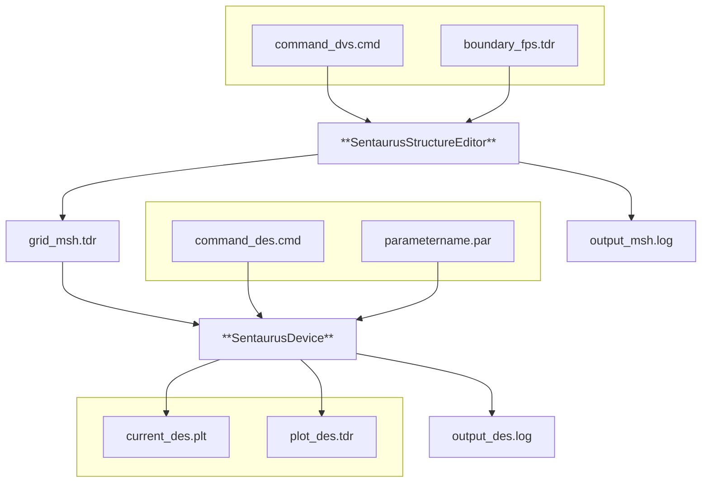
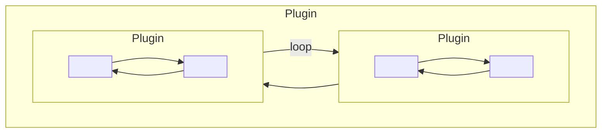
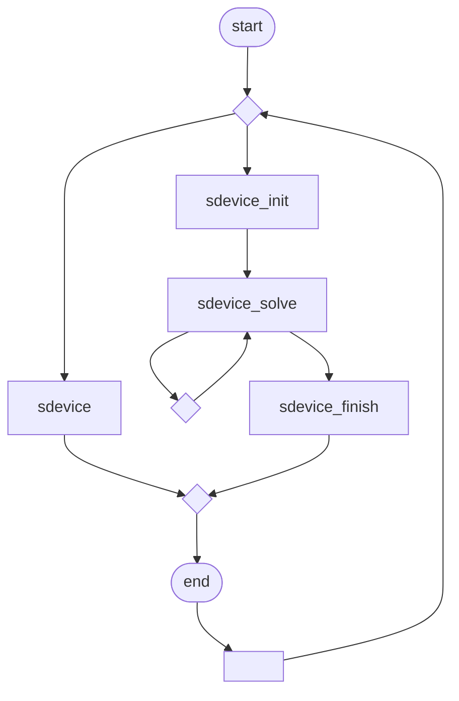
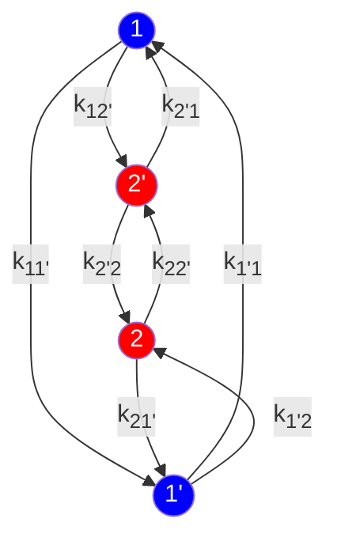
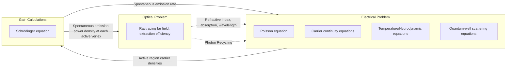
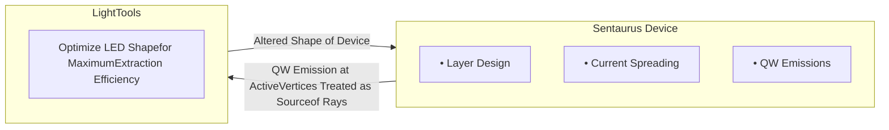
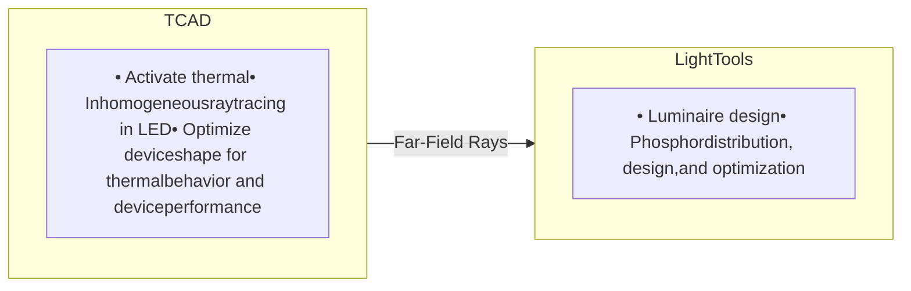
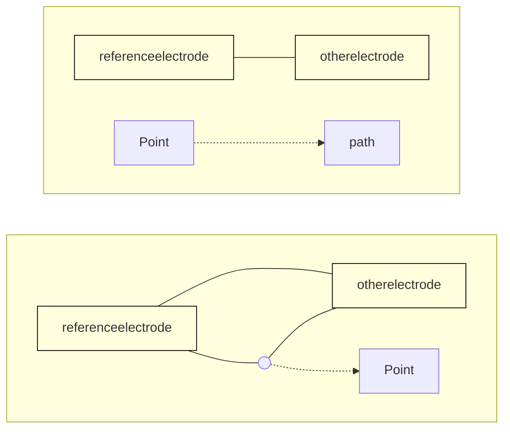
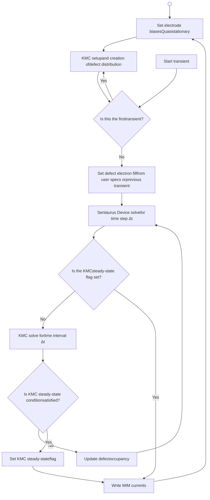

# Sentaurus™ Device User Guide

Version S-2021.06, June 2021

**SYNOPSYS<sup>®</sup>**

# Copyright and Proprietary Information Notice

© 2021 Synopsys, Inc. This Synopsys software and all associated documentation are proprietary to Synopsys, Inc. and may only be used pursuant to the terms and conditions of a written license agreement with Synopsys, Inc. All other use, reproduction, modification, or distribution of the Synopsys software or the associated documentation is strictly prohibited.

## Destination Control Statement

All technical data contained in this publication is subject to the export control laws of the United States of America. Disclosure to nationals of other countries contrary to United States law is prohibited. It is the reader’s responsibility to determine the applicable regulations and to comply with them.

## Disclaimer

SYNOPSYS, INC., AND ITS LICENSORS MAKE NO WARRANTY OF ANY KIND, EXPRESS OR IMPLIED, WITH REGARD TO THIS MATERIAL, INCLUDING, BUT NOT LIMITED TO, THE IMPLIED WARRANTIES OF MERCHANTABILITY AND FITNESS FOR A PARTICULAR PURPOSE.

## Trademarks

Synopsys and certain Synopsys product names are trademarks of Synopsys, as set forth at [https://www.synopsys.com/company/legal/trademarks-brands.html](https://www.synopsys.com/company/legal/trademarks-brands.html).

All other product or company names may be trademarks of their respective owners.

## Free and Open-Source Licensing Notices

If applicable, Free and Open-Source Software (FOSS) licensing notices are available in the product installation.

## Third-Party Links

Any links to third-party websites included in this document are for your convenience only. Synopsys does not endorse and is not responsible for such websites and their practices, including privacy practices, availability, and content.

www.synopsys.com

<page_number>ii</page_number> 

 Sentaurus™ Device User Guide

 S-2021.06

# Contents

**About This Guide** **xliii**
*   Conventions xliii
*   Customer Support xliv
    *   Accessing SolvNetPlus xliv
    *   Contacting Synopsys Support xliv
    *   Contacting Your Local TCAD Support Team Directly xlv
*   Acknowledgments xlv

**Part I Getting Started** **1**

**Chapter 1 Introduction to Sentaurus Device** **3**
*   Functionality of Sentaurus Device 3
    *   Creating and Meshing Device Structures 5
    *   Tool Flow 5
*   Starting Sentaurus Device 6
    *   From the Command Line 6
    *   From Sentaurus Workbench 7
*   TCAD Sentaurus Tutorial: Simulation Projects 8

**Chapter 2 Specifying Physical Devices** **9**
*   Reading a Structure 9
    *   Cylindrical Coordinate System 10
    *   Abrupt and Graded Heterojunctions 11
*   Specifying Doping Species 12
*   Specifying Materials 14
    *   User-Defined Materials 14
    *   Mole-Fraction Materials 15
*   Mole-Fraction Specification 17
*   Physical Models and the Hierarchy of Their Specification 18
    *   Region-Specific and Material-Specific Models 19
    *   Interface-Specific Models 20
    *   Electrode-Specific Models 21
*   Physical Model Parameters 22
    *   Search Strategy for Parameter Files 23
    *   Parameters for Composition-Dependent Materials 24
    *   Ternary Semiconductor Composition 26

Sentaurus™ Device User Guide

S-2021.06

<page_number>iii</page_number>

# Contents

Quaternary Semiconductor Composition . . . . . . . . . . . . . . . . . . . . . . . . . . . . . . . . 28
Default Model Parameters for Compound Semiconductors. . . . . . . . . . . . . . . . . . 29
Combining Parameter Specifications. . . . . . . . . . . . . . . . . . . . . . . . . . . . . . . . . . . . . . 30
Materialwise Parameters. . . . . . . . . . . . . . . . . . . . . . . . . . . . . . . . . . . . . . . . . . . . . 30
Regionwise Parameters. . . . . . . . . . . . . . . . . . . . . . . . . . . . . . . . . . . . . . . . . . . . . . 31
Material Interface–Wise Parameters . . . . . . . . . . . . . . . . . . . . . . . . . . . . . . . . . . . 32
Region Interface–Wise Parameters . . . . . . . . . . . . . . . . . . . . . . . . . . . . . . . . . . . . 32
Electrode-Wise Parameters. . . . . . . . . . . . . . . . . . . . . . . . . . . . . . . . . . . . . . . . . . . 32
Generating a Copy of Parameter File . . . . . . . . . . . . . . . . . . . . . . . . . . . . . . . . . . . . . 32
Undefined Physical Models . . . . . . . . . . . . . . . . . . . . . . . . . . . . . . . . . . . . . . . . . . . . . 34
Default Parameters. . . . . . . . . . . . . . . . . . . . . . . . . . . . . . . . . . . . . . . . . . . . . . . . . . . . 35
Named Parameter Sets . . . . . . . . . . . . . . . . . . . . . . . . . . . . . . . . . . . . . . . . . . . . . . . . . 36
Auto-Orientation Framework . . . . . . . . . . . . . . . . . . . . . . . . . . . . . . . . . . . . . . . . . . . 38
Changing Orientations Used With Auto-Orientation . . . . . . . . . . . . . . . . . . . . . . . 38
Auto-Orientation Smoothing . . . . . . . . . . . . . . . . . . . . . . . . . . . . . . . . . . . . . . . . . 39
References. . . . . . . . . . . . . . . . . . . . . . . . . . . . . . . . . . . . . . . . . . . . . . . . . . . . . . . . . . . . . 40

## Chapter 3 Mixed-Mode Simulations **41**

Overview of Mixed-Mode Simulations . . . . . . . . . . . . . . . . . . . . . . . . . . . . . . . . . . . . . . 41
Compact Models . . . . . . . . . . . . . . . . . . . . . . . . . . . . . . . . . . . . . . . . . . . . . . . . . . . . . . . . 42
Hierarchical Description of Compact Models . . . . . . . . . . . . . . . . . . . . . . . . . . . . . . . 42
User-Defined Compact Models . . . . . . . . . . . . . . . . . . . . . . . . . . . . . . . . . . . . . . . . . . 45
HSPICE Netlist Files . . . . . . . . . . . . . . . . . . . . . . . . . . . . . . . . . . . . . . . . . . . . . . . . . . . . 45
Structure of Netlist Files . . . . . . . . . . . . . . . . . . . . . . . . . . . . . . . . . . . . . . . . . . . . . . . 45
Comments. . . . . . . . . . . . . . . . . . . . . . . . . . . . . . . . . . . . . . . . . . . . . . . . . . . . . . . . 46
Continuation Lines . . . . . . . . . . . . . . . . . . . . . . . . . . . . . . . . . . . . . . . . . . . . . . . . . 46
The .INCLUDE Statement . . . . . . . . . . . . . . . . . . . . . . . . . . . . . . . . . . . . . . . . . . . 46
Numeric Constants . . . . . . . . . . . . . . . . . . . . . . . . . . . . . . . . . . . . . . . . . . . . . . . . . 46
Parameters and Expressions . . . . . . . . . . . . . . . . . . . . . . . . . . . . . . . . . . . . . . . . . . 47
Subcircuits . . . . . . . . . . . . . . . . . . . . . . . . . . . . . . . . . . . . . . . . . . . . . . . . . . . . . . . 48
The .MODEL Statement. . . . . . . . . . . . . . . . . . . . . . . . . . . . . . . . . . . . . . . . . . . . . 48
Elements . . . . . . . . . . . . . . . . . . . . . . . . . . . . . . . . . . . . . . . . . . . . . . . . . . . . . . . . . 49
Netlist Commands . . . . . . . . . . . . . . . . . . . . . . . . . . . . . . . . . . . . . . . . . . . . . . . . . 50
Specifying Physical Devices in Netlists . . . . . . . . . . . . . . . . . . . . . . . . . . . . . . . . . . . 50
SPICE Circuit Files. . . . . . . . . . . . . . . . . . . . . . . . . . . . . . . . . . . . . . . . . . . . . . . . . . . . . . 51
Example . . . . . . . . . . . . . . . . . . . . . . . . . . . . . . . . . . . . . . . . . . . . . . . . . . . . . . . . . . . . 52
Command File for Mixed-Mode Simulations. . . . . . . . . . . . . . . . . . . . . . . . . . . . . . . . . . 53
System Section. . . . . . . . . . . . . . . . . . . . . . . . . . . . . . . . . . . . . . . . . . . . . . . . . . . . . . . 54
Physical Devices. . . . . . . . . . . . . . . . . . . . . . . . . . . . . . . . . . . . . . . . . . . . . . . . . . . 55
Circuit Devices . . . . . . . . . . . . . . . . . . . . . . . . . . . . . . . . . . . . . . . . . . . . . . . . . . . . 56
Electrical and Thermal Netlists . . . . . . . . . . . . . . . . . . . . . . . . . . . . . . . . . . . . . . . 56

<page_number>iv</page_number>

Sentaurus™ Device User Guide
S-2021.06

# Contents

Initializing Nodes ................................................................................................................. 58
Plotting Quantities ............................................................................................................... 59
Modifying Plot Output ................................................................................................... 60
Device Section ...................................................................................................................... 60
File Section .......................................................................................................................... 61
Math Section ........................................................................................................................ 62
Working With Mixed-Mode Simulations ................................................................................... 62
From Single-Device to Multidevice Command Files .......................................................... 62
File-Naming Conventions for Mixed Mode ........................................................................ 64

**Chapter 4 Performing Numeric Experiments** **67**
Specifying Electrical Boundary Conditions ............................................................................... 67
Changing Boundary Condition Type During Simulation ..................................................... 68
Mixed-Mode Electrical Boundary Conditions .................................................................... 69
Specifying Thermal Boundary Conditions ................................................................................. 70
Break Criteria: Conditionally Stopping the Simulation .............................................................. 71
Global Contact Break Criteria .......................................................................................... 72
Global Device Break Criteria ........................................................................................... 72
Sweep-Specific Break Criteria .......................................................................................... 73
Mixed-Mode Break Criteria ............................................................................................. 74
Quasistationary Ramps .......................................................................................................... 74
Ramping Boundary Conditions ........................................................................................ 75
Ramping Quasi-Fermi Potentials in Doping Wells ............................................................. 76
Ramping Physical Parameter Values ................................................................................. 79
Quasistationary in Mixed Mode ....................................................................................... 80
Saving and Plotting During a Quasistationary ................................................................... 82
Extrapolation ................................................................................................................... 82
Inside a Quasistationary Command ............................................................................ 83
Between Quasistationary Commands .......................................................................... 83
Parameters of the Extrapolate Statement .................................................................... 84
Continuation Command ......................................................................................................... 87
Continuation Control Parameters ...................................................................................... 87
Continuation in Mixed Mode ............................................................................................ 89
Transient Command .............................................................................................................. 90
Numeric Control of Transient Analysis ............................................................................. 91
Time-Stepping ................................................................................................................. 92
Ramping Physical Parameter Values ................................................................................. 94
Extrapolation ................................................................................................................... 95
Inside a Transient Command ...................................................................................... 95
Between Quasistationary Commands .......................................................................... 95
Transient Ramps .................................................................................................................... 96

Sentaurus™ Device User Guide
S-2021.06

<page_number>v</page_number>

# Contents

Large-Signal Cyclic Analysis . . . . . . . . . . . . . . . . . . . . . . . . . . . . . . . . . . . . . . . . . . . . . . 97
    Description of Method . . . . . . . . . . . . . . . . . . . . . . . . . . . . . . . . . . . . . . . . . . . . . . . . . 98
    Using Cyclic Analysis . . . . . . . . . . . . . . . . . . . . . . . . . . . . . . . . . . . . . . . . . . . . . . . . 100
Small-Signal AC Analysis . . . . . . . . . . . . . . . . . . . . . . . . . . . . . . . . . . . . . . . . . . . . . . . 101
    AC Analysis in Mixed-Mode Simulations. . . . . . . . . . . . . . . . . . . . . . . . . . . . . . . . . 101
        Example . . . . . . . . . . . . . . . . . . . . . . . . . . . . . . . . . . . . . . . . . . . . . . . . . . . . . . . . 103
    AC Analysis in Single-Device Mode. . . . . . . . . . . . . . . . . . . . . . . . . . . . . . . . . . . . . 104
    Optical AC Analysis . . . . . . . . . . . . . . . . . . . . . . . . . . . . . . . . . . . . . . . . . . . . . . . . . 105
Harmonic Balance. . . . . . . . . . . . . . . . . . . . . . . . . . . . . . . . . . . . . . . . . . . . . . . . . . . . . . 106
    Modes of Harmonic Balance Analysis . . . . . . . . . . . . . . . . . . . . . . . . . . . . . . . . . . . 106
        MDFT Mode. . . . . . . . . . . . . . . . . . . . . . . . . . . . . . . . . . . . . . . . . . . . . . . . . . . . . 107
        SDFT Mode . . . . . . . . . . . . . . . . . . . . . . . . . . . . . . . . . . . . . . . . . . . . . . . . . . . . . 107
    Performing Harmonic Balance Analysis . . . . . . . . . . . . . . . . . . . . . . . . . . . . . . . . . . 107
        Solve Spectrum. . . . . . . . . . . . . . . . . . . . . . . . . . . . . . . . . . . . . . . . . . . . . . . . . . . 108
        Convergence Parameters . . . . . . . . . . . . . . . . . . . . . . . . . . . . . . . . . . . . . . . . . . . 109
    Harmonic Balance Analysis Output . . . . . . . . . . . . . . . . . . . . . . . . . . . . . . . . . . . . . 110
        Circuit Currents and Voltages . . . . . . . . . . . . . . . . . . . . . . . . . . . . . . . . . . . . . . . 110
        Solution Variables . . . . . . . . . . . . . . . . . . . . . . . . . . . . . . . . . . . . . . . . . . . . . . . . 111
        Output of Individual HBCoupled Statements. . . . . . . . . . . . . . . . . . . . . . . . . . . . 111
    Application Notes . . . . . . . . . . . . . . . . . . . . . . . . . . . . . . . . . . . . . . . . . . . . . . . . . . . 112
References. . . . . . . . . . . . . . . . . . . . . . . . . . . . . . . . . . . . . . . . . . . . . . . . . . . . . . . . . . . . 112

---

**Chapter 5 Simulation Results** **113**
    Current File . . . . . . . . . . . . . . . . . . . . . . . . . . . . . . . . . . . . . . . . . . . . . . . . . . . . . . . . . . . 113
        When to Write to the Current File . . . . . . . . . . . . . . . . . . . . . . . . . . . . . . . . . . . . . . . 113
            Example: CurrentPlot Statements. . . . . . . . . . . . . . . . . . . . . . . . . . . . . . . . . . . . . 115
        NewCurrentPrefix Statement. . . . . . . . . . . . . . . . . . . . . . . . . . . . . . . . . . . . . . . . . . . 116
        Tracking Additional Data in the Current File . . . . . . . . . . . . . . . . . . . . . . . . . . . . . . 116
        CurrentPlot Section . . . . . . . . . . . . . . . . . . . . . . . . . . . . . . . . . . . . . . . . . . . . . . . 117
            Example: Mixed Mode . . . . . . . . . . . . . . . . . . . . . . . . . . . . . . . . . . . . . . . . . . . . . 119
            Example: Advanced Options . . . . . . . . . . . . . . . .; . . . . . . . . . . . . . . . . . . . . . . . 119
            Example: Plotting Parameter Values . . . . . . . . . . . . . . . . . . . . . . . . . . . . . . . . . . 120
        CurrentPlot Options . . . . . . . . . . . . . . . . . . . . . . . . . . . . . . . . . . . . . . . . . . . . . . . 120
    Tcl Formulas . . . . . . . . . . . . . . . . . . . . . . . . . . . . . . . . . . . . . . . . . . . . . . . . . . . . . . . 121
        Dataset Option . . . . . . . . . . . . . . . . . . . . . . . . . . . . . . . . . . . . . . . . . . . . . . . . . . . 122
        Function Option . . . . . . . . . . . . . . . . . . . . . . . . . . . . . . . . . . . . . . . . . . . . . . . . . . 123
        Unit Option. . . . . . . . . . . . . . . . . . . . . . . . . . . . . . . . . . . . . . . . . . . . . . . . . . . . . . 123
        Init Option. . . . . . . . . . . . . . . . . . . . . . . . . . . . . . . . . . . . . . . . . . . . . . . . . . . . . . . 123
        Formula Option. . . . . . . . . . . . . . . . . . . . . . . . . . . . . . . . . . . . . . . . . . . . . . . . . . . 123
        Finish Option . . . . . . . . . . . . . . . . . . . . . . . . . . . . . . . . . . . . . . . . . . . . . . . . . . . . 124
        Operation Option . . . . . . . . . . . . . . . . . . . . . . . . . . . . . . . . . . . . . . . . . . . . . . . . . 124

<page_number>vi</page_number>

Sentaurus™ Device User Guide
S-2021.06

# Contents

Examples . . . . . . . . . . . . . . . . . . . . . . . . . . . . . . . . . . . . . . . . . . . . . . . . . . . . . . . 126
Device Plots . . . . . . . . . . . . . . . . . . . . . . . . . . . . . . . . . . . . . . . . . . . . . . . . . . . . . . . . . . 128
*   What to Plot . . . . . . . . . . . . . . . . . . . . . . . . . . . . . . . . . . . . . . . . . . . . . . . . . . . . . . . . 128
*   When to Plot . . . . . . . . . . . . . . . . . . . . . . . . . . . . . . . . . . . . . . . . . . . . . . . . . . . . . . . 129
*   Snapshots . . . . . . . . . . . . . . . . . . . . . . . . . . . . . . . . . . . . . . . . . . . . . . . . . . . . . . . . . . 130
*   Interface Plots . . . . . . . . . . . . . . . . . . . . . . . . . . . . . . . . . . . . . . . . . . . . . . . . . . . . . . 131
*   Log File . . . . . . . . . . . . . . . . . . . . . . . . . . . . . . . . . . . . . . . . . . . . . . . . . . . . . . . . . . . 132
Extraction File. . . . . . . . . . . . . . . . . . . . . . . . . . . . . . . . . . . . . . . . . . . . . . . . . . . . . . . . . 132
*   Extraction File Format . . . . . . . . . . . . . . . . . . . . . . . . . . . . . . . . . . . . . . . . . . . . . . . . 132
*   Analysis Modes . . . . . . . . . . . . . . . . . . . . . . . . . . . . . . . . . . . . . . . . . . . . . . . . . . . . . 134
*   File Section . . . . . . . . . . . . . . . . . . . . . . . . . . . . . . . . . . . . . . . . . . . . . . . . . . . . . . . . 135
*   Electrode Section . . . . . . . . . . . . . . . . . . . . . . . . . . . . . . . . . . . . . . . . . . . . . . . . . . . . 135
*   Extraction Section . . . . . . . . . . . . . . . . . . . . . . . . . . . . . . . . . . . . . . . . . . . . . . . . . . . 135
*   Solve Section . . . . . . . . . . . . . . . . . . . . . . . . . . . . . . . . . . . . . . . . . . . . . . . . . . . . . . . 136

**Chapter 6 Numeric and Software-Related Issues** **139**
*   Structure of Command File. . . . . . . . . . . . . . . . . . . . . . . . . . . . . . . . . . . . . . . . . . . . . . . 139
    *   Inserting Files . . . . . . . . . . . . . . . . . . . . . . . . . . . . . . . . . . . . . . . . . . . . . . . . . . . . . . 139
*   Solve Section: How the Simulation Proceeds. . . . . . . . . . . . . . . . . . . . . . . . . . . . . . . . . 140
*   Nonlinear Iterations. . . . . . . . . . . . . . . . . . . . . . . . . . . . . . . . . . . . . . . . . . . . . . . . . . . . . 141
    *   Coupled Statement. . . . . . . . . . . . . . . . . . . . . . . . . . . . . . . . . . . . . . . . . . . . . . . . . . . 141
        *   Convergence and Error Control . . . . . . . . . . . . . . . . . . . . . . . . . . . . . . . . . . . . . . 143
        *   Damped Newton Iterations. . . . . . . . . . . . . . . . . . . . . . . . . . . . . . . . . . . . . . . . . . 145
        *   Derivatives . . . . . . . . . . . . . . . . . . . . . . . . . . . . . . . . . . . . . . . . . . . . . . . . . . . . . . 146
        *   Incomplete Newton Algorithm. . . . . . . . . . . . . . . . . . . . . . . . . . . . . . . . . . . . . . . 146
        *   Additional Equations Available in Mixed Mode . . . . . . . . . . . . . . . . . . . . . . . . . . 147
        *   Selecting Individual Devices in Mixed Mode . . . . . . . . . . . . . . . . . . . . . . . . . . . . 148
        *   Relaxed Newton Method . . . . . . . . . . . . . . . . . . . . . . . . . . . . . . . . . . . . . . . . . . . 149
    *   Plugin Command . . . . . . . . . . . . . . . . . . . . . . . . . . . . . . . . . . . . . . . . . . . . . . . . . . . . 151
*   Linear Solvers . . . . . . . . . . . . . . . . . . . . . . . . . . . . . . . . . . . . . . . . . . . . . . . . . . . . . . . . . 151
*   Nonlocal Meshes. . . . . . . . . . . . . . . . . . . . . . . . . . . . . . . . . . . . . . . . . . . . . . . . . . . . . . . 152
    *   Specifying Nonlocal Meshes . . . . . . . . . . . . . . . . . . . . . . . . . . . . . . . . . . . . . . . . . . . 153
    *   Visualizing Nonlocal Meshes . . . . . . . . . . . . . . . . . . . . . . . . . . . . . . . . . . . . . . . . . . 154
    *   Visualizing Data Defined on Nonlocal Meshes. . . . . . . . . . . . . . . . . . . . . . . . . . . . . 154
    *   Constructing Nonlocal Meshes . . . . . . . . . . . . . . . . . . . . . . . . . . . . . . . . . . . . . . . . . 155
        *   Specification Using Barrier . . . . . . . . . . . . . . . . . . . . . . . . . . . . . . . . . . . . . . . . . 155
        *   Specification Using a Reference Surface . . . . . . . . . . . . . . . . . . . . . . . . . . . . . . . 156
    *   Special Handling of the 1D Schrödinger Equation . . . . . . . . . . . . . . . . . . . . . . . . . . 157
    *   Special Handling of the Nonlocal Tunneling Model . . . . . . . . . . . . . . . . . . . . . . . . . 158
    *   Unnamed Meshes. . . . . . . . . . . . . . . . . . . . . . . . . . . . . . . . . . . . . . . . . . . . . . . . . . . . 158
    *   Performance Suggestions. . . . . . . . . . . . . . . . . . . . . . . . . . . . . . . . . . . . . . . . . . . . . . 159

Sentaurus™ Device User Guide
S-2021.06

<page_number>vii</page_number>

# Contents

Monitoring Convergence Behavior ................................................................................................. 159
- CNormPrint ................................................................................................................................. 160
- NewtonPlot ................................................................................................................................. 160
- Automatic Activation of CNormPrint and NewtonPlot ............................................................... 161
- Simulation Statistics for Plotting and Output ............................................................................. 162
  - Simulation Statistics in Current Plot Files ............................................................................. 162
  - Simulation Statistics in Design-of-Experiments Variables ................................................... 163
Save and Load Statements ................................................................................................................. 163
Tcl Command File ............................................................................................................................. 165
- Performing Device Simulations ................................................................................................... 165
- sdevice Command ....................................................................................................................... 168
- sdevice_init Command ................................................................................................................ 168
- sdevice_solve Command ............................................................................................................. 169
- sdevice_finish Command ............................................................................................................. 169
- sdevice_parameters Command ................................................................................................... 169
- Extracting Parameters ................................................................................................................. 169
  - Available Inspect Tcl Commands .......................................................................................... 170
- Redirecting Output ...................................................................................................................... 171
- Known Restrictions ..................................................................................................................... 171
Parallelization .................................................................................................................................... 172
Extended Precision ............................................................................................................................ 174
System Command .............................................................................................................................. 176
References .......................................................................................................................................... 176

# Part II Physics in Sentaurus Device 177

## Chapter 7 Poisson Equation and Quasi-Fermi Potentials 179
Electrostatic Potential ........................................................................................................................ 179
- Dipole Layer ............................................................................................................................... 180
- Equilibrium Solution ................................................................................................................... 181
Quasi-Fermi Potential With Boltzmann Statistics ............................................................................. 181
Fermi Statistics .................................................................................................................................. 182
- Using Fermi Statistics ................................................................................................................. 183
Initial Guess for Electrostatic Potential and Quasi-Fermi Potentials in Doping Wells ..................... 184
- Regionwise Specification of Initial Quasi-Fermi Potentials ....................................................... 185
Alternative Initial Guess for Quasi-Fermi Potentials From Linear Conduction Equation .......................................................................................................................................... 185
Electrode Charge Calculation ............................................................................................................ 187

<page_number>viii</page_number>

Sentaurus™ Device User Guide
S-2021.06

Contents

**Chapter 8 Carrier Transport Equations in Semiconductors** **189**
Introduction to Carrier Transport Models . . . . . . . . . . . . . . . . . . . . . . . . . . . . . . . . . . . . . . . . . . . . . . . . . . . . . . . 189
Drift-Diffusion Model . . . . . . . . . . . . . . . . . . . . . . . . . . . . . . . . . . . . . . . . . . . . . . . . . . . . . . . . . . . . . . . . . . . . . . . 190
Thermodynamic Model for Current Densities . . . . . . . . . . . . . . . . . . . . . . . . . . . . . . . . . . . . . . . . . . . . . . . . . . . 191
Hydrodynamic Model for Current Densities . . . . . . . . . . . . . . . . . . . . . . . . . . . . . . . . . . . . . . . . . . . . . . . . . . . . 192
Numeric Parameters for Continuity Equation . . . . . . . . . . . . . . . . . . . . . . . . . . . . . . . . . . . . . . . . . . . . . . . . . . . . 192
Numeric Approaches for Contact Current Computation . . . . . . . . . . . . . . . . . . . . . . . . . . . . . . . . . . . . . . . . . . . 193
Current Potential . . . . . . . . . . . . . . . . . . . . . . . . . . . . . . . . . . . . . . . . . . . . . . . . . . . . . . . . . . . . . . . . . . . . . . . . . . . 193
References . . . . . . . . . . . . . . . . . . . . . . . . . . . . . . . . . . . . . . . . . . . . . . . . . . . . . . . . . . . . . . . . . . . . . . . . . . . . . . . . 195

**Chapter 9 Lattice and Carrier Temperature Equations** **197**
Introduction to Temperature Equations . . . . . . . . . . . . . . . . . . . . . . . . . . . . . . . . . . . . . . . . . . . . . . . . . . . . . . . . 197
Uniform Self-Heating . . . . . . . . . . . . . . . . . . . . . . . . . . . . . . . . . . . . . . . . . . . . . . . . . . . . . . . . . . . . . . . . . . . . . . . 198
Using Uniform Self-Heating . . . . . . . . . . . . . . . . . . . . . . . . . . . . . . . . . . . . . . . . . . . . . . . . . . . . . . . . . . . . . . 199
Default Model for Lattice Temperature . . . . . . . . . . . . . . . . . . . . . . . . . . . . . . . . . . . . . . . . . . . . . . . . . . . . . . . . 200
Thermodynamic Model for Lattice Temperature . . . . . . . . . . . . . . . . . . . . . . . . . . . . . . . . . . . . . . . . . . . . . . . . . 201
Total Heat and Its Contributions . . . . . . . . . . . . . . . . . . . . . . . . . . . . . . . . . . . . . . . . . . . . . . . . . . . . . . . . . . . 201
Using the Thermodynamic Model . . . . . . . . . . . . . . . . . . . . . . . . . . . . . . . . . . . . . . . . . . . . . . . . . . . . . . . . . . 202
Hydrodynamic Model for Temperatures . . . . . . . . . . . . . . . . . . . . . . . . . . . . . . . . . . . . . . . . . . . . . . . . . . . . . . . . 204
Hydrodynamic Model Parameters . . . . . . . . . . . . . . . . . . . . . . . . . . . . . . . . . . . . . . . . . . . . . . . . . . . . . . . . . . 207
Using the Hydrodynamic Model . . . . . . . . . . . . . . . . . . . . . . . . . . . . . . . . . . . . . . . . . . . . . . . . . . . . . . . . . . . 207
Numeric Parameters for Temperature Equations . . . . . . . . . . . . . . . . . . . . . . . . . . . . . . . . . . . . . . . . . . . . . . . . . 208
Validity Ranges for Lattice and Carrier Temperatures . . . . . . . . . . . . . . . . . . . . . . . . . . . . . . . . . . . . . . . . . . 208
Scaling of Lattice Heat Generation . . . . . . . . . . . . . . . . . . . . . . . . . . . . . . . . . . . . . . . . . . . . . . . . . . . . . . . . . 208
References . . . . . . . . . . . . . . . . . . . . . . . . . . . . . . . . . . . . . . . . . . . . . . . . . . . . . . . . . . . . . . . . . . . . . . . . . . . . . . . . 209

**Chapter 10 Boundary Conditions** **211**
Electrical Boundary Conditions . . . . . . . . . . . . . . . . . . . . . . . . . . . . . . . . . . . . . . . . . . . . . . . . . . . . . . . . . . . . . . 211
Ohmic Contacts . . . . . . . . . . . . . . . . . . . . . . . . . . . . . . . . . . . . . . . . . . . . . . . . . . . . . . . . . . . . . . . . . . . . . . . . 211
Modified Ohmic Contacts . . . . . . . . . . . . . . . . . . . . . . . . . . . . . . . . . . . . . . . . . . . . . . . . . . . . . . . . . . . . . . . . 212
Contacts on Insulators . . . . . . . . . . . . . . . . . . . . . . . . . . . . . . . . . . . . . . . . . . . . . . . . . . . . . . . . . . . . . . . . . . . 213
Schottky Contacts . . . . . . . . . . . . . . . . . . . . . . . . . . . . . . . . . . . . . . . . . . . . . . . . . . . . . . . . . . . . . . . . . . . . . . 214
Fermi-Level Pinning at Schottky Contacts . . . . . . . . . . . . . . . . . . . . . . . . . . . . . . . . . . . . . . . . . . . . . . . . 215
Barrier Lowering at Schottky Contacts . . . . . . . . . . . . . . . . . . . . . . . . . . . . . . . . . . . . . . . . . . . . . . . . . . 218
Resistive Contacts . . . . . . . . . . . . . . . . . . . . . . . . . . . . . . . . . . . . . . . . . . . . . . . . . . . . . . . . . . . . . . . . . . . . . . 223
Resistive Interfaces . . . . . . . . . . . . . . . . . . . . . . . . . . . . . . . . . . . . . . . . . . . . . . . . . . . . . . . . . . . . . . . . . . . . . 229
Boundaries Without Contacts . . . . . . . . . . . . . . . . . . . . . . . . . . . . . . . . . . . . . . . . . . . . . . . . . . . . . . . . . . . . . 231
Application Notes . . . . . . . . . . . . . . . . . . . . . . . . . . . . . . . . . . . . . . . . . . . . . . . . . . . . . . . . . . . . . . . . . . . . . . 232
Floating Contacts . . . . . . . . . . . . . . . . . . . . . . . . . . . . . . . . . . . . . . . . . . . . . . . . . . . . . . . . . . . . . . . . . . . . . . . . . . 232

Sentaurus™ Device User Guide
S-2021.06
<page_number>ix</page_number>

# Contents

Floating Metal Contacts.................................................................................................................................... 232
Floating Semiconductor Contacts .................................................................................................................... 234
Thermal Boundary Conditions .......................................................................................................................... 235
Boundary Conditions for Lattice Temperature ............................................................................................ 235
Boundary Conditions for Carrier Temperatures .......................................................................................... 237
Periodic Boundary Conditions .......................................................................................................................... 237
Robin PBC Approach ................................................................................................................................... 238
Mortar PBC Approach.................................................................................................................................. 238
Specifying Periodic Boundary Conditions .................................................................................................. 239
Specifying Robin Periodic Boundary Conditions ................................................................................... 239
Specifying Mortar Periodic Boundary Conditions.................................................................................. 240
Application Notes ........................................................................................................................................ 240
Specialized Linear Solver for MPBC....................................................................................................... 240
Discontinuous Interfaces.................................................................................................................................... 241
Representation of Physical Quantities Across Interfaces ............................................................................ 241
Interface Conditions at Discontinuous Interfaces ........................................................................................ 242
Critical Points .............................................................................................................................................. 242
References.......................................................................................................................................................... 242

---

**Chapter 11 Transport Equations in Metals, Organic Materials, and Disordered Media** **245**
Singlet Exciton Equation ................................................................................................................................... 245
Boundary and Continuity Conditions for Singlet Exciton Equation ............................................................ 246
Using the Singlet Exciton Equation............................................................................................................. 247
Transport in Metals............................................................................................................................................ 249
Electric Boundary Conditions for Metals .................................................................................................... 250
Metal Workfunction ..................................................................................................................................... 252
Metal Workfunction Randomization ....................................................................................................... 253
Temperature in Metals.................................................................................................................................. 254
Conductive Insulators ........................................................................................................................................ 254

---

**Chapter 12 Semiconductor Band Structure** **259**
Intrinsic Density ................................................................................................................................................ 259
Band Gap and Electron Affinity ....................................................................................................................... 259
Selecting the Bandgap Model ...................................................................................................................... 260
Bandgap and Electron-Affinity Models....................................................................................................... 260
Bandgap Narrowing for Bennett–Wilson Model .................................................................................... 261
Bandgap Narrowing for Slotboom Model ............................................................................................... 262
Bandgap Narrowing for del Alamo Model.............................................................................................. 262
Bandgap Narrowing for Jain–Roulston Model........................................................................................ 262

<page_number>x</page_number>

Sentaurus™ Device User Guide
S-2021.06

# Contents

Table Specification of Bandgap Narrowing . . . . . . . . . . . . . . . . . . . . . . . . . . . . . 264
Schenk Bandgap Narrowing Model . . . . . . . . . . . . . . . . . . . . . . . . . . . . . . . . . . . 265
Bandgap Narrowing With Incomplete Ionization . . . . . . . . . . . . . . . . . . . . . . . . 269
Bandgap Narrowing With Fermi Statistics . . . . . . . . . . . . . . . . . . . . . . . . . . . . . . 270
Bandgap Parameters . . . . . . . . . . . . . . . . . . . . . . . . . . . . . . . . . . . . . . . . . . . . . . . . . 271
Effective Masses and Effective Density-of-States . . . . . . . . . . . . . . . . . . . . . . . . . . . . . 272
Electron Effective Mass and Density-of-States . . . . . . . . . . . . . . . . . . . . . . . . . . . . . 273
Formula=1 . . . . . . . . . . . . . . . . . . . . . . . . . . . . . . . . . . . . . . . . . . . . . . . . . . . . . . 273
Formula=2 . . . . . . . . . . . . . . . . . . . . . . . . . . . . . . . . . . . . . . . . . . . . . . . . . . . . . . 273
Electron Effective Mass and Conduction Band DOS Parameters . . . . . . . . . . . . . . . 274
Hole Effective Mass and Density-of-States . . . . . . . . . . . . . . . . . . . . . . . . . . . . . . . . 274
Formula=1 . . . . . . . . . . . . . . . . . . . . . . . . . . . . . . . . . . . . . . . . . . . . . . . . . . . . . . 274
Formula=2 . . . . . . . . . . . . . . . . . . . . . . . . . . . . . . . . . . . . . . . . . . . . . . . . . . . . . . 275
Hole Effective Mass and Valence Band DOS Parameters . . . . . . . . . . . . . . . . . . . . 275
Gaussian Density-of-States for Organic Semiconductors . . . . . . . . . . . . . . . . . . . . . . . . 276
Band Tails . . . . . . . . . . . . . . . . . . . . . . . . . . . . . . . . . . . . . . . . . . . . . . . . . . . . . . . . . . . . 279
Multivalley Band Structure . . . . . . . . . . . . . . . . . . . . . . . . . . . . . . . . . . . . . . . . . . . . . . . 281
Nonparabolic Band Structure . . . . . . . . . . . . . . . . . . . . . . . . . . . . . . . . . . . . . . . . . . 282
Bandgap Widening . . . . . . . . . . . . . . . . . . . . . . . . . . . . . . . . . . . . . . . . . . . . . . . . . . 283
Monte Carlo Density-of-States . . . . . . . . . . . . . . . . . . . . . . . . . . . . . . . . . . . . . . . . . 283
Non-Three-Dimensional Density-of-States . . . . . . . . . . . . . . . . . . . . . . . . . . . . . . . . 284
Using Multivalley Band Structure . . . . . . . . . . . . . . . . . . . . . . . . . . . . . . . . . . . . . . . 285
References . . . . . . . . . . . . . . . . . . . . . . . . . . . . . . . . . . . . . . . . . . . . . . . . . . . . . . . . . . . . 290

---

**Chapter 13 Incomplete Ionization** **293**
Considering Incomplete Ionization . . . . . . . . . . . . . . . . . . . . . . . . . . . . . . . . . . . . . . . . . 293
Using the Incomplete Ionization Model . . . . . . . . . . . . . . . . . . . . . . . . . . . . . . . . . . . . . 293
Incomplete Ionization Model . . . . . . . . . . . . . . . . . . . . . . . . . . . . . . . . . . . . . . . . . . . 294
Physical Model Parameters . . . . . . . . . . . . . . . . . . . . . . . . . . . . . . . . . . . . . . . . . . . . . . . 296
Multiple Lattice Sites . . . . . . . . . . . . . . . . . . . . . . . . . . . . . . . . . . . . . . . . . . . . . . . . . . . 299
References . . . . . . . . . . . . . . . . . . . . . . . . . . . . . . . . . . . . . . . . . . . . . . . . . . . . . . . . . . . . 300

---

**Chapter 14 Quantization** **303**
Modeling Quantization Effects . . . . . . . . . . . . . . . . . . . . . . . . . . . . . . . . . . . . . . . . . . . . 303
The van Dort Model . . . . . . . . . . . . . . . . . . . . . . . . . . . . . . . . . . . . . . . . . . . . . . . . . . . . 304
Using the van Dort Model . . . . . . . . . . . . . . . . . . . . . . . . . . . . . . . . . . . . . . . . . . . . . 305
1D Schrödinger Equation . . . . . . . . . . . . . . . . . . . . . . . . . . . . . . . . . . . . . . . . . . . . . . . . 305
Nonlocal Mesh for the 1D Schrödinger Equation . . . . . . . . . . . . . . . . . . . . . . . . . . . 306
Using the 1D Schrödinger Equation . . . . . . . . . . . . . . . . . . . . . . . . . . . . . . . . . . . . . 307
Parameters of the 1D Schrödinger Equation . . . . . . . . . . . . . . . . . . . . . . . . . . . . . . . 307

Sentaurus™ Device User Guide
S-2021.06

<page_number>xi</page_number>

# Contents

Explicitly Specifying Ladders . . . . . . . . . . . . . . . . . . . . . . . . . . . . . . . . . . . . . . . 308
Automatically Extracting Ladder Parameters. . . . . . . . . . . . . . . . . . . . . . . . . . . . 308
Visualizing the Solutions . . . . . . . . . . . . . . . . . . . . . . . . . . . . . . . . . . . . . . . . . . . . . . 310
1D Schrödinger Equation. . . . . . . . . . . . . . . . . . . . . . . . . . . . . . . . . . . . . . . . . . . . . . 310
Notes on the Use of the 1D Schrödinger Equation . . . . . . . . . . . . . . . . . . . . . . . . . . 311
External 2D Schrödinger Solver . . . . . . . . . . . . . . . . . . . . . . . . . . . . . . . . . . . . . . . . . . . 312
Notes on the Use of External 2D Schrödinger Solvers . . . . . . . . . . . . . . . . . . . . . . . 314
External Boltzmann Solver . . . . . . . . . . . . . . . . . . . . . . . . . . . . . . . . . . . . . . . . . . . . . . . 314
Density Gradient Model . . . . . . . . . . . . . . . . . . . . . . . . . . . . . . . . . . . . . . . . . . . . . . . . . 316
Using the Density Gradient Model . . . . . . . . . . . . . . . . . . . . . . . . . . . . . . . . . . . . . . 318
Named Parameter Sets for the Density Gradient Model . . . . . . . . . . . . . . . . . . . 321
Auto-Orientation for the Density Gradient Model . . . . . . . . . . . . . . . . . . . . . . . . 322
Notes on the Use of the Density Gradient Model . . . . . . . . . . . . . . . . . . . . . . . . . . . 322
Modified Local-Density Approximation Model . . . . . . . . . . . . . . . . . . . . . . . . . . . . . . . 324
Interface Orientation and Stress Dependencies . . . . . . . . . . . . . . . . . . . . . . . . . . . . . 325
Heterojunctions . . . . . . . . . . . . . . . . . . . . . . . . . . . . . . . . . . . . . . . . . . . . . . . . . . . . . 326
Nonparabolic Bands and Geometric Quantization . . . . . . . . . . . . . . . . . . . . . . . . . . 327
Using the MLDA Model . . . . . . . . . . . . . . . . . . . . . . . . . . . . . . . . . . . . . . . . . . . . . . 328
Notes on the Use of the MLDA Model . . . . . . . . . . . . . . . . . . . . . . . . . . . . . . . . . . . 332
Quantum-Well Quantization Model . . . . . . . . . . . . . . . . . . . . . . . . . . . . . . . . . . . . . . . . 332
Extracting Layer Thickness . . . . . . . . . . . . . . . . . . . . . . . . . . . . . . . . . . . . . . . . . . . . . . 333
Combining the LayerThickness Command and ThinLayer Subcommand . . . . . . . . 334
Geometric Parameters of the LayerThickness Command . . . . . . . . . . . . . . . . . . . . . 335
Thickness Extraction . . . . . . . . . . . . . . . . . . . . . . . . . . . . . . . . . . . . . . . . . . . . . . 336
References. . . . . . . . . . . . . . . . . . . . . . . . . . . . . . . . . . . . . . . . . . . . . . . . . . . . . . . . . . . . 338

---

# Chapter 15 Mobility 341
Introduction to Mobility Models. . . . . . . . . . . . . . . . . . . . . . . . . . . . . . . . . . . . . . . . . . . 341
Combining Mobility Models . . . . . . . . . . . . . . . . . . . . . . . . . . . . . . . . . . . . . . . . . . . 341
Mobility due to Phonon Scattering . . . . . . . . . . . . . . . . . . . . . . . . . . . . . . . . . . . . . . . . . 342
Doping-Dependent Mobility Degradation . . . . . . . . . . . . . . . . . . . . . . . . . . . . . . . . . . . 342
Using Doping-Dependent Mobility . . . . . . . . . . . . . . . . . . . . . . . . . . . . . . . . . . . . . . 343
Using More Than One Doping-Dependent Mobility Model . . . . . . . . . . . . . . . . 344
Masetti Model . . . . . . . . . . . . . . . . . . . . . . . . . . . . . . . . . . . . . . . . . . . . . . . . . . . . . . 344
Arora Model. . . . . . . . . . . . . . . . . . . . . . . . . . . . . . . . . . . . . . . . . . . . . . . . . . . . . . . . 345
University of Bologna Bulk Mobility Model . . . . . . . . . . . . . . . . . . . . . . . . . . . . . . 346
The pmi_msc_mobility Model. . . . . . . . . . . . . . . . . . . . . . . . . . . . . . . . . . . . . . . . . . 348
PMIs for Bulk Mobility . . . . . . . . . . . . . . . . . . . . . . . . . . . . . . . . . . . . . . . . . . . . . . . 349
Low-Field Ballistic Mobility Models . . . . . . . . . . . . . . . . . . . . . . . . . . . . . . . . . . . . 349
Simple Channel Length–Dependent Ballistic Mobility Model . . . . . . . . . . . . . . 349
Injection Velocity–Dependent Ballistic Mobility Model . . . . . . . . . . . . . . . . . . . 350

<page_number>xii</page_number>

Sentaurus™ Device User Guide
S-2021.06

# Contents

Carrier–Carrier Scattering . . . . . . . . . . . . . . . . . . . . . . . . . . . . . . . . . . . . . . . . . . . . . . . 351
    Using Carrier–Carrier Scattering . . . . . . . . . . . . . . . . . . . . . . . . . . . . . . . . . . . . . . . . 351
    Conwell–Weisskopf Model . . . . . . . . . . . . . . . . . . . . . . . . . . . . . . . . . . . . . . . . . . . . 352
    Brooks–Herring Model . . . . . . . . . . . . . . . . . . . . . . . . . . . . . . . . . . . . . . . . . . . . . . . 352
    Physical Model Parameters . . . . . . . . . . . . . . . . . . . . . . . . . . . . . . . . . . . . . . . . . . . . 352
Philips Unified Mobility Model . . . . . . . . . . . . . . . . . . . . . . . . . . . . . . . . . . . . . . . . . . . 353
    Using the Philips Unified Mobility Model . . . . . . . . . . . . . . . . . . . . . . . . . . . . . . . . 353
    Using an Alternative Philips Unified Mobility Model . . . . . . . . . . . . . . . . . . . . . . . 354
    Description of the Philips Unified Mobility Model. . . . . . . . . . . . . . . . . . . . . . . . . . 354
    Screening Parameter . . . . . . . . . . . . . . . . . . . . . . . . . . . . . . . . . . . . . . . . . . . . . . . . . 356
    Philips Model Parameters . . . . . . . . . . . . . . . . . . . . . . . . . . . . . . . . . . . . . . . . . . . . . 356
Mobility Degradation at Interfaces . . . . . . . . . . . . . . . . . . . . . . . . . . . . . . . . . . . . . . . . . 357
    Using Mobility Degradation at Interfaces . . . . . . . . . . . . . . . . . . . . . . . . . . . . . . . . . 357
    Enhanced Lombardi Model . . . . . . . . . . . . . . . . . . . . . . . . . . . . . . . . . . . . . . . . . . . . 359
        Stress Factors for Mobility Components . . . . . . . . . . . . . . . . . . . . . . . . . . . . . . . 361
        Named Parameter Sets for the Lombardi Model . . . . . . . . . . . . . . . . . . . . . . . . . 361
        Auto-Orientation for the Lombardi Model. . . . . . . . . . . . . . . . . . . . . . . . . . . . . . 362
    Inversion and Accumulation Layer Mobility Model . . . . . . . . . . . . . . . . . . . . . . . . . 362
        Coulomb Scattering . . . . . . . . . . . . . . . . . . . . . . . . . . . . . . . . . . . . . . . . . . . . . . . 362
        Phonon Scattering. . . . . . . . . . . . . . . . . . . . . . . . . . . . . . . . . . . . . . . . . . . . . . . . . 365
        Surface Roughness Scattering . . . . . . . . . . . . . . . . . . . . . . . . . . . . . . . . . . . . . . . 365
        Parameters . . . . . . . . . . . . . . . . . . . . . . . . . . . . . . . . . . . . . . . . . . . . . . . . . . . . . . 366
        Stress Factors for Mobility Components . . . . . . . . . . . . . . . . . . . . . . . . . . . . . . . 368
        Using the Inversion and Accumulation Layer Mobility Model . . . . . . . . . . . . . . 369
        Named Parameter Sets for the IALMob Model . . . . . . . . . . . . . . . . . . . . . . . . . . 369
        Auto-Orientation for the IALMob Model . . . . . . . . . . . . . . . . . . . . . . . . . . . . . . 370
    University of Bologna Surface Mobility Model . . . . . . . . . . . . . . . . . . . . . . . . . . . . 370
    Mobility Degradation Components due to Coulomb Scattering . . . . . . . . . . . . . . . . 372
        Stress Factors for Mobility Components . . . . . . . . . . . . . . . . . . . . . . . . . . . . . . . 374
        Using Mobility Degradation Components . . . . . . . . . . . . . . . . . . . . . . . . . . . . . . 375
    Remote Coulomb Scattering Model . . . . . . . . . . . . . . . . . . . . . . . . . . . . . . . . . . . . . 376
        Stress Factors for Mobility Components . . . . . . . . . . . . . . . . . . . . . . . . . . . . . . . 378
    Remote Phonon Scattering Model . . . . . . . . . . . . . . . . . . . . . . . . . . . . . . . . . . . . . . . 378
        Stress Factors for Mobility Components . . . . . . . . . . . . . . . . . . . . . . . . . . . . . . . 379
    Computing Transverse Field . . . . . . . . . . . . . . . . . . . . . . . . . . . . . . . . . . . . . . . . . . . 380
        Normal to the Interface. . . . . . . . . . . . . . . . . . . . . . . . . . . . . . . . . . . . . . . . . . . . . 380
        Normal to the Current Flow . . . . . . . . . . . . . . . . . . . . . . . . . . . . . . . . . . . . . . . . . 381
        Field Correction on Interface . . . . . . . . . . . . . . . . . . . . . . . . . . . . . . . . . . . . . . . . 381
Thin-Layer Mobility Model . . . . . . . . . . . . . . . . . . . . . . . . . . . . . . . . . . . . . . . . . . . . . . 381
    Using the Thin-Layer Mobility Model . . . . . . . . . . . . . . . . . . . . . . . . . . . . . . . . . . . 383
    Physical Parameters . . . . . . . . . . . . . . . . . . . . . . . . . . . . . . . . . . . . . . . . . . . . . . . 383

Sentaurus™ Device User Guide
S-2021.06

<page_number>xiii</page_number>

# Contents

Stress Factors for Mobility Components ................................................................................. 385
Auto-Orientation and Named Parameter Sets ................................................................... 386
Geometric Parameters....................................................................................................... 386
High-Field Saturation Models................................................................................................... 387
Using High-Field Saturation Models................................................................................ 387
Named Parameter Sets for the High-Field Saturation Models ................................. 388
Auto-Orientation for the High-Field Saturation Models .......................................... 388
Extended Canali Model ..................................................................................................... 388
Transferred Electron Model............................................................................................... 390
Transferred Electron Model 2 ........................................................................................... 390
Multivalley Transferred Electron Mobility ....................................................................... 392
Basic Model....................................................................................................................... 392
Meinerzhagen–Engl Model ............................................................................................... 393
Physical Model Interfaces ................................................................................................. 393
Lucent Model..................................................................................................................... 394
Velocity Saturation Models ............................................................................................... 394
Selecting Velocity Saturation Models ....................................................................... 394
Driving Force Models ....................................................................................................... 395
Electric Field Parallel to the Current ......................................................................... 395
Gradient of Quasi-Fermi Potential ............................................................................ 396
Electric Field Parallel to the Interface ....................................................................... 396
Hydrodynamic Driving Force.................................................................................... 398
Electric Field.............................................................................................................. 398
Interpolation of Driving Forces to Zero Field ........................................................... 398
Interpolation of the GradQuasiFermi Driving Force ................................................ 399
Interpolation of the Eparallel Driving Force ............................................................. 400
Field Correction Close to Interfaces.......................................................................... 400
Non-Einstein Diffusivity ................................................................................................... 401
High-Field Saturation Mobility Scaling ........................................................................... 402
Ballistic Mobility Model........................................................................................................... 403
Channel Length–Dependent Model.................................................................................. 403
Kinetic Velocity Model ..................................................................................................... 404
Fermi–Dirac Statistics ....................................................................................................... 404
Frensley Rule..................................................................................................................... 405
Using the Ballistic Mobility Model .................................................................................. 405
Using the PMI Fitting Parameter in the Ballistic Mobility Model ................................... 406
General Model for Mobility Degradation by Traps in the Bulk and at Semiconductor
Interfaces ................................................................................................................... 407
Incomplete Ionization–Dependent Mobility Models ............................................................... 408
Poole–Frenkel Mobility (Organic Material Mobility) .............................................................. 409
Mobility Averaging................................................................................................................... 410
Mobility Doping File ................................................................................................................ 411

<page_number>xiv</page_number>

Sentaurus™ Device User Guide
S-2021.06

# Contents

Effective Mobility . . . . . . . . . . . . . . . . . . . . . . . . . . . . . . . . . . . . . . . . . . . . . . . . . . . . . . 411
    EffectiveMobility PMI Methods . . . . . . . . . . . . . . . . . . . . . . . . . . . . . . . . . . . . . . . . 413
    Using the EffectiveMobility PMI . . . . . . . . . . . . . . . . . . . . . . . . . . . . . . . . . . . . . . . 413
References. . . . . . . . . . . . . . . . . . . . . . . . . . . . . . . . . . . . . . . . . . . . . . . . . . . . . . . . . . . . 415

**Chapter 16 Generation–Recombination** . . . . . . . . . . . . . . . . . . . . **419**
    Shockley–Read–Hall Recombination . . . . . . . . . . . . . . . . . . . . . . . . . . . . . . . . . . . . . . . 419
        Using SRH Recombination . . . . . . . . . . . . . . . . . . . . . . . . . . . . . . . . . . . . . . . . . . . . 420
        SRH Doping Dependence . . . . . . . . . . . . . . . . . . . . . . . . . . . . . . . . . . . . . . . . . . . . . 420
        Lifetime Profiles From Files . . . . . . . . . . . . . . . . . . . . . . . . . . . . . . . . . . . . . . . . . . 421
        Improved Nakagawa Model. . . . . . . . . . . . . . . . . . . . . . . . . . . . . . . . . . . . . . . . . . . . 421
        SRH Temperature Dependence . . . . . . . . . . . . . . . . . . . . . . . . . . . . . . . . . . . . . . . . . 422
        SRH Doping- and Temperature-Dependent Parameters . . . . . . . . . . . . . . . . . . . . . . 423
        SRH Field Enhancement . . . . . . . . . . . . . . . . . . . . . . . . . . . . . . . . . . . . . . . . . . . . . . 424
            Using Field Enhancement. . . . . . . . . . . . . . . . . . . . . . . . . . . . . . . . . . . . . . . . . . . 424
            Schenk Trap-Assisted Tunneling Model . . . . . . . . . . . . . . . . . . . . . . . . . . . . . . . 425
            Hurkx Trap-Assisted Tunneling Model . . . . . . . . . . . . . . . . . . . . . . . . . . . . . . . 426
            Density Correction for the Schenk and Hurkx Trap-Assisted Tunneling Models 427
        Dynamic Nonlocal Path Trap-Assisted Tunneling . . . . . . . . . . . . . . . . . . . . . . . . . . 428
            Recombination Rate . . . . . . . . . . . . . . . . . . . . . . . . . . . . . . . . . . . . . . . . . . . . . . . 428
            Using the Dynamic Nonlocal Path Trap-Assisted Tunneling Model. . . . . . . . . . 430
        Trap-Assisted Auger Recombination Model . . . . . . . . . . . . . . . . . . . . . . . . . . . . . . . 431
    Surface SRH Recombination Model. . . . . . . . . . . . . . . . . . . . . . . . . . . . . . . . . . . . . . . . 432
    Coupled Defect Level Recombination . . . . . . . . . . . . . . . . . . . . . . . . . . . . . . . . . . . . . . 433
        Using Coupled Defect Level Recombination . . . . . . . . . . . . . . . . . . . . . . . . . . . . . . 435
    Radiative Recombination Model . . . . . . . . . . . . . . . . . . . . . . . . . . . . . . . . . . . . . . . . . . 435
        Using the Radiative Recombination Model. . . . . . . . . . . . . . . . . . . . . . . . . . . . . . . . 435
    Auger Recombination Model . . . . . . . . . . . . . . . . . . . . . . . . . . . . . . . . . . . . . . . . . . . . . 436
        Using the Auger Recombination Model . . . . . . . . . . . . . . . . . . . . . . . . . . . . . . . . . . 437
    Intrinsic Recombination Model for Silicon . . . . . . . . . . . . . . . . . . . . . . . . . . . . . . . . . . 437
    Constant Carrier Generation Model . . . . . . . . . . . . . . . . . . . . . . . . . . . . . . . . . . . . . . . . 440
    Avalanche Generation. . . . . . . . . . . . . . . . . . . . . . . . . . . . . . . . . . . . . . . . . . . . . . . . . . . 441
        Using Avalanche Generation . . . . . . . . . . . . . . . . . . . . . . . . . . . . . . . . . . . . . . . . . . . 441
        van Overstraeten – de Man Model. . . . . . . . . . . . . . . . . . . . . . . . . . . . . . . . . . . . . . . 444
        Okuto–Crowell Model . . . . . . . . . . . . . . . . . . . . . . . . . . . . . . . . . . . . . . . . . . . . . . . . 445
        Lackner Model. . . . . . . . . . . . . . . . . . . . . . . . . . . . . . . . . . . . . . . . . . . . . . . . . . . . . . 446
        University of Bologna Impact Ionization Model. . . . . . . . . . . . . . . . . . . . . . . . . . . . 447
        New University of Bologna Impact Ionization Model . . . . . . . . . . . . . . . . . . . . . . . 449
        Hatakeyama Avalanche Model . . . . . . . . . . . . . . . . . . . . . . . . . . . . . . . . . . . . . . . . . 451
            Driving Force of Hatakeyama Avalanche Model. . . . . . . . . . . . . . . . . . . . . . . . . 452
            Default Anisotropic Coordinate System. . . . . . . . . . . . . . . . . . . . . . . . . . . . . . . . 453

Sentaurus™ Device User Guide
S-2021.06

<page_number>xv</page_number>

# Contents

Specification of Anisotropic Direction . . . . . . . . . . . . . . . . . . . . . . . . . . . . . . . . . 453
Driving Force . . . . . . . . . . . . . . . . . . . . . . . . . . . . . . . . . . . . . . . . . . . . . . . . . . . . . . . 455
Interpolation of Avalanche Driving Forces . . . . . . . . . . . . . . . . . . . . . . . . . . . . . 455
Avalanche Generation With Hydrodynamic Transport . . . . . . . . . . . . . . . . . . . . . . 456
Approximate Breakdown Analysis . . . . . . . . . . . . . . . . . . . . . . . . . . . . . . . . . . . . . . . . . 457
Using Breakdown Analysis . . . . . . . . . . . . . . . . . . . . . . . . . . . . . . . . . . . . . . . . . . . . 458
Stopping Criteria for Breakdown Simulations . . . . . . . . . . . . . . . . . . . . . . . . . . . 461
Visualizing Breakdown Paths . . . . . . . . . . . . . . . . . . . . . . . . . . . . . . . . . . . . . . . . 461
Typical Command File of Sentaurus Device . . . . . . . . . . . . . . . . . . . . . . . . . . . . 462
Approximate Breakdown Analysis With Carriers . . . . . . . . . . . . . . . . . . . . . . . . . . . 463
Using GradQuasiFermi as a Driving Force . . . . . . . . . . . . . . . . . . . . . . . . . . . . . 464
Avalanche Breakdown Probability . . . . . . . . . . . . . . . . . . . . . . . . . . . . . . . . . . . . . . . . . 464
Using Avalanche Breakdown Probability . . . . . . . . . . . . . . . . . . . . . . . . . . . . . . . . . 465
High-Field Entrance Position and Time . . . . . . . . . . . . . . . . . . . . . . . . . . . . . . . . . . . . . 466
Using High-Field Entrance Position and Time . . . . . . . . . . . . . . . . . . . . . . . . . . . . . 466
Visualization in TDR Files . . . . . . . . . . . . . . . . . . . . . . . . . . . . . . . . . . . . . . . . . . . . 467
Save Volume Dataset in Existing TDR File . . . . . . . . . . . . . . . . . . . . . . . . . . . . . 467
Save Carrier Paths as 1D Datasets in Separate TDR File . . . . . . . . . . . . . . . . . . . 468
Band-to-Band Tunneling Models . . . . . . . . . . . . . . . . . . . . . . . . . . . . . . . . . . . . . . . . . . 469
Using Band-to-Band Tunneling . . . . . . . . . . . . . . . . . . . . . . . . . . . . . . . . . . . . . . . . . 469
Tunneling Near Interfaces and Equilibrium Regions . . . . . . . . . . . . . . . . . . . . . . 471
Schenk Band-to-Band Tunneling Model . . . . . . . . . . . . . . . . . . . . . . . . . . . . . . . . . . 471
Schenk Density Correction . . . . . . . . . . . . . . . . . . . . . . . . . . . . . . . . . . . . . . . . . . 472
Hurkx Band-to-Band Tunneling Model . . . . . . . . . . . . . . . . . . . . . . . . . . . . . . . . . . . 473
Modified Hurkx Band-to-Band Tunneling Model . . . . . . . . . . . . . . . . . . . . . . . . . . . 474
Simple Band-to-Band Tunneling Models . . . . . . . . . . . . . . . . . . . . . . . . . . . . . . . . . 475
Dynamic Nonlocal Path Band-to-Band Tunneling Model . . . . . . . . . . . . . . . . . . . . 475
Band-to-Band Generation Rate . . . . . . . . . . . . . . . . . . . . . . . . . . . . . . . . . . . . . . 476
Using the Nonlocal Path Band-to-Band Tunneling Model . . . . . . . . . . . . . . . . . 479
Handling Derivatives . . . . . . . . . . . . . . . . . . . . . . . . . . . . . . . . . . . . . . . . . . . . . . 481
Tunneling Parameters From the Physical Model Interface . . . . . . . . . . . . . . . . . 482
Energy Shift due to Geometric Confinement . . . . . . . . . . . . . . . . . . . . . . . . . . . . 482
Postprocessing Mode . . . . . . . . . . . . . . . . . . . . . . . . . . . . . . . . . . . . . . . . . . . . . . 483
Frozen Tunneling Direction . . . . . . . . . . . . . . . . . . . . . . . . . . . . . . . . . . . . . . . . . 483
Visualizing Nonlocal Band-to-Band Generation Rate . . . . . . . . . . . . . . . . . . . . . 484
Bimolecular Recombination Model . . . . . . . . . . . . . . . . . . . . . . . . . . . . . . . . . . . . . . . . 484
Using the Bimolecular Recombination Model . . . . . . . . . . . . . . . . . . . . . . . . . . . . . 484
Exciton Dissociation Model . . . . . . . . . . . . . . . . . . . . . . . . . . . . . . . . . . . . . . . . . . . . . . 485
Using the Exciton Dissociation Model . . . . . . . . . . . . . . . . . . . . . . . . . . . . . . . . . . . 485
References . . . . . . . . . . . . . . . . . . . . . . . . . . . . . . . . . . . . . . . . . . . . . . . . . . . . . . . . . . . . 486

<page_number>xvi</page_number>

Sentaurus™ Device User Guide
S-2021.06

Contents

**Chapter 17 Traps and Fixed Charges** **489**
Introduction to Traps 489
- Syntax for Traps 489
- Trap Types 490
- Energetic and Spatial Distribution of Traps 490
- Specifying Single Traps 494
- Trap Randomization 495
- Explicit Trap Occupation 496
- Options to Include Traps in Doping 498
- Trap Examples 498
Trap Models 499
- Trap Occupation Dynamics 499
- Local Capture and Emission Rates 501
- J-Model for Cross Sections 502
- Hurkx Model for Cross Sections 503
- Poole–Frenkel Model for Cross Sections 503
- Makram-Ebeid–Lannoo Model 504
- Local Capture and Emission Rates From PMI 506
- Trap-to-Trap Tunneling (DiscreteTrapT2T) 506
- Mode Oscillator Model 512
- Inelastic Phonon Model 513
- Trap-to-Trap Recombination 516
- Trap-to-Trap Flux of InelasticPhonon Model 517
- Nonlocal Tunneling for Traps 517
- Electron Capture Rate for the Phonon-Assisted Transition 518
- Electron Capture Rate for the Elastic Transition 519
Numeric Parameters for Traps 520
Visualizing Traps 520
Insulator Fixed Charges 524
References 524

**Chapter 18 Phase and State Transitions** **527**
Multistate Configurations and Their Dynamic 527
Specifying Multistate Configurations 529
- Multistate Configurations on Interfaces 529
- Additional Remarks 530
Transition Models 531
- The pmi_ce_msc Model 531
- States 531
- Transitions 532

Sentaurus™ Device User Guide <page_number>xvii</page_number>
S-2021.06

# Contents

Model Parameters . . . . . . . . . . . . . . . . . . . . . . . . . . . . . . . . . . . . . . . . . . . . . . . . . 535
Interaction of Multistate Configurations With Transport . . . . . . . . . . . . . . . . . . . . . . . . 537
    Apparent Band-Edge Shift. . . . . . . . . . . . . . . . . . . . . . . . . . . . . . . . . . . . . . . . . . . . . 537
        The pmi_msc_abes Model . . . . . . . . . . . . . . . . . . . . . . . . . . . . . . . . . . . . . . . . . . 538
    Thermal Conductivity, Heat Capacity, and Mobility . . . . . . . . . . . . . . . . . . . . . . . . 539
Manipulating MSCs During Solve . . . . . . . . . . . . . . . . . . . . . . . . . . . . . . . . . . . . . . . . . 539
    Explicit State Occupations. . . . . . . . . . . . . . . . . . . . . . . . . . . . . . . . . . . . . . . . . . . . . 540
    Manipulating Transition Dynamics . . . . . . . . . . . . . . . . . . . . . . . . . . . . . . . . . . . . . . 541
Example: Two-State Phase-Change Memory Model . . . . . . . . . . . . . . . . . . . . . . . . . . . 541
References. . . . . . . . . . . . . . . . . . . . . . . . . . . . . . . . . . . . . . . . . . . . . . . . . . . . . . . . . . . . 542

**Chapter 19 Degradation** **543**
    Overview of Degradation Models. . . . . . . . . . . . . . . . . . . . . . . . . . . . . . . . . . . . . . . . . . 543
    Trap Degradation Model. . . . . . . . . . . . . . . . . . . . . . . . . . . . . . . . . . . . . . . . . . . . . . . . . 544
        Trap Formation Kinetics . . . . . . . . . . . . . . . . . . . . . . . . . . . . . . . . . . . . . . . . . . . . . 544
            Power Law and Kinetic Equation. . . . . . . . . . . . . . . . . . . . . . . . . . . . . . . . . . . . . 544
            Si-H Density–Dependent Activation Energy . . . . . . . . . . . . . . . . . . . . . . . . . . . . 545
            Diffusion of Hydrogen in Oxide. . . . . . . . . . . . . . . . . . . . . . . . . . . . . . . . . . . . . . 546
        Model Equations and Syntax . . . . . . . . . . . . . . . . . . . . . . . . . . . . . . . . . . . . . . . . . . 546
            Reaction Enhancement Factors . . . . . . . . . . . . . . . . . . . . . . . . . . . . . . . . . . . . . . 548
            Using the Trap Degradation Model . . . . . . . . . . . . . . . . . . . . . . . . . . . . . . . . . . . 549
    Device Lifetime and Simulation . . . . . . . . . . . . . . . . . . . . . . . . . . . . . . . . . . . . . . . . 550
    Degradation in Insulators. . . . . . . . . . . . . . . . . . . . . . . . . . . . . . . . . . . . . . . . . . . . . . 553
Fluence Model. . . . . . . . . . . . . . . . . . . . . . . . . . . . . . . . . . . . . . . . . . . . . . . . . . . . . . . . . 554
MSC–Hydrogen Transport Degradation Model . . . . . . . . . . . . . . . . . . . . . . . . . . . . . . . 555
    Hydrogen Transport. . . . . . . . . . . . . . . . . . . . . . . . . . . . . . . . . . . . . . . . . . . . . . . . . . 555
        Boundary Conditions . . . . . . . . . . . . . . . . . . . . . . . . . . . . . . . . . . . . . . . . . . . . . . 557
    Reactions Between Mobile Elements . . . . . . . . . . . . . . . . . . . . . . . . . . . . . . . . . . . . 557
    Reactions With Multistate Configurations . . . . . . . . . . . . . . . . . . . . . . . . . . . . . . . . 559
    The CEModel_Depassivation Model. . . . . . . . . . . . . . . . . . . . . . . . . . . . . . . . . . . . . 560
    Using MSC–Hydrogen Transport Degradation Model . . . . . . . . . . . . . . . . . . . . . . . 562
        Changing Charge and Hydrogen Composition of Species . . . . . . . . . . . . . . . . . . 564
Two-Stage NBTI Degradation Model. . . . . . . . . . . . . . . . . . . . . . . . . . . . . . . . . . . . . . . 564
    Formulation . . . . . . . . . . . . . . . . . . . . . . . . . . . . . . . . . . . . . . . . . . . . . . . . . . . . . . . . 565
    Using Two-Stage NBTI Model . . . . . . . . . . . . . . . . . . . . . . . . . . . . . . . . . . . . . . . . . 568
Extended Nonradiative Multiphonon Model . . . . . . . . . . . . . . . . . . . . . . . . . . . . . . . . . 569
    eNMP Model Description . . . . . . . . . . . . . . . . . . . . . . . . . . . . . . . . . . . . . . . . . . . . . 569
    Using the eNMP Model . . . . . . . . . . . . . . . . . . . . . . . . . . . . . . . . . . . . . . . . . . . . . . . 572
        eNMP Quantities Available for Plotting . . . . . . . . . . . . . . . . . . . . . . . . . . . . . . . 572
        eNMP Model Parameters . . . . . . . . . . . . . . . . . . . . . . . . . . . . . . . . . . . . . . . . . . . 573
        eNMP Transition Rates PMI Model. . . . . . . . . . . . . . . . . . . . . . . . . . . . . . . . . . . 574

<page_number>xviii</page_number>

Sentaurus™ Device User Guide
S-2021.06

# Contents

Hot-Carrier Stress Degradation Model 575
- Model Description 575
    - Single-Particle and Multiple-Particle Interface-Trap Densities 575
    - Field-Enhanced Thermal Degradation 577
    - Carrier Distribution Function 578
    - Bond Dispersion 579
- Using the HCS Degradation Model 580
Activated Barrier Double Well Thermionic Model 582
- Model Description 582
- Using the ABDWT Model 583
Transient Trap Occupancy Model 585
- Model Description 585
- Using the Transient Trap Occupancy Model 586
References 587

**Chapter 20 Organic Devices** **589**
- Introduction to Organic Device Simulation 589
- References 590

**Chapter 21 Optical Generation** **593**
- Overview of Optical Generation 593
- Specifying the Type of Optical Generation Computation 594
    - Optical Generation From Monochromatic Source 596
    - Illumination Spectrum 596
        - Multidimensional Illumination Spectra 597
        - Enhanced Spectrum Control 598
    - Loading and Saving Optical Generation From and to Files 601
- Constant Optical Generation 602
- Quantum Yield Models 603
    - Optical Absorption Heat 605
- Specifying Time Dependency for Transient Simulations 606
    - Optical Turning Points 612
- Solving the Optical Problem 613
    - Specifying the Optical Solver 614
        - Transfer Matrix Method 614
        - Finite-Difference Time-Domain Method 615
        - Raytracing 616
        - Beam Propagation Method 618
    - Loading Solution of Optical Problem From File 618
    - Optical Beam Absorption Method 619

Sentaurus™ Device User Guide
S-2021.06

<page_number>xix</page_number>

# Contents

Composite Method . . . . . . . . . . . . . . . . . . . . . . . . . . . . . . . . . . . . . . . . . . . . . . . . 619
Setting the Excitation Parameters . . . . . . . . . . . . . . . . . . . . . . . . . . . . . . . . . . . . . . . 620
    Illumination Window . . . . . . . . . . . . . . . . . . . . . . . . . . . . . . . . . . . . . . . . . . . . . . 622
    Spatial Intensity Function Excitation . . . . . . . . . . . . . . . . . . . . . . . . . . . . . . . . . . 630
Choosing Refractive Index Model. . . . . . . . . . . . . . . . . . . . . . . . . . . . . . . . . . . . . . . 632
Extracting the Layer Stack. . . . . . . . . . . . . . . . . . . . . . . . . . . . . . . . . . . . . . . . . . . . . 632
    Controlling Computation of Optical Problem in Solve Section . . . . . . . . . . . . . . . . 634
Parameter Ramping. . . . . . . . . . . . . . . . . . . . . . . . . . . . . . . . . . . . . . . . . . . . . . . . . . . . . 635
Accurate Absorbed Photon Density for 1D Optical Solvers. . . . . . . . . . . . . . . . . . . . . . 637
Complex Refractive Index Model. . . . . . . . . . . . . . . . . . . . . . . . . . . . . . . . . . . . . . . . . . 640
    Physical Model . . . . . . . . . . . . . . . . . . . . . . . . . . . . . . . . . . . . . . . . . . . . . . . . . . . . . 640
        Wavelength Dependency . . . . . . . . . . . . . . . . . . . . . . . . . . . . . . . . . . . . . . . . . . . 641
        Temperature Dependency. . . . . . . . . . . . . . . . . . . . . . . . . . . . . . . . . . . . . . . . . . . 641
        Carrier Dependency . . . . . . . . . . . . . . . . . . . . . . . . . . . . . . . . . . . . . . . . . . . . . . . 641
        Gain Dependency . . . . . . . . . . . . . . . . . . . . . . . . . . . . . . . . . . . . . . . . . . . . . . . . . 643
    Using Complex Refractive Index . . . . . . . . . . . . . . . . . . . . . . . . . . . . . . . . . . . . . . . 643
Raytracing . . . . . . . . . . . . . . . . . . . . . . . . . . . . . . . . . . . . . . . . . . . . . . . . . . . . . . . . . . . . 648
    Raytracer . . . . . . . . . . . . . . . . . . . . . . . . . . . . . . . . . . . . . . . . . . . . . . . . . . . . . . . . . . 648
    Ray Photon Absorption and Optical Generation . . . . . . . . . . . . . . . . . . . . . . . . . . . . 651
    Using the Raytracer . . . . . . . . . . . . . . . . . . . . . . . . . . . . . . . . . . . . . . . . . . . . . . . . . . 651
    Terminating Raytracing . . . . . . . . . . . . . . . . . . . . . . . . . . . . . . . . . . . . . . . . . . . . . . . 653
    Monte Carlo Raytracing. . . . . . . . . . . . . . . . . . . . . . . . . . . . . . . . . . . . . . . . . . . . . . . 653
    Multithreading for Raytracer . . . . . . . . . . . . . . . . . . . . . . . . . . . . . . . . . . . . . . . . . . . 654
    Compact Memory Model for Raytracer. . . . . . . . . . . . . . . . . . . . . . . . . . . . . . . . . . . 655
    Window of Starting Rays. . . . . . . . . . . . . . . . . . . . . . . . . . . . . . . . . . . . . . . . . . . . . . 655
        User-Defined Window of Rays . . . . . . . . . . . . . . . . . . . . . . . . . . . . . . . . . . . . . . 656
        Distribution Window of Rays. . . . . . . . . . . . . . . . . . . . . . . . . . . . . . . . . . . . . . . . 657
    Cylindrical Coordinates for Raytracing. . . . . . . . . . . . . . . . . . . . . . . . . . . . . . . . . . . 658
    Boundary Condition for Raytracing . . . . . . . . . . . . . . . . . . . . . . . . . . . . . . . . . . . . . 660
        Fresnel Boundary Condition. . . . . . . . . . . . . . . . . . . . . . . . . . . . . . . . . . . . . . . . . 661
        Constant Reflectivity and Transmittivity Boundary Condition . . . . . . . . . . . . . . 661
        Raytrace PMI Boundary Condition . . . . . . . . . . . . . . . . . . . . . . . . . . . . . . . . . . . 662
        Thin-Layer-Stack Boundary Condition . . . . . . . . . . . . . . . . . . . . . . . . . . . . . . . . 663
        TMM Optical Generation in Raytracer . . . . . . . . . . . . . . . . . . . . . . . . . . . . . . . . 664
        Diffuse Surface Boundary Condition . . . . . . . . . . . . . . . . . . . . . . . . . . . . . . . . . . 666
        Periodic Boundary Condition . . . . . . . . . . . . . . . . . . . . . . . . . . . . . . . . . . . . . . . . 669
    Virtual Regions in Raytracer . . . . . . . . . . . . . . . . . . . . . . . . . . . . . . . . . . . . . . . . . . . 669
    External Material in Raytracer. . . . . . . . . . . . . . . . . . . . . . . . . . . . . . . . . . . . . . . . . . 670
    Additional Options for Raytracing . . . . . . . . . . . . . . . . . . . . . . . . . . . . . . . . . . . . . . 670
    Redistributing Power of Stopped Rays . . . . . . . . . . . . . . . . . . . . . . . . . . . . . . . . . . . 671
    Weighted Interpolation for Raytrace Optical Generation . . . . . . . . . . . . . . . . . . . . . 672

<page_number>xx</page_number>

Sentaurus™ Device User Guide
S-2021.06

Contents

Visualizing Raytracing . . . . . . . . . . . . . . . . . . . . . . . . . . . . . . . . . . . . . . . . . . . . . . . 672
Reporting Various Powers in Raytracing . . . . . . . . . . . . . . . . . . . . . . . . . . . . . . . . . 672
Plotting Interface Flux . . . . . . . . . . . . . . . . . . . . . . . . . . . . . . . . . . . . . . . . . . . . . . . . 673
Far Field and Sensors for Raytracing . . . . . . . . . . . . . . . . . . . . . . . . . . . . . . . . . . . . 675
Dual-Grid Setup for Raytracing. . . . . . . . . . . . . . . . . . . . . . . . . . . . . . . . . . . . . . . . . 678
Transfer Matrix Method . . . . . . . . . . . . . . . . . . . . . . . . . . . . . . . . . . . . . . . . . . . . . . . . . 680
Physical Model . . . . . . . . . . . . . . . . . . . . . . . . . . . . . . . . . . . . . . . . . . . . . . . . . . . . . 680
Rough Surface Scattering . . . . . . . . . . . . . . . . . . . . . . . . . . . . . . . . . . . . . . . . . . . 682
Using Transfer Matrix Method . . . . . . . . . . . . . . . . . . . . . . . . . . . . . . . . . . . . . . . . . 685
Using Scattering Solver . . . . . . . . . . . . . . . . . . . . . . . . . . . . . . . . . . . . . . . . . . . . 687
Loading Solution of Optical Problem From Files. . . . . . . . . . . . . . . . . . . . . . . . . . . . . . 695
Importing 1D Profiles Into Higher-Dimensional Grids. . . . . . . . . . . . . . . . . . . . . . . 697
Ramping Profile Index. . . . . . . . . . . . . . . . . . . . . . . . . . . . . . . . . . . . . . . . . . . . . . . . 698
Optical Beam Absorption Method . . . . . . . . . . . . . . . . . . . . . . . . . . . . . . . . . . . . . . . . . 699
Physical Model . . . . . . . . . . . . . . . . . . . . . . . . . . . . . . . . . . . . . . . . . . . . . . . . . . . . . 699
Using Optical Beam Absorption Method . . . . . . . . . . . . . . . . . . . . . . . . . . . . . . . . . 701
Beam Propagation Method . . . . . . . . . . . . . . . . . . . . . . . . . . . . . . . . . . . . . . . . . . . . . . . 702
Physical Model . . . . . . . . . . . . . . . . . . . . . . . . . . . . . . . . . . . . . . . . . . . . . . . . . . . . . 702
Bidirectional BPM . . . . . . . . . . . . . . . . . . . . . . . . . . . . . . . . . . . . . . . . . . . . . . . . 703
Boundary Conditions . . . . . . . . . . . . . . . . . . . . . . . . . . . . . . . . . . . . . . . . . . . . . . 703
Using Beam Propagation Method . . . . . . . . . . . . . . . . . . . . . . . . . . . . . . . . . . . . . . . 704
General . . . . . . . . . . . . . . . . . . . . . . . . . . . . . . . . . . . . . . . . . . . . . . . . . . . . . . . . . 704
Bidirectional BPM . . . . . . . . . . . . . . . . . . . . . . . . . . . . . . . . . . . . . . . . . . . . . . . . 705
Excitation . . . . . . . . . . . . . . . . . . . . . . . . . . . . . . . . . . . . . . . . . . . . . . . . . . . . . . . 706
Boundary . . . . . . . . . . . . . . . . . . . . . . . . . . . . . . . . . . . . . . . . . . . . . . . . . . . . . . . 709
Ramping Input Parameters . . . . . . . . . . . . . . . . . . . . . . . . . . . . . . . . . . . . . . . . . . 709
Visualizing Results on Native Tensor Grid . . . . . . . . . . . . . . . . . . . . . . . . . . . . . 710
Composite Method . . . . . . . . . . . . . . . . . . . . . . . . . . . . . . . . . . . . . . . . . . . . . . . . . . . . . 711
Using the Composite Method . . . . . . . . . . . . . . . . . . . . . . . . . . . . . . . . . . . . . . . . . . 711
Controlling Interpolation When Loading Optical Generation Profiles. . . . . . . . . . . . . . 714
Optical AC Analysis . . . . . . . . . . . . . . . . . . . . . . . . . . . . . . . . . . . . . . . . . . . . . . . . . . . . 716
References. . . . . . . . . . . . . . . . . . . . . . . . . . . . . . . . . . . . . . . . . . . . . . . . . . . . . . . . . . . . 717

**Chapter 22 Radiation** **719**
Carrier Generation by Gamma Radiation . . . . . . . . . . . . . . . . . . . . . . . . . . . . . . . . . . . . 719
Yield Function . . . . . . . . . . . . . . . . . . . . . . . . . . . . . . . . . . . . . . . . . . . . . . . . . . . . . . 720
Carrier Generation by Alpha Particles . . . . . . . . . . . . . . . . . . . . . . . . . . . . . . . . . . . . . . 720
Using the Alpha Particle Model. . . . . . . . . . . . . . . . . . . . . . . . . . . . . . . . . . . . . . . . . 721
Carrier Generation by Heavy Ions . . . . . . . . . . . . . . . . . . . . . . . . . . . . . . . . . . . . . . . . . 722
Using the Heavy Ion Model. . . . . . . . . . . . . . . . . . . . . . . . . . . . . . . . . . . . . . . . . . . . 723
Examples: Heavy Ions . . . . . . . . . . . . . . . . . . . . . . . . . . . . . . . . . . . . . . . . . . . . . . . . 725

Sentaurus™ Device User Guide
S-2021.06
<page_number>xxi</page_number>

# Contents

Example 1 . . . . . . . . . . . . . . . . . . . . . . . . . . . . . . . . . . . . . . . . . . . . . . . . . . . . . . . 725
Example 2 . . . . . . . . . . . . . . . . . . . . . . . . . . . . . . . . . . . . . . . . . . . . . . . . . . . . . . . 726
Example 3 . . . . . . . . . . . . . . . . . . . . . . . . . . . . . . . . . . . . . . . . . . . . . . . . . . . . . . . 726
References. . . . . . . . . . . . . . . . . . . . . . . . . . . . . . . . . . . . . . . . . . . . . . . . . . . . . . . . . . . . 727

**Chapter 23 Noise, Fluctuations, and Sensitivity** **729**
Using the Impedance Field Method . . . . . . . . . . . . . . . . . . . . . . . . . . . . . . . . . . . . . . . . 729
Specifying Variations . . . . . . . . . . . . . . . . . . . . . . . . . . . . . . . . . . . . . . . . . . . . . . . . 730
Specifying the Solver. . . . . . . . . . . . . . . . . . . . . . . . . . . . . . . . . . . . . . . . . . . . . . . . . 731
Analysis at Frequency Zero . . . . . . . . . . . . . . . . . . . . . . . . . . . . . . . . . . . . . . . . . . . . 731
Output of Results . . . . . . . . . . . . . . . . . . . . . . . . . . . . . . . . . . . . . . . . . . . . . . . . . . . . 732
Noise Sources . . . . . . . . . . . . . . . . . . . . . . . . . . . . . . . . . . . . . . . . . . . . . . . . . . . . . . . . . 734
Common Options. . . . . . . . . . . . . . . . . . . . . . . . . . . . . . . . . . . . . . . . . . . . . . . . . . . . 734
Diffusion Noise . . . . . . . . . . . . . . . . . . . . . . . . . . . . . . . . . . . . . . . . . . . . . . . . . . . . . 735
Equivalent Monopolar Generation–Recombination Noise . . . . . . . . . . . . . . . . . . . . 736
Bulk Flicker Noise . . . . . . . . . . . . . . . . . . . . . . . . . . . . . . . . . . . . . . . . . . . . . . . . . . . 736
Trapping Noise . . . . . . . . . . . . . . . . . . . . . . . . . . . . . . . . . . . . . . . . . . . . . . . . . . . . . 736
Random Dopant Fluctuations . . . . . . . . . . . . . . . . . . . . . . . . . . . . . . . . . . . . . . . . . . 737
Random Geometric Fluctuations . . . . . . . . . . . . . . . . . . . . . . . . . . . . . . . . . . . . . . . . 738
Random Trap Concentration Fluctuations. . . . . . . . . . . . . . . . . . . . . . . . . . . . . . . . . 741
Random Workfunction Fluctuations . . . . . . . . . . . . . . . . . . . . . . . . . . . . . . . . . . . . . 741
Random Band Edge Fluctuations . . . . . . . . . . . . . . . . . . . . . . . . . . . . . . . . . . . . . . . 742
Random Metal Conductivity Fluctuations. . . . . . . . . . . . . . . . . . . . . . . . . . . . . . . . . 743
Random Dielectric Constant Fluctuations . . . . . . . . . . . . . . . . . . . . . . . . . . . . . . . . . 744
Noise From SPICE Circuit Elements. . . . . . . . . . . . . . . . . . . . . . . . . . . . . . . . . . . . . 744
Statistical Impedance Field Method . . . . . . . . . . . . . . . . . . . . . . . . . . . . . . . . . . . . . . . . 745
Options Common to sIFM Variations . . . . . . . . . . . . . . . . . . . . . . . . . . . . . . . . . . . . 746
Spatial Correlations and Random Fields . . . . . . . . . . . . . . . . . . . . . . . . . . . . . . . . . . 747
Doping Variations . . . . . . . . . . . . . . . . . . . . . . . . . . . . . . . . . . . . . . . . . . . . . . . . . . . 749
Trap Concentration Variations. . . . . . . . . . . . . . . . . . . . . . . . . . . . . . . . . . . . . . . . . . 750
Workfunction Variations . . . . . . . . . . . . . . . . . . . . . . . . . . . . . . . . . . . . . . . . . . . . . . 751
Geometric Variations. . . . . . . . . . . . . . . . . . . . . . . . . . . . . . . . . . . . . . . . . . . . . . . . . 752
Band Edge Variations . . . . . . . . . . . . . . . . . . . . . . . . . . . . . . . . . . . . . . . . . . . . . . . . 753
Metal Conductivity Variations. . . . . . . . . . . . . . . . . . . . . . . . . . . . . . . . . . . . . . . . . . 754
Dielectric Constant Variations. . . . . . . . . . . . . . . . . . . . . . . . . . . . . . . . . . . . . . . . . . 755
Doping Profile Variations . . . . . . . . . . . . . . . . . . . . . . . . . . . . . . . . . . . . . . . . . . . . . 756
Deterministic Variations . . . . . . . . . . . . . . . . . . . . . . . . . . . . . . . . . . . . . . . . . . . . . . . . . 757
Deterministic Doping Variations . . . . . . . . . . . . . . . . . . . . . . . . . . . . . . . . . . . . . . . . 757
Deterministic Geometric Variations . . . . . . . . . . . . . . . . . . . . . . . . . . . . . . . . . . . . . 759
Parameter Variations . . . . . . . . . . . . . . . . . . . . . . . . . . . . . . . . . . . . . . . . . . . . . . . . . 760
IFM Section. . . . . . . . . . . . . . . . . . . . . . . . . . . . . . . . . . . . . . . . . . . . . . . . . . . . . . . . . . . 761

<page_number>xxii</page_number>

Sentaurus™ Device User Guide
S-2021.06

# Contents

Impedance Field Method . . . . . . . . . . . . . . . . . . . . . . . . . . . . . . . . . . . . . . . . . . . . . . . . 762
Noise Output Data. . . . . . . . . . . . . . . . . . . . . . . . . . . . . . . . . . . . . . . . . . . . . . . . . . . . . . 764
References. . . . . . . . . . . . . . . . . . . . . . . . . . . . . . . . . . . . . . . . . . . . . . . . . . . . . . . . . . . . 766

**Chapter 24 Tunneling** **767**
    Overview of Tunneling Models . . . . . . . . . . . . . . . . . . . . . . . . . . . . . . . . . . . . . . . . . . . 767
    Fowler–Nordheim Tunneling . . . . . . . . . . . . . . . . . . . . . . . . . . . . . . . . . . . . . . . . . . . . . 768
        Using Fowler–Nordheim . . . . . . . . . . . . . . . . . . . . . . . . . . . . . . . . . . . . . . . . . . . . . 768
        Fowler–Nordheim Model . . . . . . . . . . . . . . . . . . . . . . . . . . . . . . . . . . . . . . . . . . . . . 769
        Fowler–Nordheim Parameters . . . . . . . . . . . . . . . . . . . . . . . . . . . . . . . . . . . . . . . . . . 770
    Direct Tunneling . . . . . . . . . . . . . . . . . . . . . . . . . . . . . . . . . . . . . . . . . . . . . . . . . . . . . . . 770
        Using Direct Tunneling . . . . . . . . . . . . . . . . . . . . . . . . . . . . . . . . . . . . . . . . . . . . . . 771
        Direct Tunneling Model. . . . . . . . . . . . . . . . . . . . . . . . . . . . . . . . . . . . . . . . . . . . . . 771
            Image Force Effect . . . . . . . . . . . . . . . . . . . . . . . . . . . . . . . . . . . . . . . . . . . . . . . 772
        Direct Tunneling Parameters . . . . . . . . . . . . . . . . . . . . . . . . . . . . . . . . . . . . . . . . . . . 773
    Nonlocal Tunneling at Interfaces, Contacts, and Junctions . . . . . . . . . . . . . . . . . . . . . . 774
        Defining Nonlocal Meshes . . . . . . . . . . . . . . . . . . . . . . . . . . . . . . . . . . . . . . . . . . . . 774
        Specifying Nonlocal Tunneling Model . . . . . . . . . . . . . . . . . . . . . . . . . . . . . . . . . . . 776
        Nonlocal Tunneling Parameters. . . . . . . . . . . . . . .; . . . . . . . . . . . . . . . . . . . . . . . . . 778
        Visualizing Nonlocal Tunneling . . . . . . . . . . . . . . . . . . . . . . . . . . . . . . . . . . . . . . . . 780
        Physics of Nonlocal Tunneling Model . . . . . . . . . . . . . . . . . . . . . . . . . . . . . . . . . . . 781
            WKB Tunneling Probability. . . . . . . . . . . . . . . . . . . . . . . . . . . . . . . . . . . . . . . . . 781
            Schrödinger Equation–Based Tunneling Probability . . . . . . . . . . . . . . . . . . . . . . 784
            Density Gradient Quantization Correction. . . . . . . . . . . . . . . . . . . . . . . . . . . . . . 785
            Multivalley Band Structure and Geometric Quantization . . . . . . . . . . . . . . . . . . 785
            Nonlocal Tunneling Current. . . . . . . . . . . . . . . . . . . . . . . . . . . . . . . . . . . . . . . . . 787
                Band-to-Band Contributions to Nonlocal Tunneling Current . . . . . . . . . . . . . . . 788
            Carrier Heating . . . . . . . . . . . . . . . . . . . . . . . . . . . . . . . . . . . . . . . . . . . . . . . . . . 789
References. . . . . . . . . . . . . . . . . . . . . . . . . . . . . . . . . . . . . . . . . . . . . . . . . . . . . . . . . . . . 790

**Chapter 25 Hot-Carrier Injection** **793**
    Overview of Hot-Carrier Injection Models. . . . . . . . . . . . . . . . . . . . . . . . . . . . . . . . . . . 793
        Destination of Injected Current . . . . . . . . . . . . . . . . . . . . . . . . . . . . . . . . . . . . . . . . . 794
        Injection Barrier and Image Potential . . . . . . . . . . . . . . . . . . . . . . . . . . . . . . . . . . . . 796
        Effective Field . . . . . . . . . . . . . . . . . . . . . . . . . . . . . . . . . . . . . . . . . . . . . . . . . . . . . . 798
    Classical Lucky Electron Injection . . . . . . . . . . . . . . . . . . . . . . . . . . . . . . . . . . . . . . . . . 798
    Fiegna Hot-Carrier Injection. . . . . . . . . . . . . . . . . . . . . . . . . . . . . . . . . . . . . . . . . . . . . . 799
    SHE Distribution Hot-Carrier Injection . . . . . . . . . . . . . . . . . . . . . . . . . . . . . . . . . . . . . 801
        Spherical Harmonics Expansion Method . . . . . . . . . . . . . . . . . . . . . . . . . . . . . . . . . 802
        Using Spherical Harmonics Expansion Method . . . . . . . . . . . . . . . . . . . . . . . . . . . . 806

Sentaurus™ Device User Guide
S-2021.06

xxiii
<page_number>xxiii</page_number>

# Contents

Visualizing Spherical Harmonics Expansion Method . . . . . . . . . . . . . . . . . . . . . . . . 814
Carrier Injection With Explicitly Evaluated Boundary Conditions for Continuity
Equations . . . . . . . . . . . . . . . . . . . . . . . . . . . . . . . . . . . . . . . . . . . . . . . . . . . . . . 815
References. . . . . . . . . . . . . . . . . . . . . . . . . . . . . . . . . . . . . . . . . . . . . . . . . . . . . . . . . . . . 817

**Chapter 26 Heterostructure Device Simulation** **819**
Thermionic Emission Current. . . . . . . . . . . . . . . . . . . . . . . . . . . . . . . . . . . . . . . . . . . . . 819
Using Thermionic Emission Current . . . . . . . . . . . . . . . . . . . . . . . . . . . . . . . . . . . . . 819
Thermionic Emission Model . . . . . . . . . . . . . . . . . . . . . . . . . . . . . . . . . . . . . . . . . . . 820
Thermionic Emission Model With Fermi Statistics . . . . . . . . . . . . . . . . . . . . . . . . . 821
Gaussian Transport Across Organic Heterointerfaces . . . . . . . . . . . . . . . . . . . . . . . . . . 822
Using Gaussian Transport at Organic Heterointerfaces . . . . . . . . . . . . . . . . . . . . . . 822
Gaussian Transport at Organic Heterointerface Model . . . . . . . . . . . . . . . . . . . . . . . 823
References. . . . . . . . . . . . . . . . . . . . . . . . . . . . . . . . . . . . . . . . . . . . . . . . . . . . . . . . . . . . 824

**Chapter 27 Energy-Dependent Parameters** **825**
Overview. . . . . . . . . . . . . . . . . . . . . . . . . . . . . . . . . . . . . . . . . . . . . . . . . . . . . . . . . . . . . 825
Energy-Dependent Energy Relaxation Time . . . . . . . . . . . . . . . . . . . . . . . . . . . . . . . . . 825
Spline Interpolation . . . . . . . . . . . . . . . . . . . . . . . . . . . . . . . . . . . . . . . . . . . . . . . . . . 827
Energy-Dependent Mobility . . . . . . . . . . . . . . . . . . . . . . . . . . . . . . . . . . . . . . . . . . . . . . 828
Spline Interpolation . . . . . . . . . . . . . . . . . . . . . . . . . . . . . . . . . . . . . . . . . . . . . . . . . . 829
Energy-Dependent Peltier Coefficient . . . . . . . . . . . . . . . . . . . . . . . . . . . . . . . . . . . . . . 830
Spline Interpolation . . . . . . . . . . . . . . . . . . . . . . . . . . . . . . . . . . . . . . . . . . . . . . . . . . 832

**Chapter 28 Anisotropic Properties** **833**
Anisotropic Properties of Semiconductor Devices . . . . . . . . . . . . . . . . . . . . . . . . . . . . . 833
Anisotropic Approximations . . . . . . . . . . . . . . . . . . . . . . . . . . . . . . . . . . . . . . . . . . . 834
TensorGridAniso . . . . . . . . . . . . . . . . . . . . . . . . . . . . . . . . . . . . . . . . . . . . . . . . . 834
AnisoSG . . . . . . . . . . . . . . . . . . . . . . . . . . . . . . . . . . . . . . . . . . . . . . . . . . . . . . . . 834
StressSG . . . . . . . . . . . . . . . . . . . . . . . . . . . . . . . . . . . . . . . . . . . . . . . . . . . . . . . . 835
AverageAniso . . . . . . . . . . . . . . . . . . . . . . . . . . . . . . . . . . . . . . . . . . . . . . . . . . . . 835
Crystal and Simulation Coordinate Systems. . . . . . . . . . . . . . . . . . . . . . . . . . . . . . . . . . 836
Cylindrical Symmetry . . . . . . . . . . . . . . . . . . . . . . . . . . . . . . . . . . . . . . . . . . . . . . . . . . . 837
Anisotropic Direction in 3D Cases . . . . . . . . . . . . . . . . . . . . . . . . . . . . . . . . . . . . . . 837
Anisotropic Direction in 2D Cases . . . . . . . . . . . . . . . . . . . . . . . . . . . . . . . . . . . . . . 838
Aniso Subsection With Direction Definition . . . . . . . . . . . . . . . . . . . . . . . . . . . . 838
Aniso Subsection Without Direction Definition . . . . . . . . . . . . . . . . . . . . . . . . . . . . 839
Aniso(direction) Versus LatticeParameters . . . . . . . . . . . . . . . . . . . . . . . . . . . . . . . . 840
Orthogonal Matrix From Eigenvectors Q . . . . . . . . . . . . . . . . . . . . . . . . . . . . . . . . . 841

xxiv

Sentaurus™ Device User Guide
S-2021.06

# Contents

Anisotropic Mobility . . . . . . . . . . . . . . . . . . . . . . . . . . . . . . . . . . . . . . . . . . . . . . . . . . . . 842
- Anisotropy Factor . . . . . . . . . . . . . . . . . . . . . . . . . . . . . . . . . . . . . . . . . . . . . . . . . . . 842
- Current Densities . . . . . . . . . . . . . . . . . . . . . . . . . . . . . . . . . . . . . . . . . . . . . . . . . . . . 842
- Driving Forces . . . . . . . . . . . . . . . . . . . . . . . . . . . . . . . . . . . . . . . . . . . . . . . . . . . . . . 844
- Total Anisotropic Mobility . . . . . . . . . . . . . . . . . . . . . . . . . . . . . . . . . . . . . . . . . . . . 845
- Self-Consistent Anisotropic Mobility . . . . . . . . . . . . . . . . . . . . . . . . . . . . . . . . . . . . 846
- Anisotropic Mobility Visualization . . . . . . . . . . . . . . . . . . . . . . . . . . . . . . . . . . . . . . 847
Anisotropic Metal Resistivity . . . . . . . . . . . . . . . . . . . . . . . . . . . . . . . . . . . . . . . . . . . . . 848
- Total Anisotropic Metal Resistivity . . . . . . . . . . . . . . . . . . . . . . . . . . . . . . . . . . . . . . 848
Anisotropic Avalanche Generation . . . . . . . . . . . . . . . . . . . . . . . . . . . . . . . . . . . . . . . . . 848
Anisotropic Electrical Permittivity . . . . . . . . . . . . . . . . . . . . . . . . . . . . . . . . . . . . . . . . . 850
Anisotropic Thermal Conductivity . . . . . . . . . . . . . . . . . . . . . . . . . . . . . . . . . . . . . . . . . 851
Anisotropic Density Gradient Model . . . . . . . . . . . . . . . . . . . . . . . . . . . . . . . . . . . . . . . 852
- Anisotropic Directions for Density Gradient Model . . . . . . . . . . . . . . . . . . . . . . . . 852

**Chapter 29 Ferroelectric Materials** **855**
- Using Ferroelectrics . . . . . . . . . . . . . . . . . . . . . . . . . . . . . . . . . . . . . . . . . . . . . . . . . . . . 855
- Ferroelectrics Model . . . . . . . . . . . . . . . . . . . . . . . . . . . . . . . . . . . . . . . . . . . . . . . . . . . . 858
- Ginzburg–Landau–Khalatnikov Equation . . . . . . . . . . . . . . . . . . . . . . . . . . . . . . . . . . . 860
  - Using the Ginzburg–Landau–Khalatnikov Equation . . . . . . . . . . . . . . . . . . . . . . . . 862
  - Versions of the Solver . . . . . . . . . . . . . . . . . . . . . . . . . . . . . . . . . . . . . . . . . . . . . . . 865
    - Default . . . . . . . . . . . . . . . . . . . . . . . . . . . . . . . . . . . . . . . . . . . . . . . . . . . . . . . . 865
    - Multidimensional . . . . . . . . . . . . . . . . . . . . . . . . . . . . . . . . . . . . . . . . . . . . . . . . 866
    - Solver II . . . . . . . . . . . . . . . . . . . . . . . . . . . . . . . . . . . . . . . . . . . . . . . . . . . . . . . 867
  - Bitlis Solver . . . . . . . . . . . . . . . . . . . . . . . . . . . . . . . . . . . . . . . . . . . . . . . . . . . . . . . . 868
- References . . . . . . . . . . . . . . . . . . . . . . . . . . . . . . . . . . . . . . . . . . . . . . . . . . . . . . . . . . . . 870

**Chapter 30 Ferromagnetism and Spin Transport** **871**
- Brief Introduction to Spintronics . . . . . . . . . . . . . . . . . . . . . . . . . . . . . . . . . . . . . . . . . 871
- Transport Through Magnetic Tunnel Junctions . . . . . . . . . . . . . . . . . . . . . . . . . . . . . . 872
  - Magnetic Direct Tunneling Model . . . . . . . . . . . . . . . . . . . . . . . . . . . . . . . . . . . . . 872
  - Using the Magnetic Direct Tunneling Model . . . . . . . . . . . . . . . . . . . . . . . . . . . . . 873
  - Physics Parameters for Magnetic Direct Tunneling . . . . . . . . . . . . . . . . . . . . . . . . 873
  - Math Parameters for Magnetic Direct Tunneling . . . . . . . . . . . . . . . . . . . . . . . . . . 874
- Magnetization Dynamics . . . . . . . . . . . . . . . . . . . . . . . . . . . . . . . . . . . . . . . . . . . . . . . . 875
  - Spin Dynamics of a Free Electron in a Magnetic Field . . . . . . . . . . . . . . . . . . . . . . 875
  - Magnetization Dynamics in a Ferromagnetic Layer . . . . . . . . . . . . . . . . . . . . . . . . 876
  - Contributions of the Magnetic Energy Density . . . . . . . . . . . . . . . . . . . . . . . . . . . . 877
  - Energy Density and Effective Field in Macrospin Approximation . . . . . . . . . . . . . . 878
  - Using Magnetization Dynamics in Device Simulations . . . . . . . . . . . . . . . . . . . . . . 879

Sentaurus™ Device User Guide
S-2021.06
<page_number>xxv</page_number>

# Contents

Domain Selection and Initial Conditions . . . . . . . . . . . . . . . . . . . . . . . . . . . . . . . 879
Plotting Time-Dependent Magnetization . . . . . . . . . . . . . . . . . . . . . . . . . . . . . . . 880
Parameters for Magnetization Dynamics . . . . . . . . . . . . . . . . . . . . . . . . . . . . . . . . 880
Time-Step Control for Magnetization Dynamics . . . . . . . . . . . . . . . . . . . . . . . . . . . 881
Thermal Fluctuations . . . . . . . . . . . . . . . . . . . . . . . . . . . . . . . . . . . . . . . . . . . . . . . . . . . 881
Using Thermal Fluctuations . . . . . . . . . . . . . . . . . . . . . . . . . . . . . . . . . . . . . . . . . . . . 881
Parallel and Perpendicular Spin Transfer Torque . . . . . . . . . . . . . . . . . . . . . . . . . . . . . . 882
Magnetization Dynamics Beyond Macrospin: Position-Dependent Exchange and Spin
Waves . . . . . . . . . . . . . . . . . . . . . . . . . . . . . . . . . . . . . . . . . . . . . . . . . . . . . . . . . 882
Using Position-Dependent Exchange . . . . . . . . . . . . . . . . . . . . . . . . . . . . . . . . . . . . 883
User-Defined Contributions to Effective Magnetic Field of LLG Equation . . . . . . . . . 884
References . . . . . . . . . . . . . . . . . . . . . . . . . . . . . . . . . . . . . . . . . . . . . . . . . . . . . . . . . . . . 884

**Chapter 31 Mechanical Stress** **885**
Overview of Mechanical Stress . . . . . . . . . . . . . . . . . . . . . . . . . . . . . . . . . . . . . . . . . . . 885
Stress and Strain in Semiconductors . . . . . . . . . . . . . . . . . . . . . . . . . . . . . . . . . . . . . . . . 885
Using Stress and Strain . . . . . . . . . . . . . . . . . . . . . . . . . . . . . . . . . . . . . . . . . . . . . . . 887
Stress Tensor . . . . . . . . . . . . . . . . . . . . . . . . . . . . . . . . . . . . . . . . . . . . . . . . . . . . . 888
Strain Tensor . . . . . . . . . . . . . . . . . . . . . . . . . . . . . . . . . . . . . . . . . . . . . . . . . . . . . 888
Stress Limits . . . . . . . . . . . . . . . . . . . . . . . . . . . . . . . . . . . . . . . . . . . . . . . . . . . . . 889
Crystallographic Orientation and Compliance Coefficients . . . . . . . . . . . . . . . . . 889
Deformation of Band Structure . . . . . . . . . . . . . . . . . . . . . . . . . . . . . . . . . . . . . . . . . . . . 890
Using Deformation Potential Model . . . . . . . . . . . . . . . . . . . . . . . . . . . . . . . . . . . . . 893
Strained Effective Masses and Density-of-States . . . . . . . . . . . . . . . . . . . . . . . . . . . 895
Strained Electron Effective Mass and DOS . . . . . . . . . . . . . . . . . . . . . . . . . . . . . 895
Strained Hole Effective Mass and DOS . . . . . . . . . . . . . . . . . . . . . . . . . . . . . . . . 897
Using Strained Effective Masses and DOS . . . . . . . . . . . . . . . . . . . . . . . . . . . . . 898
Multivalley Band Structure . . . . . . . . . . . . . . . . . . . . . . . . . . . . . . . . . . . . . . . . . . . . 899
Using Multivalley Band Structure . . . . . . . . . . . . . . . . . . . . . . . . . . . . . . . . . . . . 901
Mobility Modeling . . . . . . . . . . . . . . . . . . . . . . . . . . . . . . . . . . . . . . . . . . . . . . . . . . . . . 902
Multivalley Electron Mobility Model . . . . . . . . . . . . . . . . . . . . . . . . . . . . . . . . . . . . 903
Intervalley Scattering . . . . . . . . . . . . . . . . . . . . . . . . . . . . . . . . . . . . . . . . . . . . . . 904
Effective Mass . . . . . . . . . . . . . . . . . . . . . . . . . . . . . . . . . . . . . . . . . . . . . . . . . . . 906
Inversion Layer . . . . . . . . . . . . . . . . . . . . . . . . . . . . . . . . . . . . . . . . . . . . . . . . . . . 908
Using Multivalley Electron Mobility Model . . . . . . . . . . . . . . . . . . . . . . . . . . . . 910
Multivalley Hole Mobility Model . . . . . . . . . . . . . . . . . . . . . . . . . . . . . . . . . . . . . . . 913
Effective Mass . . . . . . . . . . . . . . . . . . . . . . . . . . . . . . . . . . . . . . . . . . . . . . . . . . . 913
Scattering . . . . . . . . . . . . . . . . . . . . . . . . . . . . . . . . . . . . . . . . . . . . . . . . . . . . . . . 914
Using Multivalley Hole Mobility Model . . . . . . . . . . . . . . . . . . . . . . . . . . . . . . . 916
Multivalley Ballistic Mobility Model . . . . . . . . . . . . . . . . . . . . . . . . . . . . . . . . . . . . 918
Using Multivalley Ballistic Mobility Model . . . . . . . . . . . . . . . . . . . . . . . . . . . . 919

<page_number>xxvi</page_number>

Sentaurus™ Device User Guide
S-2021.06

# Contents

Multivalley Transferred Carrier Mobility Model . . . . . . . . . . . . . . . . . . . . . . . . . . . 920
    Using Multivalley Transferred Carrier Mobility Model. . . . . . . . . . . . . . . . . . . . 921
Intel Stress-Induced Hole Mobility Model . . . . . . . . . . . . . . . . . . . . . . . . . . . . . . . . 921
    Stress Dependencies . . . . . . . . . . . . . . . . . . . . . . . . . . . . . . . . . . . . . . . . . . . . . . . 922
    Generalization of Model. . . . . . . . . . . . . . . . . . . . . . . . . . . . . . . . . . . . . . . . . . . . 923
    Using Intel Mobility Model . . . . . . . . . . . . . . . . . . . . . . . . . . . . . . . . . . . . . . . . . 925
Piezoresistance Mobility Model . . . . . . . . . . . . . . . . . . . . . . . . . . . . . . . . . . . . . . . . 926
    Doping and Temperature Dependency . . . . . . . . . . . . . . . . . . . . . . . . . . . . . . . . . 928
    Using Piezoresistance Mobility Model. . . . . . . . . . . . . . . . . . . . . . . . . . . . . . . . . 929
    Named Parameter Sets for Piezoresistance . . . . . . . . . . . . . . . . . . . . . . . . . . . . . 930
    Auto-Orientation for Piezoresistance . . . . . . . . . . . . . . . . . . . . . . . . . . . . . . . . . . 930
    Enormal- and MoleFraction-Dependent Piezo Coefficients . . . . . . . . . . . . . . . . 931
    Using Piezoresistive Prefactors Model. . . . . . . . . . . . . . . . . . . . . . . . . . . . . . . . . 931
Isotropic Factor Models . . . . . . . . . . . . . . . . . . . . . . . . . . . . . . . . . . . . . . . . . . . . . . . 937
    Using Isotropic Factor Models . . . . . . . . . . . . . . . . . . . . . . . . . . . . . . . . . . . . . . . 938
    Piezoresistance Factor Models . . . . . . . . . . . . . . . . . . . . . . . . . . . . . . . . . . . . . . . 939
    Effective Stress Model . . . . . . . . . . . . . . . . . . . . . . . . . . . . . . . . . . . . . . . . . . . . . 939
    Mobility Stress Factor PMI Model. . . . . . . . . . . . . . . . . . . . . . . . . . . . . . . . . . . . 942
    SFactor Dataset or PMI Model. . . . . . . . . . . . . . . . . . . . . . . . . . . . . . . . . . . . . . . 943
    Isotropic Factor Model Options . . . . . . . . . . . . . . . . . . . . . . . . . . . . . . . . . . . . . . 943
    Factor Models Applied to Mobility Components. . . . . . . . . . . . . . . . . . . . . . . . . 943
Stress Mobility Model for Minority Carriers. . . . . . . . . . . . . . . . . . . . . . . . . . . . . . . 944
Dependency of Saturation Velocity on Stress . . . . . . . . . . . . . . . . . . . . . . . . . . . . . . 946
Mobility Enhancement Limits . . . . . . . . . . . . . . . . . . . . . . . . . . . . . . . . . . . . . . . . . . 947
    Plotting Mobility Enhancement Factors . . . . . . . . . . . . . . . . . . . . . . . . . . . . . . . . . . 948
Numeric Approximations for Tensor Mobility. . . . . . . . . . . . . . . . . . . . . . . . . . . . . . . . 948
    Tensor Grid Option . . . . . . . . . . . . . . . . . . . . . . . . . . . . . . . . . . . . . . . . . . . . . . . . . . 948
    Stress Tensor Applied to Low-Field Mobility. . . . . . . . . . . . . . . . . . . . . . . . . . . . . . 949
Piezoelectric Polarization . . . . . . . . . . . . . . . . . . . . . . . . . . . . . . . . . . . . . . . . . . . . . . . . 950
    Strain Model . . . . . . . . . . . . . . . . . . . . . . . . . . . . . . . . . . . . . . . . . . . . . . . . . . . . . . . 950
        Simplified Strain Model . . . . . . . . . . . . . . . . . . . . . . . . . . . . . . . . . . . . . . . . . . . . 951
    Stress Model . . . . . . . . . . . . . . . . . . . . . . . . . . . . . . . . . . . . . . . . . . . . . . . . . . . . . . . 951
    Poisson Equation . . . . . . . . . . . . . . . . . . . . . . . . . . . . . . . . . . . . . . . . . . . . . . . . . . . . 952
    Parameter File . . . . . . . . . . . . . . . . . . . . . . . . . . . . . . . . . . . . . . . . . . . . . . . . . . . . . . 953
    Coordinate Systems . . . . . . . . . . . . . . . . . . . . . . . . . . . . . . . . . . . . . . . . . . . . . . . . . . 954
    Converse Piezoelectric Field . . . . . . . . . . . . . . . . . . . . . . . . . . . . . . . . . . . . . . . . . . . 954
    Piezoelectric Datasets . . . . . . . . . . . . . . . . . . . . . . . . . . . . . . . . . . . . . . . . . . . . . . . . 955
        Discontinuous Piezoelectric Charge at Heterointerfaces . . . . . . . . . . . . . . . . . . . 955
    Gate-Dependent Polarization in GaN Devices . . . . . . . . . . . . . . . . . . . . . . . . . . . . . 955
        Two-Dimensional Simulations. . . . . . . . . . . . . . . . . . . . . . . . . . . . . . . . . . . . . . . 956
Mechanics Solver . . . . . . . . . . . . . . . . . . . . . . . . . . . . . . . . . . . . . . . . . . . . . . . . . . . . . . 957

Sentaurus™ Device User Guide <page_number>xxvii</page_number>
S-2021.06

Contents

Options for the Stress Solver . . . . . . . . . . . . . . . . . . . . . . . . . . . . . . . . . . . . . . . . . . . 958
References. . . . . . . . . . . . . . . . . . . . . . . . . . . . . . . . . . . . . . . . . . . . . . . . . . . . . . . . . . . . 961

# Chapter 32 Galvanic Transport 965
Model Description. . . . . . . . . . . . . . . . . . . . . . . . . . . . . . . . . . . . . . . . . . . . . . . . . . . . . . 965
Using Galvanic Transport Model . . . . . . . . . . . . . . . . . . . . . . . . . . . . . . . . . . . . . . . 965
Discretization Scheme for Continuity Equations . . . . . . . . . . . . . . . . . . . . . . . . . . . . . . 966
References. . . . . . . . . . . . . . . . . . . . . . . . . . . . . . . . . . . . . . . . . . . . . . . . . . . . . . . . . . . . 966

# Chapter 33 Thermal Properties 967
Heat Capacity . . . . . . . . . . . . . . . . . . . . . . . . . . . . . . . . . . . . . . . . . . . . . . . . . . . . . . . . . 967
The pmi_msc_heatcapacity Model . . . . . . . . . . . . . . . . . . . . . . . . . . . . . . . . . . . . . . 968
Thermal Conductivity . . . . . . . . . . . . . . . . . . . . . . . . . . . . . . . . . . . . . . . . . . . . . . . . . . . 969
The AllDependent Thermal Conductivity Model . . . . . . . . . . . . . . . . . . . . . . . . . . . 970
Bulk Thermal Conductivity Computation . . . . . . . . . . . . . . . . . . . . . . . . . . . . . . 971
Bulk Relaxation Time With Doping. . . . . . . . . . . . . . . . . . . . . . . . . . . . . . . . . . . 973
Thin-Layer Relaxation Time . . . . . . . . . . . . . . . . . . . . . . . . . . . . . . . . . . . . . . . 976
Mole Fraction–Dependent Relaxation Time . . . . . . . . . . . . . . . . . . . . . . . . . . . . 977
The ConnellyThermalConductivity Model . . . . . . . . . . . . . . . . . . . . . . . . . . . . . . . . 978
Layer Thickness Computation . . . . . . . . . . . . . . . . . . . . . . . . . . . . . . . . . . . . . . . 979
Bulk Thermal Conductivity Computation . . . . . . . . . . . . . . . . . . . . . . . . . . . . . . 979
The pmi_msc_thermalconductivity Model . . . . . . . . . . . . . . . . . . . . . . . . . . . . . . . . 980
Thermoelectric Power . . . . . . . . . . . . . . . . . . . . . . . . . . . . . . . . . . . . . . . . . . . . . . . . . . . 981
Physical Models. . . . . . . . . . . . . . . . . . . . . . . . . . . . . . . . . . . . . . . . . . . . . . . . . . . . . 981
Table-Based TEPower Model . . . . . . . . . . . . . . . . . . . . . . . . . . . . . . . . . . . . . . . 981
Analytic TEPower Model. . . . . . . . . . . . . . . . . . . . . . . . . . . . . . . . . . . . . . . . . . . 982
PMI_ThermoElectricPower Model . . . . . . . . . . . . . . . . . . . . . . . . . . . . . . . . . . . 982
Thermoelectric Power in Metals. . . . . . . . . . . . . . . . . . . . . . . . . . . . . . . . . . . . . . 983
Using Thermoelectric Power . . . . . . . . . . . . . . . . . . . . . . . . . . . . . . . . . . . . . . . . . . . 983
Heating at Contacts, Metal–Semiconductor and Conductive Insulator–Semiconductor
Interfaces . . . . . . . . . . . . . . . . . . . . . . . . . . . . . . . . . . . . . . . . . . . . . . . . . . . . . . 984
References. . . . . . . . . . . . . . . . . . . . . . . . . . . . . . . . . . . . . . . . . . . . . . . . . . . . . . . . . . . . 985

# Chapter 34 Light-Emitting Diodes 987
Modeling Light-Emitting Diodes . . . . . . . . . . . . . . . . . . . . . . . . . . . . . . . . . . . . . . . . . . 987
Coupling Electronics and Optics in LED Simulations . . . . . . . . . . . . . . . . . . . . . . . . . . 988
Single-Grid Versus Dual-Grid LED Simulation . . . . . . . . . . . . . . . . . . . . . . . . . . . . 988
Electrical Transport in Light-Emitting Diodes . . . . . . . . . . . . . . . . . . . . . . . . . . . . . . . . 989
Spontaneous Emission Rate and Power. . . . . . . . . . . . . . . . . . . . . . . . . . . . . . . . . . . 989

<page_number>xxviii</page_number>

Sentaurus™ Device User Guide
S-2021.06

# Contents

Spontaneous Emission Power Spectrum . . . . . . . . . . . . . . . . . . . . . . . . . . . . . . . 990
Current File and Plot Variables for LED Simulations. . . . . . . . . . . . . . . . . . . . . . . . 991
LED Wavelength . . . . . . . . . . . . . . . . . . . . . . . . . . . . . . . . . . . . . . . . . . . . . . . . . . . . 993
Optical Absorption Heat . . . . . . . . . . . . . . . . . . . . . . . . . . . . . . . . . . . . . . . . . . . . . . 994
Quantum Well Physics. . . . . . . . . . . . . . . . . . . . . . . . . . . . . . . . . . . . . . . . . . . . . . . . 995
Accelerating Gain Calculations and LED Simulations . . . . . . . . . . . . . . . . . . . . . . . 996
Discussion of LED Physics . . . . . . . . . . . . . . . . . . . . . . . . . . . . . . . . . . . . . . . . . . . . 996
LED Optics: Raytracing . . . . . . . . . . . . . . . . . . . . . . . . . . . . . . . . . . . . . . . . . . . . . . . . . 997
Compact Memory Raytracing . . . . . . . . . . . . . . . . . . . . . . . . . . . . . . . . . . . . . . . 998
Isotropic Starting Rays From Spontaneous Emission Sources . . . . . . . . . . . . . . . . . 998
Anisotropic Starting Rays From Spontaneous Emission Sources . . . . . . . . . . . . . . . 999
Randomizing Starting Rays . . . . . . . . . . . . . . . . . . . . . . . . . . . . . . . . . . . . . . . . . . . 1000
Pseudorandom Starting Rays . . . . . . . . . . . . . . . . . . . . . . . . . . . . . . . . . . . . . . . 1001
Reading Starting Rays From File. . . . . . . . . . . . . . . . . . . . . . . . . . . . . . . . . . . . . . . 1001
Moving Starting Rays on Boundaries . . . . . . . . . . . . . . . . . . . . . . . . . . . . . . . . . . . 1002
Clustering Active Vertices. . . . . . . . . . . . . . . . . . . . . . . . . . . . . . . . . . . . . . . . . . . . 1002
Plane Area Cluster . . . . . . . . . . . . . . . . . . . . . . . . . . . . . . . . . . . . . . . . . . . . . . . 1003
Nodal Clustering. . . . . . . . . . . . . . . . . . . . . . . . . . . . . . . . . . . . . . . . . . . . . . . . . 1004
Optical Grid Element Clustering . . . . . . . . . . . . . . . . . . . . . . . . . . . . . . . . . . . . 1004
Using the Clustering Feature . . . . . . . . . . . . . . . . . . . . . . . . . . . . . . . . . . . . . . . 1004
Debugging Raytracing . . . . . . . . . . . . . . . . . . . . . . . . . . . . . . . . . . . . . . . . . . . . . . . 1005
Print Options in Raytracing . . . . . . . . . . . . . . . . . . . . . . . . . . . . . . . . . . . . . . . . . . . 1006
Interfacing LED Starting Rays to LightTools . . . . . . . . . . . . . . . . . . . . . . . . . . . . . 1007
Example: n99_000000_des_lighttools.txt File. . . . . . . . . . . . . . . . . . . . . . . . . . 1008
LED Radiation Pattern . . . . . . . . . . . . . . . . . . . . . . . . . . . . . . . . . . . . . . . . . . . . . . . . . 1009
Two-Dimensional LED Radiation Pattern and Output Files . . . . . . . . . . . . . . . . . . 1011
Three-Dimensional LED Radiation Pattern and Output Files . . . . . . . . . . . . . . . . . 1012
Staggered 3D Grid LED Radiation Pattern . . . . . . . . . . . . . . . . . . . . . . . . . . . . 1012
Spectrum-Dependent LED Radiation Pattern . . . . . . . . . . . . . . . . . . . . . . . . . . . . . 1014
Tracing Source of Output Rays . . . . . . . . . . . . . . . . . . . . . . . . . . . . . . . . . . . . . . . . 1015
Interfacing Far-Field Rays to LightTools . . . . . . . . . . . . . . . . . . . . . . . . . . . . . . . . . . . 1016
Example: farfield_lighttools.txt File . . . . . . . . . . . . . . . . . . . . . . . . . . . . . . . . . . . . 1017
Nonactive Region Absorption (Photon Recycling) . . . . . . . . . . . . . . . . . . . . . . . . . . . 1018
Device Physics and Tuning Parameters . . . . . . . . . . . . . . . . . . . . . . . . . . . . . . . . . . . . 1018
Example of 3D GaN LED Simulation . . . . . . . . . . . . . . . . . . . . . . . . . . . . . . . . . . . 1019
References. . . . . . . . . . . . . . . . . . . . . . . . . . . . . . . . . . . . . . . . . . . . . . . . . . . . . . . . . . . 1025

# Chapter 35 Quantum Wells 1027

Overview. . . . . . . . . . . . . . . . . . . . . . . . . . . . . . . . . . . . . . . . . . . . . . . . . . . . . . . . . . . . 1027
Radiative Recombination and Gain Coefficients . . . . . . . . . . . . . . . . . . . . . . . . . . . . . 1028
Stimulated and Spontaneous Emission Coefficients . . . . . . . . . . . . . . . . . . . . . . . . 1028

Sentaurus™ Device User Guide
S-2021.06

<page_number>xxix</page_number>

# Contents

Active Bulk Material Gain . . . . . . . . . . . . . . . . . . . . . . . . . . . . . . . . . . . . . . . . . . . . 1030
- Stimulated Recombination Rate . . . . . . . . . . . . . . . . . . . . . . . . . . . . . . . . . . . . . . . 1030
- Spontaneous Recombination Rate . . . . . . . . . . . . . . . . . . . . . . . . . . . . . . . . . . . . . . 1031
- Fitting Stimulated and Spontaneous Emission Spectra . . . . . . . . . . . . . . . . . . . . . . 1031
Gain-Broadening Models . . . . . . . . . . . . . . . . . . . . . . . . . . . . . . . . . . . . . . . . . . . . . . . 1031
- Lorentzian Broadening . . . . . . . . . . . . . . . . . . . . . . . . . . . . . . . . . . . . . . . . . . . . . . 1031
- Landsberg Broadening . . . . . . . . . . . . . . . . . . . . . . . . . . . . . . . . . . . . . . . . . . . . . . . 1032
- Hyperbolic-Cosine Broadening . . . . . . . . . . . . . . . . . . . . . . . . . . . . . . . . . . . . . . . . 1032
- Syntax to Activate Broadening . . . . . . . . . . . . . . . . . . . . . . . . . . . . . . . . . . . . . . . . 1032
- Electronic Band Structure for Wurtzite Crystals . . . . . . . . . . . . . . . . . . . . . . . . . . . 1033
- Optical Transition Matrix Element for Wurtzite Crystals . . . . . . . . . . . . . . . . . 1037
Simple Quantum-Well Subband Model . . . . . . . . . . . . . . . . . . . . . . . . . . . . . . . . . . . . . . . . . . 1039
- Syntax for Simple Quantum-Well Model . . . . . . . . . . . . . . . . . . . . . . . . . . . . . . . . 1041
Strain Effects . . . . . . . . . . . . . . . . . . . . . . . . . . . . . . . . . . . . . . . . . . . . . . . . . . . . . . . . . 1042
- Syntax for Quantum-Well Strain . . . . . . . . . . . . . . . . . . . . . . . . . . . . . . . . . . . . . . . 1043
Localized Quantum-Well Model . . . . . . . . . . . . . . . . . . . . . . . . . . . . . . . . . . . . . . . . . . 1044
Nonlocal Quantum-Well Model Using 1D Schrödinger Solver . . . . . . . . . . . . . . . . . . . . 1046
Importing Gain and Spontaneous Emission Data With PMI . . . . . . . . . . . . . . . . . . . . . . 1048
- Implementing Gain PMI . . . . . . . . . . . . . . . . . . . . . . . . . . . . . . . . . . . . . . . . . . . . . 1048
References . . . . . . . . . . . . . . . . . . . . . . . . . . . . . . . . . . . . . . . . . . . . . . . . . . . . . . . . . . . 1051

---

**Chapter 36 Kinetic Monte Carlo MIM Transport** **1053**
- KMC Simulation Space and Math Settings . . . . . . . . . . . . . . . . . . . . . . . . . . . . . . . . 1053
    - KMC Simulation Space . . . . . . . . . . . . . . . . . . . . . . . . . . . . . . . . . . . . . . . . . . . . . 1054
    - Setting the Minimum Defect Distances . . . . . . . . . . . . . . . . . . . . . . . . . . . . . . . . . . 1055
    - Specifying the Random Seed . . . . . . . . . . . . . . . . . . . . . . . . . . . . . . . . . . . . . . . . . 1055
    - Omitting KMC Simulations Near Steady State . . . . . . . . . . . . . . . . . . . . . . . . . . . . 1056
    - Omitting the KMC Simulation Completely . . . . . . . . . . . . . . . . . . . . . . . . . . . . . . . 1056
    - Resetting the Fraction of Defects Filled With Electrons . . . . . . . . . . . . . . . . . . . . . 1057
    - Sampling Potential at All Crossings . . . . . . . . . . . . . . . . . . . . . . . . . . . . . . . . . . . 1057
    - Resetting the Rate More Frequently . . . . . . . . . . . . . . . . . . . . . . . . . . . . . . . . . . . 1057
    - Adjusting the Calculated Tunneling Rates . . . . . . . . . . . . . . . . . . . . . . . . . . . . . . . 1058
    - Setting the Integration Points . . . . . . . . . . . . . . . . . . . . . . . . . . . . . . . . . . . . . . . . . 1058
    - Specifying the Approximate Bessel Function . . . . . . . . . . . . . . . . . . . . . . . . . . . . . 1058
- Specifying Electrodes . . . . . . . . . . . . . . . . . . . . . . . . . . . . . . . . . . . . . . . . . . . . . . . . . . 1059
- Specifying Insulators . . . . . . . . . . . . . . . . . . . . . . . . . . . . . . . . . . . . . . . . . . . . . . . . . . 1060
- Specifying Defects . . . . . . . . . . . . . . . . . . . . . . . . . . . . . . . . . . . . . . . . . . . . . . . . . . . 1060
- Creating the Grain Field . . . . . . . . . . . . . . . . . . . . . . . . . . . . . . . . . . . . . . . . . . . . . . . . 1062
- Tunneling Processes . . . . . . . . . . . . . . . . . . . . . . . . . . . . . . . . . . . . . . . . . . . . . . . . . . . 1064
    - Specifying Tunneling Processes and Related Options . . . . . . . . . . . . . . . . . . . . . . 1064
    - Direct Tunneling . . . . . . . . . . . . . . . . . . . . . . . . . . . . . . . . . . . . . . . . . . . . . . . . . . . 1065

xxx

Sentaurus™ Device User Guide
S-2021.06

# Contents

Poole–Frenkel Emission . . . . . . . . . . . . . . . . . . . . . . . . . . . . . . . . . . . . . . . . . . . . . 1066
Elastic Electrode-to-Trap and Trap-to-Electrode Tunneling . . . . . . . . . . . . . . . . . . 1067
    Option for Elastic Tunneling . . . . . . . . . . . . . . . . . . . . . . . . . . . . . . . . . . . . . . . 1068
Inelastic Electrode-to-Trap and Trap-to-Electrode Tunneling . . . . . . . . . . . . . . . . 1068
    Options for Inelastic Tunneling . . . . . . . . . . . . . . . . . . . . . . . . . . . . . . . . . . . . . 1070
Trap-to-Trap Tunneling . . . . . . . . . . . . . . . . . . . . . . . . . . . . . . . . . . . . . . . . . . . . . . 1070
    Trap-to-Trap Tunneling Model . . . . . . . . . . . . . . . . . . . . . . . . . . . . . . . . . . . . . 1070
    Inelastic Phonon Trap-to-Trap Tunneling Model. . . . . . . . . . . . . . . . . . . . . . . . 1071
    Multiphonon Trap-to-Trap Tunneling Model. . . . . . . . . . . . . . . . . . . . . . . . . . . 1072
Image Charge Barrier Lowering . . . . . . . . . . . . . . . . . . . . . . . . . . . . . . . . . . . . . . . 1073
Energy-Dependent Mass . . . . . . . . . . . . . . . . . . . . . . . . . . . . . . . . . . . . . . . . . . . . . 1073
Including the MIM Charge in the Poisson Equation . . . . . . . . . . . . . . . . . . . . . . . . 1074
    Average Electron Occupancy in the MIM Charge . . . . . . . . . . . . . . . . . . . . . . . 1075
Printing Options. . . . . . . . . . . . . . . . . . . . . . . . . . . . . . . . . . . . . . . . . . . . . . . . . . . . 1075
Rate Equation Current Calculation . . . . . . . . . . . . . . . . . . . . . . . . . . . . . . . . . . . . . 1076
Conductive Path Current Analysis. . . . . . . . . . . . . . . . . . . . . . . . . . . . . . . . . . . . . . 1077
Sensitivity Analysis . . . . . . . . . . . . . . . . . . . . . . . . . . . . . . . . . . . . . . . . . . . . . . . . . 1077
Time-Dependent Dielectric Breakdown Simulations . . . . . . . . . . . . . . . . . . . . . . . 1080
    Adjustment for Vacancy Sites per Volume . . . . . . . . . . . . . . . . . . . . . . . . . . . . 1082
    TDDB Break Criteria . . . . . . . . . . . . . . . . . . . . . . . . . . . . . . . . . . . . . . . . . . . . . 1082
    TDDB Models . . . . . . . . . . . . . . . . . . . . . . . . . . . . . . . . . . . . . . . . . . . . . . . . . . 1083
    Fluence Dependency. . . . . . . . . . . . . . . . . . . . . . . . . . . . . . . . . . . . . . . . . . . . . . 1084
Performing the Simulation . . . . . . . . . . . . . . . . . . . . . . . . . . . . . . . . . . . . . . . . . . . . . . 1085
Printed Output . . . . . . . . . . . . . . . . . . . . . . . . . . . . . . . . . . . . . . . . . . . . . . . . . . . . . . . . 1087
    Setup Information . . . . . . . . . . . . . . . . . . . . . . . . . . . . . . . . . . . . . . . . . . . . . . . . . . 1087
    Occupancy and Energy . . . . . . . . . . . . . . . . . . . . . . . . . . . . . . . . . . . . . . . . . . . . . . 1089
    Event Statistics. . . . . . . . . . . . . . . . . . . . . . . . . . . . . . . . . . . . . . . . . . . . . . . . . . . . . 1089
    Tunneling Rates . . . . . . . . . . . . . . . . . . . . . . . . . . . . . . . . . . . . . . . . . . . . . . . . . . . . 1090
Quantities Available for Plotting . . . . . . . . . . . . . . . . . . . . . . . . . . . . . . . . . . . . . . . . . 1091
    Quantities Written to the Current Plot (*.plt) File. . . . . . . . . . . . . . . . . . . . . . . . . . 1091
    Special MIM Current File (Currents and Capacitance) . . . . . . . . . . . . . . . . . . . . . . 1091
    Quantities Written to TDR Files . . . . . . . . . . . . . . . . . . . . . . . . . . . . . . . . . . . . . . . 1092
        Concentration Plots. . . . . . . . . . . . . . . . . . . . . . . . . . . . . . . . . . . . . . . . . . . . . . . 1092
        Particle Plots. . . . . . . . . . . . . . . . . . . . . . . . . . . . . . . . . . . . . . . . . . . . . . . . . . . . 1093
        Band Diagram With Traps. . . . . . . . . . . . . . . . . . . . . . . . . . . . . . . . . . . . . . . . . . . . 1093
Example: MIM Leakage Current . . . . . . . . . . . . . . . . . . . . . . . . . . . . . . . . . . . . . . . . . 1094
    Sentaurus Device Command File . . . . . . . . . . . . . . . . . . . . . . . . . . . . . . . . . . . . . . 1094
    Sentaurus Device Parameter File. . . . . . . . . . . . . . . . . . . . . . . . . . . . . . . . . . . . . . . 1096
    Results . . . . . . . . . . . . . . . . . . . . . . . . . . . . . . . . . . . . . . . . . . . . . . . . . . . . . . . . . . 1097
Example: TiN/ZrO2/TiN KMC-TDDB Simulation . . . . . . . . . . . . . . . . . . . . . . . . . . . 1098
    Sentaurus Device Command File . . . . . . . . . . . . . . . . . . . . . . . . . . . . . . . . . . . . . . 1099

Sentaurus™ Device User Guide
S-2021.06

<page_number>xxxi</page_number>

# Contents

Sentaurus Device Parameter File 1101
Results 1102
References 1104

**Chapter 37 Kinetic Monte Carlo ReRAM 1107**
Starting the Simulation and Specifying Particles 1107
Capacity of Defects 1108
KMC Events 1109
Location of KMC Events 1110
Particle or Particle Pairs Involved in KMC Events 1110
Parameters of KMC Events 1110
Diffusion Events 1111
Generation and Recombination Events 1111
Filament Growth and Recession Events 1112
KMC Simulation Space and Math Settings 1112
KMC Simulation Space 1113
Random Seed 1114
KMC Time Step Control 1114
Current Compliance 1115
Specifying the Material 1115
Specifying the Field and Temperature 1116
Transient Calculation for ReRAM 1117
Current in ReRAM Operations 1117
Conduction Current 1117
Trap-Assisted Tunneling Calculation 1118
Particles for Trap-Assisted Tunneling Calculation 1118
Physics for Trap-Assisted Tunneling Calculation 1118
Stopping Criteria of Trap-Assisted Tunneling Calculation 1119
Parameters for Trap-Assisted Tunneling Calculation 1120
Simulation Output 1121
Current and Particles 1121
Event and Particle Statistics 1121
Defect and Field Visualization 1122
ReRAM Example 1123
Sentaurus Device Command File 1123
Sentaurus Device Parameter File 1127

<page_number>xxxii</page_number>
Sentaurus™ Device User Guide S-2021.06

Contents

# Part III Numeric Methods and External Interfaces **1131**

**Chapter 38 Numeric Methods** **1133**
* Discretization . . . . . . . . . . . . . . . . . . . . . . . . . . . . . . . . . . . . . . . . . . . . . . . . . . . . . . . . 1133
    - Extended Precision . . . . . . . . . . . . . . . . . . . . . . . . . . . . . . . . . . . . . . . . . . . . . . . . . 1134
    - Box Method Coefficients in the 3D Case . . . . . . . . . . . . . . . . . . . . . . . . . . . . . . . . . . . 1135
        - Basic Definitions . . . . . . . . . . . . . . . . . . . . . . . . . . . . . . . . . . . . . . . . . . . . . . . . . 1135
        - Element Intersection Box Method Algorithm . . . . . . . . . . . . . . . . . . . . . . . . . . . . . 1137
        - Truncated Obtuse Elements . . . . . . . . . . . . . . . . . . . . . . . . . . . . . . . . . . . . . . . . . . . 1138
        - Weighted Box Method Coefficients . . . . . . . . . . . . . . . . . . . . . . . . . . . . . . . . . . . . 1141
            - Weighted Points . . . . . . . . . . . . . . . . . . . . . . . . . . . . . . . . . . . . . . . . . . . . . . . . . 1141
            - Weighted Voronoï Diagram . . . . . . . . . . . . . . . . . . . . . . . . . . . . . . . . . . . . . . . . 1142
        - Saving and Restoring Box Method Coefficients . . . . . . . . . . . . . . . . . . . . . . . . . . . 1143
        - Statistics About Non-Delaunay Elements . . . . . . . . . . . . . . . . . . . . . . . . . . . . . . . . 1144
            - Region Non-Delaunay Elements . . . . . . . . . . . . . . . . . . . . . . . . . . . . . . . . . . . . 1145
            - Interface Non-Delaunay Elements . . . . . . . . . . . . . . . . . . . . . . . . . . . . . . . . . . . 1145
            - Plot Section. . . . . . . . . . . . . . . . . . . . . . . . . . . . . . . . . . . . . . . . . . . . . . . . . . . . . 1146
        - Improved Accuracy of Box Method Parameters . . . . . . . . . . . . . . . . . . . . . . . . . . . 1147
* AC Simulation. . . . . . . . . . . . . . . . . . . . . . . . . . . . . . . . . . . . . . . . . . . . . . . . . . . . . . . . 1147
    - AC Response . . . . . . . . . . . . . . . . . . . . . . . . . . . . . . . . . . . . . . . . . . . . . . . . . . . . . . 1147
    - AC Current Density Responses . . . . . . . . . . . . . . . . . . . . . . . . . . . . . . . . . . . . . . . . . 1149
* Harmonic Balance Analysis . . . . . . . . . . . . . . . . . . . . . . . . . . . . . . . . . . . . . . . . . . . . . 1150
    - Harmonic Balance Equation . . . . . . . . . . . . . . . . . . . . . . . . . . . . . . . . . . . . . . . . . . 1150
    - Multitone Harmonic Balance Analysis . . . . . . . . . . . . . . . . . . . . . . . . . . . . . . . . . . 1150
        - Multidimensional Fourier Transformation . . . . . . . . . . . . . . . . . . . . . . . . . . . . . 1151
        - Quasi-Periodic Functions . . . . . . . . . . . . . . . . . . . . . . . . . . . . . . . . . . . . . . . . . . 1152
        - Multidimensional Frequency Domain Problem . . . . . . . . . . . . . . . . . . . . . . . . . 1152
        - One-Tone Harmonic Balance Analysis . . . . . . . . . . . . . . . . . . . . . . . . . . . . . . . 1152
    - Solving the Harmonic Balance Equation. . . . . . . . . . . . . . . . . . . . . . . . . . . . . . . . . . 1153
    - Solving the Harmonic Balance Newton Step Equation . . . . . . . . . . . . . . . . . . . . . . 1154
        - Restarted GMRES Method. . . . . . . . . . . . . . . . . . . . . . . . . . . . . . . . . . . . . . . . . 1154
        - Direct Solver Method . . . . . . . . . . . . . . . . . . . . . . . . . . . . . . . . . . . . . . . . . . . . . 1155
* Transient Simulation . . . . . . . . . . . . . . . . . . . . . . . . . . . . . . . . . . . . . . . . . . . . . . . . . . . 1155
    - Backward Euler Method . . . . . . . . . . . . . . . . . . . . . . . . . . . . . . . . . . . . . . . . . . . . . 1155
    - TRBDF Composite Method. . . . . . . . . . . . . . . . . . . . . . . . . . . . . . . . . . . . . . . . . . . 1156
    - Controlling Transient Simulations. . . . . . . . . . . . . . . . . . . . . . . . . . . . . . . . . . . . . . 1157
    - Floating Gates. . . . . . . . . . . . . . . . . . . . . . . . . . . . . . . . . . . . . . . . . . . . . . . . . . . 1158
* Nonlinear Solvers . . . . . . . . . . . . . . . . . . . . . . . . . . . . . . . . . . . . . . . . . . . . . . . . . . . . . 1159
    - Fully Coupled Solution . . . . . . . . . . . . . . . . . . . . . . . . . . . . . . . . . . . . . . . . . . . . . . 1159

Sentaurus™ Device User Guide <page_number>xxxiii</page_number>
S-2021.06

Contents

‘Plugin’ Iterations ................................................................................................. 1161
References................................................................................................................. 1162

# Chapter 39 Physical Model Interface 1165
Introduction to the Physical Model Interface ............................................................ 1165
Using a PMI Model ............................................................................................. 1167
Available Interfaces............................................................................................. 1168
Standard C++ Interface.................................................................................. 1168
Simplified C++ Interface ............................................................................... 1171
Nonlocal Interface ........................................................................................ 1175
Shared Object Code ...................................................................................... 1187
Command File of Sentaurus Device .................................................................... 1187
Parameter File of Sentaurus Device..................................................................... 1189
Parallelization ..................................................................................................... 1191
Thread-Local Storage .................................................................................... 1192
Debugging Physical Model Interfaces.................................................................. 1193
Runtime Support for Vertex-Based PMI Models ................................................ 1194
Support at Model Scope ................................................................................ 1195
Support at Compute Scope ............................................................................ 1197
Experimental Functions ................................................................................ 1201
Runtime Support for Vertex-Based Multistate Configuration–Dependent Models 1202
Runtime Support for Mesh-Based PMI Models .................................................. 1203
Device Mesh.................................................................................................. 1205
Device Data .................................................................................................. 1211
Runtime Support to Write PMI Output to Log File............................................. 1216
Generation–Recombination ...................................................................................... 1217
Avalanche Generation ......................................................................................... 1217
Dependencies ................................................................................................ 1217
Standard C++ Interface.................................................................................. 1218
Simplified C++ Interface ............................................................................... 1219
Example: Okuto Avalanche Generation........................................................ 1220
Generation–Recombination ................................................................................. 1224
Dependencies ................................................................................................ 1224
Standard C++ Interface.................................................................................. 1225
Simplified C++ Interface ............................................................................... 1226
Example: Auger Recombination ................................................................... 1227
Lifetimes ............................................................................................................. 1227
Dependencies ................................................................................................ 1227
Standard C++ Interface.................................................................................. 1228
Simplified C++ Interface ............................................................................... 1229
Example: Doping- and Temperature-Dependent Lifetimes .......................... 1229

<page_number>xxxiv</page_number>

Sentaurus™ Device User Guide
S-2021.06

# Contents

Nonlocal Generation–Recombination . . . . . . . . . . . . . . . . . . . . . . . . . . . . . . . . . . . 1232
- Dependencies . . . . . . . . . . . . . . . . . . . . . . . . . . . . . . . . . . . . . . . . . . . . . . . . . . . 1232
- Standard C++ Interface. . . . . . . . . . . . . . . . . . . . . . . . . . . . . . . . . . . . . . . . . . . . 1233
- Simplified C++ Interface . . . . . . . . . . . . . . . . . . . . . . . . . . . . . . . . . . . . . . . . . . 1233
- Example: Point-to-Point Tunneling . . . . . . . . . . . . . . . . . . . . . . . . . . . . . . . . . . 1234
Tunneling Parameters . . . . . . . . . . . . . . . . . . . . . . . . . . . . . . . . . . . . . . . . . . . . . . . 1234
- Dependencies . . . . . . . . . . . . . . . . . . . . . . . . . . . . . . . . . . . . . . . . . . . . . . . . . . . 1235
- Simplified C++ Interface . . . . . . . . . . . . . . . . . . . . . . . . . . . . . . . . . . . . . . . . . . 1235
- Example: Constant Tunneling Parameters . . . . . . . . . . . . . . . . . . . . . . . . . . . . . 1236
Mobility. . . . . . . . . . . . . . . . . . . . . . . . . . . . . . . . . . . . . . . . . . . . . . . . . . . . . . . . . . . . . 1237
- Doping-Dependent Mobility . . . . . . . . . . . . . . . . . . . . . . . . . . . . . . . . . . . . . . . . . . 1237
- Dependencies . . . . . . . . . . . . . . . . . . . . . . . . . . . . . . . . . . . . . . . . . . . . . . . . . . . 1238
- Standard C++ Interface. . . . . . . . . . . . . . . . . . . . . . . . . . . . . . . . . . . . . . . . . . . . 1238
- Simplified C++ Interface . . . . . . . . . . . . . . . . . . . . . . . . . . . . . . . . . . . . . . . . . . 1239
- Example: Masetti Doping-Dependent Mobility . . . . . . . . . . . . . . . . . . . . . . . . . 1240
- Fitting Parameter for Ballistic Mobility. . . . . . . . . . . . . . . . . . . . . . . . . . . . . . . . . . 1243
- Dependencies . . . . . . . . . . . . . . . . . . . . . . . . . . . . . . . . . . . . . . . . . . . . . . . . . . . 1244
- Standard C++ Interface. . . . . . . . . . . . . . . . . . . . . . . . . . . . . . . . . . . . . . . . . . . . 1244
- Simplified C++ Interface . . . . . . . . . . . . . . . . . . . . . . . . . . . . . . . . . . . . . . . . . . 1244
- Example: Ballistic Mobility . . . . . . . . . . . . . . . . . . . . . . . . . . . . . . . . . . . . . . . . 1245
- High-Field Saturation . . . . . . . . . . . . . . . . . . . . . . . . . . . . . . . . . . . . . . . . . . . . . . . 1246
- Dependencies . . . . . . . . . . . . . . . . . . . . . . . . . . . . . . . . . . . . . . . . . . . . . . . . . . . 1246
- Standard C++ Interface. . . . . . . . . . . . . . . . . . . . . . . . . . . . . . . . . . . . . . . . . . . . 1247
- Simplified C++ Interface . . . . . . . . . . . . . . . . . . . . . . . . . . . . . . . . . . . . . . . . . . 1249
- Example: Canali High-Field Saturation . . . . . . . . . . . . . . . . . . . . . . . . . . . . . . . 1250
- High-Field Saturation With Two Driving Forces . . . . . . . . . . . . . . . . . . . . . . . . . . 1255
- Command File . . . . . . . . . . . . . . . . . . . . . . . . . . . . . . . . . . . . . . . . . . . . . . . . . . 1255
- Dependencies . . . . . . . . . . . . . . . . . . . . . . . . . . . . . . . . . . . . . . . . . . . . . . . . . . . 1255
- Standard C++ Interface. . . . . . . . . . . . . . . . . . . . . . . . . . . . . . . . . . . . . . . . . . . . 1256
- Simplified C++ Interface . . . . . . . . . . . . . . . . . . . . . . . . . . . . . . . . . . . . . . . . . . 1258
- Mobility Degradation at Interfaces . . . . . . . . . . . . . . . . . . . . . . . . . . . . . . . . . . . . . 1259
- Dependencies . . . . . . . . . . . . . . . . . . . . . . . . . . . . . . . . . . . . . . . . . . . . . . . . . . . 1259
- Standard C++ Interface. . . . . . . . . . . . . . . . . . . . . . . . . . . . . . . . . . . . . . . . . . . . 1260
- Simplified C++ Interface . . . . . . . . . . . . . . . . . . . . . . . . . . . . . . . . . . . . . . . . . . 1262
- Example: Lombardi Mobility Degradation . . . . . . . . . . . . . . . . . . . . . . . . . . . . 1263
Semiconductor Band Structure . . . . . . . . . . . . . . . . . . . . . . . . . . . . . . . . . . . . . . . . . . . 1268
- Apparent Band-Edge Shift. . . . . . . . . . . . . . . . . . . . . . . . . . . . . . . . . . . . . . . . . . . . 1268
- Dependencies . . . . . . . . . . . . . . . . . . . . . . . . . . . . . . . . . . . . . . . . . . . . . . . . . . . 1268
- Standard C++ Interface. . . . . . . . . . . . . . . . . . . . . . . . . . . . . . . . . . . . . . . . . . . . 1269
- Simplified C++ Interface . . . . . . . . . . . . . . . . . . . . . . . . . . . . . . . . . . . . . . . . . . 1270
Band Gap . . . . . . . . . . . . . . . . . . . . . . . . . . . . . . . . . . . . . . . . . . . . . . . . . . . . . . . . . 1271

Sentaurus™ Device User Guide

<page_number>xxxv</page_number>

S-2021.06

# Contents

Dependencies . . . . . . . . . . . . . . . . . . . . . . . . . . . . . . . . . . . . . . . . . . . . . . . . . . . 1271
Standard C++ Interface. . . . . . . . . . . . . . . . . . . . . . . . . . . . . . . . . . . . . . . . . . . . 1271
Simplified C++ Interface . . . . . . . . . . . . . . . . . . . . . . . . . . . . . . . . . . . . . . . . . . 1272
Example: Default Temperature Dependence . . . . . . . . . . . . . . . . . . . . . . . . . . . 1272
Bandgap Narrowing. . . . . . . . . . . . . . . . . . . . . . . . . . . . . . . . . . . . . . . . . . . . . . . . . 1274
Dependencies . . . . . . . . . . . . . . . . . . . . . . . . . . . . . . . . . . . . . . . . . . . . . . . . . . . 1274
Standard C++ Interface. . . . . . . . . . . . . . . . . . . . . . . . . . . . . . . . . . . . . . . . . . . . 1274
Simplified C++ Interface . . . . . . . . . . . . . . . . . . . . . . . . . . . . . . . . . . . . . . . . . . 1275
Example: Bennett–Wilson Bandgap Narrowing . . . . . . . . . . . . . . . . . . . . . . . . 1275
Effective Mass . . . . . . . . . . . . . . . . . . . . . . . . . . . . . . . . . . . . . . . . . . . . . . . . . . . . . 1277
Dependencies . . . . . . . . . . . . . . . . . . . . . . . . . . . . . . . . . . . . . . . . . . . . . . . . . . . 1277
Standard C++ Interface. . . . . . . . . . . . . . . . . . . . . . . . . . . . . . . . . . . . . . . . . . . . 1277
Simplified C++ Interface . . . . . . . . . . . . . . . . . . . . . . . . . . . . . . . . . . . . . . . . . . 1278
Example: Linear Effective Mass . . . . . . . . . . . . . . . . . . . . . . . . . . . . . . . . . . . . 1278
Electron Affinity . . . . . . . . . . . . . . . . . . . . . . . . . . . . . . . . . . . . . . . . . . . . . . . . . . . 1281
Dependencies . . . . . . . . . . . . . . . . . . . . . . . . . . . . . . . . . . . . . . . . . . . . . . . . . . . 1281
Standard C++ Interface. . . . . . . . . . . . . . . . . . . . . . . . . . . . . . . . . . . . . . . . . . . . 1281
Simplified C++ Interface . . . . . . . . . . . . . . . . . . . . . . . . . . . . . . . . . . . . . . . . . . 1282
Example: Default Temperature Dependence . . . . . . . . . . . . . . . . . . . . . . . . . . . 1282
Phase and State Transitions. . . . . . . . . . . . . . . . . . . . . . . . . . . . . . . . . . . . . . . . . . . . . . 1284
Multistate Configuration–Dependent Apparent Band-Edge Shift. . . . . . . . . . . . . . 1284
Dependencies . . . . . . . . . . . . . . . . . . . . . . . . . . . . . . . . . . . . . . . . . . . . . . . . . . . 1284
Additional Functionality. . . . . . . . . . . . . . . . . . . . . . . . . . . . . . . . . . . . . . . . . . . 1285
Standard C++ Interface. . . . . . . . . . . . . . . . . . . . . . . . . . . . . . . . . . . . . . . . . . . . 1285
Simplified C++ Interface . . . . . . . . . . . . . . . . . . . . . . . . . . . . . . . . . . . . . . . . . . 1286
Multistate Configuration–Dependent Bulk Mobility. . . . . . . . . . . . . . . . . . . . . . . . 1287
Command File . . . . . . . . . . . . . . . . . . . . . . . . . . . . . . . . . . . . . . . . . . . . . . . . . . 1287
Dependencies . . . . . . . . . . . . . . . . . . . . . . . . . . . . . . . . . . . . . . . . . . . . . . . . . . . 1288
Standard C++ Interface. . . . . . . . . . . . . . . . . . . . . . . . . . . . . . . . . . . . . . . . . . . . 1289
Simplified C++ Interface . . . . . . . . . . . . . . . . . . . . . . . . . . . . . . . . . . . . . . . . . . 1289
Multistate Configuration–Dependent Heat Capacity. . . . . . . . . . . . . . . . . . . . . . . . 1290
Command File . . . . . . . . . . . . . . . . . . . . . . . . . . . . . . . . . . . . . . . . . . . . . . . . . . 1290
Dependencies . . . . . . . . . . . . . . . . . . . . . . . . . . . . . . . . . . . . . . . . . . . . . . . . . . . 1291
Standard C++ Interface. . . . . . . . . . . . . . . . . . . . . . . . . . . . . . . . . . . . . . . . . . . . 1291
Simplified C++ Interface . . . . . . . . . . . . . . . . . . . . . . . . . . . . . . . . . . . . . . . . . . 1292
Multistate Configuration–Dependent Thermal Conductivity . . . . . . . . . . . . . . . . . 1293
Command File . . . . . . . . . . . . . . . . . . . . . . . . . . . . . . . . . . . . . . . . . . . . . . . . . . 1293
Dependencies . . . . . . . . . . . . . . . . . . . . . . . . . . . . . . . . . . . . . . . . . . . . . . . . . . . 1293
Standard C++ Interface. . . . . . . . . . . . . . . . . . . . . . . . . . . . . . . . . . . . . . . . . . . . 1294
Simplified C++ Interface . . . . . . . . . . . . . . . . . . . . . . . . . . . . . . . . . . . . . . . . . . 1295
Thermal Properties and Heat. . . . . . . . . . . . . . . . . . . . . . . . . . . . . . . . . . . . . . . . . . . . . 1296

<page_number>xxxvi</page_number>

Sentaurus™ Device User Guide
S-2021.06

# Contents

Distributed Thermal Resistance 1297
- Dependencies 1297
- Simplified C++ Interface 1298
- Example: Electron Density Dependence 1299
Heat Capacity 1300
- Dependencies 1300
- Standard C++ Interface 1300
- Simplified C++ Interface 1301
- Example: Constant Heat Capacity 1302
Heat Generation Rate 1303
- Dependencies 1303
- Standard C++ Interface 1304
- Simplified C++ Interface 1305
- Example: Dependency on Electric Field and Gradient of Temperature 1306
Metal Thermoelectric Power 1307
- Dependencies 1307
- Standard C++ Interface 1308
- Simplified C++ Interface 1309
- Example: Linear Field Dependency of Metal TEP 1309
Thermal Conductivity 1311
- Dependencies 1312
- Standard C++ Interface 1312
- Simplified C++ Interface 1313
- Example: Temperature-Dependent Thermal Conductivity 1313
- Example: Thin-Layer Thermal Conductivity 1315
Thermoelectric Power 1317
- Dependencies 1317
- Standard C++ Interface 1318
- Simplified C++ Interface 1319
- Example: Analytic TEP 1319
Optics 1322
- Complex Refractive Index Model Interface 1322
- C++ Application Programming Interface 1323
- Shared Object Code 1328
- Command File of Sentaurus Device 1329
Optical Quantum Yield 1329
- Dependencies 1330
- Standard C++ Interface 1331
- Simplified C++ Interface 1332
Special Contact PMI for Raytracing 1333
- Dependencies 1333

Sentaurus™ Device User Guide

<page_number>xxxvii</page_number>

S-2021.06

# Contents

Standard C++ Interface 1335
Example: Assessing and Modifying a Ray 1337
Mechanical Stress 1339
Mobility Stress Factor 1339
Dependencies 1340
Standard C++ Interface 1340
Simplified C++ Interface 1341
Example: Effective Stress 1342
Piezoelectric Polarization 1347
Dependencies 1347
Standard C++ Interface 1348
Simplified C++ Interface 1348
Example: Gaussian Polarization 1349
Piezoresistive Coefficients 1350
Dependencies 1350
Standard C++ Interface 1350
Simplified C++ Interface 1351
Stress 1352
Dependencies 1352
Standard C++ Interface 1352
Simplified C++ Interface 1353
Example: Constant Stress 1354
Traps and Fixed Charges 1355
Trap Capture and Emission Rates 1356
Traps 1356
Multistate Configurations 1356
Dependencies 1356
Standard C++ Interface 1357
Simplified C++ Interface 1358
Example: Arrhenius Law 1359
Trap Energy Shift 1360
Command File 1360
Dependencies 1360
Standard C++ Interface 1361
Simplified C++ Interface 1361
Degradation 1362
Diffusivity 1362
Dependencies 1363
Simplified C++ Interface 1363
Example: Field-Dependent Hydrogen Diffusivity 1364
eNMP Transition Rates 1366

<page_number>xxxviii</page_number>

Sentaurus™ Device User Guide
S-2021.06

# Contents

Distinction Between Electron and Hole Transitions . . . . . . . . . . . . . . . . . . . . . 1367
Transition Rates for All Sample Defects . . . . . . . . . . . . . . . . . . . . . . . . . . . . . . 1368
Parameter Randomization. . . . . . . . . . . . . . . . . . . . . . . . . . . . . . . . . . . . . . . . . . 1368
Dependencies . . . . . . . . . . . . . . . . . . . . . . . . . . . . . . . . . . . . . . . . . . . . . . . . . . . 1369
Standard C++ Interface. . . . . . . . . . . . . . . . . . . . . . . . . . . . . . . . . . . . . . . . . . . . 1371
Simplified C++ Interface . . . . . . . . . . . . . . . . . . . . . . . . . . . . . . . . . . . . . . . . . . 1372
Example: eNMP Model Transition Rates. . . . . . . . . . . . . . . . . . . . . . . . . . . . . . 1373
Ferroelectrics and Ferromagnetics . . . . . . . . . . . . . . . . . . . . . . . . . . . . . . . . . . . . . . . . 1377
Ferroelectrics Hysteresis . . . . . . . . . . . . . . . . . . . . . . . . . . . . . . . . . . . . . . . . . . . . . 1378
Dependencies . . . . . . . . . . . . . . . . . . . . . . . . . . . . . . . . . . . . . . . . . . . . . . . . . . . 1378
Standard C++ Interface. . . . . . . . . . . . . . . . . . . . . . . . . . . . . . . . . . . . . . . . . . . . 1379
Ferroelectrics . . . . . . . . . . . . . . . . . . . . . . . . . . . . . . . . . . . . . . . . . . . . . . . . . . . . . . 1380
Ferromagnetism and Spin Transport . . . . . . . . . . . . . . . . . . . . . . . . . . . . . . . . . . . . 1381
User-Defined Interlayer Exchange Coupling . . . . . . . . . . . . . . . . . . . . . . . . . . . 1382
User-Defined Bulk or Interface Contributions to the Effective Magnetic Field 1385
User-Defined Magnetostatic Potential Calculation . . . . . . . . . . . . . . . . . . . . . . 1394
Electrical Resistivity . . . . . . . . . . . . . . . . . . . . . . . . . . . . . . . . . . . . . . . . . . . . . . . . . . . 1395
Metal Resistivity . . . . . . . . . . . . . . . . . . . . . . . . . . . . . . . . . . . . . . . . . . . . . . . . . . . 1395
Dependencies . . . . . . . . . . . . . . . . . . . . . . . . . . . . . . . . . . . . . . . . . . . . . . . . . . . 1396
Standard C++ Interface. . . . . . . . . . . . . . . . . . . . . . . . . . . . . . . . . . . . . . . . . . . . 1396
Simplified C++ Interface . . . . . . . . . . . . . . . . . . . . . . . . . . . . . . . . . . . . . . . . . . 1397
Example: Linear Metal Resistivity. . . . . . . . . . . . . . . . . . . . . . . . . . . . . . . . . . . 1397
Schottky Resistance . . . . . . . . . . . . . . . . . . . . . . . . . . . . . . . . . . . . . . . . . . . . . . . . . 1399
Dependencies . . . . . . . . . . . . . . . . . . . . . . . . . . . . . . . . . . . . . . . . . . . . . . . . . . . 1399
Standard C++ Interface. . . . . . . . . . . . . . . . . . . . . . . . . . . . . . . . . . . . . . . . . . . . 1400
Simplified C++ Interface . . . . . . . . . . . . . . . . . . . . . . . . . . . . . . . . . . . . . . . . . . 1401
Example: Built-in Schottky Resistance . . . . . . . . . . . . . . . . . . . . . . . . . . . . . . . 1402
Simulation Controls . . . . . . . . . . . . . . . . . . . . . . . . . . . . . . . . . . . . . . . . . . . . . . . . . . . 1404
Current Plot File. . . . . . . . . . . . . . . . . . . . . . . . . . . . . . . . . . . . . . . . . . . . . . . . . . . . 1404
Structure of Current Plot File . . . . . . . . . . . . . . . . . . . . . . . . . . . . . . . . . . . . . . . 1404
Standard C++ Interface. . . . . . . . . . . . . . . . . . . . . . . . . . . . . . . . . . . . . . . . . . . . 1405
Simplified C++ Interface . . . . . . . . . . . . . . . . . . . . . . . . . . . . . . . . . . . . . . . . . . 1406
Example: Average Electrostatic Potential . . . . . . . . . . . . . . . . . . . . . . . . . . . . . 1406
Postprocessing for Transient Simulations . . . . . . . . . . . . . . . . . . . . . . . . . . . . . . . . 1408
Standard C++ Interface. . . . . . . . . . . . . . . . . . . . . . . . . . . . . . . . . . . . . . . . . . . . 1409
Simplified C++ Interface . . . . . . . . . . . . . . . . . . . . . . . . . . . . . . . . . . . . . . . . . . 1409
Example: Postprocess User-Field. . . . . . . . . . . . . . . . . . . . . . . . . . . . . . . . . . . . 1410
Preprocessing for Newton Iterations and Newton Step Control . . . . . . . . . . . . . . 1411
Standard C++ Interface. . . . . . . . . . . . . . . . . . . . . . . . . . . . . . . . . . . . . . . . . . . . 1412
Simplified C++ Interface . . . . . . . . . . . . . . . . . . . . . . . . . . . . . . . . . . . . . . . . . . 1413
Flow of Computation . . . . . . . . . . . . . . . . . . . . . . . . . . . . . . . . . . . . . . . . . . . . . 1414

Sentaurus™ Device User Guide

<page_number>xxxix</page_number>

S-2021.06

# Contents

Various . . . . . . . . . . . . . . . . . . . . . . . . . . . . . . . . . . . . . . . . . . . . . . . . . . . . . . . . . . . . . 1415
- Dielectric Permittivity . . . . . . . . . . . . . . . . . . . . . . . . . . . . . . . . . . . . . . . . . . . . . . . 1415
    - Dependencies . . . . . . . . . . . . . . . . . . . . . . . . . . . . . . . . . . . . . . . . . . . . . . . . . . . 1415
    - Standard C++ Interface. . . . . . . . . . . . . . . . . . . . . . . . . . . . . . . . . . . . . . . . . . . . 1416
    - Simplified C++ Interface . . . . . . . . . . . . . . . . . . . . . . . . . . . . . . . . . . . . . . . . . . 1416
    - Example: Temperature-Dependent Dielectric Permittivity . . . . . . . . . . . . . . . . 1417
- Energy Relaxation Times. . . . . . . . . . . . . . . . . . . . . . . . . . . . . . . . . . . . . . . . . . . . . 1418
    - Dependencies . . . . . . . . . . . . . . . . . . . . . . . . . . . . . . . . . . . . . . . . . . . . . . . . . . . 1418
    - Standard C++ Interface. . . . . . . . . . . . . . . . . . . . . . . . . . . . . . . . . . . . . . . . . . . . 1419
    - Simplified C++ Interface . . . . . . . . . . . . . . . . . . . . . . . . . . . . . . . . . . . . . . . . . . 1419
    - Example: Constant Energy Relaxation Times . . . . . . . . . . . . . . . . . . . . . . . . . . 1420
- Gamma Factor for Density Gradient Model . . . . . . . . . . . . . . . . . . . . . . . . . . . . . . 1422
    - Dependencies . . . . . . . . . . . . . . . . . . . . . . . . . . . . . . . . . . . . . . . . . . . . . . . . . . . 1422
    - Standard C++ Interface. . . . . . . . . . . . . . . . . . . . . . . . . . . . . . . . . . . . . . . . . . . . 1423
    - Simplified C++ Interface . . . . . . . . . . . . . . . . . . . . . . . . . . . . . . . . . . . . . . . . . . 1424
    - Example: Solution-Dependent Gamma Factor. . . . . . . . . . . . . . . . . . . . . . . . . . 1425
- Heavy Ion Spatial Distribution . . . . . . . . . . . . . . . . . . . . . . . . . . . . . . . . . . . . . . . . 1427
    - Dependencies . . . . . . . . . . . . . . . . . . . . . . . . . . . . . . . . . . . . . . . . . . . . . . . . . . . 1428
    - Standard C++ Interface. . . . . . . . . . . . . . . . . . . . . . . . . . . . . . . . . . . . . . . . . . . . 1428
    - Simplified C++ Interface . . . . . . . . . . . . . . . . . . . . . . . . . . . . . . . . . . . . . . . . . . 1429
    - Example: Gaussian Spatial Distribution Function . . . . . . . . . . . . . . . . . . . . . . 1430
- Hot-Carrier Injection . . . . . . . . . . . . . . . . . . . . . . . . . . . . . . . . . . . . . . . . . . . . . . . . 1431
    - Dependencies . . . . . . . . . . . . . . . . . . . . . . . . . . . . . . . . . . . . . . . . . . . . . . . . . . . 1431
    - Standard C++ Interface. . . . . . . . . . . . . . . . . . . . . . . . . . . . . . . . . . . . . . . . . . . . 1431
    - Simplified C++ Interface . . . . . . . . . . . . . . . . . . . . . . . . . . . . . . . . . . . . . . . . . . 1432
    - Example: Lucky Hot-Carrier Injection. . . . . . . . . . . . . . . . . . . . . . . . . . . . . . . . 1433
- Incomplete Ionization . . . . . . . . . . . . . . . . . . . . . . . . . . . . . . . . . . . . . . . . . . . . . . . 1438
    - Dependencies . . . . . . . . . . . . . . . . . . . . . . . . . . . . . . . . . . . . . . . . . . . . . . . . . . . 1439
    - Standard C++ Interface. . . . . . . . . . . . . . . . . . . . . . . . . . . . . . . . . . . . . . . . . . . . 1439
    - Simplified C++ Interface . . . . . . . . . . . . . . . . . . . . . . . . . . . . . . . . . . . . . . . . . . 1440
    - Example: Matsuura Incomplete Ionization. . . . . . . . . . . . . . . . . . . . . . . . . . . . . 1441
- Space Factor. . . . . . . . . . . . . . . . . . . . . . . . . . . . . . . . . . . . . . . . . . . . . . . . . . . . . . . 1446
    - Dependencies . . . . . . . . . . . . . . . . . . . . . . . . . . . . . . . . . . . . . . . . . . . . . . . . . . . 1447
    - Standard C++ Interface. . . . . . . . . . . . . . . . . . . . . . . . . . . . . . . . . . . . . . . . . . . . 1447
    - Simplified C++ Interface . . . . . . . . . . . . . . . . . . . . . . . . . . . . . . . . . . . . . . . . . . 1447
    - Example: PMI User Field as Space Factor. . . . . . . . . . . . . . . . . . . . . . . . . . . . . 1448
References. . . . . . . . . . . . . . . . . . . . . . . . . . . . . . . . . . . . . . . . . . . . . . . . . . . . . . . . . . . . 1449

## Chapter 40 Tcl Interfaces 1451
Overview. . . . . . . . . . . . . . . . . . . . . . . . . . . . . . . . . . . . . . . . . . . . . . . . . . . . . . . . . . . . 1451
Mesh-Based Runtime Support . . . . . . . . . . . . . . . . . . . . . . . . . . . . . . . . . . . . . . . . . . . 1451

<page_number>xl</page_number>

Sentaurus™ Device User Guide
S-2021.06

# Contents

Device Mesh . . . . . . . . . . . . . . . . . . . . . . . . . . . . . . . . . . . . . . . . . . . . . . . . . . . . . . 1452
- Vertex . . . . . . . . . . . . . . . . . . . . . . . . . . . . . . . . . . . . . . . . . . . . . . . . . . . . . . . . . 1453
- Edge . . . . . . . . . . . . . . . . . . . . . . . . . . . . . . . . . . . . . . . . . . . . . . . . . . . . . . . . . . 1454
- Element . . . . . . . . . . . . . . . . . . . . . . . . . . . . . . . . . . . . . . . . . . . . . . . . . . . . . . . . 1454
- Region . . . . . . . . . . . . . . . . . . . . . . . . . . . . . . . . . . . . . . . . . . . . . . . . . . . . . . . . . 1455
- Region Interface . . . . . . . . . . . . . . . . . . . . . . . . . . . . . . . . . . . . . . . . . . . . . . . . . 1456
Device Data . . . . . . . . . . . . . . . . . . . . . . . . . . . . . . . . . . . . . . . . . . . . . . . . . . . . . . . 1457
- One-Dimensional Arrays . . . . . . . . . . . . . . . . . . . . . . . . . . . . . . . . . . . . . . . . . . 1458
- Two-Dimensional Arrays . . . . . . . . . . . . . . . . . . . . . . . . . . . . . . . . . . . . . . . . . . 1458
Current Plot File . . . . . . . . . . . . . . . . . . . . . . . . . . . . . . . . . . . . . . . . . . . . . . . . . . . . . . 1458
Tcl Functions . . . . . . . . . . . . . . . . . . . . . . . . . . . . . . . . . . . . . . . . . . . . . . . . . . . . . . 1459
- tcl_cp_constructor . . . . . . . . . . . . . . . . . . . . . . . . . . . . . . . . . . . . . . . . . . . . . . . 1459
- tcl_cp_destructor . . . . . . . . . . . . . . . . . . . . . . . . . . . . . . . . . . . . . . . . . . . . . . . . 1460
- tcl_cp_Compute_Dataset_Names . . . . . . . . . . . . . . . . . . . . . . . . . . . . . . . . . . . . 1460
- tcl_cp_Compute_Function_Names . . . . . . . . . . . . . . . . . . . . . . . . . . . . . . . . . . 1460
- tcl_cp_Compute_Plot_Values . . . . . . . . . . . . . . . . . . . . . . . . . . . . . . . . . . . . . . 1461
Example: Average Electron Conductivity . . . . . . . . . . . . . . . . . . . . . . . . . . . . . . . . 1461

**Part IV Appendices** **1463**

**Appendix A Mathematical Symbols** **1465**

**Appendix B Syntax** **1469**

**Appendix C File-Naming Conventions** **1471**
File Extensions . . . . . . . . . . . . . . . . . . . . . . . . . . . . . . . . . . . . . . . . . . . . . . . . . . . . . . . 1471

**Appendix D Command-Line Options** **1473**
Starting Sentaurus Device . . . . . . . . . . . . . . . . . . . . . . . . . . . . . . . . . . . . . . . . . . . . . . . 1473
Command-Line Options . . . . . . . . . . . . . . . . . . . . . . . . . . . . . . . . . . . . . . . . . . . . . . . . 1473

**Appendix E Runtime Statistics** **1477**
Generating Statistics . . . . . . . . . . . . . . . . . . . . . . . . . . . . . . . . . . . . . . . . . . . . . . . . . . . 1477

**Appendix F Data Names and Plot Names** **1479**
Overview . . . . . . . . . . . . . . . . . . . . . . . . . . . . . . . . . . . . . . . . . . . . . . . . . . . . . . . . . . . . 1479
Scalar Data . . . . . . . . . . . . . . . . . . . . . . . . . . . . . . . . . . . . . . . . . . . . . . . . . . . . . . . . . . 1480

Sentaurus™ Device User Guide xli
S-2021.06
<page_number>xli</page_number>

# Contents

Vector Data ................................................................. 1502
Special Vector Data ......................................................... 1505
Tensor Data ................................................................. 1505
Particle Data ............................................................... 1505

**Appendix G Command File Overview** **1507**
Organization of Command File Overview ...................................... 1507
Top Level of Command File .................................................. 1509
CurrentPlot ................................................................ 1509
Device ..................................................................... 1511
Electrode .................................................................. 1512
File ....................................................................... 1514
GainPlot ................................................................... 1517
HydrogenBoundary ........................................................... 1517
IFM ........................................................................ 1518
Math ....................................................................... 1518
NoisePlot .................................................................. 1546
NonLocalPlot ............................................................... 1546
OpticalDevice .............................................................. 1547
Physics .................................................................... 1547
Generation and Recombination ............................................... 1557
LED ........................................................................ 1577
Mobility ................................................................... 1582
Radiation Models ........................................................... 1587
Various .................................................................... 1588
Plot ....................................................................... 1621
RayTraceBC ................................................................. 1622
Solve ...................................................................... 1623
System ..................................................................... 1637
TensorPlot ................................................................. 1638
Thermode ................................................................... 1639
Various .................................................................... 1639

<page_number>xlii</page_number>

Sentaurus™ Device User Guide
S-2021.06

# About This Guide

The Synopsys® Sentaurus™ Device tool is a full-featured, electrothermal, mixed-mode device and circuit simulator for one-dimensional, two-dimensional, and three-dimensional semiconductor devices. It incorporates advanced physical models and robust numeric methods for the simulation of most types of semiconductor device ranging from very deep-submicron silicon MOSFETs to large bipolar power structures. In addition, SiC and III–V compound homostructure and heterostructure devices are fully supported.

The user guide is divided into parts:

* Part I presents information about starting Sentaurus Device and how it interacts with other Synopsys tools.

* Part II describes the physics and the physical models in Sentaurus Device.

* Part III describes the physical model interface, which provides direct access to certain models in the semiconductor transport equations, and the numeric methods used in Sentaurus Device.

* Part IV contains the appendices.

This guide assumes familiarity with working on UNIX-like systems and requires a basic understanding of semiconductor device physics and its terminology.

For additional information, see:

* The TCAD Sentaurus release notes, available on the Synopsys SolvNetPlus support site (see Accessing SolvNetPlus on page xliv)

* Documentation available on the SolvNetPlus support site

# Conventions

The following conventions are used in Synopsys documentation.

| Convention | Description |
| --- | --- |
| Bold text | Identifies a selectable icon, button, menu, or tab. It also indicates the name of a field or an option. |
| `Courier font` | Identifies text that is displayed on the screen or that the user must type. It identifies the names of files, directories, paths, parameters, keywords, and variables. |

Sentaurus™ Device User Guide
S-2021.06

<page_number>xliii</page_number>

About This Guide

Customer Support

| Convention | Description |
| --- | --- |
| Italicized text | Used for emphasis, the titles of books and journals, and non-English words. It also identifies components of an equation or a formula, a placeholder, or an identifier. |
| Menu > Command | Indicates a menu command, for example, File > New (from the File menu, choose New). |

# Customer Support

Customer support is available through the Synopsys SolvNetPlus support site and by contacting the Synopsys support center.

## Accessing SolvNetPlus

The SolvNetPlus support site includes an electronic knowledge base of technical articles and answers to frequently asked questions about Synopsys tools. The site also gives you access to a wide range of Synopsys online services, which include downloading software, viewing documentation, and entering a call to the Support Center.

To access the SolvNetPlus site:

1. Go to [https://solvnetplus.synopsys.com](https://solvnetplus.synopsys.com).

2. Enter your user name and password. (If you do not have a Synopsys user name and password, follow the instructions to register.)

## Contacting Synopsys Support

If you have problems, questions, or suggestions, you can contact Synopsys support in the following ways:

* Go to the Synopsys Global Support Centers site on www.synopsys.com. There you can find email addresses and telephone numbers for Synopsys support centers throughout the world.

* Go to either the Synopsys SolvNetPlus site or the Synopsys Global Support Centers site and open a case (Synopsys user name and password required).

<page_number>

xliv
</page_number>

Sentaurus™ Device User Guide
S-2021.06

About This Guide
Acknowledgments

# Contacting Your Local TCAD Support Team Directly

Send an email message to:

* support-tcad-us@synopsys.com from within North America and South America

* support-tcad-eu@synopsys.com from within Europe

* support-tcad-ap@synopsys.com from within Asia Pacific (China, Taiwan, Singapore, Malaysia, India, Australia)

* support-tcad-kr@synopsys.com from Korea

* support-tcad-jp@synopsys.com from Japan

# Acknowledgments

Parts of Sentaurus Device were codeveloped by Integrated Systems Laboratory of ETH Zurich in the joint research project LASER with financial support by the Swiss funding agency CTI and in the joint research project VCSEL with financial support by the Swiss funding agency TOP NANO 21. The GEBAS Library was codeveloped by Integrated Systems Laboratory of ETH Zurich in the joint research project MQW with financial support by the Swiss funding agency TOP NANO 21.

Sentaurus™ Device User Guide
S-2021.06
<page_number>

xlv
</page_number>

# About This Guide

Acknowledgments

<page_number>xlvi</page_number>

Sentaurus™ Device User Guide

S-2021.06

# Part I Getting Started

This part of the *Sentaurus™ Device User Guide* contains the following chapters:

Chapter 1 Introduction to Sentaurus Device

Chapter 2 Specifying Physical Devices

Chapter 3 Mixed-Mode Simulations

Chapter 4 Performing Numeric Experiments

Chapter 5 Simulation Results

Chapter 6 Numeric and Software-Related Issues

# CHAPTER 1 Introduction to Sentaurus Device

*This chapter describes how Sentaurus Device integrates into the TCAD tool suite and presents some complete simulation examples.*

# Functionality of Sentaurus Device

Sentaurus Device simulates numerically the electrical behavior of a single semiconductor device in isolation or several physical devices combined in a circuit. Terminal currents, voltages, and charges are computed based on a set of physical device equations that describes the carrier distribution and conduction mechanisms. A real semiconductor device, such as a transistor, is represented in the simulator as a ‘virtual’ device whose physical properties are discretized onto a nonuniform ‘grid’ (or ‘mesh’) of nodes.

Therefore, a virtual device is an approximation of a real device. Continuous properties such as doping profiles are represented on a sparse mesh and, therefore, are only defined at a finite number of discrete points in space. The doping at any point between nodes (or any physical quantity calculated by Sentaurus Device) can be obtained by interpolation. Each virtual device structure is described in the Synopsys TCAD tool suite by a TDR file containing the following information:

*   The grid (or geometry) of the device contains a description of the various regions, that is, boundaries, material types, and the locations of any electrical contacts. It also contains the locations of all the discrete nodes and their connectivity.

*   The data fields contain the properties of the device, such as the doping profiles, in the form of data associated with the discrete nodes. Figure 1 on page 4 shows a typical example: the doping profile of a MOSFET structure discretized by a mixed-element grid. By default, a device simulated in 2D is assumed to have a ‘thickness’ in the third dimension of 1 μm.

The features of Sentaurus Device are many and varied. They can be summarized as:

*   An extensive set of models for device physics and effects in semiconductor devices (drift-diffusion, thermodynamic, and hydrodynamic models).

*   General support for different device geometries (1D, 2D, 3D, and 2D cylindrical).

*   Mixed-mode support of electrothermal netlists with mesh-based device models and SPICE circuit models.

Sentaurus™ Device User Guide

S-2021.06

<page_number>3</page_number>

# 1: Introduction to Sentaurus Device

Functionality of Sentaurus Device

Two-dimensional doping profile on simulation grid

Figure 1 Two-dimensional doping profile that is discretized on the nodes of simulation grid

Nonvolatile memory simulations are accommodated by robust treatment of floating electrodes in combination with Fowler–Nordheim and direct tunneling, and hot-carrier injection mechanisms.

Hydrodynamic (energy balance) transport is simulated rigorously to provide a more physically accurate alternative to conventional drift-diffusion formulations of carrier conduction in advanced devices.

Floating semiconductor regions in devices such as thyristors and silicon-on-insulator (SOI) transistors (floating body) are handled robustly. This allows hydrodynamic breakdown simulations in such devices to be achieved with good convergence.

The mixed device and circuit capabilities give Sentaurus Device the ability to solve three basic types of simulation: single device, single device with a circuit netlist, and multiple devices with a circuit netlist (see Figure 2).

Three types of simulation: Single Device, Single Device With Circuit, and Multiple Devices With Circuit

Figure 2 Three types of simulation

<page_number>4</page_number>

Sentaurus™ Device User Guide
S-2021.06

1: Introduction to Sentaurus Device
Functionality of Sentaurus Device

Multiple-device simulations can combine devices of different mesh dimensionality, and different physical models can be applied in individual devices, providing greater flexibility. In all cases, the circuit netlists can contain an electrical and a thermal section.

# Creating and Meshing Device Structures

Device structures can be created in various ways, including 1D, 2D, or 3D process simulation (Sentaurus Process), 2D or 3D process emulation (Sentaurus Structure Editor), and 2D or 3D structure editors (Sentaurus Structure Editor).

Regardless of the means used to generate a virtual device structure, it is recommended that the structure be remeshed using Sentaurus Structure Editor (2D and 3D meshing with an interactive graphical user interface (GUI)) or Sentaurus Mesh (1D, 2D, and 3D meshing without a GUI) to optimize the grid for efficiency and robustness.

For maximum efficiency of a simulation, a mesh must be created with a minimum number of vertices to achieve the required level of accuracy. For any given device structure, the optimal mesh varies depending on the type of simulation.

It is recommended that to create the most suitable mesh, the mesh must be densest in those regions of the device where the following are expected:

*   High current density (MOSFET channels, bipolar base regions)

*   High electric fields (MOSFET channels, MOSFET drains, depletion regions in general)

*   High charge generation (single event upset (SEU) alpha particle, optical beam)

For example, accurate drain current modeling in a MOSFET requires very fine, vertical, mesh spacing in the channel at the oxide interface (of the order 1 Å) when using advanced mobility models. For reliable simulation of breakdown at a drain junction, the mesh must be more concentrated inside the junction depletion region for good resolution of avalanche multiplication.

Generally, a total node count of 2000 to 4000 is reasonable for most 2D simulations. Large power devices and 3D structures require a considerably larger number of elements.

# Tool Flow

In a typical device tool flow, the creation of a device structure by process simulation (Sentaurus Process) is followed by remeshing using Sentaurus Structure Editor or Sentaurus Mesh. In this scheme, control of mesh refinement is handled automatically through the file `_dvs.cmd`.

Sentaurus™ Device User Guide
S-2021.06

<page_number>5</page_number>

# 1: Introduction to Sentaurus Device

Starting Sentaurus Device

Sentaurus Device is used to simulate the electrical characteristics of the device. Finally, Sentaurus Visual is used to visualize the output from the simulation in 2D and 3D, and Inspect is used to plot the electrical characteristics.



Figure 3 Typical tool flow with device simulation using Sentaurus Device

# Starting Sentaurus Device

You can start Sentaurus Device from either the command line or Sentaurus Workbench.

## From the Command Line

Sentaurus Device is driven by a command file and run by the command:

`sdevice <command_filename>`

Various options exist at start-up and are listed by using:

`sdevice -h`

By default, `sdevice` runs the latest version in the current release of Sentaurus Device. To run a particular version in the current release, use the `-ver` command-line option. The following example starts version 1.4 of the latest release of Sentaurus Device:

`sdevice -ver 1.4 nmos_des.cmd`

To run the latest version in a particular release, use the `-rel` command-line option. The following example starts the latest version available in release S-2021.06:

`sdevice -rel S-2021.06 nmos_des.cmd`

<page_number>6</page_number>

Sentaurus™ Device User Guide
S-2021.06

1: Introduction to Sentaurus Device

Starting Sentaurus Device

To run a particular version in a particular release, combine `-ver` and `-rel`. The following example starts Sentaurus Device, release R-2020.09, version 1.2:

```
sdevice -rel R-2020.09 -ver 1.2 nmos_des.cmd
```

When the release or the version requested is not installed, the available releases or versions are listed, and the program terminates.

Appendix D on page 1473 lists the command options of Sentaurus Device, which include:

`sdevice -versions`

*   Checks which versions are in the installation path.

`sdevice -P` and `sdevice -L`

*   Extracts model parameter files (see Generating a Copy of Parameter File on page 32).

`sdevice --parameter-names`

*   Prints names of parameters that can be ramped (see Ramping Physical Parameter Values on page 79).

When Sentaurus Device starts, the command file is checked for correct syntax, and the commands are executed in sequence. Character strings starting with `*` or `#` are ignored by Sentaurus Device, so that these characters can be used to insert comments in the simulation command file.

# From Sentaurus Workbench

Sentaurus Device is launched automatically through the Scheduler when working inside Sentaurus Workbench.

Sentaurus Workbench interprets `#` as a special marker for conditional statements. For example:

```
#if...
#elif...
#endif...
```

Sentaurus™ Device User Guide

<page_number>7</page_number>

S-2021.06

1: Introduction to Sentaurus Device

TCAD Sentaurus Tutorial: Simulation Projects

# TCAD Sentaurus Tutorial: Simulation Projects

The TCAD Sentaurus Tutorial provides various projects demonstrating the capabilities of Sentaurus Device.

To access the TCAD Sentaurus Tutorial:

1. Open Sentaurus Workbench by entering the following on the command line: `swb`

2. From the menu bar of Sentaurus Workbench, choose **Help** > **Training** or click the T toolbar button toolbar button.

Alternatively, to access the TCAD Sentaurus Tutorial:

1. Go to the following directory:

   `$STROOT/tcad/current/Sentaurus_Training`

   The `STROOT` environment variable indicates where the Synopsys TCAD distribution has been installed.

2. Open the `index.html` file in your browser.

<page_number>8</page_number>

Sentaurus™ Device User Guide
S-2021.06

# CHAPTER 2 Specifying Physical Devices

*This chapter describes how to specify physical devices.*

Before performing a simulation, Sentaurus Device needs to know which device will actually be simulated. This chapter describes what Sentaurus Device needs to know and how to specify it. This includes obvious information, such as the size and shape of the device, the materials of which the device is made, and the doping profiles. It also includes less obvious aspects such as which physical effects must be taken into account, and by which models and model parameters this should be performed.

# Reading a Structure

A device is defined by its shape, material composition, and doping. This information is defined on a grid and contained in a TDR file that you specify with the keyword `Grid` in the `File` section of the command file. For example:

```
File {
  Grid = "mosfet.tdr"
  ...
}
```

The following keywords affect the interpretation of the geometry in the `Grid` file:

*   `CoordinateSystem` in the global `Math` section specifies the coordinate system that is used for explicit coordinates in the Sentaurus Device command file. Many features such as current plot statements (see Tracking Additional Data in the Current File on page 116) or `LatticeParameters` in the parameter file (see Crystal and Simulation Coordinate Systems on page 836) use explicit coordinates, and they are based on an implicit assumption regarding the orientation of the device. You can indicate the required orientation of the device by specifying the following keyword:

```
Math {
  CoordinateSystem { <option> }
}
```

If the coordinate system of the device is incompatible with the specification in the `Math` section, then Sentaurus Device automatically transforms the device into the required coordinate system.

Sentaurus™ Device User Guide
S-2021.06

<page_number>9</page_number>

# 2: Specifying Physical Devices

Reading a Structure

Table 1 Options of the CoordinateSystem keyword

| Option | Description |
| --- | --- |
| AsIs | (Default) This option specifies that the coordinate system of the device is compatible with the explicit coordinates used in the Sentaurus Device command file. No transformation is applied to the structure. |
| DFISE | In two dimensions, the x-axis points across the surface, and the y-axis points down into the device. In 3D, the x-axis and y-axis span the surface of the device, and the z-axis points upwards away from the device. |
| UCS | The unified coordinate system (UCS) uses the convention of the simulation coordinate system as established by Sentaurus Process. The x-axis always points down into the device. In 2D, the y-axis runs across the surface of the device. In 3D, the z-axis is added to obtain a right-handed coordinate system. |

*   `AreaFactor` in the global `Physics` section specifies a multiplier for currents and charges. For 1D or 2D simulations, it typically specifies the extension of the device in the remaining one or two dimensions. In simulations that exploit the symmetry of the device, it can also be used to account for the reduction of the simulated device compared to the real device. `AreaFactor` is also available in the `Electrode` and `Thermode` sections, with the same meaning; if both `AreaFactors` are present, Sentaurus Device multiplies them.

TDR units are taken into account when loading from a `.tdr` file. Thereby, the units read from files are converted to the appropriate units used in Sentaurus Device. The TDR unit is ignored in the case of a conversion failure. Use the keyword `IgnoreTdrUnits` in the `Math` section to disregard TDR units during loading. This applies not only to the `Grid` file, but also to other loaded files (see Save and Load Statements on page 163).

# Cylindrical Coordinate System

The cylindrical coordinate system models the radial (ρ) and height (z) dependency of 3D devices with cylindrical symmetry, or models devices or problems with circular cross-sections. The device behavior is assumed to be identical for all values of the azimuthal angle (φ). Therefore, a 3D device can be described in a 2D coordinate system.

Sentaurus Device assumes that the 2D structure is rotated completely about the cylindrical z-axis through an angle of 2π radians. As a result, a 2D mesh can be used to simulate a 3D cylindrical device, and the simulation results are equivalent to a 3D simulation. Therefore, the unit of the terminal current is ampere (A) *not* A/μm, which is the unit of the terminal current for 2D device structures.

<page_number>10</page_number>

Sentaurus™ Device User Guide
S-2021.06

**2: Specifying Physical Devices**

Reading a Structure

You activate cylindrical coordinates by specifying the keyword `Cylindrical` in the global `Math` section (only applies to 2D meshes):

```
Math {
  Cylindrical( xAxis=<float> )    # or yAxis=<float>
}
```

You can define where the cylindrical z-axis is located by using the option `xAxis=<float>` or `yAxis=<float>`. Figure 4 explains the usage of these options and pertains to DF–ISE coordinates. In the case of the UCS, the x-axis is the vertical axis, and the y-axis is the horizontal axis. Therefore, you need to set the options `xAxis` and `yAxis` carefully to define their cylindrical z-axis.

> **NOTE** No contacts should be aligned to the cylindrical z-axis. Otherwise, an error will terminate the simulation.

Diagram showing how the cylindrical z-axis can be shifted using xAxis or yAxis options in a coordinate system.

Figure 4 Cylindrical z-axis can be shifted along the axis of definition with the xAxis or yAxis option

# Abrupt and Graded Heterojunctions

Sentaurus Device supports both abrupt and graded heterojunctions, with an arbitrary mole fraction distribution. In the case of abrupt heterojunctions, Sentaurus Device treats discontinuous datasets properly by introducing double points at the heterointerfaces.

This option is switched on automatically when thermionic emission (see Thermionic Emission Current on page 819) is selected, or when the keyword `HeteroInterface` is specified in the `Physics` section of a selected heterointerface. By default, this double points option is switched off.

> **NOTE** The keyword `HeteroInterface` provides equilibrium conditions (continuous quasi-Fermi potentials) for the double points. It does not provide realistic physics at the interface for high-current regimes. Using the `HeteroInterface` option without thermionic emission or a tunneling model is discouraged.

Sentaurus™ Device User Guide

<page_number>11</page_number>

S-2021.06

# 2: Specifying Physical Devices

Specifying Doping Species

To illustrate the double points option, Figure 5 shows the conduction band near an abrupt heterointerface. The wide line shows a case without double points, which requires a very fine mesh to avoid a large barrier error ($ \delta E_{C} $).

| Mesh Nodes | Energy Level |
| --- | --- |
| 1 | EC1 |
| 2 |  |
| 3 |  |
| 4 | DC |
| 5 |  |
| 6 |  |
| 7 |  |
| 8 |  |
| 9 | EC2 |
| 10 |  |

Figure 5 Band edge at a heterointerface with and without double points

---

# Specifying Doping Species

Sentaurus Device relies on the `Variables` section of the file `datexcodes.txt` to determine its doping species. A variable is identified as a doping species by a `doping` field that shows whether it is an acceptor or a donor. Chemical concentrations are linked to their corresponding active concentrations by an `active` field. Similarly, ionized concentrations are specified by an `ionized` field. A typical declaration would be:

```
BoronConcentration, BoronChemicalConcentration {
  doping = acceptor (
    active = BoronActiveConcentration
    ionized = BoronMinusConcentration
  )
  ...
}

BoronActiveConcentration { ... }

BoronMinusConcentration { ... }
```

You can also limit the doping species to certain substrate materials. For example, to restrict `SiliconConcentration` as a donor for GaN substrates only, specify the following:

```
SiliconConcentration, SiliconChemicalConcentration {
  doping = donor (
    active = SiliconActiveConcentration
    ionized = SiliconPlusConcentration
    material = GaN
  )
}
```

<page_number>12</page_number>

Sentaurus™ Device User Guide
S-2021.06

**2: Specifying Physical Devices**
Specifying Doping Species

The TCAD Sentaurus tool suite provides a default `datexcodes.txt` file in the directory `$STROOT_LIB` (or `$STROOT/tcad/$STRELEASE/lib`). Many common doping species are already predefined in this file. To add user-defined doping species or to modify an existing specification, you can use a `datexcodes.txt` file in the local directory. The local `datexcodes.txt` file only needs to contain the variables that you want to add or modify.

If the incomplete ionization model is activated (see Chapter 13 on page 293), the model parameters of the user-defined species must be specified in the `Ionization` section of the material parameter file.

Sentaurus Device loads doping distributions from the `Grid` file specified in the `File` section (see Reading a Structure on page 9) and reads the following datasets:

*   Net doping (`DopingConcentration` in the `Grid` file)

*   Total doping (`TotalConcentration` in the Grid file)

*   Concentrations of individual species

Sentaurus Device supports the following rules of doping specification:

*   Sentaurus Device takes the net doping dataset from the file if this dataset is present. Otherwise, net doping is recomputed from the concentrations of the separate species. To force the recomputation of the net doping based on individual species, use the keyword `ComputeDopingConcentration` in the global `Math` section.

*   The same rule applies to the total doping dataset.

> **NOTE** Total concentration, which originates from process simulators such as Sentaurus Process, is the sum of the chemical concentrations of dopants. However, if the total concentration is recomputed inside Sentaurus Device, active concentrations are used.

*   Sentaurus Device takes the active concentration of a dopant if it is in the `Grid` file (for example, `BoronActiveConcentration`). Otherwise, the chemical dopant concentration is used (for example, `BoronConcentration`).

To perform any simulation, Sentaurus Device must prepare the following major doping arrays:

*   Net doping concentration, $N_{net} = N_{D,0} - N_{A,0}$

*   Donor and acceptor concentrations, $N_{D,0}$ and $N_{A,0}$

*   Total doping concentration, $N_{tot} = N_{D,0} + N_{A,0}$

Sentaurus™ Device User Guide

<page_number>13</page_number>

S-2021.06

**2: Specifying Physical Devices**
Specifying Materials

After loading the doping file, Sentaurus Device uses the following scheme to compute the doping arrays:

1. If the `Grid` file does not have any species, $N_{\text{net}}$ is initialized from `DopingConcentration`, $N_{\text{tot}}$ is initialized from `TotalConcentration` or $|N_{\text{net}}|$ if `TotalConcentration` was not read, $N_{\text{D},0} = (N_{\text{tot}} + N_{\text{net}})/2$ , and $N_{\text{A},0} = (N_{\text{tot}} - N_{\text{net}})/2$ .

2. If the `Grid` file has individual species, $N_{\text{A},0}$ and $N_{\text{D},0}$ are computed as the sum of individual donor and acceptor concentrations, $N_{\text{net}}$ is initialized from `DopingConcentration` or $N_{\text{D},0} - N_{\text{A},0}$ if `DopingConcentration` was not read, and $N_{\text{tot}}$ is initialized from `TotalConcentration` or $N_{\text{A},0} + N_{\text{D},0}$ if `TotalConcentration` was not read.

3. Doping concentration is also affected if the `Physics` section includes trap specifications with the `Add2TotalDoping` or `Add2TotalDoping(ChargedTraps)` option (see Options to Include Traps in Doping on page 498 for a description of these options).

# Specifying Materials

Sentaurus Device supports all materials that are declared in the `datexcodes.txt` file (see Utilities User Guide, Chapter 1 on page 1). The following search strategy is observed to locate the `datexcodes.txt` file:

* `$STROOT_LIB/datexcodes.txt` or `$STROOT/tcad/$STRELEASE/lib/datexcodes.txt` if the environment variable `STROOT_LIB` is not defined (lowest priority)

* `$HOME/datexcodes.txt` (medium priority)

* `datexcodes.txt` in local directory (highest priority)

Definitions in later files replace or add to the definitions in the earlier files. In this way, the local file only needs to contain materials or variables that you want to add or modify.

## User-Defined Materials

New materials can be defined in a local `datexcodes.txt` file. To add a new material, add its description to the `Materials` section of `datexcodes.txt`:

```
Materials {
  Silicon {
    label = "Silicon"
    group = Semiconductor
    color = #ffb6c1
  }
  Oxide {
    label = "SiO2"
    group = Insulator
```

<page_number>14</page_number>

Sentaurus™ Device User Guide
S-2021.06

**2: Specifying Physical Devices**

Specifying Materials

```
      color = #7d0505
    }
    ...
  }
```

The `label` value is used as a legend in visualization tools.

The `group` value identifies the type of the new material. The available options are `All`, `Conductor`, `Insulator`, or `Semiconductor`.

The field `color` defines the color of the material in visualization tools and must have the following syntax:

`color = #rrggbb`

Here, `rr`, `gg`, and `bb` denote hexadecimal numbers representing the intensity of red, green, and blue, respectively. The values of `rr`, `gg`, and `bb` must be in the range `00` to `ff`.

Table 2 Sample values for color

| Color code | Color | Color code | Color |
| --- | --- | --- | --- |
| #000000 | Black | #ffffff | White |
| #ff0000 | Red | #40e0d0 | Turquoise |
| #00ff00 | Green | #7fff00 | Chartreuse |
| #0000ff | Blue | #b03060 | Maroon |
| #ffff00 | Yellow | #ff7f50 | Coral |
| #ff00ff | Magenta | #da70d6 | Orchid |
| #00ffff | Cyan | #e6e6fa | Lavender |

# Mole-Fraction Materials

Sentaurus Device reads the `Molefraction.txt` file to determine mole fraction–dependent materials. The following search strategy is used to locate this file:

1. Sentaurus Device looks for `Molefraction.txt` in the current working directory.

2. If the environment variables `STROOT` and `STRELEASE` are defined, Sentaurus Device tries to read the `$STROOT/tcad/$STRELEASE/lib/Molefraction.txt` file.

3. If these previous strategies are unsuccessful, Sentaurus Device uses the built-in defaults that follow.

Sentaurus™ Device User Guide
S-2021.06

<page_number>15</page_number>

# 2: Specifying Physical Devices

Specifying Materials

The following example shows the default `Molefraction.txt` file (but you are urged to check `$STROOT/tcad/$STRELEASE/lib/Molefraction.txt` for the latest version of this file):

```
# Ge(x)Si(1-x)
SiliconGermanium (x=0) = Silicon
SiliconGermanium (x=1) = Germanium

# Al(x)Ga(1-x)As
AlGaAs (x=0) = GaAs
AlGaAs (x=1) = AlAs

# In(1-x)Al(x)As
InAlAs (x=0) = InAs
InAlAs (x=1) = AlAs

# In(1-x)Ga(x)As
InGaAs (x=0) = InAs
InGaAs (x=1) = GaAs

# Ga(x)In(1-x)P
GaInP (x=0) = InP
GaInP (x=1) = GaP

# InAs(x)P(1-x)
InAsP (x=0) = InP
InAsP (x=1) = InAs

# GaAs(x)P(1-x)
GaAsP (x=0) = GaP
GaAsP (x=1) = GaAs

# Hg(1-x)Cd(x)Te
HgCdTe (x=0) = HgTe
HgCdTe (x=1) = CdTe

# In(1-x)Ga(x)As(y)P(1-y)
InGaAsP (x=0, y=0) = InP
InGaAsP (x=1, y=0) = GaP
InGaAsP (x=1, y=1) = GaAs
InGaAsP (x=0, y=1) = InAs
```

To add a new mole fraction–dependent material, the material (and its side and corner materials) must first be added to `datexcodes.txt`. Afterwards, `Molefraction.txt` can be updated.

Quaternary alloys are specified by their corner materials in the file `Molefraction.txt`. For example, the 2:2 III–V quaternary alloy In<sub>1–x</sub>Ga<sub>x</sub>As<sub>y</sub>P<sub>1–y</sub> is given by:

```
InGaAsP (x=0, y=0) = InP
InGaAsP (x=1, y=0) = GaP
InGaAsP (x=1, y=1) = GaAs
InGaAsP (x=0, y=1) = InAs
```

<page_number>16</page_number>

Sentaurus™ Device User Guide
S-2021.06

**2: Specifying Physical Devices**
Mole-Fraction Specification

The 3:1 III–V quaternary alloy Al<sub>x</sub>In<sub>y</sub>Ga<sub>1–x–y</sub>As is defined by:

```
AlInGaAs (x=0, y=0) = GaAs
AlInGaAs (x=1, y=0) = AlAs
AlInGaAs (x=0, y=1) = InAs
```

When the corner materials of an alloy have been specified, Sentaurus Device determines the corresponding side materials automatically. In the case of In<sub>1–x</sub>Ga<sub>x</sub>As<sub>y</sub>P<sub>1–y</sub> , the four side materials are InAs<sub>x</sub>P<sub>1–x</sub> , GaAs<sub>x</sub>P<sub>1–x</sub> , Ga<sub>x</sub>In<sub>1–x</sub>P, and In<sub>1–x</sub>Ga<sub>x</sub>As. Similarly, for Al<sub>x</sub>In<sub>y</sub>Ga<sub>1–x–y</sub>As, the three side materials are In<sub>1–x</sub>Al<sub>x</sub>As, Al<sub>x</sub>Ga<sub>1–x</sub>As, and In<sub>1–x</sub>Ga<sub>x</sub>As.

**NOTE** All side and corner materials must appear in the `datexcodes.txt` file, and their mole dependencies must be specified in `Molefraction.txt` (see Specifying Materials on page 14).

If it cannot parse the `Molefraction.txt` file, Sentaurus Device reverts to the defaults shown previously. This might lead to unexpected simulation results.

# Mole-Fraction Specification

In Sentaurus Device, the mole fraction of a compound semiconductor or insulator is defined in the following ways:

*   In the `Grid` file (`<name>.tdr`) of the device structure

*   Internally, in the `Physics` section of the command file

If the mole fraction is loaded from the `.tdr` file and an internal mole fraction specification is also applied, the loaded mole fraction values are overwritten in the regions specified in the `MoleFraction` sections of the command file.

The internal mole fraction distribution is described in the `MoleFraction` statement inside the `Physics` section:

```
Physics { ...
  MoleFraction(<MoleFraction parameters>)
}
```

The parameters for the mole fraction specification and grading options are described in Table 310 on page 1604.

The specification of an `xFraction` is mandatory in the `MoleFraction` statement for binary or ternary compounds; a `yFraction` is also mandatory for quaternary materials. If the `MoleFraction` statement is inside a default `Physics` section, the `RegionName` must be specified. If it is inside a region-specific `Physics` section, by default, it is applied only to that

Sentaurus™ Device User Guide <page_number>17</page_number>
S-2021.06

# 2: Specifying Physical Devices

Physical Models and the Hierarchy of Their Specification

region. If a `MoleFraction` statement is inside a material-specific `Physics` section and the `RegionName` is not specified, this composition is applied to all regions containing the specified material. If `RegionName` is specified inside a region-specific and material-specific `Physics` section, this specification is used instead of the default regions.

> **NOTE** Similar to all statements, only one `MoleFraction` statement is allowed inside each `Physics` section. By default, grading is not included.

An example of a mole fraction specification is:

```
Physics {
  MoleFraction(RegionName = ["Region.3" "Region.4"]
    xFraction=0.8
    yFraction=0.7
    Grading(
        (xFraction=0.3 GrDistance=1
         RegionInterface=("Region.0" "Region.3"))
        (xFraction=0.2 yFraction=0.1 GrDistance=1
         RegionInterface=("Region.0" "Region.5"))
        (yFraction=0.4 GrDistance=1
         RegionInterface=("Region.0" "Region.3"))
    )
  )
}
Physics (Region = "Region.6") {
  MoleFraction(xFraction=0.1 yFraction=0.7 GrDistance=0.01)
}
```

# Physical Models and the Hierarchy of Their Specification

The `Physics` section is used to select the models that are used to simulate a device. Table 231 on page 1547 lists the keywords that are available, and Part II discusses the models in detail. Physical models can be specified globally, per region or material, per interface, or per electrode.

Some models (for example, the hydrodynamic transport model) can only be activated for the whole device. Regionwise or materialwise specifications are syntactically possible, but Sentaurus Device silently ignores them. Likewise, some specifications are syntactically possible for all locations, but they are semantically valid only for interfaces or bulk regions. In the tables in Appendix G on page 1507, the validity of specifications is indicated in the description column by characters in parentheses. For example, (g) denotes models that can be activated only for the entire device, but not for individual parts of it.

Some specifications are syntactically possible everywhere, but are valid for certain materials only. For example, `Mobility` is only valid in semiconductors.

<page_number>18</page_number>

Sentaurus™ Device User Guide
S-2021.06

**2: Specifying Physical Devices**
Physical Models and the Hierarchy of Their Specification

# Region-Specific and Material-Specific Models

In Sentaurus Device, different physical models for different regions and materials within a device structure can be specified. The syntax for this feature is:

```
Physics (material="material") {
  <physics-body>
}
```

or:

```
Physics (region="region-name") {
  <physics-body>
}
```

This feature is also available for the `Math` section:

```
Math (material="material") {
  <math-body>
}
```

or:

```
Math (region="region-name") {
  <math-body>
}
```

A `Physics` section without any region or material specifications is considered the default section.

> **NOTE** You can edit region names in Sentaurus Structure Editor (see Sentaurus™ Structure Editor User Guide, Changing the Name of a Region on page 109).

The `Physics` and `Math` sections for different locations are related as follows:

* Physical models defined in the global `Physics` section (that is, in the section without any region or material specifications) are applied in all regions of the device.

* Physical models defined in a material-specific `Physics` section are added to the default models for all regions containing the specified material.

* The same applies to the physical models defined in a region-specific `Physics` section: all regionwise defined models are added to the models defined in the default section.

Sentaurus™ Device User Guide
S-2021.06

<page_number>19</page_number>

# 2: Specifying Physical Devices

Physical Models and the Hierarchy of Their Specification

> **NOTE** If for a region, both a region-specific `Physics` section and a material-specific `Physics` section for the material of the region are present, the region-specific declaration overrides the material-specific declaration, that is, the region-specific `Physics` section will not inherit any models from the material-specific section.

For example:

```
Physics {<Default models>}
Physics (Material="GaAs") {<GaAs models>}
Physics (Region="Emitter"){<Emitter models>}
```

If the "Emitter" region is made of GaAs, the models in this region are `<Default models>` and `<Emitter models>`, that is, whatever `<GaAs models>` contains is ignored in region "Emitter".

For some models, the model specification and numeric values of the parameters are defined in the `Physics` sections. Examples of such models are `Traps` and the `MoleFraction` specifications.

For these models, the specifications in region or material `Physics` sections overwrite previously defined values of the corresponding parameters.

If in the default `Physics` section, `MoleFraction` is defined for a given region and, afterward, is defined for the same region again, in a region or material `Physics` section, then the default definition is overwritten. The hierarchy of the parameter specification is the same as discussed previously.

## Interface-Specific Models

A special set of models can be activated at the interface between two different materials or two different regions. In Table 231 on page 1547, pure interface models are flagged with ‘(i)’ in the description column.

As physical phenomena at an interface are not the same as in the bulk of a device, not all models are allowed inside interface-specific `Physics` sections. For example, it is not possible to define any mobility models or bandgap narrowing at interfaces.

> **NOTE** Although the `Recombination(surfaceSRH)` statement and the `GateCurrent` statement describe pure interface phenomena, they can be defined in a region-specific `Physics` section. In this case, the models are applied to all interfaces between this region and all adjacent insulator regions. If specified in the global `Physics` section, these models are applied to all semiconductor–insulator interfaces.

<page_number>20</page_number>

Sentaurus™ Device User Guide
S-2021.06

**2: Specifying Physical Devices**

Physical Models and the Hierarchy of Their Specification

Interface models are specified in interface-specific `Physics` sections. Their respective parameters are accessible in the parameter file. The syntax for specification of an interface model is:

```
Physics (MaterialInterface="material-name1/material-name2") {
  <physics-body>
}
```

or:

```
Physics (RegionInterface="region-name1/region-name2") {
  <physics-body>
}
```

The following is an example illustrating the specification of fixed charges at the interface between the materials oxide and aluminum gallium arsenide (AlGaAs):

```
Physics(MaterialInterface="Oxide/AlGaAs") {
  Traps(Conc=-1.e12 FixedCharge)
}
```

If no region interface `Physics` section is present for a given region interface, the material interface section is used if present. If the material interface `Physics` section is missing as well, built-in defaults are used. Similar to what holds for regions and materials, if a region interface section is present, it is used for the region interface, ignoring material interface settings completely, even when a material interface `Physics` section is present. However, other than for regions and materials, the global `Physics` section is not used automatically to determine interface `Physics` settings.

# Electrode-Specific Models

Electrode-specific `Physics` sections can be defined. For example:

```
Physics(Electrode="Gate"){
  Schottky
  eRecVel = <float>
  hRecVel = <float>
  Workfunction = <float>
}
```

Sentaurus™ Device User Guide
S-2021.06

<page_number>21</page_number>

2: Specifying Physical Devices
Physical Model Parameters

# Physical Model Parameters

Most physical models depend on parameters that can be adjusted in a file given by `Parameter` in the `File` section:

```
File {
  Parameter = <string>
  ...
}
```

The name of the parameter file conventionally has the extension `.par`.

Model parameters are split into sets, where a particular set corresponds to a particular physical model. The available parameter sets and the individual parameters they contain are described along with the description of the related model (see Part II).

Parameters can be specified globally, materialwise, regionwise, material interface–wise, region interface–wise, and electrode-wise. The following example shows each of these possibilities:

```
LatticeHeatCapacity {
  cv = 1.1
}
Material = "Silicon" {
  LatticeHeatCapacity {
    cv = 1.63
  }
}
Region = "Oxide" {
  LatticeHeatCapacity {
    cv = 1.67
  }
}
MaterialInterface = "Silicon/Oxide" {
  LatticeHeatCapacity {
    cv = -1
  }
}
RegionInterface = "Oxide/Bulk" {
  LatticeHeatCapacity {
    cv = -2
  }
}
Electrode = "gate" {
  LatticeHeatCapacity {
    cv = -3
  }
}
```

<page_number>22</page_number>

Sentaurus™ Device User Guide
S-2021.06

**2: Specifying Physical Devices**

Physical Model Parameters

As for the models themselves, not all parameters are valid in all locations, even though it is syntactically possible to specify them. For example, the heat capacity is not used for interfaces and electrodes. Therefore, it does not matter that the values provided in the example above are nonsensical.

To specify parameters for multiple parameter sets for the same location, put all these specifications together into one section for that location, as in the following example for dielectric permittivity and heat capacity:

```
Material = "Silicon" {
  Epsilon{
    epsilon= 11.6
  }
  LatticeHeatCapacity {
    cv = 1.63
  }
}
```

Parameter files support an `Insert` statement to insert other parameter files. Inserted files themselves can use `Insert`. You can change parameters after an `Insert` statement. This is useful to provide standard values through the inserted file and to make the changes to those standards explicit. `Insert` is used as in the following example:

```
Material = "Silicon" { Insert = "Silicon.par" }
```

# Search Strategy for Parameter Files

Sentaurus Device uses the following strategy to search for inserted files, from highest to lowest priority as follows:

1. Local directory.

2. The `ParameterPath` variable in the `File` section can specify a list of releases. For example:

```
File {
  ParameterPath = "2019.12 2020.09 2021.06"
}
```

In this case, the following directories are added to the search path:

```
$STROOT/tcad/$STRELEASE/lib/sdevice/MaterialDB/2019.12
$STROOT/tcad/$STRELEASE/lib/sdevice/MaterialDB/2020.09
$STROOT/tcad/$STRELEASE/lib/sdevice/MaterialDB/2021.06
```

Sentaurus™ Device User Guide
S-2021.06
<page_number>

23
</page_number>

# 2: Specifying Physical Devices

Physical Model Parameters

3. Sentaurus Device checks whether the environment variable `SDEVICEDB` is defined. This variable must contain a directory or a list of directories separated by white space or colons. For example:

```
SDEVICEDB="/home/usr/lib /home/tcad/lib"
```

Sentaurus Device scans the directories in the given order until the inserted file is found.

**NOTE** The environment variable `SDEVICEDB` also is used for the insert directive in Sentaurus Device command files (see Inserting Files on page 139).

4. The default library directory:

```
$STROOT/tcad/$STRELEASE/lib/sdevice/MaterialDB
```

In all cases, Sentaurus Device prints the path to the actual file and displays an error message if it cannot be found.

**NOTE** The insert directive is also available for command files (see Inserting Files on page 139).

# Parameters for Composition-Dependent Materials

The following parameter sets provide mole fraction dependencies. All models are available for compound semiconductors only, except where otherwise noted:

*   `Epsilon` (also available for compound insulators)

*   `LatticeHeatCapacity` (also available for compound insulators)

*   `Kappa` (lattice thermal conductivity, also available for compound insulators)

*   `EnergyRelaxationTime`

*   `Bandgap`

*   `Bennett` (bandgap narrowing)

*   `delAlamo` (bandgap narrowing)

*   `OldSlotboom` (bandgap narrowing)

*   `Slotboom` (bandgap narrowing)

*   `JainRoulston` (bandgap narrowing)

*   `eDOSMass`

*   `hDOSMass`

*   `ConstantMobility`

*   `DopingDependence` (mobility model)

*   `HighFieldDependence` (mobility model)

<page_number>24</page_number>

Sentaurus™ Device User Guide
S-2021.06

2: Specifying Physical Devices
Physical Model Parameters

*   TransferredElectronEffect2 (mobility model)

*   Enormal (mobility model)

*   ToCurrentEnormal (mobility model)

*   PhuMob (mobility model)

*   `ThinLayerMobility`

*   StressMobility (hSixBand model parameters)

*   vanOverstraetendeMan (impact ionization model)

*   `MLDAQMModel`

*   `SchroedingerParameters`

*   `Band2BandTunneling`

*   `DirectTunneling` (for semiconductor–insulator interfaces only)

*   `AbsorptionCoefficient`

*   `QWStrain` (see Electronic Band Structure for Wurtzite Crystals on page 1033 and Syntax for Quantum-Well Strain on page 1043)

*   `RefractiveIndex` (also available for compound insulators)

*   Radiative recombination

*   Shockley–Read–Hall recombination

*   Auger recombination

*   Piezoelectric polarization

*   `QuantumPotentialParameters`

*   Deformation potential (elasticity modulus, the parameters for the electron band: `xis`, `dbs`, `xiu`, `xid` and, for hole band: `adp`, `bdp`, `ddp`, `dso`)

*   `SHEDistribution`

*   `ComplexRefractiveIndex`

*   `BandstructureParameters` (see Electronic Band Structure for Wurtzite Crystals on page 1033)

*   `FEPolarization`

Sentaurus Device supports the suppression of the mole fraction dependence of a given model and the use of a fixed (mole fraction–independent) parameter set instead. To suppress mole fraction dependency, specify the (fixed) values for the parameter (for example, `Eg0=1.53`) and omit all other coefficients associated with the interpolation over the mole fraction (for example, `Eg0(1)`, `B(Eg0(1))`, and `C(Eg0(1))`) from this section of the parameter file. It is not necessary to set them to zero individually.

> **NOTE** When specifying a fixed value for one parameter of a given model, all other parameters for the same model must be fixed.

Sentaurus™ Device User Guide
S-2021.06
<page_number>

25
</page_number>

# 2: Specifying Physical Devices

Physical Model Parameters

In summary, if the mole fraction dependence of a given model is suppressed, the parameter specification for this model is performed in exactly the same manner as for mole fraction–independent material.

## Ternary Semiconductor Composition

To illustrate a calculation of mole fraction–dependent parameter values for ternary materials, consider one mole interval from $x_{i-1}$ to $x_i$. For mole fraction value ($x$) of this interval, to compute the parameter value ($P$), Sentaurus Device uses the expression:

$$
\begin{aligned}
P &= P_{i-1} + A \cdot \Delta x + B_i \cdot \Delta x^2 + C_i \cdot \Delta x^3 \\
A &= \frac{\Delta P_i}{\Delta x_i} - B_i \cdot \Delta x_i - C_i \cdot \Delta x_i^2 \\
\Delta P_i &= P_i - P_{i-1} \\
\Delta x_i &= x_i - x_{i-1} \\
\Delta x &= x - x_{i-1}
\end{aligned}
\eqno(1)
$$

where $P_i$, $B_i$, $C_i$, $x_i$ are values defined in the parameter file for each mole fraction interval, $x_0 = 0$, $P_0$ is the parameter value (at $x = 0$) specified using the same manner as for mole fraction–independent material (for example, `Eg0=1.53`). As in the formulas above, you are not required to specify coefficient $A$ of the polynomial because it is easily recomputed inside Sentaurus Device.

In the case of undefined parameters (these can be listed by printing the parameter file), Sentaurus Device uses linear interpolation using two parameter values of side materials (for $x = 0$ and $x = 1$):

$$
P = (1 - x)P_{x0} + xP_{x1} \eqno(2)
$$

| Mole Fraction | Parameter Value |
| --- | --- |
| 0 |  |
| x_{i-1} | P_{i-1} |
| x_i | P_i |
| 1 |  |

Figure 6 Parameter value as a function of mole fraction

<page_number>26</page_number>

Sentaurus™ Device User Guide
S-2021.06

2: Specifying Physical Devices
Physical Model Parameters

# Example 1: Specifying Electric Permittivity

This example provides the specification of dielectric permittivity for Al<sub>x</sub>Ga<sub>1–x</sub>As:

```
Epsilon
{ * Ratio of the permittivities of material and vacuum
        epsilon = 13.18       # [1]
  * Mole fraction dependent model.
  * The linear interpolation is used on interval [0,1].
        epsilon(1) = 10.06    # [1]
}
```

A linear interpolation is used for the dielectric permittivity, where epsilon specifies the value for the mole fraction $x = 0$, and epsilon(1) specifies the value for $x = 1$.

# Example 2: Specifying Band Gap

This example provides a specification of the bandgap parameters for Al<sub>x</sub>Ga<sub>1–x</sub>As. A polynomial approximation, up to the third degree, describes the mole fraction–dependent band parameters on every mole fraction interval. In the following example, two intervals are used, namely, [Xmax(0), Xmax(1)] and [Xmax(1), Xmax(2)]. The parameters Eg0, Chi0, ... correspond to the values for $X = Xmax(0)$; while the parameters Eg0(1), Chi0(1), ... correspond to the values for $X = Xmax(1)$ and, finally, Eg0(2), Chi0(2), ... correspond to the values for $X = Xmax(2)$.

The coefficients $A$ and $F$ of the following polynomial are determined from the values at both ends of the intervals:

$$ F + A(X - Xmin(I)) + B(X - Xmin(I))^2 + C(X - Xmin(I))^3 \eqno(3) $$

The coefficients $B$ and $C$ must be specified explicitly. You can introduce additional intervals:

```
Bandgap *temperature dependent*
{ * Eg = Eg0 - alpha T^2 / (beta + T) + alpha Tpar^2 / (beta + Tpar)
  * Eg0 can be overwritten in below bandgap narrowing models,
  * if any of the BGN model is chosen in physics section.
  * Parameter 'Tpar' specifies the value of lattice
  * temperature, at which parameters below are defined.
        Eg0 = 1.42248          # [eV]
        Chi0 = 4.11826         # [eV]
        alpha = 5.4050e-04     # [eV K^-1]
        beta = 2.0400e+02      # [K]
        Tpar = 3.0000e+02      # [K]
  * Mole fraction dependent model.
  * The following interpolation polynomial can be used on interval
  [Xmin(I),Xmax(I)]:
  * F(X) = F(I-1)+A(I)*(X-Xmin(I))+B(I)*(X-Xmin(I))^2+C(I)*(X-Xmin(I))^3,
```

Sentaurus™ Device User Guide <page_number>27</page_number>
S-2021.06

# 2: Specifying Physical Devices

Physical Model Parameters

```
 * where Xmax(I), F(I), B(I), C(I) are defined below for each interval.
 * A(I) is calculated for a boundary condition F(Xmax(I)) = F(I).
 * Above parameters define values at the following mole fraction:
        Xmax(0) = 0.0000e+00      # [1]
 * Definition of mole fraction intervals, parameters, and coefficients:
        Xmax(1) = 0.45            # [1]
        Eg0(1) = 1.98515          # [eV]
        B(Eg0(1)) = 0.0000e+00    # [eV]
        C(Eg0(1)) = 0.0000e+00    # [eV]
        Chi0(1) = 3.575           # [eV]
        B(Chi0(1)) = 0.0000e+00   # [eV]
        C(Chi0(1)) = 0.0000e+00   # [eV]
        alpha(1) = 4.7727e-04     # [eV K^-1]
        B(alpha(1)) = 0.0000e+00  # [eV K^-1]
        C(alpha(1)) = 0.0000e+00  # [eV K^-1]
        beta(1) = 1.1220e+02      # [K]
        B(beta(1)) = 0.0000e+00   # [K]
        C(beta(1)) = 0.0000e+00   # [K]
        Xmax(2) = 1               # [1]
        Eg0(2) = 2.23             # [eV]
        B(Eg0(2)) = 0.143         # [eV]
        C(Eg0(2)) = 0.0000e+00    # [eV]
        Chi0(2) = 3.5             # [eV]
        B(Chi0(2)) = 0.0000e+00   # [eV]
        C(Chi0(2)) = 0.0000e+00   # [eV]
        alpha(2) = 4.0000e-04     # [eV K^-1]
        B(alpha(2)) = 0.0000e+00  # [eV K^-1]
        C(alpha(2)) = 0.0000e+00  # [eV K^-1]
        beta(2) = 0.0000e+00      # [K]
        B(beta(2)) = 0.0000e+00   # [K]
        C(beta(2)) = 0.0000e+00   # [K]
}
```

# Quaternary Semiconductor Composition

Sentaurus Device supports 1:3, 2:2, and 3:1 III–V quaternary alloys. A 1:3 III–V quaternary alloy is given by:

$$ AB_x C_y D_z $$ (4)

where *A* is a group III element, and *B*, *C*, and *D* are group V elements (usually listed according to increasing atomic number). Conversely, a 3:1 III–V quaternary alloy can be described as:

$$ A_x B_y C_z D $$ (5)

where *A*, *B*, and *C* are group III elements, and *D* is a group V element.

<page_number>28</page_number>

Sentaurus™ Device User Guide
S-2021.06

**2: Specifying Physical Devices**
Physical Model Parameters

The composition variables $x$, $y$, and $z$ are nonnegative, and they are constrained by:

$$x + y + z = 1 \tag{6}$$

An example would be Al$_x$Ga$_y$In$_{1-x-y}$As, where $1 - x - y$ corresponds to $z$.

Sentaurus Device uses the symmetric interpolation scheme proposed by Williams *et al.* [[1]]([1]) to compute the parameter value $P(A_x B_y C_z D)$ of a 3:1 III–V quaternary alloy as a weighted sum of the corresponding ternary values:

$$P(A_x B_y C_z D) = \frac{xyP(A_{1-u} B_u D) + yzP(B_{1-v} C_v D) + xzP(A_{1-w} C_w D)}{xy + yz + xz} \tag{7}$$

where:

$$u = \frac{1 - x + y}{2}, v = \frac{1 - y + z}{2}, w = \frac{1 - x + z}{2} \tag{8}$$

The parameter values $P(AB_x C_y D_z)$ for 1:3 III–V quaternary alloys are computed similarly. A general 2:2 III–V quaternary alloy is given by:

$$A_x B_{1-x} C_y D_{1-y} \tag{9}$$

where $A$ and $B$ are group III elements, and $C$ and $D$ are group V elements. The composition variables $x$ and $y$ satisfy the inequalities $0 \le x \le 1$ and $0 \le y \le 1$. As an example, the material In$_{1-x}$Ga$_x$As$_y$P$_{1-y}$ is mentioned.

The parameters $P(A_x B_{1-x} C_y D_{1-y})$ of a 2:2 III–V quaternary alloy are determined by interpolation between the four ternary side materials:

$$P(A_x B_{1-x} C_y D_{1-y}) = \frac{x(1 - x)(yP(A_x B_{1-x} C) + (1 - y)P(A_x B_{1-x} D)) + y(1 - y)(xP(A C_y D_{1-y}) + (1 - x)P(B C_y D_{1-y}))}{x(1 - x) + y(1 - y)} \tag{10}$$

The interpolation of model parameters for quaternary alloys is also discussed in the literature [[2]]([2])[[3]]([3])[[4]]([4])[[5]]([5]). A comprehensive survey paper is available [[6]]([6]).

## Default Model Parameters for Compound Semiconductors

It is important to understand how the default values for different physical models in different materials are determined. The approach used in Sentaurus Device is summarized here. For example, consider the material `Material`. Assume that no default parameters are defined for this material and a given physical model `Model`.

Sentaurus™ Device User Guide
29
S-2021.06
<page_number>29</page_number>

# 2: Specifying Physical Devices

Physical Model Parameters

In this case, use the command `sdevice -P:Material` to see for which models specific default parameters are predefined in the material `Material`:

1. Silicon parameters are used, by default, in the model `Model` if the material `Material` is mole fraction independent.

2. If `Material` is a compound material and dependent on the mole fraction $x$, the default values of the parameters for the model `Model` are determined by a linear interpolation between the values of the respective parameters of the corresponding ‘pure’ materials (that is, materials corresponding to $x = 0$ and $x = 1$). For example, for Al<sub>x</sub>Ga<sub>1–x</sub>As, values of the parameters of GaAs and AlAs are used in the interpolation formula.

3. If `Material` is a quaternary material and dependent on $x$ and $y$, an interpolation formula, which is based on the values of all corresponding ternary materials, is used. For example, for InGaAsP, the values of four materials (InAsP, GaAsP, GaInP, and InGaAs) are used in the interpolation procedure to obtain the default values of the parameters.

Additional details for each model and specific materials are found in the comments of the parameter file.

## Combining Parameter Specifications

Sentaurus Device has built-in values for many parameters, can read parameters from files in a default location, and can read a user-supplied parameter file that can specify parameters for various locations. This section discusses the rules for combining all these specifications.

Parameter handling is affected by the presence of the flag `DefaultParametersFromFile` (specified in the global `Physics` section) and the value of `ParameterInheritance` (specified in the global `Math` section). By default, `ParameterInheritance=Flatten`; by setting `ParameterInheritance=None`, the rules for combining parameter specifications can be altered.

### Materialwise Parameters

To determine materialwise parameters, follow these steps:

1. The parameters are initialized from built-in values. These values can depend on the material. For many materials, no appropriate built-in values exist, and silicon values are used instead.

2. If the `DefaultParametersFromFile` flag is present, then Sentaurus Device reads the default parameter file for the material. This file can add parameters (for example, add intervals to a mole fraction specification) or overwrite built-in values (for details, see Default Parameters on page 35).

<page_number>30</page_number>

Sentaurus™ Device User Guide
S-2021.06

**2: Specifying Physical Devices**
Physical Model Parameters

3. If `ParameterInheritance=Flatten` and specifications outside any location-specific section are present, then they can add or overwrite the parameter values obtained through the previous two steps, and they also contribute to a separate, global, default parameter set.

4. If your parameter file contains a section for the material, then specifications in this section can add to or overwrite the parameter values obtained through the previous three steps. If `ParameterInheritance=None`, specifications outside any location-specific section are handled as if they occurred in a section for the material silicon.

Materialwise specifications in your parameter file are read even when the material is not contained in the structure to be simulated. This is useful, for example, to provide parameters for corner and side materials for materials that are present in the structure.

Apart from corner and side materials, materialwise parameters are rarely used directly; physical bulk models access parameters regionwise, not materialwise. However, materialwise settings can affect regionwise parameters. The next section explains this in detail.

## Regionwise Parameters

When your parameter file does not contain a section for a certain region, the parameter values for this region are the same as for the material of the region. In this case, if `ParameterInheritance=None`, the regionwise parameters are discarded entirely and the material parameters are accessed instead. If `ParameterInheritance=Flatten`, the region parameters are a copy of the material parameters (the subtle distinction of these two cases becomes important only when ramping parameters).

If your parameter file does contain a section for a certain region, the parameters for this region are initialized executing Steps 1 and 2 as for the materialwise parameters, using the material of the region to select the built-in values and the default parameter file. If `ParameterInheritance=Flatten`, and a section for this material is present in your parameter file, Steps 3 and 4 are taken as well. Finally, in any case, the section for the region is evaluated and can add to or overwrite the values previously obtained.

> **NOTE** If `ParameterInheritance=None` and a section for a region is present in your parameter file, then none of the settings for any parameter in the section for the material of the region (if such a section exists) has an effect on the parameters for that region. In other words, if `ParameterInheritance=None`, then the region parameters do not 'inherit' user settings from the material parameters.

Sentaurus™ Device User Guide
S-2021.06

<page_number>31</page_number>

# 2: Specifying Physical Devices

Physical Model Parameters

## Material Interface–Wise Parameters

Material interface–wise parameters are handled similarly to materialwise parameters, simply replace the term ‘material’ by ‘material interface’ in the description of the handling of materialwise parameters.

## Region Interface–Wise Parameters

Region interface–wise parameters are handled similarly to regionwise parameters, and the relation between region interface–wise parameters and material interface–wise parameters is analogous to the relation between regionwise and materialwise parameters. As an additional complication, if `ParameterInheritance=None` and neither a section for the region interface nor for its material interface is present in your parameter file, the region interface parameters are discarded, and the parameters for material silicon are accessed instead.

## Electrode-Wise Parameters

Electrode-wise parameters are handled similarly to materialwise parameters, simply replace the term ‘material’ by ‘electrode’ in the description of the handling of materialwise parameters.

# Generating a Copy of Parameter File

To redefine a parameter value for a particular material, a copy of the default parameter file must be created. To do this, the command `sdevice -P` prints the parameter file for silicon, with insulator properties. Table 3 lists the principal options for the command `sdevice -P`.

Table 3 Principal options for generating a parameter file

| Option | Description |
| --- | --- |
| -P:All | Prints a copy of the parameter file for all materials. Materials are taken from the file `datexcodes.txt`. |
| -P:Material | Prints model parameters for the specified material. |
| -P:Material:x | Prints model parameters for the specified material for mole fraction x. |
| -P:Material:x:y | Prints model parameters for the specified material for mole fractions x and y. |
| -P filename | Prints model parameters for materials and interfaces used in the command file `filename`. |
| -r | Reads parameters from default locations (see Search Strategy for Parameter Files on page 23) before printing parameters. This is analogous to using the `DefaultParametersFromFile` flag (see Materialwise Parameters on page 30). |

<page_number>32</page_number>

Sentaurus™ Device User Guide
S-2021.06

2: Specifying Physical Devices

Physical Model Parameters

For regionwise and materialwise parameter specifications, any model and parameter from the default section is usable, even if it is not printed for the particular material.

For mole fraction–dependent parameters, for people, it is difficult to read a parameter file and to obtain the final values of parameters (for example, the band gap) for a particular composition mole fraction. By using the command `sdevice -M <inputfile.cmd>`, Sentaurus Device creates a `models-M.par` file that will contain regionwise parameters with only constant values (instead of the polynomial coefficients) for regions where the composition mole fraction is constant. For regions where the composition is not a constant, Sentaurus Device prints the default material parameters.

As an alternative to the command `sdevice -P`, Sentaurus Device provides the `sdevice -L` command, which supports the same options in Table 3 on page 32 for `sdevice -P`. However, instead of generating a single file, it creates separate files for each material and each material interface. Typically, these files are edited and used to provide default parameters (see Default Parameters on page 35).

For example, assume the command file `pp1_des.cmd` is for a simple silicon MOSFET with four electrodes, one silicon region, and one oxide region. Using the following command, a parameter file is created in the current directory for each material, material interface, and electrode found in `nmos_mdr.tdr`:

```
sdevice -L pp1_des.cmd
```

In this example, the appropriate files are `Silicon.par`, `Oxide.par`, `Oxide%Silicon.par`, and `Electrode.par`.

In addition, the following `models.par` file is created in the current directory:

```
Region = "Region0" { Insert = "Silicon.par" }
Region = "Region1" { Insert = "Oxide.par" }
RegionInterface = "Region1/Region0" { Insert = "Oxide%Silicon.par" }
Electrode = "gate" { Insert = "Electrode.par" }
Electrode = "source" { Insert = "Electrode.par" }
Electrode = "drain" { Insert = "Electrode.par" }
Electrode = "substrate" { Insert = "Electrode.par" }
```

This `models.par` file can be renamed. It is only used in the simulation if it is specified in the `File` section of the command file of Sentaurus Device:

```
File {...
  Parameter = "models.par"
  ...
```

Sentaurus™ Device User Guide
S-2021.06

<page_number>33</page_number>

**2: Specifying Physical Devices**
Physical Model Parameters

# Undefined Physical Models

For a nonsilicon simulation, the default behavior of Sentaurus Device is to use silicon parameters for models that are not defined in a material used in the simulation. It is useful for noncritical models, but it can lead to confusion, for example, if the semiconductor band gap is not defined, and Sentaurus Device uses that of silicon. Therefore, Sentaurus Device has a list of critical models and stops the simulation, with an error message, if these models are not defined.

> **NOTE** The model is defined in a material if it is present in the default parameter file of Sentaurus Device for the material or it is specified in a user-defined parameter file.

Table 4 lists the critical models (with names from the parameter file of Sentaurus Device) with materials where these models are checked.

Table 4 List of critical models

| Model | Insulator | Semiconductor | Conductor |
| --- | --- | --- | --- |
| Auger |  | x |  |
| Bandgap |  | x |  |
| ConstantMobility |  | x |  |
| DopingDependence |  | x |  |
| eDOSmass hDOSmass |  | x |  |
| Epsilon | x | x |  |
| Kappa | x | x | x |
| RadiativeRecombination |  | x |  |
| RefractiveIndex | x | x |  |
| Scharfetter |  | x |  |
| SchroedingerParameters | x | x |  |

The models `Bandgap`, `DOSmass`, and `Epsilon` are checked always. For other models, this check is performed for each region, but only if appropriate models in the `Physics` section and equations in the `Solve` section are activated. The thermal conductivity model `Kappa` is checked only if the lattice temperature equation is included.

Drift-diffusion or hydrodynamic simulations activate the checking mobility models `ConstantMobility` and `DopingDependence` (with appropriate models in the `Physics` section).

<page_number>34</page_number>

Sentaurus™ Device User Guide
S-2021.06

2: Specifying Physical Devices

Physical Model Parameters

**NOTE** This checking procedure can be switched off by the keyword `-CheckUndefinedModels` in the `Math` section.

The models `eDOSmass` and `hDOSmass` also must be defined for insulators to support tunneling (see Nonlocal Tunneling Parameters on page 778). Only the following specifications are acceptable for insulators:

```
eDOSmass {
  Formula = 1
  a = 0
  ml = 0
  mm = <effective mass>   # default 0.42
}

hDOSmass {
  Formula = 1
  a = 0
  b = 0
  c = 0
  d = 0
  e = 0
  f = 0
  g = 0
  h = 0
  i = 0
  mm = <effective mass>   # default 1
}
```

**NOTE** In general, the models `eDOSmass` and `hDOSmass` only need to be specified for user-specified insulators. The correct values are predefined for standard insulators.

---

# Default Parameters

Sentaurus Device provides built-in default parameters for many models and materials. However, Sentaurus Device also offers the option to overwrite the built-in values with default parameters from files. This option is activated by `DefaultParametersFromFile` in the global `Physics` section:

```
Physics {
  DefaultParametersFromFile
  ...
}
```

Sentaurus™ Device User Guide

S-2021.06

<page_number>35</page_number>

# 2: Specifying Physical Devices

Physical Model Parameters

Table 5 File names that are used to initialize default parameters

| Location of parameters | File name |
| --- | --- |
| Materials | <material>.par, for example, Silicon.par, GaAs.par |
| Material interfaces | <material1>%<material2>.par, for example, InAlAs%AlGaAs.par (Instead of %, a comma or space can also be used.) |
| Contacts | Contact.par or Electrode.par |

Sentaurus Device uses the same search strategy as for inserted files (see Physical Model Parameters on page 22). Sentaurus Device ships with a selection of parameter files in the directory `$STROOT/tcad/$STRELEASE/lib/sdevice/MaterialDB`. This directory also contains release-specific subdirectories. For example:

```
$STROOT/tcad/$STRELEASE/lib/sdevice/MaterialDB/2019.12
$STROOT/tcad/$STRELEASE/lib/sdevice/MaterialDB/2020.09
$STROOT/tcad/$STRELEASE/lib/sdevice/MaterialDB/2021.06
```

You can request that the parameter files from a specific release are taken by specifying the `ParameterPath` variable in the `File` section:

```
File {
  ParameterPath = "2021.06"
}
```

If a matching file is not found, then the built-in default parameters are used unaltered. Check the log file of Sentaurus Device to see which files were actually used.

## Named Parameter Sets

Some models in Sentaurus Device support the use of parameter sets that can be named. For example, `EnormalDependence` is the unnamed parameter set used with the Lombardi mobility model. In the parameter file, you can write the following to declare a parameter set for the Lombardi mobility model with the name `myset`:

```
EnormalDependence "myset" {
  B = 3.6100e+07 , 1.5100e+07     # [cm/s]
  C = 1.7000e+04 , 4.1800e+03     # [cm^(5/3)/(V^(2/3)s)]
  ...
}
```

Typically, named parameter sets are used to store alternative parameterizations for a model. They can be selected from the command file by specifying the name with `ParameterSetName` as an option to a model that supports this feature.

<page_number>36</page_number>

Sentaurus™ Device User Guide
S-2021.06

2: Specifying Physical Devices

Physical Model Parameters

For example:

```
Physics {
  Mobility (
    PhuMob
    Enormal( Lombardi (ParameterSetName="myset") )
    HighFieldSaturation
  )
}
```

If `ParameterSetName` is not specified, the unnamed parameter set associated with the model is used by default.

Table 6 Models that support named parameter sets

| Model name |  | Parameter set (unnamed) |
| --- | --- | --- |
| eQuantumPotential hQuantumPotential |  | QuantumPotentialParameters |
|  |  |  |
| Mobility eMobility hMobility | Enormal(Lombardi) ToCurrentEnormal(Lombardi) | EnormalDependence |
| ThinLayer(Lombardi) | EnormalDependence ThinLayerMobility |  |
| Enormal(IALMob) ToCurrentEnormal(IALMob) | IALMob |  |
| ThinLayer(IALMob) | IALMob ThinLayerMobility |  |
| HighFieldSaturation eHighFieldSaturation hHighFieldSaturation | HighFieldDependence HydroHighFieldDependence |  |
| Diffusivity eDiffusivity hDiffusivity |  |  |
| Piezo(Mobility) | Tensor eTensor hTensor | Piezoresistance |
| Factor eFactor hFactor | Piezoresistance EffectiveStressModel |  |
| Recombination(Band2Band) |  | Band2BandTunneling |

Sentaurus™ Device User Guide

<page_number>37</page_number>

S-2021.06

2: Specifying Physical Devices

Physical Model Parameters

# Auto-Orientation Framework

Some models in Sentaurus Device support an auto-orientation framework that automatically switches between different named parameter sets for model evaluation, based on the surface orientation of the nearest interface.

When the `AutoOrientation` option is activated for a model, by default, Sentaurus Device looks for and uses parameter sets named "100", "110", and "111" corresponding to surface orientations of {100}, {110}, and {111}. If the nearest interface orientation is {110}, for example, the model is evaluated using the parameter set "110". For surface orientations that fall between {100}, {110}, and {111}, the named parameter set that most closely corresponds to the actual surface orientation is used.

Models that support the auto-orientation framework include:

*   Density-gradient quantization model (`eQuantumPotential`, `hQuantumPotential`)

*   Lombardi and IALMob mobility models

*   `HighFieldSaturation` and `Diffusivity`

*   `ThinLayer` mobility model

*   Piezoresistance models (`Tensor`, `eTensor`, `hTensor`, `Factor`, `eFactor`, `hFactor`)

*   `EffectiveStressModel` (`Factor`, `eFactor`, `hFactor`)

In the `Plot` section of the command file, the quantities `InterfaceOrientation` and `NearestInterfaceOrientation` can be specified to see the orientation that is used, at each interface face vertex and at every vertex, respectively, when auto-orientation is enabled for a model.

## Changing Orientations Used With Auto-Orientation

The auto-orientation framework can be modified to use surface orientations other than {100}, {110}, and {111}. This is accomplished by providing a definition for `AutoOrientation` in the `Math` section of the command file:

```
Math { AutoOrientation=(ori₁, ori₂, ...) }
```

In the above specification, the ori<sub>i</sub> values are three-digit integers that represent Miller indices for families of equivalent planes (a cubic lattice structure is assumed). For example, to modify `AutoOrientation` to use the surface orientations {100}, {110}, {111}, and {211}, specify:

```
Math { AutoOrientation=(100, 110, 111, 211) }
```

<page_number>38</page_number>

Sentaurus™ Device User Guide
S-2021.06

**2: Specifying Physical Devices**
Physical Model Parameters

In this case, models that support `AutoOrientation` will switch between the parameter sets named "100", "110", "111", and "211", depending on the surface orientation of the nearest interface.

## Auto-Orientation Smoothing

By default, the switch from one parameter set to another when using auto-orientation occurs abruptly. To enable a smooth transition between different parameter sets, specify a nonzero value for the auto-orientation smoothing distance in the `Math` section:

```
Math {
    AutoOrientationSmoothingDistance = 0.005    # [micrometers]
}
```

The smoothing distance is an approximate measure of the distance over which the transition between different parameter sets will occur. For convenience, specifying `AutoOrientationSmoothingDistance < 0` uses the average interface vertex spacing as the smoothing distance. In many cases, this is a reasonable choice.

When auto-orientation smoothing is used, weights are calculated at each vertex for each orientation-dependent parameter set based on the proximity to the different supported surface orientations:

$$ w_i(\text{vertex}) = \sum_{j=1}^{N_i} \left( \frac{A_j}{A_{\text{total}}} \right) \exp \left( -\frac{d_j - d_{\min}}{d_{\text{smooth}}} \right), i = 100, 110, \dots $$ (11)

The summation is over all interface vertices associated with orientation $i$:

*   $d_{\min}$ is the minimum distance to the interface.

*   $d_j$ is the distance to the interface vertex $j$.

*   $d_{\text{smooth}}$ is the smoothing distance.

*   $A_j$ is the area associated with the interface vertex $j$.

*   $A_{\text{total}}$ is the total interface area.

At each vertex, very small weights are set to zero, and the remaining weights are normalized so that their sum is equal to one.

During model evaluation, the weights for each orientation at a vertex are used to obtained a weighted average of the quantity being calculated.

In the `Plot` section of the command file, the quantity `AutoOrientationSmoothing` can be specified to see the vertices where auto-orientation smoothing is used and the dominant orientation at those vertices.

Sentaurus™ Device User Guide
S-2021.06

<page_number>39</page_number>

2: Specifying Physical Devices
References

# References

[1] C. K. Williams *et al.*, “Energy Bandgap and Lattice Constant Contours of III-V Quaternary Alloys of the Form A<sub>x</sub>B<sub>y</sub>C<sub>z</sub>D or AB<sub>x</sub>C<sub>y</sub>D<sub>z</sub>,” *Journal of Electronic Materials*, vol. 7, no. 5, pp. 639–646, 1978.

[2] T. H. Glisson *et al.*, “Energy Bandgap and Lattice Constant Contours of III-V Quaternary Alloys,” *Journal of Electronic Materials*, vol. 7, no. 1, pp. 1–16, 1978.

[3] M. P. C. M. Krijn, “Heterojunction band offsets and effective masses in III–V quaternary alloys,” *Semiconductor Science and Technology*, vol. 6 , no. 1, pp. 27–31, 1991.

[4] S. Adachi, “Band gaps and refractive indices of AlGaAsSb, GaInAsSb, and InPAsSb: Key properties for a variety of the 2–4-mm optoelectronic device applications,” *Journal of Applied Physics*, vol. 61, no. 10, pp. 4869–4876, 1987.

[5] R. L. Moon, G. A. Antypas, and L. W. James, “Bandgap and Lattice Constant of GaInAsP as a Function of Alloy Composition,” *Journal of Electronic Materials*, vol. 3, no. 3, pp. 635–644, 1974.

[6] I. Vurgaftman, J. R. Meyer, and L. R. Ram-Mohan, “Band parameters for III–V compound semiconductors and their alloys,” *Journal of Applied Physics*, vol. 89, no. 11, pp. 5815–5875, 2001.

<page_number>40</page_number>

Sentaurus™ Device User Guide
S-2021.06

# CHAPTER 3 Mixed-Mode Simulations

*This chapter describes how to specify circuits and compact devices for mixed-mode simulations.*

---

## Overview of Mixed-Mode Simulations

Sentaurus Device is a single-device simulator, and a mixed-mode device and circuit simulator. A single-device command file is defined through the mesh, contacts, physical models, and solve command specifications.

For a multidevice simulation, the command file must include specifications of the mesh (`File` section), contacts (`Electrode` section), and physical models (`Physics` section) for each device. A circuit netlist must be defined to connect the devices (see Figure 7), and solve commands must be specified that solve the whole system of devices.

Diagram showing the difference between a single device simulation and multiple devices connected via a netlist.

<a name="figure-7"></a>Figure 7 Each device in a multidevice simulation is connected with a circuit netlist

The `Device` command defines each physical device. A command file can have any number of `Device` sections. The `Device` section defines a device, but a `System` section is required to create and connect devices.

Sentaurus Device provides different compact models for use in mixed-mode simulations and supports different ways of specifying compact models as follows:

*   Netlist files support a subset of the Synopsys HSPICE® language. You can use these files to specify parameter sets and instances of SPICE models and HSPICE models (see HSPICE Netlist Files on page 45).

*   SPICE circuit files (extension `.scf`) are available for SPICE models, HSPICE models, and built-in models. Both parameter sets and instances can be specified (see SPICE Circuit Files on page 51).

Sentaurus™ Device User Guide

S-2021.06

<page_number>41</page_number>

# 3: Mixed-Mode Simulations

Compact Models

* Compact circuit files (extension `.ccf`) support the compact model interface in Sentaurus Device. Devices and parameter sets for user-defined models must be specified in compact circuit files. Instances can appear either in compact circuit files or in the `System` section of the command file (see User-Defined Compact Models on page 45).

* Electrical and thermal circuits can be defined in the `System` section of the command file. Initial conditions for the circuit nodes can be specified, as well as `Plot` statements to generate output (see System Section on page 54).

# Compact Models

Sentaurus Device provides different compact models for use in mixed-mode simulations:

* SPICE models (see Table 7 on page 43)

* Frequently used HSPICE models (see Table 8 on page 44)

* Built-in, special-purpose models (see Table 9 on page 44)

* User-defined models (see User-Defined Compact Models on page 45)

This section describes the incorporation of compact models in mixed-mode simulations. The *Compact Models User Guide* provides references for the different models.

# Hierarchical Description of Compact Models

In Sentaurus Device, each compact model is described by a three-level hierarchy:

* **Device:** The device describes the basic properties of a compact model. This includes the names of the model, electrodes, thermodes, and internal variables, and the names and types of the internal states and parameters. Devices are predefined for SPICE models and built-in models. For user-defined models, you must specify the devices.

* **Parameter set:** Each parameter set is derived from a device. It defines default values for the parameters of a compact model. Usually, the parameters that are shared among several instances are defined in a parameter set. Most SPICE models and built-in models provide a default parameter set, which can be directly referenced in a circuit description. For more complicated models such as MOSFETs, you can introduce new parameter sets.

* **Instance:** Instances correspond to the elements in the Sentaurus Device circuit. Each instance is derived from a parameter set. It can override the values of its parameters if necessary.

For SPICE models and built-in models, you define parameter sets and instances. For user-defined models, it is possible (and required) to introduce new devices. For more information, see the *Compact Models User Guide*.

<page_number>42</page_number>

Sentaurus™ Device User Guide
S-2021.06

# 3: Mixed-Mode Simulations

Compact Models

Table 7 Available SPICE models in Sentaurus Device

| Model | Device name | Name of default parameter set |
| --- | --- | --- |
| Resistor | Resistor | Resistor_pset |
| Capacitor | Capacitor | Capacitor_pset |
| Inductor | Inductor | Inductor_pset |
| Coupled inductors | mutual | mutual_pset |
| Voltage-controlled switch | Switch | Switch_pset |
| Current-controlled switch | CSwitch | CSwitch_pset |
| Voltage source | Vsource | Vsource_pset |
| Current source | Isource | Isource_pset |
| Voltage-controlled current source | VCCS | VCCS_pset |
| Voltage-controlled voltage source | VCVS | VCVS_pset |
| Current-controlled current source | CCCS | CCCS_pset |
| Current-controlled voltage source | CCVS | CCVS_pset |
| MOSFET | Mos1 | Mos1_pset |
| Mos2 | Mos2_pset |  |
| Mos3 | Mos3_pset |  |
| Mos6 | Mos6_pset |  |
| BSIM1 | BSIM1_pset |  |
| BSIM2 | BSIM2_pset |  |
| BSIM3 | BSIM3_pset |  |
| BSIM4 | BSIM4_pset |  |
| B3SOI | B3SOI_pset |  |
| Diode | Diode | Diode_pset |
| Bipolar junction transistor | BJT | BJT_pset |
| Junction field effect transistor | JFET | JFET_pset |
| GaAs MESFET | MES | MES_pset |

Sentaurus™ Device User Guide
S-2021.06

<page_number>43</page_number>

# 3: Mixed-Mode Simulations

Compact Models

Table 8 Available HSPICE models in Sentaurus Device

| Model | Device name |
| --- | --- |
| HSPICE Level 1 | HMOS_L1 |
| HSPICE Level 2 | HMOS_L2 |
| HSPICE Level 3 | HMOS_L3 |
| HSPICE Level 28 | HMOS_L28 |
| HSPICE Level 49 | HMOS_L49 |
| HSPICE Level 53 | HMOS_L53 |
| HSPICE Level 54 | HMOS_L54 |
| HSPICE Level 57 | HMOS_L57 |
| HSPICE Level 59 | HMOS_L59 |
| HSPICE Level 61 | HMOS_L61 |
| HSPICE Level 62 | HMOS_L62 |
| HSPICE Level 64 | HMOS_L64 |
| HSPICE Level 68 | HMOS_L68 |
| HSPICE Level 69 | HMOS_L69 |
| HSPICE Level 72 | HMOS_L72 |
| HSPICE Level 73 | HMOS_L73 |
| HSPICE Level 76 | HMOS_L76 |

Table 9 Built-in models in Sentaurus Device

| Model | Device name | Name of default parameter set |
| --- | --- | --- |
| Electrothermal resistor | Ter | Ter_pset |
| Ferroelectric capacitor | ferroelectric | ferroelectric_pset |
| MOS harness | MOS_harness | MOS_harness_pset |
| Parameter interface | Param_Interface_Device | Param_Interface |
| Saturable inductor | satinductor | satinductor_pset |
| SPICE temperature interface | Spice_Temperature_Interface_Device | Spice_Temperature_Interface |

<page_number>44</page_number>

Sentaurus™ Device User Guide
S-2021.06

3: Mixed-Mode Simulations
HSPICE Netlist Files

# User-Defined Compact Models

Sentaurus Device provides a compact model interface (CMI) for user-defined compact models. These models are implemented in C++ by you and linked to Sentaurus Device at runtime. Access to the source code of Sentaurus Device is not required.

To implement a new user-defined model:

1. Provide a corresponding equation for each variable in the compact model. For electrode voltages, compute the current flowing from the device into the electrode. For an internal model variable, use a model equation.

2. Write a formal description of the new compact model. Sentaurus Device reads this compact circuit file before the model is loaded.

3. Implement a set of C++ interface subroutines. Sentaurus Device provides a runtime environment.

4. Compile the model code into a shared object file, which is linked at runtime to Sentaurus Device. A `cmi` script executes this compilation.

5. Use the `CMIPath` keyword to define a search path in the `File` section of the command file.

6. Reference user-defined compact models in compact circuit files (extension `.ccf`) or directly in the `System` section of the command file.

# HSPICE Netlist Files

Sentaurus Device accepts HSPICE netlists that are provided in a separate file. A netlist is specified in the `System` section as follows:

```
System { Netlist = "spice_netlist.sp" }
```

Sentaurus Device can process only a subset of the HSPICE netlist syntax.

The recognized syntax is described in the following sections.

## Structure of Netlist Files

The first line of a netlist file is assumed to be a title line and is ignored. For example:

```
.TITLE 'amplifier netlist'
```

Sentaurus™ Device User Guide
S-2021.06

<page_number>45</page_number>

# 3: Mixed-Mode Simulations

HSPICE Netlist Files

The title line is followed by a sequence of HSPICE statements, and the netlist is terminated by an optional `.END` statement:

```
.END
```

Everything after the final `.END` statement is ignored.

The netlist parser is case insensitive, except for string literals or file names in `.INCLUDE` statements:

```
.PARAM s = str('This is a case sensitive string.')
.INCLUDE 'Case/Sensitive/Filename'
```

## Comments

A line starting with either the dollar sign ($) character or the asterisk (*) character is a comment line. For example:

```
* This is a comment.
```

You can use in-line comments after the $ character:

```
R1 1 2 R=100 $ drain resistor
```

## Continuation Lines

Use the plus sign (+) character in the first column to indicate a continuation line:

```
R1 1 0
+ R=500
```

## The .INCLUDE Statement

Use the `.INCLUDE` statement to include another netlist in the current netlist:

```
.INCLUDE models.sp
```

## Numeric Constants

You can enter numbers in one of the following formats:

*   Integer (for example, 7)

*   Floating point (for example, -4.5)

*   Floating point with an integer exponent (for example, 3e8 and -1.2e9)

<page_number>46</page_number>

Sentaurus™ Device User Guide
S-2021.06

# 3: Mixed-Mode Simulations
HSPICE Netlist Files

* Integer with a scale factor listed in Table 10 (for example, `6k`)

* Floating point with a scale factor listed in Table 10 (for example, `-8.9meg`)

**NOTE** The scale factor `a` is not a scale factor in a character string that contains `amps`. For example, the expression `20amps` is interpreted as 20 amperes of current, not as `20e-18mps`.

Table 10 Scale factors

| Scale factor | Description | Multiplying factor |
| --- | --- | --- |
| t | tera | 1012 |
| g | giga | 109 |
| meg or x | mega | 106 |
| k | kilo | 103 |
| mil | one-thousandth of an inch | 25.4 · 10-6 |
| m | milli | 10-3 |
| u | micro | 10-6 |
| n | nano | 10-9 |
| p | pico | 10-12 |
| f | femto | 10-15 |
| a | atto | 10-18 |

## Parameters and Expressions

In the HSPICE tool, parameters are names that you associate with a value. Numeric and string parameters are supported. For example:

```
.PARAM a = 4
.PARAM b = '2*a + 7'
.PARAM s = str('This is a string')
.PARAM t = str(s)
```

The following built-in mathematical functions are supported:

sin, cos, tan, asin, acos, atan, sinh, cosh, tanh, abs, sqrt, pow, pwr, log, log10, exp, db, int, nint, sgn, sign, floor, ceil, min, max

Sentaurus™ Device User Guide
S-2021.06

<page_number>47</page_number>

# 3: Mixed-Mode Simulations

HSPICE Netlist Files

## Subcircuits

Reusable cells can be specified as subcircuits. The general definition is given by:

```
.SUBCKT name n1 n2 ... [param1=val] [param2=val] ...
.ENDS
```

or:

```
.MACRO name n1 n2 ... [param1=val] [param2=val] ...
.EOM
```

String parameters are supported as well:

```
.SUBCKT name n1 n2 ... [param=str('string')] ...
.ENDS
```

### Examples

```
.PARAM P5=5 P2=10

.SUBCKT SUB1 1 2 P4=4
  R1 1 0 P4
  R2 2 0 P5
  X1 1 2 SUB2 P6=7
  X2 1 2 SUB2
.ENDS

.MACRO SUB2 1 2 P6=11
  R1 1 2 P6
  R2 2 0 P2
.EOM

X1 1 2 SUB1 P4=6

X2 3 4 SUB2 P6=15
```

## The .MODEL Statement

The .MODEL statement has the following general syntax:

```
.MODEL model_name type [level=num] [pname1=val1] [pname2=val2] ...
```

Table 11 Recognized model types

| Type | Description | Type | Description |
| --- | --- | --- | --- |
| c | Capacitor model | npn | npn BJT model |
| csw | Current-controlled switch | pjf | p-channel JFET model |
| d | Diode model | pmf | p-channel MESFET |

<page_number>48</page_number>

Sentaurus™ Device User Guide
S-2021.06

# 3: Mixed-Mode Simulations
HSPICE Netlist Files

Table 11 Recognized model types (Continued)

| Type | Description | Type | Description |
| --- | --- | --- | --- |
| l | Mutual inductor model | pmos | p-channel MOSFET model |
| njf | N-channel JFET model | pnp | pnp BJT model |
| nmf | N-channel MESFET | r | Resistor model |
| nmos | N-channel MOSFET model | sw | Voltage-controlled switch |

## Examples

```
.MODEL mod1 NPN BF=50 IS=1e-13 VFB=50 PJ=3 N=1.05

.MODEL mod2 PMOS LEVEL=72
+ aigbinv = 0.0111
+ at = -0.00156
```

## Elements

Element names must begin with a specific letter for each element type.

Table 12 HSPICE element types that are supported

| First letter | Element | Example |
| --- | --- | --- |
| c | Capacitor | Cbypass 1 0 10pf |
| d | Diode | D7 3 9D1 |
| e | Voltage-controlled voltage source | Ea 1 2 3 4 K |
| f | Current-controlled current source | Fsub n1 n2 vin 2.0 |
| g | Voltage-controlled current source | G12 4 0 3 0 10 |
| h | Current-controlled voltage source | H3 4 5 Vout 2.0 |
| i | Current source | IA 2 6 1e-6 |
| j | JFET or MESFET | J1 7 2 3 model_jfet w=10u l=10u |
| k | Linear mutual inductor | K1 L1 L2 0.98 |
| l | Linear inductor | Lx a b 1e-9 |
| m | MOS transistor | M834 1 2 3 4 N1 |
| q | Bipolar transistor | Q5 3 6 7 8 pnp1 |
| r | Resistor | R10 21 10 1000 |
| v | Voltage source | V1 8 0 5 |
| x | Subcircuit call | X1 2 4 17 31 MULTI WN=100 LN=5 |

Sentaurus™ Device User Guide
S-2021.06

<page_number>49</page_number>

# 3: Mixed-Mode Simulations

HSPICE Netlist Files

Table 13 Berkeley SPICE element types that are supported

| First letter | Element | Example |
| --- | --- | --- |
| s | Voltage-controlled switch | S1 1 2 3 4 SWITCH1 ON |
| w | Current-controlled switch | W1 1 2 VCLOCK SWITCHMOD1 |
| z | GaAs MESFET | Z1 7 2 3 ZM1 AREA=2 |

## Netlist Commands

A limited set of netlist commands is recognized.

To make node names global across all subcircuits, use a `.GLOBAL` statement. For example:

```
.GLOBAL node1 node2 node3 ...
```

Use the `.OPTION PARHIER` statement to specify scoping rules. For example:

```
.OPTION PARHIER=GLOBAL|LOCAL
```

Other HSPICE netlist commands that have not been already mentioned explicitly are ignored.

## Specifying Physical Devices in Netlists

Sentaurus Device supports an extension of the HSPICE netlist format so that you can specify physical devices in an HSPICE netlist. The `.SDEVICE` statement declares the name of a physical device and its contacts:

```
.SDEVICE device_name drain gate source bulk
```

Instances of a physical device can be inserted into the netlist using the subcircuit command:

```
x1 d g s b device_name
```

The `.SDEVICE` statement and a subcircuit instantiation are equivalent to the following specification in the System section of a Sentaurus Device command file:

```
System { device_name x1 (drain=d gate=g source=s bulk=b) }
```

**NOTE** HSPICE names are case insensitive, and the netlist parser converts all identifiers to lowercase. Consequently, you must specify physical devices using lowercase in Sentaurus Device.

<page_number>50</page_number>

Sentaurus™ Device User Guide
S-2021.06

3: Mixed-Mode Simulations
SPICE Circuit Files

# SPICE Circuit Files

You can specify compact models in an external SPICE circuit file (extension `.scf`). The declaration of a parameter set can be:

```
PSET pset
    DEVICE dev
    PARAMETERS
    parameter0 = value0
    parameter1 = value1
    ...
END PSET
```

This declaration introduces the parameter set `pset` that is derived from the device `dev`. It assigns default values for the given parameters. The device `dev` should have already declared the parameter names. Furthermore, the values assigned to the parameters must be of the appropriate type.

Table 14 Parameters types in SPICE circuit files

| Parameter type | Example | Parameter type | Example |
| --- | --- | --- | --- |
| char | c = 'n' | char[] | cc = ['a' 'b' 'c'] |
| double | d = 3.14 | double[] | dd = [1.2 -3.4 5e6] |
| int | i = 7 | int[] | ii = [1 2 3] |
| string | s = "hello world" | string[] | ss = ["hello" "world"] |

Similarly, circuit instances can be declared as:

```
INSTANCE inst
    PSET pset
    ELECTRODES e0 e1 ...
    THERMODES t0 t1 ...
    PARAMETERS
       parameter0 = value0
       parameter1 = value1
       ...
END INSTANCE
```

According to this declaration, the instance `inst` is derived from the parameter set `pset`. Its electrodes are connected to the circuit nodes `e0`, `e1`, ..., and its thermodes are connected to `t0`, `t1`, and so on. This instance also defines or overrides parameter values.

See Compact Models User Guide, Syntax of Compact Circuit (.ccf) Files on page 178 Files on page 178) for the complete syntax of the input language for SPICE circuit files.

Sentaurus™ Device User Guide
S-2021.06

<page_number>51</page_number>

3: Mixed-Mode Simulations

SPICE Circuit Files

# Example

Consider the following simple rectifier circuit:

Rectifier circuit diagram showing a voltage source, a diode, and a resistor in a loop with nodes labeled 'in' and 'out'.

The circuit comprises three compact models and can be defined in the file `rectifier.scf` as:

```
 PSET D1n4148
  DEVICE Diode
  PARAMETERS
   is = 0.1p   // saturation current
   rs = 16     // Ohmic resistance
   cjo = 2p    // junction capacitance
   tt = 12n    // transit time
   bv = 100    // reverse breakdown voltage
   ibv = 0.1p // current at reverse breakdown voltage
 END PSET

 INSTANCE v
  PSET Vsource_pset
  ELECTRODES in 0
  PARAMETERS sine = [0 5 1meg 0 0]
 END INSTANCE

 INSTANCE d1
  PSET D1n4148
  ELECTRODES in out
  PARAMETERS temp = 30
 END INSTANCE

 INSTANCE r
  PSET Resistor_pset
  ELECTRODES out 0
  PARAMETERS resistance = 1000
 END INSTANCE
```

The parameter set D1n4148 defines the parameters shared by all diodes of type 1n4148. Instance parameters are usually different for each diode, for example, their operating temperature.

**NOTE** You must declare a parameter set before an instance can reference it.

<page_number>

52
</page_number>

Sentaurus™ Device User Guide
S-2021.06

3: Mixed-Mode Simulations

Command File for Mixed-Mode Simulations

The *Compact Models User Guide* further explains the SPICE parameters in this example. The command file for this simulation can be:

```
File { SPICEPath = ". lib spice/lib" }

System { Plot "rectifier" (time() v(in) v(out) i(r 0)) }

Solve {
  Circuit
  NewCurrentPrefix = "transient_"
  Transient (InitialTime = 0 FinalTime = 0.2e-5
             InitialStep = 1e-7 MaxStep = 1e-7) {Circuit}
}
```

The `SPICEPath` in the `File` section is assigned a list of directories. All directories are scanned for SPICE circuit files (`.scf`). Check the log file of Sentaurus Device to see which circuit files were found and used in the simulation.

The `System` section contains a `Plot` statement that produces the `rectifier_des.plt` file and plots the simulation time, the voltages of nodes `in` and `out`, and the current from resistor `r` into node 0.

The `Solve` section describes the simulation. The keyword `Circuit` denotes the circuit equations to be solved.

Instances in a circuit also can appear directly in the `System` section of the command file. For example:

```
System {
  Vsource_pset v (in 0) {sine = (0 5 1meg 0 0)}
  D1n4148 d1 (in out) {temp = 30}
  Resistor_pset r (out 0) {resistance = 1000}

  Plot "rectifier" (time() v(in) v(out) i(r 0))
}
```

# Command File for Mixed-Mode Simulations

This section discusses the most important sections of the Sentaurus Device command file for mixed-mode simulations.

Sentaurus™ Device User Guide

<page_number>53</page_number>

S-2021.06

# 3: Mixed-Mode Simulations

Command File for Mixed-Mode Simulations

# System Section

The `System` section defines the netlist of physical devices and circuit elements to be solved. The netlist is connected through circuit nodes. By default, a circuit node is electrical, but it can be declared to be electrical or thermal:

```
Electrical { enode0 enode1 ... }
Thermal { tnode0 tnode1 ... }
```

Each electrical node is associated with a voltage variable, and each thermal node is associated with a temperature variable. Node names are numeric or alphanumeric. Node `0` is predefined as the ground node (0 V).

You can define compact models in HSPICE netlist files (see HSPICE Netlist Files on page 45) or in SPICE circuit files (see SPICE Circuit Files on page 51). However, instances of compact models can also appear directly in the `System` section of the command file:

```
parameter-set-name instance-name (node0 node1 ...) {<attributes>}
```

The order of nodes in the connectivity list corresponds to the electrodes and thermodes in the SPICE device definition (refer to the Compact Models User Guide).

The connectivity list is a list of *contact name=node name* connections, separated by white space. The contact name is the name of the contact from the grid file of the given device, and the node name is the name of the circuit netlist node as previously defined in the definition of a circuit element.

Physical devices are defined as:

```
device-type instance-name (connectivity list) {<attributes>}
```

The connectivity list of a physical device explicitly establishes the connection between a contact and a node. For example, the following defines a physical diode and a circuit diode:

```
Diode_pset circuit_diode (1 2) {...}                 # circuit diode
Diode243   device_diode (anode=1 cathode=2) {...}     # physical diode
```

Both diodes have their anode connected to node 1 and their cathode connected to node 2.

In the case of the circuit diode, the device specification defines the order of electrodes (see Compact Models User Guide, Syntax of Compact Circuit (.ccf) Files on page 178 Files on page 178)). Conversely, the connectivity for the physical diode must be given explicitly. The names `anode` and `cathode` of the contacts are defined in the grid file of the device. The device types of the physical devices must be defined elsewhere in the command file (with `Device` sections) or an external `.device` file.

<page_number>54</page_number>

Sentaurus™ Device User Guide
S-2021.06

# 3: Mixed-Mode Simulations
Command File for Mixed-Mode Simulations

The `System` section can contain the initial conditions of nodes (see Initializing Nodes on page 58). Different types of initialization can be specified:

*   Fixed values (`Set`)

*   Fixed until transient (`Initialize`)

*   Initialized only for the first solve (`Hint`)

The `System` section can also contain `Plot` statements to generate plot files of node values, currents through devices, and parameters of internal circuit elements. For a simple case of one device without circuit connections (besides resistive contacts), the keyword `System` is not required because the system is implicit and trivial given the information from the `Electrode`, `Thermode`, and `File` sections at the base level.

# Physical Devices

A physical device is instantiated using a previously defined device type, name, connectivity list, and optional parameters. For example:

```
device_type instance-name (<connectivity_list>) {
  <optional_device_parameters>
}
```

If no extra device parameters are required, the device is specified without braces. For example:

```
device-type instance-name (<connectivity_list>)
```

The device parameters overload the parameters defined in the device type. As for a device type of Sentaurus Device, the parameters can include `Electrode`, `Thermode`, `File`, `Plot`, `Physics`, and `Math` sections.

> **NOTE** Electrodes have `Voltage` statements that set the voltage of each electrode. If electrodes are connected to nodes through the connectivity list, these values are only hints (as defined by the keyword `Hint`) for the first Newton solve, but they do not set the electrodes to those values as with the keyword `Set`. By default, an electrode that is connected to a node is floating.

> Electrodes must be connected to electrical nodes and thermodes to thermal nodes. This allows electrodes and thermodes to share the same contact name or number.

Sentaurus™ Device User Guide
S-2021.06

<page_number>55</page_number>

# 3: Mixed-Mode Simulations

Command File for Mixed-Mode Simulations

## Circuit Devices

You can declare SPICE instances in HSPICE netlist files (see HSPICE Netlist Files on page 45) or in SPICE circuit files (see SPICE Circuit Files on page 51). They can also appear directly in the `System` section of the command file. For example:

```
pset inst (e0 e1 ... t0 t1 ...) {
  parameter0 = value0
  parameter1 = value1
  ...
}
```

This declaration in the command file provides the same information as the equivalent declaration in an HSPICE netlist file or a SPICE circuit file.

Array parameters must be specified with parentheses, not braces. For example:

```
dd = (1.2 -3.4 5e6)
ss = ("hello" "world")
```

Certain SPICE models have internal nodes that are accessible through the form `instance_name.internal_node`. For example, a SPICE inductance creates an internal node `branch`, which represents the current through the instance. Therefore, the expression `v(l.branch)` can be used to gain access to the current through the inductor `l`. This is useful for plotting internal data or initializing currents through inductors (refer to the *Compact Models User Guide* for a list of the internal nodes for each model).

## Electrical and Thermal Netlists

Both electrical and thermal netlists can coexist in the same system. For example:

```
System {
  Thermal (ta tc t300)
  Set (t300 = 300)
  Hint (ta = 300 tc = 300)

  Isource_pset i (a 0) {dc = 0}
  PRES pres ("Anode"=a "Cathode"=0 "Anode"=ta "Cathode"=tc)
  Resistor_pset ra (ta t300) {resistance = 1}
  Resistor_pset rc (tc t300) {resistance = 1}

  Plot "pres" (v(a) t(ta) t(tc) h(pres ta) h(pres tc) i(pres 0))
}
```

The current source `i` drives a resistive physical device `pres`. This device has two contacts `Anode` and `Cathode` that are connected to the circuit nodes `a` and `0`, and are also used as thermodes, which are connected to the heat sink `t300` through two thermal resistors `ra` and `rc`.

<page_number>56</page_number>

Sentaurus™ Device User Guide
S-2021.06

3: Mixed-Mode Simulations
Command File for Mixed-Mode Simulations

The `Plot` statement accesses the voltage of node `a`, the temperature of nodes `ta` and `tc`, the heat flux from `pres` into `ta` and `tc`, and the current from `pres` into the ground node `0`.

Many SPICE models provide a temperature parameter for electrothermal simulations. In Sentaurus Device, a temperature parameter is connected to the thermal circuit by a parameter interface.

Circuit diagram showing a current source and a resistor connected between nodes 1 and 0, with a thermal node t connected to the resistor.

For example, in this simple circuit, the resistor `r` is a SPICE semiconductor resistor whose resistance depends on the value of the temperature parameter `temp`:

$$ r_0 = rsh \cdot \frac{l - \text{narrow}}{w - \text{narrow}} $$
$$ r(\text{temp}) = r_0 \cdot (1 + tc_1 \cdot (\text{temp} - \text{tnom}) + tc_2 \cdot (\text{temp} - \text{tnom})^2) $$
(12)

To feed the value of thermal node `t` as a parameter into resistor `r`, a parameter interface is required:

```
 System {
  Thermal (t)
  Set (t = 300)

  Isource_pset i (1 0) {dc = 1}
  cres_pset r (1 0) {temp = 27 l = 0.01 w = 0.001}
  Param_Interface rt (t) {parameter = "r.temp" offset = -273.15}

  Plot "cres" (t(t) p(r temp) i(r 0) v(1))
 }
```

The parameter set `cres_pset` for resistor `r` is defined in an external SPICE circuit file:

```
 PSET cres_pset
  DEVICE Resistor
  PARAMETERS
              rsh = 1
              narrow = 0
              tc1 = 0.01
              tnom = 27
 END PSET
```

The parameter interface `rt` updates the value of `temp` in `r` when the variable `t` is changed. This is the general mechanism in Sentaurus Device, which allows a circuit node to connect to a model parameter.

Sentaurus™ Device User Guide
S-2021.06

<page_number>57</page_number>

# 3: Mixed-Mode Simulations

Command File for Mixed-Mode Simulations

> **NOTE** It is important to declare the parameter interface after the instance to which it refers. Otherwise, Sentaurus Device cannot establish the connection between the parameter interface and the instance.

Temperatures in Sentaurus Device are defined in kelvin. SPICE temperatures are measured in degree Celsius. Therefore, an offset of –273.15 must be used to convert kelvin to degree Celsius.

The parameter `Spice_Temperature` in the `Math` section initializes the global SPICE circuit temperature at the beginning of a simulation. It cannot be used to change the SPICE temperature later. To modify the SPICE temperature during a simulation, a *SPICE temperature interface* must be used.

A SPICE temperature interface has one contact that can be connected to an electrode or a thermode. When the value $u$ of the electrode or thermode changes, the global SPICE temperature is updated according to:

$$ \text{Spice temperature} = \text{offset} + c_1 u + c_2 u^2 + c_3 u^3 $$ (13)

By default, $\text{offset} = c_2 = c_3 = 0$ and $c_1 = 1$. Therefore, the SPICE temperature interface ensures that the global SPICE temperature is identical to the value $u$.

In the following example, a SPICE temperature interface is used to ramp the global SPICE temperature from 300 K to 400 K:

```
System {
  Set (st = 300)
  Spice_Temperature_Interface ti (st) { }
}
Solve {
  Quasistationary (Goal {Node = st Value = 400} DoZero
    InitialStep = 0.1 MaxStep = 0.1) {
    Coupled {Circuit}
  }
}
```

## Initializing Nodes

The `Set` statement establishes the node value. (The `Unset` statement is used to free a node after a `Set` statement.) This value remains fixed during all subsequent simulations until a `Set` or an `Unset` statement is used in the `Solve` section (see Mixed-Mode Electrical Boundary Conditions on page 69), or the node becomes a `Goal` of a `Quasistationary`, which controls the node itself (see Quasistationary in Mixed Mode on page 80). For a set node, the corresponding equation (that is, the current balance equation for electrical nodes and the heat balance equation for thermal nodes) is not solved, unlike an unset node.

<page_number>58</page_number>

Sentaurus™ Device User Guide
S-2021.06

**3: Mixed-Mode Simulations**
Command File for Mixed-Mode Simulations

**NOTE** The `Set` and `Unset` statements exist in the `Solve` section. These act like the System-level `Set` but allow more flexibility (see System Section on page 54).

You can also use the `Set` statement to change the value of a parameter in a compact model. In the following example, the resistance of resistor `r1` changes to 1000 $\Omega$:

```
Set (r1."resistance" = 1000)
```

The `Initialize` statement is similar to the `Set` statement except that node values are kept only during nontransient simulations. When a transient simulation starts, the node is released with its actual value, that is, the node is unset.

**NOTE** The `Initialize` statement can be used with an internal node to set a current through an inductor before a transient simulation. For example:

```
Inductor_pset L2 (a b){ inductance = 1e-5 }
Initialize (L2.branch = 1.0e-4)
```

The `Hint` statement provides a guess value for an unset node for the first Newton step only. The numeric value is given in volt, ampere, or kelvin. A current value only makes sense for internal current nodes in circuit devices. The statements are used as follows:

```
Set ( <node> = <float> <node> = <float> ... )
Unset ( <node> <node> ... )
Initialize ( <node> = <float> <node> = <float> ... )
Hint ( <node> = <float> <node> = <float> ... )
```

## Example

```
Set ( anode = 5 )
```

# Plotting Quantities

The `System` section can contain any number of `Plot` statements to print voltages at nodes, currents through devices, or circuit element parameters. The output is stored in a specified file name. If no file name is provided, the output is sent to the standard output file and the log file. The syntax of the `Plot` statement is:

```
Plot [<filename>] (<plot_command_list>)
```

where `<plot_command_list>` is a list of nodes or plot commands (see Table 350 on page 1638).

Sentaurus™ Device User Guide
S-2021.06
<page_number>59</page_number>

# 3: Mixed-Mode Simulations

Command File for Mixed-Mode Simulations

**NOTE** Plot commands are case sensitive.

The `Plot` statement does not print the time by default. When plotting a transient simulation, you must add the `time()` command.

## Examples

```
Plot (a b i(r1 a) p(r1 rT) p(v0 "sine[0]"))
Plot "plotfile" (time() v(a b) i(d1 a))
```

## Modifying Plot Output

You can use the `ACPlot` statement in the `System` section to modify the output in the Sentaurus Device AC plot file:

```
System {
  ACPlot (<plot_command_list>)
}
```

The `<plot_command_list>` is the same as the plot commands discussed in Plotting Quantities on page 59.

If an `ACPlot` statement is specified, then the given quantities are plotted in the Sentaurus Device AC plot file with the results from the AC analysis. Otherwise, only the voltages at the AC nodes are plotted with the results from the AC analysis.

# Device Section

The `Device` sections of the command file define the different device types used in the system to be simulated. Each device type must have an identifier name that follows the keyword `Device`. Each `Device` section can include `Electrode`, `Thermode`, `File`, `Plot`, `Physics`, and `Math` sections. For example:

```
Device "resist" {
  Electrode { ... }
  File { ... }
  Physics { ... }
  ...
}
```

If information is not specified in the `Device` section, then information from the lowest level of the command file is taken (if defined there). For example:

```
# Default Physics section
Physics { ... }
```

<page_number>60</page_number>

Sentaurus™ Device User Guide
S-2021.06

**3: Mixed-Mode Simulations**
Command File for Mixed-Mode Simulations

```
Device resist {
 # This device has no Physics section, so it uses the default set above
 Electrode { ... }
 File { ... }
}
```

# File Section

In the `File` section, you can specify the following:

* Name of the output file (keyword `Output`) and name of the small-signal AC extraction file (keyword `ACExtract`)

* Sentaurus Device directory path (keyword `DevicePath`)

* Search path for SPICE models (keyword `SPICEPath`) and compact models (keyword `CMIPath`)

* Default file names for the devices

See Table 202 on page 1514 for the syntax of these keywords.

For the keywords `Output` and `ACExtract`, only a file name without an extension is required. Sentaurus Device automatically appends a predefined extension:

```
File {
  Output = "mct"
  ACExtract = "mct"
}
```

For the keywords `DevicePath`, `SPICEPath`, and `CMIPath`, you must assign a list of directories for which Sentaurus Device searches. For example:

```
File {
  DevicePath = "../devices:/usr/local/tcad/devices:."
  SPICEPath  = ". lib lib/spice"
  CMIPath    = ". libcmi"
}
```

Device files (extension `.device`) in `DevicePath` are loaded. The devices found can then be used in the `System` section.

SPICE circuit files (extension `.scf`) in `SPICEPath` are parsed and added to the `System` section of the command file.

Compact circuit files (extension `.ccf`) and the corresponding shared object files (extension `.so.arch`) in `CMIPath` are parsed and added to the `System` section of the command file.

Sentaurus™ Device User Guide
S-2021.06

<page_number>61</page_number>

# 3: Mixed-Mode Simulations

Working With Mixed-Mode Simulations

Device-specific keywords are defined under the file entry in the `Device` section.

## Math Section

You can specify the following keywords in the global `Math` section for mixed-mode simulations:

```
Math {
  Spice_Temperature=<float>
  Spice_gmin=<float>
}
```

The keyword `Spice_Temperature` is the global SPICE circuit temperature (default: 300.15 K). The keyword `Spice_gmin` refers to the minimum conductance in SPICE (default: 10<sup>-12</sup> $\Omega$<sup>-1</sup>).

To compute the numeric Jacobian for the SPICE behavioral model (E-element and G-element), you need to specify the following keyword in the global `Math` section:

```
Math {
  BehavSrcNumericDeriv=0.001
}
```

The keyword `BehavSrcNumericDeriv` is the deviation of the variable. Its default is 0, which means no Jacobian is computed.

# Working With Mixed-Mode Simulations

In Sentaurus Device, mixed-mode simulations are handled as a direct extension of single-device simulations.

## From Single-Device to Multidevice Command Files

The command file of Sentaurus Device accepts both single-device and multidevice problems. Although the two forms of input look different, they fit in the same input syntax pattern. This is possible because the command file has multiple levels of definitions and there is a built-in default mechanism for the `System` section.

The complete input syntax allows for three levels of device definition: global, device, and instance (see Figure 8 on page 63). These levels are linked in that the global level is the default for the device level and instance level.

<page_number>62</page_number>

Sentaurus™ Device User Guide
S-2021.06

# 3: Mixed-Mode Simulations

Working With Mixed-Mode Simulations

```
File {...}
Electrode {...}   } Global
...

Device <type> {
  File {...}
  Electrode {...} } Device
  ...
}

System {
  <type> <name> {
    File {...}
    Electrode {...} } Instance
    ...
  }
}
```

Figure 8 Three levels of device definition

By default, if no `Device` section exists, a single device is created with the content of a global device. If no `System` section exists, one is created with this single device. In this way, single devices are converted to multidevice problems with a single device and no circuit.

**NOTE** The device that is created by default has the name " " (that is, an empty string).

This translation process can be performed manually by creating a `Device` and `System` section with a single entry (see Figure 9).

```
                                File {
                                  Output = "diode"
                                }

Electrode {                     Device diode {
  {name="anode"   Voltage=0}      Electrode {
  {name="cathode" Voltage=1}        {name="anode"   Voltage=0}
}                                   {name="cathode" Voltage=1}
                                  }
File {                            File {
  Grid   = "diode.tdr"              Grid = "diode.tdr"
  Output = "diode"                }
}                               }

                                System {
                                  diode diode1 ...
                                }
```

Figure 9 Translating single-device syntax to mixed-mode syntax

Sentaurus™ Device User Guide
S-2021.06

<page_number>63</page_number>

# 3: Mixed-Mode Simulations

Working With Mixed-Mode Simulations

The `Solve` section can also be converted if you specify `NoAutomaticCircuitContact`. In Figure 10, all occurrences of `Poisson` must be expanded to `Poisson Contact Circuit`.

Diagram showing the translation of default solve syntax to a NoAutomaticCircuitContact form with code blocks and arrows indicating the expansion of Poisson to Poisson Contact Circuit.

<a id="figure-10"></a>Figure 10 Translating default solve syntax to a NoAutomaticCircuitContact form

# File-Naming Conventions for Mixed Mode

You can define a `File` section at all levels of a command file. Therefore, a default file name can be potentially included by more than one device.

In the following example, both `r1` and `r2` use the save device parameters set up in the definition of `res`:

```
Device res {
  File { Save="res" ... }
  ...
}
System {
  res r1
  res r2
}
```

Therefore, in principle, `r1` and `r2` have the same default for `Save` (that is, `res`). Since it is impractical to save both device instances under the same name, names of device instances (that is, `r1` and `r2`) are concatenated to the file name to produce the files `res.r1` and `res.r2`.

This process of file name extension applies to the keywords `Current`, `Plot`, and `Save` of the `File` section, and also when the file name is copied from the global default to a device type declaration.

<page_number>64</page_number>

Sentaurus™ Device User Guide
S-2021.06

**3: Mixed-Mode Simulations**
Working With Mixed-Mode Simulations

In practice, the following possibilities exist:

* The file name is defined at the instance level, in which case, it is unchanged.

* The file name is defined at the device level, in which case, the instance name is concatenated to the original file name.

* The file name is defined at the global level of the command file, in which case, the device name and instance name are concatenated to the original file name.

Table 15 File name extensions for the Current, Plot, and Save keywords

| Level | File name format |
| --- | --- |
| Instance | <given name> |
| Device | <given name>.<instance name> |
| Global | <given name>.<device type>.<instance name> |

Sentaurus™ Device User Guide
S-2021.06
<page_number>65</page_number>

# 3: Mixed-Mode Simulations

Working With Mixed-Mode Simulations

<page_number>66</page_number> Sentaurus™ Device User Guide

S-2021.06

# CHAPTER 4 Performing Numeric Experiments

*This chapter describes how to perform numeric experiments.*

Performing a simulation is the virtual analog to performing an experiment in the real world. This chapter describes how to specify the parameters that constitute such an *experiment*, in particular, bias conditions and their variation. It also describes how to perform important types of experiment that involve periodic signals, such as small-signal analysis. Some experiments described here have no real-world analogy, for example, continuous change of physical parameters and device-internal quantities.

# Specifying Electrical Boundary Conditions

Electrical boundary conditions are specified in the `Electrode` section. Only one `Electrode` section must be defined for each device. Each electrode is defined in a subsection enclosed by braces and must include a name and default voltage. For example, a complete `Electrode` section is:

```
Electrode {
  { name = "source" Voltage = 1.0 Current = 1e-3}
  { name = "drain"  Voltage = 0.0 }
  { name = "gate"   Voltage = 0.0 Material = "PolySi"(P=6.0e19) }
}
```

Table 201 on page 1512 lists all keywords that can be specified for each electrode. Keywords that relate to the physical properties of electrodes are discussed in Electrical Boundary Conditions on page 211.

Contacts in the `Electrode` section can be specified alternatively by a user-defined regular expression instead of a well-defined name. In this case, all the matching contacts in the structure file (TDR file) will be given the properties defined by the contact with the matching pattern. For example, in a device with nine drain contacts named `drain1` ... `drain9`, you can define them simultaneously with:

```
Electrode {
  ...
  { name = regexp("drain[1-9]")  Voltage = 0.0 }
  ...
}
```

Sentaurus™ Device User Guide

S-2021.06

<page_number>67</page_number>

# 4: Performing Numeric Experiments

Specifying Electrical Boundary Conditions

The regular expressions must be specified following the rules defined by the `boost::regex` library with Perl regular expression syntax enabled [[1]]([1]).

Internally, Sentaurus Device matches the regular expressions defined in the `Electrode` section against the contacts in the structure file as a preprocessing step before the simulation. The list of matched structure contacts is expanded as valid contacts, and the simulation proceeds as usual. When structure contacts are matched by more than a regular expression, the last defined in the `Electrode` section succeeds. When a contact is specified in the standard way using the `Name` keyword and also is matched by a regular expression, the last defined in the `Electrode` section succeeds.

You can specify time-dependent boundary conditions, by providing a list of voltage–time pairs. The following example specifies the voltage at `source` to be 5 V at 0 s, increasing linearly to 10 V at 1 μs:

```
{ name = "source" voltage = (5 at 0, 10 at 1e-6) }
```

In addition, you can specify a separate *static* voltage. For example:

```
{ name = "source" voltage = 0 voltage = (5 at 0, 10 at 1e-6) }
```

This combination is useful where an initial quasistationary command ramps `source` from 0 V to 5 V, before `source` increases to 10 V during a subsequent transient analysis.

The parameters `Charge` and `Current` determine the boundary condition type as well as the value for an electrode. By default, electrodes have a voltage boundary condition type. The keyword `Current` changes the boundary to current type, and the keyword `Charge` changes it to charge type. Note that for current boundary conditions, you still must specify `Voltage`; this value is used as an initial guess when the simulation begins, but it has no impact on the final results. `Charge` and `Current` support time-dependent specifications in the same manner as explained for `Voltage`.

## Changing Boundary Condition Type During Simulation

The `Set` statement in the `Solve` section changes the boundary condition type for an electrode as follows:

*   To change the boundary condition of a current contact `<name>` to voltage type, use:

```
Set(<name> mode voltage)
```

*   To change the boundary condition of a voltage contact `<name>` to current type or charge type, use one of the following:

```
Set(<name> mode current)
Set(<name> mode charge)
```

<page_number>68</page_number>

Sentaurus™ Device User Guide
S-2021.06

**4: Performing Numeric Experiments**

Specifying Electrical Boundary Conditions

*   To change the boundary condition of a charge contact `<name>` to voltage type, use:

```
Set(<name> mode voltage)
```

> **NOTE** Changing the boundary condition of a current contact `<name>` directly to charge type or from a charge contact `<name>` directly to current type is not allowed.

The following example changes the boundary condition for the voltage contact `drain` from voltage type to current type:

```
Solve { ...
  Set ("drain" mode current)
  ...
}
```

If the boundary condition for `drain` was of current type before the `Set` statement is executed, nothing happens.

The `Set` statement does not change the value of the voltages and currents at the electrodes. The boundary value for the new boundary condition type results from the solution previously obtained for the bias point at which the `Set` statement appears.

Alternatively, to change the boundary condition type of a contact, use the `Quasistationary` statement (see Quasistationary Ramps on page 74) or the `Transient` statement (see Transient Ramps on page 96). This is usually more convenient. However, a goal value for the boundary condition must be specified; whereas, the `Set` statement allows you to fix the current, charge, or voltage at a contact to a value reached during the simulation, even if this value is not known beforehand.

# Mixed-Mode Electrical Boundary Conditions

In mixed-mode simulations, an additional possibility to specify electrical boundary conditions is to connect electrodes to a circuit (see Electrical and Thermal Netlists on page 56).

The `Set` statement in the `Solve` section can be used to determine the boundary conditions at circuit nodes (see Initializing Nodes on page 58). The `Set` statement takes a list of nodes with optional values as parameters. If a value is given, the node is set to that value. If no value is given, the node is set to its current value. The nodes are set until the end of the Sentaurus Device run or the next `Unset` statement with the specified node.

The `Unset` statement takes a list of nodes and *frees* them (that is, the nodes are floating). In practice, the `Set` statement is used in the `Solve` section to establish a complex system of steps, circuit region by circuit region.

Sentaurus™ Device User Guide

<page_number>69</page_number>

S-2021.06

# 4: Performing Numeric Experiments

Specifying Thermal Boundary Conditions

The SPICE voltage and current sources use vector parameters to define the properties of various source types. The following example defines a voltage source with an offset v<sub>o</sub> = sine[0] = 0.5 V, an amplitude v<sub>a</sub> = sine[1] = 1 V, a frequency freq = sine[2] = 10 Hz, a delay t<sub>d</sub> = sine[3] = 0 s, a damping factor theta = sine[4] = 0 s<sup>–1</sup>, and a phase shift phi = sine[5] = 0 rad:

```
System {
  Vsource_pset v0 (n1 n0) { sine = (0.5 1 10 0 0 0) }
}
```

Components of such vectors can be set in the `Solve` section.

The following example sets the offset of the sine voltage source `v0` to 0.75 V :

```
Solve { ...
  Set (v0."sine[0]" = 0.75) ...
}
```

# Specifying Thermal Boundary Conditions

The `Thermode` section defines the thermal contacts of a device. The `Thermode` section is defined in the same way as the `Electrode` section. By default, the temperature specified with `Temperature` is the temperature of the thermode. If, in addition, `Power` (in W/cm<sup>2</sup>) is specified in the `Thermode` section, a heat flux boundary condition is imposed instead, and the specified temperature serves as an initial guess only. For example:

```
Thermode {
  { Name = "top"    Temperature = 350 }
  { Name = "bottom" Temperature = 300 Power = 1e6 }
}
```

Thermal contacts in the `Electrode` section can be specified alternatively by a user-defined regular expression instead of a well-defined name. In this case, all the matching thermal contacts in the structure file (TDR file) will be given the properties defined by the thermal contact with the matching pattern. The matching process is similar to that of electrical contacts (see Specifying Electrical Boundary Conditions on page 67).

Time-dependent thermal boundary conditions are specified using the same syntax as for electrical boundary conditions (see Specifying Electrical Boundary Conditions on page 67).

Table 352 on page 1639 lists the keywords available for the `Thermode` section. Thermal Boundary Conditions on page 235 discusses the physical options. In mixed-mode device simulation, an additional possibility to specify thermal boundary conditions is to connect thermodes to a thermal circuit (see Electrical and Thermal Netlists on page 56).

<page_number>70</page_number>

Sentaurus™ Device User Guide
S-2021.06

4: Performing Numeric Experiments
Break Criteria: Conditionally Stopping the Simulation

**NOTE** Only thermodes with a thermal resistive boundary condition can be connected to a circuit. Thermodes with a heat flux boundary condition are not available for circuit connections.

Table 16 Various thermode declarations

| Command statement | Description |
| --- | --- |
| { Name = "surface" Temperature = 310 SurfaceResistance = 0.1 } | This is a thermal resistive boundary condition with 0.1 cm2K/W thermal resistance, which is specified at the thermode ‘surface.’ |
| { Name = "body" Temperature = 300 Power = 1e6 } | Heat flux boundary condition. |
| { Name = "bulk" Temperature = 300 Power = 1e5 Power = (1e5 at 0, 1e6 at 1e-4, 1e3 at 2e-4) } | Thermode with time-dependent heat flux boundary condition. |

# Break Criteria: Conditionally Stopping the Simulation

Sentaurus Device prematurely terminates a simulation if certain values exceed a given limit. This feature is useful during a nonisothermal simulation to stop the calculations when the silicon starts to melt or to stop a breakdown simulation when the current through a contact exceeds a predefined value.

The following values can be monitored during a simulation:

* Contact voltage (inner voltage)

* Contact current

* Lattice temperature

* Current density

* Electric field (absolute value of field)

* Device power

It is possible to specify values to a lower bound and an upper bound. Similarly, a bound can be specified on the absolute value. The break criteria can have a global or sweep specification. If the break is in sweep, you can have multiple break criteria in one simulation. The break can be specified in a single device and in mixed mode.

Sentaurus™ Device User Guide <page_number>71</page_number>
S-2021.06

# 4: Performing Numeric Experiments

Break Criteria: Conditionally Stopping the Simulation

## Global Contact Break Criteria

The limits for contact voltages and contact currents can be specified in the global `Math` section:

```
Math {
  BreakCriteria {
    Voltage (Contact = "drain" absval = 10)
    Current (Contact = "source" minval = -0.001 maxval = 0.002)
  }
  ...
}
```

In this example, the stopping criterion is met if the absolute value of the inner voltage at the drain exceeds 10 V. In addition, Sentaurus Device terminates the simulation if the source current is less than $-0.001 \text{ A/}\mu\text{m}$ or greater than $0.002 \text{ A/}\mu\text{m}$.

**NOTE** The unit depends on the device dimension. It is $\text{A/}\mu\text{m}^2$ for 1D, $\text{A/}\mu\text{m}$ for 2D, and A for 3D devices.

## Global Device Break Criteria

The device power is equal to $P = \sum_{k} I_k \cdot V_k$, where:

* $k$ is the index of a device contact.

* $I_k$ is the current.

* $V_k$ is the inner or outer voltage at this contact.

Examples of the device power criteria are:

```
Math {
  BreakCriteria { DevicePower( Absval=6e-5) }
  BreakCriteria { OuterDevicePower( Absval=6e-5) }
  BreakCriteria { InnerDevicePower( Absval=2e-6) }
  ...
}
```

The keywords `DevicePower` and `OuterDevicePower` are synonyms. In this example, the stopping criterion is met if the absolute value of the outer power exceeds $6 \times 10^{-5} \text{ W/}\mu\text{m}$ or the inner power exceeds $2 \times 10^{-6} \text{ W/}\mu\text{m}$.

The break criteria for lattice temperature, current density, and electric field can be specified by region and material. If no region or material is given, the stopping criteria apply to all regions.

<page_number>72</page_number>

Sentaurus™ Device User Guide
S-2021.06

4: Performing Numeric Experiments

Break Criteria: Conditionally Stopping the Simulation

A sample specification is:

```
Math (material = "Silicon") {
  BreakCriteria {
    LatticeTemperature (maxval = 1000)
    CurrentDensity (maxval = 1e7)
  }
  ...
}
Math (region = "Region.1") {
  BreakCriteria {
    ElectricField (maxval = 1e6)
  }
  ...
}
```

Sentaurus Device terminates the simulation if the lattice temperature in silicon exceeds 1000 K, the current density in silicon exceeds 10<sup>7</sup> A/cm<sup>2</sup>, or the electrical field in the region Region.1 exceeds 10<sup>6</sup> V/cm.

An upper bound for the lattice temperature can also be specified in the Physics section. For example:

```
Physics {
  LatticeTemperatureLimit = 1693 # melting point of Si
  ...
}
```

**NOTE** The break criteria of the lattice temperature are only valid for nonisothermal simulations, that is, the keyword `Temperature` must appear in the corresponding `Solve` section.

---

# Sweep-Specific Break Criteria

Sweep-specific break criteria can be specified as an option of `Quasistationary`, `Transient`, and `Continuation`:

```
solve {
  Quasistationary(
    BreakCriteria {
      Current(Contact = "drain" AbsVal = 1e-8)
      DevicePower(Absval = 1e-5)
    }
    Goal { Name="drain" Voltage = 5 }
  )
  { coupled { poisson electron hole } }
}
```

Sentaurus™ Device User Guide

<page_number>73</page_number>

S-2021.06

# 4: Performing Numeric Experiments

Quasistationary Ramps

```
Quasistationary(
  BreakCriteria { CurrentDensity( AbsVal = 0.1) }
  Goal { Name = "gate" Voltage = 2 }
)
{ coupled { poisson electron hole } }
...
}
```

This example contains multiple break criteria. As soon as either the drain current or the device power exceeds the limit, Sentaurus Device stops the first Quasistationary computations and switches to the second Quasistationary. As soon as the current density exceeds its limit, Sentaurus Device exits this section and switches to the next section.

## Mixed-Mode Break Criteria

All the previously mentioned break criteria are also available in mixed mode. In this case, the BreakCriteria section must contain the circuit device name (an exception are voltage criteria on circuit nodes). Examples of the break criteria conditions in mixed mode are:

```
Quasistationary(
  BreakCriteria {
    # mixed-mode variables
    Voltage( Node = a MaxVal = 10)
    Current( DevName = resistor Node = b MinVal = -1e-5)

    # device variables
    Voltage(DevName = diode Contact = "anode" MaxVal=10)
    LatticeTemperature(DevName = mos MaxVal=1000)
    ElectricField(DevName = mos MaxVal=1e6)
    DevicePower(DevName = resistor AbsVal=1e-5)
  }
  ...
)
```

# Quasistationary Ramps

The Quasistationary command ramps a device from one solution to another through the modification of its boundary conditions (such as contact voltages) or parameter values.

The simulation continues by iterating between the modification of the boundary conditions or parameter values, and re-solving the device (see Figure 11 on page 75). The command to re-solve the device at each iteration is given with the Quasistationary command.

<page_number>74</page_number>

Sentaurus™ Device User Guide
S-2021.06

**4: Performing Numeric Experiments**

Quasistationary Ramps

Step boundary Re-solve device

Figure 11 Quasistationary ramp

# Ramping Boundary Conditions

To ramp boundary conditions, such as voltages on electrodes, the `Quasistationary` command is:

```
Quasistationary ( <parameter-list> ) { <solve-command> }
```

The possibilities for `<parameter-list>` are summarized in Table 342 on page 1633. `<solve-command>` is `Coupled`, `Plugin`, `ACCoupled`, `HBCoupled`, or possibly another `Quasistationary`.

For example, ramping a drain voltage of a device to 5 V is performed by:

```
Quasistationary( Goal {Voltage=5 Name=Drain } ){
  Coupled { Poisson Electron Hole }
}
```

Internally, the `Quasistationary` command works by ramping a variable $t$ from 0.0 to 1.0. The voltage at the contact changes according to the formula $V = V_0 + t(V_1 - V_0)$, where $V_0$ is the initial voltage and $V_1$ is the final voltage, which is specified in the `Goal` statement.

Control of the stepping is expressed in terms of the $t$ variable. The control is not made over contact values because more than one contact can be ramped simultaneously.

The step control parameters are `MaxStep`, `MinStep`, `InitialStep`, `Increment`, and `Decrement` in `<parameter-list>`:

* `MaxStep` and `MinStep` limit the step size.

* `InitialStep` controls the size of the first step of the ramping. The step size is automatically augmented or reduced depending on the rate of success of the inner solve command.

* The rate of increase is controlled by the number of performed Newton iterations and by the factor `Increment`.

Sentaurus™ Device User Guide
S-2021.06

<page_number>75</page_number>

# 4: Performing Numeric Experiments

Quasistationary Ramps

* The step size is reduced by the factor `Decrement`, when the inner solve fails. The ramping process terminates when the step becomes smaller than `MinStep`.

* If the dynamic nonlocal path band-to-band model is activated, the `NonlocalPath` section can be included (see Handling Derivatives on page 481).

Each contact has a type, which can be voltage, current, or charge. Each `Quasistationary` command has a goal, which can also be voltage, current, or charge. If the goal and contact type do not match, Sentaurus Device changes the contact type to match the goal. However, Sentaurus Device cannot change a contact of charge type to current type, or a contact of current type to charge type.

Contacts in the `Goal` section of each `Quasistationary` can be specified alternatively by a user-defined regular expression instead of a well-defined name. In this case, all the matching valid contacts in the `Electrode` section will be ramped.

For example, the following statement will ramp all contacts named `d1` ... `d9` to 5 V:

```
Quasistationary( Goal {Voltage=5 Name=Regexp("d[1-9]") } ){
  Coupled { Poisson Electron Hole }
}
```

For details about the matching process, see Specifying Electrical Boundary Conditions on page 67.

The initial value (for $t = 0$) is the current or voltage computed for the contact before the `Quasistationary` command starts. Contacts keep their boundary condition type after the `Quasistationary` command finishes. To change the boundary condition type of a contact explicitly, use the `Set` command (see Changing Boundary Condition Type During Simulation on page 68).

If all equations to be solved in a `Quasistationary` also have been solved in the `solve` statement immediately before, Sentaurus Device omits the point $t = 0$, as the solution is already known. Otherwise, this point is computed at the beginning of the `Quasistationary`. You can explicitly force or prevent this point from being computed using `DoZero` or `-DoZero` in the `<parameter-list>`.

## Ramping Quasi-Fermi Potentials in Doping Wells

Electron and hole quasi-Fermi potentials in specified doping wells can also be ramped in a `Quasistationary` statement. This is a quick and robust way to deplete doping wells without having to solve the continuity equation for the carrier to be depleted. Its main application is in CMOS image sensor simulations and charge-coupled device simulations.

<page_number>76</page_number>

Sentaurus™ Device User Guide
S-2021.06

4: Performing Numeric Experiments

Quasistationary Ramps

To ramp a quasi-Fermi potential, specify the keyword `WellContactName` or `DopingWell` followed by `eQuasiFermi` or `hQuasiFermi` in the `Goal` section of the `Quasistationary` command:

```
Goal { [ WellContactName=<contact_name> | DopingWell(<point_coordinates>)]
  [eQuasiFermi=<float> | hQuasiFermi=<float>] }
```

The `DopingWell` specification is more general and can be used for both semiconductor wells with or without contacts (buried wells). In this case, the coordinates of a point in the well must be given to select the well (see code above).

When the semiconductor well where the quasi-Fermi potential is ramped is connected to a contact, the `WellContactName` specification can be used. Now, the contact associated with the well must be specified to select the well (see code above).

The starting value of the `Goal` for the quasi-Fermi potential ramping in the specified well is taken as the well averaged value of the quasi-Fermi potential at the end of the previous `Quasistationary` command. This starting value can be changed using a `Set` statement:

```
Solve {
  Set(DopingWell(0.5 0.5) eQuasiFermi=5.0)
  Quasistationary(... Goal {DopingWell(0.5 0.5) eQuasiFermi=10.0})
   ) {Coupled {poisson hole}}
}
```

The `Set` statement has the same options and syntax as the `Goal` statement above.

In mixed-mode simulations, the feature still can be used for each device separately. In this case, the keywords `DopingWell` and `WellContactName` must be prefixed by the device name:

```
System {
  MOSCAP1 "mc1" (
   "gate_contact" = gate1
   "substrate_contact" = sub
  )
  ...
}

Solve {
  Set(mc1.DopingWell(0.5 0.5) eQuasiFermi=5.0)
  Quasistationary(...
   Goal {mc1.DopingWell(0.5 0.5) eQuasiFermi=10.0}
  ) {Coupled {poisson hole circuit}}
}
```

Sentaurus™ Device User Guide

<page_number>77</page_number>

S-2021.06

# 4: Performing Numeric Experiments

Quasistationary Ramps

In addition, Sentaurus Device supports multiple-well ramping, activated by the keyword `DopingWells` with an option in parentheses. The syntax is:

```
Quasistationary(...
  Goal {DopingWells([Region=<region> | Material=<material> | Semiconductor])
    eQuasiFermi=<float>}
) {Coupled {poisson hole}}
```

As can be seen from this syntax description, wells in a region, wells having the same material, or all semiconductor wells in the device can be ramped to a specified value of the electron or hole quasi-Fermi potential. A well is considered to be in a region if it has one or more vertices in common with the region. A well belongs to a region even if it is not entirely in the region.

For multiple-well ramping, the `Set` command is used to change the quasi-Fermi potential in a group of wells before a `Quasistationary` ramping:

```
Set(DopingWells([Region=<region> | Material=<material> | Semiconductor])
  eQuasiFermi=5.0)
```

In the case of mixed-mode simulations, `DopingWells` must be prefixed with the device instance name and a "." similar to single-well syntax.

You can set the quasi-Fermi potential in a user-defined window as follows:

```
Set (DopingWells [(x y z) (x1 y1 z1) (x2 y2 z2)] eQuasiFermi=5.0)
```

The vector (x y z) is used to locate the doping well to be modified. The other two vectors (x1 y1 z1) and (x2 y2 z2) are the corners of the user-defined window. Only the overlapping area between the selected doping region and the user-defined window will have the quasi-Fermi value defined in the command file.

Furthermore, instead of using the vector (x y z) to locate the doping well, you can use the region name, material name, or material group name to locate the doping well. For example:

```
Set (DopingWells [<region> | <material> | <Semiconductor> (x1 y1 z1) (x2 y2 z2)]
  eQuasiFermi=5.0)
```

With this syntax, the overlapping area between the selected region, material, or semiconductor and the user-defined window will have the quasi-Fermi value defined in the command file.

Electron and hole quasi-Fermi potentials can be simultaneously ramped using multiple `Goal` statements and solving for the Poisson equation only.

When the continuity equation has been solved for a carrier whose quasi-Fermi potential is to be ramped, the initial value of the quasi-Fermi potential for all vertices in the well is computed from the carrier density in the point specified when the well was defined. For multiple-well ramping, the same scheme applies well-wise.

<page_number>78</page_number>

Sentaurus™ Device User Guide
S-2021.06

**4: Performing Numeric Experiments**
Quasistationary Ramps

# Ramping Physical Parameter Values

A `Quasistationary` command allows parameters from the parameter file of Sentaurus Device to be ramped. The `Goal` statement has the form:

```
Goal { [ Device = <device> ]
  [ Material = <material> | MaterialInterface = <interface> |
    Region = <region> | RegionInterface = <interface> ]
  Model = <model> Parameter = <parameter> Value = <value> }
```

Specifying the device and location (material, material interface, region, or region interface) is optional. However, the model name and parameter name must always be specified.

A list of model names and parameter names is obtained by using:

```
sdevice --parameter-names
```

This list of parameters corresponds to those in the Sentaurus Device parameter file, which can be obtained by using `sdevice -P` (see Generating a Copy of Parameter File on page 32).

The following command produces a list of model names and parameter names that can be ramped in the command file:

```
sdevice --parameter-names <command_file>
```

Sentaurus Device reads the devices in the command file and reports all parameter names that can be ramped. However, no simulation is performed. The models in Table 17 contain command file parameters that can be ramped.

Table 17 Command file parameters

| Model name | Parameters |
| --- | --- |
| DeviceTemperature | Temperature |
| GalvanicTransport | MagneticFieldx, MagneticFieldy, MagneticFieldz |
| Optics | Wavelength, Intensity, Theta, Phi, Polarization |
| PEPolarization | activation |
| RadiationBeam | Dose, DoseRate, DoseTSigma, DoseTime_end, DoseTime_start |
| Strain | StrainXX, StrainXY, StrainXZ, StrainYY, StrainYZ, StrainZZ |
| Stress | StressXX, StressXY, StressXZ, StressYY, StressYZ, StressZZ |
| Traps(<index>) | Conc, EnergyMid, EnergySig, eGfactor, eJfactor, eXsection, hGfactor, hJfactor, hXsection |

Sentaurus™ Device User Guide
S-2021.06
<page_number>79</page_number>

# 4: Performing Numeric Experiments

Quasistationary Ramps

**NOTE** Certain models such as traps must be specified with an index. For example:

```
Model="Traps(1)"
```

The index denotes the exact model for which a parameter should be ramped. Usually, Sentaurus Device assigns an increasing index starting with zero for each optical beam, trap, and so on. However, the situation becomes more complex if material and region specifications are present. To confirm the value of the index, using the following command is recommended:

```
sdevice --parameter-names <command file>
```

Mole fraction–dependent parameters can be ramped. For example, if the parameter p is mole fraction–dependent, the parameter names listed in Table 18 can appear in a `Goal` statement.

Table 18 Mole fraction–dependent parameters as Quasistationary Goals

| Parameter in Goal statement | Description |
| --- | --- |
| Parameter=p | Parameter p in non-mole fraction–dependent materials. |
| Parameter="p(0)" Parameter="p(1)" ... | Interpolation value of p at Xmax(0), Xmax(1), ... |
| Parameter="B(p(1))" Parameter="C(p(1))" Parameter="B(p(2))" Parameter="C(p(2))" ... | Quadratic and cubic interpolation coefficients of p in intervals [Xmax(0), Xmax(1)], [Xmax(1), Xmax(2)], ... |

Mole fraction–dependent parameters can be ramped in all materials. In mole fraction–dependent materials, interpolation values p(...) and interpolation coefficients B(p(...)) and C(p(...)) must be ramped. In a non-mole fraction–dependent material, only the parameter p can be ramped.

If a parameter is not found, then Sentaurus Device issues a warning, and the corresponding goal statement is ignored.

Parameters in PMI models can also be ramped.

To ramp optical parameters, see Parameter Ramping on page 635.

# Quasistationary in Mixed Mode

The `Quasistationary` statement is extended in mixed mode to include goals on nodes and circuit model parameters. Table 337 on page 1629 shows the syntax of these goals.

<page_number>80</page_number>

Sentaurus™ Device User Guide
S-2021.06

4: Performing Numeric Experiments

Quasistationary Ramps

The goal is usually used on a node that has been fixed with the `Set` or `Initialize` statement in the `System` section. The statement `Goal{Node=<string> Voltage=<float>}` assigns a new target voltage to a specified node. For example, the node `a` is set to 1 V and ramped to 10 V:

```
System {
  Resistor_pset r1(a 0){resistance = 1}
  Set(a=1)
}

Solve {
  Circuit
  Quasistationary( Goal{Node=a Voltage=10} ){ Circuit }
}
```

A goal on circuit model parameters can be used to change the configuration of a system. The statement `Goal{Parameter=<i-name>.<p-name> value=<float>}` assigns a new target value to a specified parameter `p-name` of a device instance `i-name`. Any circuit model parameter can be changed.

For example, the resistor `r1` is ramped from 1 $\Omega$ to 0.1 $\Omega$, and the offset of the sine voltage source is ramped to 1.5 V:

```
System {
  Resistor_pset r1(a 0){resistance = 1}
  Vsource_pset v0 (n1 n0) { sine = (0.5 1 10 0 0 0) }
  Set(a=1)
}

Solve {
  Circuit
  Quasistationary(
    Goal { Parameter = r1."resistance" Value = 0.1 }
    Goal { Parameter = v0."sine[0]"      Value = 1.5 })
    { Circuit }
}
```

**NOTE** When a node is used in a goal, it is set during the quasistationary simulation. At the end of the ramp, the node reverts to its previous *set* status, that is, if it was not set before, it is not set afterward. This can cause unexpected behavior in the `Solve` statement following the `Quasistationary` statement. Therefore, it is better to set the node in the `Quasistationary` statement using the `Set` command.

Sentaurus™ Device User Guide

<page_number>81</page_number>

S-2021.06

**4: Performing Numeric Experiments**

Quasistationary Ramps

# Saving and Plotting During a Quasistationary

Data can be saved and plotted during a Quasistationary ramping process by using the `Plot` command. `Plot` is placed with the other `Quasistationary` parameters. For example:

```
Quasistationary(
  Goal {Voltage=5 Name=Drain}
  Plot {Range = (0 1) Intervals=5})
  {Coupled{ Poisson Electron Hole }}
```

In this example, six plot files are saved at five intervals: $t = 0, 0.2, 0.4, 0.6, 0.8$, and $1.0$.

Data can also be saved and plotted when a specific step has passed since last save by using the keyword `MinSpacing` in the `Plot` command. For example:

```
Quasistationary(
  Goal {Voltage=5 Name=Drain}
  Plot {Range = (0 1) MinSpacing=0.2}
)
{Coupled{ Poisson Electron Hole }}
```

In this example, no extra intervals are added into the simulation. Within the range `(0 1)`, those ramping points that are $0.2$ larger than the last saved point are plotted and saved. After `MinSpacing` is defined in the command file, other plot commands will be ignored.

Another way to plot data is with `Plot` in the `Quasistationary` body rather than inside the `Quasistationary` parameters (see When to Plot on page 129). `Plot` is added after the equations to solve, such as:

```
Quasistationary( Goal {Voltage=5 Name=Drain } ){
  Coupled { Poisson Electron Hole }
  Plot ( Time= ( 0.2; 0.4; 0.6; 0.8; 1.0 ) NoOverwrite )
}
```

# Extrapolation

The `Quasistationary` command can use extrapolation to predict the next solution based on the values of the previous solutions. Extrapolation can be switched off (default) or on globally in the `Math` section:

```
Math { -Extrapolate }   # default
```

or:

```
Math { Extrapolate }
```

<page_number>82</page_number>

Sentaurus™ Device User Guide
S-2021.06

4: Performing Numeric Experiments

Quasistationary Ramps

Alternatively, you can switch it off or on for a specific `Quasistationary` command only:

```
Quasistationary (
  Goal { ... }
  -Extrapolate
) { Coupled { Poisson Electron Hole } }
```

Sentaurus Device can use extrapolation in the following cases: inside a `Quasistationary` command and between `Quasistationary` commands.

## Inside a Quasistationary Command

The initial guess for a given step is obtained by extrapolation from the solutions of the previous steps (if they exist).

## Between Quasistationary Commands

The extrapolation information is preserved between `Quasistationary` commands, and it also is saved and loaded automatically by the `Save` and `Load` commands. A subsequent `Quasistationary` command uses this extrapolation information if the following conditions are met:

1. The previous and current `Quasistationary` commands have the same number of goals.

2. The previous and current `Quasistationary` commands ramp the same quantities.

3. The previous and current `Quasistationary` commands are contiguous, that is, for all goals, the current initial value is equal to the goal value in the previous command.

4. Multiple goals are ramped at the same rate in the current `Quasistationary` command compared to the previous `Quasistationary` command. As an example, assume that all contact voltages have zero initial values. Then, the following two `Quasistationary` commands satisfy this condition:

```
Quasistationary (
  Goal { Name = "gate"  Voltage = 1 }
  Goal { Name = "drain" Voltage = 2 }
) { Coupled { Poisson Electron Hole } }

Quasistationary (
  Goal { Name = "gate"  Voltage = 3 }
  Goal { Name = "drain" Voltage = 6 }
) { Coupled { Poisson Electron Hole } }
```

On the other hand, the following two `Quasistationary` commands violate this condition:

```
Quasistationary (
  Goal { Name = "gate"  Voltage = 1 }
  Goal { Name = "drain" Voltage = 2 }
```

Sentaurus™ Device User Guide

<page_number>83</page_number>

S-2021.06

# 4: Performing Numeric Experiments

Quasistationary Ramps

```
) { Coupled { Poisson Electron Hole } }

Quasistationary (
    Goal { Name = "gate"  Voltage = 3 }
    Goal { Name = "drain" Voltage = 10 }
) { Coupled { Poisson Electron Hole } }
```

In the second `Quasistationary` command, the drain voltage is ramped at a higher rate than the gate voltage. Therefore, the extrapolation information from the previous `Quasistationary` command cannot be used.

5. The values of the solution variables have not changed between the two `Quasistationary` commands, for example, by a `Load` command.

If the extrapolation information from a previous `Quasistationary` command can be used successfully, the following message appears in the log file:

```
Reusing extrapolation from a previous quasistationary
```

The options in Table 19 control the handling of extrapolation information between `Quasistationary` commands.

Table 19 Extrapolation options

| Option | Description |
| --- | --- |
| ReadExtrapolation | Tries to use the extrapolation information from a previous command if it is available and compatible. This is the default. |
| -ReadExtrapolation | Do not use the extrapolation information from a previous command. |
| StoreExtrapolation | Stores the extrapolation information internally at the end of the command, so that it will be available for a subsequent command, or can be written to a save or plot file. This is the default. |
| -StoreExtrapolation | Do not store the extrapolation information internally at the end of the command. |

## Parameters of the Extrapolate Statement

### Order Extrapolation

By default, Sentaurus Device uses linear extrapolation, but you can request a higher order extrapolation. For example, to specify quadratic extrapolation, use:

```
Extrapolate (Order = 2)
```

### Exclude Equations

By default, Sentaurus Device uses extrapolation for all equations from a `Coupled` command, but you can exclude some equations from this list.

<page_number>84</page_number>

Sentaurus™ Device User Guide
S-2021.06

4: Performing Numeric Experiments

Quasistationary Ramps

For example, to extrapolate only for the Electron equation with second-order extrapolation, use:

```
Quasistationary (
  Goal { Name = "gate" Voltage = 3 }
  Extrapolate(Order=2 Exclude(Poisson Hole))
) { Coupled { Poisson Electron Hole } }
```

## Low Density Limit

If the electron or hole concentration has small values in some vertices, extrapolation in these vertices might be the reason for convergence problems. You can define a low limit for these concentrations starting from which Sentaurus Device will extrapolate the corresponding density.

For example, to extrapolate the carrier density only in vertices in which the corresponding concentration is more than 1e+08, use:

```
Quasistationary (
  Goal { Name = "gate" Voltage = 3 }
  Extrapolate(LowDensityLimit = 1e+8)
) { Coupled { Poisson Electron Hole } }
```

## Minimum Step of Extrapolation

The `Quasistationary` or `Transient` commands contain the options `Initialstep`, `Increment`, `Decrement`, `Maxstep`, and `Minstep`. Sentaurus Device uses the following iterative procedure.

**Procedure 1:**

a) An initial guess for the given step (t2=t1+step) is obtained by extrapolation from the solutions of the previous steps (that is, it is dependent on t0, t1, and step).

b) Sentaurus Device uses the Newton iterative method to obtain the solution for t=t2.

c) **IF** this iterative process converges, **THEN** t0=t1, t1=t2, and step=NewStep (there is a special algorithm for computing NewStep). **GOTO a)**.

d) **ELSE** step=step/Decrement, **IF** step > Minstep (it is a `Quasistationary` parameter). **GOTO a)**.

e) **ELSE** (that is, step < Minstep) **Procedure 1** has not converged. In this case, Sentaurus Device exits from the `Quasistationary` or `Transient` commands.

Sometimes, for small steps, **Procedure 1** has better convergence without extrapolation. For this case, the `Extrapolate` statement has the `MinStep` parameter, which is the minimum step of the extrapolation (default value is 0).

Sentaurus™ Device User Guide
S-2021.06

<page_number>85</page_number>

# 4: Performing Numeric Experiments

Quasistationary Ramps

### For example:

```
Quasistationary (
   Minstep = 1e-8                    # it is Quasistationary minimum step
   Extrapolate(MinStep = 1e-5)       # it is Extrapolate minimum step
   Goal { Name = "gate" Voltage = 3 }
) { Coupled { Poisson Electron Hole } }
```

Therefore, item a) of **Procedure 1** changes to the following:

### Algorithm=1

a0) **IF** step > Extrapolate.MinStep(1e-5), **THEN** an initial guess for the given step (t2=t1+step) is obtained by extrapolation from the solutions of the previous steps.

a1) **ELSE IF** step > Quasistationary.Minstep(1e-8), **THEN** Sentaurus Device uses the current solution (not extrapolated) as the initial guess.

a2) **ELSE GOTO e)**.

**NOTE** If Extrapolate.MinStep is greater than Quasistationary.Maxstep, then Sentaurus Device does not use extrapolation, that is, this is equivalent to using the Quasistationary command without the Extrapolate statement.

### Number of Failed Extrapolations

In addition to, or as an alternative to MinStep, Sentaurus Device can use the number of successive failures to switch off extrapolation and to use the current solution as the initial guess.

### For example:

```
Extrapolate( NumberOfFailures = 2 )
```

In this case, after **two consecutive** failures with extrapolation, Sentaurus Device uses the current solution (not extrapolated) as the initial guess.

### Switch Algorithm

For example:

```
Extrapolate( MinStep=1e-5 NumberOfFailures=2 Algorithm=<1 | 2> )
```

The default is Algorithm=1, which means **Procedure 1** is used. That is, if Step < MinStep or the number of consecutive failures $\ge$ NumberOfFailures, then Sentaurus Device uses **only** the current solution (not extrapolated) as the initial guess.

<page_number>86</page_number>

Sentaurus™ Device User Guide
S-2021.06

**4: Performing Numeric Experiments**

Continuation Command

If `Algorithm=2`, then Sentaurus Device uses extrapolation in any case. **Only if it fails** does Sentaurus Device switch to the not extrapolated solution as the initial guess.

# Continuation Command

The `Continuation` command enables automated tracing of arbitrarily shaped I–V curves. This capability is particularly useful for tracing I–V curves associated with complicated device phenomena such as breakdown or latchup, which can be multivalued with abrupt changes.

The implementation is based on a dynamic load-line technique [2] adapting the boundary conditions along the I–V curve to ensure convergence. The boundary condition consists of an external voltage applied to the end of a variable load resistor connected to the device electrode for which the I–V curve is traced. The program calculates an optimal boundary condition at each point along the I–V curve by adjusting the load line so it is orthogonal to the local tangent of the I–V curve.

The continuation method is activated by specifying the keyword `Continuation` in the `Solve` section. Control parameters that define the setup must be given in parentheses that follow the `Continuation` keyword. For example:

```
Solve {
  Continuation (<Control Parameters>) {
    Coupled { poisson electron hole }
  }
}
```

Table 333 on page 1625 summarizes the control parameters of the `Continuation` command. The method works with both single-device and mixed-mode setups, with only one electrode undergoing continuation at a time.

## Continuation Control Parameters

> **NOTE** Specifying the `NewArc` option will invoke several features that improve the robustness of the method for most applications. If you do not specify this option, the original continuation algorithm will be used by default.

The first step of a continuation simulation is always a voltage-controlled step specified with the `InitialVstep` parameter. After this step, the I–V curve tracing proceeds automatically until the current or voltage at the continuation electrode advances outside of a user-defined continuation window specified with the parameters `MinVoltage`, `MaxVoltage`, `MinCurrent`, and `MaxCurrent`.

Sentaurus™ Device User Guide

S-2021.06

<page_number>87</page_number>

# 4: Performing Numeric Experiments

Continuation Command

For example:

```
Solve { ...
  Continuation (
    NewArc
    Name="collector" InitialVstep=0.1
    MinVoltage=0 MaxVoltage=10
    MinCurrent=0 MaxCurrent=1e-3
  )
  { Coupled { poisson electron hole } }
}
```

This code block specifies that the I–V curve must be traced at the collector electrode, the initial voltage-controlled step is 0.1 V, the voltage range is 0 V to 10 V, and the current range is 0 A to 1 mA.

The step size along the I–V curve is controlled primarily by the convergence of the simulation. The step size increases by a factor `Increment` (default is 1.5) if a solution converges, and it decreases by a factor `Decrement` (default is 2.0) if it does not converge.

You can limit the step size by specifying the parameters `MaxVstep`, `MaxIstep`, and `MaxIfactor`. These parameters limit the projections $\Delta V$ and $\Delta I$ calculated by Sentaurus Device from one point along the I–V curve to the next. The actual maximum spacing between successive points might differ slightly from these limits. The parameters `MaxVstep` and `MaxIstep` represent the maximum voltage and current steps, respectively, while `MaxIfactor` represents the maximum factor that the current is allowed to increase in one step.

During continuation, Sentaurus Device automatically calculates an optimal value for the load resistance that is attached to the continuation electrode. Limits for the calculated resistance can be specified using the `MinRload` and `MaxRload` parameters.

Tracing an I–V curve successfully with the continuation method depends on how accurately the local slope of the traced I–V curve is computed. At low biases, the current at the continuation electrode can be small and noisy. This can result in an inaccurate computation of the slope, which can sometimes cause the continuation method to backtrace. In such cases, it might be necessary to specify the parameter `Vadapt`, or `Iadapt`, or both that represent the minimum voltage and the current, respectively, that must be reached before the adaptive algorithm is switched on. From `MinVoltage` to `Vadapt` and from `MinCurrent` to `Iadapt`, the adaptive algorithm is switched off and the simulation proceeds as a simple voltage ramping through a fixed-value resistor attached to the continuation electrode. The default value for the fixed resistor is 0.001 $\Omega$ and can be changed using the `Rfixed` parameter.

<page_number>88</page_number>

Sentaurus™ Device User Guide
S-2021.06

4: Performing Numeric Experiments

Continuation Command

# Continuation in Mixed Mode

The continuation method can be used in mixed-mode simulations; however, the continuation contact must not be connected to any circuit node. When using continuation in mixed mode, the device instance must be prefixed to the `Name` parameter.

In the following example, consider a device with the identifier `mos1`, with electrodes named source, drain, gate, and substrate. The device instance for `mos1` (given in the `System` section) is `d1`. If drain should be used as the continuation electrode, no circuit connection should be made to it in the connectivity list, and it must be identified using `d1.Name` in the `Continuation` section:

```
Device mos1 {
  Electrode {
    {Name="source" Voltage=0.0}
    {Name="drain" Voltage=0.0}
    {Name="gate" Voltage=0.0}
    {Name="substrate" Voltage=0.0}
  }
  ...
}

System {
  mos1 d1 (source=s1 gate=g1 substrate=s1)
  set (s1=0 g1=0 b1=0)
}

Solve {
  ...
  Continuation(
    d1.Name="drain"
    ...
  ) {Coupled {Poisson Electron Hole}}
}
```

To bias a mixed-mode continuation electrode before `Continuation`, you can use a `Quasistationary` ramp. However, the electrode must be identified using the `Contact` keyword instead of `Name` to avoid biasing the contact as a circuit node. For example:

```
Quasistationary (
  InitialStep=1e-3
  ...
  Goal {Contact=d1."drain" Voltage=3}
) {Coupled {Poisson Electron Hole}}
```

Sentaurus™ Device User Guide

<page_number>89</page_number>

S-2021.06

4: Performing Numeric Experiments

Transient Command

# Transient Command

The Transient command is used to perform a transient time simulation. The command must start with a device that has already been solved. The simulation continues by iterating between incrementing time and re-solving the device (see Figure 12). The command to solve the device at each iteration is given with the Transient command.

Transient simulation flowchart showing a loop between "Increment time" and "Re-solve device"

Figure 12 Transient simulation

The syntax of the Transient command is:

```
Transient ( <parameter-list> ) { <solve-command> }
```

Table 346 on page 1635 lists the possible parameters and `<solve-command>` is Coupled or Plugin.

An example of performing a transient simulation for 10 μs is:

```
Transient( InitialTime = 0.0 FinalTime=1.0e-5 ){
    Coupled { Poisson Electron Hole }
}
```

The Transient command allows you to overwrite time-step control parameters, which have default values or are globally defined in the Math section. The error control parameters that are accepted by the Transient command are listed in Table 213 on page 1538.

The parameters TransientError, TransientErrRef, and TransientDigits control the error over the transient integration method. This differs from the error control for the Coupled statement, which only controls the error of each nonlinear solution. As with the error parameters for the Coupled statement, the transient error controls can be both absolute and relative. Absolute values are parameterized according to equation–variable type.

The plot controls of the Transient command are the same as for the Quasistationary command, except the $t$ is the real time (in seconds), and is not restricted to an interval from 0 to 1.

Plot can be given as a Transient parameter. For example:

```
Transient( InitialTime = 0.0 FinalTime = 1.0e-5
    Plot { Range = (0 3.0e-6) Intervals=3 } )
    { Coupled { Poisson Electron Hole } }
```

<page_number>90</page_number>

Sentaurus™ Device User Guide
S-2021.06

# 4: Performing Numeric Experiments

Transient Command

This example saves four plot files at t = 0.0, 1.0e–6, 2.0e–6, and 3.0e–6.

Similar to the Quasistationary simulation, data can also be saved and plotted when a specific step has passed since the last save by using the keyword `MinSpacing` in the `Plot` command. For example:

```
Transient(
  InitialTime = 0.0 FinalTime = 1.0e-5
  Plot { Range = (0 3.0e-6) MinSpacing= 2.0e-5 }
)
{ Coupled { Poisson Electron Hole } }
```

In this example, no extra intervals are added into the simulation. Within the range (0 3.0e-6), those ramping points that are 2.0e-5 larger than the last saved point are plotted and saved. After `MinSpacing` is defined in the command file, other plot commands will be ignored.

Alternatively, `Plot` can be put into the `Transient` solve command (see When to Plot on page 129):

```
Transient( InitialTime = 0.0 FinalTime = 1.0e-5 )
  { Coupled{ Poisson Electron Hole }
  Plot ( Time=( 1.0e-6; 2.0e-6; 3.0e-6 ) NoOverwrite )
}
```

# Numeric Control of Transient Analysis

You can control transient simulations by using a set of keywords available in the `Math` section and the options of `Transient` statements in the `Solve` section. Sentaurus Device uses implicit discretization of nonstationary equations and supports two discretization schemes: the trapezoidal rule/backward differentiation formula (TRBDF), which is the default, and the simpler backward Euler (BE) method. To select a particular transient method, specify `Transient=<transient-method>`, where `<transient-method>` can be `TRBDF` or `BE`.

In transient simulations, in addition to numeric errors of the nonlinear equations, discretization errors due to the finite time-step occur (see Transient Simulation on page 1155). By default, Sentaurus Device does not control the time step to limit this discretization error (that is, that time step depends only on convergence of Newton iterations).

To activate time-step control, `CheckTransientError` must be specified. For time-step control, Sentaurus Device uses a separate set of criteria, but as with Newton iterations, the control of both relative and absolute errors is performed.

The relative transient error $\epsilon_{R,tr}$ is defined similarly to $\epsilon_R$ in Eq. 32, p. 144:

$$ \epsilon_{R,tr} = 10^{-TransientDigits} \text{ (14)} $$

Sentaurus™ Device User Guide
S-2021.06

<page_number>91</page_number>

# 4: Performing Numeric Experiments

Transient Command

Similarly, for $x_{\text{ref,tr}}$ and $\varepsilon_{\text{A,tr}}$, the equation:

$$x_{\text{ref,tr}} = \frac{\varepsilon_{\text{A,tr}}}{\varepsilon_{\text{R,tr}}}x^* \tag{15}$$

is valid. The keyword `TransientDigits` must be used to specify relative error $\varepsilon_{\text{R,tr}}$ in transient simulations. An absolute error in time-step control can be specified by either the keyword `TransientError` ($\varepsilon_{\text{A,tr}}$) or `TransientErrRef` ($x_{\text{ref,tr}}$), and their values can be defined independently for each equation variable. The same flag as in Newton iteration control, `RelErrControl`, is used to switch to unscaled (`TransientErrRef`) absolute error specification.

For simulations with floating gates, Sentaurus Device can monitor the errors in the floating-gate charges as well. For details, see Floating Gates on page 1158.

**NOTE** All transient parameters in the `Math` section, except `Transient`, can be overwritten in the `Transient` command of the `Solve` section (see Transient Command on page 90).

The `Transient` command uses time-dependent boundary conditions (see Specifying Electrical Boundary Conditions on page 67) and correspondingly updates the quasi-Fermi potentials in doping wells. This might interfere with previously ramped ones in the `Quasistationary` command (see Ramping Quasi-Fermi Potentials in Doping Wells on page 76). This is critical for a `Poisson`-only solution. To avoid this, use `-UpdateQFPinTransientPoisson` in the `Math` section.

## Time-Stepping

A transient simulation computes the status of the system or device as a function of time for a finite time range, specified by `InitialTime` and `FinalTime`, by advancing from a status at a given time to the status at a later time point. The time step is chosen dynamically. The time step is bounded by `MinStep` and `MaxStep` from below and above, respectively; while `InitialStep` specifies the first time step at start time.

If the computation of the system status for a given time step fails, the time step is reduced iteratively until either the system status can be computed successfully or the minimum time step is reached. In the later case, the `Transient` terminates with an error. The factor by which a step is reduced can be set with the `Decrement` keyword.

After a successful computation of the system status, the time step is typically increased, depending on the computational effort for the actual time step. The maximum factor by which a step is increased can be controlled with the `Increment` keyword.

<page_number>92</page_number>

Sentaurus™ Device User Guide
S-2021.06

**4: Performing Numeric Experiments**

Transient Command

The effective time step can be smaller than the advancing time step, for example, if time points are specified for plotting, where a system status must be computed. However, these effective time steps do not reduce the advancing time step, that is, the subsequent effective time step might be as large as the advancing time step. You can bound (from above) the advancing time step at certain conditions by specifying turning points as a parameter in the `Transient`.

These conditions can be a list of arbitrary time points or time ranges (see Table 346 on page 1635). For example:

```
Transient ( ...
  TurningPoints (
    ( Condition ( Time ( 1.e-7 ; 2.e-7 ; 3.e-7 ) ) Value = 1.1e-9 )
    ( Condition ( Time ( Range = (1.e-7 2.e-7 ) ) ) Value = 2.1e-9 )
    ( Condition ( Time ( 1.23e-7 ; 1.45e-7 ; 1.67.e-7 ) ) Value = 1.0e-10 )
  )
)
```

The advancing time step is limited by the specified `Value` (in seconds) for the corresponding `Condition`. Here, the first condition limits the value for a list of time points. The second condition limits the time step for a whole range. If within a time range (where you have specified a maximum time step, like the second condition in this example) and you want to output results at specific time points within that range, simply specify these in another `Condition` statement (third statement in the example), ensuring that you set a `Value` that is less than the `Value` set for the `Range` in which the time points fall.

Observe that, for time points, the computation of the transient is triggered; while for `Range`, this is not the case. `Time` takes the same options as the `Time` keyword in `Plot` in `Solve`. The specification:

```
TurningPoints ( ... (1.e-9 1.e-10) )
```

serves as shorthand for a single time-point condition:

```
TurningPoints ( ... ( Condition ( Time ( 1.e-9 ) ) Value = 1.e-10 ) )
```

> **NOTE** Turning points related to optical simulations, specified using the unified interface for optical generation computation (see Chapter 21 on page 593), are described in Optical Turning Points on page 612.

In the off-state of a device, the displacement current might not be resolved due to numeric precision if the time step is too small, which leads to a spiky current. In this case, you can define:

```
TurningPoints ( Condition=(...) Value=<float> Factor=<int> )
```

Sentaurus™ Device User Guide
S-2021.06

<page_number>93</page_number>

# 4: Performing Numeric Experiments

Transient Command

The parameter `Factor` controls the criterion `max_currentValue < Factor`x`eps`, where `eps` represents the numeric limit for the precision in use, and `max_current` is the maximum terminal current of that device.

Sentaurus Device detects whether `Value` is too small to resolve the result, based on this criterion. If so, it prints a warning message and resets the time step to a more reasonable value.

By default, `Factor=0`. To solve a spiky current, set `Factor` to a positive value, for example, `Factor=10`.

***

## Ramping Physical Parameter Values

A `Transient` command allows parameters from the parameter file of Sentaurus Device to be ramped linearly.

The `Bias` statement (similar to the `Goal` subsection in a `Quasistationary` command; see Ramping Physical Parameter Values on page 79) has the form:

```
Bias { [ Device = <device> ]
    [ Material = <material> | MaterialInterface = <interface> |
    Region = <region> | RegionInterface = <interface> ]
    Model = <model> Parameter = <parameter> Value = <value_list>
}
```

Specifying the device and location (material, material interface, region, or region interface) is optional. However, the model name and parameter name must always be specified. For example:

```
Transient (
    InitialTime = 0 FinalTime = 1
    Bias( Material = "Silicon"
        Model = DeviceTemperature Parameter = "Temperature"
        Value = (300 at 0.1, 400 at 0.2, 450 at 0.5)
    )
    Bias( Region = "Channel"
        Model = DeviceTemperature Parameter = "Temperature"
        Value = (550 at 0.6, 400 at 0.8, 300 at 0.9)
    )
) { Coupled { Poisson Electron Hole } }
```

For a list of parameters that can be ramped in a `Transient` command, see Ramping Physical Parameter Values on page 79.

<page_number>94</page_number>

Sentaurus™ Device User Guide
S-2021.06

4: Performing Numeric Experiments

Transient Command

# Extrapolation

The `Transient` command can use the extrapolation from the solutions of the previous steps to predict the next solution. Extrapolation can be switched off (default) or on globally in the `Math` section:

```
Math { Extrapolate }
```

Alternatively, you can switch it off or on for a specific `Transient` command only:

```
Transient (
  Goal { ... }
  -Extrapolate
) { Coupled { Poisson Electron Hole } }
```

Sentaurus Device can use extrapolation in the following cases: inside a `Transient` command and between `Transient` commands.

## Inside a Transient Command

The initial guess for a given step is obtained by extrapolation from the solutions of the previous steps (if they exist).

## Between Quasistationary Commands

This extrapolation information is preserved between `Transient` commands, and it is also saved and loaded automatically by the `Save` and `Load` commands.

A `Transient` command can use this extrapolation information between the two `Transient` commands, if the following conditions are met:

1. The previous and current `Transient` commands are contiguous, that is, the final time of the previous `Transient` is equal to the initial time of the current `Transient`.

2. The values of the solution variables have not changed between the two `Transient` commands, for example, by a `Load` command.

If the extrapolation information from a previous `Transient` command can be used successfully, the following message appears in the log file:

```
Reusing extrapolation from a previous transient
```

The options to control the handling of extrapolation information described in Table 19 on page 84 are available for `Transient` as well. See Parameters of the Extrapolate Statement on page 84.

Sentaurus™ Device User Guide
S-2021.06

<page_number>95</page_number>

# 4: Performing Numeric Experiments
Transient Ramps

# Transient Ramps

As an alternative, Sentaurus Device provides `Transient` command syntax very similar to the `Quasistationary` command. This `Transient` command simplifies switching from quasistationary simulations to slow transient ones with minimal user effort. Replacing a quasistationary simulation with a slow transient is particularly useful in modeling wide-bandgap semiconductor devices, devices with trap states, breakdown simulations, and in general where convergence can be improved by switching to transient.

The transient ramp is activated by a `Quasistationary`-like command where the `Quasistationary` keyword is replaced by `Transient` and two optional parameters `InitialTime` and `FinalTime` can be used to control the ramp rate:

```
Solve { ...
    Transient (
        InitialTime = 0
        FinalTime = 1
        InitialStep = 0.01
        MaxStep = 0.1
        MinStep = 0.001
        Goal {name="gate" Voltage=5.0}
        Goal {name="drain" Current=1e-8}
    ) { Coupled {...} }
}
```

The default value for `InitialTime` is 0 or the final simulation time from a previous transient ramp simulation. The `FinalTime` default value is `InitialTime` + 1 second.

When a quasistationary ramp is inserted between two transient ramps, the time for the transient ramp after the quasistationary will be reset to zero if `InitialTime` is not specified.

If the dynamic nonlocal path band-to-band model is activated, the `NonlocalPath` section can be included (see Handling Derivatives on page 481).

In the following example, the last transient will bias the contact `anode` from 3 V at t = 0 to 0 V at t = 2 s:

```
Solve { ...
    Transient (
        FinalTime = 2
        InitialStep = 0.01
        MaxStep = 0.1
        MinStep = 0.001
        Goal {name="anode" Voltage=2.0}
    ) { Coupled {...} }
}
```

<page_number>96</page_number>

Sentaurus™ Device User Guide
S-2021.06

**4: Performing Numeric Experiments**

Large-Signal Cyclic Analysis

```
Quasistationary(
  InitialStep = 0.01
  MaxStep = 0.1
  MinStep = 0.001
  Goal {name="anode" Voltage=3.0}
) { Coupled {...} }

Transient (
  FinalTime = 2
  InitialStep = 0.01
  MaxStep = 0.1
  MinStep = 0.001
  Goal {name="anode" Voltage=0.0}
) { Coupled {...} }
}
```

The electrode bias time dependency is computed internally for the electrodes specified in the `Goal` section, so no time-dependent bias specification is allowed in the `Electrode` section for those contacts. `InitialStep`, `MaxStep`, and `MinStep` are like those in the `Quasistationary` case represented on a 0 to 1 scale. Sentaurus Device converts them internally to a scale from `InitialTime` to `FinalTime`.

This feature supports voltage, current, or charge ramps. Therefore, in the `Goal` section, only voltage, current, and charge contacts are allowed.

# Large-Signal Cyclic Analysis

For high-speed and high-frequency operations, devices are often evaluated by cyclic biases. After a time, device variables change periodically. This cyclic-bias steady state <sup>[3]</sup> is a condition that occurs when all parameters of a simulated system return to the initial values after one cycle bias is applied.

In fact, such a cyclic steady state is reached by using standard transient simulation. However, this is not always effective, especially if some processes in the system have very long characteristic times in comparison with the period of the signal.

For example, deep traps usually have relatively long characteristic times. A suggested approach <sup>[4]</sup> allows for significant acceleration of the process of reaching a cyclic steady state solution. The approach is based on iterative correction of the initial guess at the beginning of each period of transient simulation, using previous initial guesses and focusing on reaching a cyclic steady state. This approach is implemented in Sentaurus Device. An alternative frequency-domain approach is harmonic balance (see Harmonic Balance on page 106).

Sentaurus™ Device User Guide

S-2021.06

<page_number>97</page_number>

# 4: Performing Numeric Experiments

Large-Signal Cyclic Analysis

## Description of Method

The original method [4] is summarized. Transient simulation starts from some initial guess. A few periods of transient simulation are performed and, after each period, the change over the period of each independent variable of the simulated system is estimated (that is, the potential at each vertex of all devices, electron and hole concentrations, carrier temperatures, and lattice temperature if hydrodynamic or thermodynamic models are selected, trap occupation probabilities for each trap type and occupation level, and circuit node potentials in the case of mixed-mode simulation).

If $x_n^{\text{I}}$ denotes the value of any variable in the beginning of the $n$-th period, and $x_n^{\text{F}}$ denotes the same value at the end of the period, the cyclic steady state is reached when:

$$ \Delta x_n = x_n^{\text{F}} - x_n^{\text{I}} \tag{16} $$

is equal to zero.

Considering linear extrapolation and that the goal is to achieve $\Delta x_{n+1} = 0$, the next initial guess can be estimated as:

$$ x_{n+1}^{\text{I}} = x_n^{\text{I}} - \gamma \frac{x_n^{\text{I}} - x_{n-1}^{\text{I}}}{\Delta x_n - \Delta x_{n-1}} \Delta x_n \tag{17} $$

where $\gamma$ is a user-defined relaxation factor to stabilize convergence.

As Eq. 17 contains uncertainty such as 0/0, especially when $\Delta x$ is close to zero (when the solution is close to the steady state), special precautions are necessary to provide robustness of the algorithm.

Consider the derivation of Eq. 17 in a different fashion – near the cyclic steady state. If such a steady state exists, the initial guess $y = x^{\text{I}}$ is expected to behave with time as $y = a \exp(-\alpha t) + b$, where $\alpha > 0$. It is easy to show that Eq. 17 gives $x^{\text{I}} = b$, that is, a desirable cyclic steady-state solution.

It follows that the ratio $r$:

$$ r = \frac{x_n^{\text{I}} - x_{n-1}^{\text{I}}}{\Delta x_n - \Delta x_{n-1}} \tag{18} $$

can be estimated as $r \approx 1 / (1 - \exp(-\alpha t))$. From this, it is clear that because $\alpha$ is positive, the condition $r \geq 1$ must be valid. Moreover, $r$ can be very large if some internal characteristic time (like the trap characteristic time) is much longer than the period of the cycle.

<page_number>98</page_number>

Sentaurus™ Device User Guide
S-2021.06

**4: Performing Numeric Experiments**

Large-Signal Cyclic Analysis

Using the definition of $r$ from Eq. 18, Eq. 17 can be rewritten as:

$$x_{n+1}^{\text{I}} = x_n^{\text{I}} + \gamma r \Delta x_n \tag{19}$$

Although Eq. 18 and Eq. 19 are equivalent to Eq. 17, it is more convenient inside Sentaurus Device to use Eq. 18 and Eq. 19. Sentaurus Device never allows $r$ to be less than 1 because of the above arguments.

To provide convergence and robustness, it is reasonable also not to allow $r$ to become very large. In Sentaurus Device, $r$ cannot exceed a user-specified parameter $r_{\text{max}}$. You can specify different $r_{\text{max}}$ values for temperature, potential, and circuit node voltages. By default, $r_{\text{max}}$ is used for each equation. You can also specify the value of the parameter $r_{\text{min}}$.

An extrapolation procedure, which is described by Eq. 18 and Eq. 19, is performed for every variable of all the devices, in each vertex of the mesh. Instead of densities, which can spatially vary over the device by many orders of magnitude, the extrapolation procedure is applied to the appropriate quasi-Fermi potentials.

For the trap equations, extrapolation can be applied either to the trap occupation probability $f_{\text{T}}$ (the default) or, optionally, to the ‘trap quasi-Fermi level,’ $\Phi_{\text{T}} = -\ln((1 - f_{\text{T}})/f_{\text{T}})$. The cyclic steady state is supposedly reached if the following condition is satisfied:

$$\frac{\Delta x}{x + x_{\text{ref}}} < \varepsilon_{\text{cyc}} \tag{20}$$

Values of $x_{\text{ref}}$ are the same as `ErrRef` values of the `Math` section. For every object $o$ of the simulated system (that is, every variable of all devices), an averaged value $r_{\text{av}}^o$ of the ratio $r$ is estimated and can be optionally printed. Estimation of $r_{\text{av}}^o$ is performed only at such vertices of the object, where the condition:

$$\frac{\Delta x}{x + x_{\text{ref}}} < \frac{\varepsilon_{\text{cyc}}}{f} \tag{21}$$

is fulfilled, that is, the same condition as Eq. 20, but with a possibly different tolerance $\varepsilon 1_{\text{cyc}} = \varepsilon_{\text{cyc}}/f$.

You can specify the cyclic norm file name in the `File` section of the command file to store the cyclic norm as a function of the simulation time and the number of cyclic cycles for visualization of cyclic convergence.

The following extrapolation procedures are allowed:

1. Use of averaged extrapolation factors for every object. This is the default option.

2. Use of the factor $r$ independently for every mesh vertex of all objects. If for some reason, the criterion in Eq. 21 is already reached, the value of factor $r$ is replaced by the user-

Sentaurus™ Device User Guide
S-2021.06

<page_number>99</page_number>

# 4: Performing Numeric Experiments

Large-Signal Cyclic Analysis

defined parameter $r_{\text{min}}$. The option is activated by the keyword `-Average` in the `Extrapolate` statement inside the `Cyclic` specification.

3. The same as Step 2, but for the points where Eq. 21 is fulfilled, the value of factor $r$ is replaced by the averaged factor $r_{av}^o$. The option is activated by the keyword `-Average` in the `Extrapolate` statement inside the `Cyclic` specification, accompanied by the specification of the parameter $r_{\text{min}} = 0$.

4. You can limit the extrapolation factor for temperature equations (lattice, carrier temperatures), circuit node voltage, and electrostatic potential separately from carrier concentrations. For details about the associated keywords, see Table 335 on page 1627.

5. You can limit the cyclic extrapolation to a few cyclic cycles beyond which Sentaurus Device automatically switches to transient simulations. This allows the use of a mixed cyclic-transient methodology. This option can avoid the solution from oscillating around steady state.

6. You can specify a slightly modified extrapolation method using the keyword `CyclicExtrapolationMethod`. By default, Sentaurus Device uses Eq. 17 for extrapolation (`CyclicExtrapolationMethod=0`). However, in certain cases, setting `CyclicExtrapolationMethod=1`, which uses a slightly different formulation, can help with cyclic convergence.

7. For mixed-mode simulations, it has been observed that extrapolation applied to carrier concentrations often results in convergence issues. You can choose to exclude any field variable, that is, { $\psi, n, p, QP, Tl, Tc$ }, from cyclic extrapolation. The `IgnoreElectronPDE` option excludes electron density from cyclic extrapolation. Keywords relevant to this feature are explained in Table 335 on page 1627.

8. You can ignore a particular *region* for extrapolation. If specified in the command file, then none of the fields in the user-specified region is extrapolated using the cyclic extrapolation scheme. Fields in all other regions continue to be extrapolated cyclically.

# Using Cyclic Analysis

Cyclic analysis is activated by specifying the parameter `Cyclic` in the parameter list of the `Transient` statement. `Cyclic` is a complex structure–like parameter and contains cyclic options and parameters in parentheses:

```
Transient( InitialTime=0 FinalTime=2.e-7 InitialStep=2.e-14 MinStep=1.e-16
  Cyclic( <cyclic-parameters> )
) { ... }
```

With sub-options to the optional parameter `Extrapolate` to the `Cyclic` keyword, details of the cyclic extrapolation procedure are defined. Table 335 on page 1627 lists all options for `Cyclic`.

<page_number>100</page_number>

Sentaurus™ Device User Guide
S-2021.06

4: Performing Numeric Experiments

Small-Signal AC Analysis

An example of a Transient command with Cyclic specification is:

```
Transient( InitialTime=0 FinalTime=2.e-7 InitialStep=2.e-14 MinStep=1.e-16
  Cyclic( Period=8.e-10 StartingPeriod=4
    Accuracy=1.e-4 RelFactor=1
    Extrapolate (Average Print MaxVal=50) )
) { ... }
```

**NOTE** The value of the parameter `Period` in the `Cyclic` statement must be divisible by the period of the bias signal. A periodic bias signal must be specified elsewhere in the command file.

# Small-Signal AC Analysis

An `ACCoupled` solve section is an extension of a `Coupled` section with an extra set of parameters allowing small-signal AC analysis. Table 332 on page 1624 describes these parameters. In general, an `ACCoupled` is used in mixed mode. AC Simulation on page 1147 provides technical background information for the method.

## AC Analysis in Mixed-Mode Simulations

AC analysis computes the frequency-dependent admittance matrix $Y$ between circuit nodes of the specified electrical system.

For a given excitation frequency $\nu$, it describes the equivalent small-signal model by:

$$ \delta I = Y \delta V \qquad (22) $$

where $\delta V$ and $\delta I$ are the vectors of (complex-valued) voltage and current excitations at selected nodes, respectively. The admittance matrix can be represented as:

$$ Y = A + i 2 \pi \nu \ C \qquad (23) $$

by the real-valued conductance matrix $A$ and capacitance matrix $C$.

Within an `ACCoupled` section, you must specify the frequencies of interest and the circuit nodes considered in the admittance matrix. Furthermore, you might have to exclude some circuit instances from the given electrical system to describe the proper AC system:

*   `StartFrequency`, `EndFrequency`, `NumberOfPoints`, `Linear`, and `Decade`: Select the frequencies at which the AC analysis is performed.

*   `Frequency`: Specify a list of frequencies at which the AC analysis is performed.

Sentaurus™ Device User Guide

S-2021.06

<page_number>101</page_number>

# 4: Performing Numeric Experiments

Small-Signal AC Analysis

*   **ACExtract**: Specify an `ACCoupled`-specific file-name prefix for the extraction file, where the admittance matrices will be stored. If not specified, the `ACCoupled` writes into the global extraction file (given by `ACExtract` in `File`, which defaults to the extraction file `extraction_ac_des.plt`). The extraction file contains the frequency, the voltages at the nodes, and the entries of the matrices $A$ (denoted by a) and $C$ (denoted by c).

*   **ACPlot**: Invoke device plots containing AC response functions (solution variables and current densities). Here, you specify a file-name prefix, which generates a corresponding plot file for each AC node voltage excitation and frequency.

*   **Exclude**: Specify a list of system instances that should not be part of the AC system.

*   **Node**: Specify the list of AC nodes considered in the admittance matrix. For admittance matrix computations, a nonempty node list must be specified.

> **NOTE** If both `Frequency` and either one of `StartFrequency`, `EndFrequency`, or `NumberOfPoints` are defined, then the value defined in `Frequency` is used.

The `Exclude` list is used to remove a set of circuit or physical devices from the AC analysis. Typically, the power supply is removed so as not to short-circuit the AC analysis, but the list can also be used to isolate a single device from a whole circuit.

> **NOTE** The system analyzed consists of the equations specified in the body of the `ACCoupled` statement, without the instances removed by the `Exclude` list. The `Exclude` list only specifies instances, therefore, all equations of these instances are removed.

The `ACCompute` option controls AC or noise analysis performances within a `Quasistationary` or `Transient` ramp. The parameters in `ACCompute` are identical to the parameters in the `Plot` and `Save` commands (see Table 339 on page 1631). For example:

```
Quasistationary (...) {
  ACCoupled (...
    ACCompute (Time = (0; 0.01; 0.02; 0.03; 0.04; 0.05)
               Time = (Range = (0.9 1.0) Intervals = 4)
               Time = (Range = (0.1 0.2); Range = (0.7 0.8))
               When (Node = in Voltage = 1.5))
    {...}
  )
}
```

In this example, an AC analysis is performed only for the time points:

```
t = 0, 0.01, 0.02, 0.03, 0.04, 0.05
t = 0.9, 0.925, 0.95, 0.975, 1.0
```

and for all time points in the intervals [0.1, 0.2] and [0.7, 0.8]. Additionally, an AC analysis is triggered whenever the voltage at the node `in` reaches the 1.5 V threshold.

<page_number>102</page_number>

Sentaurus™ Device User Guide
S-2021.06

**4: Performing Numeric Experiments**

Small-Signal AC Analysis

If the AC or noise analysis is suppressed by the `ACCompute` option, an `ACCoupled` statement behaves like an ordinary `Coupled` statement.

The `Quasistationary` or `Transient` ramp that contains the `ACCoupled` also can contain a `CurrentPlot` specification (see When to Write to the Current File on page 113) to select the steps at which current output should occur.

The `CurrentPlot` and an `ACCompute` statement that the `ACCoupled` statement might contain are completely independent.

## Example

This example illustrates AC analysis of a simple device. A 1D resistor is connected to ground (through resistor `to_ground`) and to a voltage source `drive` at reverse bias of –3 V. After calculating the initial voltage point at –3 V, the left voltage is ramped to 1 V in 0.1 V increments. The AC parameters between nodes `left` and `right` are calculated at frequencies $f = 10^3 \text{ Hz}$, $10^4 \text{ Hz}$, $10^5 \text{ Hz}$, and $10^6 \text{ Hz}$. The circuit element `drive` and `to_ground` are excluded from the AC calculation.

By including circuits, complete Bode plots can be performed:

```
 Device "Res" { ...
    Electrode {{Name=anode    Voltage=-3 resist=1}
               {Name=cathode  Voltage= 0 resist=1}
    }
    File {Grid = "resist.tdr"}
    Physics {...}
 }

 System {
    "Res" "1d" (anode="left" cathode="right")
    Vsource_pset drive("left" "right"){dc = -3}
    Resistor_pset to_ground ("right" 0){resistance=1}
 }

 Math {
    Method=Blocked SubMethod=Super             # 1D, 2D default solvers for Coupled
    ACMethod=Blocked ACSubMethod=Super         # 1D, 2D default solvers for AC analysis
    NoAutomaticCircuitContact
 }

 Solve { ...
    ACCoupled (
       StartFrequency=1e3 EndFrequency=1e6 NumberOfPoints=4 Decade
       Node("left" "right")
       Exclude(drive to_ground)
       ACMethod=Blocked ACSubMethod("1d")=ParDiSo
    ) { Poisson Electron Hole Contact Circuit }
```

Sentaurus™ Device User Guide
S-2021.06

<page_number>103</page_number>

# 4: Performing Numeric Experiments

Small-Signal AC Analysis

```
    Quasistationary ( ...
      Goal{Parameter=drive.dc Value=1}
    ) {
      ACCoupled(
        StartFrequency=1e3 EndFrequency=1e6 NumberOfPoints=4 Decade
        Node("left" "right")
        Exclude(drive to_ground)
        ACMethod=Blocked ACSubMethod("1d")=ParDiSo
      ) { Poisson Electron Hole Circuit Contact }
    }
  }
```

# AC Analysis in Single-Device Mode

As previously described, AC analysis requires in general a mixed-mode simulation, that is, a `System` section must be defined. For single-device simulations, a simple AC system is constructed for you if you use `ImplicitACSystem` in the global `Math` section.

This implicit AC system is built internally and is essentially invisible to users. The implicit AC system has the following properties:

* For each voltage-controlled electrode of the device under test (DUT), an electrical circuit node is constructed and connected to the device contact. For other contact types, no nodes are constructed.

* Each implicit node is connected with a system instance describing the stationary and (possibly) transient voltage boundary conditions. Data provided for the device contacts is transferred implicitly to the system instances.

In the case of an implicit AC system generation, the `ACCoupled` provides slightly different default behavior:

* Node: If no AC nodes are specified, all implicit system nodes are used as AC nodes. Specified device contact names are interpreted implicitly as the corresponding node name.

* Exclude: If no exclude instances are specified, all implicit system instances attached to the AC nodes are excluded. Specified device contact names are interpreted as the corresponding system instance name.

### Additional remarks:

* Goal statements in `Quasistationary`: `Goal` statements for the electrode-voltage values for the device are interpreted as `Goal` statements for the implicit system instance connected to the corresponding node of the electrode.

* The implicit AC system is extracted before the `Solve` section is executed. Therefore, solve statements that change the mode of the contact type are not supported.

<page_number>104</page_number>

Sentaurus™ Device User Guide
S-2021.06

4: Performing Numeric Experiments

Small-Signal AC Analysis

### Example

```
Math {
    ImplicitACSystem             * build implicit AC system
}

Electrode { ...
    { Name="c1" Voltage=1 Voltage=(1 at 0. , 2. at 1.e-8) ... }
    { Name="c2" Current=0. }     * contact without implicit node connection
}

Solve { ...
    Quasistat ( ...
        Goal { Name= "c1" Voltage=2"} * contact goals are mapped onto instances
    ) { Coupled {...} }

    * AC analysis: use all implicit AC nodes
    ACCoupled ( StartFrequency=1.e6 EndFrequency=1.e9 NumberOfPoints=4 Decade
        ACExtract="AC1" ) {...}
    * AC analysis: use only one AC node
    ACCoupled ( StartFrequency=1.e6 EndFrequency=1.e9 NumberOfPoints=4 Decade
        Node ( "c1" )
        ACExtract="AC2" ) {...}
}
```

# Optical AC Analysis

Optical AC analysis calculates the quantum efficiency as a function of the frequency of the optical signal. This technique is based on the AC analysis technique, and provides real and imaginary parts of the quantum efficiency versus the frequency.

To start optical AC analysis, add the keyword `Optical` in an `ACCoupled` statement. For example:

```
ACCoupled ( StartFrequency=1.e4 EndFrequency=1.e9
        NumberOfPoints=31 Decade Node(a c)
        Optical Exclude(v1 v2) )
        { poisson electron hole }
```

For details, see Optical AC Analysis on page 716.

Sentaurus™ Device User Guide

S-2021.06

<page_number>105</page_number>

# 4: Performing Numeric Experiments

Harmonic Balance

# Harmonic Balance

Harmonic balance (HB) analysis is a frequency domain method to solve periodic or quasi-periodic, time-dependent problems. Compared to transient analysis (see Transient Command on page 90), HB is computationally more efficient for problems with time constants that differ by many orders of magnitude. Compared to AC analysis (see Small-Signal AC Analysis on page 101), the periodic excitation is not restricted to infinitesimally small amplitudes. An alternative to HB for the periodic case is cyclic analysis (see Large-Signal Cyclic Analysis on page 97).

**NOTE** Harmonic balance is not supported for traps (see Chapter 17 on page 489) or ferroelectrics (see Chapter 29 on page 855).

The time-dependent simulation problems take the form:

$$ \frac{d}{dt}q[r, u(t, r)] + f[r, u(t, r), w(t, r)] = 0 $$ (24)

where $f$ and $q$ are nonlinear functions that describe the circuit and the devices, $u$ is the vector of solution variables, and $w$ is a time-dependent excitation.

Assuming $w$ is quasi-periodic with respect to $f = (\hat{f}_1, \dots, \hat{f}_M)^T$, the vector of the positive base frequencies $\hat{f}_m$, and $\underline{H} = (H_1, \dots, H_M)^T$, the vector of nonnegative maximal numbers of harmonics $H_m$, the solution $u$ is approximated by a truncated Fourier series:

$$ u(t) = U_0 + \sum_{-\underline{H} \le \underline{h} \le \underline{H}} U_{\underline{h}} \exp(i\omega_{\underline{h}}t) $$ (25)

where $\omega_{\underline{h}} = 2\pi\underline{h} \cdot \hat{f}$. In Fourier space, Eq. 24 becomes:

$$ L(U) := i\Omega Q(U) + F(U) = 0 $$ (26)

where $\Omega$ is the frequency matrix, and $F$ and $Q$ are the Fourier series of $f$ and $q$. The function $L$ depends nonlinearly on $U$ and, therefore, solving Eq. 26 requires a nonlinear (Newton) iteration. For more details on the numerics of harmonic balance, see Harmonic Balance Analysis on page 1150.

## Modes of Harmonic Balance Analysis

Sentaurus Device supports two different modes to perform harmonic balance simulations: the MDFT mode and the SDFT mode.

<page_number>106</page_number>

Sentaurus™ Device User Guide
S-2021.06

4: Performing Numeric Experiments

Harmonic Balance

## MDFT Mode

The MDFT mode is suitable for multitone analysis and one-tone analysis, and is enabled by the `MDFT` option in the `HB` section of the global `Math` section. It uses the multidimensional Fourier transformation (MDFT) to switch between the frequency and time domain of the system.

This mode requires compact models defined by the compact model interface (CMI), which support assembly routines in the frequency domain, that is, the CMI-HB-MDFT function set as described in Compact Models User Guide, Analytical Description of CMI Models on page 129.

Sentaurus Device provides a basic set of compact models that support this functional behavior (see Compact Models User Guide, CMI Models With Frequency-Domain Assembly on page 171). Standard SPICE models are not supported in this mode.

## SDFT Mode

The SDFT mode supports only one-tone HB analysis. The mixed-mode circuit might contain SPICE models and CMI models that do not provide the CMI-HB-MDFT functional set. It is used if the MDFT mode is disabled.

# Performing Harmonic Balance Analysis

Harmonic balance simulations are enabled through the keyword `HBCoupled` in the `Solve` section. The syntax of `HBCoupled` is the same as for `Coupled` (see Coupled Statement on page 141). In addition, `HBCoupled` supports the options summarized in Table 338 on page 1630.

**NOTE** Not all `HBCoupled` options are supported by both modes.

The `Tone` option is mandatory, as no default values are provided.

Specifying several `Tone` options in MDFT mode enables multitone analysis. The base frequencies for the analysis can be given by explicit numeric constants or can refer to the frequencies of time-dependent sources in the `System` section.

An example of a two-tone analysis is:

```
Math {
  HB { MDFT }    * enable MDFT mode
  ...
}
System {
```

Sentaurus™ Device User Guide
S-2021.06

<page_number>107</page_number>

# 4: Performing Numeric Experiments

Harmonic Balance

```
  ...
  sd_hb_vsource2_pset "va" ( na 0 )                        * two-tone voltage source
   { dc = 1.0 freq = 1.e9 mag = 5.e-3 phase = -90.
   freq2 = 1.e3 mag2 = 1.e-3 phase2 = -90.}

  HBPlot "hbplot" ( v(na) i(va na) ... )                   * HB circuit output
 }
 Solve {
  * solve the DC problem
  ...
  Coupled { Poisson Electron Hole }

  * solve the HB problem
  HBCoupled ( * two-tone analysis
   Tone ( Frequency = "va"."freq" NumberOfHarmonics = 5 )
   Tone ( Frequency = "va"."freq2" NumberOfHarmonics = 1 )
   Initialize = DCMode
   Method = ILS
   GMRES ( Tolerance = 1.e-2 MaxIterations = 30 Restart = 30 )
  ) { Poisson Electron Hole }
 }
```

The base frequencies $\hat{f}_1$ and $\hat{f}_2$ in this example are taken from the time-dependent voltage source va.

HBCoupled can be used as a top-level `Solve` statement, or within `Plugin`, `QuasiStationary`.

**NOTE** If a `QuasiStationary` controls other `Solve` statements besides a single `HBCoupled`, step reduction due to convergence problems works correctly only when no `HBCoupled` in the failing step has converged before the statement that caused the failure is run.

## Solve Spectrum

The spectrum to be solved is determined by the specified tones. For different `HBCoupled` statements, the number of tones and their number of harmonics are allowed to change (where the $m$-th tone is identified with the $m$-th tone of the next spectrum, regardless of the value of its frequency, that is, the order of tones is significant).

For some applications, you might be interested only in a few spectrum components or you might want to reduce the computational burden in the Newton process. For such situations, you can reduce the solve spectrum (only for the MDFT mode) by applying spectrum truncation.

This is performed by specifying a list of spectrum (multi-)indices by using `SolveSpectrum` in the `HB` section of the global `Math` section, and referencing to this spectrum in the `HBCoupled` statement.

<page_number>108</page_number>

Sentaurus™ Device User Guide
S-2021.06

4: Performing Numeric Experiments

Harmonic Balance

For example:

```
Math { ...
  HB { ... SolveSpectrum ( Name = "sp1" ){ (0 0) (1 0) (0 1) (2 1) (2 -1) } }
}
Solve { ...
  HBCoupled ( ... SolveSpectrum = "sp1" ) { ... }
}
```

where, for example, the multi-index (2 -1) corresponds to the intermodulation frequency $2\hat{f}_1 - 1\hat{f}_2$.

## Convergence Parameters

The convergence behavior of `HBCoupled` can be analyzed and influenced independently of specifications for the convergence of `Coupled` solve statements. Some parameters can be set exclusively in the `HB` section of the global `Math` section (see Table 215 on page 1539), others can be set exclusively in the `HBCoupled` statement (see Table 338 on page 1630), and some can be set in both places.

Specifying `LogDensity` allows you to use transformed density variables in the HB analysis. Instead of using the carrier density variables directly, the logarithm of internally scaled carrier densities are used as solution variables in the HB Newton algorithm. This improves sometimes the convergence of the analysis. You can set this flag only in the global `Math` section, and the variable transformation applies to all `HBCoupled` statements.

The parameter `LogTemperature` works completely analogously to `LogDensity`, but here the variable transformation is applied to the (internally scaled) lattice and carrier temperature variables. This option requires the novel update error computation.

The parameter `sdft_update_norm_R` allows you to change between the update error computation (compatible with Version R-2020.09) and an improved novel variant. For linear variables, the differences are very small, but for logarithmic variables (that is, usage of `LogDensity` or `LogTemperature`), the novel update error computation deviates significantly and is more consistent. Therefore, it is highly recommended to switch off the old variant by specifying `-sdft_update_norm_R` in the `HB` section of the global `Math` section.

`CNormPrint` is used to print the residuum, the update error, and the number of corrections (the number of grid points where a correction of computed sample points is necessary) in each Newton step for all solved equations of all instances. This information can be used to adjust the numeric convergence parameters.

The `Derivative` flag in `HBCoupled` overwrites the `Derivative` flag of the `Math` section and determines whether all derivatives are included in the HB Newton process.

Sentaurus™ Device User Guide <page_number>109</page_number>
S-2021.06

# 4: Performing Numeric Experiments

Harmonic Balance

With `RhsScale` and `UpdateScale`, you can scale the residuum and the update error of individual equations, respectively, which are used as Newton convergence criteria. This is often necessary for the electron and hole continuity equations, and the values differ for different applications and devices.

The parameters `ValueMin` and `ValueVariation` are used for positive solution variables to specify the allowed minimum value in the time domain, and the corresponding ratio of maximum and minimum values, respectively. The number of corrections (given by `CNormPrint`) indicates how many grid points violate the specified bounds.

---

## Harmonic Balance Analysis Output

All frequency-domain output data refers to the one-sided Fourier series representation for real-valued quantities, that is, it refers to $\tilde{U}_h$ of:

$$
\begin{aligned}
u(t) &= \tilde{U}_0 + \sum_{h \in K^+} \text{Re}(\tilde{U}_h \text{exp}(i\omega_{\underline{h}}t)) \\
&= \tilde{U}_0 + \sum_{h \in K^+} \left\{ \text{Re}(\tilde{U}_h) \text{cos}(\omega_{\underline{h}}t) - \text{Im}(\tilde{U}_h) \text{sin}(\omega_{\underline{h}}t) \right\}
\end{aligned}
\eqno(27)
$$

where the sum is taken over all multi-indices $\underline{h}$, which results in a positive frequency $\omega_{\underline{h}} = \underline{h} \cdot \underline{\hat{\omega}}$.

## Circuit Currents and Voltages

The keyword `HBPlot` in the `System` section allows you to plot circuit quantities. The syntax of `HBPlot` is identical to that of `Plot` in the `System` section (see Plotting Quantities on page 59). For both SDFT and MDFT modes, two output files are generated for the circuit quantities: `HB_F` for the frequency domain output, and `HB_T` for the time domain output. Output quantities for all bias points are combined into such output files in a way similar to AC analysis.

If conflicts impede information being saved in the same `.plt` file, then Sentaurus Device closes the current file, automatically modifies the file name by inserting an incrementer (for example, `HB_F_1` and `HB_T_1`), and prints a warning.

Output files for individual devices are suppressed as HB information is usually related to circuit nodes.

To activate the old output format, define:

```
Math { -NewHBFileNames }
```

<page_number>110</page_number>

Sentaurus™ Device User Guide
S-2021.06

4: Performing Numeric Experiments

Harmonic Balance

# Solution Variables

Plotting solution variables is implicitly performed if the `HB` section in the `Math` section is present. Sentaurus Device plots the magnitude and phase of the $\tilde{U}_h$ coefficients of Eq. 27, with the prefixes `MagHB` and `PhaseHB` to the variable names. For the SDFT mode, a suffix `_C<i>` with component `<i>` is added to the names. For the MDFT mode, a suffix corresponding to the intermodulation frequencies `_C_<i,j,k...>` is added to the names. To control the output quantities, you can define:

```
Plot { ...
    HBPlot ( <int>|order=<int> dataname[<list>] )
}
```

where `<int>` or `order=<int>` defines the order for plotting. For the SDFT mode, `order` is equal to the number of harmonics to be plotted. For the MDFT mode, it plots the results of intermodulation frequencies up to the integer defined by `order`. For example, for `order=3`, in two-tone simulations (frequencies f2 > f1), Sentaurus Device plots the datasets corresponding to f1, f2, 2&times;f1, 2&times;f2, f1+f2, f2&ndash;f1, 3&times;f1, 3&times;f2, 2&times;f1+f2, 2&times;f2+f1, 2&times;f1&ndash;f2, 2&times;f2&ndash;f1, as long as the resulting frequency is positive. If `order` is not defined, then the results of all harmonics used in the simulation are plotted. You can set `order=0` to suppress the HB datasets from the TDR files.

The keyword `dataname[<list>]` defines a list of datasets to be plotted. If `dataname` is not defined, then all related solution variables are plotted; otherwise, only the defined ones are plotted.

If options for `HBPlot` are not defined, then the results of all harmonics of all related solution variables are plotted, which is the default case.

# Output of Individual HBCoupled Statements

By using `-NewHBFileNames`, each converged `HBCoupled` statement plots its results into separate files, and the files previously described are not generated.

The device results (contact currents and voltages, temperatures, and heat component) in the time domain and frequency domain are plotted into individual files.

The file names for the time domain contain a component `Tdom`; the file names for the frequency domain contain a component `Hdom`.

Circuit currents and voltages are plotted as previously described, referring to the `HBPlot` statements in the `System` section, but now individual files are generated per converged `HBCoupled` statements.

Sentaurus&trade; Device User Guide
S-2021.06

<page_number>111</page_number>

**4: Performing Numeric Experiments**
References

# Application Notes

Note that:

*   Convergence: Typically, the nonlinear convergence improves with an increasing number of harmonics *H* for one-tone HB simulations.

*   Linear solvers: Benefiting both memory requirements and simulation time, you can use the iterative linear solver GMRES for most simulations. Only for very small problems, in terms of grid size and number of harmonics, will the direct solver method be sufficient.

# References

[1] For information about Perl regular expression syntax, go to [https://www.boost.org/doc/libs/1_72_0/libs/regex/doc/html/boost_regex/syntax/perl_syntax.html](https://www.boost.org/doc/libs/1_72_0/libs/regex/doc/html/boost_regex/syntax/perl_syntax.html).

[2] R. J. G. Goossens *et al.*, “An Automatic Biasing Scheme for Tracing Arbitrarily Shaped *I-V* Curves,” *IEEE Transactions on Computer-Aided Design of Integrated Circuits and Systems*, vol. 13, no. 3, pp. 310–317, 1994.

[3] K. S. Kundert, J. K. White, and A. Sangiovanni-Vincentelli, *Steady-State Methods for Simulating Analog and Microwave Circuits*, Boston: Kluwer Academic Publishers, 1990.

[4] Y. Takahashi, K. Kunihiro, and Y. Ohno, “Two-Dimensional Cyclic Bias Device Simulator and Its Application to GaAs HJFET Pulse Pattern Effect Analysis,” *IEICE Transactions on Electronics*, vol. E82-C, no. 6, pp. 917–923, 1999.

<page_number>112</page_number>

Sentaurus™ Device User Guide
S-2021.06

# CHAPTER 5 Simulation Results

*This chapter describes the output of Sentaurus Device, which contains the simulation results.*

This chapter describes only the most important output that Sentaurus Device provides. Many more specific output files exist. They are described in context in other parts of the user guide.

## Current File

Sentaurus Device provides several forms of output. Most importantly, the current file contains the terminal characteristics obtained during the numeric experiment. Plot files allow you to visualize device internal quantities, and thereby provide information not available in real experiments. Other output, such as the log file, allows you to investigate the simulation procedure itself and provides an important tool to understand and resolve problems with the simulation itself.

## When to Write to the Current File

By default, currents are output after each iteration in a `Plugin`, `Quasistationary`, or `Transient` command. This behavior can be modified by a `CurrentPlot` statement in the body of these commands. The `CurrentPlot` statement in the `Solve` section provides full control over the plotting of device currents and circuit currents. If a `CurrentPlot` statement is present, it determines exactly which points are written to the current file. Sentaurus Device can still perform computations for intermediate points, but they are not written to the file.

> **NOTE** Do not confuse the `CurrentPlot` statement in the `Solve` section with the `CurrentPlot` section described in Tracking Additional Data in the Current File on page 116.

The syntax of the `CurrentPlot` statement is:

```
CurrentPlot (<parameters-opt>) {<system-opt>}
```

Both `<parameters-opt>` and `<system-opt>` are optional and can be omitted.

Sentaurus™ Device User Guide
S-2021.06

<page_number>113</page_number>

# 5: Simulation Results

Current File

`<parameters-opt>` is a space-separated list, which can consist of the following entries:

`Time = (<entry> ; <entry> ; <entry> ;)`

The list of time entries enumerates the times for which a current plot is requested. The entries are separated by semicolons. A time entry can have these forms:

*   floating point number

    The time value for which a current plot is requested.

*   `Range = (a b)`

    This option specifies a free plot range between a and b. All the time points in this range are plotted.

*   `Range = (a b) Intervals = n`

    This option specifies n intervals in the range between a and b. In other words, these plot points are generated:

$$ t = a, t = a + \frac{b - a}{n}, \dots, t = b - \frac{b - a}{n}, t = b $$ (28)

`Iterations = (<integer>; <integer>; <integer>;)`

The list of integers specifies the iterations for which a plot is required. This option is available for the `Plugin` command.

`IterationStep=<integer>`

This option requests a current plot every n iterations. It is available for the `Plugin` command.

`When (<when condition>)`

A `When` option can be used to request a current plot whenever a condition has been met. This option works in the same way as in a `Plot` or `Save` command (see Table 339 on page 1631).

`<system-opt>` is a space-separated list of devices. If `<system-opt>` is not present, then Sentaurus Device plots all device currents and the circuit (in mixed-mode simulations). If `<system-opt>` is present, then only the currents of the given devices are plotted. The keyword `Circuit` can be used to request a circuit plot.

<page_number>114</page_number>

Sentaurus™ Device User Guide
S-2021.06

5: Simulation Results

Current File

# Example: CurrentPlot Statements

A `CurrentPlot` statement by itself creates a current plot for each iteration:

```
Quasistationary (InitialStep=0.2 MinStep=0.2 MaxStep=0.2
Goal { Name="drain" Voltage=0.5 })
 { Coupled { Poisson Electron Hole }
 CurrentPlot }
```

If no current plots are required, then a current plot for the ‘impossible’ time $t = -1$ can be specified:

```
Quasistationary (InitialStep=0.2 MinStep=0.2 MaxStep=0.2
Goal { Name ="drain" Voltage=0.5 })
 { Coupled { Poisson Electron Hole }
 CurrentPlot ( Time = (-1)) }
```

In this example, the currents of the device `nmos` are plotted for $t = 0$, $t = 10^{-8}$, and $t = 10^{-7}$:

```
Transient ( MaxStep=1e-8 InitialTime=0 FinalTime=1e-6 )
 { Coupled { Poisson Circuit }
 CurrentPlot ( Time = (0 ; 1e-8; 1e-7)) { nmos } }
```

This `CurrentPlot` statement produces 11 equidistant plot points in the interval 0, $10^{-5}$:

```
Transient ( MaxStep = 1e-8 InitialTime=0 FinalTime=1e-5 )
 { Coupled { Poisson Circuit }
 CurrentPlot ( Time = (range = (0 1e-5) intervals = 10)) }
```

In this example, a current plot for iteration 1, 2, 3, and for every tenth iteration is specified:

```
Plugin { Poisson Electron Hole
 CurrentPlot ( Iterations = (1; 2; 3) IterationStep = 10 ) }
```

A `CurrentPlot` statement can also appear at the top level in the `Solve` section. In this case, the currents are plotted when the flow of control reaches the statement.

A `CurrentPlot` statement is also recognized within a `Continuation` command. In this case, the time in the `CurrentPlot` statement corresponds to the arc length in the `Continuation` command. However, only free plot ranges are supported.

Sentaurus™ Device User Guide
S-2021.06
<page_number>

115
</page_number>

5: Simulation Results

Current File

# NewCurrentPrefix Statement

By default, Sentaurus Device saves all current plots in one file (as defined by the variable `Current` in the `File` section). This behavior can be modified by the `NewCurrentPrefix` keyword in the `Solve` section:

`NewCurrentPrefix = prefix`

This keyword appends the specified prefix to the default, current file name, and all subsequent `Plot` statements are directed to the new file. You can specify `NewCurrentPrefix` multiple times in the `Solve` section. For example:

```
Solve {
  Circuit
  Poisson
  NewCurrentPrefix = "pre1"
  Coupled {Poisson Electron Hole Contact Circuit}
  NewCurrentPrefix = "pre2"
  Transient (
    MaxStep= 2.5e-6 InitialStep=1.0e-6
    InitialTime=0.0 FinalTime=0.0001
    Plot {range=(10e-6,40e-6) Intervals=10}
  )
  {Coupled {Poisson Electron Hole Contact Circuit}}
}
```

In this example, the current files specified in the `File` and `System` sections contain the results of the `Circuit` and `Poisson` solves. The results of the `Coupled` solution are saved in a new current file with the same name but prefixed with `pre1`. The last current file contains the results of the `Transient` solve with the prefix `pre2`.

> **NOTE** The file names for current plots defined in the `System` section and the plot files of AC analyses are also modified by `NewCurrentPrefix`.

# Tracking Additional Data in the Current File

The `CurrentPlot` section on the top level of the command file is used to include selected parameter values and mesh data into the current plot file (.plt).

Sentaurus Device provides the following options:

*   You can list the required quantities directly in the `CurrentPlot` section (see CurrentPlot Section on page 117).

*   You can use a Tcl formula (see Tcl Formulas on page 121).

<page_number>116</page_number>

Sentaurus™ Device User Guide
S-2021.06

**5: Simulation Results**
Current File

*   You can use a current plot PMI (see Current Plot File on page 1404).

*   You can use the current plot Tcl interface, which represents an alternative to the current plot PMI (see Current Plot File on page 1458).

# CurrentPlot Section

Sentaurus Device can add the scalar data listed in Appendix F on page 1479 to the current plot file.

Data can be plotted according to coordinates. A coordinate is given as one to three (depending on device dimensions) numbers in parentheses. When plotting according to coordinates, the plotted values are interpolated as required.

Furthermore, it is possible to output averages, integrals, maximum, and minimum of quantities over specified domains. To do this, specify the keyword `Average`, `Integrate`, `Maximum`, or `Minimum`, respectively, followed by the specification of the domain in parentheses. A domain specification consists of any number of the following:

*   Region specification: `Region=<regionname>`

*   Material specification: `Material=<materialname>`

*   Region interface specification: `RegionInterface=<regioninterfacename>`

*   Material interface specification: `MaterialInterface=<materialinterfacename>`

*   Any of the keywords `Semiconductor`, `Insulator`, and `Everywhere`, which match all semiconductor regions, all insulator regions, or the entire device, respectively

*   Window specification: `Window[(x1 y1 z1) (x2 y2 z2)]`

*   Well specification: `DopingWell(x1 y1 z1)` (for the definition of the doping well boundary, see Initial Guess for Electrostatic Potential and Quasi-Fermi Potentials in Doping Wells on page 184)

The average, integral, maximum, and minimum are applied to all of the specified parts of the device. Multiple specifications of the same part of the device are insignificant. In addition, `Name=<plotname>` is used to specify a name under which the average, integral, maximum, and minimum are written to the `.plt` file. (By default, the name is automatically obtained from a concatenation of the names in the domain specification, which yields impractically long names for complicated specifications.)

For maximum and minimum, Sentaurus Device can write coordinates where the maximum and minimum occur to the `.plt` file.

Sentaurus™ Device User Guide
S-2021.06

<page_number>117</page_number>

# 5: Simulation Results

Current File

In the case of average and integral, Sentaurus Device can write the coordinates ($\langle x \rangle$, $\langle y \rangle$, $\langle z \rangle$) of the centroid of a data field $f$ defined:

$$ \langle x \rangle = \frac{\int xf(x, y, z) dV}{\int f(x, y, z) dV} \tag{29} $$

where the integration covers the specified domain. The values of $\langle y \rangle$ and $\langle z \rangle$ are defined similarly. Output of coordinates is activated by adding the keyword `Coordinates` in the parentheses where the domain is specified.

The average, integral, maximum, and minimum can be confined to a window by using the window specification. A 1D, 2D, or 3D window is defined by the coordinates (in micrometers) of two opposite corners of the window. In addition, you can confine the domain in a well using the well specification. In this case, the well is defined by the coordinates of a point inside the well. When a list of domains is specified in addition to the window or well, the intersection of the window with the specified domains is taken into account for the average, integral, maximum, or minimum.

The length unit for integration and the number of digits used for names in the current plot file can be specified in the `Math` section (see CurrentPlot Options on page 120 for details).

Parameters from the parameter file of Sentaurus Device can also be added to the current plot file. The general specification looks like:

```
[ Material = <material> | MaterialInterface = <interface> |
  Region = <region> | RegionInterface = <interface> ]
Model = <model> Parameter = <parameter>
```

Specifying the location (material, material interface, region, or region interface) is optional. However, the model name and parameter name must always be present.

> **NOTE** The order of specification is fixed. An optional location specification (material, material interface, region, or region interface) must be followed by a model name and a parameter name. Otherwise, Sentaurus Device will report a syntax error.

Ramping Physical Parameter Values on page 79 describes how model names and parameter names can be determined.

Sentaurus Device also provides a current plot PMI (see Current Plot File on page 1404).

> **NOTE** Do not confuse the `CurrentPlot` section with the `CurrentPlot` statement in the `Solve` section introduced in When to Write to the Current File on page 113.

<page_number>118</page_number>

Sentaurus™ Device User Guide
S-2021.06

5: Simulation Results
Current File

## Example: Mixed Mode

In mixed-mode simulations, the `CurrentPlot` section can appear in the body of a physical device within the `System` section (it is also possible to have a global `CurrentPlot` section). For example:

```
System {
  Set (gnd = 0)
  CAP Cm (Top=node2 Bot=gnd) { CurrentPlot { Potential ((0.7, 0.8, 0.9)) } }
  ...
}
```

## Example: Advanced Options

This example is a 2D device that uses the more advanced `CurrentPlot` features:

```
CurrentPlot {
  hDensity((0 1)) * hole density at position (0um, 1um)
  ElectricField/Vector((0 1)) * Electric Field Vector
  Potential (
    (0.1 -0.2) * coordinates need not be integers
    Average(Region="Channel") * average over a region
    Average(Everywhere)      * average over entire device
    Maximum(Material="Oxide") * Maximum in a material
    Maximum(Semiconductor)   * in all semiconductors
    * minimum in a material and a region, output under the name "x":
    Minimum(Name="x" Region="Channel" DopingWell(-0.1 0.3))
  )
  eDensity(
    * average and coordinates of centroid
    Average(Semiconductor Coordinates)
    * maximum and coordinates of maximum in well
    Maximum(DopingWell(-0.1 0.3) Coordinates)
    * integral over the semiconductor regions
    Integrate(Semiconductor)
  )
  SpaceCharge(
    * maximum over 2D window
    Maximum(Window[(-0.2 0) (0.2 0.2)])
    * integral over well
    Integrate( DopingWell(-0.1 0.3) )
  )
}
```

**NOTE** If you specify multiple domains in addition to the window or well, the intersection of the window with the specified domains is taken into account for the average, integral, maximum, or minimum.

Sentaurus™ Device User Guide <page_number>119</page_number>
S-2021.06

# 5: Simulation Results

Current File

## Example: Plotting Parameter Values

The following example adds five curves to the current plot file:

```
CurrentPlot {
    Model = DeviceTemperature Parameter = "Temperature"
    Material = Silicon Model = Epsilon Parameter = epsilon
    MaterialInterface = "AlGaAs/InGaAs"
        Model = "SurfaceRecombination" Parameter = "S0_e"
    Region = "bulk" Model = LatticeHeatCapacity Parameter = cv
    RegionInterface = "Region.0/Region.1"
        Model = "SurfaceRecombination" Parameter = "S0_h"
}
```

This example also shows the fixed order of specification. An optional location (material, material interface, region, or region interface) is followed by a model name and a parameter name. Therefore this example adds the following five parameter values to the current plot file:

1. Global device temperature

2. Dielectric constant ε in silicon

3. Surface recombination parameter s<sub>0</sub> for electrons on AlGaAs–InGaAs material interfaces

4. Lattice heat parameter cv for region ‘bulk’

5. Surface recombination parameter s<sub>0</sub> for holes on the Region.0–Region.1 region interface

## CurrentPlot Options

The length unit used during a current plot integration (see Tracking Additional Data in the Current File on page 116) can be selected as follows:

```
Math {
    CurrentPlot (IntegrationUnit = um)
}
```

The available choices are cm (centimeters) and um (micrometers). The default is IntegrationUnit=um. This option is useful when quantities such as densities (unit of cm<sup>-3</sup>) are integrated. In a 2D simulation, the unit of the integral is either μm<sup>2</sup>cm<sup>-3</sup> (IntegrationUnit=um) or cm<sup>-1</sup> (IntegrationUnit=cm).

The number of digits in the names of quantities in the current plot file can be specified as follows:

```
Math {
    CurrentPlot (Digits = 6)
}
```

<page_number>120</page_number>

Sentaurus™ Device User Guide
S-2021.06

**5: Simulation Results**
Current File

The default is `Digits=6`. This option is useful when the names of two quantities become equal due to rounding. In the following example, you want to monitor the valence band energy in two points:

```
CurrentPlot {
  ValenceBandEnergy ((5.0, 199.011111) (5.0, 199.011112))
}
```

However, with the default setting of `Digits=6`, both quantities are assigned the same name due to rounding:

```
Pos(5,199.011) ValenceBandEnergy
```

By increasing the number of digits, the names in the current plot file become distinct.

Specifying `Digits` affects the names of the following quantities in the current plot file:

* Coordinates

* Well specification

* Window specification

# Tcl Formulas

Sentaurus Device can evaluate Tcl formulas and add the results to the current plot file. The Tcl interpreter has access to the data listed in Appendix F on page 1479, and you can provide Tcl commands to compute derived quantities. For example, it is possible to compute the electron conductivity $\sigma_n$ given by:

$$ \sigma_n = qn\mu_n \text{ (30)} $$

The following operations can be performed with a Tcl formula:

* Evaluation at a given vertex

* Evaluation at a location specified by its coordinates

* Compute the minimum/maximum/average/integral over a domain

* Plot output to a PMI user field

In the case of a minimum/maximum/average/integral operation or plot operation, the domain of the evaluation can be restricted as follows:

* Region

* Material

* Region interface

* Material interface

Sentaurus™ Device User Guide
S-2021.06
<page_number>

121
</page_number>

# 5: Simulation Results

Current File

*   Contact

*   Semiconductor, insulator, or metal regions

*   Entire device

*   Doping well

*   Window

In the case of a minimum/maximum/average/integral operation, the location of the minimum or maximum, or the centroid of the average or integral operation (see Eq. 29) also will be added to the current plot file.

The following example shows how to compute the average electron conductivity $\sigma_n$ in the channel region:

```
CurrentPlot {
  Tcl (
    Dataset   = "Ave_channel eConductivity"
    Function  = "Conductivity"
    Formula   = "set q 1.602e-19
                 set n [tcl_cp_ReadScalar eDensity]
                 set mu [tcl_cp_ReadScalar eMobility]
                 set value [expr $q * $n * $mu]"
    Operation = "Average Region = channel"
  )
}
```

The `Tcl` statement supports the following options:

```
CurrentPlot {
  Tcl (
    Dataset   = "..."
    Function  = "..."
    Unit      = "..."
    Init      = "..."
    Formula   = "..."
    Finish    = "..."
    Operation = "..."
  )
}
```

## Dataset Option

This option specifies the dataset name that appears in the header section of the current plot file. If it is not specified, Sentaurus Device generates the name `Tcl_Dataset_<index>`, where `<index>` is a unique integer. For example:

```
Dataset = "channel eConductivity"
```

<page_number>122</page_number>

Sentaurus™ Device User Guide
S-2021.06

5: Simulation Results
Current File

## Function Option

This is the function name that appears in the header section of the current plot file. If it is not specified, Sentaurus Device generates the name `Tcl_Function_<index>`, where `<index>` is a unique integer. For example:

```
Function = "Conductivity"
```

## Unit Option

This is the unit of the current plot quantity. The `.plt` file format does not support units. For example:

```
Unit = "cm/s"
```

## Init Option

The Tcl code in this option is executed first for each plot time point. It can be used to initialize quantities that will be referenced in `Formula`. For example:

```
Init = "set counter 0"
```

## Formula Option

The Tcl code in this option is executed on individual mesh vertices. It must evaluate a formula and assign the result to the Tcl variable `value`.

The following Tcl functions and variables are available:

*   `tcl_cp_dim`: Dimension of the mesh; possible values are 1, 2, or 3

*   `tcl_cp_vertex`: Mesh index of the current vertex

*   `tcl_cp_ContactOuterVoltage`: Returns the value of the contact voltage for the local contact vertex (the evaluation domain must be contact)

*   `tcl_cp_ContactInnerVoltage`: Returns the value of the contact inner voltage for the local contact vertex (the evaluation domain must be contact)

*   `proc tcl_cp_ReadScalar {dataname}`: Returns the value of a scalar data field for the local vertex (see Appendix F on page 1479 for valid data names)

*   `proc tcl_cp_ReadVector {dataname index}`: Returns a component of a vector data field for the local vertex

    The parameter `index` must satisfy `0 <= $index < $tcl_cp_dim`. See Appendix F on page 1479 for valid data names.

Sentaurus™ Device User Guide
S-2021.06
<page_number>

123
</page_number>

# 5: Simulation Results

Current File

*   `proc tcl_cp_WriteScalar {dataname value}`: This Tcl function defines the value of a scalar field for the local vertex. This is a side effect of the Tcl current plot statement, and it is typically used to compute the values of a PMI user field.

    Alternatively, you can use the `Plot` operation (see Operation Option).

For example:

```
Formula = "incr counter
           set value [tcl_cp_ReadScalar ElectrostaticPotential]"
```

## Finish Option

The Tcl code in this option is executed last for each plot time point. It can be used for postprocessing purposes. It can access the Tcl list `result`, which contains the final current plot value, followed by the coordinates. When the operation is `Minimum`, `Maximum`, `Average`, or `Integrate` (see Operation Option), the coordinates are those of the corresponding extremum or the centroid (see Eq. 29). For example:

```
Finish = "puts \"Used $counter calls\""
```

For additional examples, see Examples on page 126.

## Operation Option

This option determines how the current plot formula is evaluated. The following operations are recognized:

*   `Node=<int>`: Evaluate formula at specified node.

*   `Coordinate= (...)`: Evaluate formula at specified coordinates.

*   `Minimum`: Compute minimum over specified domain.

*   `Maximum`: Compute maximum over specified domain.

*   `Average`: Compute average over specified domain.

*   `Integrate`: Compute integral over specified domain.

*   `Plot=<name>`: Output formula to PMI user field.

Only one of the above operations must be specified.

To obtain the value of the current plot formula at specified coordinates, Sentaurus Device evaluates the formula at nearby vertices and interpolates these values. The required interpolation scheme can be selected as follows:

*   `Interpolation=<method>`: Specify interpolation scheme.

    The available interpolation schemes are `Arsinh`, `Linear` (default), `Logarithmic`.

<page_number>124</page_number>

Sentaurus™ Device User Guide
S-2021.06

5: Simulation Results

Current File

A scaling factor for arsinh interpolation also can be specified:

*   `ArsinhFactor=<value>`: Specify arsinh scaling factor. The default is 1.

The length unit when computing an integral can be selected as follows:

*   `IntegrationUnit=<unit>`: Specify integration unit.

    The possible options are `cm` (centimeter) and `um` (micrometer). The default is `IntegrationUnit=um`. This option is useful when quantities such as densities (unit of cm<sup>-3</sup>) are integrated. In a 2D simulation, the unit of the integral is either μm<sup>2</sup>cm<sup>-3</sup> (`IntegrationUnit=um`) or cm<sup>-1</sup> (`IntegrationUnit=cm`).

In the case of `Minimum`, `Maximum`, `Average`, or `Integrate` operations or a plot operation, the required domain also can be specified as follows:

*   `Region=<regionname>`: Region domain.

*   `Material=<materialname>`: Material domain.

*   `RegionInterface=<region1/region2>`: Region interface domain.

*   `MaterialInterface=<material1/material2>`: Material interface domain.

*   `Contact=<contactname>`: Contact domain (for minimum, maximum, average, or integral operation only).

*   `Semiconductor`: Use all semiconductor regions as domain.

*   `Insulator`: Use all insulator regions as domain.

*   `Conductor`: Use all metal regions as domain.

*   `Everywhere`: Use entire device as domain (default).

*   `DopingWell= (...)`: Doping well domain.

*   `Window= [(...) (...)]`: Window domain.

If multiple domains are specified, Sentaurus Device will only evaluate the current plot formula where the domains intersect. For example, it is possible to specify:

```
Operation = "Average Region=drain DopingWell=(1 2)"
```

In this case, the formula is only evaluated for those vertices in the drain region that also lie within the specified doping well.

Region interface, material interface, and contact specifications cannot be combined with other domains.

For example:

```
Operation = "Average Window=[(1 2) (3 4)]"
```

Sentaurus™ Device User Guide

<page_number>125</page_number>

S-2021.06

# 5: Simulation Results

Current File

For the contact specification, when the contact is connected to multiple regions, you have the option to select a subset of the contact vertices involved in the operation (the intersection between the contact and a selected region). The selected region is specified by the `RegionName` keyword.

For example, to integrate a formula over the intersection of contact `anode` and region `r1`, specify:

```
Operation = "Integrate Contact=\"anode\" RegionName=\"r1\""
```

## Examples

Evaluate the electrostatic potential $\phi$ at (7.2 $\mu$m, 2.1 $\mu$m):

```
CurrentPlot {
  Tcl (
    Formula   = "set value [tcl_cp_ReadScalar ElectrostaticPotential]"
    Operation = "Coordinate = (7.2 2.1)"
    Dataset   = "7.2_2.1 ElectrostaticPotential"
    Function  = "ElectrostaticPotential"
  )
}
```

Save the electron conductivity $\sigma_n = qn\mu_n$ in semiconductor (see Eq. 30, p. 121) as a PMI user field:

```
CurrentPlot {
  Tcl (
    Formula   = "set q 1.602e-19
                 set n [tcl_cp_ReadScalar eDensity]
                 set mu [tcl_cp_ReadScalar eMobility]
                 set value [expr $q * $n * $mu]"
    Unit      = "Ohm^-1*cm^-1"
    Operation = "Plot = PMIUserField5 Semiconductor"
  )
}
```

Plot the integral of the space charge $\rho$ in the window [(0 $\mu$m, 6 $\mu$m) (2.5 $\mu$m, 7 $\mu$m)]:

```
CurrentPlot {
  Tcl (
    Formula   = "set value [tcl_cp_ReadScalar SpaceCharge]
    Operation = "Integrate Window = [(0 6) (2.5 7)] IntegrationUnit = cm"
    Dataset   = "Integral_Window SpaceCharge"
    Function  = "SpaceCharge"
  )
}
```

<page_number>126</page_number>

Sentaurus™ Device User Guide
S-2021.06

**5: Simulation Results**
Current File

Compute the integral of the electron Joule heat $J_n \cdot E$ in semiconductor regions:

```
CurrentPlot {
  Tcl (
    Formula   = "set value 0
                 for {set d 0} {$d < $tcl_cp_dim} {incr d} {
                   set j [tcl_cp_ReadVector eCurrentDensity $d]
                   set f [tcl_cp_ReadVector ElectricField $d]
                   set value [expr $value + $j * $f]
                 }"
    Operation = "Integrate Semiconductor IntegrationUnit = cm"
    Dataset   = "Integral_Semiconductor eJouleHeat"
    Function  = "JouleHeat"
  )
}
```

Compute the distributed conductance of the contact anode:

```
CurrentPlot {
  Tcl (
    Formula = "set value 0
               set Vext [tcl_cp_ContactOuterVoltage \"anode\"]
               set QF [tcl_cp_ReadScalar \"QuasiFermiPotential\"]
               for {set d 0} {$d < $tcl_cp_dim} {incr d} {
                  set j [tcl_cp_ReadVector eCurrentDensity $d]
                  set N [tcl_cp_ReadVector ContactSurfaceNormal $d]
                  set value [expr $value + $j * $N]
               }
               set value [expr $value / ($Vext - $QF + 0.0001)]"
    Operation = "Integrate Contact=\"top1\" RegionName=\"r2\"
                IntegrationUnit = cm"
    Dataset   = "Conductance"
    Function  = "Conductance"
  )
}
```

Compute an integral value and use the `Finish` statement. To compute the integral of the optical generation inside silicon and to write the result to the log file, use the `Finish` option as follows:

```
CurrentPlot {
  Tcl (
    Formula   = "set value [tcl_cp_ReadScalar OpticalGeneration]"
    Operation = "Integrate Material=Silicon"
    Dataset   = "IntegrSilicon G"
    Function  = "OpticalGeneration"
    Finish    = "
        set v [lindex $result 0]
        set x [lindex $result 1]
        set y [lindex $result 2]
```

Sentaurus™ Device User Guide <page_number>127</page_number>
S-2021.06

# 5: Simulation Results

Device Plots

```
        puts [format "GSi = %.4g; centroid_coord=(%.4g %.4g)" $v $x $y]
    )
}
```

In this case, the log file will contain the following information:

`GSi = 1.669e+21; centroid_coord=(1.718 0.5995)`

# Device Plots

Device plots show spatial-dependent datasets in the device and provide a view of the inside of the device.

## What to Plot

The `Plot` section specifies the data that is saved at the end of or, optionally, during the simulation to the `Plot` file specified in the `File` section or by the `Plot` command in the `Solve` section. Consecutive plots can be collected in a single file, or written to separate enumerated files, or written to a single file by overwriting the previous plot. To collect consecutive plots in a single file, specify `Plot(collected)=<filename>` in the `File` section.

The keywords `Overwrite` and `noOverwrite`, specified as options in the `Plot` command in the `Solve` section (see When to Plot on page 129), control whether plots are written to separate files or to a single file.

> **NOTE** You can control further compression, beyond a basic standard compression of `Plot` files, by specifying `CompressTDR` in the `Math` section. However, further compression might not always lead to a significantly reduced file size and, depending on the content of the file, it might lead to a slightly increased file size.

> Specifying `CompressTDR` in the `Math` section applies to all types of plot commands that generate files containing spatial-dependent datasets.

Vector data can be plotted by appending `/Vector` to the corresponding keyword. For example:

`Plot { ElectricField/Vector }`

Element-based scalar data can be plotted by appending `/Element` to the corresponding keyword. For example:

`Plot { eMobility/Element }`

<page_number>128</page_number>

Sentaurus™ Device User Guide
S-2021.06

5: Simulation Results

Device Plots

Some quantities (such as the carrier densities) are put into the `Plot` file even when they are not listed in the `Plot` section. The keyword `PlotExplicit` in the global `Math` section suppresses this behavior.

By default, the plot file also contains additional information required by `Load` to restart a simulation (see Save and Load Statements on page 163). To suppress writing this additional information, specify `-PlotLoadable` in the global `Math` section.

You can specify the keyword `DatasetsFromGrid` to copy quantities from the TDR grid file directly to the plot file. You can copy all datasets by specifying `DatasetsFromGrid` by itself:

```
Plot { DatasetsFromGrid }
```

Alternatively, you can copy selected quantities by listing their names:

```
Plot {
  DatasetsFromGrid (dataset1 dataset2 dataset3)
}
```

A dataset is only copied from the TDR grid file if it is not computed by Sentaurus Device. Otherwise, the dataset computed by Sentaurus Device takes precedence.

> **NOTE** The keyword `DatasetsFromGrid` only copies entire datasets from the TDR grid file to the plot file. You cannot copy partial datasets, for example, the components of tensor and vector datasets.

See Table 328 on page 1621 for all possible plot options.

# When to Plot

The simplest way to create a device plot is to define `Plot` in the `File` section. By default, the output to the `Plot` file will occur at the end of the simulation only.

The commands for `Quasistationary` and `Transient` analysis support an option `Plot` that allows you to write plots while these commands are executing. The plot file name is derived from the one specified with `Plot` in the `File` section. See Saving and Plotting During a Quasistationary on page 82 and Transient Command on page 90 for the syntax.

The most flexible way to create device plots is through the `Plot` statement in the `Solve` section. It provides full control of when to plot and limited control of the file names. The `Plot` statement can be used at any level of the `Solve` section. The command takes the form:

```
Plot (<parameters-opt>) <system-opt>
```

Sentaurus™ Device User Guide
S-2021.06

<page_number>129</page_number>

# 5: Simulation Results

Device Plots

If `<system-opt>` is not specified, then all physical devices and circuits are plotted. Use `<system-opt>` to specify an optional list of devices delimited by braces (see Table 331 on page 1623).

If `<parameters-opt>` is not specified, then defaults are used. The keywords `Loadable` and `Explicit` provide plot-specific overrides for `PlotLoadable` and `PlotExplicit` in the global `Math` section (see What to Plot on page 128). For a summary of all options, see Table 339 on page 1631.

**Example**

```
Solve {
  Plugin {
    Poisson
    Plot ( FilePrefix = "output/poisson")
    Coupled { Poisson Electron Hole }
    Plot (FilePrefix = "output/electric" noOverwrite)
  }
  Transient {
    Coupled { Poisson Electron Hole Temperature }
    Plot ( FilePrefix = "output/trans"
             Time = ( range = (0 1) ;
             range = (0 1) intervals = 4 ; 0.7 ;
             range = (1.e-3 1.e-1) intervals = 2 decade )
             NoOverwrite )
  }
  ...
}
```

The first `Plot` statement in `Plugin` writes (after the computation of the Poisson equation) to a file named `output/poisson_des.tdr`. The second `Plot` statement in `Plugin` writes to a file called `output/electric_0000_des.tdr` and increases the internal number for each call.

The `Plot` statement in the transient specifies three different types of time entries (separated by semicolons). The first entry indicates all the times within this range when a plot file must be written. The second time entry forces the transient simulation to compute solutions for the given times. In this example, the given times are 0.25, 0.5, 0.75, and 1.0. The third entry is for the single time of 0.7. The fourth entry triggers the plotting at time points given by subdividing the range on the logarithmic scale, resulting for this example in plots at 1.e-3, 1.e-2, and 1.e-1.

# Snapshots

Sentaurus Device offers the possibility to save snapshots interactively during a simulation. This can be undertaken by sending a POSIX signal to the Sentaurus Device process.

<page_number>130</page_number>

Sentaurus™ Device User Guide
S-2021.06

5: Simulation Results
Device Plots

Depending on whether `Plot` or `Save` or both is specified in the `File` section, the signal invokes a request to write a plot (.tdr) file or a save (.sav) file after the actual time step is finished.

The following signals are supported to save snapshots:

*   USR1: The occurrence of the USR1 signal initiates Sentaurus Device to write a plot file or a save file after the simulation has finished its actual time step. The simulation will continue afterwards.

*   INT: By default, sending the INT signal causes a process to exit. This behaviour changes if `Interrupt=BreakRequest` or `Interrupt=PlotRequest` is specified in the `Math` section (see Table 206 on page 1518). In both cases, the occurrence of the INT signal initiates Sentaurus Device to write a plot file or a save file. `Interrupt=BreakRequest` causes Sentaurus Device to terminate the actual solve statement after the snapshot is saved. If `Interrupt=PlotRequest` is specified, the simulation continues.

A signal can be sent to a process by invoking the `kill` command (see the corresponding man page of your operating system). The process ID can be extracted from the `.log` file.

# Interface Plots

Data fields defined on interfaces can be plotted by using the modifier `/RegionInterface`. For Example:

```
Plot {
  eTrappedCharge/RegionInterface
}
```

The following fields are available for interface plots:

```
TotalTrapConcentration
eTrappedCharge
hTrappedCharge
eHIDensity
hHIDensity
eHIDensityPerDensity
hHIDensityPerDensity
eHIDensityPerTemperature
hHIDensityPerTemperature
eHIDensityPer_eTemperature
hHIDensityPer_hTemperature
```

Interface plots are generated only if interface regions appear in the grid file.

Sentaurus™ Device User Guide <page_number>131</page_number>
S-2021.06

# 5: Simulation Results
Extraction File

## Log File

The name of the log file is specified by `Output` in the `File` section. The log file contains a copy of the messages that Sentaurus Device prints while a simulation runs. The log file contains various information, including:

* Technical information such as the version of Sentaurus Device that is running, the machine where it is running, and the process ID

* Confirmation as to which structure is simulated, which physical models have been selected, and which parameters are used

* Detailed information about how the simulation proceeds, including timing and convergence information

* Warning messages

The log file is of minor interest as long as your simulations are set up well and no convergence problems occur. It is a valuable diagnostic tool during simulation setup or when convergence problems occur.

A log file annotated with XML tags can be generated by specifying the `--xml` command-line option. This file contains the same information as the regular log file, but features additional XML tags to organize its content. The XML log file uses the same file name as the regular log file, but with the extension .xml instead of .log.

The XML log file is best displayed with the TCAD Log File Browser. For more information, see Utilities User Guide, Chapter 2 on page 7.

# Extraction File

Sentaurus Device supports a special-purpose file format (extension .xtr) for the extraction of MOSFET compact model parameters.

## Extraction File Format

The extraction file consists of the following parts:

* A header identifying the file format.

* A section containing the process information of the MOSFET such as channel length or channel width.

* A collection of curves containing the values of a dependent variable as a function of an independent variable, for example, drain current versus gate voltage in an I<sub>d</sub>–V<sub>g</sub> ramp. In

<page_number>132</page_number>

Sentaurus™ Device User Guide

S-2021.06

5: Simulation Results

Extraction File

addition, each curve contains the corresponding bias conditions, for example, $V_b$, $V_d$, and $V_s$ in an $I_d$–$V_g$ ramp.

A sample extraction file is:

```
# Synopsys Extraction File Format Version 1.1
# Copyright (C) 2008 Synopsys, Inc.
# All rights reserved.

$ Process
AD 31.50f
AS 31.50f
D NMOS
L 90.00n
NF 1.000
NRD 0.000
NRS 0.000
PD 880.0n
PS 880.0n
SA 500.0n
SB 500.0n
SC 0.000
SCA 0.000
SCB 0.000
SCC 0.000
SD 0.000
W 90.00n

$ Data
Curve: Id_Vg
Bias : Vb = 0 , Vd = 0.5 , Vs = 0
 1.60000000000000E+00    7.95091490486384E-05
 1.63750000000000E+00    8.27433425335473E-05
 1.67500000000000E+00    8.59289596870642E-05
 1.71250000000000E+00    8.90665609661286E-05
 1.75000000000000E+00    9.21567959785304E-05

Curve: Is_Vg
Bias : Vb = 0 , Vd = 0.5 , Vs = 0
 1.60000000000000E+00   -7.95091490484525E-05
 1.63750000000000E+00   -8.27433425333610E-05
 1.67500000000000E+00   -8.59289596868774E-05
 1.71250000000000E+00   -8.90665609659414E-05
 1.75000000000000E+00   -9.21567959783428E-05
```

Sentaurus™ Device User Guide

S-2021.06

<page_number>133</page_number>

5: Simulation Results
Extraction File

# Analysis Modes

Sentaurus Device supports different analysis modes.

Table 20 Analysis modes

| Analysis | Curve1 | Description |
| --- | --- | --- |
| DC | Ii_Vj | The i-th terminal current versus j-th terminal voltage. i,j=b (bulk), d (drain), g (gate), or s (source) Bias conditions: all terminal voltages other than j-th terminal voltage. |
| AC | Ai_j_Vk | Admittance $A_{ij}$ versus k-th terminal voltage. i,j,k=b (bulk), d (drain), g (gate), or s (source) Bias conditions: all terminal voltages other than k-th terminal voltage and frequency. |
| Ai_j_F | Admittance $A_{ij}$ versus frequency. i,j=b (bulk), d (drain), g (gate), or s (source) Bias conditions: $V_b$, $V_d$, $V_g$, $V_s$. |  |
| Ci_j_Vk | Capacitance $C_{ij}$ versus k-th terminal voltage. where i,j,k=b (bulk), d (drain), g (gate), or s (source) Bias conditions: all terminal voltages other than k-th terminal voltage and frequency. |  |
| Ci_j_F | Capacitance $C_{ij}$ versus frequency. i,j=b (bulk), d (drain), g (gate), or s (source) Bias conditions: $V_b$, $V_d$, $V_g$, $V_s$. |  |
| Noise | noise_Vi_Vj | Autocorrelation noise voltage spectral density (NVSD) for electrode i versus j-th terminal voltage. i,j=b (bulk), d (drain), g (gate), or s (source) Bias conditions: all terminal voltages other than j-th terminal voltage and frequency. |
| noise_Vi_F | Autocorrelation noise voltage spectral density (NVSD) for electrode i versus frequency. i=b (bulk), d (drain), g (gate), or s (source) Bias conditions: $V_b$, $V_d$, $V_g$, $V_s$. |  |
| noise_Ii_Vj | Autocorrelation noise current spectral density (NISD) for electrode i versus j-th terminal voltage. i,j=b (bulk), d (drain), g (gate), or s (source) Bias conditions: all terminal voltages other than j-th terminal voltage and frequency. |  |
| noise_Ii_F | Autocorrelation noise current spectral density (NISD) for electrode i versus frequency. i=b (bulk), d (drain), g (gate), or s (source) Bias conditions: $V_b$, $V_d$, $V_g$, $V_s$. |  |

1. Underscores are optional and are used to improve legibility.

<page_number>134</page_number> Sentaurus™ Device User Guide
S-2021.06

5: Simulation Results

Extraction File

# File Section

You specify the name of the extraction file in the `File` section of the Sentaurus Device command file. For example:

```
File {
  Extraction = "mosfet_des.xtr"
  ...
}
```

The default file name is `extraction_des.xtr`.

# Electrode Section

Sentaurus Device automatically recognizes the four electrodes of a MOSFET if they are called "bulk", "drain", "gate", and "source", or "b", "d", "g", and "s" (case insensitive). For other contact names, you can specify the mapping in the `Electrode` section:

```
Electrode {
  { Name = "contact_bulk"   Voltage = 0.0 Extraction {bulk}   }
  { Name = "contact_drain"  Voltage = 0.0 Extraction {drain}  }
  { Name = "contact_gate"   Voltage = 0.0 Extraction {gate}   }
  { Name = "contact_source" Voltage = 0.0 Extraction {source} }
}
```

All four MOSFET electrodes (bulk, drain, gate, and source) must be present. Additional electrodes are allowed, but they will be ignored for extraction purposes.

# Extraction Section

The process parameters can be part of the Sentaurus Device grid or doping file. You can also specify the same information in an `Extraction` section. For example:

```
Extraction {
  AD 31.50f
  AS 31.50f
  D NMOS
  L 90.00n
  NF 1.000
  NRD 0.000
  NRS 0.000
  PD 880.0n
  PS 880.0n
```

Sentaurus™ Device User Guide
S-2021.06
<page_number>

135
</page_number>

# 5: Simulation Results

Extraction File

```
  SA 500.0n
  SB 500.0n
  SC 0.000
  SCA 0.000
  SCB 0.000
  SCC 0.000
  SD 0.000
  W 90.00n
}
```

Each line in the `Extraction` section consists of a name–value pair. All entries are copied to the extraction file as is.

**NOTE** The process parameters in the `Extraction` section of the Sentaurus Device command file take precedence over the information in the grid or doping file.

# Solve Section

The `Quasistationary` statement in the `Solve` section supports an `Extraction` option to request voltage-dependent extraction curves. Multiple curves can be generated during a single ramp.

No extraction curves are produced if the `Extraction` option is missing. For example:

```
Solve {
  # ramp contributes to extraction
  Quasistationary (
    Goal { Name="contact_gate" Voltage=1.5 }
    Extraction { IdVg IsVg ... }
  )
  { Coupled { Poisson Electron }
    CurrentPlot (Time = (Range=(0 1) Intervals=10))
  }

  # ramp does not contribute to extraction
  Quasistationary (
    Goal { Name="contact_base" Voltage=0.5 }
  )
  { Coupled { Poisson Electron } }

  # ramp contributes to extraction
  Quasistationary (
    Goal { Name="contact_drain" Voltage=1.5 }
    Extraction { IdVd IbVd ... }
  )
```

<page_number>136</page_number>

Sentaurus™ Device User Guide
S-2021.06

5: Simulation Results
Extraction File

```
    { Coupled { Poisson Electron } }
}
```

AC and noise simulations must be performed in mixed mode. Only one physical device is supported in the circuit. Voltage-dependent curves are specified as an option to the `Quasistationary` statement; whereas, frequency-dependent curves appear within the `ACCoupled` statement:

```
Solve {
  Quasistationary (
    ...
    Extraction { Ads_Vg Agg_Vg Cgd_Vg
                 noise_Id_Vg noise_Ig_Vg }
  )
  { ACCoupled (
      ...
      Extraction { Add_F Cgd_F Csd_F
                   noise_Vd_F noise_Vg_F noise_Is_F }
    )
    { Poisson Electron }
  }
}
```

The recognized curves in the `Extraction` option are shown in Table 20 on page 134.

Sentaurus™ Device User Guide
<page_number>137</page_number>
S-2021.06

# 5: Simulation Results

## Extraction File

<page_number>138</page_number>

Sentaurus™ Device User Guide

S-2021.06

CHAPTER 6

# Numeric and Software-Related Issues

*This chapter discusses technical issues of simulation that do not have real-world equivalents.*

To successfully perform an experiment, apart from understanding the device under investigation, the experimenter must understand, control, and skillfully use the measurement equipment. The same holds for numeric *experiments*. This chapter describes the *equipment* available in Sentaurus Device for numeric experiments: linear and nonlinear solvers, control of accuracy, convergence monitors, and other software-related facilities. Additional background information on numerics is available in Chapter 38 on page 1133.

## Structure of Command File

The Sentaurus Device command file is divided into sections that are defined by a keyword and braces (see Figure 13). A device is defined by the `File`, `Electrode`, `Thermode`, and `Physics` sections. The solve methods are defined by the `Math` and `Solve` sections. Two sections are used in mixed-mode circuit and device simulation, see Chapter 3 on page 41. This section concentrates on the input to define single-device simulations.

```
File {...}          Plot {...}          Solve {...}
Electrode {...}     CurrentPlot {...}
Thermode {...}      Math {...}
Physics {...}
```

Figure 13 Different sections of a Sentaurus Device command file

## Inserting Files

An insert directive is available in the command file of Sentaurus Device to incorporate other files:

```
Insert = "filename"
```

Sentaurus™ Device User Guide
S-2021.06

<page_number>139</page_number>

**6: Numeric and Software-Related Issues**

Solve Section: How the Simulation Proceeds

This directive can appear at the top level in the command file or inside any of the following sections:

*   CurrentPlot

*   Device

*   Electrode

*   File

*   Math

*   MonteCarlo

*   NoisePlot

*   NonlocalPlot

*   Physics

*   Plot

*   RayTraceBC

*   Solve

*   System

*   Thermode

The following search strategy is used to locate a file:

*   The current directory is checked first (highest priority).

*   If the environment variable SDEVICEDB exists, then the directory associated with the variable is checked (medium priority).

*   The $STROOT/tcad/$STRELEASE/lib/sdevice/MaterialDB directory is checked (lowest priority).

> **NOTE** The insert directive is also available for parameter files (see Physical Model Parameters on page 22).

---

# Solve Section: How the Simulation Proceeds

The `Solve` section is the only section in which the order of commands are important. It consists of a series of simulation commands to be performed that are activated sequentially, according to the order of commands in the command file.

Many `Solve` commands are high-level commands that have lower level commands as parameters. Figure 14 on page 141 shows an example of these different command levels:

*   The `Coupled` statement (the base command) is used to solve a set of equations.

*   The `Plugin` statement is used to iterate between a number of coupled equations.

<page_number>140</page_number>

Sentaurus™ Device User Guide
S-2021.06

6: Numeric and Software-Related Issues

Nonlinear Iterations

*   The `Quasistationary` statement is used to ramp a solution from one boundary condition to another.

*   The `Transient` statement is used to run a transient simulation.

Furthermore, small-signal AC analysis can be performed with the `ACCoupled` statement. An advanced ramping by continuation method can be performed with the `Continuation` statement. (The `ACCoupled` and `Continuation` statements are presented in Small-Signal AC Analysis on page 101 and Continuation Command on page 87, respectively.)

```mermaid
graph LR
    subgraph Ramping_Commands [Ramping Commands]
        QS[Quasistationary]
        C[Continuation]
        T[Transient]
    end

    subgraph Iterative_Level [Iterative Level]
        P[Plugin]
    end

    subgraph Base_Commands [Base Commands]
        AC[ACCoupled]
        CP[Coupled]
    end

    subgraph Base_Options [Base Options]
        BO1[SuperPardisoILSBlocked]
        BO2[PoissonElectronHoleTemperatureeTemperaturehTemperatureeQuantumPotentialhQuantumPotential]
    end

    Ramping_Commands --> Iterative_Level
    Iterative_Level --> Base_Commands
    Base_Commands --> Base_Options
```



Figure 14 Different levels of Solve statements

# Nonlinear Iterations

This section discusses nonlinear iterations.

## Coupled Statement

This statement activates a Newton-like solver over a set of equations. Available equations include the Poisson equation, continuity equations, and the different thermal and energy equations. The syntax of the `Coupled` statement is:

```
Coupled ( <optional parameters> ){ <equation> }
```

or:

```
<equation>
```

Sentaurus™ Device User Guide
S-2021.06

<page_number>141</page_number>

# 6: Numeric and Software-Related Issues

Nonlinear Iterations

This last form uses only the keyword `equation`, which is equivalent to a `coupled` with default parameters and the single equation.

For example, if the following command is used, the electrostatic potential and electron density are computed from the resolution of the Poisson equation and electron continuity equation (using the default parameters):

```
Coupled {Poisson Electron}
```

If the following command is used, only the electrostatic potential is computed using the Poisson equation:

```
Poisson
```

The `Coupled` statement is based on a Newton solver. This is an iterative algorithm in which a linear system is solved at each simulation step. Parameters of the command determine:

*   The maximum number of iterations allowed

*   The required precision of the solution

*   The linear solver that must be used

*   Whether the solution is allowed to worsen over a number of iterations

These parameters and others are summarized in Table 334 on page 1626.

The following example limits the previous `Coupled {Poisson Electron}` example to ten iterations and uses the ILS linear solver:

```
Coupled ( Iterations=10 Method=ILS ) {Poisson Electron}
```

> **NOTE** Use a large number of iterations when the coupled iteration is not inside a ramping process. This allows the Newton algorithm to proceed as far as possible. Inside a ramping statement (for example, `Transient` or `Quasistationary`), the maximum number of iterations should be limited to approximately ten because, if the Newton process does not converge rapidly, it is preferable to try again with a smaller step size than to pursue an iterative process that is not likely to converge.

The best linear method to use in a coupled iteration depends on the type and size of the problem solved. Table 218 on page 1542 lists the solvers and the size of the problems for which they are designed.

<page_number>142</page_number>

Sentaurus™ Device User Guide
S-2021.06

6: Numeric and Software-Related Issues
Nonlinear Iterations

# Convergence and Error Control

The `Coupled` statement is sensitive to the following `Math` parameters that determine when a coupled solution diverges or converges:

*   `Iterations`

*   `RhsAndUpdateConvergence`

*   `RhsFactor`, `RhsMin`, `RhsMinFactor`, `RhsMax`, `RhsMaxQ`

*   `CheckRhsAfterUpdate`

*   `RelErrControl`

*   `Digits`

*   `ErrRef`

*   `Error`

*   *   `UpdateIncrease`, `UpdateMax`

The parameter `Iterations` in the global `Math` section sets the default for `Iterations` of the `Coupled` statement. `Iterations` limits the number of Newton iterations. If the equation being solved is converging quadratically, the number of iterations might increase beyond this limit. For `Iterations=0`, only one iteration is performed.

Convergence of a solution in Sentaurus Device is determined by calculating and examining the following quantities at each Newton iteration:

*   *RHS norm* is the norm of the right-hand-side (that is, the residual of the equations).

*   *Update error* is a measure of the updates to the equation variables.

These quantities are printed in the log file for each Newton iteration during a solution. By default, a solution is considered converged if the RHS norm < `RhsMin` or if the update error < 1. If `RhsAndUpdateConvergence` is specified, then both of these criteria must be satisfied. However, a solution is accepted as converged if the RHS norm < `RhsMinFactor` $\times$ `RhsMin`, even if the update error criterion is not satisfied.

During a single Newton step, the solution is considered diverged if the RHS norm increases by more than a factor of `RhsFactor`. The solution is also considered diverged if the RHS norm exceeds `RhsMax` (for transient simulations) or `RhsMaxQ` (for nontransient simulations).

Specify `CheckRhsAfterUpdate` to force Sentaurus Device to perform an additional check on the RHS norm after the update error criteria is satisfied. If Sentaurus Device assesses that the RHS norm can be made smaller, additional iterations will be performed. This can sometimes improve the quality of a solution and might result in better overall convergence.

Sentaurus™ Device User Guide
S-2021.06

<page_number>143</page_number>

# 6: Numeric and Software-Related Issues

Nonlinear Iterations

> **NOTE** `CheckRhsAfterUpdate` usually adds no more than one or two extra iterations. However, when convergence is slow or when using extended-precision accuracy, this option can result in several additional iterations if the RHS norm continues to be reduced. In such cases, a larger value for `Iterations` might be needed. In all cases, however, Sentaurus Device will accept a converged solution when the maximum number of iterations is reached, even if the RHS norm is still improving.

There are two formulations of the update error calculations used in Sentaurus Device, depending on whether `RelErrControl` (the default) or `-RelErrControl` is specified. For both formulations, Sentaurus Device tries to determine the value of an equation variable $x$, such that the computed update $\Delta x$ is small enough to satisfy an error criterion:

$$
\begin{aligned}
\frac{|\Delta x|}{|x| + x_{\text{ref}}} < \varepsilon_{\text{R}} \quad , \quad \text{RelErrControl} \\
\frac{|\Delta x / x^*|}{\varepsilon_{\text{R}} |x / x^*| + \varepsilon_{\text{A}}} < 1 \text{ , -RelErrControl}
\end{aligned}
\eqno(31)
$$

where:

*   $\varepsilon_{\text{R}} = 10^{-\text{Digits}}$ is the relative error.

*   $x_{\text{ref}} = \text{ErrRef(<equation>)}$ is the reference error parameter.

*   $\varepsilon_{\text{A}} = \text{Error(<equation>)}$ is the absolute error parameter.

*   $x^*$ is a scaling constant for the equation variable.

For large values of $x$ ($|x| \rightarrow \infty$), the conditions in Eq. 31 become relative error criteria:

$$
\frac{|\Delta x|}{|x|} < \varepsilon_{\text{R}} \eqno(32)
$$

Conversely, for small values of $x$ ($|x| \rightarrow 0$), they become absolute error criteria:

$$
|\Delta x| < x_{\text{ref}} \cdot \varepsilon_{\text{R}} \quad \text{or} \quad |\Delta x / x^*| < \varepsilon_{\text{A}} \eqno(33)
$$

Therefore, Eq. 31 ensures a smooth transition between absolute and relative error control.

<page_number>144</page_number>

Sentaurus™ Device User Guide
S-2021.06

6: Numeric and Software-Related Issues
Nonlinear Iterations

To account for all coupled equations $i$ at all vertices $j$, Sentaurus Device extends the conditions in Eq. 31 and defines the update error as:

$$ \text{update error} = \begin{cases} \sqrt{\sum_{i=1}^{N_i} \sum_{j=1}^{N_{vi}} \left( \frac{|\Delta x_{i,j}|}{\epsilon_R (|x_{i,j}| + x_{\text{ref},i})} \right)^2 \bigg/ \sum_{i=1}^{N_i} N_{vi}} , & \text{RelErrControl} \\ \sqrt{\sum_{i=1}^{N_i} \sum_{j=1}^{N_{vi}} \left( \frac{|\Delta x_{i,j} / x_i^*|}{\epsilon_R |x_{i,j} / x_i^*| + \epsilon_{A,i}} \right)^2 \bigg/ \sum_{i=1}^{N_i} N_{vi}} , & \text{-RelErrControl} \end{cases} \quad (34) $$

where:

*   $N_i$ is the number of coupled equations.

*   $N_{vi}$ is the number of vertices being solved for equation $i$.

The value of $\epsilon_R$ is defined by specifying the keyword `Digits`.

The values of $x_{\text{ref}}$ and $\epsilon_A$ can be defined commonly or independently for each equation with the keywords `ErrRef` and `Error`, respectively. Default values are listed in Table 336 on page 1628.

The parameters `UpdateMax` and `UpdateIncrease` detect divergence of the Newton algorithm. If the update error is larger than `UpdateMax`, or its increase from Newton step to Newton step exceeds `UpdateIncrease`, then the Newton is regarded as diverged.

## Damped Newton Iterations

Line search damping and Bank–Rose damping are two different damping methods. These approaches try to achieve convergence of the coupled iteration far from the final solution by changing the solution by smaller amounts than a normal Newton iteration would. Damping is useful to find an initial solution, but during Quasistationary or Transient ramps, using smaller time steps is usually preferable.

Line search damping is switched off by default. It is activated when the value of `LineSearchDamping` is set to a value smaller than one. This value determines the minimum factor by which the normal Newton update $\Delta x$ can be damped. The damping method determines the actual damping factor automatically in each Newton step. If the actual factor falls below the minimum specified by `LineSearchDamping`, line search damping is considered to fail and is disabled for the following Newton iterations.

Bank–Rose damping is a method that automatically adjusts the size of the update based on how the RHS changes [1]. It can be used sometimes to improve convergence when large bias steps are taken.

Sentaurus™ Device User Guide
S-2021.06
<page_number>145</page_number>

# 6: Numeric and Software-Related Issues

Nonlinear Iterations

Bank–Rose damping becomes activated when the number of iterations exceeds the value specified with `NotDamped` in the `Math` section (default is 1000).

`LineSearchDamping` and `NotDamped` are set in the global `Math` section and by parameters of the `Coupled` statement. The former specification sets the defaults for the latter.

## Derivatives

For most problems, Newton iterations converge best with full derivatives. Furthermore, for small-signal analysis, and noise and fluctuation analysis, using full derivatives is mandatory. Therefore, by default, Sentaurus Device takes full derivatives into account. For rare occasions where omission of derivatives improves convergence or performance significantly, use the keywords `-AvalDerivatives` and `-Derivatives` in the global `Math` section to switch off mobility and avalanche derivatives.

The derivatives are usually computed analytically, but a numeric computation can be used by specifying `Numerically`. This does not work with the method `Blocked` and, generally, is discouraged.

## Incomplete Newton Algorithm

Certain simple simulations, such as I<sub>d</sub>–V<sub>g</sub> ramps, can be accelerated by using a modified Newton algorithm (see Fully Coupled Solution on page 1159 for a description of the standard Newton algorithm). The incomplete Newton algorithm, also known as the Newton–Richardson method, tries to reuse the Jacobian matrix to avoid the expense of evaluating derivatives and computing matrix factorizations.

It can be switched on either in the global `Math` section:

```
Math {
  IncompleteNewton
  ...
}
```

or it can be used as an option in a `Coupled` statement:

```
Coupled (IncompleteNewton) {poisson electron hole}
```

The Jacobian matrix is reused if the following two conditions are satisfied:

$$ \| \text{Rhs}_k \| < \text{RhsFactor} \cdot \| \text{Rhs}_{k-1} \| $$ (35)

$$ \| \text{Update}_k \| < \text{UpdateFactor} \cdot \| \text{Update}_{k-1} \| $$ (36)

<page_number>146</page_number>

Sentaurus™ Device User Guide
S-2021.06

**6: Numeric and Software-Related Issues**

Nonlinear Iterations

where $k$ denotes the iteration index, `Rhs` denotes the right-hand side of the nonlinear equations, and `Update` denotes the Newton step. The values of $||Rhs_k||$ and $||Update_k||$ are displayed in the log file of Sentaurus Device during Newton iterations in the columns `|Rhs|` and `|step|`.

You can specify the parameters `RhsFactor` and `UpdateFactor` as arguments to the keyword `IncompleteNewton`. For example:

```
IncompleteNewton (UpdateFactor=0.1 RhsFactor=10)
```

The default values are `UpdateFactor=0.1` and `RhsFactor=10`.

## Additional Equations Available in Mixed Mode

The `Contact`, `Circuit`, `TContact`, and `TCircuit` equations are introduced for mixed-mode problems:

*   The keyword `Circuit` activates the solution of the electrical circuit models and nodes.

*   The keyword `Contact` activates the solution of the electrical interface condition at the contacts.

*   Similarly, `TContact` and `TCircuit` activate the solution of the thermal interface condition and the thermal circuit, respectively.

By default, the keywords `Contact` and `Circuit` are not required because the `Poisson` equation also covers the contact and circuit domains. If only the `Poisson` equation is solved, no additional equations are added. Only if additional equations to `Poisson` appear in a `Coupled` statement, the circuit and contact equations are also added. Therefore, the following two statements are equivalent:

```
Coupled { Poisson Electron Hole }

Coupled { Poisson Electron Hole Circuit Contact }
```

**NOTE** Sentaurus Device does not add circuit and contact equations if `Poisson` is restricted to instances. For example:

```
Coupled {device1.Poisson device1.Electron
  device1.Hole
  device2.Poisson device2.Electron
  device2.Hole}
```

If the keyword `NoAutomaticCircuitContact` appears in the `Math` section, Sentaurus Device does not add the circuit and contact equations automatically (see Figure 15 on page 148).

Sentaurus™ Device User Guide
S-2021.06

<page_number>147</page_number>

# 6: Numeric and Software-Related Issues

Nonlinear Iterations

Diagram showing default range of equation keywords (Poisson, Electron, Hole) covering the device.

Diagram showing NoAutomaticCircuitContact range where Circuit and Contact keywords are associated with the circuit node, while Poisson, Electron, and Hole are restricted to the device.

Figure 15 Range of equation keywords Circuit, Contact, Poisson, Electron, and Hole

## Selecting Individual Devices in Mixed Mode

The default usage of an equation keyword such as `Poisson` activates the given equations for all devices. With complex multiple-device systems, such an action is not always desirable especially when a fully consistent solution has not yet been found. Sentaurus Device allows each equation to be restricted to a specific device by adding the name of the device instance to the equation keyword separated with a period. The syntax is:

`<identifier>.<equation>`

Device-specific solutions are used to obtain the initial solution for the whole system. For example, with two or more devices, it is often better to solve each device individually before coupling them all. Such a scheme can be written as:

```
System {
  ... device1 ...
  ... device2 ...
}

Solve {
  # Solve Circuit equation
  Circuit

  # Solve poisson and full coupled for each device
  Coupled { device1.Poisson device1.Contact }
  Coupled { device1.Poisson device1.Contact
            device1.Electron device1.Hole }
  Coupled { device2.Poisson device2.Contact }
  Coupled { device2.Poisson device2.Contact
            device2.Electron device2.Hole }

  # Solve full coupled over all devices
  Coupled { Circuit Poisson Contact Electron Hole }
}
```

<page_number>148</page_number>

Sentaurus™ Device User Guide
S-2021.06

**6: Numeric and Software-Related Issues**
Nonlinear Iterations

# Relaxed Newton Method

The relaxed Newton method allows Sentaurus Device to consider whether a solution that has neither converged nor diverged by the final Newton iteration should be accepted as a converged solution based on relaxed convergence criteria. This method applies to `Quasistationary`, `Transient`, and `Continuation` ramps.

Relaxed convergence criteria are established from relaxed Newton parameters that are specified by users in the `AcceptNewtonParameter` (ANP) statement of the global `Math` section. These parameters are used to calculate an *ANP RhsMin* and an *ANP error* that will be used to test for relaxed convergence:

```
Math { ...
    AcceptNewtonParameter (
        [RhsAndUpdateConvergence]    * Use -RhsAndUpdateConvergence to relax
                                     * convergence
        [RhsMin=<float>]             * The ANP RhsMin that is used for relaxed
                                     * convergence
        [UpdateScale=<float>]        * This multiplies update error to give
                                     * a relaxed ANP error
        [RelErrControl]              * Specifies the error control method for
                                     * calculating the ANP error
        [Digits=<integer>]           * The number of relative error digits in the
                                     * ANP error calculation
        [ErrRef (                    * Reference error parameters to use in the ANP
                                     * error calculation
            [Poisson=<float>] [Electron=<float>] [Hole=<float>]
            [Temperature=<float>] [eTemperature=<float>] [hTemperature=<float>]
            [eQuantumPotential=<float>] [hQuantumPotential=<float>]
        )]
        [Error (                     * Absolute error parameters to use in the ANP
                                     * error calculation
            [Poisson=<float>] [Electron=<float>] [Hole=<float>]
            [Temperature=<float>] [eTemperature=<float>] [hTemperature=<float>]
            [eQuantumPotential=<float>] [hQuantumPotential=<float>]
        )]
        [InvokeAtDivergence]         * Allows relaxed convergence for diverging
                                     * solutions
    )
}
```

To activate the relaxed Newton method, specify `AcceptNewtonParameter` in the `Quasistationary`, `Transient`, or `Continuation` statements of the `Solve` section, along with a `ReferenceStep` (except for `Continuation`).

149

Sentaurus™ Device User Guide
S-2021.06

# 6: Numeric and Software-Related Issues

Nonlinear Iterations

For example:

```
Solve { ...
  Quasistationary ( ...
    AcceptNewtonParameter ( ReferenceStep = 1.e-3 )
  ) { Coupled { ... } }
}
```

or:

```
Solve { ...
  Transient ( ...
    AcceptNewtonParameter ( ReferenceStep = 1.e-9 )
  ) { Coupled { ... } }
}
```

or:

```
Solve { ...
  Continuation ( ...
    AcceptNewtonParameter
  ) { Coupled { ... } }
}
```

During the simulation, if the Quasistationary or Transient step size is reduced below the value specified with `ReferenceStep`, Sentaurus Device will begin to calculate an ANP error in addition to the standard update error for each Newton iteration during a solution. This will be used to determine whether relaxed convergence has been achieved if the solution fails to converge using the standard error criteria. For Continuation, the check for relaxed convergence is activated for all step sizes.

Relaxed convergence is considered achieved if the calculated ANP error < 1 or the RHS norm < ANP `RhsMin`, for any iteration. If relaxed convergence is achieved, Sentaurus Device will store the solution obtained from the iteration with the smallest standard update error occurring after relaxed convergence is triggered. In most cases, this is a reasonable choice for the "best" solution.

Note the following:

* The relaxed Newton parameters are passed only to the next-level `Coupled` statements, that is, `Coupled` statements in `Plugin` statements do not use the relaxed Newton parameters.

* Only specified parameter values are passed to the `Coupled` statement, that is, no default values are used.

<page_number>150</page_number>

Sentaurus™ Device User Guide
S-2021.06

**6: Numeric and Software-Related Issues**

Linear Solvers

# Plugin Command

The `Plugin` command controls an iterative loop over two or more `Coupled` statements. It is used when a fully coupled method would use too many resources of a given machine, or when the problem is not yet solved and a full coupling of the equations would diverge.

The `Plugin` syntax is defined as:

```
Plugin ( <options> ) ( <list-of-coupled-commands> )
```

`Plugin` commands can have any complexity but, usually, only a few combinations are effective. One standard form is the Gummel iteration in which each basic semiconductor equation is solved consecutively.

With the `Plugin` command, this is written as:

```
Plugin { Poisson Electron Hole }
```

Table 341 on page 1633 summarizes the options of `Plugin`.

`Plugin` commands can be used with other `Plugin` commands. For example:

```
Plugin{ Plugin{ ... } Plugin { ... } }
```

Figure 16 illustrates the corresponding loop structure. A hierarchy of `Plugin` commands allows more complex iterative solve patterns to be created.



Figure 16 Example of hierarchy of Plugin commands

# Linear Solvers

The `Math` parameters to the solution algorithms are device independent and must appear only in the base `Math` section. These can be grouped by solver type. The control parameters for the linear solvers are `Method` and `SubMethod`. The keyword `Method` selects the linear solver to be used, and the keyword `SubMethod` selects the inner method for block-decomposition methods (see Table 218 on page 1542 for available linear solvers).

Sentaurus™ Device User Guide

S-2021.06

<page_number>151</page_number>

# 6: Numeric and Software-Related Issues

Nonlocal Meshes

The keywords `ACMethod` and `ACSubMethod` determine the linear solver used for AC analysis.

> **NOTE** `ACMethod=Blocked` is the only valid choice for `ACMethod`. However, any of the available linear solvers can be selected for `ACSubMethod`.

Table 218 on page 1542 lists available options for the linear solver PARDISO. The options are specified in parentheses after the solver specification:

```
Method = ParDiSo (NonsymmetricPermutation IterativeRefinement)
```

The default options `NonsymmetricPermutation`, `-IterativeRefinement`, and `-RecomputeNonsymmetricPermutation` provide the best compromise between speed and accuracy. To improve speed, select `-NonsymmetricPermutation`.

To improve accuracy, at the expense of speed, activate `IterativeRefinement`, or `RecomputeNonsymmetricPermutation`, or both.

All ILS options can be specified within an `ILSrc` statement in the global `Math` section:

```
Math {
  ILSrc = "
    set (...) {
      iterative (...);
      preconditioning (...);
      ordering (...);
      options (...);
    };
    ...
  "
  ...
}
```

See Table 218 on page 1542 for additional ILS options.

The linear solvers PARDISO and ILS support the option `MultipleRHS` to solve linear systems with multiple right-hand sides. This option is only appropriate for AC analysis. ILS might produce a small parallel speedup or slightly more accurate results if this option is selected.

Use the `Math` option `PrintLinearSolver` to obtain additional information regarding the linear solver being used.

# Nonlocal Meshes

Nonlocal meshes are one-dimensional, special-purpose meshes that Sentaurus Device needs to implement one-dimensional, nonlocal physical models. A nonlocal mesh consists of nonlocal

<page_number>152</page_number>

Sentaurus™ Device User Guide
S-2021.06

**6: Numeric and Software-Related Issues**

Nonlocal Meshes

lines. Each nonlocal line is subdivided by nonlocal mesh points, to allow for the discretization of the equations that constitute the physical models. Sentaurus Device performs this subdivision automatically to obtain optimal interpolation between the nonlocal mesh and the normal mesh.

The 1D Schrödinger equation (see 1D Schrödinger Equation on page 305), the nonlocal tunneling model (see Nonlocal Tunneling at Interfaces, Contacts, and Junctions on page 774), and the trap tunneling model (see Nonlocal Tunneling for Traps on page 517) use nonlocal meshes. The documentation of the first two models introduces the use of nonlocal meshes in the context of the particular model and is restricted to typical cases. This section describes the construction of nonlocal meshes in detail.

# Specifying Nonlocal Meshes

You specify nonlocal meshes using the keyword `Nonlocal`, in the global `Math` section, followed by a string that gives the name of the nonlocal mesh and a list of options that control the construction of the nonlocal mesh. You can specify any number of nonlocal meshes; individual specifications are independent.

In the following example, Sentaurus Device constructs a nonlocal mesh named `GateNonLocalMesh` that consists of nonlocal lines for semiconductor vertices up to a distance of 5 nm from the `Gate` electrode:

```
Math {
  Nonlocal "GateNonLocalMesh" (
    Electrode="Gate"
    Length=5e-7
  )
}
```

In the following example, Sentaurus Device constructs a nonlocal mesh named `for_tunneling` that consists of lines that connect the different sides of the region `gateoxide`:

```
Math {
  Nonlocal "for_tunneling" (
    Barrier(Region="gateoxide")
  )
}
```

For a summary of available options, see Table 221 on page 1543. For a comprehensive description of the construction of a nonlocal mesh, see Constructing Nonlocal Meshes on page 155.

Sentaurus™ Device User Guide S-2021.06

<page_number>153</page_number>

**6: Numeric and Software-Related Issues**

Nonlocal Meshes

# Visualizing Nonlocal Meshes

Sentaurus Device can visualize the nonlocal meshes it constructs. This feature is used to verify that the nonlocal mesh constructed is the one actually intended. For visualizing data defined on nonlocal meshes, see Visualizing Data Defined on Nonlocal Meshes on page 154.

To visualize nonlocal meshes, use the keyword `NonLocal` in the `Plot` section (see Device Plots on page 128). The keyword causes Sentaurus Device to write two vector fields to the plot file that represent the nonlocal meshes constructed in the device.

For each vertex (of the normal mesh) for which a nonlocal line exists, the first vector field `NonLocalDirection` contains a vector that points from the vertex to the end of the nonlocal line in the direction of the reference surface for which the nonlocal line was constructed. The vector in the second field `NonLocalBackDirection` points from the vertex to the other end of the nonlocal line. The unit of both vectors is $\mu$m.

For vertices for which no nonlocal line exists, both vectors are zero. For vertices for which more than one nonlocal line exists, Sentaurus Device plots the vectors for one of these lines.

# Visualizing Data Defined on Nonlocal Meshes

To visualize data defined on nonlocal meshes:

*   In the `File` section, specify a file name using the `NonLocalPlot` keyword.

*   On the top level of the command file, specify a `NonLocalPlot` section. There, `NonLocalPlot` is followed by a list of coordinates in parentheses and a list of datasets in braces.

Sentaurus Device writes nonlocal plots at the same time it writes normal plots. Nonlocal plot files have the extension `.plt` or `.tdr`.

Sentaurus Device picks nonlocal lines close to the coordinates specified in the `NonLocalPlot` section for output. The datasets given in the `NonLocalPlot` section are the datasets that can be used in the `Plot` section (see Device Plots on page 128). `NonLocalPlot` does not support the option `/Vector`. In addition, the Schrödinger equation provides special-purpose datasets available only for `NonLocalPlot` (see Visualizing the Solutions on page 310).

In addition to the datasets explicitly specified, Sentaurus Device automatically includes the `Distance` dataset in the output. It provides the coordinate along the nonlocal line. The values in the `Distance` dataset are measured in $\mu$m. The interface or contact for which a nonlocal mesh line was constructed is located at zero, and its mesh vertex is located at positive coordinates.

<page_number>154</page_number>

Sentaurus™ Device User Guide
S-2021.06

**6: Numeric and Software-Related Issues**

Nonlocal Meshes

The following example plots electron and hole densities for the nonlocal lines close to the coordinates (0, 0, 0) and (0, 1, 0) in the device:

```
NonLocalPlot(
  (0 0) (0 1)
){
  eDensity hDensity
}
```

# Constructing Nonlocal Meshes

Nonlocal meshes are specified in the global `Math` section:

```
Math {
  NonLocal <string> (
    Barrier(...)
    RegionInterface=<string>
    MaterialInterface=<string>
    Electrode=<string>
    ...
  )
}
```

The string following `NonLocal` is the name of the nonlocal mesh. The name relates the nonlocal mesh to the physical models defined on it.

Sentaurus Device supports two ways to specify nonlocal meshes:

*   Specify the regions and materials that form the tunneling barrier (keyword `Barrier`).

*   Specify a reference surface (keywords `RegionInterface`, `MaterialInterface`, and `Electrode`).

The `Barrier` specification is simpler but less general, and it is only suitable for nonlocal meshes used for direct tunneling through barriers that are assumed to be insulating.

## Specification Using Barrier

As an option to `Barrier`, specify all regions that belong to the tunneling barrier, using any number of `Region=<string>` or `Material=<string>` specifications. Sentaurus Device connects each side of the barrier to any other with nonlocal lines. Here, *side* means a conductively connected part of the surface of the barrier.

By default, semiconductor regions, metal regions, and electrodes are considered to be conductive. To enforce that a particular region (such as a wide-bandgap semiconductor region)

Sentaurus™ Device User Guide
S-2021.06

<page_number>155</page_number>

# 6: Numeric and Software-Related Issues

Nonlocal Meshes

is treated as not conductive, use the option `-Endpoint`, which accepts as an option a list of regions and materials, using the same syntax as for `Barrier`.

The following example causes regions `buffer1` and `buffer2`, and all GaN regions to be considered nonconductive when constructing the nonlocal mesh `NLM`:

```
Nonlocal "NLM" (
  ...
  -Endpoint(Material="GaN" Region="buffer1" Region="buffer2")
)
```

Use `Length=<float>` (in centimeters) to restrict the length on nonlocal lines (to suppress very long tunneling paths).

## Specification Using a Reference Surface

`RegionInterface`, `MaterialInterface`, and `Electrode` specify a region interface name, material interface name, or electrode name. All interfaces and electrodes together form the reference surface that determines where in the device the nonlocal mesh is constructed.

The nonlocal lines link vertices of the normal mesh to the reference surface on the geometrically shortest path. The parameter `Length` of `NonLocal` determines the maximum distance of the vertex to the reference surface (in centimeters). Sentaurus Device provides no default value for `Length`; all nonlocal meshes must specify `Length` explicitly.

`Length` and `Permeation` are limited to the value of the parameter `NonLocalLengthLimit`, which is specified in centimeters in the global `Math` section and defaults to 10<sup>-4</sup>. This parameter is used to capture cases where users accidentally specify lengths in micrometers rather than centimeters.

The property that nonlocal lines connect a vertex to the reference surface on the geometrically shortest path is fundamental. If any of the other rules described in this section inhibits the construction of a nonlocal line for this path, but a longer connection obeys all these restrictions, Sentaurus Device still does not use this connection to construct an alternative nonlocal line.

The parameter `Permeation` specifies a length by which Sentaurus Device extends the nonlocal lines, across the reference surface, towards the opposite of the side for which the line is constructed. `Permeation` defaults to zero. Sentaurus Device never extends the lines outside the device or into regions flagged with `-Permeable` (see below). The extension is not affected by the `Transparent` and `Endpoint` options (see below).

The `Direction` parameter specifies a direction that the nonlocal lines approximately should have. Nonlocal lines with directions that deviate from the specified direction by an angle greater than `MaxAngle` are suppressed. If `Direction` is the zero vector or `MaxAngle` exceeds 90

<page_number>156</page_number>

Sentaurus™ Device User Guide
S-2021.06

**6: Numeric and Software-Related Issues**
Nonlocal Meshes

(this is the default), nonlocal lines can have any direction. The length and sign of the direction vector are otherwise insignificant.

Discretization specifies the maximum spacing of the nonlocal mesh vertices. When necessary, Sentaurus Device further refines the mesh created on a nonlocal line according to the built-in rules to yield a spacing no bigger than `Discretization` demands.

The flags Transparent, Permeable, Endpoint, and Refined, as well as their negation, specify flags for regions or materials that control nonlocal mesh construction. Each of the flags can be specified in two different ways:

*   As an option to the main specification in the global `Math` section

*   As an option to `NonLocal` in a region-specific or material-specific `Math` section

In the former case, the flag is followed by a list of region or material specifications that determine where the flag applies. In the latter case, the region or material of applicability is the location of the `Math` specification. Specifications of the latter style provide defaults that can be overwritten by specifications of the former style.

The part of a nonlocal line between the mesh vertex for which the line is constructed and the reference surface must not pass through regions flagged with `-Transparent`. By default, all regions are `Transparent`. For the exterior of the device, the flag `Outside` has the same meaning; this flag is an option to the main `NonLocal` specification.

The `-Permeable` flag limits extension on nonlocal lines across the reference surface. By default, all regions are `Permeable`.

For regions flagged with `-Endpoint`, Sentaurus Device does not construct nonlocal lines that end in this region. The default is `-Endpoint` for insulator regions, and `Endpoint` for other regions.

Inside regions flagged as `-Refined`, the generation of nonlocal mesh points at element boundaries is suppressed. By default, all regions are `Refined`.

---

# Special Handling of the 1D Schrödinger Equation

For performance reasons, Sentaurus Device solves the 1D Schrödinger equation (see 1D Schrödinger Equation on page 305) only on a reduced subset of nonlocal lines that still cover all vertices of the normal mesh for which nonlocal lines are constructed according to the rules outlined above.

To avoid artificial geometric quantization, Sentaurus Device extends nonlocal lines used for the 1D Schrödinger equation that are shorter than `Length` to reach full length. Sentaurus Device

Sentaurus™ Device User Guide
S-2021.06

<page_number>157</page_number>

# 6: Numeric and Software-Related Issues
Nonlocal Meshes

never extends the lines outside the device or into regions flagged by the `-Permeable` option. The extension is not affected by the `Transparent` and `Endpoint` options.

For nonlocal line segments in regions not marked by `-Refined` and `-Endpoint`, Sentaurus Device computes the intersections with the boxes of the normal mesh. Sentaurus Device needs this information to interpolate results from the 1D Schrödinger equation back to the normal mesh. Therefore, in regions where `-Refined` or `-Endpoint` is specified, 1D Schrödinger density corrections are not available, even when the regions are covered by nonlocal lines.

## Special Handling of the Nonlocal Tunneling Model

Sentaurus Device computes the intersections of the nonlocal lines with the boxes (see Discretization on page 1133). To this end, some lines might become longer than `Length`. The nonlocal tunneling model uses the intersection points to limit the spatial range of the integrations Sentaurus Device must perform to compute the contribution to tunneling that comes from the particular vertex (see Nonlocal Tunneling at Interfaces, Contacts, and Junctions on page 774). For mesh points that border regions flagged with `-Endpoint`, the integration range is extended into that region, to pick up the Fowler–Nordheim current that enters it.

For nonlocal meshes used only for nonlocal tunneling, when `Permeation` is zero, Sentaurus Device assumes that the nonlocal lines cross the reference plane by an infinitesimal length. Therefore, if `-Endpoint` is specified for one of the regions that border the reference plane, Sentaurus Device suppresses nonlocal lines that point into that region.

If `Permeation` is positive, for nonlocal lines at nonmetal interfaces, Sentaurus Device switches to a nonlocal mesh construction mode similar to the one used for the Schrödinger equation: Sentaurus Device constructs only as many lines as needed to cover all vertices that must be covered, and extends all those lines to their maximum length. Furthermore, for nonlocal meshes not used for tunneling to traps, the integration range for tunneling covers the entire line.

Tunneling to and from segments of the line marked by `-Endpoint` or `-Refined` will be assigned to the vertices for boxes crossed immediately outside those segments, to pick up Fowler–Nordheim currents in a similar manner as for the line construction mode with `Permeation=0`.

## Unnamed Meshes

For backward compatibility, you can specify nonlocal meshes in interface-specific or electrode-specific `Math` sections. For this kind of specification, the location of the mesh is the

<page_number>158</page_number>

Sentaurus™ Device User Guide
S-2021.06

**6: Numeric and Software-Related Issues**

Monitoring Convergence Behavior

location of the `Math` section and, therefore, no interface or electrode specification must appear as an option to `NonLocal`.

Furthermore, the name of the nonlocal mesh must be omitted. Physical models are associated with the nonlocal mesh by activating them in a `Physics` section specific to the same interface or electrode for which the nonlocal mesh was constructed.

For unnamed nonlocal meshes, vertices in regions with the trap tunneling model (see Nonlocal Tunneling for Traps on page 517) are connected irrespective of the material of the region or the `Endpoint` specification.

## Performance Suggestions

To limit the negative performance impact of the nonlocal tunneling model, it is important to limit the number of nonlocal lines. To this end, most importantly, select `Length` and `Permeation` to be only as long as necessary. The option `-Endpoint` can be used to suppress the construction of lines to regions for which you know, in advance, that will not receive much tunneling current. The option `-Transparent` allows you to neglect tunneling through materials with comparatively high tunneling barrier, for example, oxides near a Schottky contact or heterointerface for which nonlocal tunneling has been activated.

Another use of the option `-Transparent` is at heterointerfaces, where there is no tunneling to the side of the material with the lower band edge (as there is no barrier to tunnel through). To restrict the construction of nonlocal lines to lines that go through the larger band-edge material, declare the lower band-edge material as not transparent by using `-Transparent`.

The option `-Refined` does not reduce the number of nonlocal lines, but it can reduce the size of the Jacobian matrix. The option `-Refined` is most useful for insulator regions, where the band-edge profile is approximately linear.

# Monitoring Convergence Behavior

When Sentaurus Device has convergence problems, it can be helpful to know in which parts of the device and for which equations the errors are particularly large. With this information, it is easier to adjust the mesh or the models used, to improve convergence.

Sentaurus Device can print the locations in the device where the largest errors occur (see CNormPrint on page 160). This provides limited information and has negligible performance impact. Sentaurus Device can also plot solution error information for the entire device after each Newton step (see NewtonPlot on page 160). This information is comprehensive, but can generate many files and can take significant time to write.

Sentaurus™ Device User Guide

<page_number>159</page_number>

S-2021.06

# 6: Numeric and Software-Related Issues

Monitoring Convergence Behavior

Both approaches provide access to the internal data of Sentaurus Device. Therefore, in both cases, the output is implementation dependent. Its proper interpretation can change between different Sentaurus Device releases.

## CNormPrint

To obtain basic error information, specify the `CNormPrint` keyword in the global `Math` section. Then, after each Newton step and for each equation solved, Sentaurus Device prints the following to standard output:

*   Largest error according to Eq. 33, p. 144 that occurs anywhere in the device for the equation

*   Vertex where the largest error occurs

*   Coordinates of the vertex

*   Current value of the solution variable for that vertex

## NewtonPlot

Sentaurus Device can write the spatial values of solution variables, the errors, the right-hand sides, and the solution updates to a `NewtonPlot` file after each Newton step. `NewtonPlot` files then can be read into Sentaurus Visual for examination. To use this feature:

*   Use the `NewtonPlot` keyword in the `File` section to specify a file name for the plot. This name can contain up to two C-style integer format specifiers (for example, `%d`). If present, for the file name generation, the first one is replaced by the iteration number in the current Newton step and the second, by the number of Newton steps in the simulation so far. Sentaurus Device does not enforce any particular file name extension, but prepends the device instance name to the file name in mixed mode.

*   Sentaurus Device writes Newton information to a `NewtonPlot` file during execution of a `Quasistationary` or `Transient` command when the step size decreases below a certain value. By default, the criterion is step size $< 2 \times \text{MinStep}$, where `MinStep` is the lower limit for the step size that is set in a `Quasistationary` or `Transient` command. This condition usually occurs immediately before a simulation is about to fail.

*   Alternatively, use the `NewtonPlotStep` parameter to specify the step-size criterion. `NewtonPlotStep` can be specified as an option to the `NewtonPlot` keyword in the `Math` section of the command file, in which case, it applies to all `Quasistationary` and `Transient` commands. It also can be specified as an option to a particular `Quasistationary` or `Transient` command, in which case, it only applies to that particular command.

<page_number>160</page_number>

Sentaurus™ Device User Guide
S-2021.06

6: Numeric and Software-Related Issues
Monitoring Convergence Behavior

* By default, when the step-size criterion is met, Sentaurus Device writes the current values of the solution variables only to the `NewtonPlot` file. Additional data can be included in the output by specifying options to `NewtonPlot` in the `Math` section. See Table 206 on page 1518 for a list of available options.

* In addition, `MinError` can be specified as an option to `NewtonPlot`. If present, Sentaurus Device writes the `NewtonPlot` file only if the error of the actual iteration is smaller than all previous errors within the current Newton step. In this case, the first `%d` format specifier in the `NewtonPlot` file name will be replaced with `min` instead of the iteration number.

# Automatic Activation of CNormPrint and NewtonPlot

By default, `CNormPrint` and `NewtonPlot` are activated automatically when certain criteria are met:

* For `CNormPrint`: step size < `AutoCNPMinStepFactor` × `MinStep`

* For `NewtonPlot`: step size < `AutoNPMinStepFactor` × `MinStep`

where the *step size* is calculated during the execution of a `Quasistationary` or `Transient` statement, and `AutoCNPMinStepFactor` and `AutoNPMinStepFactor` are parameters that can be specified in the `Math` section of the command file:

```
Math {
  AutoCNPMinStepFactor = <float>  #default = 2.0
  AutoNPMinStepFactor = <float>   #default = 2.0
}
```

You can deactivate the automatic activation of `CNormPrint` and `NewtonPlot` by specifying values of zero for the above parameters.

When `NewtonPlot` files are created as a result of automatic activation, the `Error`, `Residual`, `Update`, and `MinError` options for `NewtonPlot` will be used by default. However, any user-specified options for `NewtonPlot` in the `Math` section of the command file will override the default behavior.

In addition, `NewtonPlot` will be activated automatically for solutions that are not part of a `Quasistationary` or `Transient` when the maximum-allowed iterations for the solution have been reached. The same output options described in the previous paragraph will be used in this case as well (except for `MinError`), and the iteration number will replace the `%d` format specifier in the file name.

Sentaurus™ Device User Guide
S-2021.06

<page_number>161</page_number>

**6: Numeric and Software-Related Issues**
Monitoring Convergence Behavior

# Simulation Statistics for Plotting and Output

## Simulation Statistics in Current Plot Files

To include various simulation statistics in current plot files for visualization, specify the `SimStats` option in the Math section of the command file:

```
Math {SimStats}
```

When this option is specified, Sentaurus Device will write a `SimStats` group of datasets to the current plot file (`*.plt` file) after each successful solution. The following datasets are included in the `SimStats` group:

| Restarts | Number of consecutive restarts before the solution converged |
| --- | --- |
| CumulativeRestarts | Total number of restarts so far |
| Stepsize | Step size used for quasistationary or transient solution |
| Rhs | Final RHS norm for the solution |
| error | Final error for the solution |
| Iterations | Number of iterations required for solution |
| CumulativeIterations | Total number of iterations so far |
| AssemblyTime | CPU time spent building RHS and Jacobian for the solution |
| SolveTime | CPU time used by solver for the solution |
| TotalTime | Total CPU time for the solution (includes overhead time) |
| CumulativeAssemblyTime | Total assembly time so far |
| CumulativeSolveTime | Total solve time so far |
| CumulativeTotalTime | Total CPU time so far |
| AssemblyTime_wall | Wallclock time spent building RHS and Jacobian for the solution |
| SolveTime_wall | Wallclock time used by solver for the solution |
| TotalTime_wall | Total wallclock time for the solution (includes overhead time) |
| CumulativeAssemblyTime_wall | Total wallclock assembly time so far |
| CumulativeSolveTime_wall | Total wallclock solve time so far |
| CumulativeTotalTime_wall | Total wallclock time so far |
| PeakMemory | Peak memory (watermark) so far |
| AverageMemory | Average memory for the time step |

<page_number>162</page_number>

Sentaurus™ Device User Guide
S-2021.06

**6: Numeric and Software-Related Issues**
Save and Load Statements

# Simulation Statistics in Design-of-Experiments Variables

Cumulative simulation statistics can be written to the end of a Sentaurus Device output file (`*.log` file) as design-of-experiments (DOE) variables by specifying the `WriteDOE` option to `SimStats` in the Math section:

```
Math {
  SimStats ( WriteDOE [DOE_prefix = <string>] )
}
```

When `WriteDOE` is specified, the following DOE variables will be written:

```
DOE: Restarts             <value>
DOE: Iterations           <value>
DOE: AssemblyTime         <value>
DOE: SolveTime            <value>
DOE: TotalTime            <value>
DOE: AssemblyTime_wall    <value>
DOE: SolveTime_wall       <value>
DOE: TotalTime_wall       <value>
```

The option `DOE_prefix` allows a string to be prepended to the DOE variable names. For example, specifying `DOE_prefix= "test_"` writes the DOE variable `test_Restarts` instead of `Restarts`.

# Save and Load Statements

The `Save` and `Load` statements allow you to store the current simulation state of a device in a file and later (often, from another simulation run) to reload it, and to resume from where you stopped. By default, `Plot` files can be reloaded as well (see Device Plots on page 128).

The `Save` statement generates files of type `.sav`, which only contain the information required to restart a simulation such as:

* Contact biases and currents

* Values of solution variables

* Occupation probability of traps

* Ferroelectric history (electric field and polarization) if the ferroelectric model is switched on

Loading traps is supported only if the specifications of traps for the saving and loading simulation are identical, that is, the set of traps and their order in the command file must be identical, as well as their types. A mismatch of trap specifications is silently ignored and could

Sentaurus™ Device User Guide
S-2021.06
<page_number>163</page_number>

# 6: Numeric and Software-Related Issues

Save and Load Statements

lead to partially correctly, incorrectly, or not loaded trap occupations. In this case, you must verify if the traps are initialized as intended.

When the file is loaded, all this information is restored.

> **NOTE** Contact voltages stored in the loaded file overwrite the bias conditions that are specified in the command file.

When you specify a `Save` file in the `File` section, the simulation state is saved automatically to that file at the end of the simulation. When you specify a `Load` file in the `File` section, the state stored in that file is loaded at the beginning of the simulation. The geometry of a loaded file must match the geometry specified in the `Grid` file.

> **NOTE** Interfaces regions are required in the grid file to save and load data on interfaces (see Interface Plots on page 131).

More control is possible with `Save` and `Load` commands in the `Solve` section. The commands are defined as:

```
Save(<parameters-opt>) <system-opt>
Load(<parameters-opt>) <system-opt>
```

The options are as for `Plot` (see When to Plot on page 129). `Save` statements can be used at any level of the `Solve` section, and the `Load` statement can be used only as a base level of the `Solve` section. For example, in the case of a transient simulation, `Load` can be used only before or after the transient, not during it.

Multiple `Load` and `Save` commands are allowed in a `Solve` section. For example:

```
Solve {
  ...
  # Ramp the gate and save structures
  # First gate voltage
  Quasistationary (InitialStep=0.1 MaxStep=0.1 MinStep=0.01
                   Goal {Name="gate" Voltage=1})
                   {Coupled {Poisson Electron Hole}}
                   Save(FilePrefix="vg1")
  # Second gate voltage
  Quasistationary (InitialStep=0.1 Maxstep=0.1 MinStep=0.01
                   Goal {Name="gate" Voltage=3})
                   {Coupled {Poisson Electron Hole}}
                   Save(FilePrefix="vg2")
  # Load the saved structures and ramp the drain
  # First curve
  Load(FilePrefix="vg1")
  NewCurrentPrefix="Curve1"
  Quasistationary (InitialStep=0.1 MaxStep=0.5 MinStep=0.01
```

<page_number>164</page_number>

Sentaurus™ Device User Guide
S-2021.06

**6: Numeric and Software-Related Issues**

Tcl Command File

```
               Goal {Name="drain" Voltage=2.0})
               {Coupled {Poisson Electron Hole}}
 # Second curve
 Load(FilePrefix="vg2")
 NewCurrentPrefix="Curve2"
 Quasistationary (InitialStep=0.1 MaxStep=0.5 MinStep=0.01
               Goal {Name="drain" Voltage=2.0})
               {Coupled {Poisson Electron Hole}}
}
```

# Tcl Command File

The Sentaurus Device command-line option `--tcl` invokes the Tcl interpreter to execute the command file. Tcl provides valuable extensions to the standard command file of Sentaurus Device, including:

*   Variables

*   Expressions

*   Control structures

In addition, all of the Inspect Tcl batch commands are available (refer to the *Inspect User Guide*). These commands are useful for parameter extraction (see Extracting Parameters on page 169).

# Performing Device Simulations

An entire device simulation can be performed using the Tcl command `sdevice`. The following example shows a quasistationary ramp to computed contact values:

```
 set vd 0.2
 set vg [expr {10*$vd}]

 sdevice "
  Electrode{
   { Name = \"source\" Voltage = 0.0 }
   { Name = \"gate\" Voltage = 0.0 }
   { Name = \"drain\" Voltage = $vd }
   { Name = \"bulk\" Voltage = 0.0 }
  }

  File{
   Grid    = \"mosfet.tdr\"
   Plot    = \"mosfet_des.tdr\"
   Current = \"mosfet_des.plt\"
```

Sentaurus™ Device User Guide

S-2021.06

<page_number>165</page_number>

# 6: Numeric and Software-Related Issues

Tcl Command File

```
    Output  = \"mosfet_des.log\"
  }

  Physics {
    Mobility (DopingDependence)
    Recombination (SRH (DopingDependence))
  }

  Solve{
    Poisson
    QuasiStationary (Goal {Name=\"gate\" Voltage=$vg})
    { Coupled {Poisson Electron Hole} }
  }
"
```

Sometimes, it is more useful to perform a device simulation in stages. In this case, the `sdevice_init` command is used for initialization, and multiple `sdevice_solve` commands are used to drive the simulation.

In the following example, an I<sub>d</sub>–V<sub>g</sub> sweep is performed, and the threshold voltage is extracted from the current plot file:

```
  # initialize Sentaurus Device simulation
  sdevice_init {
    Electrode{
      { Name = "source" Voltage = 0.0 }
      { Name = "gate"   Voltage = 0.0 }
      { Name = "drain"  Voltage = 0.2 }
      { Name = "bulk"   Voltage = 0.0 }
    }

    File{
      Grid    = "mosfet.tdr"
      Plot    = "extract_VT_des.tdr"
      Current = "extract_VT_des.plt"
      Output  = "extract_VT_des.log"
    }

    Physics{
      EffectiveIntrinsicDensity (Slotboom)
      Mobility (DopingDependence)
      Recombination (SRH (DopingDependence))
    }
  }

  # compute idvgs curve
  sdevice_solve {
    Solve{
      NewCurrentPrefix = "initial_"
```

<page_number>166</page_number>

Sentaurus™ Device User Guide
S-2021.06

**6: Numeric and Software-Related Issues**

Tcl Command File

```tcl
    Poisson
    Coupled {Poisson Electron Hole}

    Save (FilePrefix = "extract_VT_inital_save")

    NewCurrentPrefix = ""
    QuasiStationary (
      InitialStep=0.05 Increment=1.3
      MaxStep=0.05 MinStep=1e-4
      Goal {Name="gate" Voltage=2}
    )
    { Coupled {Poisson Electron Hole} }
  }
}

# extract threshold voltage
set VT [extract_VT extract_VT_des.plt gate drain]

# ramp gate voltage to threshold voltage
sdevice_solve "
  Solve{
    NewCurrentPrefix = \"ignore_\"

    Load (FilePrefix = \"extract_VT_inital_save\")

    QuasiStationary (
      InitialStep=0.25 Increment=1.3
      MaxStep=0.25 MinStep=1e-4
      Goal {Name=\"gate\" Voltage=$VT}
    )
    { Coupled {Poisson Electron Hole} }
  }
"

# save final plot file
sdevice_finish
```

The final command `sdevice_finish` signals the end of a sequence of `sdevice_solve` statements, and Sentaurus Device saves the final plot files.

Sentaurus™ Device User Guide
S-2021.06

<page_number>167</page_number>

# 6: Numeric and Software-Related Issues

Tcl Command File



Figure 17 Flowchart showing sequence in which various Tcl commands are invoked

---

## sdevice Command

This Tcl command expects one argument, which describes an entire device simulation, that is, it includes a `File` section, `Physics` section, and `Solve` section.

The `sdevice` command returns 1 if the device simulation converges. Otherwise, the value 0 is returned.

---

## sdevice_init Command

This Tcl command expects one argument, which initializes a device simulation, that is, it can contain all of the sections of a standard command file of Sentaurus Device (except a `Solve` section).

No return value is computed by `sdevice_init`. If an error is encountered, Sentaurus Device will terminate.

<page_number>168</page_number>

Sentaurus™ Device User Guide
S-2021.06

6: Numeric and Software-Related Issues

Tcl Command File

# sdevice_solve Command

This Tcl command expects one argument and can be used only after an `sdevice_init` command. The argument must contain a single `Solve` section. All the commands in the `Solve` section are executed.

The `sdevice_solve` command returns 1 if the device simulation converges. Otherwise, the value 0 is returned.

# sdevice_finish Command

This Tcl command expects no arguments and can be called after a series of `sdevice_solve` commands. It indicates that the device simulation performed by the `sdevice_solve` commands is finished, and the final plot file is generated. All open current plot files are closed.

# sdevice_parameters Command

This Tcl command expects two arguments: a file name and the contents of a Sentaurus Device parameter file. It is an auxiliary function, which writes the parameter file to the given file name.

The following example generates the file `models.par` containing a permittivity parameter:

```
sdevice_parameters models.par {
  Epsilon {
    epsilon = 11.7
  }
}
```

# Extracting Parameters

The Tcl interpreter in Sentaurus Device provides access to all of the Inspect commands. In this way, you can easily analyze `.plt` files generated by Sentaurus Device and extract parameters. The following example shows a gate ramp followed by the extraction of the threshold voltage:

```
sdevice {
  Electrode {
    { Name = "source" Voltage = 0.0 }
    { Name = "gate"   Voltage = 0.0 }
    { Name = "drain"  Voltage = 0.2 }
    { Name = "bulk"   Voltage = 0.0 }
  }
```

Sentaurus™ Device User Guide
S-2021.06

<page_number>169</page_number>

# 6: Numeric and Software-Related Issues

Tcl Command File

```tcl
   File {
    Grid = "mosfet.tdr"
    Current = "IdVg_des.plt"
   }
   Physics { ... }
   Solve {
    QuasiStationary (
     InitialStep=0.05 MaxStep=0.05
     Goal {Name="gate" Voltage=2}
    ) { Coupled {Poisson Electron Hole} }
   }
  }
  load_library EXTRACT
  proj_load IdVg_des.plt iv
  cv_create idvgs "iv gate OuterVoltage" "iv drain TotalCurrent"
  set Vtgm [ExtractVtgm Vtgm idvgs]
  set Vti [ExtractVti Vti idvgs 1e-8]
  set gm [ExtractGm gm idvgs]
  set SS [ExtractSS SS idvgs 1e-2]
```

## Available Inspect Tcl Commands

Inspect Tcl commands can be used in Sentaurus Device.

Table 21 Inspect Tcl commands available for use in Sentaurus Device

| Command functions | Tcl commands |
| --- | --- |
| Reading and writing files | graph_load, graph_write, load_library, param_load, param_write, proj_getDataSet, proj_getList, proj_getNodeList, proj_load, proj_unload, proj_write |
| Curve commands | cv_abs, cv_compute, cv_create, cv_createFromScript, cv_createWithFormula, cv_delete, cv_delPts, cv_getVals, cv_getValsX, cv_getValsY, cv_getXaxis, cv_getYaxis, cv_getZero, cv_inv, cv_log10Scale, cv_logScale, cv_printVals, cv_rename, cv_renameCurve, cv_reset, cv_scaleCurve, cv_set_interpol, cv_split, cv_split_disc, cv_write, macro_define |
| Parameter extraction | f_Gamma, f_gm, f_IDSS, f_KP, f_Ron, f_Rout, f_TetaG, f_VT, f_VT1, f_VT2, ft_scalar |
| Curve comparison library (load_library curvecomp) | cvcmp_CompareTwoCurves, cvcmp_DeltaTwoCurves |
| Extraction library (load_library EXTRACT) | cv_linTransCurve, cv_scaleCurve, ExtractBVi, ExtractBVv, ExtractEarlyV, ExtractGm, ExtractGmb, ExtractIoff, ExtractMax, ExtractRon, ExtractSS, ExtractValue, ExtractVtgm, ExtractVtgmb, ExtractVti |

<page_number>170</page_number>

Sentaurus™ Device User Guide
S-2021.06

6: Numeric and Software-Related Issues

Tcl Command File

Table 21 Inspect Tcl commands available for use in Sentaurus Device (Continued)

| Command functions | Tcl commands |
| --- | --- |
| RF extraction library (load_library RFX) | rfx_abs_c, rfx_abs2_c, rfx_add_c, rfx_con_c, rfx_div_c, rfx_Export2csv, rfx_ExtractVal, rfx_GetFK1, rfx_GetFmax, rfx_GetFt, rfx_GetK_MSG_MAG, rfx_GetMUG, rfx_GetNearestIndex, rfx_GetRFCList, rfx_im_c, rfx_load, rfx_mag_phase, rfx_mul_c, rfx_PolarBackdrop, rfx_re_c, rfx_ReIm2Abs, rfx_ReIm2Phase, rfx_S2K, rfx_sign, rfx_SmithBackdrop, rfx_sub_c, rfx_Y2H, rfx_Y2K, rfx_Y2S, rfx_Y2U, rfx_Y2Z, rfx_Z2U |
| IC-CAP model parameter extraction library (load_library ise2iccap) | iccap_Write |

# Redirecting Output

The Tcl commands `sdevice`, `sdevice_init`, `sdevice_solve`, and `sdevice_finish` allow you to redirect standard output and standard errors.

Table 22 Syntax for output redirection

| Syntax | Description |
| --- | --- |
| filename | Writes standard output to filename. |
| 2> filename | Writes standard error to filename. |
| & filename | Writes both standard output and standard error to filename. |
| > filename | Appends standard output to filename. |
| 2>> filename | Appends standard error to filename. |
| >& filename | Appends both standard output and standard error to filename. |

# Known Restrictions

The following restrictions apply:

* If there is a `Set(TrapFilling=...)` statement inside an `sdevice_solve` command, then it applies only to subsequent statements within the surrounding `Solve` section (see Explicit Trap Occupation on page 496). This effect does not persist between multiple calls of the `sdevice_solve` command.

* If a transient simulation is performed using several `sdevice_solve` commands, then the correct initial time must be specified because Sentaurus Device does not remember the last transient time from the previous `sdevice_solve` command.

Sentaurus™ Device User Guide

<page_number>171</page_number>

S-2021.06

6: Numeric and Software-Related Issues

Parallelization

# Parallelization

Sentaurus Device uses thread parallelism to accelerate simulations on shared memory computers.

Table 23 Summary of Sentaurus Device components that have been parallelized

| Area | Description |
| --- | --- |
| Matrix assembly | * Computation of mobility, avalanche, current density, energy flux * Assembly of Poisson, continuity, lattice, and temperature equations * Modified local-density approximation (MLDA) * Computation of box method coefficients |
| Linear solver | * Direct solver PARDISO * Iterative solver ILS |

You can specify the number of threads in the global `Math` section of the Sentaurus Device command file:

```
Math {
    NumberOfThreads = <number_of_threads>
}
```

You can specify a constant for the number of threads. For example:

```
NumberOfThreads = 2
NumberOfThreads = maximum
```

Here, `maximum` is equivalent to the number of processors available on the execution platform.

If required, you can specify the number of threads separately for both the assembly and the linear solvers:

```
Math {
    NumberOfAssemblyThreads = number_of_assembly_threads
    NumberOfSolverThreads = number_of_solver_threads
}
```

Table 24 summarizes the priority of the various methods for specifying the number of threads.

Table 24 Specification of number of threads

| Priority | Matrix assembly | Linear solver |
| --- | --- | --- |
| Highest | NumberOfAssemblyThreads | NumberOfSolverThreads |
| Lowest | NumberOfThreads | NumberOfThreads |

<page_number>172</page_number>

Sentaurus™ Device User Guide
S-2021.06

6: Numeric and Software-Related Issues
Parallelization

The stack size per assembly thread can be specified in the global Math section of the Sentaurus Device command file:

```
Math {
  StackSize = stacksize in bytes
}
```

Alternatively, the following UNIX environment variables are recognized:

`SDEVICE_STACKSIZE`, `SNPS_STACKSIZE`

**NOTE** By default, Sentaurus Device uses only one thread and the stack size is 1 MB. For most simulations, the default stack size is adequate.

In-line with other Sentaurus tools, you can also specify the number of threads and the maximum number of threads on the command line:

`sdevice --threads <int> --max_threads <int> pp1234_des.cmd`

The number of assembly threads and the number of solver threads are then set if the command-line option `--threads` is detected. The priority order for reading the number of threads is as follows:

1. Command-line specification using `--threads`

2. Threads specification in the Math section for the solver or the assembly process

In all cases, the number of threads is limited by the value of the `--max_threads` command-line option if it is detected.

Sentaurus Device requires one parallel license for every four threads. For example, a parallel simulation with 2–4 threads requires one parallel license, 5–8 threads require two licenses, 9–12 threads require three licenses, and so on.

In the Math section, you can specify the behavior if there are not enough parallel licenses available:

```
Math {
  ParallelLicense (option)
}
```

Table 25 Available options if insufficient parallel licenses are available

| Option | Description |
| --- | --- |
| Abort | Terminate the simulation. |
| Serial | (Default) Continue the simulation in serial mode. |
| Wait | Wait until enough parallel licenses become available. |

Sentaurus™ Device User Guide <page_number>173</page_number>
S-2021.06

# 6: Numeric and Software-Related Issues

Extended Precision

> **NOTE** These options apply only to the initial checkout of parallel licenses. Under certain circumstances, Sentaurus Device might later check in and check out parallel licenses as well. This might occur when another required license is temporarily unavailable. In this case, Sentaurus Device checks in all licenses that have been checked out so far (including parallel licenses), waits until all the required licenses become available, and checks them out again.

Observe the following recommendations to obtain the best results from a parallel Sentaurus Device run:

* Speedups are only obtained for sufficiently large problems. In general, the device grid should have at least 5000 vertices. Three-dimensional problems are good candidates for parallelization.

* It is sensible to run a parallel Sentaurus Device job on an empty computer. As soon as multiple jobs compete for processors, performance decreases significantly.

* Use the keyword `Wallclock` in the `Math` section of the Sentaurus Device command file to display wallclock times rather than CPU times.

* Parallel execution produces different rounding errors. Therefore, the number of Newton iterations might change.

# Extended Precision

Sentaurus Device allows you to perform simulations using extended precision floating-point arithmetic. This option is switched on in the global `Math` section by the keyword `ExtendedPrecision`. Table 26 lists the available options, the size of a floating-point number, and the precision.

Table 26 Extended precision floating-point arithmetic

| Option | Description | Size | Precision |
| --- | --- | --- | --- |
| -ExtendedPrecision | double (default) | 64 bits | 2.22×10–16 |
| ExtendedPrecision | long double | 80 bits (Linux) | 1.08×10–19 |
| ExtendedPrecision(128) | double-double | 128 bits | 4.93×10–32 |
| ExtendedPrecision(256) | quad-double | 256 bits | 1.22×10–63 |
| ExtendedPrecision(Digits=<digits>) | arbitrary | 320 + 4.5<digits> bits | 10–<digits> |

On Linux operating systems, 80-bit extended precision arithmetic is supported in hardware with no noticeable degradation in performance. However, the gain in accuracy compared to normal precision (19 decimal digits versus 16 decimal digits) is limited.

<page_number>174</page_number>

Sentaurus™ Device User Guide
S-2021.06

**6: Numeric and Software-Related Issues**
Extended Precision

The data types double-double and quad-double are implemented in software on all platforms. They provide significant improvements in accuracy (32 and 63 decimal digits, respectively). However, the runtimes increase by a factor of 10 and 100, respectively.

Arbitrary precision supports floating-point arithmetic with an arbitrary number of digits. It can be used for small research problems where even quad-double might not provide sufficient accuracy, for example, ultrawide-bandgap semiconductors.

The storage requirements of arbitrary precision increase linearly with the number of digits. The runtimes, however, increase quadratically with the number of digits.

Extended precision can be a powerful tool to simulate wide-bandgap semiconductors, where it is necessary to resolve accurately small currents and very low carrier concentrations. It might or might not be beneficial for general convergence problems.

When using extended precision, the following points should be observed for the best results:

* In general, the direct linear solver SUPER provides the best accuracy. Additional choices include the direct linear solver PARDISO and the iterative linear solver ILS. Other linear solvers do not support extended precision.

* In the Math section:

    - Increase the value of `Digits`. Possible values are `Digits=15` for `ExtendedPrecision(128)` and `Digits=25` for `ExtendedPrecision(256)`. The value of `Digits` can be increased even further with arbitrary precision.

    - Decrease the value of `RhsMin`. Possible values are `RhsMin=1e-15` for `ExtendedPrecision(128)` and `RhsMin=1e-25` for `ExtendedPrecision(256)`. The value of `RhsMin` can be decreased even further with arbitrary precision.

    - Slightly increase `Iterations`, for example, from 15 to 20.

    - In the case of arbitrary precision, you might need to increase the maximum-allowed error (`UpdateMax` parameter) as well as to increase `Digits`. For example, `UpdateMax=1e220` is recommended for `Digits=200`.

Some features of Sentaurus Device do not take advantage of extended precision, including:

* Input and output to files

* Compact circuit models (refer to the *Compact Models User Guide*)

* CMI and the standard C++ interface in the PMI (see Part III of this user guide)

* Monte Carlo (refer to the *Sentaurus™ Device Monte Carlo User Guide*)

* Optical simulations

* Integration of beam distribution for optical generation (see the keyword `RecBoxIntegr` in Transfer Matrix Method on page 680)

Sentaurus™ Device User Guide
S-2021.06

<page_number>175</page_number>

**6: Numeric and Software-Related Issues**

System Command

# System Command

The `System` command allows UNIX commands to be executed during a Sentaurus Device simulation:

```
System ("UNIX command")
```

The `System` command can appear as an independent command in the `Solve` section, as well as within a `Transient`, `Plugin`, or `Quasistationary` statement. The string argument of the `System` command is passed to a UNIX shell for evaluation.

By default, the return status of the UNIX command is ignored. If the following variant is used, Sentaurus Device examines the return status:

```
+System ("UNIX command")
```

The `System` command is considered to have converged if the return status is zero. Otherwise, it has not converged.

# References

[1] R. E. Bank and D. J. Rose, “Global Approximate Newton Methods,” *Numerische Mathematik*, vol. 37, no. 2, pp. 279–295, 1981.

<page_number>

176
</page_number>

Sentaurus™ Device User Guide
S-2021.06

# Part II Physics in Sentaurus Device

This part of the *Sentaurus™ Device User Guide* contains the following chapters:

Chapter 7 Poisson Equation and Quasi-Fermi Potentials

Chapter 8 Carrier Transport Equations in Semiconductors

Chapter 9 Lattice and Carrier Temperature Equations

Chapter 10 Boundary Conditions

Chapter 11 Transport Equations in Metals, Organic Materials, and Disordered Media

Chapter 12 Semiconductor Band Structure

Chapter 13 Incomplete Ionization

Chapter 14 Quantization

Chapter 15 Mobility

Chapter 16 Generation–Recombination

Chapter 17 Traps and Fixed Charges

Chapter 18 Phase and State Transitions

Chapter 19 Degradation

Chapter 20 Organic Devices

Chapter 21 Optical Generation

Chapter 22 Radiation

Chapter 23 Noise, Fluctuations, and Sensitivity

Chapter 24 Tunneling

Chapter 25 Hot-Carrier Injection

Chapter 26 Heterostructure Device Simulation

Chapter 27 Energy-Dependent Parameters

Chapter 28 Anisotropic Properties

Chapter 29 Ferroelectric Materials
Chapter 30 Ferromagnetism and Spin Transport
Chapter 31 Mechanical Stress
Chapter 32 Galvanic Transport
Chapter 33 Thermal Properties
Chapter 34 Light-Emitting Diodes
Chapter 35 Quantum Wells
Chapter 36 Kinetic Monte Carlo MIM Transport
Chapter 37 Kinetic Monte Carlo ReRAM

# CHAPTER 7 Poisson Equation and Quasi-Fermi Potentials

*This chapter discusses the Poisson equation, electrostatic potential, and quasi-Fermi potentials.*

In all semiconductor devices, mobile charges (electrons and holes) and immobile charges (ionized dopants or traps) play a central role. The charges determine the electrostatic potential and, in turn, are themselves affected by the electrostatic potential. Therefore, each electrical device simulation at the very least must compute the electrostatic potential.

When all contacts of a device are biased to the same voltage, the device is in equilibrium, and the electron and hole densities are described by a constant quasi-Fermi potential. Therefore, together with the electrostatic potential, the relation between the quasi-Fermi potentials and the electron and hole densities is sufficient to perform the simplest possible device simulation.

Maxwell–Boltzmann statistics is the default in Sentaurus Device, and you can choose to use Fermi–Dirac statistics as described in Fermi Statistics on page 182.

# Electrostatic Potential

The electrostatic potential is the solution of the Poisson equation, which is:

$$ \nabla \cdot (\varepsilon \nabla \phi - \vec{P}) = -q(p - n + N_D - N_A) - \rho_{\text{trap}} $$ (37)

where:

*   $\varepsilon$ is the electrical permittivity.

*   $\vec{P}$ is the ferroelectric polarization (see Chapter 29 on page 855).

*   $q$ is the elementary electronic charge.

*   $n$ and $p$ are the electron and hole densities.

*   $N_D$ is the concentration of ionized donors.

*   $N_A$ is the concentration of ionized acceptors.

*   $\rho_{\text{trap}}$ is the charge density contributed by traps and fixed charges (see Chapter 17 on page 489).

Sentaurus™ Device User Guide
S-2021.06

<page_number>179</page_number>

# 7: Poisson Equation and Quasi-Fermi Potentials

Electrostatic Potential

The dataset name for the electrostatic potential is `ElectrostaticPotential`. The right-hand side of Eq. 37 (divided by $-q$) is stored in the `SpaceCharge` dataset. The keyword for the Poisson equation in the `Solve` section is `Poisson`.

The dimensionless relative permittivity (that is, the permittivity in units of the vacuum permittivity $\varepsilon_0$) is given by the parameter `epsilon` in the `Epsilon` parameter set. The boundary conditions for the Poisson equation are discussed in Chapter 10 on page 211.

***

## Dipole Layer

At material interfaces, dipole layers of immobile charges can occur, leading to a potential jump across the interface. They are modeled by:

$$ \phi_2 - \phi_1 = \frac{q \sigma_D}{\varepsilon_r \varepsilon_0} $$ (38)

where:

*   $\phi_1$ and $\phi_2$ refer to the electrostatic potential at both sides of the interface (index 1 is the reference side).

*   $\sigma_D$ is the dipole surface density.

*   $\varepsilon_0$ is the free space permittivity.

*   $\varepsilon_r$ is the relative interface permittivity.

*   $q$ is the elementary electronic charge.

The dipole interface model can be invoked for insulator–insulator interfaces by specifying the following in the `Physics` section of the interface:

```
Dipole ( Reference = "R1" )
```

Here, `Reference` denotes the reference side of the interface, and it can be either a region name or the material name.

The parameters of the model are given in the `Dipole` parameter set of the region or material interface section in the parameter file, and are listed in Table 27.

Table 27 Dipole model parameters

| Symbol | Parameter name | Default value | Unit |
| --- | --- | --- | --- |
| σD | sigma_D | 0. | cm-1 |
| εr | epsilon | 3.9 | 1 |

<page_number>180</page_number>

Sentaurus™ Device User Guide
S-2021.06

7: Poisson Equation and Quasi-Fermi Potentials
Quasi-Fermi Potential With Boltzmann Statistics

**NOTE** At critical points where heterointerfaces and dipole interfaces intersect, semiconductor regions must be interface connected. Interface traps with tunneling cannot be located on dipole interfaces.

# Equilibrium Solution

For specific models (see Modified Ohmic Contacts on page 212, Barrier Lowering at Schottky Contacts on page 218, Floating Semiconductor Contacts on page 234, and Conductive Insulators on page 254), the equilibrium electrostatic potential is required internally. In this case, the Poisson equation is solved with equilibrium boundary conditions before any other `Coupled` statement and the solution is saved for use during the simulation.

You can control the parameters of the nonlinear solver for the equilibrium Poisson equation. The parameters `Iterations`, `Digits`, `NotDamped`, `LineSearchDamping`, and `RelErrControl`, described in Table 334 on page 1626, can be specified as options to the keyword `EquilibriumSolution` in the `Math` section (see Table 212 on page 1537) to control the Newton solver behavior.

The following example forces the Newton solver to solve for an equilibrium solution with 7 digits as the target accuracy and a maximum number of 100 iterations:

```
Math {
  ...
  EquilibriumSolution(Iterations=100 Digits=7)
  ...
}
```

# Quasi-Fermi Potential With Boltzmann Statistics

Electron and hole densities can be computed from the electron and hole quasi-Fermi potentials, and vice versa. If Boltzmann statistics is assumed, the formulas read:

$$ n = N_C \exp \left( \frac{E_{F,n} - E_C}{kT} \right) $$ (39)

$$ p = N_V \exp \left( \frac{E_V - E_{F,p}}{kT} \right) $$ (40)

where:

*   $N_C$ and $N_V$ are the effective density-of-states.

*   $E_{F,n} = -q \Phi_n$ and $E_{F,p} = -q \Phi_p$ are the quasi-Fermi energies for electrons and holes.

Sentaurus™ Device User Guide
S-2021.06

<page_number>181</page_number>

# 7: Poisson Equation and Quasi-Fermi Potentials

Fermi Statistics

*   $\Phi_n$ and $\Phi_p$ are electron and hole quasi-Fermi potentials, respectively.

*   $E_C$ and $E_V$ are conduction and valence band edges, defined as:

$$E_C = -\chi - q(\phi - \phi_{\text{ref}}) \tag{41}$$

$$E_V = -\chi - E_{g,\text{eff}} - q(\phi - \phi_{\text{ref}}) \tag{42}$$

where $\chi$ denotes the electron affinity, $E_{g,\text{eff}}$ is the effective band gap, and $\phi_{\text{ref}}$ is a constant reference potential (see below). The zero level for the quasi-Fermi potential agrees with the zero level for the voltages applied at the contacts.

In unipolar devices, such as MOSFETs, it is sometimes possible to assume that the value of quasi-Fermi potential for the minority carrier is constant in certain regions. In this case, the concentration of the minority carrier can be directly computed from Eq. 39 or Eq. 40. This strategy is applied in Sentaurus Device if one of the carriers (electron or hole) is not specified inside the `Coupled` statement of the `Solve` section. Sentaurus Device uses an approximation scheme to determine the constant value of the quasi-Fermi potential.

> **NOTE** In many cases if avalanche generation is important, the one carrier approximation cannot be applied even for unipolar devices.

The datasets for $E_{F,n}$, $\Phi_n$, $E_{F,p}$, and $\Phi_p$ are named eQuasiFermiEnergy, eQuasiFermiPotential, hQuasiFermiEnergy, and hQuasiFermiPotential, respectively.

The `ConstRefPot` parameter allows you to specify $\phi_{\text{ref}}$ explicitly. Otherwise, Sentaurus Device computes $\phi_{\text{ref}}$ from the vacuum level, using the following rules:

*   If there is silicon in any simulated semiconductor structure, then the intrinsic Fermi level of silicon is selected as reference, $\phi_{\text{ref}} = \Phi_{\text{intr}}(\text{Si})$.

*   Otherwise, if any simulated device structure contains GaAs, then $\phi_{\text{ref}} = \Phi_{\text{intr}}(\text{GaAs})$.

*   In all other cases, Sentaurus Device selects the material with the smallest band gap (assuming a mole fraction of 0) and takes the value of its intrinsic Fermi level as $\phi_{\text{ref}}$.

# Fermi Statistics

For the equations presented in the previous section, Boltzmann statistics was assumed for electrons and holes. Physically more correct, Fermi (also called Fermi–Dirac) statistics can be used. Fermi statistics becomes important for high values of carrier densities, for example, $n > 1 \times 10^{19} \text{ cm}^{-3}$ in the active regions of a silicon device.

<page_number>182</page_number>

Sentaurus™ Device User Guide
S-2021.06

# 7: Poisson Equation and Quasi-Fermi Potentials
Fermi Statistics

For Fermi statistics, Eq. 39 and for Eq. 40 are replaced by:

$$ n = N_C F_{1/2} \left( \frac{E_{F,n} - E_C}{kT} \right) $$ (43)

$$ p = N_V F_{1/2} \left( \frac{E_V - E_{F,p}}{kT} \right) $$ (44)

where $F_{1/2}$ is the Fermi integral of order 1/2.

Alternatively, you can write these expressions as:

$$ n = \gamma_n N_C \exp \left( \frac{E_{F,n} - E_C}{kT} \right) $$ (45)

$$ p = \gamma_p N_V \exp \left( \frac{E_V - E_{F,p}}{kT} \right) $$ (46)

where $\gamma_n$ and $\gamma_p$ are the functions of $\eta_n$ and $\eta_p$:

$$ \gamma_n = \frac{n}{N_C} \exp(-\eta_n) $$ (47)

$$ \gamma_p = \frac{p}{N_V} \exp(-\eta_p) $$ (48)

$$ \eta_n = \frac{E_{F,n} - E_C}{kT} $$ (49)

$$ \eta_p = \frac{E_V - E_{F,p}}{kT} $$ (50)

---

# Using Fermi Statistics

To activate Fermi statistics, you must specify the keyword `Fermi` in the `Physics` section:

```
Physics {
  ...
  Fermi
}
```

**NOTE** Fermi statistics can be activated only for the entire device. Region-specific or material-specific activation is not possible, and the keyword `Fermi` can be defined in any `Physics` section.

Sentaurus™ Device User Guide
S-2021.06

<page_number>183</page_number>

7: Poisson Equation and Quasi-Fermi Potentials
Initial Guess for Electrostatic Potential and Quasi-Fermi Potentials in Doping Wells

# Initial Guess for Electrostatic Potential and Quasi-Fermi Potentials in Doping Wells

To determine an initial guess for the electrostatic potential and quasi-Fermi potentials, a device is divided into doping well regions, where a doping well region is a semiconductor region consisting of a set of connected semiconductor elements bounded by nonsemiconductor elements or by vacuum (a doping well region might contain several mesh semiconductor regions). Then, each doping well region is further subdivided into wells of n-type and p-type doping, such that p-n junctions (DopingConcentration=0) serve as dividers between wells. For doping wells with more than one contact, the wells are further subdivided, such that no well is associated with more than one contact. Every well is connected uniquely to a contact or it has no contact (floating well).

> **NOTE** Sentaurus Device uses integers to enumerate all doping wells. You can visualize the indices of the doping wells by plotting the `DopingWells` field.

In wells with contacts, the quasi-Fermi potential of the majority carrier is set to the voltage on the contact associated with the well. For wells that have no contacts, the following equations define the quasi-Fermi potential for the majority carriers:

$$ \Phi_p = k_{\text{float}} V_{\max} + (1 - k_{\text{float}}) V_{\min} $$ (51)

$$ \Phi_n = (1 - k_{\text{float}}) V_{\max} + k_{\text{float}} V_{\min} $$ (52)

where:

*   $V_{\min}$ and $V_{\max}$ are the minimum and maximum of the contact voltages of the semiconductor wells with contacts in the doping well region, where the contactless well under consideration is located.

*   The coefficient $k_{\text{float}}$ is an adjustable parameter with a default value of 0. To change the value of $k_{\text{float}}$, use the keyword `FloatCoef` in the `Physics` section.

If a well has a contact and it is the only well in the doping well region to which it belongs, then the quasi-Fermi potential of the minority carrier is set equal to the quasi-Fermi potential of the majority carrier. For all other wells, the quasi-Fermi potential of the minority carrier is set to $V_{\min}$ or $V_{\max}$ if the well is n-type or p-type, respectively, with $V_{\min}$ and $V_{\max}$ previously described.

The electrostatic potential in a well is set to the value of the quasi-Fermi potential of the majority carrier adjusted by the built-in potential, that is, the initial solution will obey charge neutrality in all semiconductor regions.

<page_number>184</page_number>

Sentaurus™ Device User Guide
S-2021.06

7: Poisson Equation and Quasi-Fermi Potentials

Alternative Initial Guess for Quasi-Fermi Potentials From Linear Conduction Equation

# Regionwise Specification of Initial Quasi-Fermi Potentials

You can set initial quasi-Fermi potentials regionwise. This is especially useful in charge-coupled device (CCD) simulations, where a CCD cell or region must be initially in a certain state (usually, deep depletion). By specifying an initial quasi-Fermi potential, the region or set of regions can be brought to the proper state or states at the start of the simulation.

The initial quasi-Fermi potentials for electrons and holes can be specified regionwise in the Physics section using `eQuasiFermi` for electrons and `hQuasiFermi` for holes, followed by the value in volts:

```
Physics(Region="region_1") {
  eQuasiFermi = 10
}
```

The initial quasi-Fermi potential is recomputed when the continuity equation for the respective carrier is solved. If the continuity equation for the carrier whose quasi-Fermi potential has been specified is not solved, then the quasi-Fermi potential does not change. In this case, the device can be biased to an initial state through a quasistationary or transient simulation, while keeping the initial specified quasi-Fermi potential.

# Alternative Initial Guess for Quasi-Fermi Potentials From Linear Conduction Equation

Sentaurus Device provides an alternative method to initialize the quasi-Fermi potentials in semiconductor materials. It is more computationally intensive than their initialization in doping wells, but often gives better results, especially in complicated device structures with multiple contacts per doping well region.

In this approach, a solution of the linear conduction equations:

$$ -\nabla \cdot (\sigma_{n_0} \nabla\Phi_n) = 0 $$ (53)

$$ -\nabla \cdot (\sigma_{p_0} \nabla\Phi_p) = 0 $$ (54)

serves as an initial guess for the electron and hole quasi-Fermi potentials, $\Phi_n$ and $\Phi_p$, respectively.

The conductivity coefficients for electrons ($\sigma_{n_0}$) and holes ($\sigma_{p_0}$) are approximated as:

$$ \sigma_{n_0} = q\mu_{L,n}n_0 $$ (55)

Sentaurus™ Device User Guide

<page_number>185</page_number>

S-2021.06

# 7: Poisson Equation and Quasi-Fermi Potentials

Alternative Initial Guess for Quasi-Fermi Potentials From Linear Conduction Equation

$$ \sigma_{p_0} = q\mu_{L,p}p_0 \tag{56} $$

where $n_0$, $p_0$ are the equilibrium carrier concentrations, and $\mu_{L,n}$, $\mu_{L,p}$ are the constant carrier mobilities. The concentrations $n_0$ and $p_0$ are calculated by invoking the charge neutrality condition (Eq. 99, p. 211) and the law of mass action (Eq. 100, p. 211). The mobilities $\mu_{L,n}$ and $\mu_{L,p}$ are taken as the values of the `mumax` parameter for electrons and holes, respectively, from the `ConstantMobility` parameter set (see Mobility due to Phonon Scattering on page 342).

The following boundary conditions are used when solving Eq. 53 and Eq. 54:

* At contacts, the Dirichlet boundary condition is applied, by setting the quasi-Fermi potentials equal to the voltage on the contact.

* For interfaces between a semiconductor and an insulator, a homogeneous Neumann boundary condition is imposed.

* At semiconductor–semiconductor and semiconductor–metal interfaces, the continuity of quasi-Fermi potentials is enforced.

In the command file, the initialization of quasi-Fermi potentials from the solution of Eq. 53 and Eq. 54 is activated by the `IniteQuasiFermi` and `InithQuasiFermi` options, respectively, set in the `Physics` section. You can use these options independently and can also use them in regionwise or materialwise `Physics` sections. The following example activates the linear conduction equation for the electron quasi-Fermi potential in region n-epi:

```
Physics (Region="n-epi") {
  IniteQuasiFermi
}
```

For interior interfaces where the linear conduction equation is solved only in one of the regions of the interface, the continuity condition for quasi-Fermi potentials is evaluated based on the initial guess coming from doping wells (see Initial Guess for Electrostatic Potential and Quasi-Fermi Potentials in Doping Wells on page 184). In metal regions, Eq. 53 and Eq. 54 are never solved. Instead, the metal conductivity equation is used to compute the Fermi level (see Transport in Metals on page 249).

Therefore, the linear conduction equation is solved by default only in semiconductor regions. However, the solution of the linear conduction equation can be extended to insulator regions by using the `includingInsulator` option. For example:

```
IniteQuasiFermi(includingInsulator)
InithQuasiFermi(includingInsulator)
```

In insulator regions, the conductivity coefficients $\sigma_{n_0}$ and $\sigma_{p_0}$, in Eq. 53 and Eq. 54, are approximated as $\sigma_{n_0} = \sigma_{p_0} = 1/\rho_0$, where $\rho_0$ is the resistivity value of the corresponding insulator material. The resistivity value $\rho_0$ is taken as the value of the `Resist0` parameter from the `Resistivity` parameter set (see Transport in Metals on page 249).

<page_number>186</page_number>

Sentaurus™ Device User Guide
S-2021.06

**7: Poisson Equation and Quasi-Fermi Potentials**

Electrode Charge Calculation

If the continuity equation for the carrier whose quasi-Fermi potential has been specified is not solved, then the initial quasi-Fermi potential is recomputed for every ramping step. In this case, the concentration of the carrier is calculated directly from Eq. 39, p. 181 or Eq. 40, p. 181 (see Quasi-Fermi Potential With Boltzmann Statistics on page 181).

You can access the datasets storing the values of $\Phi_n$, $\sigma_{n_0}$, $\Phi_p$, and $\sigma_{p_0}$ by using the keywords `eQuasiFermiPotential`, `eInitialConductivity/Element`, `hQuasiFermiPotential`, and `eInitialConductivity/Element`, respectively.

# Electrode Charge Calculation

Sentaurus Device outputs the electrode charge to the current plot file (`*.plt` file) after each bias or time point.

For an electrode that contacts an insulator region only, the charge is computed from Gauss’s law and represents the charge that would sit on the surface of a real contact to the device.

For an electrode that contacts a semiconductor region, the charge also is computed from Gauss’s law; however, the Gaussian surface used for the integration includes the doping well associated with the electrode. In this case, the electrode charge represents the charge that sits on the electrode plus the space charge in the doping well.

Sentaurus™ Device User Guide

<page_number>187</page_number>

S-2021.06

# 7: Poisson Equation and Quasi-Fermi Potentials

**Electrode Charge Calculation**

<page_number>188</page_number>

Sentaurus™ Device User Guide

S-2021.06

# CHAPTER 8 Carrier Transport Equations in Semiconductors

*This chapter discusses carrier transport models for electrons and holes in inorganic semiconductors.*

# Introduction to Carrier Transport Models

Sentaurus Device supports several carrier transport models for semiconductors. They all can be written in the form of continuity equations, which describe charge conservation:

$$ \nabla \cdot \vec{J}_n = q(R_{\text{net},n} - G_{\text{net},n}) + q \frac{\partial n}{\partial t} \quad -\nabla \cdot \vec{J}_p = q(R_{\text{net},p} - G_{\text{net},p}) + q \frac{\partial p}{\partial t} \eqno(57) $$

where:

*   $R_{\text{net},n}$ and $R_{\text{net},p}$ are the electron and hole net recombination rate, respectively.

*   $G_{\text{net},n}$ and $G_{\text{net},p}$ are the electron and hole net generation rate, respectively.

*   $\vec{J}_n$ is the electron current density.

*   $\vec{J}_p$ is the hole current density.

*   $n$ and $p$ are the electron and hole density, respectively.

The transport models differ in the expressions used to compute $\vec{J}_n$ and $\vec{J}_p$. These expressions are the topic of this chapter. Additional equations to compute temperatures are usually also considered part of a transport model but are deferred to Chapter 9 on page 197. Models for $R_{\text{net},n}$ and $R_{\text{net},p}$ are discussed in Chapter 16 on page 419, Chapter 17 on page 489, and Chapter 24 on page 767. Boundary conditions for Eq. 57 are discussed in Chapter 10 on page 211.

Depending on the device under investigation and the level of modeling accuracy required, you can select different transport models:

*   **Drift-diffusion**: Isothermal simulation, suitable for low-power density devices with long active regions (see Drift-Diffusion Model on page 190).

*   **Thermodynamic**: Accounts for self-heating. Suitable for devices with low thermal exchange, particularly, high-power density devices with long active regions (see Thermodynamic Model for Current Densities on page 191).

Sentaurus™ Device User Guide
S-2021.06

<page_number>189</page_number>

# 8: Carrier Transport Equations in Semiconductors

Drift-Diffusion Model

*   **Hydrodynamic**: Accounts for energy transport of the carriers. Suitable for devices with small active regions (see Hydrodynamic Model for Current Densities on page 192).

*   **Monte Carlo**: Solves the Boltzmann equation for a full band structure.

The numeric approach for the Monte Carlo method (and the physical models usable with it) differs significantly from the other transport models. Therefore, the Monte Carlo method is described separately (see Sentaurus™ Device Monte Carlo User Guide).

For all other transport models, the solution of Eq. 57 is requested by the keywords `Electron` and `Hole` in the `Solve` section. When the equation for a density is not solved in a `Solve` statement, the quasi-Fermi potential for the respective carrier type remains fixed, unless the keyword `RecomputeQFP` is present in the `Math` section and the equation for the other density is solved.

Solutions of the densities $n$ and $p$ are stored in the datasets `eDensity` and `hDensity`, respectively. Current densities $J_n$ and $J_p$ are stored in the vector datasets `eCurrentDensity` and `hCurrentDensity`, their sum is stored in `ConductionCurrentDensity`, and the total current density (including displacement current) is stored in `TotalCurrentDensity`. For an alternative representation of the total current density, see Current Potential on page 193.

> **NOTE** Maxwell–Boltzmann statistics is the default for transport models in Sentaurus Device, and you can choose to use Fermi–Dirac statistics as described in Fermi Statistics on page 182.

# Drift-Diffusion Model

The drift-diffusion model is the default carrier transport model in Sentaurus Device. For the drift-diffusion model, the current densities for electrons and holes are given by:

$$ \vec{J}_n = \mu_n (n \nabla E_C - 1.5 n k T \nabla \ln m_n) + D_n (\nabla n - n \nabla \ln \gamma_n) $$ (58)

$$ \vec{J}_p = \mu_p (p \nabla E_V + 1.5 p k T \nabla \ln m_p) - D_p (\nabla p - p \nabla \ln \gamma_p) $$ (59)

The first term takes into account the contribution due to the spatial variations of the electrostatic potential, the electron affinity, and the band gap. The remaining terms take into account the contribution due to the gradient of concentration, and the spatial variation of the effective masses $m_n$ and $m_p$. For Fermi statistics, $\gamma_n$ and $\gamma_p$ are given by Eq. 47 and Eq. 48, p. 183. For Boltzmann statistics, $\gamma_n = \gamma_p = 1$.

<page_number>190</page_number>

Sentaurus™ Device User Guide
S-2021.06

8: Carrier Transport Equations in Semiconductors

Thermodynamic Model for Current Densities

By default, the diffusivities $D_n$ and $D_p$ are given through the mobilities by the Einstein relation, $D_n = kT\mu_n$ and $D_p = kT\mu_p$. However, you can compute them independently (see Non-Einstein Diffusivity on page 401).

When the Einstein relation holds, the current equations can be simplified to:

$$ \vec{J}_n = -nq\mu_n\nabla\Phi_n \tag{60} $$

$$ \vec{J}_p = -pq\mu_p\nabla\Phi_p \tag{61} $$

where $\Phi_n$ and $\Phi_p$ are the electron and hole quasi-Fermi potentials, respectively (see Quasi-Fermi Potential With Boltzmann Statistics on page 181).

You can use the drift-diffusion model with a lattice temperature equation, but it is not mandatory. It is not possible to use the drift-diffusion model for a particular carrier type and to solve the carrier temperature for the same carrier type; the hydrodynamic model is required for that (see Hydrodynamic Model for Current Densities on page 192).

# Thermodynamic Model for Current Densities

In the thermodynamic model [1], the relations Eq. 60 and Eq. 61 are generalized to include the temperature gradient as a driving term:

$$ \vec{J}_n = -nq\mu_n(\nabla\Phi_n + P_n\nabla T) \tag{62} $$

$$ \vec{J}_p = -pq\mu_p(\nabla\Phi_p + P_p\nabla T) \tag{63} $$

where $P_n$ and $P_p$ are the absolute thermoelectric powers [2] (see Thermoelectric Power on page 981), and $T$ is the lattice temperature.

The model differs from drift-diffusion when the lattice temperature equation is solved (see Thermodynamic Model for Lattice Temperature on page 201). However, it is possible to solve the lattice temperature equation even when using the drift-diffusion model.

To activate the thermodynamic model, specify the `Thermodynamic` keyword in the global `Physics` section.

Sentaurus™ Device User Guide
S-2021.06

<page_number>191</page_number>

8: Carrier Transport Equations in Semiconductors

Hydrodynamic Model for Current Densities

# Hydrodynamic Model for Current Densities

In the hydrodynamic model, current densities are defined as:

$$ \vec{J_n} = \mu_n (n \nabla E_C + k T_n \nabla n - n k T_n \nabla \ln \gamma_n + \lambda_n f_n^{td} k n \nabla T_n - 1.5 n k T_n \nabla \ln m_n) $$ (64)

$$ \vec{J_p} = \mu_p (p \nabla E_V - k T_p \nabla p + p k T_p \nabla \ln \gamma_p - \lambda_p f_p^{td} k p \nabla T_p + 1.5 p k T_p \nabla \ln m_p) $$ (65)

The first term takes into account the contribution due to the spatial variations of electrostatic potential, electron affinity, and the band gap. The remaining terms in Eq. 64 and Eq. 65 take into account the contribution due to the gradient of concentration, the carrier temperature gradients, and the spatial variation of the effective masses $m_n$ and $m_p$. For Fermi statistics, $\gamma_n$ and $\gamma_p$ are given by Eq. 47 and Eq. 48, p. 183, and $\lambda_n = F_{1/2}(\eta_n)/F_{-1/2}(\eta_n)$ and $\lambda_p = F_{1/2}(\eta_p)/F_{-1/2}(\eta_p)$ (with $\eta_n$ and $\eta_p$ from Eq. 49 and Eq. 50, p. 183); for Boltzmann statistics, $\gamma_n = \gamma_p = \lambda_n = \lambda_p = 1$.

The thermal diffusion constants $f_n^{td}$ and $f_p^{td}$ are available in the `ThermalDiffusion` parameter set. They default to zero, which corresponds to the Stratton model [3][4].

Eq. 64 and Eq. 65 assume that the Einstein relation $D = \mu k T$ holds ($D$ is the diffusion constant), which is true only near the equilibrium. Therefore, Sentaurus Device provides the option to replace the carrier temperatures in Eq. 64 and Eq. 65 by $g T_c + (1 - g) T$, an average of the carrier temperature ($T_n$ or $T_p$) and the lattice temperature. This can be useful in devices where the carrier diffusion is important. The coefficient $g$ for electrons and holes can be specified in the `ThermalDiffusion` parameter set. It defaults to one.

To activate the hydrodynamic model, specify the keyword `Hydrodynamic` in the global `Physics` section. If only one carrier temperature equation is to be solved, then `Hydrodynamic` must be specified with an option, either `Hydrodynamic(eTemperature)` or `Hydrodynamic(hTemperature)`.

# Numeric Parameters for Continuity Equation

Carrier concentrations must never be negative. If during a Newton iteration a concentration erroneously becomes negative, Sentaurus Device applies damping procedures to make it positive. The concentration that finally results from a Newton iteration is limited to a value that can be specified in cm<sup>-3</sup> by `DensLowLimit=<float>` in the global `Math` section (default: 10<sup>-100</sup> cm<sup>-3</sup>).

<page_number>

192
</page_number>

Sentaurus™ Device User Guide
S-2021.06

8: Carrier Transport Equations in Semiconductors

Numeric Approaches for Contact Current Computation

**NOTE** For very-low device temperatures (below 50 K), the carrier concentration might be extremely small. To support simulations using such temperatures, specify `ExtendedPrecision` (see Extended Precision on page 174) and `DensLowLimitPower=<int>` in the global `Math` section (default: –100). The lowest carrier concentration limit will be set to the minimum between `DensLowLimit=<float>` and $10^{\text{DensLowLimitPower}} \text{ cm}^{-3}$.

---

# Numeric Approaches for Contact Current Computation

By default, Sentaurus Device computes the contact current as the sum of the integral of the current density over the surface of the doping well associated with the contact and the integral of the charge generation rate over the volume of the doping well. The following alternative, mutually exclusive approaches can be selected in the global `Math` section:

* `CurrentWeighting` activates a domain-integration method that uses a solution-dependent weighting function to minimize numeric errors (see [[5]](reference_5) for details).

* `DirectCurrent` activates computation of the current as the surface integral of the current density over the contact area.

> **NOTE** The current that flows into nodes in mixed-mode simulations is always computed with the `DirectCurrent` approach, regardless of the specification in the `Math` section.

---

# Current Potential

The total current density:

$$ \vec{J} = \vec{J}_n + \vec{J}_p + \vec{J}_D \text{ (66)} $$

satisfies the conservation law $\nabla \cdot \vec{J} = 0$.

Consequently, $\vec{J}$ can be written as the curl of a vector potential $\vec{W}$:

$$ \vec{J} = \nabla \times \vec{W} \text{ (67)} $$

In a 2D simulation, $\vec{W}$ only has a nonzero component along the z-axis, which is written simply as $W_z = W$.

Sentaurus™ Device User Guide
S-2021.06

<page_number>193</page_number>

# 8: Carrier Transport Equations in Semiconductors

Current Potential

The total current density is then given by:

$$ \vec{J} = \begin{bmatrix} \frac{\partial W}{\partial y} \\ -\frac{\partial W}{\partial x} \end{bmatrix} $$ (68)

The function *W* has the following important properties:

*   The contour lines of *W* are the current lines of $\vec{J}$.

*   The difference between the values of *W* at any two points equals the total current flowing across any line linking these points.

Sentaurus Device computes the 2D current potential according to the approach proposed by Palm and Van de Wiele [6].

To visualize the results, add the keyword `CurrentPotential` to the `Plot` section:

```
Plot { CurrentPotential }
```

Figure 18 displays plots of the total current density and current potential for a simple square device.

Total current density plot

Current potential plot

Figure 18 (Left) Total current density [Acm<sup>–2</sup>] and (right) current potential [Acm<sup>–1</sup>]

<page_number>194</page_number>

Sentaurus™ Device User Guide
S-2021.06

8: Carrier Transport Equations in Semiconductors

References

# References

[1] G. Wachutka, “An Extended Thermodynamic Model for the Simultaneous Simulation of the Thermal and Electrical Behaviour of Semiconductor Devices,” in *Proceedings of the Sixth International Conference on the Numerical Analysis of Semiconductor Devices and Integrated Circuits (NASECODE VI)*, Dublin, Ireland, pp. 409–414, July 1989.

[2] H. B. Callen, *Thermodynamics and an Introduction to Thermostatistics*, New York: John Wiley & Sons, 2nd ed., 1985.

[3] R. Stratton, “Diffusion of Hot and Cold Electrons in Semiconductor Barriers,” *Physical Review*, vol. 126, no. 6, pp. 2002–2014, 1962.

[4] Y. Apanovich et al., “Numerical Simulation of Submicrometer Devices Including Coupled Nonlocal Transport and Nonisothermal Effects,” *IEEE Transactions on Electron Devices*, vol. 42, no. 5, pp. 890–898, 1995.

[5] P. D. Yoder et al., “Optimized Terminal Current Calculation for Monte Carlo Device Simulation,” *IEEE Transactions on Computer-Aided Design of Integrated Circuits and Systems*, vol. 16, no. 10, pp. 1082–1087, 1997.

[6] E. Palm and F. Van de Wiele, “Current Lines and Accurate Contact Current Evaluation in 2-D Numerical Simulation of Semiconductor Devices,” *IEEE Transactions on Electron Devices*, vol. ED-32, no. 10, pp. 2052–2059, 1985.

Sentaurus™ Device User Guide

<page_number>195</page_number>

S-2021.06

# 8: Carrier Transport Equations in Semiconductors

## References

<page_number>196</page_number>

Sentaurus™ Device User Guide

S-2021.06

# CHAPTER 9 Lattice and Carrier Temperature Equations

*This chapter describes the equations for lattice and carrier temperatures.*

## Introduction to Temperature Equations

Sentaurus Device can compute up to three different temperatures: lattice temperature, electron temperature, and hole temperature. Lattice temperature describes self-heating of devices. The electron and hole temperatures are required to model nonequilibrium effects in deep-submicron devices (in particular, velocity overshoot and impact ionization).

The following options are available:

* The lattice temperature can be computed from the total dissipated heat, assuming the temperature is constant throughout the device.

* The lattice temperature can be computed nonuniformly using the default model, or the thermodynamic model, or the hydrodynamic model.

* One or both carrier temperatures can be computed using the hydrodynamic model.

Irrespective of the model used, the lattice temperature is stored in the dataset `Temperature`, and electron and hole temperatures are stored as `eTemperature` and `hTemperature`, respectively.

To solve the lattice temperature, you must specify a thermal boundary condition (see Thermal Boundary Conditions on page 235). To solve the carrier temperatures, no thermal boundary conditions are required.

By default (and as an initial guess), the lattice temperature is set to 300 K throughout the device or to the value of `Temperature` set in the `Physics` section. If the device has one or more defined thermodes, an average temperature is calculated from the temperatures at the thermodes and is set throughout the device. As an initial guess, electron and hole temperatures are set to the lattice temperature. Carrier temperatures that are not solved are assumed to equal the lattice temperature throughout the simulation.

Sentaurus™ Device User Guide
S-2021.06

<page_number>197</page_number>

9: Lattice and Carrier Temperature Equations
Uniform Self-Heating

# Uniform Self-Heating

A simple self-heating model is available to account for self-heating effects without solving the lattice heat flow equation. The self-heating effect can be captured with a uniform temperature, which is bias dependent or current dependent. The global temperature is computed from a global heat balance equation where the dissipated power $P_{\text{diss}}$ is equal to the sum of the boundary heat fluxes (on thermodes with finite thermal resistance):

$$P_{\text{diss}} = \sum_{i} \frac{T - T_{\text{thermode}}^{(i)}}{R_{\text{th}}^{(i)}} + \sum_{k} \frac{T - T_{\text{circ}}^{(k)}}{R_{\text{th}}^{(k)}} \tag{69}$$

where:

*   $T$ is the device global temperature.

*   $T_{\text{thermode}}^{(i)}$ and $R_{\text{th}}^{(i)}$ are the temperature and thermal resistivity of thermode $i$ not connected in a thermal circuit.

*   $T_{\text{circ}}^{(k)}$ and $R_{\text{th}}^{(k)}$ are the temperature and thermal resistivity of thermode $k$ connected in a thermal circuit.

The second sum in Eq. 69 becomes zero when the device is not connected to any thermal circuit.

For a thermode $k$ connected in a thermal circuit, an additional thermal circuit equation is solved for the temperature at the respective thermode $T_{\text{circ}}^{(k)}$. The thermal circuit equation solved is derived from the condition that the heat flux through the connected thermode is equal to the flux flowing through the thermal circuit element to which the thermode is connected.

In the case of thermode $k$ connected to a thermal resistor, the thermal circuit equation becomes:

$$(T - T_{\text{circ}}^{(k)}) / R_{\text{th}}^{(k)} = \nabla T^{\text{resistor}} / R_{\text{th}} \tag{70}$$

where:

*   The left-hand side represents the thermal flux at thermode $k$.

*   The right-hand side represents the heat flux flowing through the thermal resistor with thermal resistivity $R_{\text{th}}$.

*   $\nabla T^{\text{resistor}} = T_{\text{resistor}} - T_{\text{circ}}^{(k)}$ is the temperature drop across the thermal resistor.

For a thermal capacitor, the thermal equation becomes $(T - T_{\text{circ}}^{(k)}) / R_{\text{th}}^{(k)} = C_{\text{th}} \frac{d}{dt} \nabla T^{\text{capacitor}}$ where $\nabla T^{\text{capacitor}} = T_{\text{capacitor}} - T_{\text{circ}}^{(k)}$ is the voltage drop across the thermal capacitor in a transient simulation.

<page_number>

198
</page_number>

Sentaurus™ Device User Guide
S-2021.06

9: Lattice and Carrier Temperature Equations

Uniform Self-Heating

If a thermode does not specify a thermal resistance or a thermal conductance, then by default, a Dirichlet boundary condition of a fixed thermode temperature is assumed. In this case, the thermode is not accounted for in the sum on the right-hand side of Eq. 69 because the respective heat flux is zero. When none of the thermodes specifies any thermal resistance or conductance, Eq. 69 cannot be solved.

The dissipated power $P_{\text{diss}}$ can be calculated as either the sum of all terminal currents multiplied by their respective terminal voltages ($\sum IV$), the sum of $IV$s from the user-specified node, or the total Joule heat $\int\limits_{V} (\vec{J} \cdot \vec{F}) dv$.

The global temperature $T_{i}$ for the point $t_{i}$ (in transient or quasistationary simulations) is computed based on the estimation of $T_{i}$ at the previous point $t_{i-1}$ and the solution temperature $T_{i-1}$ at the same point $t_{i-1}$.

> **NOTE** For uniform self-heating, the temperature is obtained by postprocessing, rather than computed self-consistently with all other solution variables. Therefore, the simulation results might depend on the simulation time step used in quasistationary or transient simulations. In addition, uniform self-heating must not be used for AC, noise, or harmonic balance simulations.

# Using Uniform Self-Heating

The uniform self-heating equation is activated in the global `Physics` section using the `PostTemperature` keyword:

```
Physics {
  PostTemperature
  ...
}
```

The heat fluxes at thermodes are defined in the `Thermode` sections by specifying `Temperature` and `SurfaceResistance` or `SurfaceConductance`:

```
Thermode {
  {Name= "top" Temperature=300 SurfaceConductance=0.1}
  ...
  {Name= "bottom" Temperature=300 SurfaceResistance=0.01}
}
```

The way $P_{\text{diss}}$ is computed can be chosen by options to `PostTemperature` in the command file:

* As $\sum IV$ over all electrodes:

```
Physics {
  PostTemperature(IV_diss)
```

Sentaurus™ Device User Guide

S-2021.06

<page_number>199</page_number>

# 9: Lattice and Carrier Temperature Equations

Default Model for Lattice Temperature

```
    ...
}
```

*   As $\sum IV$ at user-selected electrodes:

```
Physics {
  PostTemperature(IV_diss("contact1" "contact2"))
  ...
}
```

*   As the integral of Joule heat over the device volume:

```
Physics {
  PostTemperature
  ...
}
```

Uniform self-heating can be used during a quasistationary or transient simulation. As the feature replaces the lattice heat flow equation (Eq. 71, Eq. 72, and Eq. 78, p. 204), it cannot be used with the lattice temperature equation activated in the `Coupled` section.

# Default Model for Lattice Temperature

Sentaurus Device can compute a spatially dependent lattice temperature even when neither the thermodynamic nor the hydrodynamic model is activated. The equation for the temperature is:

$$ \frac{\partial W_L}{\partial t} + \nabla \cdot \vec{S}_L = \left. \frac{dW_L}{dt} \right|_{coll} + \frac{1}{q} \vec{J}_n \cdot \nabla E_C + \left. \frac{dW_n}{dt} \right|_{coll} + \frac{1}{q} \vec{J}_p \cdot \nabla E_V + \left. \frac{dW_p}{dt} \right|_{coll} \text{ (71)} $$

(See Hydrodynamic Model for Current Densities on page 192 for an explanation of the symbols.) That is, the model is similar to the hydrodynamic model, but all temperatures merge into the lattice temperature, and all heating terms are accounted for in the lattice temperature equation.

To use this model, specify the keyword `Temperature` in the `Solve` section. You do not have to specify a model in the `Physics` section.

To account for Peltier heat at a contact, or a metal–semiconductor interface, or a conductive insulator–semiconductor interface, switch on the Peltier heating model explicitly. See Heating at Contacts, Metal–Semiconductor and Conductive Insulator–Semiconductor Interfaces on page 984.

<page_number>200</page_number>

Sentaurus™ Device User Guide
S-2021.06

9: Lattice and Carrier Temperature Equations
Thermodynamic Model for Lattice Temperature

# Thermodynamic Model for Lattice Temperature

With the thermodynamic model, the lattice temperature $T$ is computed from:

$$ \frac{\partial}{\partial t}(c_L T) - \nabla \cdot (\kappa \nabla T) = -\nabla \cdot [(P_n T + \Phi_n)\vec{J}_n + (P_p T + \Phi_p)\vec{J}_p] $$
$$ -\frac{1}{q}(E_C + \frac{3}{2}kT)(\nabla \cdot \vec{J}_n - qR_{net,n}) \eqno(72) $$
$$ -\frac{1}{q}(-E_V + \frac{3}{2}kT)(-\nabla \cdot \vec{J}_p - qR_{net,p}) + \hbar\omega G^{opt} $$

where:

*   $\kappa$ is the thermal conductivity (see Thermal Conductivity on page 969).

*   $c_L$ is the lattice heat capacity (see Heat Capacity on page 967).

*   $E_C$ and $E_V$ are the conduction and valence band energies, respectively.

*   $G^{opt}$ is the optical generation rate from photons with frequency $\omega$ (see Chapter 21 on page 593).

*   $R_{net,n}$ and $R_{net,p}$ are the electron and hole net recombination rates, respectively.

*   Current densities $J_n$ and $J_p$ are computed as described in Thermodynamic Model for Current Densities on page 191.

In metals, Eq. 72 degenerates into:

$$ \frac{\partial}{\partial t}(c_L T) - \nabla \cdot (\kappa \nabla T) = -\nabla \cdot [(PT + \Phi_M)\vec{J}_M] \eqno(73) $$

where:

*   $P$ is the metal thermoelectric power.

*   $\Phi_M$ is the Fermi potential in the metal.

*   $\vec{J}_M$ is the metal current density as defined in Eq. 142, p. 249.

# Total Heat and Its Contributions

The RHS of Eq. 72 is the total heat $H$. In the stationary case, the second term and the third term disappear, that is, the total heat is then given by:

$$ H = -\nabla \cdot [(P_n T + \Phi_n)\vec{J}_n + (P_p T + \Phi_p)\vec{J}_p] + \hbar\omega G^{opt} \eqno(74) $$

Sentaurus™ Device User Guide
201
S-2021.06
<page_number>201</page_number>

# 9: Lattice and Carrier Temperature Equations

Thermodynamic Model for Lattice Temperature

The electron part can be rewritten as:

$$ -\nabla \cdot [(P_n T + \Phi_n) \vec{J}_n] = \frac{1}{q n \mu_n} |\vec{J}_n|^2 - q T \nabla P_n \cdot \vec{J}_n + [(P_n T + \Phi_n) \vec{J}_n \cdot n_S]_S \delta_S - q(P_n T + \Phi_n) R_{\text{net},n} \qquad (75) $$

where:

*   $n_S$ is the surface normal at region interface $S$.

*   $\delta_S$ denotes the surface delta function at region interface $S$.

*   $[\alpha]_S$ denotes the jump of a function $\alpha$ across the region interface $S$.

The resulting four terms are often denoted as the electron part of the Joule heat, Thomson heat, Peltier heat, and recombination heat, respectively.

## Using the Thermodynamic Model

To use the thermodynamic model, you must specify the keyword `Temperature` in the `Coupled` statement of the `Solve` section. Use the keyword `Thermodynamic` in the `Physics` section to activate extra terms in the current density equations (due to the gradient of the temperature).

To account for Peltier heat at a contact, or a metal–semiconductor interface, or a conductive insulator–semiconductor interface, switch on the Peltier heating model explicitly (see Heating at Contacts, Metal–Semiconductor and Conductive Insulator–Semiconductor Interfaces on page 984).

Sentaurus Device allows the total heat generation rate to be plotted and the separate components of the total heat to be estimated and plotted. The total heat generation rate is the term on the right-hand side of Eq. 72. It is plotted using the `TotalHeat` keyword in the `Plot` section. The total heat is calculated only when Sentaurus Device solves the temperature equation.

Table 28 shows the formulas to estimate individual heating mechanisms and the appropriate keywords to use in the `Plot` section of the command file (see Device Plots on page 128). The individual heat terms that are used for plotting and that are written to the `.log` file are less accurate than those Sentaurus Device uses to solve the transport equations. They serve as illustrations only.

Table 28 Terms and keywords used in Plot section of command file

| Heat name | Keyword | Formula |
| --- | --- | --- |
| Electron Joule heat | eJouleHeat | $\frac{\|\vec{J}_n\|^2}{q n \mu_n}$ |

<page_number>202</page_number>

Sentaurus™ Device User Guide
S-2021.06

**9: Lattice and Carrier Temperature Equations**

Thermodynamic Model for Lattice Temperature

Table 28 Terms and keywords used in Plot section of command file (Continued)

| Heat name | Keyword | Formula |
| --- | --- | --- |
| Hole Joule heat | hJouleHeat | $$\frac{\|\vec{J_p}\|^2}{q p \mu_p}$$ |
| Joule heat in conductive insulators | JouleHeat | $$\frac{\|\vec{J_{CI}}\|^2}{\sigma}$$ |
| Recombination heat | RecombinationHeat | $$q R_{\text{total}} ((\Phi_p + T P_p) - (\Phi_n + T P_n))$$ |
| Net recombination heat | netRecombinationHeat | $$q R_{\text{net},p} (\Phi_p + T P_p) - q R_{\text{net},n} (\Phi_n + T P_n)$$ |
| Thomson plus Peltier heat [1] | ThomsonHeat | $$-\vec{J_n} \cdot T \nabla P_n - \vec{J_p} \cdot T \nabla P_p$$ |
| Peltier heat | PeltierHeat | $$-T \left( \frac{\partial P_n}{\partial n} \vec{J_n} \cdot \nabla n + \frac{\partial P_p}{\partial p} \vec{J_p} \cdot \nabla p \right)$$ |

Here $R_{\text{total}} = 0.5(R_{\text{net},p} + R_{\text{net},n})$. To plot the lattice heat flux vector $\kappa \nabla T$, specify the keyword `lHeatFlux` in the `Plot` section (see Device Plots on page 128).

Sentaurus Device reports the maximum, minimum, and average device temperatures in both the plot file and log file whenever the self-heating equation is solved:

*   Maximum temperature ($T_{\text{max}}$) in the device as a function of the bias condition

*   Minimum temperature ($T_{\text{min}}$) in the device as a function of the bias condition

*   Average temperature ($T_{\text{avg}}$) in the device as a function of the bias condition

Device temperatures are not monitored and remain the same as the default lattice temperature, that is, room temperature, if the lattice temperature solution is not requested.

You can also use the current plot feature of Sentaurus Device to extract temperature information in different materials and regions. For example:

```
CurrentPlot {
  Temperature (
    Minimum(Material="Silicon")
    Maximum(Material="Silicon")
    Average(Material="Silicon")
    Minimum(Material="Oxide")
    Maximum(Material="Oxide")
    Average(Material="Oxide")
  )
}
```

Sentaurus™ Device User Guide

S-2021.06

<page_number>203</page_number>

9: Lattice and Carrier Temperature Equations
Hydrodynamic Model for Temperatures

# Hydrodynamic Model for Temperatures

Deep-submicron devices cannot be described properly using the conventional drift-diffusion transport model. In particular, the drift-diffusion approach cannot reproduce velocity overshoot and often overestimates the impact ionization generation rates. In this case, the hydrodynamic (or energy balance) model provides a good compromise between physical accuracy and computation time.

Since the work of Stratton [2] and Bløtekjær [3], there have been many variations of this model. The full formulation includes convective terms [4]. Sentaurus Device implements a simpler formulation without convective terms. In addition to the Poisson equation (Eq. 37, p. 179) and continuity equations (Eq. 57, p. 189), up to three additional equations for the lattice temperature $T$ and the carrier temperatures $T_n$ and $T_p$ can be solved.

The energy balance equations read:

$$ \frac{\partial W_n}{\partial t} + \nabla \cdot \vec{S}_n = \vec{J}_n \cdot \nabla E_C / q + \left. \frac{dW_n}{dt} \right|_{\text{coll}} \tag{76} $$

$$ \frac{\partial W_p}{\partial t} + \nabla \cdot \vec{S}_p = \vec{J}_p \cdot \nabla E_V / q + \left. \frac{dW_p}{dt} \right|_{\text{coll}} \tag{77} $$

$$ \frac{\partial W_L}{\partial t} + \nabla \cdot \vec{S}_L = \left. \frac{dW_L}{dt} \right|_{\text{coll}} \tag{78} $$

where the energy fluxes are:

$$ \vec{S}_n = -\frac{5 r_n \lambda_n}{2} \left( \frac{k T_n}{q} \vec{J}_n + f_n^{hf} \hat{\kappa}_n \nabla T_n \right) \tag{79} $$

$$ \vec{S}_p = -\frac{5 r_p \lambda_p}{2} \left( \frac{-k T_p}{q} \vec{J}_p + f_p^{hf} \hat{\kappa}_p \nabla T_p \right) \tag{80} $$

$$ \vec{S}_L = -\kappa_L \nabla T_L \tag{81} $$

$$ \hat{\kappa}_n = \frac{k^2}{q} n \mu_n T_n \tag{82} $$

$$ \hat{\kappa}_p = \frac{k^2}{q} p \mu_p T_p \tag{83} $$

<page_number>204</page_number> Sentaurus™ Device User Guide
S-2021.06

9: Lattice and Carrier Temperature Equations
Hydrodynamic Model for Temperatures

and $\lambda_n$ and $\lambda_p$ are defined as for Eq. 64 and Eq. 65, p. 192. The parameters $r_n$, $r_p$, $f_n^{\text{hf}}$, and $f_p^{\text{hf}}$ are accessible in the parameter file of Sentaurus Device. Different values of these parameters can significantly influence the physical results, such as velocity distribution and possible spurious velocity peaks. By changing these parameters, Sentaurus Device can be tuned to a very wide set of hydrodynamic or energy balance models as described in the literature. The default parameter values of Sentaurus Device are:

$$r_n = r_p = 0.6 \tag{84}$$

$$f_n^{\text{hf}} = f_p^{\text{hf}} = 1 \tag{85}$$

By changing the constants $f_n^{\text{hf}}$ and $r_n$, you can change the convective contribution and the diffusive contributions independently. With the default set of transport parameters of Sentaurus Device, the prefactor of the diffusive term has the form:

$$\kappa_n = \frac{3}{2} \cdot \frac{k^2 \lambda_n}{q} n \mu_n T_n \tag{86}$$

The collision terms are expressed by this set of equations:

$$\left. \frac{\partial W_n}{\partial t} \right|_{\text{coll}} = -H_n - \xi_n \frac{W_n - W_{n0}}{\tau_{en}} \tag{87}$$

$$\left. \frac{\partial W_p}{\partial t} \right|_{\text{coll}} = -H_p - \xi_p \frac{W_p - W_{p0}}{\tau_{ep}} \tag{88}$$

$$\left. \frac{\partial W_L}{\partial t} \right|_{\text{coll}} = H_L + \xi_n \frac{W_n - W_{n0}}{\tau_{en}} + \xi_p \frac{W_p - W_{p0}}{\tau_{ep}} \tag{89}$$

Here, $H_n$, $H_p$, and $H_L$ are the energy gain/loss terms due to generation–recombination processes. The expressions used for these terms are based on approximations [5] and have the following form for the major generation–recombination phenomena:

$$H_n = 1.5 k T_n (R_{\text{net}}^{\text{SRH}} + R_{\text{net}}^{\text{rad}} + R_{n, \text{net}}^{\text{trap}}) - E_{g, \text{eff}} (R_n^{\text{A}} - G_n^{\text{ii}}) - \alpha (\hbar \omega - E_{g, \text{eff}}) G^{\text{opt}} \tag{90}$$

$$H_p = 1.5 k T_p (R_{\text{net}}^{\text{SRH}} + R_{\text{net}}^{\text{rad}} + R_{p, \text{net}}^{\text{trap}}) - E_{g, \text{eff}} (R_p^{\text{A}} - G_p^{\text{ii}}) - (1 - \alpha) (\hbar \omega - E_{g, \text{eff}}) G^{\text{opt}} \tag{91}$$

$$H_L = [R_{\text{net}}^{\text{SRH}} + 0.5 (R_{n, \text{net}}^{\text{trap}} + R_{p, \text{net}}^{\text{trap}})] (E_{g, \text{eff}} + 1.5 k T_n + 1.5 k T_p) \tag{92}$$

Sentaurus™ Device User Guide
S-2021.06

<page_number>205</page_number>

# 9: Lattice and Carrier Temperature Equations

Hydrodynamic Model for Temperatures

where:

*   $R_{net}^{SRH}$ is the Shockley–Read–Hall (SRH) recombination rate (see Shockley–Read–Hall Recombination on page 419).

*   $R_{net}^{rad}$ is the radiative recombination rate (see Radiative Recombination Model on page 435).

*   $R_n^A$ and $R_p^A$ are Auger recombination rates related to electrons and holes (see Auger Recombination Model on page 436).

*   $\hbar\omega$ is the photon energy (see Hydrodynamic Model Parameters on page 207).

*   $\alpha$ is a dimensionless parameter that describes how the surplus energy of the photon splits between the bands (see Hydrodynamic Model Parameters on page 207).

*   $G_n^{ii}$ and $G_p^{ii}$ are impact ionization rates (see Avalanche Generation on page 441).

*   $R_{n, net}^{trap}$ and $R_{p, net}^{trap}$ are the recombination rates through trap levels (see Chapter 17 on page 489).

*   $G^{opt}$ is the optical generation rate (see Chapter 21 on page 593).

Surface recombination is taken into account in a way similar to bulk SRH recombination. Usually, the influence of $H_n$, $H_p$, and $H_L$ is small, so they are not activated by default. To take these energy sources into account, the keyword `RecGenHeat` must be specified in the `Physics` section.

The energy densities $W_n$, $W_p$, and $W_L$ are given by:

$$ W_n = nw_n = n \left( \frac{3kT_n}{2} \right) \eqno(93) $$

$$ W_p = pw_p = p \left( \frac{3kT_p}{2} \right) \eqno(94) $$

$$ W_L = c_L T \eqno(95) $$

The corresponding equilibrium energy densities are:

$$ W_{n0} = nw_{n0} = n \frac{3kT}{2} \eqno(96) $$

$$ W_{p0} = pw_{p0} = p \frac{3kT}{2} \eqno(97) $$

The parameters $\xi_n$ and $\xi_p$ in Eq. 87 to Eq. 89 improve numeric stability. They speed up relaxation for small densities and they approach 1 for large densities:

$$ \xi_n = 1 + \frac{n_{min}}{n} \left( \frac{n_0}{n_{min}} \right)^{\max[0, (T - T_n) / 100 \, \text{K}]} \eqno(98) $$

<page_number>206</page_number>

Sentaurus™ Device User Guide
S-2021.06

**9: Lattice and Carrier Temperature Equations**
Hydrodynamic Model for Temperatures

and likewise for $\xi_p$. Here, $n_{\text{min}}$ and $n_0$ are adjustable small density parameters.

# Hydrodynamic Model Parameters

The default set of transport coefficients (Eq. 84 and Eq. 85, p. 205) can be changed in the parameter file. The coefficients $r$ and $f^{\text{hf}}$ are specified in the `EnergyFlux` and `HeatFlux` parameter sets, respectively. Energy relaxation times $\tau_{en}$ and $\tau_{ep}$ can be modified in the `EnergyRelaxationTime` parameter set.

$\alpha$ in Eq. 90 and Eq. 91 divides the contribution of the optical generation rate into the energy gain or loss terms $H_n$ and $H_p$. `OptGenOffset` specifies $\alpha$, which can take values between 0 and 1 (default is 0.5). The angular frequency $\omega$ in Eq. 90 and Eq. 91 corresponds to the wavelength specified to compute the optical generation rate. This wavelength is defined by `OptGenWavelength` if the optical generation is loaded from a file (see Optical AC Analysis on page 716).

Both `OptGenOffset` and `OptGenWavelength` are options to `RecGenHeat` (see Table 231 on page 1547).

The parameters $n_{\text{min}}$ and $n_0$ in Eq. 98 are set with `RelTermMinDensity` and `RelTermMinZeroDensity`, respectively, in the global `Math` section. The default values for $n_{\text{min}}$ and $n_0$ are $10^3 \text{ cm}^{-3}$ and $2 \times 10^8 \text{ cm}^{-3}$, respectively.

# Using the Hydrodynamic Model

To activate the hydrodynamic model, you must specify the keyword `Hydrodynamic` in the `Physics` section. If only one carrier temperature equation is to be solved, `Hydrodynamic` must be specified with the appropriate parameter, either `Hydrodynamic(eTemperature)` or `Hydrodynamic(hTemperature)`. If the hydrodynamic model is not activated for a particular carrier type, Sentaurus Device merges the temperature for this carrier with the lattice temperature. That is, these temperatures are equal, and their heating terms (see the right-hand sides of Eq. 76, Eq. 77, and Eq. 78) are added.

In addition, you must specify the `eTemperature`, `hTemperature`, and `Temperature` keywords inside the `Coupled` statement of the `Solve` section (see Coupled Statement on page 141) to actually solve a carrier temperature equation or the lattice temperature equation. Temperatures remain fixed during `Solve` statements in which their equation is not solved.

By default, the energy conservation equations of Sentaurus Device do not include generation–recombination heat sources. To activate them, the keyword `RecGenHeat` must be specified in the `Physics` section.

Sentaurus™ Device User Guide
S-2021.06
<page_number>

207
</page_number>

# 9: Lattice and Carrier Temperature Equations

Numeric Parameters for Temperature Equations

To plot the electron, hole, and lattice heat flux vectors $\vec{S}_n, \vec{S}_p, \vec{S}_L$ (see Eq. 79, Eq. 80, and Eq. 81), specify the corresponding keywords `eHeatFlux`, `hHeatFlux`, and `lHeatFlux` in the Plot section (see Device Plots on page 128).

To plot $\vec{J}_n \cdot \nabla E_C / q$ and $\vec{J}_p \cdot \nabla E_V / q$ (see Eq. 76 and Eq. 77), specify the corresponding keywords `eJEheat` and `hJEHeat`.

To plot $dW_n / dt|_{coll}$, $dW_p / dt|_{coll}$, and $dW_L / dt|_{coll}$ (see Eq. 76, Eq. 77, and Eq. 78), specify the corresponding keywords `eColHeat`, `hColHeat`, and `lColHeat`.

To plot $H_n$, $H_p$, and $H_L$ (see Eq. 90, Eq. 91, and Eq. 92), specify the corresponding keywords `eRecGenHeat`, `hRecGenHeat`, and `lRecGenHeat`.

# Numeric Parameters for Temperature Equations

This section presents the numeric parameters for temperature equations.

## Validity Ranges for Lattice and Carrier Temperatures

Lower and upper limits for the lattice temperature and the carrier temperatures exist.

The allowed temperature ranges are specified (in K) by `lT_Range=(<float> <float>)` (defaults 50 K and 5000 K) and `cT_Range=(<float> <float>)` (defaults 10 K and 80000 K). These ranges apply both to the temperatures during the Newton iterations and to the final results.

## Scaling of Lattice Heat Generation

For the lattice heat equation, you have the possibility to disable the heat term by using:

```
Physics ( Region="Bulk" ) { ... HeatPreFactor = 0. }
```

This reduces or even eliminates the strong coupling, given by the Joule heat, of the lattice heat equation with the carrier continuity equations, and leads in general to smooth temperature profiles. This simplified coupled system of carrier transport and lattice temperature might converge easier than the fully coupled system including the heat term. Instead of ramping the fully coupled system to a required bias condition, it might be easier to ramp first the simplified coupled system to the required bias condition, and ramp subsequently the `HeatPreFactor` from zero to one.

<page_number>208</page_number>

Sentaurus™ Device User Guide
S-2021.06

9: Lattice and Carrier Temperature Equations

References

**NOTE** Due to the strong nonlinearity of semiconductor equations, which allows multiple solutions in general, and especially for examples with strong generation–recombination rates, the `HeatPreFactor` ramping might lead to a different but still valid solution.

In the command file, this second ramp could be:

```
Quasistationary (
  Goal { Region="Bulk" ModelParameter="Physics/HeatPreFactor" Value=1 }
) { Coupled { Poisson Electron Hole Temperature } }
```

**NOTE** The `Goal` statement requires the specification of a `Region`, and a `Physics` section for the corresponding region must be specified in the command file.

# References

[1] K. Kells, *General Electrothermal Semiconductor Device Simulation*, Series in Microelectronics, vol. 37, Konstanz, Germany: Hartung-Gorre, 1994.

[2] R. Stratton, “Diffusion of Hot and Cold Electrons in Semiconductor Barriers,” *Physical Review*, vol. 126, no. 6, pp. 2002–2014, 1962.

[3] K. Bløtekjær, “Transport Equations for Electrons in Two-Valley Semiconductors,” *IEEE Transactions on Electron Devices*, vol. ED-17, no. 1, pp. 38–47, 1970.

[4] A. Benvenuti *et al.*, “Evaluation of the Influence of Convective Energy in HBTs Using a Fully Hydrodynamic Model,” in *IEDM Technical Digest*, Washington, DC, USA, pp. 499–502, December 1991.

[5] D. Chen *et al.*, “Dual Energy Transport Model with Coupled Lattice and Carrier Temperatures,” in *Simulation of Semiconductor Devices and Processes (SISDEP)*, vol. 5, Vienna, Austria, pp. 157–160, September 1993.

Sentaurus™ Device User Guide

<page_number>209</page_number>

S-2021.06

# 9: Lattice and Carrier Temperature Equations

## References

<page_number>210</page_number> Sentaurus™ Device User Guide

S-2021.06

# CHAPTER 10 Boundary Conditions

*This chapter describes the boundary conditions available in Sentaurus Device.*

This chapter describe the properties of electrical contacts, thermal contacts, floating contacts, as well as boundary conditions at other borders of a domain where an equation is solved. Continuity conditions (how the solutions of one equation on two neighboring regions are matched at the region interface) are discussed elsewhere (see, for example, Dipole Layer on page 180). This chapter is restricted to the boundary conditions for the equations presented in Chapter 7 on page 179, Chapter 8 on page 189, and Chapter 9 on page 197. Boundary conditions for less important equations are discussed with the equations themselves (see, for example, Chapter 11 on page 245).

## Electrical Boundary Conditions

This section discusses electrical boundary conditions.

### Ohmic Contacts

By default, contacts on semiconductors are Ohmic, with no resistance. When connected to a circuit node, the resistance is activated by:

`Math { MixedModeContactResistance=<float> }`

The default is 0. In this case, a 0.001 resistance is added to the circuit node, which is not scaled with AreaFactor. If `<float>` > 0, then `<float>`×AreaFactor is added to the circuit node. The AreaFactor comes solely from the Physics section. The one from the Electrode section is ignored.

Charge neutrality and equilibrium are assumed at Ohmic contacts:

$$ n_0 - p_0 = N_D - N_A $$ (99)

$$ n_0 p_0 = n_{i,eff}^2 $$ (100)

Sentaurus™ Device User Guide

S-2021.06

<page_number>211</page_number>

# 10: Boundary Conditions

Electrical Boundary Conditions

For Boltzmann statistics, these conditions can be expressed analytically:

$$ \phi = \phi_F + \frac{kT}{q} \text{asinh} \left( \frac{N_D - N_A}{2n_{i,\text{eff}}} \right) $$ (101)

$$ n_0 = \sqrt{\frac{(N_D - N_A)^2}{4} + n_{i,\text{eff}}^2} + \frac{N_D - N_A}{2} \qquad p_0 = \sqrt{\frac{(N_D - N_A)^2}{4} + n_{i,\text{eff}}^2} - \frac{N_D - N_A}{2} $$ (102)

where $n_0, p_0$ are the electron and hole equilibrium concentrations, and $\phi_F$ is the Fermi potential at the contact (which equals the applied voltage if it is not a resistive contact; see Resistive Contacts on page 223). For Fermi statistics, Sentaurus Device computes the equilibrium solution numerically.

By default, $n = n_0, p = p_0$ are applied for concentrations at the Ohmic contacts. If the electron or hole recombination velocity is specified, Sentaurus Device uses the following current boundary conditions:

$$ \vec{j}_n \cdot \hat{n} = qv_n(n - n_0) \qquad \vec{j}_p \cdot \hat{n} = -qv_p(p - p_0) $$ (103)

where $v_n, v_p$ are the electron and hole recombination velocities. In the command file, the recombination velocities can be specified as:

```
Electrode { ...
  { Name="Emitter" Voltage=0 eRecVelocity = vn hRecVelocity = vp }
}
```

**NOTE** If the values of the electron and hole recombination velocities equal zero ($v_n = 0, v_p = 0$), then $\vec{j}_n \cdot \hat{n} = 0, \vec{j}_p \cdot \hat{n} = 0$. That is, the electrode only defines the electrostatic potential (which is useful for SOI devices).

By specifying `Poisson=Neumann` for an electrode, the boundary condition for the Poisson equation at a contact can be switched to a homogeneous Neumann boundary condition, that is, Eq. 101 is not applied.

# Modified Ohmic Contacts

Ohmic contacts, as described in Ohmic Contacts on page 211, can often lead to incorrect results around p-n junctions and heterointerfaces. The main cause is the charge neutrality condition imposed at the contact vertices located within the charged depletion region of the p-n junction or heterointerface. Ideally, the carrier densities at such contacts should be an extension of bulk densities with no sharp jump along the contact.

<page_number>212</page_number>

Sentaurus™ Device User Guide
S-2021.06

10: Boundary Conditions

Electrical Boundary Conditions

Sentaurus Device supports an alternative for Ohmic contacts that does not impose the charge neutrality condition. In this approach, the equilibrium nonlinear Poisson equation is solved at the beginning of the simulation with the Ohmic contacts under consideration removed (see Equilibrium Solution on page 181 for setting numeric parameters to obtain the equilibrium solution). The equilibrium electrostatic potential $\phi_{eq}$ obtained in this way is used instead of the built-in potential $\phi_{bi} = kT \operatorname{asinh}[(N_D - N_A) / 2n_{i,eff}] / q$ on the vertices of the Ohmic contacts under consideration. The boundary conditions for the continuity equations remain formally the same as in the case of Ohmic contacts but with the built-in potential $\phi_{bi}$ replaced by $\phi_{eq}$.

You can set the modified Ohmic contacts in the `Electrode` section with the keyword `EqOhmic`:

```
Electrode {
  ...
  {Name="drain" Voltage=0 EqOhmic}
}
```

**NOTE** The feature is supported only for isothermal simulations.

# Contacts on Insulators

For contacts on insulators (for example, gate contacts), the electrostatic potential is:

$$ \phi = \phi_F - \Phi_{MS} $$ (104)

where $\phi_F$ is the Fermi potential at the contact (which equals the applied voltage if it is not a resistive contact; see Resistive Contacts on page 223), and $\Phi_{MS}$ is the workfunction difference between the metal and an intrinsic reference semiconductor.

> **NOTE** If an Ohmic contact touches both an insulator and a semiconductor, the electrostatic potential along the contact can be discontinuous because the boundary conditions (Eq. 101 and Eq. 104) usually contradict. Eq. 101 takes precedence over Eq. 104.

$\Phi_{MS}$ can be specified in the `Electrode` section, either directly with `Barrier`, by specifying the metal workfunction with `WorkFunction`, or by specifying the electrode material:

```
Electrode { ...
  { Name="Gate" Voltage=0 Barrier = 0.55 }
}
Electrode { ...
  { Name="Gate" Voltage=0 WorkFunction = 5 }
}
Electrode { ...
  { Name="Gate" Voltage=0 Material="Gold" }
}
```

Sentaurus™ Device User Guide

<page_number>213</page_number>

S-2021.06

# 10: Boundary Conditions

Electrical Boundary Conditions

In the last case, the value for the workfunction is obtained from the parameter file:

```
Material = "Gold" {
  Bandgap { WorkFunction = 5 }
}
```

To emulate a poly gate, a semiconductor material and doping concentration can be specified in the Electrode section:

```
Electrode { ...
  { Name="Gate" Voltage=0 Material="Silicon" (N = 5e19) }
}
```

where `N` is used to specify the doping in an n-type semiconductor material. The built-in potential is approximated by $(kT/q) \ln(N/n_i)$. A p-type doping can be selected, similarly, by the letter `P`. If the value of the doping concentration is not specified (only `N` or `P`), the Fermi potential of the electrode is assumed to equal the conduction or valence band edge.

# Schottky Contacts

The physics of Schottky contacts is considered in detail in [1] and [2]. In this section, a typical model for Schottky contacts [3] is considered. The following boundary conditions hold:

$$ \phi = \phi_F - \Phi_B + \frac{kT}{q} \ln \left( \frac{N_C}{n_{i,\text{eff}}} \right) $$ (105)

$$ \vec{J}_n \cdot \hat{n} = qv_n(n - n_0^B) \quad \vec{J}_p \cdot \hat{n} = -qv_p(p - p_0^B) $$ (106)

$$ n_0^B = N_C \exp \left( \frac{-q\Phi_B}{kT} \right) \quad p_0^B = N_V \exp \left( \frac{-E_{g,\text{eff}} + q\Phi_B}{kT} \right) $$ (107)

where:

* $\phi_F$ is the Fermi potential at the contact that is equal to an applied voltage $V_{\text{applied}}$ if it is not a resistive contact (see Resistive Contacts on page 223).

* $\Phi_B$ is the barrier height (the difference between the contact workfunction and the electron affinity of the semiconductor in n-type semiconductors, or the difference between the band gap and the barrier as defined for n-type semiconductors in the case of p-type semiconductors).

* $v_n$ and $v_p$ are the thermionic emission velocities.

* $n_0^B$ and $p_0^B$ are the equilibrium densities.

<page_number>214</page_number>

Sentaurus™ Device User Guide
S-2021.06

# 10: Boundary Conditions
## Electrical Boundary Conditions

The default values for the thermionic emission velocities $v_n$ and $v_p$ are $2.573 \times 10^6$ cm/s and $1.93 \times 10^6$ cm/s, respectively.

The recombination velocities can be set in the `Electrode` section. For example:

```
Electrode { ...
  { Name="Gate" Voltage=0 Schottky Barrier = ΦB eRecVelocity = vn
    hRecVelocity = vp }
}
```

> **NOTE** The `Barrier` specification might produce incorrect results if the Schottky contact is connected to several different semiconductors. In such cases, use `WorkFunction` instead of `Barrier`. See Contacts on Insulators on page 213 for details.

Sentaurus Device also allows thermionic emission velocities $v_n$ and $v_p$ to be defined as functions of lattice temperature:

$$ v_n(T) = v_n(300\text{ K}) \sqrt{\frac{m_n(300\text{ K})}{m_n(T)}} \sqrt{\frac{T}{300\text{ K}}} \quad v_p(T) = v_p(300\text{ K}) \sqrt{\frac{m_p(300\text{ K})}{m_p(T)}} \sqrt{\frac{T}{300\text{ K}}} \quad (108) $$

where:

* $m_n$ and $m_p$ are the temperature-dependent electron and hole density-of-states (DOS) effective masses.

* $v_n(300\text{ K})$ and $v_p(300\text{ K})$ are the recombination velocities at 300 K specified in the `Electrode` section by `eRecVelocity` and `hRecVelocity`.

The default values for the thermionic emission velocities $v_n(300\text{ K})$ and $v_p(300\text{ K})$ are $2.573 \times 10^6$ cm/s and $1.93 \times 10^6$ cm/s, respectively.

To activate the temperature-dependent recombination velocity, specify `eRecVel(TempDep)`, or `hRecVel(TempDep)`, or `RecVel(TempDep)` in the electrode-specific `Physics` section:

```
Physics (Electrode = "cathode") { RecVel(TempDep) }
```

## Fermi-Level Pinning at Schottky Contacts

At a metal semiconductor contact or interface, there is a charge transfer between the metal and the interface states located inside the semiconductor bandgap. The charge transfer creates an interfacial dipole, which can change the Schottky barrier. This phenomenon, known as Fermi-level pinning, can be modeled by a Schottky pinning parameter $S$.

Sentaurus™ Device User Guide

<page_number>215</page_number>

S-2021.06

# 10: Boundary Conditions

Electrical Boundary Conditions

The Schottky potential barrier accounting for the correction due to the charge transfer between the metal and the interface states in the semiconductor bandgap (pinning effect) is modeled as:

$$ \Phi_{\text{B}} = S \left( \Phi_{\text{M}} - \frac{E_{\text{CNL}}}{q} \right) + \left( \frac{E_{\text{CNL}}}{q} - \frac{\chi}{q} \right) $$ (109)

where:

*   $\Phi_{\text{M}}$ is the metal workfunction in V.

*   $E_{\text{CNL}}$ is the charge neutrality level with respect to the vacuum level in eV.

*   $S$ is the Schottky pinning parameter. For $S = 1$ (no pinning), there is no charge transfer, and the Schottky barrier becomes the classical Schottky limit. For $S = 0$ (strong pinning), you obtain the Bardeen limit where the metal Fermi level is pinned by the interface states at $E_{\text{CNL}}$.

The models available in Sentaurus Device for the Schottky pinning parameter $S$ are the Sze model and the Mönch model.

The Sze model is defined as [4]:

$$ S = \frac{1}{1 + \frac{q^2 (N_{\text{I}} d)}{\varepsilon \varepsilon_0}} $$ (110)

where $\varepsilon$ is the semiconductor permittivity, $N_{\text{I}}$ is the density of interface states per unit energy, and $d$ is their extent into the semiconductor. The parameters $N_{\text{I}}$ and $d$ are mole fraction dependent and can be modified in the Schottky section of the parameter file.

The Mönch model, which is the default, is an empirical formula and is defined as [5]:

$$ S = \frac{1}{1 + A(\varepsilon_{\infty} - 1)^B} $$ (111)

where $\varepsilon_{\infty}$ is the high-frequency limit of the permittivity (set to 12 for most materials), and $A$ and $B$ are mole fraction–adjustable parameters that you can modify in the Schottky section of the parameter file. You can set $\varepsilon_{\infty}$ in the `Epsilon_Inf` section of the parameter file:

```
Epsilon_Inf { epsilon_inf = 12 }
```

The charge neutrality level $E_{\text{CNL}}$ is also a mole fraction–dependent parameter adjustable in the parameter file.

> **NOTE** In general, $\varepsilon_{\infty}$ is tabulated for standard materials, so $S$ can be reliably determined from Eq. 111 for those materials. Using the $S$ equivalency between Eq. 110 and Eq. 111 values for $N_{\text{I}} d$ can be inferred.

<page_number>216</page_number>

Sentaurus™ Device User Guide
S-2021.06

10: Boundary Conditions

Electrical Boundary Conditions

To activate the pinning effect at the Schottky contacts, specify the `Pinning` keyword in the `Electrode` section, with the model defined as an option for the keyword `Model`:

```
Electrode { ...
   { name = "cnt1" voltage = 0 Schottky(Pinning(Model="Sze"))
      Workfunction=4.75 }
}
```

If the keyword `Model` is omitted, the Mönch model is used. The pinning model specification in the `Electrode` section has a higher priority. If the pinning model is specified in both the `Electrode` section and the electrode `Physics` section, the specification in the `Electrode` section is chosen.

The pinning model parameters in Eq. 110 and Eq. 111 are accessible in the `Schottky` subsection in the `Electrode` section of the parameter file.

Table 29 Parameters and their default values for Schottky pinning

| Symbol | Parameter name | Default value | Unit |
| --- | --- | --- | --- |
| A | Pinning_A | 0.1 | 1 |
| B | Pinning_B | 2 | 1 |
| NI | Pinning_Nint | 1010 | cm–2 eV–1 |
| d | Pinning_d | 2×10–7 | cm |
| ECNL | Pinning_CNL | 5.01964 | eV |

For example, to specify a mole fraction–dependent CNL on the contact `drain`, which is on the top of a mole fraction–dependent SiGe region `r3` defined as:

```
Physics(Region = "r3") { # Ge(x)Si(1-x)
* Mole-dependent material: SiGe(x=0) = Silicon
* Mole-dependent material: SiGe(x=1) = Germanium
   MoleFraction(
      xFraction=0.35
   )
}
```

specify in the parameter file something like:

```
Region = "r3" {
   Schottky {
      Xmax(0)=0.0
      Xmax(1)=0.8
      Xmax(2)=1.0

      Electrode = "drain" {
         Pinning_CNL(0) = 3.5
```

Sentaurus™ Device User Guide

<page_number>217</page_number>

S-2021.06

# 10: Boundary Conditions

Electrical Boundary Conditions

```
                        Pinning_CNL(1) = 3.7
                        Pinning_CNL(2) = 3.8
                }
            }
        }
```

See Resistive Contacts on page 223 for a detailed description on how to specify mole-fraction parameters on contacts and interfaces.

## Barrier Lowering at Schottky Contacts

The barrier-lowering model for Schottky contacts can account for different physical mechanisms. The most important one is the image force [3], but it can also model tunneling and dipole effects.

The barrier lowering seen by the electron being emitted from metal into the conduction band and for the hole being emitted into the valence are given by:

$$ \Delta\Phi_{\text{B,e}}(\vec{F}) = \begin{cases} aa_{1, \text{e}} \left( \frac{\vec{F} \cdot \hat{n}}{F_0} \right)^{pp_{1, \text{e}}} + aa_{2, \text{e}} \left( \frac{\vec{F} \cdot \hat{n}}{F_0} \right)^{pp_{2, \text{e}}} & \text{if } \vec{F} \cdot \hat{n} > 0 \\ 0 & \text{if } \vec{F} \cdot \hat{n} \le 0 \end{cases} \text{ (112)} $$

$$ \Delta\Phi_{\text{B,h}}(\vec{F}) = \begin{cases} aa_{1, \text{h}} \left( \frac{\vec{F} \cdot \hat{n}}{F_0} \right)^{pp_{1, \text{h}}} + aa_{2, \text{h}} \left( \frac{\vec{F} \cdot \hat{n}}{F_0} \right)^{pp_{2, \text{h}}} & \text{if } \vec{F} \cdot \hat{n} \le 0 \\ 0 & \text{if } \vec{F} \cdot \hat{n} > 0 \end{cases} \text{ (113)} $$

where:

*   $\vec{F} \cdot \hat{n}$ is the normal component of the electric field on the local exterior normal pointing from semiconductor region to metal contact, $F_0 = 1 \text{ Vcm}^{-1}$.

*   $aa_{1, \text{e}}$, $aa_{2, \text{e}}$, $pp_{1, \text{e}}$, $pp_{2, \text{e}}$, $aa_{1, \text{h}}$, $aa_{2, \text{h}}$, $pp_{1, \text{h}}$, $pp_{2, \text{h}}$ are the model coefficients that can be specified in the parameter file of Sentaurus Device. Their default values are $aa_{1, \text{e}} = aa_{1, \text{h}} = 2.6 \times 10^{-4} \text{ eV}$, $pp_{1, \text{e}} = pp_{1, \text{h}} = 0.5$, $aa_{2, \text{e}} = aa_{2, \text{h}} = 0 \text{ eV}$, and $pp_{2, \text{e}} = pp_{2, \text{h}} = 1$.

The final value of the Schottky barrier is computed as $\Phi_{\text{B}} - \Delta\Phi_{\text{B,e}}(\vec{F})$ for the electrons in the conduction band and as $\Phi_{\text{B}} + \Delta\Phi_{\text{B,h}}(\vec{F})$ for the holes in the valence band. The barrier lowering also affects the equilibrium concentration of electrons $n_{\text{B}}^0$ and holes $p_{\text{B}}^0$ corresponding to its formula (Eq. 107), through the correction in barrier $\Phi_{\text{B}}$ described above.

<page_number>218</page_number>

Sentaurus™ Device User Guide
S-2021.06

**10: Boundary Conditions**
Electrical Boundary Conditions

In addition, Sentaurus Device implements a simplified model for barrier lowering. In this case, the barrier lowering is:

$$ \Delta\Phi_{\text{B}}(F) = \begin{cases} a_1 \left[ \left( \frac{F}{F_0} \right)^{p_1} - \left( \frac{F_{\text{eq}}}{F_0} \right)^{p_{1, \text{eq}}} \right] + a_2 \left[ \left( \frac{F}{F_0} \right)^{p_2} - \left( \frac{F_{\text{eq}}}{F_0} \right)^{p_{2, \text{eq}}} \right] & \text{if } F > \eta F_{\text{eq}} \\ 0 & \text{if } F \leq \eta F_{\text{eq}} \end{cases} $$ (114)

where:

*   $F_0 = 1 \text{ Vcm}^{-1}$.

*   $F_{\text{eq}}$ is the equilibrium electric field (see Equilibrium Solution on page 181 for setting numeric parameters to obtain the equilibrium solution).

*   $a_1, a_2, p_1, p_{1, \text{eq}}, p_2, \text{ and } p_{2, \text{eq}}$ are the model coefficients that can be specified in the parameter file of Sentaurus Device. Their default values are $a_1 = 2.6 \times 10^{-4} \text{ eV}$, $a_2 = 0 \text{ eV}$, $p_1 = p_{1, \text{eq}} = 0.5$, and $p_2 = p_{2, \text{eq}} = 1$.

For fields smaller than $\eta F_{\text{eq}}$ (where $\eta$ is one by default), barrier lowering is zero. The final value of the Schottky barrier is computed as $\Phi_{\text{B}} - \Delta\Phi_{\text{B}}(F)$ for n-doped contacts and $\Phi_{\text{B}} + \Delta\Phi_{\text{B}}(F)$ for p-doped contacts, because a difference between the metal workfunction and the valence band must be considered if holes are majority carriers. This model does not account for the direction of the electric field that determines in which band the barrier forms. For example, assume a Schottky contact on an n-type semiconductor with Schottky barrier 0.8 V. The flat band condition is at a forward bias of approximately 0.8 V. For a reverse bias and forward bias less than 0.8 V, the barrier is in the conduction band, so the barrier lowering is applied correctly for electrons. On the other hand, for a forward bias greater than 0.8 V, the barrier is now in the valence band, so the barrier lowering should be applied to holes, not to electrons as the model does. In this case, this simplified model fails. This model is tuned to work properly for reverse biases, where the barrier lowering produces a sizable change in I–V characteristics of the Schottky device.

You can use the `weight` parameter to combine one of the barrier models with the barrier lowering with interfacial insulator layer model described by Eq. 115. If the barrier-lowering model is the only model specified (no interfacial insulator layer model), the value of `weight` is 1 regardless of the value specified in the parameter file by `c_weight`.

Table 30 Parameters and their default values for barrier-lowering models

| Symbol | Parameter name | Default value | Unit |
| --- | --- | --- | --- |
| $aa_{1, e}$ | aa1 | $a_1 = 2.6 \times 10^{-4}$ | eV |
| $aa_{1, h}$ | aa1 | $a_1 = 2.6 \times 10^{-4}$ | eV |
| $aa_{2, e}$ | aa2 | 0 | eV |
| $aa_{2, h}$ | aa2 | 0 | eV |

Sentaurus™ Device User Guide
S-2021.06

<page_number>219</page_number>

# 10: Boundary Conditions

Electrical Boundary Conditions

Table 30 Parameters and their default values for barrier-lowering models (Continued)

| Symbol | Parameter name | Default value | Unit |
| --- | --- | --- | --- |
| pp1, e | pp1 | 0.5 | 1 |
| pp1, h | pp1 | 0.5 | 1 |
| pp2, e | pp2 | 1 | 1 |
| pp2, h | pp2 | 1 | 1 |
| a1 | a1 | a1 = 2.6 × 10−4 | eV |
| a2 | a2 | 0 | eV |
| p1 | p1 | 0.5 | 1 |
| p2 | p2 | 1 | 1 |
| p1, eq | p1_eq | 0.5 | 1 |
| p2, eq | p2_eq | 1 | 1 |
| η | eta | 1 | 1 |
| weight | c_weight | 1 | 1 |

To activate the barrier-lowering model, specify BarrierLowering in the electrode-specific Physics section for the simplified model:

```
Physics(Electrode = "Gate") { BarrierLowering }
```

For the complete model, specify:

```
Physics(Electrode = "Gate") { BarrierLowering(Full) }
```

To specify parameters of the model, create the following parameter set:

```
Electrode = "Gate"{
    BarrierLowering {
        a1 = a₁             * [eV]
        p1 = p₁             * [1]
        p1_eq = p1, eq      * [1]
        a2 = a₂             * [eV]
        p2 = p₂             * [1]
        p2_eq = p2, eq
        eta = η             * [1]
        aa1 = aa1,e , aa1,h * [eV]
        pp1 = pp1,e , pp1,h * [1]
        aa2 = aa2,e , aa2,h * [eV]
        pp2 = pp2,e , pp2,h * [1]
    }
}
```

<page_number>220</page_number>

Sentaurus™ Device User Guide
S-2021.06

10: Boundary Conditions

Electrical Boundary Conditions

To emulate the barrier-lowering effect at a metal-semiconductor contact, with a thin virtual interfacial layer between the metal and the semiconductor, Sentaurus Device supports another barrier-lowering model that takes into account such an insulating interface layer. The model [[6]]([6]) assumes that a finite insulator layer is present between the metal and the semiconductor, and it includes both images with respect to the metal–insulator and insulator–semiconductor interfaces.

Sentaurus Device implements the barrier lowering with interfacial insulating layer model described in detail in [[6]]([6]) as:

$$
\Delta\Phi_{\text{B}}(d_0) = \begin{cases} \frac{q}{16\pi\varepsilon_{\text{ins}}} \left( \frac{1}{d_{\varepsilon}} + \frac{\beta}{t_{\text{ox}} - d_{\varepsilon}} \right) & 0 \le d_0 \le d_{\varepsilon} \\ \frac{q}{16\pi\varepsilon_{\text{ins}}} \left( \frac{1}{d_0} + \frac{\beta}{t_{\text{ox}} - d_0} \right) & d_{\varepsilon} < d_0 \le t_{\text{ox}} - d_{\varepsilon} \\ \frac{q}{16\pi\varepsilon_{\text{ins}}} \left( \frac{1}{t_{\text{ox}} - d_{\varepsilon}} + \frac{\beta}{d_{\varepsilon}} \right) - A \frac{t_{\text{ox}} - d_{\varepsilon}}{2d_{\varepsilon}} + \frac{A}{2d_{\varepsilon}} d_0 & t_{\text{ox}} - d_{\varepsilon} < d_0 \le t_{\text{ox}} + d_{\varepsilon} \\ \frac{q}{16\pi\varepsilon_{\text{sem}}} \left( \frac{1}{d_0} + \frac{\beta}{t_{\text{ox}} - d_0} \right) & d_0 > t_{\text{ox}} + d_{\varepsilon} \end{cases} \quad (115)
$$

where:

*   $\beta = \frac{\varepsilon_{\text{sem}} - \varepsilon_{\text{ins}}}{\varepsilon_{\text{sem}} + \varepsilon_{\text{ins}}}$

*   $A = \frac{q}{16\pi\varepsilon_{\text{sem}}} \left( \frac{1}{t_{\text{ox}} + d_{\varepsilon}} - \frac{\beta}{d_{\varepsilon}} \right) - \frac{q}{16\pi\varepsilon_{\text{ins}}} \left( \frac{1}{t_{\text{ox}} - d_{\varepsilon}} + \frac{\beta}{d_{\varepsilon}} \right)$.

*   $\varepsilon_{\text{sem}}$ is the semiconductor layer permittivity.

*   $\varepsilon_{\text{ins}}$ is the insulator layer permittivity.

*   $t_{\text{ox}}$ is the conforming insulator layer thickness.

*   $d_0$ is the distance from the metal surface (contact) to the point where the barrier lowering is evaluated.

*   $d_{\varepsilon}$ is a computational-adjustable parameter used to handle critical points in the model.

The second branch in Eq. 115 represents the barrier lowering due to the image-force potential of the electron in the insulator layer, where a numeric adjustment is applied to the edges of the layer to avoid infinite values. The first branch is introduced to saturate the value of the image-force potential close to the metal surface (contact), which otherwise would become infinite for $d_0 \to 0$. The last branch represents the barrier lowering due to the image-force potential of the electron in the semiconductor layer.

To avoid discontinuity and infinite values at the insulator–semiconductor interface, a linear transitional region is introduced (the third branch).

Sentaurus™ Device User Guide
S-2021.06

<page_number>221</page_number>

# 10: Boundary Conditions

Electrical Boundary Conditions

The $d_{\varepsilon}$ parameter, which should be smaller than $t_{ox}$ for geometric reasons, allows you to adjust the functional shape of the model around the model critical points).

For consistency, when $t_{ox} = 0$, the model reverts to $\Delta\Phi_B(d_0, d_0 > 0) = \frac{q}{16\pi\varepsilon_{sem}d_0}$, which is the typical image-force barrier lowering for a metal–semiconductor interface.

As an option, you can select to compute a barrier-lowering average based on Eq. 115 over the distance $d_o$ from the contact or an average around $d_o$.

The barrier lowering with interfacial insulator layer model can be combined as a weighted sum with any of the barrier-lowering models described by Eq. 112 (or Eq. 113) or Eq. 114, but not with both.

To activate the barrier lowering with interfacial insulator layer model, specify `InsBarrierLowering` in the `Schottky` subsection of the `Electrode` or the electrode-specific `Physics` section:

```
Electrode { ...
   { name = "cnt1" voltage = 0 Schottky(InsBarrierLowering))
    Workfunction=4.75 }
}
Physics(Electrode = "cnt1") { ...
   Schottky(InsBarrierLowering)
}
```

To compute an average based on Eq. 115 over the distance $d_o$, specify also the keyword `Average`:

```
Physics(Electrode = "Gate") { InsBarrierLowering(Average) }
```

To compute an average based on Eq. 115 over a symmetric interval `delta`, centered around $d_o$, specify the keyword `DeltaAverage` in the `InsBarrierLowering` section of the command file:

```
Physics(Electrode = "Gate") { InsBarrierLowering(DeltaAverage) }
```

You can adjust the parameter `InsBL_delta` in the `Schottky` section of the parameter file:

```
Electrode = "anode" {
   Schottky {
       InsBL_delta = 1.0000e-08    * [cm]
   }
}
```

The model parameters $t_{ox}$, $\varepsilon_{ins}$, $d_{\varepsilon}$, $d_0$, and `nn` can be specified in the `Schottky` section of the parameter file (see Table 31 on page 223). The parameter `nn` controls the number of equidistant intervals over which the integration is performed using the trapezoidal rule in the case of averaging. The $t_{ox}$, $\varepsilon_{ins}$, and $d_{\varepsilon}$ parameters are mole fraction dependent.

<page_number>222</page_number>

Sentaurus™ Device User Guide
S-2021.06

10: Boundary Conditions

Electrical Boundary Conditions

You can use the `weight` parameter to combine the barrier lowering with the interfacial insulator layer model with either the barrier model described by Eq. 112 (or Eq. 113) or Eq. 114. If only the barrier lowering with interfacial insulator layer model is specified (by `InsBarrierLowering` in the electrode-specific `Physics` section), the value of `weight` is 1 regardless of the value specified in the parameter file by `InsBL_c_weight`. If the model is used together with other barrier-lowering models, the `weight` parameters in both models can be adjusted individually such that their sum is 1. The overall barrier-lowering effect would be a weighted sum of the models.

Table 31 Parameters of barrier lowering with interfacial insulator layer model

| Symbol | Parameter name | Default value | Unit |
| --- | --- | --- | --- |
| tox | InsBL_tox | 2 × 10−7 | cm |
| εins | InsBL_epsins | 3.9 | 1 |
| d0 | InsBL_d0 | 1 × 10−7 | cm |
| dε | InsBL_d_eps | 1 × 10−8 | cm |
| nn | InsBL_nn | 20 | 1 |
| weight | InsBL_c_weight | 1 | 1 |
| delta | InsBL_delta | 1 × 10−8 | cm |

# Resistive Contacts

By default, contacts have a resistance of 1 mΩ when they are connected to a circuit node, and no resistance otherwise. The resistance can be changed with `Resist` or `DistResist` or both in the `Electrode` section.

The following example defines an emitter as a contact with resistance 1 Ω (assuming that `AreaFactor` is one):

```
Electrode { ...
  { name = "emitter" voltage = 2 Resist=1 }
}
```

The following example defines an emitter as a contact with a distributed resistance of 0.0002 Ωcm² in series with a 100 Ω lump resistor, with the 2 V external voltage applied to the lump resistor:

```
Electrode { ...
  { name = "emitter" voltage = 2 Resist=100 DistResist=2e-4 }
}
```

Sentaurus™ Device User Guide
S-2021.06
<page_number>

223
</page_number>

# 10: Boundary Conditions

Electrical Boundary Conditions

If $V_{\text{applied}}$ is applied to the contact through a resistor $R$ (`Resist` in the `Electrode` section) or distributed resistance $R_{\text{d}}$ (`DistResist` in the `Electrode` section), there is an additional equation to compute $\phi_{\text{F}}$ in Eq. 101, Eq. 104, and Eq. 105.

For a distributed resistance, $\phi_{\text{F}}$ is different for each mesh vertex of the contact and is computed as a solution of the following equation for each contact vertex, self-consistently with the system of all equations:

$$ \hat{n} \cdot [\vec{J}_{\text{p}}(\phi_{\text{F}}) + \vec{J}_{\text{n}}(\phi_{\text{F}}) + \vec{J}_{\text{D}}(\phi_{\text{F}})] = \frac{(V_{\text{applied}} - \phi_{\text{F}})}{R_{\text{d}}} \tag{116} $$

For a resistor, $\phi_{\text{F}}$ is a constant over the contact and only one equation per contact is solved self-consistently with the system of all equations:

$$ \int_{s} \hat{n} \cdot [\vec{J}_{\text{p}}(\phi_{\text{F}}) + \vec{J}_{\text{n}}(\phi_{\text{F}}) + \vec{J}_{\text{D}}(\phi_{\text{F}})] ds = \frac{(V_{\text{applied}} - \phi_{\text{F}})}{R} \tag{117} $$

where $s$ is a contact area used in a Sentaurus Device simulation to compute a total current through the contact.

When both a lump resistor $R$ and a distributed resistance $R_{\text{d}}$ are specified, $\phi_{\text{F}}$ is computed for each mesh vertex of the contact as a solution of the following equations, self-consistently with the system of all equations:

$$ \hat{n} \cdot [\vec{J}_{\text{p}}(\phi_{\text{F}}) + \vec{J}_{\text{n}}(\phi_{\text{F}}) + \vec{J}_{\text{D}}(\phi_{\text{F}})] = \frac{(V_{\text{internal}} - \phi_{\text{F}})}{R_{\text{d}}} \tag{118} $$

$$ \frac{V_{\text{applied}} - V_{\text{internal}}}{R} = \int_{s} \frac{V_{\text{internal}} - \phi_{\text{F}}}{R_{\text{d}}} ds \tag{119} $$

where $V_{\text{internal}}$ depends on $\phi_{\text{F}}$ along the contact (on all contact vertices) and $\int_{s} \frac{V_{\text{internal}} - \phi_{\text{F}}}{R_{\text{d}}} ds$ is the total current on the contact.

**NOTE** In 2D simulations, $R$ must be specified in units of $\Omega\mu\text{m}$. In 3D simulations, $R$ must be specified in units of $\Omega$. $R_{\text{d}}$ is given in $\Omega\text{cm}^{2}$ (see Table 201 on page 1512).

To emulate the behavior of a Schottky contact [[7]](https://example.com/ref7), Schottky contact resistivity at zero bias was derived and a doping-dependent resistivity model of such contacts was obtained. This model is activated for Ohmic contacts by the keyword `DistResist=SchottkyResist` in the `Electrode` section.

<page_number>224</page_number>

Sentaurus™ Device User Guide
S-2021.06

10: Boundary Conditions
Electrical Boundary Conditions

The model is expressed as:

$$ R_d = R_{\infty} \frac{300\text{ K}}{T_0} \exp \left( \frac{q\Phi_B}{E_0} \right) $$
$$ E_0 = E_{00} \text{coth} \left( \frac{E_{00}}{kT_0} \right) \eqno(120) $$
$$ E_{00} = \frac{qh}{4\pi} \sqrt{\frac{|N_{D,0} - N_{A,0}|}{\varepsilon_s m_t}} $$

where:

*   $\Phi_B$ is the Schottky barrier (in this model, for electrons, this is the difference between the metal workfunction and the electron affinity of the semiconductor; for holes, this is the difference between the valence band energy of the semiconductor and the metal workfunction).

*   $R_{\infty}$ is the Schottky resistance for an infinite doping concentration at the contact (or zero Schottky barrier).

*   $\varepsilon_s$ is the semiconductor permittivity.

*   $m_t$ is the tunneling mass.

*   $T_0$ is the device lattice temperature defined in the `Physics` section (see Table 231 on page 1547).

The parameters $\Phi_B$, $R_{\infty}$, and $m_t$ can be mole dependent, and they can be specified in the region or material sections of the parameter file. If the parameters are mole independent, they also can be specified directly in the `Electrode` section of the parameter file.

For example, if the contact "top" covers two semiconductor regions "reg1" and "reg2", the mole dependency of parameter $R_{\infty}$ can be defined as:

```
Region = "reg1" {
  SchottkyResistance {
    Xmax(0) = 0.0
    Xmax(1) = 0.6
    Electrode = "top" {
      Rinf = 2.4000e-09 , 5.2000e-09    # [Ohm*cm^2]
      Rinf(1) = 2.5000e-09 , 5.2000e-09 # [Ohm*cm^2]
    }
  }
}

Region = "reg2" {
  SchottkyResistance {
    Xmax(0) = 0.0
    Xmax(1) = 0.1
    Xmax(2) = 0.6
    Electrode = "top" {
```

Sentaurus™ Device User Guide
S-2021.06
<page_number>

225
</page_number>

# 10: Boundary Conditions

Electrical Boundary Conditions

```
        Rinf = 2.5000e-09 , 5.2000e-09    # [Ohm*cm^2]
        Rinf(1) = 2.6000e-09 , 5.2000e-09 # [Ohm*cm^2]
        Rinf(2) = 2.9000e-09 , 5.2000e-09 # [Ohm*cm^2]
      }
    }
  }
```

In the example, the parameter $R_{\infty}$ of contact "top" is defined in "reg1" and "reg2" with different mole dependencies.

If the Schottky resistance parameters are not mole fraction dependent, the parameters can be specified regionwise or materialwise in the SchottkyResistance section:

```
Region = "reg1" {
  SchottkyResistance {
    Rinf = 2.4000e-09 , 5.2000e-09 # [Ohm*cm^2]
  }
}
```

For backward compatibility, the Schottky resistance parameters that are not mole fraction dependent also can be defined directly in the Electrode section of the Schottky resistive contact:

```
Electrode = "gate" {
  # no mole fraction dependency allowed
  SchottkyResistance {
    Rinf = 2.4000e-09 , 5.2000e-09 # [Ohm*cm^2]
    PhiB = 0.6        , 0.51       # [eV]
  }
}
```

When multiple definitions of the Schottky resistance parameters are found in the parameter file, a priority scheme is used:

1. If a Region section contains a SchottkyResistance subsection with an Electrode specification, then the parameters specified here are chosen.

2. If there is no Region section with a SchottkyResistance subsection having an Electrode specification, then Material sections are searched next. If a Material section contains a SchottkyResistance subsection with an Electrode specification, then the parameters specified are chosen.

3. If there is no Region section or Material section with a SchottkyResistance subsection having an Electrode specification, only constant parameters can be specified. First, the global Electrode sections are searched for constant parameters:

```
Electrode = "gate" {
  # no mole fraction dependency allowed
  SchottkyResistance {
```

<page_number>226</page_number>

Sentaurus™ Device User Guide
S-2021.06

10: Boundary Conditions

Electrical Boundary Conditions

```
        Rinf = 2.4000e-09 , 5.2000e-09  # [Ohm*cm^2]
    }
}
```

If this section is found, then the parameters here are chosen. If not, a `Region` section with a `SchottkyResistance` subsection and constant parameters is searched for:

```
Region = "reg1" {
    SchottkyResistance {
        Rinf = 2.4000e-09 , 5.2000e-09  # [Ohm*cm^2]
    }
}
```

If a `Region` section is found, then the parameters are chosen here. If not, a `Material` section with a `SchottkyResistance` subsection and constant parameters is the last possible specification:

```
Material = "Silicon" {
    SchottkyResistance {
        Rinf = 2.4000e-09 , 5.2000e-09  # [Ohm*cm^2]
    }
}
```

4. If nothing is specified at all, then the default values are chosen, with their values:

a) $m_t = 0.19$, $R_\infty = 2.4 \times 10^{-9} \Omega\text{cm}^2$, $\Phi_B = 0.6 \text{ eV}$ for electrons

b) $m_t = 0.19$, $R_\infty = 5.2 \times 10^{-9} \Omega\text{cm}^2$, $\Phi_B = 0.51 \text{ eV}$ for holes <sup>[7]</sup>

These parameters can be specified independently in different sections as previously described. The priority scheme is applied independently of each of them.

When multiple regions are connected to a Schottky resist contact, the value of the Schottky resistance at the common vertices on the contact is taken as a maximum of the region Schottky resistances. In other words, the Schottky resistance at the common vertices is computed for each region with the region parameters, and the maximum value among regions is chosen.

In the case of alloys, parameters are interpolated from the composing materials. For example, in the case of Ge<sub>x</sub>Si<sub>1-x</sub>, the value of $R_\infty$ is computed from the two side materials and the corresponding mole-fraction specification. The command file is:

```
Physics (Material = "SiliconGermanium") {  # Gex(x)Si(1-x)
  * Mole fraction material: SiGe(x=0) = Silicon
  * Mole fraction material: SiGe(x=1) = Germanium
  MoleFraction(
    xFraction = 0.35
  )
}
```

Sentaurus™ Device User Guide
S-2021.06

<page_number>227</page_number>

# 10: Boundary Conditions

Electrical Boundary Conditions

The parameter file is:

```
Material = "Silicon" {
    SchottkyResistance {
        Rinf = 2.3000e-09 , 5.1000e-09 # [Ohm*cm^2]
    }
}

Material = "Germanium" {
    SchottkyResistance {
        Rinf = 2.4000e-09 , 5.0000e-09 # [Ohm*cm^2]
    }
}
```

The model is applied to each contact vertex and checks the sign of the doping concentration $N_{D,0} - N_{A,0}$. If the sign is positive, the electron parameters are used to compute $R_d$ for the vertex. If the sign is negative, the hole parameters are used.

As an option, you can specify a constant metal workfunction parameter instead of a mole fraction–dependent Schottky barrier parameter $\Phi_B$. In this case, Sentaurus Device computes the Schottky barrier $\Phi_B$ in Eq. 120 as the difference between the specified contact workfunction and the electron affinity of the semiconductor (in the case of n-type semiconductors), or as the difference between the valence band energy and the contact workfunction (in the case of p-type semiconductors). Although only a constant contact workfunction is allowed, the computed Schottky barrier $\Phi_B$ captures the mole-fraction dependency more physically through the electron affinity and the bandgap mole-fraction dependencies.

To use the metal contact workfunction option to compute the Schottky barrier $\Phi_B$, specify the `Workfunction` keyword in the `SchottkyResistance` subsection, of the `Electrode` section, of the parameter file. For example, to compute the Schottky barrier $\Phi_B$ corresponding to a 4.1 eV workfunction at the contact `top2`, specify in the parameter file:

```
Electrode = "top2" {
    SchottkyResistance {
        # PhiB = 0.6 , 0.51    # [eV]
        Workfunction = 4.1
    }
}
```

In this case, the values of the Schottky barrier $\Phi_B$ in the parameter file (if specified by `PhiB`) are ignored because they are internally computed.

For convenience, you can also specify the workfunction in the contact section of the region or material:

```
Region = "reg2" {
    SchottkyResistance {
```

<page_number>228</page_number>

Sentaurus™ Device User Guide
S-2021.06

10: Boundary Conditions

Electrical Boundary Conditions

```
        Workfunction = 4.1
        Xmax(0) = 0.0
        Xmax(1) = 0.1
        Xmax(2) = 0.6
        Electrode = "top" {
          Rinf = 2.5000e-09 , 5.2000e-09         # [Ohm*cm^2]
          Rinf(1) = 2.6000e-09 , 5.2000e-09 # [Ohm*cm^2]
          Rinf(2) = 2.9000e-09 , 5.2000e-09 # [Ohm*cm^2]
        }
    }
  }
```

In this case, note that the workfunction is applied to `reg2` only. If the contact extends over multiple regions, the workfunction can be activated only in certain regions by explicitly specifying `Workfunction` in the respective region.

When the workfunction is specified in both the `Electrode` section and the `Region` or `Material` sections, the `Electrode` section takes precedence.

A more general model for Schottky resistance can be implemented using the Schottky resistance PMI (see Schottky Resistance on page 1399). In this case, Schottky-distributed resistance $R_d$ can be an arbitrary function of lattice temperature, electron temperature, hole temperature, electron affinity, band gap, bandgap narrowing, conduction-band effective density-of-states, valence-band effective density-of-states, and effective intrinsic density, $R_d = R_d(T, T_n, T_p, \chi, E_g, E_{bgn}, N_C, N_V, n_{i,eff})$. The PMI model can access the built-in Schottky resistance model parameters (constant or mole fraction–dependent) using the vertex-based PMI support function `InitModelParameter()` (see Runtime Support for Vertex-Based PMI Models on page 1194).

# Resistive Interfaces

The distributed resistance interface model is supported for metal–semiconductor and metal–metal interfaces only. The interfaces are treated as discontinuous double-point interfaces.

To activate the model, specify the keyword `DistResist` in the `Physics` section of the resistive interface:

```
  Physics (MaterialInterface="AlGaAs/Aluminum") {
    DistResist=1e-3
  }
```

Like Schottky contacts, the behavior of a Schottky interface can be emulated using the doping-dependent resistivity model described by Eq. 120, p. 225. The model is activated for Ohmic

Sentaurus™ Device User Guide

<page_number>229</page_number>

S-2021.06

# 10: Boundary Conditions

Electrical Boundary Conditions

metal–semiconductor interfaces by the keyword `DistResist=SchottkyResistance` in the Physics section of the interface:

```
Physics(MaterialInterface="AlGaAs/Aluminum") {
      DistResist=SchottkyResistance
}
```

The Schottky resistance parameters can be mole dependent or constant. When the parameter file contains multiple definitions of the Schottky resistance parameters, the same priority scheme used for contacts is applied.

As for the contacts, you can specify a constant metal workfunction parameter instead of a mole fraction–dependent Schottky barrier parameter $\Phi_B$. The syntax is similar to contacts, but the `Workfunction` keyword must be specified in the `RegionInterface` section or the `MaterialInterface` section instead of the `Electrode` section.

The `DistResist` model is the default for distributed interface resistance simulations. However, to improve convergence performance, an alternative model is available. To activate this alternative model at the metal–semiconductor interface, specify `MSDistResist=<float>` or `MSDistResist=SchottkyResistance` in the Physics section, as follows:

```
Physics(MaterialInterface="AlGaAs/Aluminum") {
      MSDistResist=1e-3
}

Physics(MaterialInterface="AlGaAs/Aluminum") {
      MSDistResist=SchottkyResistance
}
```

A doping-dependent Schottky barrier model is supported for metal–semiconductor Schottky barriers. Image force lowering of the potential energy barrier is included in Schottky contacts. The model is based on the distributed resistance interface model. The Schottky barrier height is dependent on the doping on the semiconductor side.

**NOTE** This model works at the metal–semiconductor interface. It does not work for contacts.

The effects of image force rounding of the potential energy barrier are included. The magnitude of the bias-dependent image force lowering ($\Delta\varphi$), relative to the band bending ($E_b$), is defined as [8]:

$$ \frac{\Delta\varphi}{E_b} = \left[ 16\pi \left( \frac{E_b}{E_{11}} \right)^{3/2} \frac{x_m}{\omega} \right]^{-1/2} \left( 1 + 3\frac{x_m}{\omega} \right) \hfill (121) $$

$$ E_{11} = 9.05 \times 10^{-7} \left[ \frac{N}{K_s K_d^2} \right]^{1/3} \hfill (122) $$

<page_number>230</page_number>

Sentaurus™ Device User Guide
S-2021.06

# 10: Boundary Conditions

## Electrical Boundary Conditions

$$ \frac{x_m}{\omega} = \frac{2}{3} + \frac{1}{3} \cos \frac{\delta}{3} - \frac{1}{\sqrt{3}} \sin \frac{\delta}{3} \eqno(123) $$

$$ \cos \delta = 1 - \frac{27}{32 \pi (E_b / E_{11})^{3/2}} \eqno(124) $$

where $K_s$ is the static dielectric constant, $K_d$ is the high-frequency dielectric constant, $E_{11}$ is a constant of the material with the unit of energy, and $N$ is the electron density.

The syntax can be used in either the `RegionInterface` or `MaterialInterface` section. You can activate the model by specifying the following:

*   The keyword `DistResist=SchottkyResistance` activates the Schottky interface resistance model.

*   The option `SRDoping` activates the image-force potential lowering model in Schottky contacts.

For example:

```
Physics(MaterialInterface="AlGaAs/Aluminum") {
  DistResist=SchottkyResistance
  SRDoping
}
```

A more general model for interface Schottky resistance can be implemented using the Schottky resistance PMI (see Schottky Resistance on page 1399). In this case, Schottky-distributed resistance $R_d$ can be an arbitrary function of lattice temperature, electron temperature, hole temperature, electron affinity, band gap, bandgap narrowing, conduction-band effective density-of-states, valence-band effective density-of-states, and effective intrinsic density, $R_d = R_d(T, T_n, T_p, \chi, E_g, E_{bgn}, N_C, N_V, n_{i, \text{eff}})$. The PMI model can access the built-in Schottky resistance model parameters using the vertex-based PMI support function `InitModelParameter()` (see Runtime Support for Vertex-Based PMI Models on page 1194).

# Boundaries Without Contacts

Outer boundaries of the device that are not contacts are treated with ideal Neumann boundary conditions:

$$ \varepsilon \nabla \phi + \vec{P} = 0 \eqno(125) $$

$$ \vec{J}_n \cdot \hat{n} = 0 \quad \vec{J}_p \cdot \hat{n} = 0 \eqno(126) $$

Eq. 126 also applies to semiconductor–insulator interfaces.

Sentaurus™ Device User Guide
S-2021.06

<page_number>231</page_number>

# 10: Boundary Conditions

Floating Contacts

## Application Notes

Setting `Barrier` in the `Electrode` statement is typically used to define the semiconductor Schottky barrier, but it also can be used for all other types of contact where it simply shifts the contact electrostatic potential by the specified value. It can be useful for some fitting and calibration, but it might lead to zero bias currents if these barrier values are different for contacts placed in the same region or material.

Given differences in the `Barrier` setting and to avoid zero bias currents, there are special rules for specifying `WorkFunction` in the `Electrode` statement. The `WorkFunction` is ignored for contact mesh nodes if it is located at:

*   Only in metals or only in semiconductors with Ohmic boundary conditions

*   An interface between a semiconductor and any other type of material with Ohmic boundary conditions at the semiconductor side

Like the `Barrier` setting, the `WorkFunction` is used to define the semiconductor Schottky barrier including contacts placed at metal–semiconductor interfaces. In addition, it is used for contacts placed at metal–insulator interfaces or solely in insulator regions.

# Floating Contacts

This section discusses floating contacts.

## Floating Metal Contacts

The charge on a floating contact (for example, a floating gate in an EEPROM cell) is specified in the `Electrode` section:

```
Electrode { ...
  { name="FloatGate" charge=1e-15 }
}
```

In the case of a floating metal contact (a contact not in touch with any semiconductor region), the electrostatic potential is determined by solving the Poisson equation with the following charge boundary condition:

$$ \int \epsilon \hat{n} \cdot \nabla \phi dS = Q $$ (127)

<page_number>232</page_number>

Sentaurus™ Device User Guide
S-2021.06

10: Boundary Conditions

Floating Contacts

where $\hat{n}$ is the normal vector on the floating contact surface $S$, and $Q$ is the specified charge on the floating contact. The electrostatic potential on the floating-contact surface is assumed to be constant.

An additional capacitance between floating contact and control contact is necessary if, for example, EEPROM cells are simulated in a 2D approximation, to account for the additional influence on the capacitance from the real 3D layout. The additional capacitance can be specified in the `Electrode` section using the keyword `FGcap`.

For example, if you have `ContGate` and `FloatGate` contacts, additional `ContGate`/`FloatGate` capacitance is specified as:

```
Electrode {
  { name="ContGate" voltage=10 }
  { name="FloatGate" charge=0 FGcap=(value=3e-15 name="ContGate") }
}
```

where `value` is the capacitance value between `FloatGate` and `ContGate`. For the 1D case, the capacitance unit is F/$\mu$m$^2$; for the 2D case, F/$\mu$m; and for the 3D case, F.

If the floating-contact capacitance is specified, Eq. 127 changes to:

$$ \int \varepsilon \hat{n} \cdot \nabla \phi dS + C_{FC}(\phi_{CC} - \phi_{FC} + \phi_B) = Q \eqno(128) $$

where:

*   $C_{FC}$ is the specified floating-contact capacitance.

*   $\phi_{FC}$ is the floating-contact potential.

*   $\phi_{CC}$ is the potential on the control electrode (specified in the `FGcap` statement).

*   $\phi_B$ is a barrier specified in the `Electrode` section for the floating contact, which can be used as a fitting parameter (default value is zero).

> **NOTE** If the control contact is a metal, then the value of $\phi_{CC}$ is defined by the applied voltage and the metal barrier/workfunction (see Contacts on Insulators on page 213). However, if the control contact touches a semiconductor region, then $\phi_{CC}$ is equal to the applied voltage with an averaged built-in potential on the contact.

Floating contacts can have several capacitance values for different control contacts. For example:

```
Electrode {
  { name="source" voltage=0 }
  { name="ContGate" voltage=10 }
  { name="FloatGate" charge=0 FGcap( (value=3e-15 name="ContGate")
```

Sentaurus™ Device User Guide

<page_number>233</page_number>

S-2021.06

# 10: Boundary Conditions

Floating Contacts

```
    (value=2e-15 name="source") }
}
```

In transient simulations, Sentaurus Device takes the charge specified in the `Electrode` section as an initial condition. After each time step, the charge is updated due to tunneling and hot-carrier injection currents. For a description of tunneling and hot-carrier injection, see Chapter 24 on page 767 and Chapter 25 on page 793, respectively.

# Floating Semiconductor Contacts

Sentaurus Device can simulate floating semiconductor contacts by connecting an electrode with charge boundary condition to an insulated semiconductor region. Within that floating-contact region, Sentaurus Device solves the Poisson equation with the following charge boundary condition:

$$ \int_{FC} [q(p - n + N_D - N_A) + \rho_{\text{trap}}] dV = Q_{FC} $$ (129)

where $Q_{FC}$ denotes the total charge on the floating gate and $\rho_{\text{trap}}$ is the charge density contributed by traps and fixed charges (see Chapter 17 on page 489). The integral is calculated over all nodes of the floating-contact region [9].

The charge $Q_{FC}$ is a boundary condition that must be specified in a Sentaurus Device `Electrode` statement in exactly the same way as for a floating metal contact:

```
Electrode {
  { name="floating_gate" Charge=1e-14 }
}
```

It is also possible to use the charge as a goal in a `Quasistationary` command:

```
Quasistationary (Goal {Name="floating_gate" Charge = 1e-13})
  { Coupled {Poisson Electron} }
```

Sentaurus Device automatically identifies a floating semiconductor contact based on information in the geometry (`.tdr`) file. It is not necessary for the charge contact to cover the entire boundary of the floating semiconductor region. A small contact is sufficient if the floating region has the same doping type throughout. However, if both n-type and p-type volumes exist in the floating region, both volumes must be associated with the floating contact defining the floating region. This can be achieved by having a contact in touch with both volumes.

<page_number>234</page_number>

Sentaurus™ Device User Guide
S-2021.06

10: Boundary Conditions

Thermal Boundary Conditions

It is assumed that no current flows within the floating region. Therefore, the quasi-Fermi potential for electrons and holes is identical and constant within the floating region:

$$ \Phi_n = \Phi_p = \Phi \tag{130} $$

Therefore, the electron and hole densities $n$ and $p$ are functions of the electrostatic potential $\phi$ and the quasi-Fermi potential $\Phi$ as discussed in Quasi-Fermi Potential With Boltzmann Statistics on page 181 and Fermi Statistics on page 182. Sentaurus Device does not solve the electron and hole continuity equations within a floating region.

In transient simulations, Sentaurus Device takes the charge specified in the `Electrode` section as an initial condition. After each time step, the charge is updated due to hot-carrier injection or tunneling currents including tunneling to traps. For a description of tunneling models and how to enable them, see Chapter 24 on page 767. For hot-carrier injection models, see Chapter 25 on page 793.

The floating-contact capacitance can be specified in the `Electrode` statement in exactly the same way as for the floating metal contact (see Floating Metal Contacts on page 232). The only difference is that the potential on the semiconductor floating contact is not always a constant. Therefore, defining a constant capacitance might not be strictly correct, and it gives only approximate results. Sentaurus Device uses the semiconductor floating-contact Fermi level to compute the charge associated with the floating-contact capacitance and solves an equilibrium problem (zero voltages and zero charges, see Equilibrium Solution on page 181 for setting numeric parameters to get the equilibrium solution) at the beginning to find a reference Fermi level.

For plotting purposes, floating semiconductor contacts are handled differently from other electrodes. Instead of the voltage, the value of the quasi-Fermi potential $\Phi$ is displayed.

# Thermal Boundary Conditions

This section discusses thermal boundary conditions.

## Boundary Conditions for Lattice Temperature

For the solution of Eq. 70, p. 198, Eq. 71, p. 200, Eq. 72, p. 201, and Eq. 78, p. 204, thermal boundary conditions must be applied. Wachutka [10] is followed, but the difference in thermo-powers between the semiconductor and metal at Ohmic contacts is neglected. For free, thermally insulating, surfaces:

$$ \kappa \hat{n} \cdot \nabla T = 0 \tag{131} $$

Sentaurus™ Device User Guide

<page_number>235</page_number>

S-2021.06

# 10: Boundary Conditions

Thermal Boundary Conditions

where $\hat{n}$ denotes a unit vector in the direction of the outer normal.

At thermally conducting interfaces, thermally resistive (nonhomogeneous Neumann) boundary conditions are imposed:

$$ \kappa \hat{n} \cdot \nabla T = \frac{T_{\text{ext}} - T}{R_{\text{th}}} \tag{132} $$

where $R_{\text{th}}$ is the external thermal resistance, which characterizes the thermal contact between the semiconductor and adjacent material.

For the special case of an ideal heat sink ($R_{\text{th}} \rightarrow 0$), Dirichlet boundary conditions are imposed:

$$ T = T_{\text{ext}} \tag{133} $$

By default, the Dirichlet boundary condition is imposed. For the Neumann boundary condition (Eq. 132), you can specify $R_{\text{th}}$ with the keyword `SurfaceResistance` in the specification of the Thermode (see Table 352 on page 1639). Alternatively, you can use `SurfaceConductance` to specify $1/R_{\text{th}}$.

When the lattice temperature equation is solved, the lattice temperature (`Temperature`) and lattice heat flux (`lHeatFlux`) at thermodes are added automatically to the `.plt` file in the corresponding `Thermode` section. The unit for heat flux is W for 3D, W/$\mu$m for 2D, and W/$\mu$m$^2$ for 1D.

At insulator–insulator, insulator–semiconductor, semiconductor–semiconductor, metal–semiconductor, metal–metal, and metal–insulator interfaces, a distributed thermal resistance is supported as well.

To activate this feature, specify the distributed resistance by using the `DistrThermalResist` keyword in the `Physics` section of the respective interface.

The following example activates a distributed thermal resistance at the interface between region "reg1" and region "reg2" with the value 0.001 cm$^2$K/W :

```
Physics (RegionInterface="reg1/reg2") {
  DistrThermalResist=1e-3
}
```

As for thermionic emission, double points are used at the interfaces where distributed thermal resistance has been activated. In this case, double points allow a discontinuity in the lattice temperature on the two sides of the interface.

<page_number>236</page_number>

Sentaurus™ Device User Guide
S-2021.06

**10: Boundary Conditions**
Periodic Boundary Conditions

Assuming an interface between materials 1 and 2 such that $\Delta T = T_{2} - T_{1} > 0$, if $\vec{S}_{L, 1}$ is the heat flux density entering material 1 and $\vec{S}_{L, 2}$ is the heat flux density leaving material 2, the thermal boundary condition at the interface between materials 1 and 2 can be written as:

$$ \vec{S}_{L, 2} = \vec{S}_{L, 1} \tag{134} $$

$$ \vec{S}_{L, 1} = \frac{T_{2} - T_{1}}{R_{d, \text{th}}} \tag{135} $$

where $R_{d, \text{th}}$ is the interface-distributed resistance defined with `DistrThermalResist` as described here.

A PMI model for the calculation of the distributed thermal resistance is available. The PMI model allows you to specify the distributed thermal resistance by using physical variables at the two sides of the interface. See Distributed Thermal Resistance on page 1297.

# Boundary Conditions for Carrier Temperatures

For the carrier temperatures $T_{n}$ and $T_{p}$, at the thermal contacts, fast relaxation to the lattice temperature (boundary condition $T_{n} = T_{p} = T$) is assumed.

For other boundaries, adiabatic conditions for carrier temperatures are assumed:

$$ \kappa_{n} \hat{n} \cdot \nabla T_{n} = \kappa_{p} \hat{n} \cdot \nabla T_{p} = 0 \tag{136} $$

When the hydrodynamic model is used, the lattice temperature (`Temperature`), the lattice heat flux (`lHeatFlux`), and the carrier heat fluxes (`eHeatFlux` and `hHeatFlux`) at thermodes are added automatically to the `.plt` file in the corresponding `Thermode` section. The unit for heat fluxes is W for 3D, W/$\mu$m for 2D, and W/$\mu$m<sup>2</sup> for 1D.

# Periodic Boundary Conditions

The use of periodic boundary conditions (PBCs) can be helpful for simulations of periodic device structures, for example, lines or arrays of cells. Instead of building a periodic simulation domain, you can supply PBCs at the lower and upper boundary planes (perpendicular to the main axis of the coordinate system) of a single cell. Periodicity of the solution means that the two boundary planes are virtually identified, thereby forming a PBC interface: The solution is (weakly) continuous across this interface, and currents (or fluxes in the general case) can flow from one side to the other.

Sentaurus™ Device User Guide <page_number>237</page_number>
S-2021.06

# 10: Boundary Conditions

Periodic Boundary Conditions

You can select between two different numeric PBC approaches, referred to as the Robin PBC (RPBC) approach and mortar PBC (MPBC) approach. Both approaches support the following:

* Several transport models, namely, drift-diffusion, thermodynamic, and hydrodynamic transport

* Both conforming and nonconforming geometries and meshes

* Two-dimensional and 3D device structures

* The conservation of the fluxes (for example, current conservation for the continuity equations)

* Both one-fold and two-fold periodicity, that is, PBC can be applied in one axis direction and simultaneously in two directions for 3D structures

## Robin PBC Approach

The RPBC approach uses a current (or flux) model between both sides of the PBC interface of the form:

$$ \alpha(u_1 - u_2) - j_{12} = 0 $$ (137)

where:

* $u_1$ and $u_2$ are the solution variables of an equation at both sides of the PBC interface.

* $j_{12}$ is the flux density of the equation across the PBC interface.

* $\alpha$ represents a user-provided tuning parameter. The tuning parameter allows you to determine how strongly the local current density across the interface reduces the discontinuity of the solution variable. A large $\alpha$ reduces the jumps of the solution variable, while for $\alpha = 0$, no continuity is enforced at all and no current will flow across the interface.

## Mortar PBC Approach

In the MPBC approach, both sides of the PBC interface are effectively glued together on one side (the mortar side), while on the other side (the nonmortar side), a weak continuity condition for the equation potential (mostly, the solution variable) is imposed. Therefore, the MPBC approach is not symmetric with respect to the selection of the mortar side if the mesh is nonconforming. The side where the accuracy requirements are larger (and, typically, the mesh is finer) should be selected as the mortar side. The equation potential for the carrier continuity equations are the corresponding quasi-Fermi potentials, while for the other equations, the solution variable is chosen. The MPBC approach does not require a current model across the PBC interface.

<page_number>238</page_number>

Sentaurus™ Device User Guide
S-2021.06

10: Boundary Conditions
Periodic Boundary Conditions

# Specifying Periodic Boundary Conditions

Periodic boundary conditions are activated by using `PeriodicBC` in the global or device `Math` section. Table 206 on page 1518 provides a complete list of possible options.

## Specifying Robin Periodic Boundary Conditions

RPBCs can be activated individually for all supported equations (see Electrostatic Potential on page 179, Chapter 8 on page 189, and Chapter 9 on page 197). The solution variable *u* of the selected equation (for example, the electrostatic potential $\phi$ of the Poisson equation), and the corresponding flux density *j* are listed in Table 32.

Table 32 Solution variables and fluxes used in periodic boundary conditions

| u | j | Description |
| --- | --- | --- |
| $\phi$ | $\varepsilon \nabla \phi$ | Electrostatic Potential on page 179 |
| $n$ | $\vec{J}_n$ | Chapter 8 on page 189 |
| $p$ | $\vec{J}_p$ |  |
| $T_n$ | $\vec{S}_n$ | Chapter 9 on page 197 |
| $T_p$ | $\vec{S}_p$ |  |
| $T$ | $\kappa \nabla T$ | Chapter 9 on page 197 |

An RPBC is typically activated by `PeriodicBC(<options>)`, where `<options>` provides a selection of the equations and boundaries. Multiple specifications of `<options>` are possible to select several equations: `PeriodicBC( (<options1>) ... (<optionsN>) )`.

> **NOTE** If the material parameters or the doping concentration differ on both sides of the interface, RPBC might result in nonphysical solutions.

An example of specifying RPBCs for different equations and boundaries is:

```
Math {
  PeriodicBC(
    (Direction=0 Coordinates=(-1.0 2.0))
    (Poisson Direction=1 Coordinates=(-1e50 1e50))
    (Electron Direction=1 Coordinates=(-1e50 1e50) Factor=2.e8)
  )
}
```

Here, the first option applies periodic boundary conditions to all equations in the direction of the x-axis and for the coordinates –1.0 $\mu$m and 2.0 $\mu$m. The next two options specify periodic boundary conditions for the electron and hole continuity equations in the y-direction and for

Sentaurus™ Device User Guide

S-2021.06

<page_number>239</page_number>

# 10: Boundary Conditions

Periodic Boundary Conditions

the device side coordinates. `Factor` determines the tuning parameter $\alpha$ in the flux density model and defaults to 1.e8.

## Specifying Mortar Periodic Boundary Conditions

Periodic boundary conditions using the MPBC approach are activated in the global or device `Math` section by:

```
PeriodicBC ( ( Type=MPBC Direction=1 MortarSide=Ymax ) )
```

`Direction` selects the coordinate axis where the PBC interface is created (that is, here the y-axis). `MortarSide` specifies that the plane at maximum coordinate values is taken as the mortar side (the default is the minimum coordinate plane). The maximum and minimum coordinate planes are extracted automatically. Using `MortarSide` implies the MPBC approach (making `Type` and `Direction` redundant), which means the following specification enables a two-fold MPBC simulation:

```
PeriodicBC( ( MortarSide=Xmin MortarSide=Ymax ) )
```

# Application Notes

Note that:

*   The RPBC approach supports, in contrast to the MPBC approach, some flexibility with respect to the involved equations.

*   The MPBC approach treats the PBC interface essentially as a heterointerface. Conductor regions touching the PBC interface are not supported in MPBC. Heterointerfaces touching the PBC interface are allowed, but there are cases where the periodicity is further relaxed.

*   If the device structure forms a heterointerface at the PBC interface, the MPBC approach must be used. The RPBC approach provides nonphysical results.

## Specialized Linear Solver for MPBC

Using MPBC in combination with iterative linear solvers (such as ILS), you might observe some convergence problems. If feasible, using a direct solver (such as PARDISO) should resolve the problem. Otherwise, an improved preconditioner or the use of extended precision improves the convergence behavior in many cases.

There is a specialized linear solver available for MPBC simulations that utilizes the advantages of the iterative solver ILS and improves the robustness of the simulations. This solver can be enabled by a (temporary) user interface. Specifying `UseSchurSolver` in the global `Math` section replaces the `Blocked` method by the specialized MPBC solver for all `Coupled`

<page_number>240</page_number>

Sentaurus™ Device User Guide
S-2021.06

10: Boundary Conditions
Discontinuous Interfaces

statements. Coupled statements using other methods are not affected. Note that this solver is not yet available for AC analysis.

# Discontinuous Interfaces

Discontinuous interfaces generalize the framework used for the simulation of heterointerfaces at semiconductor–semiconductor interfaces (see Abrupt and Graded Heterojunctions on page 11 and Heterostructure Device Simulation on page 819). They build the basis for models generating discontinuities of physical quantities across region interfaces.

## Representation of Physical Quantities Across Interfaces

Several interface conditions result in discontinuous physical quantities across these interfaces. An interface is a *discontinuous interface* if all physical quantities use a discontinuous representation across this interface. The continuity of selected quantities is guaranteed by applying (often implicitly) corresponding interface conditions. By default, the interface conditions at discontinuous interfaces imply continuity for the solution variable.

You can enforce every interface to be a discontinuous interface by using `Discontinuity` in any `Physics` section. For example:

```
Physics ( MaterialInterface= "Silicon/Oxide" ) {
  Discontinuity  * applies to all interfaces of the two materials
}

Physics ( Material= "Silicon" ) {
  Discontinuity  * applies to all interfaces to other materials
}
```

Discontinuous interfaces are allowed between any two regions, independent of their material or material group (semiconductor, insulator, or conductor). They are implicitly or explicitly used for the following interface models:

*   Dipole (see Dipole Layer on page 180)

*   Discontinuity

*   DistrThermalResist (see Boundary Conditions for Lattice Temperature on page 235)

*   HeteroInterface (see Abrupt and Graded Heterojunctions on page 11)

*   Thermionic, eThermionic, hThermionic (see Heterostructure Device Simulation on page 819)

Sentaurus™ Device User Guide

<page_number>241</page_number>

S-2021.06

**10: Boundary Conditions**

References

*   Concept of ‘semiconductor floating gate’ (see Destination of Injected Current on page 794)

*   Optics standalone simulations (see Controlling Computation of Optical Problem in Solve Section on page 634)

# Interface Conditions at Discontinuous Interfaces

At general discontinuous interfaces (that is, involving arbitrary material groups), not all interface conditions are yet supported. So far, the interface conditions related to drift-diffusion, thermodynamic, and hydrodynamic transport are allowed. Simulations using only heterointerfaces (that is, semiconductor–semiconductor interfaces including the `HeteroInterface` flag) as discontinuous interfaces support the full set of transport equations and interface conditions. Note that a discontinuous semiconductor–semiconductor interface must be a heterointerface.

# Critical Points

Geometric locations, where several interfaces intersect or an interface intersects the boundary or contact, are so-called critical points. At such critical points, not all interface conditions can be fulfilled, in general, and conflicts are resolved by implicit rules.

Critical points are supported if the set of discontinuous interfaces either is empty, or is the entire set of involved interfaces, or consists of heterointerfaces.

# References

[1] A. Schenk and S. Müller, “Analytical Model of the Metal-Semiconductor Contact for Device Simulation,” in *Simulation of Semiconductor Devices and Processes (SISDEP)*, vol. 5, Vienna, Austria, pp. 441–444, September 1993.

[2] A. Schenk, *Advanced Physical Models for Silicon Device Simulation*, Wien: Springer, 1998.

[3] S. M. Sze, *Physics of Semiconductor Devices*, New York: John Wiley & Sons, 2<sup>nd</sup> ed., 1981.

[4] A. M. Cowley and S. M. Sze, “Surface states and barrier height of metal-semiconductor systems,” *Journal of Applied Physics*, vol. 36, no. 10, pp. 3212–3220, 1965.

[5] W. Mönch, “Chemical trends of barrier heights in metal-semiconductor contacts: on the theory of the slope parameter,” *Applied Surface Science*, vol. 92, pp. 367–371, February 1996.

<page_number>242</page_number>

Sentaurus™ Device User Guide

S-2021.06

**10: Boundary Conditions**

References

[6] A. Tugulea and D. Dascalu, “The image-force effect at a metal-semiconductor contact with an interfacial insulator layer,” *Journal of Applied Physics*, vol. 56, no. 10, pp. 2823–2831, 1984.

[7] K. Varahramyan and E. J. Verret, “A Model for Specific Contact Resistance Applicable for Titanium Silicide–Silicon Contacts,” *Solid-State Electronics*, vol. 39, no. 11, pp. 1601–1607, 1996.

[8] V. L. Rideout and C. R. Crowell, “Effects of Image Force and Tunneling on Current Transport in Metal–Semiconductor (Schottky Barrier) Contacts,” *Solid-State Electronics*, vol. 13, no. 7, pp. 993–1009, 1970.

[9] S. Sugino *et al.*, “Analysis of Writing and Erasing Procedure of Flotox EEPROM Using the New Charge Balance Condition (CBC) Model,” in *Workshop on Numerical Modeling of Processes and Devices for Integrated Circuits (NUPAD IV)*, Seattle, WA, USA, pp. 65–69, May 1992.

[10] G. K. Wachutka, “Rigorous Thermodynamic Treatment of Heat Generation and Conduction in Semiconductor Device Modeling,” *IEEE Transactions on Computer-Aided Design*, vol. 9, no. 11, pp. 1141–1149, 1990.

Sentaurus™ Device User Guide

<page_number>243</page_number>

S-2021.06

# 10: Boundary Conditions

## References

<page_number>244</page_number>

Sentaurus™ Device User Guide

S-2021.06

# CHAPTER 11 Transport Equations in Metals, Organic Materials, and Disordered Media

*This chapter describes transport equations in materials other than low-defect, inorganic semiconductors.*

# Singlet Exciton Equation

In organic semiconductor devices, besides the simulation of the electrical part consisting of solving the Poisson and continuity equations, the *singlet exciton equation* is introduced to account for optical properties of these materials related to Frenkel excitons.

This equation takes into account only singlet excitons because triplet excitons do not contribute directly to light emission. The equation models the dynamics of the generation, diffusion, recombination, and radiative decay of singlet excitons in organic semiconductors.

The singlet exciton equation, governing the transport of excitons in organic semiconductors, is given by:

$$ \frac{\partial n_{se}}{\partial t} = R_{bimolec} + \nabla \cdot D_{se} \nabla n_{se} - \frac{n_{se} - n_{se}^{eq}}{\tau} - \frac{n_{se} - n_{se}^{eq}}{\tau_{trap}} - R_{se} $$ (138)

where:

*   $n_{se}$ is the singlet exciton density.

*   $R_{bimolec}$ is the carrier bimolecular recombination rate acting as a singlet exciton generation term.

*   $D_{se}$ is the singlet exciton diffusion constant.

*   $\tau$, $\tau_{trap}$ are the singlet exciton lifetimes.

*   $R_{se}$ is the net singlet exciton recombination rate.

The first term on the right-hand side of Eq. 138 accounts for the creation of excitons through bimolecular recombination (see Bimolecular Recombination Model on page 484). The second term describes exciton diffusion; while radiative decay associated with light emission is accounted for by the third and fourth terms.

Sentaurus™ Device User Guide
S-2021.06

<page_number>245</page_number>

# 11: Transport Equations in Metals, Organic Materials, and Disordered Media

Singlet Exciton Equation

Nonradiative exciton destruction and conversion of excitons to free electron and free hole populations are described by the net exciton recombination rate (fifth term):

$$
\begin{aligned}
R_{se} &= R_{se-nf} + R_{se-pf} \\
R_{se-nf} &= (v_{se} + v_n)\sigma_{se-n}n_{se}n \\
R_{se-pf} &= (v_{se} + v_p)\sigma_{se-p}n_{se}p
\end{aligned}
\eqno(139)
$$

where:

*   $R_{se-nf}$, $R_{se-pf}$ are the exciton recombination rate due to free electron and free hole populations, respectively.

*   $v_{se} = v_{se,0}$ is the exciton velocity.

*   $v_n = v_{n,0}\sqrt{T/300\text{ K}}$ and $v_p = v_{p,0}\sqrt{T/300\text{ K}}$ are the electron and hole velocities. $v_{se,0}$, $v_{n,0}$, and $v_{p,0}$ are set in the parameter file.

*   $\sigma_{se-n}$ and $\sigma_{se-p}$ are the reaction cross sections between the singlet exciton, and the electron and hole, respectively.

In addition, the net exciton recombination rate $R_{se}$ might contain exciton interface dissociation rates converted to volume terms if the exciton interface dissociation model is activated (see Exciton Dissociation Model on page 485).

# Boundary and Continuity Conditions for Singlet Exciton Equation

At electrodes and thermodes, equilibrium is assumed for the singlet exciton population:

$$
n_{se}(T) = n_{se}^{eq}(T) = \gamma g_{ex}(N_C(T) + N_V(T))\exp(-\frac{E_{g,eff} - E_{ex}}{kT}) \eqno(140)
$$

where $\gamma = 1/4$, and $g_{ex}$ and $E_{ex}$ are the singlet exciton degeneracy factor and binding energy, respectively.

Conditions for the singlet exciton equation at interfaces depend on the interface type. The interface type is dictated by the two regions adjacent to the interface.

For interfaces where the singlet exciton equation is solved only in one of the regions of the interface, the boundary conditions imposed are either Eq. 140 (default) or $\nabla n_{se} \cdot \hat{n} = 0$ (zero flux), depending on the user selection.

For a heterointerface where the singlet exciton equation is solved in both regions, the continuity conditions imposed are thermionic-like. In this case, you can select the barrier $\Delta E$ to be the

<page_number>246</page_number>

Sentaurus™ Device User Guide
S-2021.06

11: Transport Equations in Metals, Organic Materials, and Disordered Media

Singlet Exciton Equation

difference between the band gaps, the conduction bands, or the valence bands of the two regions.

Assuming that at heterointerfaces between materials 1 and 2 (that is, regions 1 and 2), $\Delta E > 0$ ($E_{g, 2} > E_{g, 1}$ for example), and $j_{se, 2}$ is the singlet exciton flux leaving material 2 and $j_{se, 1}$ is the singlet exciton flux entering material 1, the interface boundary condition can be written as:

$$
\begin{aligned}
j_{se, 1} &= j_{se, 2} \\
j_{se, 2} &= v_{si} \left( n_{se, 2} - n_{se, 1} \exp \left( -\frac{\Delta E}{kT} \right) \right)
\end{aligned}
\eqno(141)
$$

where $n_{se, 2}$ and $n_{se, 1}$ are the singlet exciton densities of materials 2 and 1 at the heterointerface, and $v_{si}$ is the organic heterointerface emission velocity defined in the parameter file.

# Using the Singlet Exciton Equation

To activate the singlet exciton equation, the keyword `SingletExciton` must be specified in the `Coupled` statement of the `Solve` section (see Coupled Statement on page 141). Then, the regions where the equation will be solved are selected by specifying the keyword `SingletExciton` with different options in the `Physics` section of the respective regions (by default, none of the regions is selected for solving the singlet exciton equation, so you must select at least one region).

The singlet exciton generation and recombination terms in Eq. 138 are switched off by default. They can be activated regionwise by specifying the corresponding keyword as an option for `Recombination` in the `SingletExciton` section of the respective region `Physics` section (see Table 254 on page 1572).

The keyword `Bimolecular` activates the bimolecular generation (first term). The keywords `Radiative` and `TrappedRadiative` switch on radiative decay of singlet excitons either directly or trap-assisted (third and fourth terms). Nonradiative exciton destruction (fifth term) is activated by `eQuenching` and `hQuenching`. For example:

```
Physics(Region="EML-ETL") {
  SingletExciton(Recombination(Bimolecular eQuenching hQuenching))
}
```

For interfaces where the singlet exciton equation is solved only in one of the regions of the interface, the default boundary conditions are defined by Eq. 140.

Sentaurus™ Device User Guide

<page_number>247</page_number>

S-2021.06

# 11: Transport Equations in Metals, Organic Materials, and Disordered Media

Singlet Exciton Equation

To switch to zero flux boundary condition $\nabla n_{\text{se}} \cdot \hat{n} = 0$, the keyword `FluxBC` must be specified as an option for `SingletExciton` in the interface `Physics` section:

```
Physics(RegionInterface="Region_0/Region_2") {
       SingletExciton(FluxBC)
}
```

For heterointerfaces, the default barrier type for the singlet exciton flux injection across the interface (defined in Eq. 141) is the bandgap energy difference.

The barrier can be switched to conduction band or valence band type by specifying the keyword `BarrierType` with the option `CondBand` or `ValBand` in the `SingletExciton` section of the heterointerface `Physics` section:

```
Physics(RegionInterface="Region_0/Region_2") {
       SingletExciton(BarrierType(CondBand)
}
```

Parameters used with the singlet exciton equation must be specified in the `SingletExciton` section of the parameter file.

Table 33 Parameters and their default values for singlet exciton equation

| Symbol | Parameter name | Default value | Location | Unit |
| --- | --- | --- | --- | --- |
| $\gamma$ | gamma | 0.25 | region | 1 |
| $\tau$ | tau | $1 \times 10^{-7}$ | region | s |
| $\tau_{\text{trap}}$ | tau_trap | $1 \times 10^{-8}$ | region | s |
| $L_{\text{diff}}$ | l_diff | $1 \times 10^{-3}$ | region | cm |
| $D_{\text{se}} = L_{\text{diff}}^2 / \tau$ |  |  | region | cm$^2$/s |
| $\sigma_{\text{se}-n}$ | ex_cXsection | $1 \times 10^{-8}$ | region | cm$^2$ |
| $\sigma_{\text{se}-p}$ | ex_cXsection | $1 \times 10^{-8}$ | region | cm$^2$ |
| $E_{\text{ex}}$ | Eex | 0.015 | region | eV |
| $g_{\text{ex}}$ | gex | 4 | region | 1 |
| $v_{\text{se}, 0}$ | vth | $1 \times 10^7$ | region | cm/s |
| $v_{n, 0}$ | vth_car | $1 \times 10^3$ | region | cm/s |
| $v_{p, 0}$ | vth_car | $1 \times 10^3$ | region | cm/s |
| $v_{\text{si}}$ | vel | $1 \times 10^8$ | interface | cm/s |

<page_number>248</page_number>

Sentaurus™ Device User Guide
S-2021.06

11: Transport Equations in Metals, Organic Materials, and Disordered Media
Transport in Metals

# Transport in Metals

The simulation of current transport in metals or semi-metals is important for interconnection problems in ICs. The current density in metals is given by:

$$ \vec{J}_M = -\sigma(\nabla\Phi_M + P\nabla T) $$ (142)

where:

*   $\sigma$ is the metal conductivity.

*   $\Phi_M$ is the Fermi potential in the metal.

*   $P$ is the metal thermoelectric power.

*   $T$ is the lattice temperature.

The second term in Eq. 142 accounts for the Seebeck effect, and it is nonzero only when computation of metal thermoelectric power is enabled (see Thermoelectric Power on page 981). For the steady-state case, $\nabla \cdot \vec{J}_M = 0$. Therefore, the equation for the Fermi potential inside of metals is:

$$ \nabla \cdot (\sigma(\nabla\Phi_M + P\nabla T)) = 0 $$ (143)

The following temperature dependence is applied for $\rho = 1/\sigma$:

$$ \rho = \rho_0(1 + \alpha_T(T - 273\text{ K})) $$ (144)

All these resistivity parameters can be specified in the parameter file as:

```
Resistivity {
  * Resist(T) = Resist0 * ( 1 + TempCoef * ( T - 273 ) )
    Resist0 = <value>      # [Ohm*cm]
    TempCoef = <value>     # [1/K]
}
```

No specific keyword is required in the command file because Sentaurus Device recognizes all conductor regions and applies the appropriate equations to these regions and interfaces. The metal conductivity equation Eq. 143 is a part of the `Contact` equation, which is solved automatically by default. If the keyword `NoAutomaticCircuitContact` is specified in the `Math` section or only the Poisson equation is solved, the `Contact` equation must be added explicitly in the `Coupled` statement to account for conductivity in metals.

To switch off current transport in metals, specify the keyword `-MetalConductivity` in the `Math` section.

Sentaurus™ Device User Guide <page_number>249</page_number>
S-2021.06

# 11: Transport Equations in Metals, Organic Materials, and Disordered Media

Transport in Metals

> **NOTE** If you use the `-MetalConductivity` option, then all contacts placed directly on metal regions will be electrically disconnected from these regions.

## Electric Boundary Conditions for Metals

The following boundary conditions are used:

*   At contacts connected to metal regions, the Dirichlet condition $\Phi_M = V_{\text{applied}}$ is applied for the Fermi potential.

*   Interface conditions always include the displacement current $\vec{J}_D$ to ensure conservation of current.

*   For interfaces between metal and insulator, the equations are:

$$
\begin{aligned}
\vec{J}_M \cdot \hat{n} &= \vec{J}_D \cdot \hat{n} \\
\phi &= \Phi_M - \Phi_{\text{MS}}
\end{aligned}
\eqno(145)
$$

where $\Phi_{\text{MS}}$ is the workfunction difference between the metal and an intrinsic semiconductor selected (internally by Sentaurus Device) as a reference material, and $\hat{n}$ is the unit normal vector to the interface. The electrostatic potential inside metals is computed as $\phi = \Phi_M - \Phi_{\text{MS}}$.

*   At metal–semiconductor interfaces, by default, there is an Ohmic boundary condition. Schottky boundary conditions can be selected as an option.

The Ohmic boundary condition at metal–semiconductor interfaces reads:

$$
\begin{aligned}
\vec{J}_M \cdot \hat{n} &= (\vec{J}_n + \vec{J}_p + \vec{J}_D) \cdot \hat{n} \\
\phi &= \Phi_M + \phi_0 \\
n &= n_0 \\
p &= p_0
\end{aligned}
\eqno(146)
$$

where:

*   $\phi_0$ is the equilibrium electrostatic potential (the built-in potential).

*   $n_0$ and $p_0$ are the electron and hole equilibrium concentrations (see Ohmic Contacts on page 211).

There are several options for the Schottky interface (refer to the equations in Schottky Contacts on page 214). The potential barrier between metal and semiconductor is computed automatically, and the barrier tunneling model (see Nonlocal Tunneling at Interfaces, Contacts, and Junctions on page 774) and the barrier lowering model (see Barrier Lowering at Schottky Contacts on page 218) can be applied.

<page_number>250</page_number>

Sentaurus™ Device User Guide
S-2021.06

11: Transport Equations in Metals, Organic Materials, and Disordered Media

Transport in Metals

To select these models, use the following syntax in the command file:

```
Physics(MaterialInterface = "Metal/Silicon") { Schottky eRecVelocity=1e6
  hRecVelocity=1e6 }
Physics(MaterialInterface = "Metal/Silicon") { Schottky BarrierLowering }
Physics(MaterialInterface = "Metal/Silicon") { Schottky }
```

The default values of electron and hole surface recombination velocities are `eRecVel=2.573e6` and `hRecVel=1.93e6`, respectively. Similarly to Electrode conditions, if `Schottky` is not specified but the `SurfaceSRH` keyword is specified, then Sentaurus Device will apply Ohmic boundary conditions to the electrostatic potential and the surface recombination for both electron and hole carrier current densities on such interfaces.

> **NOTE** At nonmetal interfaces, the keyword `SurfaceSRH` activates a different model from the one described in this section (see Surface SRH Recombination Model on page 432).

Both Ohmic and Schottky interfaces support a distributed resistance model similar to the one described in Resistive Contacts on page 223. If a distributed resistance is specified at the interface, a distributed voltage drop $\Delta\phi(R_d) = R_d(\vec{J}_n + \vec{J}_p + \vec{J}_D) \cdot \hat{n}$ is applied to the existing boundary condition for potential, where $\Delta\phi(R_d)$ is the voltage drop across the interface, and $R_d$ is the distributed resistance at the interface. In addition, for Ohmic interfaces, emulation of a Schottky interface using a doping-dependent resistivity model is possible. These options are activated as following:

```
# Distributed resistance at Ohmic interface
Physics(MaterialInterface = "Metal/Silicon") {DistResist=1e-6}
# Distributed resistance at Schottky interface
Physics(MaterialInterface = "Metal/Silicon") {Schottky DistResist=1e-6}
# Distributed resistance at Ohmic interface emulating a Schottky interface
Physics(MaterialInterface = "Metal/Silicon")
  {DistResist = SchottkyResist}
```

For Schottky interfaces, the distributed resistance model works with all other options previously described.

For all other metal boundaries, the Neumann condition $\vec{J}_M \cdot \hat{n} = 0$ is applied.

> **NOTE** By default, Sentaurus Device computes output currents through a contact using integration over the associated wells. For metal contacts, the integration can be switched off and the local current can be used instead by specifying the keyword `DirectCurrent` in the `Math` section. This option might produce a wrong current at the metal contact.

Sentaurus™ Device User Guide

<page_number>251</page_number>

S-2021.06

# 11: Transport Equations in Metals, Organic Materials, and Disordered Media

Transport in Metals

## Metal Workfunction

To specify the metal workfunction, use the `Bandgap` parameter set. For example:

```
Material = "Gold" {
  Bandgap { WorkFunction = 5 # [eV] }
}
```

It is also possible to account for workfunction variations within the metal.

If such variations can be characterized by mole-fraction variations and if the metal is treated as a mole fraction–dependent material (see Mole-Fraction Materials on page 15), then `WorkFunction` in the `Bandgap` parameter set can be specified as a mole fraction–dependent quantity. For example:

```
Material = "Metal" {
  Bandgap {
    Xmax(0)=0.0
    Xmax(1)=0.2
    WorkFunction(0) = 4.53# [eV]
    WorkFunction(1) = 4.38# [eV]
  }
}
```

The positional dependency of the workfunction in metals also can be specified directly in the `Physics` section of the command file using one of three different methods:

```
Physics (Material = "<name>" | Region = "<name>") {
  MetalWorkfunction (
    [ Workfunction=<wf> ] |
    [ Workfunction=(<wf₁>, <x₁>, <y₁>, <z₁>)
      Workfunction=(<wf₂>, <x₂>, <y₂>, <z₂>)
      ...
      Workfunction=(<wfₙ>, <xₙ>, <yₙ>, <zₙ>) ] |
    [ SFactor= "<dataset_name-or-pmi_model_name>" [Factor=<scale>]
      [Offset=<offset>] ]
  )
}
```

The first method (`Workfunction=<wf>`) simply specifies a constant workfunction value for the material or region that overrides any specification from the parameter file.

The next method allows the specification of an arbitrary number of workfunction–position quadruplets. The workfunction at a vertex in the metal is assigned the value of the workfunction from the quadruplet whose position is closest to the vertex.

<page_number>252</page_number>

Sentaurus™ Device User Guide
S-2021.06

11: Transport Equations in Metals, Organic Materials, and Disordered Media

Transport in Metals

Alternatively, you can use the `SFactor` parameter to specify a dataset name (which includes the PMI user fields `PMIUserField0` through `PMIUserField299`) from which the vertex workfunction values will be taken, or a space factor PMI model can be specified that calculates the vertex workfunction values directly (see Space Factor on page 1446). If `Factor=<scale>` is specified, then the `SFactor` values are normalized and then are multiplied by this factor. If `Offset=<offset>` is specified, then this value is added to the raw or scaled `SFactor` values.

## Metal Workfunction Randomization

The workfunction in metal regions can be randomized using specifications in the command file:

```
Physics (Material = "<name>" | Region = "<name>") {
  MetalWorkfunction (
    Randomize (
      AverageGrainSize=<size>           # [micrometers]
      GrainProbability=(<P1>, <P2>, ...)
      GrainWorkfunction=(<wf1>, <wf2>, ...) #[eV]
      RandomSeed=<seed>
      AtInsulatorInterface
      UniformDistribution
    )
  )
}
```

The approach taken assumes that the metal consists of randomized grains of varying size and shape that can be characterized with an average grain size. It also assumes that the grains in the metal occur with a finite number of orientations, and the number of grains for each orientation can be characterized with a probability of occurrence. All grains of the same orientation are assumed to have the same workfunction, but the workfunction can be different for each orientation.

`AverageGrainSize` is used to determine the average number of grains for a region, which then is used as the expectation value for a Poisson distribution, random number generator to determine the actual number of grains for the region. Each grain can have a different shape and size.

You can specify an arbitrary number of `GrainProbability` values, but their sum must be equal to one. In addition, there must be a one-to-one correspondence between `GrainProbability` values and `GrainWorkfunction` values.

By default, the seed for the random number generator used in the randomization process is different for every simulation. However, `RandomSeed` can be specified if required. This allows a particular randomization to be repeated if the same seed is used in a subsequent simulation of the same device on the same computer.

Sentaurus™ Device User Guide

<page_number>253</page_number>

S-2021.06

# 11: Transport Equations in Metals, Organic Materials, and Disordered Media

Conductive Insulators

The `AtInsulatorInterface` option confines the randomization to the metal–insulator interface vertices. However, the resulting workfunction values at the interface will be exactly the same as those obtained when the entire metal region is randomized.

The `UniformDistribution` option *attempts* to use grains with a uniform size that are distributed uniformly. The success of this is highly dependent on the grid used in the metal region.

The workfunction in metal regions can be saved in a plot file for visualization by specifying `MetalWorkfunction` in the `Plot` section of the command file.

## Temperature in Metals

In metals, only the lattice temperature is defined. If the lattice temperature is solved, in metals, it obeys the following equation:

$$ c_L \frac{\partial T}{\partial t} - \nabla \cdot \kappa \nabla T = -\nabla \psi_M \cdot \vec{J}_M $$ (147)

where $\kappa$ is the thermal conductivity (see Thermal Conductivity on page 969). If current transport in metals is switched off, the right-hand side of Eq. 147 vanishes. However, a heat flow in metals can still be simulated.

# Conductive Insulators

Leakage currents in dielectrics can be modeled by allowing dielectrics to have conductive properties. The conductive insulator (leaky insulator) model implements dielectrics that have nonzero (but typically low) conductivity (a metal-like property), besides the pure dielectric properties.

In a conductive insulator, the electrostatic potential is computed using the Poisson equation, similar to a pure dielectric. As in metals, conductivity is modeled by the Fermi potential (solving Eq. 143) and then the leakage current is computed using Eq. 142. Since the model does not allow net charge in the conductive insulator, the Poisson equation remains unchanged by adding conductive properties to the insulator.

The equation for the Fermi potential inside a conductive insulator is the same used for metals (see Eq. 143), where $\sigma$ is now the conductivity of the conductive insulator and $\Phi_M = \Phi_{CI}$ is the Fermi potential in the conductive insulator.

<page_number>254</page_number>

Sentaurus™ Device User Guide
S-2021.06

11: Transport Equations in Metals, Organic Materials, and Disordered Media
Conductive Insulators

The following boundary conditions are used for this equation:

*   At contacts connected to conductive insulator regions, the Dirichlet condition $\Phi_{\text{CI}} = V_{\text{applied}}$ is applied for the Fermi potential.

*   Interface conditions always include the displacement current $\vec{J}_D$ in insulators, conductive insulators, and semiconductors to ensure conservation of current.

*   For conductive insulator–semiconductor interfaces, Ohmic-like boundary conditions, thermionic-like boundary conditions, and boundary conditions for floating regions are available.

Leakage from or to a semiconductor to or from a conductive insulator is mainly determined by two factors: the conductive properties of the interface and the bulk resistivity of the conductive insulator. The bulk resistivity-limited conduction corresponds to the case when the current flow is limited by the high resistivity of the conductive insulator region, and the interface has zero resistivity. This case is modeled by the Ohmic-like boundary conditions:

$$
\begin{aligned}
\vec{J}_{\text{CI}} \cdot \hat{n} &= (\alpha \vec{J}_n + (1 - \alpha) \vec{J}_p) \cdot \hat{n} \\
\Phi_{\text{CI}} &= \phi - \phi_0
\end{aligned}
\eqno(148)
$$

where:

*   $\Phi_{\text{CI}}$ and $\vec{J}_{\text{CI}}$ are the Fermi potential and current density on the interface.

*   $\phi$ is the electrostatic potential (the solution of the Poisson equation in insulator and semiconductor regions).

*   $\phi_0$ is the built-in potential.

*   $\hat{n}$ is the unit normal vector to the interface.

*   $\vec{J}_n$ and $\vec{J}_p$ are the electron and hole currents on the semiconductor side of the interface.

*   $\alpha$ is the fraction ($0 \le \alpha \le 1$) of the current density of the conductive insulator going to the electron current density.

Thermionic-like emission at the interface models the case where conduction is limited by both interface properties and the bulk resistivity of the conductive insulator. Thermionic boundary conditions read:

$$
\begin{aligned}
\vec{J}_{\text{CI}} \cdot \hat{n} &= (\vec{J}_{n, \text{th}} + \vec{J}_{p, \text{th}}) \cdot \hat{n} \\
\vec{J}_{n, \text{th}} &= aq \left[ v_n(T_n)n - v_n(T) \left( \frac{T}{T_n} \right)^{1.5} N_C \exp \left( \frac{E_F^{\text{CI}} - E_C}{kT} \right) \right] \\
\vec{J}_{p, \text{th}} &= aq \left[ v_p(T_p)p - v_p(T) \left( \frac{T}{T_p} \right)^{1.5} N_V \exp \left( \frac{E_V - E_F^{\text{CI}}}{kT} \right) \right]
\end{aligned}
\eqno(149)
$$

Sentaurus™ Device User Guide <page_number>255</page_number>
S-2021.06

11: Transport Equations in Metals, Organic Materials, and Disordered Media

Conductive Insulators

where:

*   $\vec{J}_{n, \text{th}}$ and $\vec{J}_{p, \text{th}}$ are the electron and hole thermionic-emission current densities on the interface from the semiconductor side.

*   $v_n(T) = (kT/2\pi m_n)^{0.5}$ and $v_p(T) = (kT/2\pi m_p)^{0.5}$ are 'emission velocities' at the interface.

*   $T$, $T_n$, and $T_p$ are the lattice, electron and hole temperatures, respectively.

*   $E_F^{\text{CI}}$, $E_C$, and $E_V$ are the conductive insulator Fermi-level energy, conduction band energy, and valence band energy, respectively.

*   $a$ is a constant set through the parameter file, which has the default value of 2.

By using a conductive insulator layer between a semiconductor floating region and a semiconductor region, leakage from a semiconductor floating-gate can be emulated. The boundary condition used in this case is:

$$ \vec{J}_{\text{CI}} \cdot \hat{n} = -\sigma \nabla \Phi $$ (150)

where $\Phi$ is the Fermi potential close to the interface. In this case, during transient simulations, the charge update on the floating gate is computed as $J_{\text{CI}} \Delta t$, where $J_{\text{CI}}$ is the total current at the conductive insulator–floating gate interface, and $\Delta t$ is the current time step. The activation of this type of boundary condition is automatic if the boundary condition at the conductive insulator–semiconductor floating-gate interface is Ohmic and the simulation is transient (to allow for charging and discharging of the floating gate).

The model is activated by using the keyword `CondInsulator` in the `Physics` section to make the dielectric conductive and by adding the `CondInsulator` equation in the `Solve` section to actually solve the Fermi potential:

```
Physics(Region="insulator"){
    ...
    CondInsulator
    ...
}

Solve {
    ...
    Coupled {Poisson Electron Hole Contact CondInsulator}
    ...
}
```

The parameters for the resistivity of conductive insulators (see Eq. 144) are specified in the `Resistivity` parameter set:

```
Material = "Si3N4" {
    Resistivity {
        * Resist(T) = Resist0 * (1 + TempCoef * (T-273))
```

<page_number>256</page_number>

Sentaurus™ Device User Guide
S-2021.06

# 11: Transport Equations in Metals, Organic Materials, and Disordered Media

Conductive Insulators

```
      Resist0 = 3.0e9       # [Ohm*cm]
      TempCoef = 43.0e-4    # [1/K]
    }
  }
```

Boundary conditions according to Eq. 148 are used by default. The parameter $\alpha$ in Eq. 148 is given by the value of `curw` in the `CondInsCurr` parameter set:

```
MaterialInterface = "Si3N4/AlGaN" {
  CondInsCurr {
    curw = 1.0    # [1]
  }
}
```

Thermionic emission at the semiconductor–conductive insulator interface is enabled by adding `eThermionic` or `hThermionic` in the `Physics` section:

```
Physics(MaterialInterface="Si3N4/AlGaN") {
  *----- Insulator/AlGaN -----
  ...
  eThermionic
  hThermionic
  ...
}
```

where the parameter $a$ (see Eq. 149) is specified in the parameter file:

```
MaterialInterface = "Si3N4/AlGaN" {
  ThermionicEmission {
    A = 2, 2
  }
}
```

For nonthermionic interfaces, an equilibrium solution is needed internally to solve the `CondInsulator` equation. The equilibrium solution is computed automatically by a nonlinear iteration. Sentaurus Device allows you to specify numeric parameters of the nonlinear iteration as options to the keyword `EquilibriumSolution` in the `Math` section (see Equilibrium Solution on page 181 and Table 212 on page 1537). The following example forces the Newton solver to solve up to 100 iterations:

```
Math {
  ...
  EquilibriumSolution(Iterations=100)
  ...
}
```

Sentaurus™ Device User Guide

<page_number>257</page_number>

S-2021.06

# 11: Transport Equations in Metals, Organic Materials, and Disordered Media

Conductive Insulators

<page_number>258</page_number> Sentaurus™ Device User Guide
S-2021.06

# CHAPTER 12 Semiconductor Band Structure

*This chapter discusses the relevance of band structure to the simulation of semiconductor devices.*

For device simulation, the most fundamental property of a semiconductor is its band structure. Realistic band structures are complex and can be fully accounted for only in Monte Carlo simulations (see the Sentaurus™ Device Monte Carlo User Guide). In Sentaurus Device, the band structure is simplified to the following quantities:

*   Energies of the conduction and valence band edges or, parameterized differently, the band gap and electron affinity (see Band Gap and Electron Affinity)

*   Density-of-states (DOS) masses for electrons and holes, or parameterized differently, the band edge DOS (see Effective Masses and Effective Density-of-States on page 272)

# Intrinsic Density

The band gap and band edge DOS are summarized in the intrinsic density $n_i(T)$ (for undoped semiconductors):

$$ n_i(T) = \sqrt{N_C(T)N_V(T)} \exp \left( -\frac{E_g(T)}{2kT} \right) \text{ (151)} $$

and the effective intrinsic density (including doping-dependent bandgap narrowing):

$$ n_{i, \text{ eff}} = n_i \exp \left( \frac{E_{\text{bgn}}}{2kT} \right) \text{ (152)} $$

In devices that contain different materials, the electron affinity $\chi$ (see Band Gap and Electron Affinity) is also important. Along with the band gap, it determines the alignment of conduction and valence bands at material interfaces.

# Band Gap and Electron Affinity

The band gap is the difference between the lowest energy in the conduction band and the highest energy in the valence band. The electron affinity is the difference between the lowest energy in the conduction band and the vacuum level.

Sentaurus™ Device User Guide

<page_number>259</page_number>

S-2021.06

# 12: Semiconductor Band Structure

Band Gap and Electron Affinity

## Selecting the Bandgap Model

Sentaurus Device supports different bandgap models: `BennettWilson` (default), `delAlamo`, `JainRoulston`, `OldSlotboom`, `Slotboom` (the same as `OldSlotboom` with different default parameters), and `TableBGN`.

You specify the bandgap model in the `EffectiveIntrinsicDensity` statement in the `Physics` section. The following example activates the `Slotboom` model:

```
Physics {
  EffectiveIntrinsicDensity(BandGapNarrowing (Slotboom))
}
```

By default, bandgap narrowing is active. Bandgap narrowing can be switched off with the keyword `NoBandGapNarrowing`:

```
Physics {
  EffectiveIntrinsicDensity(NoBandGapNarrowing)
}
```

**NOTE** To plot the band gap including the bandgap narrowing, specify `EffectiveBandGap` in the `Plot` section of the command file. The quantity that Sentaurus Device plots when `BandGap` is specified does not include bandgap narrowing.

Table 36 on page 271 and Table 37 on page 272 list the model parameters available for calibration (see Bandgap and Electron-Affinity Models).

## Bandgap and Electron-Affinity Models

Sentaurus Device models the lattice temperature–dependency of the band gap as [1]:

$$ E_g(T) = E_g(0) - \frac{\alpha T^2}{T + \beta} $$ (153)

where $E_g(0)$ is the bandgap energy at $0\text{ K}$, and $\alpha$ and $\beta$ are material parameters (see Table 36).

To allow $E_g(0)$ to differ for different bandgap models, it is written as:

$$ E_g(0) = E_{g,0} + \delta E_{g,0} $$ (154)

<page_number>260</page_number>

Sentaurus™ Device User Guide
S-2021.06

# 12: Semiconductor Band Structure
Band Gap and Electron Affinity

$E_{g,0}$ is an adjustable parameter common to all models. For the `TableBGN` and `JainRoulston` models, $\delta E_{g,0} = 0$. Each of the other models offers its own adjustable parameter for $\delta E_{g,0}$ (see Table 36 on page 271).

The effective band gap results from the band gap reduced by bandgap narrowing:

$$E_{g,\text{eff}}(T) = E_g(T) - E_{\text{bgn}}$$ (155)

The electron affinity $\chi$ is the energy separation between the conduction band and the vacuum. For `BennettWilson`, `delAlamo`, `OldSlotboom`, `Slotboom`, and `TableBGN`, the affinity is temperature dependent and is affected by bandgap narrowing:

$$\chi(T) = \chi_0 + \frac{(\alpha + \alpha_2)T^2}{2(T + \beta + \beta_2)} + \text{Bgn2Chi} \cdot E_{\text{bgn}}$$ (156)

where $\chi_0$ and `Bgn2Chi` are adjustable parameters (see Table 36). `Bgn2Chi` defaults to 0.5 and, therefore, bandgap narrowing splits equally between conduction and valence bands.

For the `JainRoulston` model, the electron affinity depends also on the doping concentration (especially at high dopings) because bandgap narrowing is doping dependent:

$$\chi(T, N_{A,0}, N_{D,0}) = \chi_0 + \frac{(\alpha + \alpha_2)T^2}{2(T + \beta + \beta_2)} + E_{\text{bgn}}^{\text{cond}}$$ (157)

where $E_{\text{bgn}}^{\text{cond}}$ is the shift in the conduction band due to the `JainRoulston` bandgap narrowing and $\chi_0$ is an adjustable parameter as previously defined.

The main difference of the bandgap models is how they handle bandgap narrowing. Bandgap narrowing in Sentaurus Device has the form:

$$E_{\text{bgn}} = \Delta E_g^0 + \Delta E_g^{\text{Fermi}}$$ (158)

where $\Delta E_g^0$ is determined by the particular bandgap narrowing model used, and $\Delta E_g^{\text{Fermi}}$ is an optional correction to account for carrier statistics (see Eq. 172, p. 270).

## Bandgap Narrowing for Bennett–Wilson Model

Bandgap narrowing for the Bennett–Wilson [2] model (keyword `BennettWilson`) in Sentaurus Device reads:

$$\Delta E_g^0 = \begin{cases} E_{\text{ref}} \left[ \ln \left( \frac{N_{\text{tot}}}{N_{\text{ref}}} \right) \right]^2 & N_{\text{tot}} \geq N_{\text{ref}} \\ 0 & \text{otherwise} \end{cases}$$ (159)

Sentaurus™ Device User Guide

<page_number>261</page_number>

S-2021.06

# 12: Semiconductor Band Structure

Band Gap and Electron Affinity

The model was developed from absorption and luminescence data of heavily doped n-type materials. The material parameters $E_{\text{ref}}$ and $N_{\text{ref}}$ are accessible in the `Bennett` parameter set in the parameter file of Sentaurus Device (see Table 37 on page 272).

## Bandgap Narrowing for Slotboom Model

Bandgap narrowing for the Slotboom model (keyword `Slotboom` or `OldSlotboom`) (the only difference is in the parameters) in Sentaurus Device reads:

$$ \Delta E_g^0 = E_{\text{ref}} \left[ \ln \left( \frac{N_{\text{tot}}}{N_{\text{ref}}} \right) + \sqrt{\left( \ln \left( \frac{N_{\text{tot}}}{N_{\text{ref}}} \right) \right)^2 + 0.5} \right] \eqno(160) $$

The models are based on measurements of $\mu_n n_i^2$ in n-p-n transistors (or $\mu_p n_i^2$ in p-n-p transistors) with different base doping concentrations and a 1D model for the collector current [[3]–[6]]([3]–[6]). The material parameters $E_{\text{ref}}$ and $N_{\text{ref}}$ are accessible in the `Slotboom` and `OldSlotboom` parameter sets in the parameter file (see Table 37).

## Bandgap Narrowing for del Alamo Model

Bandgap narrowing for the del Alamo model (keyword `delAlamo`) in Sentaurus Device reads:

$$ \Delta E_g^0 = \begin{cases} E_{\text{ref}} \ln \left( \frac{N_{\text{tot}}}{N_{\text{ref}}} \right) & N_{\text{tot}} \ge N_{\text{ref}} \\ 0 & \text{otherwise} \end{cases} \eqno(161) $$

This model was proposed [[7]–[11]]([7]–[11]) for n-type materials. The material parameters $E_{\text{ref}}$ and $N_{\text{ref}}$ are accessible in the `delAlamo` parameter set in the parameter file (see Table 37).

## Bandgap Narrowing for Jain–Roulston Model

Bandgap narrowing for the Jain–Roulston model (keyword `JainRoulston`) in Sentaurus Device is implemented based on the literature [[12]]([12]) and is given by:

$$ \Delta E_g^0 = A \cdot N_{\text{tot}}^{1/3} + B \cdot N_{\text{tot}}^{1/4} + C \cdot N_{\text{tot}}^{1/2} + D \cdot N_{\text{tot}}^{1/2} \eqno(162) $$

where $A$, $B$, $C$, and $D$ are material-dependent coefficients that can be specified in the parameter file.

<page_number>262</page_number>

Sentaurus™ Device User Guide
S-2021.06

12: Semiconductor Band Structure
Band Gap and Electron Affinity

The coefficients $A$, $B$, $C$, and $D$ are derived from the quantities defined and described in the literature [12]:

$$ A = 1.83 \frac{\Lambda}{N_b^{1/3} \left( \frac{3}{4\pi} \right)^{1/3}} aR \quad [\text{eV} \cdot \text{cm}] \eqno(163) $$

$$ B = \frac{0.95 R a^{3/4}}{\left( \frac{3}{4\pi} \right)^{1/4}} \quad [\text{eV} \cdot \text{cm}^{3/4}] \eqno(164) $$

$$ C = \frac{1.57 R a^{3/2}}{N_b \left( \frac{3}{4\pi} \right)^{1/2}} \quad [\text{eV} \cdot \text{cm}^{3/2}] \eqno(165) $$

$$ D = \frac{1.57 R_{(\text{mino})} a^{3/2}}{N_b \left( \frac{3}{4\pi} \right)^{1/2}} \quad [\text{eV} \cdot \text{cm}^{3/2}] \eqno(166) $$

where $a$ is the effective Bohr radius, $R$ is the Rydberg energy, $N_b$ is the number of valleys in the conduction or valence band, $R_{(\text{mino})}$ is the Rydberg energy for the minority carrier band, and $\Lambda$ is a correction factor.

In general, papers on bandgap narrowing define the Jain–Roulston bandgap narrowing as $\Delta E_g^0 = C_1 \cdot N_{\text{tot}}^{1/3} + C_2 \cdot N_{\text{tot}}^{1/4} + C_3 \cdot N_{\text{tot}}^{1/2}$. Comparing this definition to Eq. 162, the coefficients $C_1$, $C_2$, and $C_3$ can be mapped to the ones of Sentaurus Device: $C_1 = A$, $C_2 = B$, and $C_3 = C + D$.

If, on the other hand, $C_1$, $C_2$, and $C_3$ are given, then computing the corresponding Sentaurus Device coefficients $A$, $B$, $C$, and $D$ requires splitting $C_3$ into $C$ and $D$ using Eq. 165 and Eq. 166.

Sentaurus Device needs four coefficients instead of three to compute $E_{\text{bgn}}^{\text{cond}}$ and the doping-dependent affinity (Eq. 157) internally. The expression of $E_{\text{bgn}}^{\text{cond}}$ is given by:

$$ E_{\text{bgn}}^{\text{cond}} = \begin{cases} A \cdot N_{\text{tot}}^{1/3} + C \cdot N_{\text{tot}}^{1/2} & N_{\text{D},0} > N_{\text{A},0} \\ B \cdot N_{\text{tot}}^{1/4} + D \cdot N_{\text{tot}}^{1/2} & \text{otherwise} \end{cases} \eqno(167) $$

The coefficients for SiC are available in Sentaurus Device. The default coefficients for SiC are for the material 4H-SiC. You need to define the coefficients for the material 6H-SiC in the parameter file. These coefficients are taken from the literature [13].

Sentaurus™ Device User Guide
S-2021.06

<page_number>263</page_number>

# 12: Semiconductor Band Structure

Band Gap and Electron Affinity

The coefficients $A$, $B$, $C$, and $D$ are specified in the `JainRoulston` section of the parameter file:

```
Material = "Silicon" {
  JainRoulston {
    * n-type
    A_n = 1.02e-8      # [eV cm]
    B_n = 4.15e-7      # [eV cm^(3/4)]
    C_n = 1.45e-12     # [eV cm^(3/2)]
    D_n = 1.48e-12     # [eV cm^(3/2)]
    * p-type
    A_p = 1.11e-8      # [eV cm]
    B_p = 4.79e-7      # [eV cm^(3/4)]
    C_p = 3.23e-12     # [eV cm^(3/2)]
    D_p = 1.81e-12     # [eV cm^(3/2)]
  }
}
```

Table 34 Coefficients and their default values for Jain–Roulston bandgap narrowing model

| Symbol | Parameter name | Default value for material | Unit |  |  |  |  |  |
| --- | --- | --- | --- | --- | --- | --- | --- | --- |
| Si | Ge | GaAs | 4H-SiC | 6H-SiC | All others |  |  |  |
| A | A_n | 1.02e-8 | 7.30e-9 | 1.65e-8 | 1.50e-8 | 1.12e-8 | 0.0 | eVcm |
| A_p | 1.11e-8 | 8.21e-9 | 9.77e-9 | 1.30e-8 | 1.30e-8 | 0.0 | eVcm |  |
| B | B_n | 4.15e-7 | 2.57e-7 | 2.38e-7 | 6.01e-7 | 6.67e-7 | 0.0 | eVcm3/4 |
| B_p | 4.79e-7 | 2.91e-7 | 3.87e-7 | 4.96e-7 | 5.50e-7 | 0.0 | eVcm3/4 |  |
| C | C_n | 1.45e-12 | 2.29e-12 | 1.83e-11 | 2.93e-12 | 1.01e-12 | 0.0 | eVcm3/2 |
| C_p | 3.23e-12 | 3.58e-12 | 3.41e-12 | 1.15e-12 | 1.14e-12 | 0.0 | eVcm3/2 |  |
| D | D_n | 1.48e-12 | 2.03e-12 | 7.25e-11 | 8.74e-12 | 1.73e-12 | 0.0 | eVcm3/2 |
| D_p | 1.81e-12 | 2.19e-12 | 4.84e-13 | 3.87e-13 | 6.64e-13 | 0.0 | eVcm3/2 |  |

## Table Specification of Bandgap Narrowing

You can specify bandgap narrowing using a table, which can be defined in the `TableBGN` parameter set. This table gives the value of bandgap narrowing as a function of donor or acceptor concentration, or total concentration (the sum of acceptor and donor concentrations).

When specifying acceptor and donor concentrations, the total bandgap narrowing is the sum of the contributions of the two dopant types. If only acceptor or only donor entries are present in the table, the bandgap narrowing contribution for the missing dopant type vanishes. Total concentration and donor or acceptor concentration must not be specified in the same table.

<page_number>264</page_number>

Sentaurus™ Device User Guide
S-2021.06

**12: Semiconductor Band Structure**
Band Gap and Electron Affinity

Each table entry is a line that specifies a concentration type (`Donor`, `Acceptor`, or `Total`) with a concentration in cm<sup>–3</sup>, and the bandgap narrowing for this concentration in eV. The actual bandgap narrowing contribution for each concentration type is interpolated from the table, using a scheme that is piecewise linear in the logarithm of the concentration.

For concentrations below (or above) the range covered by table entries, the bandgap narrowing of the entry for the smallest (or greatest) concentration is assumed. For example:

```
TableBGN {
  Total 1e16, 0
  Total 1e20, 0.02
}
```

means that for total doping concentrations below 10<sup>16</sup> cm<sup>–3</sup>, the bandgap narrowing vanishes, then increases up to 20 meV at 10<sup>20</sup> cm<sup>–3</sup> concentration and maintains this value for even greater concentrations. The interpolation is such that, in this example, the bandgap narrowing at 10<sup>18</sup> cm<sup>–3</sup> is 10 meV.

Tabulated default parameters for bandgap narrowing are available only for GaAs. For all other materials, you can specify the tabulated data in the parameter file.

> **NOTE** You cannot specify mole fraction–dependent bandgap narrowing tables. In particular, Sentaurus Device does not relate the parameters for ternary compound semiconductor materials to those of the related binary materials.

## Schenk Bandgap Narrowing Model

BennettWilson, delAlamo, JainRoulston, OldSlotboom, Slotboom, and TableBGN are all doping-induced bandgap narrowing models. They do not depend on carrier concentrations. High carrier concentrations produced in optical excitation or high electric field injection can also cause bandgap narrowing. This effect is referred to as plasma-induced bandgap narrowing.

The Schenk bandgap narrowing model described in [[14]]([14]) also takes into account the plasma-induced narrowing effect in silicon. In this model, the bandgap narrowing is the sum of two parts:

*   An exchange-correlation part, which is a function of plasma density and temperature

*   An ionic part, which is a function of activated doping concentration, plasma density, and temperature

Sentaurus Device supports two versions of the Schenk model: a simplified version where bandgap narrowing is computed at $T = 0\text{ K}$ and does not depend on temperature, and the full model where temperature dependence is accounted for. You can switch from the simplified

Sentaurus™ Device User Guide
S-2021.06

<page_number>265</page_number>

# 12: Semiconductor Band Structure

Band Gap and Electron Affinity

model (the default) to the full model by setting `IsSimplified=-1` in the Schenk bandgap narrowing section of the parameter file.

The full-model exchange correlation and ionic terms are described by:

$$ \Delta_{a}^{\text{xc}}(n, p, T) = -\frac{(4\pi)^{3}n_{\Sigma}^{2} \left[ \left( \frac{48n_{a}}{\pi g_{a}} \right)^{1/3} + c_{a} \ln(1 + d_{a}n_{p}^{p_{a}}) \right] + \left( \frac{8\pi\alpha_{a}}{g_{a}} \right) n_{a}\Upsilon^{2} + \sqrt{8\pi n_{\Sigma}}\Upsilon^{5/2}}{(4\pi)^{3}n_{\Sigma}^{2} + \Upsilon^{3} + b_{a}\sqrt{n_{\Sigma}}\Upsilon^{2} + 40n_{\Sigma}^{3/2}\Upsilon} $$ (168)

$$ \Delta_{a}^{\text{i}}(N_{\text{tot}}, n, p, T) = -\frac{N_{\text{tot}}[1 + U^{\text{i}}(n_{\Sigma}, \Upsilon)]}{\sqrt{\Upsilon n_{\Sigma}} / (2\pi) [1 + h_{a} \ln(1 + \sqrt{n_{\Sigma}}/\Upsilon) + j_{a}U^{\text{i}}(n_{\Sigma}, \Upsilon)n_{p}^{3/4}(1 + k_{a}n_{p}^{q_{a}})]} $$ (169)

and, for the simplified model by:

$$ \Delta_{a}^{\text{xc}}(n, p, T=0) = -\left[ \left( \frac{48n_{a}}{\pi g_{a}} \right)^{1/3} + c_{a} \ln(1 + d_{a}n_{p}^{p_{a}}) \right] $$ (170)

$$ \Delta_{a}^{\text{i}}(N_{\text{tot}}, n, p, T=0) = -N_{\text{tot}} \frac{0.799\alpha_{a}}{N_{p}^{3/4}} $$ (171)

where $a = \text{e, h}$ is the index for the carrier type, $\Upsilon = kT/Ry_{\text{ex}}$, $n_{\Sigma} = n + p$, $N_{p} = \alpha_{\text{e}}N_{\text{D}} + \alpha_{\text{h}}N_{\text{A}}$, and $U^{\text{i}}(n_{\Sigma}, \Upsilon) = n_{\Sigma}^{2}/\Upsilon^{3}$. The default values (silicon) and units for the parameters that can be changed in Sentaurus Device in this model are listed in Table 35 on page 268.

Sentaurus Device implements the Schenk bandgap narrowing model using the framework of the density gradient model (see Density Gradient Model on page 316). If you want to suppress the quantization corrections contained in this model, then set the density gradient model parameter $\gamma = 0$ (see Eq. 232, p. 317). Alternatively, you can specify the `LocalModelOnly` option in the `eQuantumPotential` and `hQuantumPotential` statements in the command file. The option `LocalModelOnly` automatically sets $\gamma = 0$ for all regions where both `LocalModel` and `LocalModelOnly` are invoked. For example:

```
Physics(Region = "Region1_Si") {
   ...
   eQuantumPotential(LocalModel=SchenkBGN_elec LocalModelOnly)
   hQuantumPotential(LocalModel=SchenkBGN_hole LocalModelOnly)
   ...
}
```

The Schenk model is switched on separately for electrons (conduction band correction) and holes (valence band correction). The complete bandgap narrowing correction is the sum of conduction and valence band corrections, and it can be obtained by switching on the Schenk model for both electrons and holes.

<page_number>266</page_number>

Sentaurus™ Device User Guide
S-2021.06

**12: Semiconductor Band Structure**
Band Gap and Electron Affinity

First, in the `Physics` section of silicon regions, `SchenkBGN_elec` must be specified as the `LocalModel` (that is, the model for $\Lambda_{PMI}$ in Eq. 232, p. 317) for `eQuantumPotential` (conduction bandgap correction), and `SchenkBGN_hole` must be specified as the `LocalModel` for `hQuantumPotential` (valence band correction).

In addition, because the Schenk model is a bandgap narrowing model itself, all other models must be switched off by specifying the keyword `NoBandGapNarrowing` as the argument for `EffectiveIntrinsicDensity`:

```
Physics(Region = "Region1_Si") {
      ...
      EffectiveIntrinsicDensity (NoBandGapNarrowing)
      eQuantumPotential(LocalModel=SchenkBGN_elec)
      hQuantumPotential(LocalModel=SchenkBGN_hole)
      ...
}
```

Apart from switching on quantum corrections in the `Physics` section, the equations for quantum corrections must be solved to compute the corrections. This is performed by specifying `eQuantumPotential` (for electrons) or `hQuantumPotential` (for holes) or both in the `Solve` section:

```
Solve {
      Coupled (LineSearchDamping=0.01){Poisson eQuantumPotential}
      Coupled {Poisson eQuantumPotential hQuantumPotential}
      quasistationary ( Goal {name="base" voltage=0.4}
                       Goal {name="collector" voltage=2.0}
                       Initialstep=0.1 Maxstep=0.1 Minstep=1e-6
                      )
        {coupled {poisson electron hole eQuantumPotential hQuantumPotential}}
}
```

Finally, to ignore the quantization corrections by the density gradient model, in the parameter file, $\gamma$ is set to zero. Then, the Schenk model parameter `IsSimplified` is set to 1 if the simplified model ($T = 0\text{ K}$) is used or -1 for the full model (temperature dependent):

```
Material = "Silicon" {
      ...
      *turn off everything in density gradient model except
      *apparent band-edge shift
      QuantumPotentialParameters {gamma = 0 , 0}
      ...
      SchenkBGN_elec {
        ...
        * Selects simplified model (1) or complete Schenk model (-1)
        IsSimplified = 1
      }
}
```

Sentaurus™ Device User Guide
S-2021.06
<page_number>267</page_number>

# 12: Semiconductor Band Structure

Band Gap and Electron Affinity

```
         SchenkBGN_hole {
            ...
            * Selects simplified model (1) or complete Schenk model (-1)
            IsSimplified = 1
         }
       }
```

The Schenk bandgap narrowing model is specifically for silicon. Sentaurus Device permits the model parameters to be changed in the parameter file (the `SchenkBGN_elec` and `SchenkBGN_hole` sections) as an option for also using this bandgap narrowing model for other materials. A full description of the parameters is given in the literature [[14]]([14]) and their default values are summarized in Table 35.

The Schenk bandgap narrowing can be visualized by specifying the data entry `eSchenkBGN` or `hSchenkBGN` or both in the `Plot` section of the command file.

Table 35 Default parameters for Schenk bandgap narrowing model

| Symbol | Parameter name | Default value (silicon) | Unit |
| --- | --- | --- | --- |
| SchenkBGN_elec |  |  |  |
| αe | alpha_e | 0.5187 | 1 |
| ge | g_e | 12 | 1 |
| Ryex | Ry_ex | 16.55 | meV |
| aex | a_ex | 3.719e-7 | cm |
| be | b_e | 8 | 1 |
| ce | c_e | 1.3346 | 1 |
| de | d_e | 0.893 | 1 |
| pe | p_e | 0.2333 | 1 |
| he | h_e | 3.91 | 1 |
| je | j_e | 2.8585 | 1 |
| ke | k_e | 0.012 | 1 |
| qe | q_e | 0.75 | 1 |
| SchenkBGN_hole |  |  |  |
| αh | alpha_h | 0.4813 | 1 |
| gh | g_h | 4 | 1 |
| Ryex | Ry_ex | 16.55 | meV |
| aex | a_ex | 3.719e-7 | cm |

<page_number>268</page_number>

Sentaurus™ Device User Guide
S-2021.06

**12: Semiconductor Band Structure**
Band Gap and Electron Affinity

Table 35 Default parameters for Schenk bandgap narrowing model (Continued)

| Symbol | Parameter name | Default value (silicon) | Unit |
| --- | --- | --- | --- |
| bh | b_h | 1 | 1 |
| ch | c_h | 1.2365 | 1 |
| dh | d_h | 1.1530 | 1 |
| ph | p_h | 0.2333 | 1 |
| hh | h_h | 4.20 | 1 |
| jh | j_h | 2.9307 | 1 |
| kh | k_h | 0.19 | 1 |
| qh | q_h | 0.25 | 1 |

## Bandgap Narrowing With Incomplete Ionization

The bandgap narrowing models introduced in Eq. 159, Eq. 160, Eq. 161, and Eq. 162, BennettWilson, delAlamo, JainRoulston, OldSlotboom, Slotboom, and TableBGN, use carrier concentrations $N_{tot}$ by default. Incomplete ionization affects bandgap narrowing. For details about the incomplete ionization model, see Chapter 13 on page 293.

Sentaurus Device implements the bandgap narrowing model with incomplete ionized doping concentration using the framework of the density gradient model (see Density Gradient Model on page 316). If you want to suppress the quantization corrections contained in this model, then set the density gradient model parameter $\gamma = 0$ (see Eq. 232, p. 317).

The bandgap narrowing model with incomplete ionization is a correction to the existing bandgap narrowing model. The carrier concentration $N_{tot}$ is replaced by the incomplete ionized doping concentration. Both the bandgap narrowing model and the incomplete ionization model should be activated within the `Physics` section.

The complete bandgap narrowing correction is the sum of conduction and valence band corrections, and it can be obtained by switching on the bandgap narrowing model for both electrons and holes. In the `Physics` section, you must specify `IncompleteBGN_elec` as the `LocalModel` for `eQuantumPotential` (conduction band correction) and `IncompleteBGN_hole` as the `LocalModel` for `hQuantumPotential` (valence band correction). For example:

```
Physics(Region = "Region1_Si") {
  ...
  EffectiveIntrinsicDensity (BandGapNarrowing(model_name))
  eQuantumPotential(LocalModel=IncompleteBGN_elec)
  hQuantumPotential(LocalModel=IncompleteBGN_hole)
  IncompleteIonization(options)
}
```

Sentaurus™ Device User Guide
S-2021.06

<page_number>269</page_number>

# 12: Semiconductor Band Structure

Band Gap and Electron Affinity

```
    ...
}
```

Since the bandgap narrowing model with incomplete ionization is a correction through the quantum equations, the equations of the quantum potential must be solved to compute the corrections. This correction is activated by specifying eQuantumPotential (for electrons) and hQuantumPotential (for holes) in the Solve section:

```
Solve {
  Coupled {Poisson eQuantumPotential hQuantumPotential}
  Quasistationary ( Goal {name="base" voltage=0.4}
                    Goal {name="collector" voltage=2.0}
                    Initialstep=0.1 Maxstep=0.1 Minstep=1e-6
                  )
  {coupled {poisson electron hole eQuantumPotential hQuantumPotential}}
}
```

## Bandgap Narrowing With Fermi Statistics

Parameters for bandgap narrowing are often extracted from experimental data assuming Maxwell–Boltzmann statistics. However, in the high-doping regime for which bandgap narrowing is important, Maxwell–Boltzmann statistics differs significantly from the more realistic Fermi statistics.

The bandgap narrowing parameters are, therefore, systematically affected by using the wrong statistics to interpret the experiment. For use in simulations that do not use Fermi statistics, this ‘error’ in the parameters is desirable, as it partially compensates the error by using the ‘wrong’ statistics in the simulation. However, for simulations using Fermi statistics, this compensation does not occur.

Therefore, Sentaurus Device can apply a correction to the bandgap narrowing to reduce the errors introduced by using Maxwell–Boltzmann statistics for the interpretation of experiments on bandgap narrowing (see Eq. 158, p. 261):

$$ \Delta E_g^{\text{Fermi}} = k300\text{K} \left[ \ln \left( \frac{N_V N_C}{N_{A,0} N_{D,0}} \right) + F_{1/2}^{-1} \left( \frac{N_{A,0}}{N_V} \right) + F_{1/2}^{-1} \left( \frac{N_{D,0}}{N_C} \right) \right] \text{ (172)} $$

where the right-hand side is evaluated at 300 K .

By default, correction Eq. 172 is switched on for simulations using Fermi statistics and switched off (that is, $\Delta E_g^{\text{Fermi}} = 0$ ) for simulations using Maxwell–Boltzmann statistics. To switch off the correction in simulations using Fermi statistics, specify `EffectiveIntrinsicDensity(NoFermi)` in the Physics section of the command file. This is recommended if you use parameters for bandgap narrowing that have been extracted assuming Fermi statistics. Sometimes for III–IV materials, the correction Eq. 172 is too large, and it is

<page_number>270</page_number>

Sentaurus™ Device User Guide
S-2021.06

**12: Semiconductor Band Structure**
Band Gap and Electron Affinity

recommended to switch it off in these cases. For Maxwell–Boltzmann statistics, either `EffectiveIntrinsicDensity(NoFermi)` or `EffectiveIntrinsicDensity()` means that the correction of Eq. 172 is set to zero.

Sometimes, the combined effect of mechanical stresses, Fermi correction, and bandgap narrowing results in a very small effective bandgap (~0 eV), particularly in high-doped source/drain regions of MOS devices. In some cases, the low effective bandgap can result in either convergence issues or other numeric issues. Sentaurus Device prints a warning message in the log file for one such vertex in the device if the effective bandgap is below 5% of the unperturbed bandgap (without a bandgap narrowing correction) of the semiconductor material. If you observe such a warning message, then it is recommended either to check the doping or stress at these vertices or to set the `EgMin` parameter (see Table 36) in the parameter file for the relevant semiconductor material.

# Bandgap Parameters

The band gap $E_{g,0}$ and values of $\delta E_{g,0}$ for each model are accessible in the `BandGap` section of the parameter file, in addition to the electron affinity $\chi_0$ and the temperature coefficients $\alpha$ and $\beta$. As an extension to what Eq. 153 and Eq. 156 suggest, the parameters $E_{g,0}$ and $\chi_0$ can be specified at any reference temperature $T_{par}$. By default, $T_{par} = 0\text{ K}$.

To prevent abnormally low (or negative) band gap, the calculated value of the band gap $E_g$ (which might include bandgap narrowing and stress effects) is limited if $E_g < E_{g,\min} + \delta E_{g,\min}$:

$$E_{g,\text{ limited}} = E_{g,\min} + \delta E_{g,\min} \exp[(E_g - E_{g,\min} - \delta E_{g,\min}) / \delta E_{g,\min}]$$ (173)

Table 36 Bandgap models: Parameters and their default values for silicon

| Symbol | Parameter name | Default | Unit | Band gap at 0 K $E_{g,0} + \delta E_{g,0} + \frac{\alpha T_{par}^2}{\beta + T_{par}}$ | Reference |
| --- | --- | --- | --- | --- | --- |
| $E_{g,0}$ | Eg0 | 1.1696 | eV | – | Eq. 154 |
| $\delta E_{g,0}$ | dEg0(Bennett) | 0.0 | eV | 1.1696 | Eq. 154 |
|  | dEg0(Slotboom) | $-4.795 \times 10^{-3}$ | eV | 1.1648 |  |
|  | dEg0(OldSlotboom) | $-1.595 \times 10^{-2}$ | eV | 1.1537 |  |
|  | dEg0(delAlamo) | $-1.407 \times 10^{-2}$ | eV | 1.1556 |  |
| $\alpha$ | alpha | $4.73 \times 10^{-4}$ | eV/K | – | Eq. 153, Eq. 156 |
| $\alpha_2$ | alpha2 | 0 | eV/K | – | Eq. 156 |

Sentaurus™ Device User Guide
S-2021.06
<page_number>271</page_number>

# 12: Semiconductor Band Structure

Effective Masses and Effective Density-of-States

Table 36 Bandgap models: Parameters and their default values for silicon (Continued)

| Symbol | Parameter name | Default | Unit | Band gap at 0 K | Reference |
| --- | --- | --- | --- | --- | --- |
| $E_{g,0} + \delta E_{g,0} + \frac{\alpha T_{par}^2}{\beta + T_{par}}$ |  |  |  |  |  |
| β | beta | 636 | K | – | Eq. 153, Eq. 156 |
| β2 | beta2 | 0 | K | – | Eq. 156 |
| χ0 | Chi0 | 4.05 | eV | – | Eq. 156 |
| Bgn2Chi | Bgn2Chi | 0.5 | 1 | – | Eq. 156 |
| $T_{par}$ | Tpar | 0 | K | – |  |
| $E_{g, \min}$ | EgMin | 0 | eV | – | Eq. 173 |
| $\delta E_{g, \min}$ | dEgMin | 0.01 | eV | – | Eq. 173 |

Table 37 summarizes the silicon default parameters for the analytic bandgap narrowing models available in Sentaurus Device.

Table 37 Bandgap narrowing models: Parameters and their default values for silicon

| Symbol | Parameter | Bennett | Slotboom | Old Slotboom | del Alamo | Unit |
| --- | --- | --- | --- | --- | --- | --- |
| $E_{ref}$ | Ebgn | $6.84 \times 10^{-3}$ | $6.92 \times 10^{-3}$ | $9.0 \times 10^{-3}$ | $18.7 \times 10^{-3}$ | eV |
| $N_{ref}$ | Nref | $3.162 \times 10^{18}$ | $1.3 \times 10^{17}$ | $1.0 \times 10^{17}$ | $7.0 \times 10^{17}$ | cm-3 |

# Effective Masses and Effective Density-of-States

Sentaurus Device provides two options for computing carrier effective masses and densities of states. The first method, selected by specifying `Formula=1` in the parameter file, computes an effective DOS as a function of carrier effective mass. The effective mass can be either independent of temperature or a function of the temperature-dependent band gap. The latter is the most appropriate model for carriers in silicon and is the default for simulations of silicon devices.

In the second method, selected by specifying `Formula=2` in the parameter file the effective carrier mass is computed as a function of a temperature-dependent DOS. The default for simulations of GaAs devices is `Formula=2`.

<page_number>272</page_number>

Sentaurus™ Device User Guide
S-2021.06

12: Semiconductor Band Structure

Effective Masses and Effective Density-of-States

# Electron Effective Mass and Density-of-States

**Formula=1**

The lattice temperature–dependence of the DOS effective mass of electrons is modeled by:

$$ m_n = 6^{2/3}(m_t^2 m_l)^{1/3} + m_m $$ (174)

where the temperature-dependent effective mass component $m_t(T)$ is best described in silicon by the temperature dependence of the energy gap [15]:

$$ \frac{m_t(T)}{m_0} = a \frac{E_g(0)}{E_g(T)} $$ (175)

The coefficient $a$ and the mass $m_l$ are defined in the parameter file with the default values provided in Table 38 on page 274. The parameter $m_m$, which defaults to zero, allows $m_n$ to be defined as a temperature-independent quantity if required.

The effective DOS in the conduction band $N_C$ follows from:

$$ N_C(m_n, T_n) = 2.5094 \times 10^{19} \left( \frac{m_n}{m_0} \right)^{\frac{3}{2}} \left( \frac{T_n}{300\text{ K}} \right)^{\frac{3}{2}} \text{cm}^{-3} $$ (176)

**Formula=2**

If `Formula=2` is specified in the parameter file, the value for the DOS is computed from $N_C(300\text{ K})$, which is read from the parameter file:

$$ N_C(T_n) = N_C(300\text{ K}) \left( \frac{T_n}{300\text{ K}} \right)^{\frac{3}{2}} $$ (177)

and the electron effective mass is simply a function of $N_C(300\text{ K})$:

$$ \frac{m_n}{m_0} = \left( \frac{N_C(300\text{ K})}{2.5094 \times 10^{19} \text{ cm}^{-3}} \right)^{\frac{2}{3}} $$ (178)

Sentaurus™ Device User Guide

S-2021.06

<page_number>273</page_number>

# 12: Semiconductor Band Structure
Effective Masses and Effective Density-of-States

## Electron Effective Mass and Conduction Band DOS Parameters

Table 38 lists the default coefficients for the electron effective mass and conduction band DOS models. The values can be modified in the `eDOSMass` parameter set.

**NOTE** The default setting for the `Formula` parameter depends on the materials, for example, it is equal to 1 for silicon and 2 for GaAs.

Table 38 Default coefficients for effective electron mass and DOS models

| Option | Symbol | Parameter name | Electrons | Unit |
| --- | --- | --- | --- | --- |
| Formula=1 | a | a | 0.1905 | 1 |
| ml | ml | 0.9163 | 1 |  |
| mm | mm | 0 | 1 |  |
| Formula=2 | NC(300 K) | Nc300 | 2.890×1019 | cm–3 |

## Hole Effective Mass and Density-of-States

### Formula=1

For the DOS effective mass of holes, the best fit in silicon is provided by the expression [16]:

$$ \frac{m_p(T)}{m_0} = \left( \frac{a + bT + cT^2 + dT^3 + eT^4}{1 + fT + gT^2 + hT^3 + iT^4} \right)^{\frac{2}{3}} + m_m $$ (179)

where the coefficients are listed in Table 39 on page 275. The parameter $m_m$, which defaults to zero, allows $m_p$ to be defined as a temperature-independent quantity. The effective DOS for holes $N_V$ follows from:

$$ N_V(m_p, T_p) = 2.5094 \times 10^{19} \left( \frac{m_p}{m_0} \right)^{\frac{3}{2}} \left( \frac{T_p}{300\text{ K}} \right)^{\frac{3}{2}} \text{cm}^{-3} $$ (180)

<page_number>274</page_number>

Sentaurus™ Device User Guide
S-2021.06

12: Semiconductor Band Structure

Effective Masses and Effective Density-of-States

# Formula=2

If `Formula=2` in the parameter file, the temperature-dependent DOS is computed from $N_V(300\text{ K})$ as given in the parameter file:

$$ N_V(T_p) = N_V(300\text{ K}) \left( \frac{T_p}{300\text{ K}} \right)^{\frac{3}{2}} \eqno(181) $$

and the effective hole mass is given by:

$$ \frac{m_p}{m_0} = \left( \frac{N_V(300\text{ K})}{2.5094 \times 10^{19}\text{ cm}^{-3}} \right)^{\frac{2}{3}} \eqno(182) $$

# Hole Effective Mass and Valence Band DOS Parameters

The model coefficients for the hole effective mass and valence band DOS can be modified in the parameter set `hDOSMass`. Table 39 lists the default parameter values.

**NOTE** The default setting for the `Formula` parameter depends on the materials, for example, it is equal to 1 for silicon and it is equal to 2 for GaAs.

Table 39 Default coefficients for hole effective mass and DOS models

| Option | Symbol | Parameter name | Holes | Unit |
| --- | --- | --- | --- | --- |
| Formula=1 | a | a | 0.4435870 | 1 |
| b | b | 0.3609528×10⁻² | K⁻¹ |  |
| c | c | 0.1173515×10⁻³ | K⁻² |  |
| d | d | 0.1263218×10⁻⁵ | K⁻³ |  |
| e | e | 0.3025581×10⁻⁸ | K⁻⁴ |  |
| f | f | 0.4683382×10⁻² | K⁻¹ |  |
| g | g | 0.2286895×10⁻³ | K⁻² |  |
| h | h | 0.7469271×10⁻⁶ | K⁻³ |  |
| i | i | 0.1727481×10⁻⁸ | K⁻⁴ |  |
| mₘ | mm | 0 | 1 |  |
| Formula=2 | N_V(300 K) | Nv300 | 3.140×10¹⁹ | cm⁻³ |

Sentaurus™ Device User Guide

<page_number>275</page_number>

S-2021.06

12: Semiconductor Band Structure
Gaussian Density-of-States for Organic Semiconductors

# Gaussian Density-of-States for Organic Semiconductors

Gaussian DOS has been introduced to better represent electron and hole effective DOS in disordered organic semiconductors. Within the Gaussian disorder model, electron and hole DOS are represented by:

$$ \Gamma(E) = \frac{N_t}{\sqrt{2\pi}\sigma_{\text{DOS}}} \exp \left( -\frac{(E - E_0)^2}{2\sigma_{\text{DOS}}^2} \right) $$ (183)

where $N_t$ is the total number of hopping sites with $N_t = N_{\text{LUMO}}$ for electrons (LUMO is the lowest unoccupied molecular orbital) and $N_t = N_{\text{HOMO}}$ for holes (HOMO is the highest occupied molecular orbital), $E_0$ and $\sigma_{\text{DOS}}$ are the energy center and the width of the DOS distribution, respectively.

Electron and hole densities in the most general case (Fermi–Dirac statistics) then are computed using Gaussian distribution from Eq. 183 as:

$$ \frac{n}{N_{\text{LUMO}}} = \frac{1}{\sqrt{2\pi}\sigma_n} \int_{-\infty}^{\infty} \exp \left( -\frac{(E - E_{0n})^2}{2\sigma_n^2} \right) \frac{1}{1 + e^{(E - E_{F,n})/(kT)}} dE = G_n(\zeta_n; \hat{s}_n) $$ (184)

$$ \frac{p}{N_{\text{HOMO}}} = \frac{1}{\sqrt{2\pi}\sigma_p} \int_{-\infty}^{\infty} \exp \left( -\frac{(E - E_{0p})^2}{2\sigma_p^2} \right) \frac{1}{1 + e^{(E_{F,p} - E)/(kT)}} dE = G_p(\zeta_p; \hat{s}_p) $$ (185)

where $\zeta_n = \frac{E_{F,n} - E_{0n}}{kT}$, $\zeta_p = \frac{E_{0p} - E_{F,p}}{kT}$, $\hat{s}_n = \frac{\sigma_n}{kT}$, $\hat{s}_p = \frac{\sigma_p}{kT}$.

Sentaurus Device computes Gauss–Fermi integrals $G_n(\zeta_n; \hat{s}_n)$ and $G_p(\zeta_p; \hat{s}_p)$ using an analytic approximation [[17]]([17]). The approximation covers both the nondegenerate and degenerate cases:

$$ G_c(\zeta_c; \hat{s}_c) = \begin{cases} \frac{\exp \left( \frac{\hat{s}_c^2}{2} + \zeta_c \right)}{1 + \exp(K(\hat{s}_c)(\zeta_c + \hat{s}_c^2))} & \zeta_c \le -\hat{s}_c^2 \text{ (nondegenerate region)} \\ \frac{1}{2} \text{erfc} \left( -\frac{\zeta_c}{\hat{s}_c\sqrt{2}} H(\hat{s}_c) \right) & \zeta_c > -\hat{s}_c^2 \text{ (degenerate region)} \end{cases} $$ (186)

where the index $c$ is $n$ or $p$, and the analytic functions $H$ and $K$ are given by:

$$ H(s) = \frac{\sqrt{2}}{s} \text{erfc}^{-1} \left( \exp \left( -\frac{s^2}{2} \right) \right) $$ (187)

<page_number>276</page_number>

Sentaurus™ Device User Guide
S-2021.06

**12: Semiconductor Band Structure**

Gaussian Density-of-States for Organic Semiconductors

$$ K(s) = 2 \left( 1 - \frac{H(s)}{s} \sqrt{\frac{2}{\pi}} \exp \left[ \frac{1}{2} s^2 (1 - H^2(s)) \right] \right) $$ (188)

The model is activated regionwise, materialwise, or globally by specifying the keyword `GaussianDOS_Full` in the respective Physics section together with the `Fermi` keyword in the global Physics section:

```
Physics(Region="Organic_sem1") {
  GaussianDOS_full
}

Physics {
  Fermi
}
```

The model parameters used in Eq. 184 and Eq. 185 are listed in Table 40. They can be specified in the `GaussianDOS_full` section of the parameter file.

Table 40 Gaussian DOS model parameters

| Parameter symbol | Parameter name | Default value | Unit |  |
| --- | --- | --- | --- | --- |
| Nt | NLUMO (electron) | Nt | 1×1021 | cm-3 |
| NHOMO (hole) | 1×1021 |  |  |  |
| σDOS | σn | sigmaDOS | 0.052 | eV |
| σp | 0.052 |  |  |  |
| E0 | E0n = E0 - EC (electron) | E0 | 0.1 | eV |
| E0p = EV - E0 (hole) | 0.1 |  |  |  |

In the case of nondegenerate semiconductors (Maxwell–Boltzmann approximation can be used for carrier densities), a simplified version based on a correction of standard densities-of-states $N_C$ and $N_V$ is available as well. The densities-of-states are corrected so that equivalent carrier densities are obtained when Gaussian densities-of-states described by Eq. 183, p. 276 are used instead of standard densities-of-states.

Sentaurus™ Device User Guide
S-2021.06

<page_number>277</page_number>

# 12: Semiconductor Band Structure

Gaussian Density-of-States for Organic Semiconductors

Introducing the notations:

$$
\begin{aligned}
A_e &= \frac{\sigma_n^2}{2k^2} \\
B_e &= \frac{E_{0n} - E_C}{k} \\
C_e &= \frac{E_{0n} - E_C}{\sqrt{2}\sigma_n} \\
A_h &= \frac{\sigma_p^2}{2k^2} \\
B_h &= \frac{E_V - E_{0p}}{k} \\
C_h &= \frac{E_V - E_{0p}}{\sqrt{2}\sigma_p}
\end{aligned}
\eqno(189)
$$

the electron and hole effective densities-of-states are computed in the Maxwell–Boltzmann approximation as:

$$ N_C(T) = \frac{N_{\text{LUMO}}}{2} \exp \left( \frac{A_e}{T^2} - \frac{B_e}{T} \right) \text{erfc} \left( \frac{\sqrt{A_e}}{T} - C_e \right) \eqno(190) $$

and:

$$ N_V(T) = \frac{N_{\text{HOMO}}}{2} \exp \left( \frac{A_h}{T^2} - \frac{B_h}{T} \right) \text{erfc} \left( \frac{\sqrt{A_h}}{T} - C_h \right) \eqno(191) $$

The simplified model can be activated regionwise or globally by specifying the keyword `GaussianDOS` for `EffectiveMass` in the `Physics` section of the command file:

```
Physics(Region="Organic_sem1") {
  EffectiveMass(GaussianDOS)
}
```

The model parameters used in Eq. 183, p. 276 and Eq. 189 and their default values are summarized in Table 41.

Table 41 Simplified Gaussian DOS model parameters

| Parameter symbol | Parameter name | Default value | Unit |  |
| --- | --- | --- | --- | --- |
| N_t N_{LUMO} (electron) | N_LUMO | 1×10^21 | cm^-3 |  |
| N_{HOMO} (hole) | N_HOMO | 1×10^21 |  |  |

<page_number>278</page_number>

Sentaurus™ Device User Guide
S-2021.06

12: Semiconductor Band Structure
Band Tails

Table 41 Simplified Gaussian DOS model parameters (Continued)

| Parameter symbol | Parameter name | Default value | Unit |
| --- | --- | --- | --- |
| σDOS σn | sigmaDOS_e | 0.052 | eV |
| σp | sigmaDOS_h | 0.052 |  |
| E0cn = E0 - EC | E0_c | 0.1 | eV |
| E0v = EV - E0 | E0_v | 0.1 |  |

# Band Tails

According to [18], the semiconductor density-of-states in the presence of random dopant fluctuations and crystal defects should have band tails in the band gap. Here, presented in the semiconductor DOS, it is assumed that band tails bring additional mobile carriers into the conduction and valence bands. The DOS band tails might affect subthreshold transport properties of MOSFET applications strongly at cryogenic temperatures.

Gaussian and exponential band tail DOS are accounted for as an extension of both the conduction and valence bands in the following form:

$$
\begin{aligned}
D_g(\varepsilon) &= \frac{N_t}{\sigma\sqrt{2\pi}} \exp \left[ -0.5 \left( \frac{\varepsilon - \varepsilon_0}{\sigma} \right)^2 \right] \\
D_e(\varepsilon) &= \frac{N_t}{2\sigma} \exp \left[ -\left| \frac{\varepsilon - \varepsilon_0}{\sigma} \right| \right]
\end{aligned}
\eqno(192)
$$

where $N_t$ is a maximum of the band tail concentration, $\varepsilon_0$ is an energy position of the maximum in a reference to the conduction band or the valence band with positive $\varepsilon_0$ shifting the maximum into the band gap, and $\sigma$ is a characteristic energy width of the band tail distribution.

Based on the band tail DOS of Eq. 192, the total electron concentration versus the quasi-Fermi energy $E_{F,n}$ and temperature $T$ is computed as the following (similar applies to holes):

$$
n(E_{F,n}, T) = n_B(E_{F,n}, T) + \int_{-\infty}^{\infty} \frac{D_{g,e}(\varepsilon)}{1 + \exp \left( \frac{\varepsilon + E_C - E_{F,n}}{kT} \right)} d\varepsilon
\eqno(193)
$$

where $n_B(E_{F,n}, T)$ is the electron concentration computed using the DOS and band structure without the band tails.

Sentaurus™ Device User Guide
S-2021.06

<page_number>279</page_number>

# 12: Semiconductor Band Structure

Band Tails

To activate the band tail DOS model, you can use the `BandTailDOS`, `eBandTailDOS`, or `hBandTailDOS` statement in the `Physics` section. These statements should be set with one of the following options, as for example, for electron band tails:

```
eBandTailDOS(Exponent)
eBandTailDOS(Gaussian)
```

The band tail DOS parameters of Eq. 192 ($N_t$, $\sigma$, and $\varepsilon_0$) should be set for electron and hole band tails in the following section of the parameter file:

```
BandTailDOS{
  Nt       = 1e19,   1e19   # [cm-3]
  sigmaDOS = 0.0075, 0.0075 # [eV]
  E0       = 0.0,    0.0    # [eV]
}
```

By default, Sentaurus Device uses the Fermi–Dirac distribution function in the band tail part of Eq. 193 independently of the carrier statistics defined in the `Physics` section. In addition, for better convergence at cryogenic temperatures, Sentaurus Device uses an abrupt distribution function, which simplifies integration in Eq. 193.

**NOTE** To have a true distribution function with numeric integration of band tail carriers (with a Gauss–Laguerre quadrature approximation) in Eq. 193, use `-SimpleBandTailIntegration` in the `Math` section of the command file.

To have the distribution function in Eq. 193 set by the carrier statistics defined in the `Physics` section, use `-FermiBandTailStatistics` in the `Math` section of the command file.

To compute the carrier concentration in Eq. 193 with the Gaussian band tails, you can apply a specific and accurate approximation developed for the DOS of organic materials (see Gaussian Density-of-States for Organic Semiconductors on page 276). It can be activated with the `GaussianFromOrganic` option in the band tail statements.

With an experimental option, you can consider that not all carriers are thermalized to ambient or lattice temperature, for example, due to a forward bias heating. For this option, two carrier populations are accounted for in the carrier concentration computation, where a nonthermalized population will have a user-defined temperature equal to $T = q\sigma/k$, where $\sigma$ is the band tail parameter, and $k$ is the Boltzmann constant. In this case, the DOS and band structure without band tails are used for both populations, but for the nonthermalized population, $N_t$ will work as the effective DOS, and $\varepsilon_0$ will work as an additional band-edge shift. To activate this option, specify `TwoPopulation` in the band tail statements.

<page_number>280</page_number>

Sentaurus™ Device User Guide
S-2021.06

12: Semiconductor Band Structure
Multivalley Band Structure

# Multivalley Band Structure

Eq. 43 and Eq. 44, p. 183 give a dependency of electron and hole concentrations on the quasi–Fermi level for a single-valley representation of the semiconductor band structure. Stress-induced change of the silicon band structure and the nature of low bandgap materials require you to consider several valleys in the conduction and valence bands to compute the correct dependency of the carrier concentration on the quasi–Fermi level.

With the parabolic band assumption and Fermi–Dirac distribution function applied to each valley, the multivalley electron and hole concentrations are represented as follows:

$$ n = N_C F_{MV, n} \left( \frac{E_{F,n} - E_C}{kT} \right) = N_C \sum_{i = 1}^{N_n} g_n^i F_{1/2} \left( \frac{E_{F,n} - E_C - \Delta E_n^i}{kT} \right) $$ (194)

$$ p = N_V F_{MV, p} \left( \frac{E_V - E_{F,p}}{kT} \right) = N_V \sum_{i = 1}^{N_p} g_p^i F_{1/2} \left( \frac{\Delta E_p^i + E_V - E_{F,p}}{kT} \right) $$ (195)

where $N_n$ and $N_p$ are the electron and hole numbers of valleys, $g_n^i$ and $g_p^i$ are the electron and hole DOS valley factors (see Eq. 205 and Eq. 206), and $\Delta E_n^i$ and $\Delta E_p^i$ are the electron and hole valley energy shifts relative to the band edges $E_C$ and $E_V$, respectively. All other variables in these equations are the same as in Eq. 43 and Eq. 44, p. 183. Without Fermi statistics, the Fermi–Dirac integrals $F_{1/2}$ in these equations are replaced by exponents that correspond to the Boltzmann statistics for each valley.

Similarly to the Fermi statistics, the inverse functions of $F_{MV, n}$ and $F_{MV, p}$ are used to define the variables $\gamma_n$ and $\gamma_p$ that bring an additional drift term with $\nabla(\ln \gamma)$ as it is expressed in Eq. 47 and Eq. 48, p. 183:

$$ \gamma_n = \frac{n}{N_C} \exp \left( -F_{MV, n}^{-1} \left( \frac{n}{N_C} \right) \right) $$ (196)

$$ \gamma_p = \frac{p}{N_V} \exp \left( -F_{MV, p}^{-1} \left( \frac{p}{N_V} \right) \right) $$ (197)

To compute the inverse functions $F_{MV, n}^{-1} \left( \frac{n}{N_C} \right)$ and $F_{MV, p}^{-1} \left( \frac{p}{N_V} \right)$, an internal Newton solver is used.

Together with the fast Joyce–Dixon approximation of the Fermi–Dirac integral $F_{1/2}$, the multivalley model of Sentaurus Device provides an option for a numeric integration over the energy to compute the carrier density using Gauss–Laguerre quadratures. This extends applicability of the model to account for band nonparabolicity (see Nonparabolic Band

Sentaurus™ Device User Guide
S-2021.06

<page_number>281</page_number>

# 12: Semiconductor Band Structure

Multivalley Band Structure

Structure) and the MOSFET channel quantization effect using the multivalley MLDA model (see Modified Local-Density Approximation Model on page 324). To control the accuracy and CPU time of such a numeric integration, it is possible to set a user-defined number of integration points in the Gauss–Laguerre quadratures.

## Nonparabolic Band Structure

The Fermi–Dirac integral $F_{1/2}$ assumes a typical parabolic band approximation where an energy dependency of the DOS is approximated with $\sqrt{\varepsilon}$. Usually, such a simple approximation is valid only in the vicinity of the band minima. Generally, the isotropic nonparabolicity parameter $\alpha$ is introduced into the dispersion relation as follows: $\varepsilon(1 + \alpha\varepsilon) = (\hbar k)^2 / (2m)$, where **k** is the wavevector, and $m$ is the effective mass.

With such a dispersion, the multivalley carrier density is computed similarly to Eq. 194 and Eq. 195, but $F_{1/2}$ is replaced by the following integral:

$$ F_{1/2}^{\alpha}(\eta, T) = \int_{0}^{\infty} \frac{(1 + 2kT\alpha\varepsilon)\sqrt{\varepsilon(1 + kT\alpha\varepsilon)}}{1 + e^{\varepsilon - \eta}} d\varepsilon $$ (198)

where $\eta$ is the carrier quasi-Fermi energy defined by Eq. 49 and Eq. 50, p. 183.

Compared to $F_{1/2}$, the above integral explicitly depends on the carrier temperature $T$, which is accounted for in hydrodynamic and thermodynamic problems.

The more general case of nonparabolic bands can be accounted for with the six-band $\mathbf{k} \cdot \mathbf{p}$ band-structure model for holes (see Strained Hole Effective Mass and DOS on page 897). The model considers three hole bands (the heavy-hole, light-hole, and split-off bands) and the DOS of band $n$ is given generally by:

$$ D_n(\varepsilon) = \frac{2}{(2\pi)^3} \oint_{\varepsilon_n(\mathbf{\kappa}) = \varepsilon} \frac{dS}{|\nabla_{\mathbf{\kappa}}\varepsilon_n(\mathbf{\kappa})|} $$ (199)

Therefore, accounting for Fermi–Dirac carrier distribution over the energy, the total hole concentration in the valence band can be expressed as:

$$ p(E_{F,p}, T) = \sum_{i} \int_{0}^{\infty} \frac{D_i(\varepsilon)}{1 + \exp\left(\frac{\varepsilon - \Delta E_p^i - E_V + E_{F,p}}{kT}\right)} d\varepsilon $$ (200)

where variable notations correspond to ones in Eq. 195 and integrals over the energy in Eq. 200 are computed numerically using Gauss–Laguerre quadrature.

<page_number>282</page_number>

Sentaurus™ Device User Guide
S-2021.06

**12: Semiconductor Band Structure**
Multivalley Band Structure

Similar to the parabolic case, without Fermi statistics, the Fermi–Dirac distribution function in Eq. 198 and Eq. 200 is replaced by the Boltzmann one.

## Bandgap Widening

The bandgap widening effect is related to the carrier geometric confinement, which is important to account for in ultrathin layer semiconductor structures. Typically, the electrons in the $\Gamma$-valley of III–V materials have a very small effective mass, which leads to increased geometric confinement in such materials. This effect in the model is accounted for by the simple assumption that the carrier DOS in Eq. 198 and Eq. 199, and in the Fermi–Dirac integrals of Eq. 194 and Eq. 195, is zero up to the first subband energy $\varepsilon_1$ computed analytically for the infinite barrier rectangular quantum well with the layer thickness size $L_z$. Mostly, this option is designed to work together with the MLDA quantization model (see Modified Local-Density Approximation Model on page 324).

Moreover, the multivalley band structure with this bandgap widening model could be used with other quantization models, such as the Density Gradient Model on page 316.

The first subband energy for nonparabolic bands is computed for each valley $i$ as follows:

$$ \varepsilon_1^i = \frac{-1 + \sqrt{1 + \frac{2\alpha^i}{m_q^i} \left( \frac{\hbar\pi}{L_z} \right)^2}}{2\alpha^i} $$ (201)

where $\alpha^i$ is the band nonparabolicity, $L_z$ is the layer thickness, and $m_q^i$ is the quantization mass computed automatically along the confinement direction or specified in the valley definition. To account for $\varepsilon_1^i$ in the density integrals Eq. 198 and Eq. 199, the DOS energy is replaced by $\varepsilon + \varepsilon_1^i$. Various options to compute the layer thickness automatically or to define it explicitly are described in Geometric Parameters on page 386 and Using the MLDA Model on page 328.

## Monte Carlo Density-of-States

To have consistency between the continuity transport models (see Carrier Transport Equations in Semiconductors on page 189) and the Monte Carlo method (refer to the *Sentaurus™ Device Monte Carlo User Guide*), there is an option to use Monte Carlo DOS in the multivalley model. The Monte Carlo DOS is computed for the full semiconductor band structure used in Monte Carlo simulations.

Sentaurus™ Device User Guide
S-2021.06

<page_number>283</page_number>

# 12: Semiconductor Band Structure

Multivalley Band Structure

If the DOS $D_i(\varepsilon)$ is computed for various bands in the conduction band, the electron density can be expressed as:

$$ n(E_{F,n}, T) = \sum_i \int_0^\infty \frac{D_i(\varepsilon)}{1 + \exp \left( \frac{\varepsilon + \Delta E_n^i + E_C - E_{F,n}}{kT} \right)} d\varepsilon $$ (202)

where $E_{F,n}$ is the electron quasi-Fermi energy, and $\Delta E_n^i$ is the difference between the energy of band $i$ and the conduction band edge. A similar expression works for the hole density (see Eq. 200).

# Non-Three-Dimensional Density-of-States

As known generally for the parabolic bands, 3D DOS $D_i(\varepsilon)$ in Eq. 200 and Eq. 202, for example, has $\varepsilon^{1/2}$ for the energy dependence. However, for thin 2D structures and thin 1D nanowires, a strong geometric confinement modifies the energy dependence in DOS to $\varepsilon^0$ and $\varepsilon^{-1/2}$, respectively. Another case is 2D materials. For graphene-like materials with atomic layers, the energy dependence changes to $\varepsilon^1$.

In a general form accounting for nonparabolicity, such a DOS of valley or band $i$ can be written in the following simple form:

$$ D_i(\varepsilon, \alpha, k) = N_k(1 + 2\alpha\varepsilon)\varepsilon^k(1 + \alpha\varepsilon)^k $$ (203)

where:

* $D_i(\varepsilon, \alpha, k)$, with $k = 1/2, 0, -1/2$, and $1$, represents 3D, 2D, 1D, and 2D material DOS, respectively.

* $N_k$ is a valley or band constant factor, which can be written as follows for all of these DOS cases:

$$ \begin{aligned} N_{1/2} &= \frac{\sqrt{2}m_i^{3/2}}{\pi^2 \hbar^3} \\ N_0 &= \frac{m_i}{\pi \hbar^2 L} \\ N_{-1/2} &= \frac{\sqrt{2m_i}}{\pi \hbar L^2} \\ N_1 &= \frac{2}{\pi \hbar^2 c^2 L} \end{aligned} $$ (204)

<page_number>284</page_number>

Sentaurus™ Device User Guide
S-2021.06

12: Semiconductor Band Structure
Multivalley Band Structure

where $m_i$ is the effective DOS mass of valley or band $i$, $L$ is a layer thickness used in device simulation, and $c$ is the speed of light.

**NOTE** In Eq. 204 $N_{1/2}$ represents constants in 3D effective DOS, and it is provided solely as a reference.

# Using Multivalley Band Structure

Multivalley statistics is activated with the keyword `MultiValley` in the `Physics` section. If the model must be activated only for electrons or holes, the keywords `eMultiValley` and `hMultiValley` can be used, respectively. The model can be defined regionwise as well.

For testing and comparison purposes, the numeric Gauss–Laguerre integration (mentioned in Nonparabolic Band Structure on page 282) can be activated for the Fermi–Dirac integral $F_{1/2}$.

To set such an integration, the keyword `DensityIntegral` must be used as in the following statement:

```
Physics { (e|h)Multivalley(DensityIntegral) }
```

Similarly, to activate the carrier density computation that accounts for nonparabolicity as in Eq. 198, the following statement must be used:

```
Physics { (e|h)Multivalley(Nonparabolicity) }
```

To activate the six-band k·p band-structure model for holes described in Strained Hole Effective Mass and DOS on page 897 and Nonparabolic Band Structure on page 282, you can specify the following:

```
Physics { hMultivalley(kpDOS) }
```

This statement creates three hole bands (light, heavy, and spin-orbit) in the multivalley model. The parameters affecting the six-band k·p band-structure model (see Eq. 1000, p. 898 for the DOS mass and Eq. 199, p. 282) include the deformation potentials of the model for hole bands (`adp`, `bdp`, `ddp`, and `dso`) and the Luttinger parameters (`gamma_1`, `gamma_2`, and `gamma_3`). All parameters can be specified in the `LatticeParameters` section of the parameter file and can be mole fraction dependent. These parameters define relaxed hole bands and the stress-induced change (see Deformation of Band Structure on page 890).

To control the accuracy of surface integration in Eq. 199, p. 282, you can use the following grid setting in $k$-space, `Math{ kGridSizeFor6kp(Nphi,Ntheta) }`, where `Nphi` and `Ntheta` define the number of points for an angular spherical coordinate system. Due to symmetry and possibly the stress effect in DOS, half of the $k$-space is used, where both angles are changed from 0° to 180°. The default setting is `kGridSizeFor6kp(10,16)`.

Sentaurus™ Device User Guide
S-2021.06

<page_number>285</page_number>

# 12: Semiconductor Band Structure

Multivalley Band Structure

To activate the two-band k·p band-structure model for electrons described in Strained Electron Effective Mass and DOS on page 895 (where three Δ₂ valleys will be created), specify:

```
Physics { eMultivalley(kpDOS) }
```

The parameters affecting the two-band k·p band-structure model for Δ₂ valleys (see Eq. 987–Eq. 990) include the deformation potentials of the k·p model for electron bands (xis, dbs, xiu, and xid), the Sverdlov k·p parameter (Mkp), and the relaxed nonparabolicity α₀ (this is accounted for only with the `Nonparabolicity` keyword in the `eMultivalley` statement). These parameters can be specified in the `LatticeParameters` section of the parameter file. In addition, the Δ₂ valley effective masses (me_l0 and me_t0) can be defined in the `StressMobility` section. All parameters can be mole fraction dependent. These parameters define three relaxed Δ₂ valleys and the stress-induced change (see Deformation of Band Structure on page 890).

To control the number of Gauss–Laguerre integration points (the default is 30, which gives a good compromise between accuracy of the numeric integration and CPU time), the global `Math` statement must be used:

```
Math { DensityIntegral(30) }
```

For non-k·p bands, all multivalley model parameters are defined in the `MultiValley` section of the parameter file.

You can define an arbitrary number of valleys; however, by default, for example for silicon, Sentaurus Device defines three Δ₂ electron valleys and two hole valleys as follows:

```
MultiValley{
  eValley"Delta1"(1,0,0)(ml=0.914, mt=0.196, energy=0, degeneracy=2,
                         alpha=0.5, xiu=9.16, xid=0.77)
  eValley"Delta2"(0,1,0)(ml=0.914, mt=0.196, energy=0, degeneracy=2,
                         alpha=0.5, xiu=9.16, xid=0.77)
  eValley"Delta3"(0,0,1)(ml=0.914, mt=0.196, energy=0, degeneracy=2,
                         alpha=0.5, xiu=9.16, xid=0.77)
  hValley"LH"(m=0.16, energy=0, degeneracy=1)
  hValley"HH"(m=0.49, energy=0, degeneracy=1)
}
```

The above definition of "Delta" valleys represents a most general way to define valleys in the multivalley band structure. For example, the valley "Delta1" defines an ellipsoidal valley with the effective masses m<sub>l</sub> = 0.914 and m<sub>t</sub> = 0.196, its main axis oriented in the <100> direction, the nonparabolicity α = 0.5 eV<sup>-1</sup>, the degeneracy equal to 2, zero energy shift ΔE<sub>n</sub> from the conduction band edge, and the deformation potentials Ξ<sub>u</sub>, Ξ<sub>d</sub>, which are used to have a stress effect in the valley energy using the linear deformation potential model (see Eq. 980 in Deformation of Band Structure on page 890).

<page_number>286</page_number>

Sentaurus™ Device User Guide
S-2021.06

# 12: Semiconductor Band Structure
Multivalley Band Structure

The general valley definition allows also another parameter $m_q$ that could redefine the quantization mass computed automatically by the multivalley MLDA model (see Modified Local-Density Approximation Model on page 324). The hole valleys above are assumed to be simple spherical ones with no stress dependency. This is a huge simplification compared to the six-band k·p model.

**NOTE** With both the `Multivalley(parfile)` and `Multivalley` options, only valleys defined in the `Multivalley` section of the parameter file (or default material-specific ones) will be used. With the `Multivalley` section in the parameter file, all default valleys will be ignored and only valleys defined in the parameter file will be used.

With the `Multivalley(kpDOS)` option in the `Physics` section, all multivalley model parameters ($N_n$, $N_p$, $g_n^i$, $g_p^i$, $\Delta E_n^i$, and $\Delta E_p^i$) are defined and described by stress models in Multivalley Band Structure on page 899. This case ignores all valleys defined in the parameter file. To use the k·p bands together with valleys in the parameter file, specify:

```
Multivalley(kpDOS parfile)
```

The option `eMultivalley(kpDOS parfile)` can be used, for example, for SiGe applications where the two-band k·p model brings three $\Delta_2$ valleys, but four L-valleys are taken from the parameter file. Generally, it is a useful option to combine k·p and analytic valleys, but you must be careful not to double-count the $\Delta_2$ valleys because, by default, the parameter file for SiGe has analytic $\Delta_2$ valleys as well. So, these valleys must be removed from the `Multivalley` section of the parameter file. However, if no `Multivalley` section is defined in the parameter file, the default valleys are still used and there might be double-counting.

To account for the bandgap widening effect as in Eq. 201, the `ThinLayer` keyword must be in the `MultiValley` statement, and the `LayerThickness` statement must be set. All `LayerThickness` options are described in Extracting Layer Thickness on page 333 where generally the layer thickness can be extracted automatically for defined regions. In addition, some specific options can be found in Using the MLDA Model on page 328 for non-1D confinement, but practically, if the geometric confinement is mostly 1D, such a setting could be as simple as:

```
LayerThickness( Thickness = Lz )
Multivalley( ThinLayer )
```

To activate the use of the Monte Carlo DOS in the multivalley model, specify one of the following options:

```
Physics { (e|h)Multivalley(mcDOS("mcdos_file_name")) }
```

Sentaurus™ Device User Guide
S-2021.06

<page_number>287</page_number>

# 12: Semiconductor Band Structure

Multivalley Band Structure

or:

```
Physics { (e|h)Multivalley(mcDOS) }
File { mcDOS="mcdos_file_name" }
```

To save the Monte Carlo DOS file, use `CreateDOSFile=1` or `CreateDOSFile=2` in the `MonteCarlo` statement of the command file (refer to the *Sentaurus™ Device Monte Carlo User Guide*). The DOS saved in the file can be solely the DOS of the full conduction and valence bands (`CreateDOSFile=1`) or the DOS of separate bands (`CreateDOSFile=2`). For the DOS of separate bands, the multivalley model will search for bands with the same energy minima and will combine such bands into one in the multivalley model (to speed up related numeric density integrations). The saved Monte Carlo DOS file will be named `<MonteCarloOut>.dostot.dat`, where `MonteCarloOut` is an output field of the Monte Carlo simulations in the `File` section of the input file.

> **NOTE** The `mcDOS` option in the `Multivalley` statement cannot be used with any other option. Therefore, the Monte Carlo DOS (bands) cannot be combined with analytic and k · p bands, and with the multivalley `MLDA` and `ThinLayer` quantization models.

For any analytic valley, you can use the non-3D DOS option described by Eq. 203 and Eq. 204. To activate this option, you must set `dospower=k` in the `(e|h)Valley` statement in the parameter file:

* `dospower=0.5` is the default and corresponds to 3D DOS.

* `dospower=0` specifies 2D DOS.

* `dospower=-0.5` specifies 1D DOS.

* `dospower=1` specifies 2D material DOS with automatic recomputation of the constant factor $N_k$ in the effective DOS.

The required layer thickness $L$ for all of these options must be set by the `LayerThickness` command (see Extracting Layer Thickness on page 333).

For 2D material DOS in Eq. 204, the speed of light $c$ is used, but in reality, for a specific 2D material, it must be replaced by the Fermi velocity $v_F$, which is a material-specific property. To account for that, you must use a factor $(c/v_F)^2$ in the parameter `degeneracy` in the `(e|h)Valley` statement. This factor is equal to approximately $10^5$ for graphene.

> **NOTE** Generally, you can set the parameter `dospower` to any arbitrary number. However, if the value is not equal to specific values in Eq. 204, 3D effective DOS will be used.

<page_number>288</page_number>

Sentaurus™ Device User Guide

S-2021.06

**12: Semiconductor Band Structure**
Multivalley Band Structure

There are two options for the model parameters $g_n^i$ and $g_p^i$. By default, these parameters are defined by the effective masses from the `(e|h)Valley` statement, and such a definition removes the dependency on $N_C$ and $N_V$ (defined by Effective Masses and Effective Density-of-States on page 272) in Eq. 194 and Eq. 195:

$$ g_{n,p}^i = \frac{2.5094 \times 10^{19}}{N_{C,V}} d^i \sqrt{\frac{m_l^i m_t^i m_t^i}{m_0 m_0 m_0}} \left( \frac{T_{n,p}}{300 \text{ K}} \right)^{\frac{3}{2}} \tag{205} $$

Another option is to use `Multivalley(RelativeToDOSMass)`. In this case, the parameters $g_n^i$ and $g_p^i$ define the carrier density relative to the effective DOS $N_C$ and $N_V$:

$$ g_{n,p}^i = \frac{d^i \sqrt{m_l^i m_t^i m_t^i}}{\sum_{k=1}^N d^k \sqrt{m_l^k m_t^k m_t^k} \exp \left( \mp \frac{\Delta E_{n,p}^k}{kT} \right)} \tag{206} $$

where $\Delta E_n^k$ and $\Delta E_p^k$ are the valley energy shifts in reference to the band edge (positive for the conduction band and negative for the valence band).

If all valley energy shifts equal zero, Eq. 206 provides the single-valley condition where, as usual, only the effective DOS and band edge define the semiconductor band structure and carrier concentration.

The valley definition allows you to have mole fraction–dependent valley parameters. The following example shows the definition for two valleys ($\Delta_2$ and L) and with two mole fraction intervals in SiGe material:

```
MultiValley{
  Xmax(0) = 0.0
  Xmax(1) = 0.85
  Xmax(2) = 1.0

  eValley"Delta1"(1,0,0)(ml=0.914 mt=0.196 energy=0 alpha=0.5 degeneracy=2
                         xiu=9.16 xid=0.77)
  eValley"L1"(1,1,1)(ml=1.69 mt=0.13 energy=1.1 alpha=0.5 degeneracy=1
                     xiu=11.5 xid=-6.58)
  eValley"Delta1"(1)(ml=0.914 mt=0.196 energy=0 alpha=0.5 degeneracy=2
                     xiu=9.16 xid=0.77)
  eValley"L1"(1)(ml=1.768 mt=0.0967 energy=0 alpha=0.5 degeneracy=1
                 xiu=11.5 xid=-6.58)
  eValley"Delta1"(2)(ml=0.915 mt=0.201 energy=0.19 alpha=0.5 degeneracy=2
                     xiu=9.42 xid=-0.54)
  eValley"L1"(2)(ml=1.768 mt=0.0967 energy=0 alpha=0.5 degeneracy=1
                 xiu=11.5 xid=-6.58)
}
```

Sentaurus™ Device User Guide
S-2021.06

<page_number>289</page_number>

# 12: Semiconductor Band Structure
References

# References

[1] W. Bludau, A. Onton, and W. Heinke, “Temperature dependence of the band gap in silicon,” *Journal of Applied Physics*, vol. 45, no. 4, pp. 1846–1848, 1974.

[2] H. S. Bennett and C. L. Wilson, “Statistical comparisons of data on band-gap narrowing in heavily doped silicon: Electrical and optical measurements,” *Journal of Applied Physics*, vol. 55, no. 10, pp. 3582–3587, 1984.

[3] J. W. Slotboom and H. C. de Graaff, “Measurements of Bandgap Narrowing in Si Bipolar Transistors,” *Solid-State Electronics*, vol. 19, no. 10, pp. 857–862, 1976.

[4] J. W. Slotboom and H. C. de Graaff, “Bandgap Narrowing in Silicon Bipolar Transistors,” *IEEE Transactions on Electron Devices*, vol. ED-24, no. 8, pp. 1123–1125, 1977.

[5] J. W. Slotboom, “The pn-Product in Silicon,” *Solid-State Electronics*, vol. 20, no. 4, pp. 279–283, 1977.

[6] D. B. M. Klaassen, J. W. Slotboom, and H. C. de Graaff, “Unified Apparent Bandgap Narrowing in n- and p-Type Silicon,” *Solid-State Electronics*, vol. 35, no. 2, pp. 125–129, 1992.

[7] J. del Alamo, S. Swirhun, and R. M. Swanson, “Simultaneous Measurement of Hole Lifetime, Hole Mobility and Bandgap Narrowing in Heavily Doped n-Type Silicon,” in *IEDM Technical Digest*, Washington, DC, USA, pp. 290–293, December 1985.

[8] J. del Alamo, S. Swirhun, and R. M. Swanson, “Measuring and Modeling Minority Carrier Transport in Heavily Doped Silicon,” *Solid-State Electronics*, vol. 28, no. 1–2, pp. 47–54, 1985.

[9] S. E. Swirhun, Y.-H. Kwark, and R. M. Swanson, “Measurement of Electron Lifetime, Electron Mobility and Band-Gap Narrowing in Heavily Doped p-Type Silicon,” in *IEDM Technical Digest*, Los Angeles, CA, USA, pp. 24–27, December 1986.

[10] S. E. Swirhun, J. A. del Alamo, and R. M. Swanson, “Measurement of Hole Mobility in Heavily Doped n-Type Silicon,” *IEEE Electron Device Letters*, vol. EDL-7, no. 3, pp. 168–171, 1986.

[11] J. A. del Alamo and R. M. Swanson, “Measurement of Steady-State Minority-Carrier Transport Parameters in Heavily Doped n-Type Silicon,” *IEEE Transactions on Electron Devices*, vol. ED-34, no. 7, pp. 1580–1589, 1987.

[12] S. C. Jain and D. J. Roulston, “A Simple Expression for Band Gap Narrowing (BGN) in Heavily Doped Si, Ge, GaAs and Ge<sub>x</sub>Si<sub>1-x</sub> Strained Layers,” *Solid-State Electronics*, vol. 34, no. 5, pp. 453–465, 1991.

[13] U. Lindefelt, “Doping-induced band edge displacements and band gap narrowing in 3C–, 4H–, 6H–SiC, and Si,” *Journal of Applied Physics*, vol. 84, no. 5, pp. 2628–2637, 1998.

<page_number>290</page_number>

Sentaurus™ Device User Guide

S-2021.06

12: Semiconductor Band Structure

References

[14] A. Schenk, “Finite-temperature full random-phase approximation model of band gap narrowing for silicon device simulation,” *Journal of Applied Physics*, vol. 84, no. 7, pp. 3684–3695, 1998.

[15] M. A. Green, “Intrinsic concentration, effective densities of states, and effective mass in silicon,” *Journal of Applied Physics*, vol. 67, no. 6, pp. 2944–2954, 1990.

[16] J. E. Lang, F. L. Madarasz, and P. M. Hemenger, “Temperature dependent density of states effective mass in nonparabolic p-type silicon,” *Journal of Applied Physics*, vol. 54, no. 6, p. 3612, 1983.

[17] G. Paasch and S. Scheinert, “Charge carrier density of organics with Gaussian density of states: Analytical approximation for the Gauss–Fermi integral,” *Journal of Applied Physics*, vol. 107, no. 10, p. 104501, 2010.

[18] E. O. Kane, “Thomas-Fermi Approach to Impure Semiconductor Band Structure,” *Physical Review*, vol. 131, no. 1, pp. 79–88, 1963.

Sentaurus™ Device User Guide

<page_number>291</page_number>

S-2021.06

# 12: Semiconductor Band Structure

## References

<page_number>292</page_number> Sentaurus™ Device User Guide

S-2021.06

# CHAPTER 13 Incomplete Ionization

*This chapter discusses how to account for incomplete ionization in Sentaurus Device.*

## Considering Incomplete Ionization

In silicon, with the exception of indium, dopants can be considered to be fully ionized at room temperature because the impurity levels are sufficiently shallow. However, when impurity levels are relatively deep compared to the thermal energy $kT$, incomplete ionization must be considered. This is the case for indium acceptors in silicon and nitrogen donors and aluminum acceptors in silicon carbide. In addition, for simulations at reduced temperatures, incomplete ionization must be considered for all dopants. For these situations, Sentaurus Device has an ionization probability model based on activation energy. The ionization (activation) is computed separately for each species present.

All doping species for Sentaurus Device are defined in the `datexcodes.txt` file. To add new doping species or to modify an existing specification, see Specifying Doping Species on page 12.

## Using the Incomplete Ionization Model

The incomplete ionization model is activated with the keyword `IncompleteIonization` in the `Physics` section:

```
Physics{ IncompleteIonization }
```

The incomplete ionization model for selected species is activated with the additional keyword `Dopants`:

```
Physics{ IncompleteIonization(Dopants = "Species_name1 Species_name2 ...") }
```

For example, the following command line activates the model only for boron:

```
Physics{ IncompleteIonization(Dopants = "BoronActiveConcentration") }
```

The incomplete ionization model can be specified in region or material physics (see Region-Specific and Material-Specific Models on page 19). In this case, the model is activated only in these regions or materials.

Sentaurus™ Device User Guide
S-2021.06

<page_number>293</page_number>

# 13: Incomplete Ionization

Using the Incomplete Ionization Model

Using `DonorPlusConcentration` and `AccepMinusConcentration` in the `Plot` section of the device, you can visualize the ionized donor and acceptor concentrations, respectively. The net ionized doping concentration can be plotted using `IonizedDopingConcentration` or `DopingConcentration`:

`IonizedDopingConcentration` (`DopingConcentration`) = `DonorPlusConcentration` - `AccepMinusConcentration`

Finally, the substitutional (active) net concentration can be plotted using `ActiveDopingConcentration`:

`ActiveDopingConcentration` = `DonorConcentration` - `AcceptorConcentration`

**NOTE** Incomplete ionization is implemented in terms of traps and, therefore, is affected by setting the trap occupation explicitly (see Explicit Trap Occupation on page 496). Use named traps to avoid affecting dopant ionization by settings intended for *real* traps only.

# Incomplete Ionization Model

The concentration of ionized impurity atoms is given by Fermi–Dirac distribution:

$$ N_{D} = \frac{N_{D,0}}{1 + g_{D} \exp \left( \frac{E_{F,n} - E_{D}}{kT} \right)} \text{ for } N_{D,0} < N_{D,\text{crit}} $$ (207)

$$ N_{A} = \frac{N_{A,0}}{1 + g_{A} \exp \left( \frac{E_{A} - E_{F,p}}{kT} \right)} \text{ for } N_{A,0} < N_{A,\text{crit}} $$ (208)

where $N_{D,0}$ and $N_{A,0}$ are the substitutional (active) donor and acceptor concentrations, $g_{D}$ and $g_{A}$ are the degeneracy factors for the impurity levels, and $E_{D}$ and $E_{A}$ are the donor and acceptor ionization (activation) energies.

In the literature [[1]](1), incomplete ionization in SiC material has been considered and another general distribution function has been proposed, which can be expressed as:

$$ N_{D} = \frac{N_{D,0}}{1 + G_{D}(T) \exp \left( \frac{E_{F,n} - E_{C}}{kT} \right)} $$ (209)

$$ N_{A} = \frac{N_{A,0}}{1 + G_{A}(T) \exp \left( -\frac{E_{F,p} - E_{V}}{kT} \right)} $$ (210)

<page_number>294</page_number>

Sentaurus™ Device User Guide
S-2021.06

13: Incomplete Ionization
Using the Incomplete Ionization Model

where $G_D(T)$ and $G_A(T)$ are the ionization factors discussed in [[2]]([2])[[3]]([3]). These factors can be defined by a PMI (see [[1]]([1]) and Example: Matsuura Incomplete Ionization on page 1441).

By comparing Eq. 207 and Eq. 208 to Eq. 209 and Eq. 210, it can be seen that, in the case of the Fermi distribution function, the ionization factors can be written as:

$$ G_D(T) = g_D \cdot \exp \left( \frac{\Delta E_D}{kT} \right), \Delta E_D = E_C - E_D \text{ and } G_A(T) = g_A \cdot \exp \left( \frac{\Delta E_A}{kT} \right), \Delta E_A = E_A - E_V \quad (211) $$

In Sentaurus Device, the basic variables are potential, electron concentration, and hole concentration. Therefore, it is more convenient to rewrite Eq. 207 and Eq. 208 in terms of the carrier concentration instead of the quasi-Fermi levels:

$$ N_D = \frac{N_{D,0}}{1 + g_D \frac{n}{n_1}}, \text{ with } n_1 = N_C \exp \left( -\frac{\Delta E_D}{kT} \right) \text{ for } N_{D,0} < N_{D,\text{crit}} \quad (212) $$

$$ N_A = \frac{N_{A,0}}{1 + g_A \frac{p}{p_1}}, \text{ with } p_1 = N_V \exp \left( -\frac{\Delta E_A}{kT} \right) \text{ for } N_A < N_{A,\text{crit}} \quad (213) $$

The expressions for $n_1$ and $p_1$ in these two equations are valid for Boltzmann statistics and without quantization. If Fermi–Dirac statistics or a quantization model (see Chapter 14 on page 303) is used, then $n_1$ and $p_1$ are multiplied by the coefficients $\gamma_n$ and $\gamma_p$ defined in Eq. 47 and Eq. 48, p. 183 (see Fermi Statistics on page 182). For $N_{D/A} > N_{D/A, \text{crit}}$, the dopants are assumed to be completely ionized, in which case, every donor and acceptor species is considered in the Poisson equation. The values of $N_{D,\text{crit}}$ and $N_{A,\text{crit}}$ can be adjusted in the parameter file of Sentaurus Device.

To provide a complete ionization for high doping concentrations, the donor and acceptor activation energies are effectively reduced by the total doping in the semiconductor [[4]]([4]). It also suggests to have an additional temperature dependence in the activation energy as a fitting option. This is accounted for in the expressions:

$$ \Delta E_D = \Delta E_{D,0} - \alpha_D \cdot N_{\text{tot}}^{1/3} + \beta_D \left[ \left( \frac{300}{T} \right)^{\gamma_D} - 1 \right] \frac{kT}{q} \quad (214) $$

$$ \Delta E_A = \Delta E_{A,0} - \alpha_A \cdot N_{\text{tot}}^{1/3} + \beta_A \left[ \left( \frac{300}{T} \right)^{\gamma_A} - 1 \right] \frac{kT}{q} \quad (215) $$

where:

*   $N_{\text{tot}} = N_{A,0} + N_{D,0}$ is the total doping concentration.

*   $T$ is the lattice temperature.

*   $\alpha_{A/D}$, $\beta_{A/D}$, and $\gamma_{A/D}$ are model fitting parameters.

Sentaurus™ Device User Guide
S-2021.06
<page_number>

295
</page_number>

# 13: Incomplete Ionization

Physical Model Parameters

The development undertaken in [[5]]([5]) and [[6]]([6]) suggests an alternative Altermatt ionization model, which is based on accounting for changes introduced by impurities into the semiconductor density-of-states. This model is still based on Eq. 212 and Eq. 213, but with some modifications of the degeneracy factors $g_D$ and $g_A$, and the activation energies $\Delta E_D$ and $\Delta E_A$:

$$ g'_D = \frac{b_D}{g_D + (1 - b_D) \frac{n}{n_1}}, g'_A = \frac{b_A}{g_A + (1 - b_A) \frac{p}{p_1}}, b_{A/D} = \frac{1}{1 + (N_{A/D,0} / N_b)^{d_b}} \text{ (216)} $$

$$ \Delta E_{A/D} = \frac{\Delta E_{A/D,0}}{1 + (N_{A/D,0} / N_E)^{d_E}} + \beta_{A/D} \left[ \left( \frac{300}{T} \right)^{\gamma_{A/D}} - 1 \right] \frac{kT}{q}, \text{ (217)} $$

where $N_b$, $d_b$, $N_E$, and $d_E$ are additional fitting parameters of the model defined for each impurity separately, and the last term in Eq. 217 is added similarly to Eq. 214 and Eq. 215 for fitting purposes.

In transient simulations, the terms:

$$ \frac{\partial N_D^n}{\partial t} = \sigma_D v_{th}^n \left[ \frac{n_1}{g_D} N_{D,0} - \left( n + \frac{n_1}{g_D} \right) N_D \right] \text{ (218)} $$

$$ \frac{\partial N_A^p}{\partial t} = \sigma_A v_{th}^p \left[ \frac{p_1}{g_A} N_{A,0} - \left( p + \frac{p_1}{g_A} \right) N_A \right] \text{ (219)} $$

are included in the continuity equations, where $v_{th}^{n,p}$ denotes the carrier thermal velocities, and $\sigma_{A/D}$ is the capture or emission cross-section.

For very low temperature applications, a field-enhanced ionization of impurities might play an important role. Generally, the ionization equations, such as Eq. 218 and Eq. 219, involve an account of the emission and capture carrier fluxes with the conduction band or valence band. These equations are the same as described for the trap model in Local Capture and Emission Rates on page 501. The field-enhanced ionization of the incomplete ionization model enhances the emission cross-section with the following allowed models: J-Model for Cross Sections on page 502, Hurkx Model for Cross Sections on page 503, and Poole–Frenkel Model for Cross Sections on page 503.

# Physical Model Parameters

You can access the values of the dopant level $E_{A/D,0}$, the doping- and temperature-dependent shift parameters $\alpha_{A/D}$, $\beta_{A/D}$, and $\gamma_{A/D}$, the impurity degeneracy factor $g_{A/D}$, and the cross section $\sigma_{A/D}$ in the parameter set `Ionization`.

<page_number>296</page_number>

Sentaurus™ Device User Guide
S-2021.06

**13: Incomplete Ionization**
Physical Model Parameters

For each ionized doping species, the `Ionization` parameter set must contain a separate subsection where the parameters $E_{A/D,0}$, $\alpha_{A/D}$, $\beta_{A/D}$, $\gamma_{A/D}$, $g_{A/D}$, and $\sigma_{A/D}$ are defined. For example, for the dopant BoronActiveConcentration, described in Specifying Doping Species on page 12, for the material silicon, the parameter set is:

```
Material = "Silicon" {
  ...
  Ionization {
    ...
    Species ("BoronActiveConcentration") {
      type = acceptor
      E_0  = 0.045        # [eV]
      alpha = 3.1e-8      # [eV cm]
      beta = 0            # [1]
      gamma = 1           # [1]
      g    = 4            # [1]
      Xsec = 1.0e-12      # [cm^2]
      Xsec_formula    = 1
      highdop_formula = 1
    }
  }
}
```

You can omit the field `type` because the dopant type is specified in the `datexcodes.txt` file. It is used here for informative purposes only.

Table 42 Default coefficients for incomplete ionization model for dopants in silicon

| Symbol | Parameter name | Default value for species * | Unit |  |  |  |  |  |  |  |  |
| --- | --- | --- | --- | --- | --- | --- | --- | --- | --- | --- | --- |
| As | P | Sb | B | Al | In | N | NDopant | PDopant |  |  |  |
| $E_{A/D,0}$ | E_0 | 0.054 | 0.045 | 0.039 | 0.045 | 0.045 | 0.16 | 0.045 | 0.045 | 0.045 | eV |
| $\alpha_{A/D}$ | alpha | 3.1×10⁻⁸ | eVcm |  |  |  |  |  |  |  |  |
| $\beta_{A/D}$ | beta | 0 | 1 |  |  |  |  |  |  |  |  |
| $\gamma_{A/D}$ | gamma | 1 | 1 |  |  |  |  |  |  |  |  |
| $g_{A/D}$ | g | 2 | 2 | 2 | 4 | 4 | 4 | 2 | 2 | 4 | 1 |
| $\sigma_{A/D}$ | Xsec | 1.0×10⁻¹² | cm² |  |  |  |  |  |  |  |  |
| $N_{D,crit}$ | NdCrit | 1.0×10²² | cm⁻³ |  |  |  |  |  |  |  |  |
| $N_{A,crit}$ | NaCrit | 1.0×10²² | cm⁻³ |  |  |  |  |  |  |  |  |

To activate the Altermatt ionization model defined by Eq. 216 and Eq. 217, specify `highdop_formula=2` as well as the additional parameters $N_b$, $d_b$, $N_E$, and $d_E$.

Sentaurus™ Device User Guide <page_number>297</page_number>
S-2021.06

# 13: Incomplete Ionization

Physical Model Parameters

For example, for boron, it should be as follows:

```
Species ("BoronActiveConcentration") {
      highdop_formula = 2
      b_Nref = 6e18                   # [cm^-3]
      b_pow = 2.4                     # [1]
      E_Nref = 1.7e18                 # [cm^-3]
      E_pow = 1.4                     # [1]
}
```

Table 43 lists all the silicon default parameters of the Altermatt model in Eq. 216 and Eq. 217 as suggested by [5] and [6].

Table 43 Default parameters of Altermatt model

| Symbol | Parameter name | Default value for species * | Unit |  |  |
| --- | --- | --- | --- | --- | --- |
| As | B | P |  |  |  |
| Nb | b_Nref | 1.4e19 | 6e18 | 6e18 | cm–3 |
| db | b_pow | 3 | 2.4 | 2.3 | 1 |
| NE | E_Nref | 4e18 | 1.7e18 | 3e18 | cm–3 |
| dE | E_pow | 1.5 | 1.4 | 2 | 1 |

**NOTE** Implementation of the Altermatt model in [5] and [6] replaces *n*, *p* by the doping concentrations *N*<sub>D,0</sub>, *N*<sub>A,0</sub>, respectively, in Eq. 216 to make the model more stable numerically. It is not recommended in Sentaurus Device, but it is still possible with the `-CarrierDensityInAltermatt` option in the `Math` section.

For experimental and fitting purposes, the activation energies of Eq. 214, Eq. 215, and Eq. 217 can be combined into one for any ionization model defined by `highdop_formula`. It can be activated by using the keyword `CombinedEnergy` in the `Species` section with the following expression:

$$ \Delta E_{A/D} = \frac{\Delta E_{A/D,0}}{1 + (N_{A/D,0}/N_E)^{d_E}} - \alpha_{A/D} \cdot N_{tot}^{1/3} + \beta_{A/D} \left[ \left( \frac{300}{T} \right)^{\gamma_{A/D}} - 1 \right] \frac{kT}{q} $$ (220)

To activate the field-enhanced ionization models, use the keyword `Xsec_formula`, where:

* `Xsec_formula=2` activates the J-Model for Cross Sections on page 502.

* `Xsec_formula=3` activates the Hurkx Model for Cross Sections on page 503.

* `Xsec_formula=4` activates the Poole–Frenkel Model for Cross Sections on page 503.

<page_number>298</page_number>

Sentaurus™ Device User Guide
S-2021.06

13: Incomplete Ionization
Multiple Lattice Sites

See the corresponding sections for details about how to set the parameters of these models.

# Multiple Lattice Sites

In certain semiconductors, dopants can occupy different lattice sites, resulting in different activation energies for incomplete ionization. An example is 6H-SiC where nitrogen can occupy either a hexagonal site h, or a cubic site k<sub>1</sub> or k<sub>2</sub>.

For the most accurate results, the doping concentration at each lattice site must be modeled by a different doping species. This approach works as follows:

*   Introduce new doping species in the `datexcodes.txt` file to describe the doping concentrations in each lattice site (see Specifying Doping Species on page 12).

To model the nitrogen doping in 6H-SiC, you can introduce the following species:

*   Nitrogen_h_Concentration

*   Nitrogen_k1_Concentration

*   Nitrogen_k2_Concentration

*   Provide a TDR doping file with the concentrations for the new doping species.

*   Provide incomplete ionization model parameters for the new doping species (see Physical Model Parameters on page 296).

In many cases, it is sufficient to specify the average occupation probability of the various lattice sites. For example, you might assume that nitrogen doping in 6H-SiC occupies the hexagonal site h and the cubic sites k<sub>1</sub> or k<sub>2</sub> with equal probability.

Sentaurus Device supports this simplification using a `Split` specification in the command file:

```
Physics {
  IncompleteIonization (
    Split (
      Doping = "NitrogenConcentration"
      Weights = (0.3333 0.3333 0.3334)
    )
  )
}
```

**NOTE** The sum of the weights must be one.

With a `Split` specification, you no longer need to introduce new doping species in the `datexcodes.txt` file. Instead, Sentaurus Device generates the necessary doping species as required and initializes them based on the occupation probabilities.

Sentaurus™ Device User Guide
S-2021.06

<page_number>299</page_number>

# 13: Incomplete Ionization

References

In the example, Sentaurus Device introduces the following doping species automatically:

* NitrogenConcentration_split1

* NitrogenActiveConcentration_split1

* NitrogenPlusConcentration_split1

* NitrogenConcentration_split2

* NitrogenActiveConcentration_split2

* NitrogenPlusConcentration_split2

* NitrogenConcentration_split3

* NitrogenActiveConcentration_split3

* NitrogenPlusConcentration_split3

> **NOTE** The generated doping species also can be used in a device plot (see Device Plots on page 128).

The corresponding parameters can then be specified in the parameter file as described in Physical Model Parameters on page 296:

```
Ionization {
  Species ("NitrogenConcentration_split1") {
    E_0 = 0.1
    alpha = 2.5e-8
    g = 2
    Xsec = 1e-12
  }
  ...
}
```

# References

[1] H. Matsuura, “Influence of Excited States of Deep Acceptors on Hole Concentration in SiC,” in *International Conference on Silicon Carbide and Related Materials (ICSCRM)*, Tsukuba, Japan, pp. 679–682, October 2001.

[2] P. Y. Yu and M. Cardona, *Fundamentals of Semiconductors: Physics and Materials Properties*, Berlin: Springer, 2nd ed., 1999.

[3] K. F. Brennan, *The Physics of Semiconductors: With applications to optoelectronic devices*, Cambridge: Cambridge University Press, 1999.

[4] M. R. Shaheed and C. M. Maziar, “A Physically Based Model for Carrier Freeze-out in Si- and SiGe- Base Bipolar Transistors Suitable for Implementation in Device Simulators,” in *Proceedings of the 1994 Bipolar/BiCMOS Circuits and Technology Meeting (BCTM)*, Minneapolis, MN, USA, pp. 191–194, October 1994.

<page_number>300</page_number>

Sentaurus™ Device User Guide
S-2021.06

**13: Incomplete Ionization**

References

[5] P. P. Altermatt, A. Schenk, and G. Heiser, “A simulation model for the density of states and for incomplete ionization in crystalline silicon. I. Establishing the model in Si:P,” *Journal of Applied Physics*, vol. 100, no. 11, p. 113714, 2006.

[6] P. P. Altermatt *et al.*, “A simulation model for the density of states and for incomplete ionization in crystalline silicon. II. Investigation of Si:As and Si:B and usage in device simulation,” *Journal of Applied Physics*, vol. 100, no. 11, p. 113715, 2006.

Sentaurus™ Device User Guide

<page_number>301</page_number>

S-2021.06

# 13: Incomplete Ionization

References

<page_number>302</page_number>

Sentaurus™ Device User Guide

S-2021.06

# CHAPTER 14 Quantization

*This chapter describes the features that Sentaurus Device offers to model quantization effects.*

Some features of current MOSFETs (oxide thickness and channel width) have reached quantum-mechanical length scales. Therefore, the wave nature of electrons and holes can no longer be neglected. The most basic quantization effects in MOSFETs are the shift of the threshold voltage and the reduction of the gate capacity. Tunneling, another important quantum effect, is described in Chapter 24 on page 767.

# Modeling Quantization Effects

To include quantization effects in a classical device simulation, Sentaurus Device introduces a potential-like quantity $\Lambda_n$ in the classical density formula:

$$ n = N_C F_{1/2} \left( \frac{E_{F,n} - E_C - \Lambda_n}{kT_n} \right) $$ (221)

An analogous quantity $\Lambda_p$ is introduced for holes.

The most important effects related to the density modification (due to quantization) can be captured by proper models for $\Lambda_n$ and $\Lambda_p$. Other effects (for example, single electron effects) exceed the scope of this approach.

Sentaurus Device implements different quantization models for $\Lambda_n$ and $\Lambda_p$, which differ in physical sophistication, numeric expense, and robustness:

*   The van Dort model is a numerically robust, fast, and proven model (see The van Dort Model on page 304). It is suited only to bulk MOSFET simulations. While important terminal characteristics are well described by this model, it does not give the correct density distribution in the channel.

*   The 1D Schrödinger equation is a physically sophisticated quantization model (see 1D Schrödinger Equation on page 305). It can be used for MOSFET simulation, and quantum well and ultrathin SOI simulation. Simulations with this model tend to be slow and often lead to convergence problems, which restrict its use to situations with small current flow. Therefore, the Schrödinger equation is used mainly for the validation and calibration of other quantization models.

Sentaurus™ Device User Guide

S-2021.06

<page_number>303</page_number>

# 14: Quantization

The van Dort Model

* For 3D structures, an external 2D Schrödinger solver can be used to provide a quantization model (see External 2D Schrödinger Solver on page 312). This is the physically most sophisticated approach, but requires a high computation time and a complicated setup, and provides reduced numeric robustness.

* For 3D structures, an external Boltzmann transport equation solver can be used to provide a quantum-correction potential as well as an effective mobility to be used in a subdomain of the Sentaurus Device mesh (see External Boltzmann Solver on page 314). Similar to an external 2D Schrödinger solver, it is a physically sophisticated and computationally demanding approach with reduced numeric robustness.

* The density gradient model (see Density Gradient Model on page 316) is numerically robust, but significantly slower than the van Dort model. It can be applied to MOSFETs, quantum wells and SOI structures, and gives a reasonable description of terminal characteristics and charge distribution inside a device. Compared to the other quantization models, it can describe 2D and 3D quantization effects.

* The modified local-density approximation (MLDA) model (see Modified Local-Density Approximation Model on page 324) is a numerically robust and fast model. It can be used for bulk MOSFET simulations and thin SOI simulations. Although it sometimes fails to calculate the accurate carrier distribution in the saturation regions because of its one-dimensional characteristic, it is suitable for 3D device simulations because of its numeric efficiency.

* The quantum-well quantization model (see Quantum-Well Quantization Model on page 332) can be applied to semiconductor quantum wells with a width that does not vary very much over the device. It approximates the solution by the solution for a trapezoidal potential.

---

# The van Dort Model

The van Dort model [1] computes $\Lambda_n$ of Eq. 221 as a function of $|\hat{n} \cdot \vec{F}|$, the electric field normal to the semiconductor–insulator interface:

$$ \Lambda_n = \frac{13}{9} \cdot k_{\text{fit}} \cdot G(\vec{r}) \cdot \left( \frac{\varepsilon \varepsilon_0}{4kT} \right)^{1/3} \cdot \left| |\hat{n} \cdot \vec{F}| - E_{\text{crit}} \right|^{2/3} \text{ (222)} $$

and likewise for $\Lambda_p$. Here, $k_{\text{fit}}$ and $E_{\text{crit}}$ are fitting parameters. The function $G(\vec{r})$ is defined by:

$$ G(\vec{r}) = \frac{2 \cdot \exp(-a^2(\vec{r}))}{1 + \exp(-2a^2(\vec{r}))} \text{ (223)} $$

<page_number>304</page_number>

Sentaurus™ Device User Guide
S-2021.06

**14: Quantization**
1D Schrödinger Equation

where $a(\vec{r}) = l(\vec{r})/\lambda_{\text{ref}}$ and $l(\vec{r})$ is a distance from the point $\vec{r}$ to the interface. The parameter $\lambda_{\text{ref}}$ determines the distance to the interface up to which the quantum correction is relevant. The quantum correction is applied to those carriers (electrons or holes) that are drawn towards the interface by the electric field; for the carriers driven away from the interface, the correction is 0.

## Using the van Dort Model

To activate the model for electrons or holes, specify `eQCvanDort` or `hQCvanDort` in the `Physics` section. For example:

```
Physics { ... eQCvanDort}
```

In Table 44, the default value of $\lambda_{\text{ref}}$ is from the literature [1]. Other parameters were obtained by fitting the model to experimental data for electrons [1] and holes [2].

Table 44 Default parameters for van Dort quantum correction model

| Symbol | Electrons | Holes | Unit |  |  |
| --- | --- | --- | --- | --- | --- |
| $k_{\text{fit}}$ | eFit | 2.4$\times$10–8 | hFit | 1.8$\times$10–8 | eVcm |
| $E_{\text{crit}}$ | eEcritQC | 105 | eEcritQC | 105 | V/cm |
| $\lambda_{\text{ref}}$ | dRef | 2.5$\times$10–6 | dRef | 2.5$\times$10–6 | cm |

By default, in Eq. 222, $\hat{n}$ is the normal to the closest semiconductor–insulator interface. The interface can be specified explicitly by `EnormalInterface` in the `Math` section (see Normal to the Interface on page 380).

# 1D Schrödinger Equation

To use the 1D Schrödinger equation:

1. Construct a special-purpose *nonlocal* mesh (see Nonlocal Mesh for the 1D Schrödinger Equation).

2. Activate the Schrödinger solver on the nonlocal line mesh with appropriate parameters (see Using the 1D Schrödinger Equation on page 307).

Sometimes, especially for heteromaterials, the physical model parameters must be adapted (see Parameters of the 1D Schrödinger Equation on page 307).

Sentaurus™ Device User Guide
S-2021.06

<page_number>305</page_number>

# 14: Quantization

1D Schrödinger Equation

> **NOTE** The 1D Schrödinger equation is time consuming and often causes converge problems. Furthermore, small-signal analysis (see Small-Signal AC Analysis on page 101) and noise and fluctuation analysis (see Chapter 23 on page 729) are not possible when using this solver.

## Nonlocal Mesh for the 1D Schrödinger Equation

The specification of the nonlocal mesh determines where in the device the 1D Schrödinger equation can be solved. This section summarizes the features that are typically needed to obtain a correct nonlocal mesh for the 1D Schrödinger equation. For more information about constructing nonlocal meshes, see Nonlocal Meshes on page 152.

To generate a nonlocal mesh, specify `NonLocal` in the global `Math` section. Options to `NonLocal` control the construction of the nonlocal mesh. The following example generates a nonlocal mesh named "NLM" at the interface between regions `gateoxide` and `channel`:

```
Math {
  NonLocal "NLM" (
    RegionInterface="gateoxide/channel"
    Length=10e-7
    Permeation=1e-7
    Direction=(0 1 0) MaxAngle=5
    -Transparent(Region="gateoxide")
  )
}
```

The nonlocal lines extend 10 nm (according to `Length`) to one side of the interface and 1 nm (according to `Permeation`) to the other side. The segments of the nonlocal lines on the two sides are handled differently; see below. In the example, `Direction` and `MaxAngle` restrict the nonlocal mesh to lines that run along the y-axis, with a tolerance of 5°.

`Direction` defines a vector that is typically perpendicular to the interface; therefore, the specification above is appropriate for an interface in the xz plane.

For nonlocal meshes constructed for the Schrödinger equation, the `-Transparent` switch is important. In this example, it suppresses the construction of nonlocal lines for which the section with length `Length` passes through `gateoxide`. Therefore, Sentaurus Device only constructs nonlocal lines that extend 10 nm into `channel` and 1 nm into `gateoxide`, and suppresses the nonlocal lines that extend 1 nm into `channel` and 10 nm into `gateoxide`. Without the `-Transparent` switch, Sentaurus Device would construct both line types and, therefore, would solve the Schrödinger equation not only in the channel, but also in the poly gate (provided that a poly gate exists and `gateoxide` is thinner than 10 nm).

<page_number>306</page_number>

Sentaurus™ Device User Guide
S-2021.06

14: Quantization
1D Schrödinger Equation

# Using the 1D Schrödinger Equation

To activate the 1D Schrödinger equation for electrons or holes, specify `Electron` or `Hole` as an option to `Schroedinger` in the global `Physics` section.

The following example activates the Schrödinger equation for electrons on the nonlocal mesh named "NLM":

```
Physics {
  Schroedinger "NLM" (Electron)
}
```

Additional options to `Schroedinger` determine numeric accuracy, details of the density computation, and which eigenstates will be computed. Table 320 on page 1609 lists the optional keywords.

`MaxSolutions`, `Error`, and `EnergyInterval` support the option `electron` or `hole`. For example, the specification `MaxSolutions=30` sets the value for both electrons and holes. The specifications `MaxSolutions(electron)=2` and `MaxSolutions(hole)=3` set different values for electrons and holes.

By default, Sentaurus Device only computes bound states, that is, states with an energy that is below the largest value of the potential both left and right of the point with minimal potential. If, according to this definition, no bound states exist, the quantum corrections will be disabled. With the `EnergyInterval` parameter, this behavior can be changed to compute all states with an energy up to the specified value above the lowest potential point.

For backward compatibility, you can define `Schroedinger` in an interface-specific or a contact-specific `Physics` section; in this case, omit the nonlocal mesh name. The specification applies to an unnamed nonlocal mesh that has been constructed for the same location (see Unnamed Meshes on page 158).

# Parameters of the 1D Schrödinger Equation

Typically, the Schrödinger equation must be solved repeatedly, with different masses and potential profiles, resulting in a number of distinct *ladders* of eigenenergies. For example, the six-fold degenerate, anisotropic conduction band valleys in silicon require the Schrödinger equation to be solved up to three times with different parameters.

Sentaurus Device allows you to specify the number of ladders and the associated parameters explicitly, or it can extract the number of ladders and the parameters from other parameters and the nonlocal line direction automatically.

Sentaurus™ Device User Guide
S-2021.06

<page_number>307</page_number>

# 14: Quantization

1D Schrödinger Equation

Parameters for the Schrödinger equation are region specific. The Schrödinger equation must not be solved across regions with fundamentally different band structures. Sentaurus Device displays an error message if band structure compatibility is violated.

## Explicitly Specifying Ladders

Any number of `eLadder(` $m_{z, \nu}$ , $m_{xy, \nu}$ , $d_{\nu}$ , $\Delta E_{\nu}$ `)` specifications (for electrons) or `hLadder(` $m_{z, \nu}$ , $m_{xy, \nu}$ , $d_{\nu}$ , $\Delta E_{\nu}$ `)` specifications (for holes) is possible in the parameter set `SchroedingerParameters`. The $\nu$-th specification for a particular carrier type defines the quantization mass $m_{z, \nu}$, the mass perpendicular to the quantization direction $m_{xy, \nu}$, the ladder degeneracy $d_{\nu}$, and a nonnegative band edge shift $\Delta E_{\nu}$.

The parameter pair `ShiftTemperature` in the `SchroedingerParameters` parameter set is given in kelvin and determines the temperatures $T_{ref}$ for electrons and holes that enter scaling factors applied to $m_{xy, \nu}$. The scaling factors ensure that the masses for the Schrödinger equation are consistent with the density-of-states masses. For electrons, the scaling factor is:

$$ \frac{m_n^{3/2}}{\sum_{\nu} d_{\nu} m_{xy, \nu} m_{z, \nu}^{1/2} \exp(-\Delta E_{\nu} / k T_{ref})} \eqno(224) $$

and likewise for holes. $T_{ref}$ defaults to a large value. When $T_{ref} = 0$, scaling is disabled.

## Automatically Extracting Ladder Parameters

When no explicit ladder specification is present, Sentaurus Device attempts to extract the required parameters automatically. The `formula` parameter pair in the parameter set `SchroedingerParameters` specifies which expressions for the masses to use. If an explicit ladder specification is present, then `formula` for the respective carrier type is ignored, and only the explicit ladder specification is accounted for.

For each carrier, if the `formula` is 0, Sentaurus Device uses the isotropic density-of-states mass as both the quantization mass and the mass perpendicular to it.

For electrons, if the `formula` is 1, Sentaurus Device uses the anisotropic (silicon-like) masses specified in the `eDOSMass` parameter set. The quantization mass for the conduction band valley $\nu$ reads:

$$ \frac{1}{m_{z, \nu}} = \sum_{i=1}^{3} \frac{z_i^2}{m_{i, \nu}} \eqno(225) $$

<page_number>308</page_number>

Sentaurus™ Device User Guide
S-2021.06

**14: Quantization**
1D Schrödinger Equation

where $m_{i, \nu}$ are the effective mass components for valley $\nu$, and $z_i$ are the coefficients of the unit normal vector pointing in the quantization direction, expressed in the crystal coordinate system.

The `LatticeParameters` parameter set determines the relation to the mesh coordinate system (see Crystal and Simulation Coordinate Systems on page 836).

For holes, ‘warped’ band structure (formula 1), or heavy-hole and light-hole masses (formula 2) are available (see Table 45 on page 309). For the former, the quantization mass is given by:

$$ m_{z, \nu} = \frac{m_0}{A \pm \sqrt{B + C \cdot (z_1^2 z_2^2 + z_2^2 z_3^2 + z_3^2 z_1^2)}} $$ (226)

For the latter, `ml` and `mh` (given as multiples of $m_0$) determine directly the masses for the light-hole and heavy-hole bands.

The masses $m_{xy, \nu}$ are chosen to achieve the same density-of-states mass as used in classical simulations. For electrons:

$$ m_{xy, \nu} = \frac{m_n^{3/2}}{m_{z, \nu}^{1/2} n_\nu} $$ (227)

where $n_\nu$ is the number of band valleys (or bands). The expression for holes is analogous.

`SchroedingerParameters` offers a parameter pair `offset` to model the lifting of the degeneracy of band minima in strained materials. Unless exactly two ladders exist, `offset` must be zero. Positive offsets apply to the electron ladder with lower degeneracy or the heavy-hole band; negative values apply to the electron ladder of higher degeneracy or the light-hole band. The modulus of the value is added to the band edge for the respective ladder, moving it away from mid-gap, while the other ladder remains unaffected. For holes, the shift is taken into account in the scaling of $m_{xy, \nu}$ as it is in Eq. 224.

Table 45 Parameters for hole effective masses in Schrödinger solver

| Formula | Symbol | Parameter name | Default value | Unit |
| --- | --- | --- | --- | --- |
| 1 | A | A | 4.22 | 1 |
| B | B | 0.6084 | 1 |  |
| C | C | 23.058 | 1 |  |
| 2 | m_l | ml | 0 | 1 |
| m_h | mh | 0 | 1 |  |

Sentaurus™ Device User Guide
S-2021.06
<page_number>

309
</page_number>

# 14: Quantization

1D Schrödinger Equation

---

## Visualizing the Solutions

To visualize the results obtained by the 1D Schrödinger equation, Sentaurus Device offers special keywords for the `NonLocalPlot` section (see Visualizing Data Defined on Nonlocal Meshes on page 154).

To plot the wavefunctions, specify `WaveFunction` in the `NonLocalPlot` section. Sentaurus Device plots wavefunctions in units of $\mu\text{m}^{-1/2}$. To plot the eigenenergies, specify `EigenEnergy`; Sentaurus Device plots them in units of eV. The names of the curves in the output have two numeric indices. The first index denotes the ladder index and the second index denotes the number of zeros of the wavefunction (see $\nu$ and $j$ in Eq. 228).

Without further specification, Sentaurus Device will plot all eigenenergies and wavefunctions it has computed. The `Electron` and `Hole` options to `WaveFunction` and `EigenEnergy` restrict the output to the wavefunctions and eigenenergies for electrons and holes, respectively.

The `Electron` and `Hole` options have a sub-option `Number=<int>` to restrict the output to a certain number of states of lowest energy.

The following example will plot all hole wavefunctions and the three lowest-energy electron wavefunctions for the nonlocal mesh line close to the coordinate (0, 0, 0):

```
NonLocalPlot(
  (0 0)
){
  WaveFunction(Electron(Number=3) Hole)
}
```

To plot the overlap integrals between all pairs of the computed wavefunctions on a nonlocal line, specify `OverlapIntegral` in the `NonLocalPlot` section.

---

## 1D Schrödinger Equation

Omitting x- and y-coordinates for simplicity, the 1D Schrödinger equation for electrons is:

$$ \left( -\frac{\partial}{\partial z} \frac{\hbar^2}{2m_{z, \nu}(z)} \frac{\partial}{\partial z} + E_C(z) + \Delta E_\nu \right) \Psi_{j, \nu}(z) = E_{j, \nu} \Psi_{j, \nu}(z) \quad (228) $$

where:

*   $z$ is the quantization direction (typically, the direction perpendicular to the silicon–oxide interface in a MOSFET).

*   $\nu$ labels the ladder.

<page_number>310</page_number>

Sentaurus™ Device User Guide
S-2021.06

14: Quantization
1D Schrödinger Equation

* $\Delta E_{\nu}$ is the (region-dependent) energy offset for the ladder $\nu$.

* $m_{z, \nu}$ is the effective mass component in the quantization direction.

* $\Psi_{j, \nu}$ is the $j$-th normalized eigenfunction.

* $E_{j, \nu}$ is the $j$-th eigenenergy.

From the solution of this equation, the density is computed as:

$$ n(z) = \frac{kT(z)}{\pi \hbar^2} \sum_{j, \nu} |\Psi_{j, \nu}(z)|^2 d_{\nu} m_{xy, \nu}(z) \Big[ F_0 \Big( \frac{E_{F, n}(z) - E_{j, \nu}}{kT(z)} \Big) - F_0 \Big( \frac{E_{F, n}(z) - E_{\text{max}, \nu}}{kT(z)} \Big) \Big] + \sum_{\nu} n_{\text{cl}, \nu} $$ (229)

where $m_{xy, \nu}$ is the mass component perpendicular to the quantization direction and $d_{\nu}$ is the degeneracy for ladder $\nu$. For the parameters $m_{z, \nu}$, $m_{xy, \nu}$, $d_{\nu}$, and $\Delta E_{\nu}$, see Parameters of the 1D Schrödinger Equation on page 307.

If `DensityTail=MaxEnergy`, $E_{\text{max}, \nu}$ in Eq. 229 is the energy of the highest computed subband for ladder $\nu$; otherwise, it is an estimate of the energy of the lowest not computed subband. $n_{\text{cl}, \nu}$ is the contribution to the classical density for ladder $\nu$ by energies above $E_{\text{max}, \nu}$.

At the ends of the nonlocal line, Sentaurus Device optionally smoothly blends from the classical density to the density according to Eq. 229. Equating the resulting density to Eq. 221 determines $\Lambda_n$.

The Schrödinger equation is solved over a finite domain $[z_-, z_+]$. At the endpoints of this domain, the boundary condition:

$$ \frac{\Psi'_{j, \nu}}{\Psi_{j, \nu}} = \mp \frac{\sqrt{2m_{z, \nu} |E_{j, \nu} - E_C|}}{\hbar} $$ (230)

is applied, where for the upper sign, all position-dependent functions are taken at $z_+$ and, for the lower sign, at $z_-$.

# Notes on the Use of the 1D Schrödinger Equation

Note that:

* **Convergence problems**: Near the flatband condition, minor changes in the band structure can change the number of bound states between zero and one. By default, Sentaurus Device computes only bound states and, therefore, this change switches from a purely classical solution to a solution with quantization. To avoid the large change in density that this transition can cause, set `EnergyInterval` to a nonzero value (for example, 1). Then, a few unbound states are computed and a hard transition is avoided.

Sentaurus™ Device User Guide
S-2021.06

<page_number>311</page_number>

# 14: Quantization

External 2D Schrödinger Solver

*   The Schrödinger solver uses an iterative method. If this iterative method fails to converge, the solution of the coupled system of all equations will not be accepted, even if the RHS and the error as reported in the log file are small.

*   Always include a part of the ‘barrier’ in the nonlocal line on which the Schrödinger equation is solved. In a MOSFET, besides the channel region, solve the Schrödinger equation in a part of the oxide adjacent to the channel (for example, 1 nm deep). Use the `Permeation` option to `NonLocal` to achieve this (see Nonlocal Mesh for the 1D Schrödinger Equation on page 306). Failure to solve in a part of the oxide adjacent to the channel blinds the Schrödinger solver to the barrier. It does not know the electrons are confined and the quantization effects are not obtained.

# External 2D Schrödinger Solver

For 3D structures, Sentaurus Device can connect to external 2D Schrödinger solvers to compute the quantum-mechanical density correction. Sentaurus Device interpolates solution-dependent data, such as band edges, quasi-Fermi potentials, and temperature, to 2D cross sections of the device, and passes it to the 2D Schrödinger solvers. From this information and their own configuration, the 2D Schrödinger solvers compute quantum-mechanical densities and pass them back to Sentaurus Device. Using these densities and Eq. 221, p. 303, Sentaurus Device computes the quantum potentials $\Lambda_n$ and $\Lambda_p$. Then, the quantum potentials are interpolated to the 3D device mesh and are used in subsequent calculations.

The connection to the external 2D Schrödinger solver is defined in the global `Physics` section:

```
ExternalSchroedinger <string> (
  NumberOfSlices=<int>      * required parameter, at least two
  Carriers = <carrierlist> * required parameter
  Volume=<string>           * optional
  SBandCommandFile=<string> * optional
  DampingLength=<float>     * in um, default 0.005
  MaxMismatch=<float>       * in um, default 1e-4
)
```

The string after `ExternalSchroedinger` is a name used to establish the connection to the 2D Schrödinger solver processes. Two Sentaurus Device processes running concurrently on the same computer, in the same working directory, must not use the same value for this name.

`NumberOfSlices` is the number of 2D slices (cross sections) of the 3D mesh on which to solve the 2D Schrödinger equation. The slices themselves are provided to Sentaurus Device by the 2D Schrödinger solver processes. They must correspond to cuts of the 3D mesh Sentaurus Device is using, that is, at the same point, the 3D mesh and the 2D slices must have the same region. Sentaurus Device checks this condition, with a tolerance that can be changed with the `MaxMismatch` parameter.

<page_number>312</page_number>

Sentaurus™ Device User Guide
S-2021.06

**14: Quantization**
External 2D Schrödinger Solver

To allow users to perform 3D simulations of a symmetric structure with a reduced mesh, the interface to the external 2D Schrödinger solver takes the `ThinLayer(Mirror)` specification into account (see Geometric Parameters of the LayerThickness Command on page 335). Note, however, that the 2D Schrödinger solver still needs the full 2D slices.

Slices are numbered from zero to `NumberOfSlices-1`. This number is used to refer to slices individually, for example, in error messages. The number also is used by the 2D Schrödinger solvers to identify a particular slice.

The carrier types to which you apply a quantum correction are specified by `Carriers`. Possible values are `(Electron)`, `(Hole)`, and `(Electron Hole)` to apply the correction to electrons only, holes only, or both, respectively.

The quantum correction is only applied to semiconductors. If specified, the application is further restricted to the named volume given by `Volume` (for named volumes, see Random Band Edge Fluctuations on page 742). Within that domain, the quantum correction from the 2D slices is interpolated to the volume enclosed by the slices. With increasing distance from the enclosed volume, the quantum correction is damped. For vertices farther outside the enclosed volume than the distance specified with `DampingLength`, the 2D Schrödinger quantum corrections $\Lambda_n$ and $\Lambda_p$ are zero.

> **NOTE** For typical MOSFET applications, the 2D Schrödinger solver is used mostly to account for the quantization in the active channel area. However, source and drain regions can use other simpler quantum-correction models such as density gradient (see Density Gradient Model on page 316) or MLDA (see Modified Local-Density Approximation Model on page 324). For such a combination, the `DampingLength` parameter is also used in the density gradient or MLDA quantum corrections ($\Lambda_{nO}$ and $\Lambda_{pO}$) to have a smooth transition between these corrections. The parameter defines a position-dependent damping $\alpha_{SE}$ (which is equal to 1 inside the 2D Schrödinger domain and goes to 0 at `DampingLength` distance from that domain), and the combined quantum corrections are computed as $\alpha_{SE}\Lambda_n + (1 - \alpha_{SE})\Lambda_{nO}$ and $\alpha_{SE}\Lambda_p + (1 - \alpha_{SE})\Lambda_{pO}$.

If `SBandCommandFile` is used to provide the name of a command file for Sentaurus Band Structure, then Sentaurus Device automatically starts Sentaurus Band Structure processes with this command file. Sentaurus Device passes to each process the number of the slice it handles on the command line.

Otherwise, users are responsible for starting the 2D Schrödinger solver processes, which must be started in the same working directory on the same computer as the Sentaurus Device process that connects to them.

Sentaurus™ Device User Guide
S-2021.06

<page_number>313</page_number>

# 14: Quantization
External Boltzmann Solver

See Sentaurus™ Device Monte Carlo User Guide, Using Sentaurus Band Structure as an External Schrödinger Solver for Sentaurus Device on page 208 for details about the 2D Schrödinger solver.

## Notes on the Use of External 2D Schrödinger Solvers

One crucial step in using the interface to external 2D Schrödinger solvers is to decide the number and the placement of the slices. Usually, the quantum corrections are applied to the channel of a device. The slices at least must resolve the shape of the cross section of the channel.

Using the quantum potentials Λ<sub>*n*</sub> and Λ<sub>*p*</sub> as the quantities that are interpolated between slices, interpolation becomes insensitive to potential and quasi-Fermi potential drops along the channel. Therefore, for devices with a uniform channel cross section, one slice close to either end of the channel should be sufficient to obtain sufficient accuracy.

> **NOTE** The placement of the slices is not specified in Sentaurus Device. The only information specified in the Sentaurus Device command file about the slices it their number. The placement of the slices is the responsibility of the external 2D Schrödinger solvers. Therefore, their configuration must be consistent with the 3D mesh used by Sentaurus Device.

Similarly, the exact model for quantization, as well as band structure information beyond the band edges, is not specified by Sentaurus Device, but by the configuration of the 2D Schrödinger solvers.

## External Boltzmann Solver

For 3D structures, Sentaurus Device can connect to Sentaurus Device QTX using the Subband-BTE solver to obtain the extracted quantum-correction potential. For coupled carrier–Poisson simulations, Sentaurus Device can also use an effective mobility extracted from the Subband-BTE solver. Similar to the approach described in External 2D Schrödinger Solver on page 312, Sentaurus Device interpolates solution-dependent data, such as band edges, quasi-Fermi potentials, and temperature, to 2D cross sections of the device, and passes it to the Subband-BTE solver. From this information and its own configuration, the Subband-BTE solver computes the quantum-correction potential and the effective mobility and passes them back to Sentaurus Device for solving the coupled carrier–Poisson equations. Solution-dependent data is exchanged only on 2D cross sections, and the respective simulator interpolates it to the 3D device mesh as needed.

<page_number>314</page_number>

Sentaurus™ Device User Guide
S-2021.06

14: Quantization
External Boltzmann Solver

The connection to the external Boltzmann solver is defined in the global Physics section:

```
ExternalBoltzmannSolver <string> (
  NumberOfSlices=<int>             * required parameter, at least two
  Carriers = ( Electron | Hole )   * required parameter
  Mobility ( Electron | Hole )     * optional
  ContactName=<string>             * optional
  SBTECommandFile=<string>         * optional
)
```

The string after `ExternalBoltzmannSolver` is a name used to establish the connection to the Subband-BTE solver process. Two Sentaurus Device processes running concurrently on the same computer, in the same working directory, must not use the same value for this name.

`NumberOfSlices` is the number of 2D slices (cross sections) of the 3D mesh on which data is exchanged between the Sentaurus Device and Subband-BTE solver processes. The slices themselves are provided to Sentaurus Device by the Subband-BTE solver. They must correspond to cuts of the 3D mesh Sentaurus Device is using, that is, at the same point, the 3D mesh and the 2D slices must have the same region.

> **NOTE** Contrary to simulations using the external 2D Schrödinger solver, all slices for a given connection are handled by a single Subband-BTE solver process.

The keyword `Carriers` specifies the carrier type, either electron or holes, for which the Boltzmann transport equation is solved.

Unless `Mobility` is specified, only the quantum-correction potential computed by the Subband-BTE solver is passed to Sentaurus Device. Specifying `Mobility (<carrier>)` also triggers the Subband-BTE solver to extract the effective carrier mobility and to pass it to Sentaurus Device where it is applied to the 3D domain enclosed by the slices. Within that domain, the application of any other mobility model specified in the Sentaurus Device command file is suppressed.

Alternatively, if you specify the following statement, the effective mobility extracted by the Subband-BTE solver can complement certain mobility models specified in the Sentaurus Device command file:

```
Mobility (<carrier>(-DisableInternalMobilityModels))
```

Supported mobility models are:

* Carrier-carrier scattering

* Mobility degradation at interfaces

* Thin-layer mobility

Sentaurus™ Device User Guide <page_number>315</page_number>
S-2021.06

14: Quantization

Density Gradient Model

*   High-field saturation

*   Ballistic mobility

Constant and doping-dependent mobility degradation models in Sentaurus Device cannot be combined with the effective mobility provided by the Subband-BTE solver.

To allow the Subband-BTE solver to output current–voltage characteristics, you can select a specific `ContactName` in the Sentaurus Device command file for which Sentaurus Device sends the value of the current to the Subband-BTE solver.

Additional optional keywords such as `Volume`, `MaxMismatch`, and `DampingLength` allow you to further control the interpolation of the quantum-correction potential and the effective mobility to the 3D mesh of Sentaurus Device and are described in External 2D Schrödinger Solver on page 312.

> **NOTE** `DampingLength` is interpreted differently for the interpolation of the quantum-correction potential and the effective mobility. For the former, the same behavior as described in External 2D Schrödinger Solver applies; whereas, for the latter, the damping length specifies the distance from the enclosed domain at which there is a discrete transition from the effective mobility extracted by the Subband-BTE solver and the mobility according to the mobility model specification in the Sentaurus Device command file.

If `SBTECommandFile` is used to provide the name of a command file for the Subband-BTE solver, Sentaurus Device automatically starts the solver process with this command file.

Otherwise, users are responsible for starting the Subband-BTE solver process, which must be started in the same working directory on the same computer as the Sentaurus Device process that connects to it.

For details about using the Subband-BTE solver, see Sentaurus™ Device QTX User Guide, Using Subband-BTE Solver as an External Solver for Sentaurus Device on page 7.

***

# Density Gradient Model

For the density gradient model [3][4], $\Lambda_n$ in Eq. 221 is given by a partial differential equation:

$$ \Lambda_n = -\frac{\gamma\hbar^2}{12m_n} \left\{ \nabla^2 \ln n + \frac{1}{2} (\nabla \ln n)^2 \right\} = -\frac{\gamma\hbar^2}{6m_n} \frac{\nabla^2 \sqrt{n}}{\sqrt{n}} \tag{231} $$

<page_number>316</page_number>

Sentaurus™ Device User Guide
S-2021.06

# 14: Quantization
Density Gradient Model

where $\gamma = \gamma_0 \cdot \gamma_{\text{pmi}}$ is a fit factor. The $\gamma_0$ is solution independent. It is dependent on the mole fraction and the distance to the nearest insulating surface (option `AutoOrientation`). The additional factor $\gamma_{\text{pmi}}$ (solution dependent) can be defined by a PMI (see Gamma Factor for Density Gradient Model on page 1422).

Introducing the reciprocal thermal energy $\beta = 1/kT_n$, the mass-driving term $\Phi_m = -kT_n \ln(N_C/N_{\text{ref}})$ (with an arbitrary normalization constant $N_{\text{ref}}$) and the potential-like quantity $\overline{\Phi} = E_C + \Phi_m + \Lambda_n$, Eq. 231 can be rewritten and generalized as:

$$ \Lambda_n = \frac{\hbar^2 \gamma}{12m_n} \{ \nabla \cdot \alpha(\xi \nabla \beta E_{F,n} - \nabla \beta \overline{\Phi} + (\eta - 1)q \nabla \beta \phi) $$
$$ + \vartheta (\xi \nabla \beta E_{F,n} - \nabla \beta \overline{\Phi} + (\eta - 1)q \nabla \beta \phi) \cdot \alpha (\xi \nabla \beta E_{F,n} - \nabla \beta \overline{\Phi} + (\eta - 1)q \nabla \beta \phi) \} + \Lambda_{\text{PMI}} \eqno(232) $$

with the default parameters $\xi = \eta = 1$, $\vartheta = 1/2$, and $\alpha$ is a symmetric matrix that defaults to one. In insulators, Sentaurus Device does not compute the Fermi energy; therefore, in insulators, $\xi = \eta = 0$. By default, Sentaurus Device uses Eq. 232, which for Fermi statistics deviates from Eq. 231, even when $\xi = \eta = 1$ and $\vartheta = 1/2$. The density-based expression Eq. 231 is available as an option (see Using the Density Gradient Model on page 318).

Optionally, you can choose an alternative formula where the mass term appears *between* rather than *in front of* the differential operators:

$$ \Lambda_n = - \{ \nabla \cdot \frac{\hbar^2 \gamma}{12m_n} \alpha(\xi \nabla \beta E_{F,n} - \nabla \beta \overline{\Phi} + (\eta - 1)q \nabla \beta \phi) $$
$$ + \vartheta (\xi \nabla \beta E_{F,n} - \nabla \beta \overline{\Phi} + (\eta - 1)q \nabla \beta \phi) \cdot \frac{\hbar^2 \gamma}{12m_n} \alpha (\xi \nabla \beta E_{F,n} - \nabla \beta \overline{\Phi} + (\eta - 1)q \nabla \beta \phi) \} + \Lambda_{\text{PMI}} \eqno(233) $$

While Eq. 232 is the default for reasons of backward compatibility, Eq. 233 resembles more closely the Schrödinger equation and, therefore, is considered physically superior.

In Eq. 232, $\Lambda_{\text{PMI}}$ is a locally dependent quantity computed from a user-specified PMI model (see Apparent Band-Edge Shift on page 1268), from the Schenk bandgap narrowing model (see Schenk Bandgap Narrowing Model on page 265), or from apparent band-edge shifts caused by multistate configurations (see Apparent Band-Edge Shift on page 537). By default, $\Lambda_{\text{PMI}} = 0$.

At Ohmic contacts, interfaces to metals with Ohmic boundary conditions, resistive contacts, and current contacts, the boundary condition $\Lambda_n = \Lambda_{\text{PMI}}$ is imposed. At Schottky contacts, gate contacts, interfaces to metals with Schottky boundary conditions, and external boundaries, homogeneous Neumann boundary conditions are used:

$\hat{n} \cdot \alpha(\xi \nabla \beta E_{F,n} - \nabla \beta \overline{\Phi} + (\eta - 1)q \nabla \beta \phi) = 0$.

At internal interfaces between regions where the density gradient equation is solved, $\overline{\Phi}$ must be continuous. In addition, for Eq. 232, $\hat{n} \cdot \underline{\alpha}(\xi \nabla \beta E_{F,n} - \nabla \beta \overline{\Phi} + (\eta - 1)q \nabla \beta \phi)$ must be continuous. For Eq. 233, $\hat{n} \cdot \gamma \alpha(\xi \nabla \beta E_{F,n} - \nabla \beta \overline{\Phi} + (\eta - 1)q \nabla \beta \phi)/m_n$ must be continuous.

Sentaurus™ Device User Guide
S-2021.06

<page_number>317</page_number>

# 14: Quantization

Density Gradient Model

At internal interfaces between a region where the equation is solved (indicated below by $0^-$) and a non-metal region where it is not solved ($0^+$), an inhomogeneous Neumann boundary condition obtained from the analytic solution of the 1D step problem is applied:

$$ \hat{n} \cdot \nabla \Lambda_n^+ = \sqrt{\frac{24m_n(0^+)kT_n}{\hbar^2 \gamma(0^+) \bar{\alpha}}} [E_C(0^+) - E_C(0^-) - \Lambda_n] f \left( \frac{2\vartheta(0^+)}{kT_n} [\Lambda_n - E_C(0^+) + E_C(0^-)] \right) \eqno(234) $$

where $f(x) = \sqrt{[(\exp x - 1) / x - 1] / x}$ and $\bar{\alpha} = \det[\alpha(0^+)]^{1/3}$.

In conjunction with Eq. 234, a homogeneous Neumann boundary condition can be imposed on interfaces of regions where quantum effects are insignificant, that is, interfaces away from the channel region in MOS devices. You should always use Eq. 234 as the boundary condition on interfaces in the channel region where quantum effects can significantly alter charge carrier concentration. The homogeneous Neumann boundary condition is:

$$ \hat{n} \cdot \nabla \Lambda_n^+ = 0 \eqno(235) $$

Optionally, Sentaurus Device offers a modified mobility to improve the modeling of tunneling through semiconductor barriers:

$$ \mu = \frac{\mu_{cl} + r\mu_{tunnel}}{1 + r} \eqno(236) $$

where $\mu_{cl}$ is the usual (classical) mobility as described in Chapter 15 on page 341, $\mu_{tunnel}$ is a fit parameter, and $r = \max(0, n/n_{cl} - 1)$. Here, $n_{cl}$ is the 'classical' density (see Eq. 409). In this modification, for $n > n_{cl}$, the additional carriers (density $n - n_{cl}$) are considered as tunneling carriers that are subject to a different mobility $\mu_{tunnel}$ than the classical carriers (density $n_{cl}$).

## Using the Density Gradient Model

The density gradient equation for electrons and holes is activated by the `eQuantumPotential` and `hQuantumPotential` switches in the `Physics` section. Use `-eQuantumPotential` and `-hQuantumPotential` to switch off the equations. These switches can also be used in regionwise or materialwise `Physics` sections. In metal regions, the equations are never solved. For a summary of available options, see Table 293 on page 1594.

The option `Formula` selects either Eq. 232 (`Formula=0`, default) or Eq. 233 (`Formula=1`).

The `Ignore` switch to `eQuantumPotential` and `hQuantumPotential` instructs Sentaurus Device to compute the quantum potential, but not to use it. `Ignore` is intended for backward compatibility to earlier versions of Sentaurus Device.

<page_number>318</page_number>

Sentaurus™ Device User Guide
S-2021.06

14: Quantization
Density Gradient Model

The `Resolve` switch enables a numeric approach that handles discontinuous band structures, at moderately refined interfaces that are not heterointerfaces, more accurately than the default approach.

The switch `Density` to `eQuantumPotential` and `hQuantumPotential` activates the density-based formula Eq. 231 instead of the potential-based formula Eq. 232. If this option is used, the parameters $\xi$ and $\eta$ must both be 1.

The `LocalModel` option of `eQuantumPotential` and `hQuantumPotential` specifies the name of a PMI model (see Physical Model Interface on page 1165) or the Schenk bandgap narrowing model (see Schenk Bandgap Narrowing Model on page 265) for $\Lambda_{\text{PMI}}$ in Eq. 232. An additional apparent band-edge shift contribution can be added if the corresponding model of a multistate configuration is switched on (see Apparent Band-Edge Shift on page 537).

The `BoundaryCondition` option of the `eQuantumPotential` and `hQuantumPotential` specifications in metal interface-specific or electrode-specific `Physics` sections allows you to explicitly specify the boundary condition for the quantum potential, overriding the default boundary condition. Possible values are `Dirichlet` and `Neumann`, to enforce homogeneous Dirichlet and Neumann boundary conditions, respectively.

The homogeneous Neumann boundary condition (Eq. 235) can be specified in the command file in the following ways:

* Doping density–based specification in the `Math` section:

    * `RefNd_QuantumPotential=<float>`

        All vertices on semiconductor–insulator interfaces that have a semiconductor donor doping density greater than `RefNd_QuantumPotential` are treated with the homogeneous Neumann boundary condition.

    * `RefNa_QuantumPotential=<float>`

        All vertices on semiconductor–insulator interfaces that have a semiconductor acceptor doping density greater than `RefNa_QuantumPotential` are treated with the homogeneous Neumann boundary condition.

    For example:

    ```
    Math {
      RefNd_QuantumPotential=<float>
      RefNa_QuantumPotential=<float>
    }
    ```

* Region interface–based specification in the `Physics` section:

    The `BoundaryCondition` attribute of `e|hQuantumPotential` specifications in `Physics` sections allows you to specify the boundary condition for the quantum potential on various interfaces, overriding the default nonhomogeneous boundary condition in Eq. 234.

Sentaurus™ Device User Guide
S-2021.06

<page_number>319</page_number>

# 14: Quantization

Density Gradient Model

For example:

```
Physics(RegionInterface="Region_1/Region_2") {
  eQuantumPotential(BoundaryCondition = HomogeneousNeumann)
}
```

The region interface specification can be combined with a doping-based specification in the Math section.

*   Homogeneous boundary condition in a box:

In this approach, you use a box to apply a nonhomogeneous boundary condition only on interfaces inside the box. The box information is the same as that of eQPBox and hQPBox in the command file as described in Notes on the Use of the Density Gradient Model on page 322 with the additional `QboxForBC` keyword. For example:

```
Math {
  eQPBox(QboxForBC {MinX=0.042 MaxX=0.045 MinY=0.008 MaxY=0.015}
              {MinX=0.022 MaxX=0.027 MinY=0.002 MaxY=0.004}
  )
  hQPBox(QboxForBC {MinX=0.042 MaxX=0.045 MinY=0.008 MaxY=0.015}
              {MinX=0.022 MaxX=0.027 MinY=0.002 MaxY=0.004}
  )
}
```

Unlike the evaluation box described in Notes on the Use of the Density Gradient Model, which effectively suppresses the quantum potential outside the box, the presence of the `QboxForBC` keyword allows for the density-gradient solution in all materials specified in the command file with an interface-specific boundary condition, that is, interfaces with nonhomogeneous boundary conditions inside the box and homogeneous boundary conditions outside the box.

Apart from activating the equations in the Physics section, the equations for the quantum corrections must be solved by using `eQuantumPotential` or `hQuantumPotential`, or both in the Solve section. For example:

```
Physics { eQuantumPotential }

Plot { eQuantumPotential }

Solve {
  Coupled { Poisson eQuantumPotential }
  Quasistationary (
    DoZero InitialStep=0.01 MaxStep=0.1 MinStep=1e-5
    Goal { Name="gate" Voltage=2 }
  ){
    Coupled { Poisson Electron eQuantumPotential }
  }
}
```

<page_number>320</page_number>

Sentaurus™ Device User Guide
S-2021.06

**14: Quantization**
Density Gradient Model

The quantum corrections can be plotted. To this end, use `eQuantumPotential`, or `hQuantumPotential`, or both in the `Plot` section.

To activate the mobility modification according to Eq. 236, specify the `Tunneling` switch to `Mobility` in the `Physics` section of the command file. Specify $\mu_{\text{tunnel}}$ for electrons and holes by the `mutunnel` parameter pair in the `ConstantMobility` parameter set.

The parameters $\gamma$, $\vartheta$, $\xi$, and $\eta$ are available in the `QuantumPotentialParameters` parameter set. The parameters can be specified regionwise and materialwise. They cannot be functions of the mole fraction in heterodevices. In insulators, $\xi$ is always assumed as zero, regardless of user specifications.

The diagonal of $\alpha$ in the crystal coordinate system (see Crystal and Simulation Coordinate Systems on page 836) is determined by the parameter pairs `alpha[1]`, `alpha[2]`, and `alpha[3]` (for the $x$-direction, $y$-direction, and $z$-direction, respectively) in the `QuantumPotentialParameters` parameter set. Unless $\alpha$ is a multiple of the unit matrix, Sentaurus Device solves an anisotropic problem.

The following example decreases the quantization effect along the $y$-direction to half, for both electrons and holes:

```
QuantumPotentialParameters {
  alpha[1] = 1   1
  alpha[2] = 0.5 0.5
}
```

The anisotropic density-gradient equation supports the `AverageAniso` approximation (see Chapter 28 on page 833) and the tensor grid approximation (see Tensor Grid Option on page 948). For the latter, `TensorGridAniso` must be selected as the numeric method in the `Math` section, and either `eQuantumPotential` or `hQuantumPotential` must be specified as an option of `Aniso` in the `Physics` section. For example:

```
Physics { Aniso (eQuantumPotential) }
Math { TensorGridAniso(Aniso) }
```

## Named Parameter Sets for the Density Gradient Model

The `QuantumPotentialParameters` parameter set can be named. For example, in the parameter file, to declare a parameter set with the name `myset`, you can write:

```
QuantumPotentialParameters "myset" { ... }
```

To use a named parameter set, specify its name with `ParameterSetName` as an option to either `eQuantumPotential` or `hQuantumPotential in the command file. For example:

```
Physics { eQuantumPotential (ParameterSetName = "myset") }
```

Sentaurus™ Device User Guide
S-2021.06

<page_number>321</page_number>

# 14: Quantization

Density Gradient Model

By default, the unnamed parameter set is used.

## Auto-Orientation for the Density Gradient Model

The `eQuantumPotential` and `hQuantumPotential` models support the auto-orientation framework (see Auto-Orientation Framework on page 38) that switches between different named parameter sets based on the orientation of the nearest interface. This can be activated by specifying `AutoOrientation` as an argument to either `eQuantumPotential` or `hQuantumPotential` in the command file. For example:

```
Physics { eQuantumPotential (AutoOrientation) }
```

# Notes on the Use of the Density Gradient Model

Note that:

*   **Fitting parameters:** The parameter $\gamma$ has been calibrated only for silicon. The quantum correction affects the densities and field distribution in a device. Therefore, parameters for mobility and recombination models that have been calibrated to classical simulations (or simulations with the van Dort model) might require recalibration.

*   **Evaluation box:** You can improve convergence by solving the density gradient equations only within regions that are adequately meshed for that task. For example, in FinFETs, it is understood that, for a fin situated on a large substrate, given the oppressive cost of meshing the surface of the substrate to density gradient standards, it is beneficial to solve the equations only in the fin.

    This works well if the fin can be specified as a unique region that coincides with the domain over which the quantum potential is useful. However, in structures formed by Sentaurus Process, such precise registration of regions might not be possible.

    An alternate approach is to reduce the quantum potential in parts of a region that are not of interest. In this approach, the parameter $\gamma$ effectively attenuates the quantum potential outside the ‘Box’ where the solution of quantum potential might cause convergence issues. The corresponding command file can be written as:

```
Math {
  eQPBox({MinX=0.042 MaxX=0.045 MinY=0.008 MaxY=0.015 Attenuation_Length=1e-3}
         {MinX=0.022 MaxX=0.027 MinY=0.002 MaxY=0.004 Attenuation_Length=2e-3}
  )
  hQPBox({MinX=0.042 MaxX=0.045 MinY=0.008 MaxY=0.015 Attenuation_Length=2e-3}
         {MinX=0.022 MaxX=0.027 MinY=0.002 MaxY=0.004 Attenuation_Length=4e-3}
  )
}
```

<page_number>322</page_number>

Sentaurus™ Device User Guide
S-2021.06

14: Quantization
Density Gradient Model

The parameter $\gamma$ is effectively attenuated using an error function for each of the six specified domain boundaries. `Attenuation_Length` determines the decay of the transition, where 0 is abrupt, and the default value is 1e-3 $\mu$m.

*   **Tunneling:** The density gradient model increases the current through the semiconducting potential barriers. However, this effect is not a trustworthy description of tunneling through the barrier. To model tunneling, use one of the dedicated models that Sentaurus Device provides (see Chapter 24 on page 767). To suppress unwanted tunneling or to fit tunneling currents despite these concerns, consider using the modified mobility model according to Eq. 236.

*   **Convergence:** In general and particularly for the density gradient corrections, solving additional equations worsens convergence. Typically, it is advisable to solve the equations for the quantum potentials whenever the Poisson equation is solved (using a `Coupled` statement). Usually, the best strategy to obtain an initial solution at the beginning of the simulation is to do a coupled solve of the Poisson equation and the quantum potentials, without the current and temperature equations.

To obtain this initial solution, it is sometimes necessary that you set the `LineSearchDamping` optional parameter (see Damped Newton Iterations on page 145) to a value less than 1; a good value is 0.01.

Often, using initial bias conditions that induce a current flow work well for a classical simulation, but do not work when the density gradient model is active. In such cases, start from equilibrium bias conditions and put an additional voltage ramping at the beginning of the simulation.

If an initial solution is still not possible, consider using Fermi statistics (see Fermi Statistics on page 182). Check grid refinement and pay special attention to interfaces between insulators and highly doped semiconductor regions. For classical simulations, the refinement perpendicular to such interfaces is often not critical, whereas for quantum mechanical simulations, quantization introduces variations at small length scales, which must be resolved.

*   **Avalanche:** The combination of using the density gradient model with an avalanche model can sometimes degrade convergence. An option is available in the `Math` section that can often result in better convergence in this situation:

```
Math {RefDens_QuantumPotential=<n₀>}
```

where $n_0$ is the carrier concentration below which the effects of quantum corrections are reduced.

*   **Speed:** Activate the equations only for regions where the quantum corrections are physically needed. For example, usually, the density gradient equations do not need to be computed in insulators. Using the model selectively, typically, also benefits convergence.

*   By default, the DOS mass used in the expressions of the density gradient method ignores the effects of strain (see Strained Effective Masses and Density-of-States on page 895). This is accomplished by using the expression $m_n = m_{n0} + \nu \cdot \Delta m_n$ with a default value of

Sentaurus™ Device User Guide

S-2021.06

<page_number>323</page_number>

# 14: Quantization
Modified Local-Density Approximation Model

$\nu = 0$, where $m_{n0}$ is the unstrained mass and $\Delta m_n$ is the change in mass due to strain. The parameter $\nu$ can be specified in the `QuantumPotentialParameters` parameter set.

*   **Homogeneous Neumann boundary condition:** Applying this boundary condition (Eq. 235) to interfaces in highly doped regions and to semiconductor–shallow trench isolation interfaces often results in better convergence behavior without affecting device characteristics. It is particularly helpful when impact ionization and nonlocal band-to-band tunneling models are used for device simulations (see Chapter 16 on page 419).

*   By default, the density gradient model uses an exponential approximation in the continuity equation, which gives its solution as the carrier concentration multiplied by a quantum-mechanical factor. To activate another approximation where the quantum potential is applied directly to the electrostatic potential as a quantum-mechanical band edge, use keyword `DirectQuantumCorrection` in the global `Math` section.

# Modified Local-Density Approximation Model

The modified local-density approximation (MLDA) model is a quantum-mechanical model that calculates the confined carrier distributions that occur near semiconductor–insulator interfaces [[5]](reference_5). It can be applied to both inversion and accumulation, and simultaneously to electrons and holes. It is based on a rigorous extension of the local-density approximation and provides a good compromise between accuracy and runtime.

Following Paasch and Übensee [[5]](reference_5), the confined electron density at a distance $z$ from a Si–SiO<sub>2</sub> interface is given, under Fermi statistics, by:

$$ n_{\text{MLDA}}(\eta_n) = N_C \left( \frac{2}{\sqrt{\pi}} \right) \int_0^\infty d\varepsilon \frac{\sqrt{\varepsilon}}{1 + \exp[(\varepsilon - \eta_n)]} [1 - j_0(2z\sqrt{\varepsilon}/\lambda_n)] \eqno(237) $$

where $\eta_n$ is given by Eq. 49, p. 183, $j_0$ is the 0<sup>th</sup>-order spherical Bessel function, and $\lambda_n = \sqrt{\hbar^2 / 2m_{qn}kT_n}$ is the electron thermal wavelength which depends on the quantization mass $m_{qn}$. The integrand of Eq. 237 is very similar to the classical Fermi integrand, with an additional factor describing confinement for small $z$. A similar equation is applied to holes.

Sentaurus Device provides the following MLDA model options:

*   One option is the simple original model that uses only one user-defined parameter $\lambda$ per carrier type.

*   The second option (considered in Interface Orientation and Stress Dependencies) accounts for the multivalley/band property of the electron and hole band structures.

<page_number>324</page_number>

Sentaurus™ Device User Guide
S-2021.06

14: Quantization
Modified Local-Density Approximation Model

For the simple model, in Boltzmann statistics, Eq. 237 simplifies to the following expression for the electron density (the hole density is similar):

$$ n_{MLDA}(\eta_n) = N_C \exp(\eta_n) [1 - \exp(-(z/\lambda_n)^2)] $$ (238)

# Interface Orientation and Stress Dependencies

The MLDA model allows you to consider a dependency of the quantization effect on interface orientation and stress. Mainly, such dependencies come from mass anisotropy and stress related valley/band energy change.

Mass anisotropy has been considered in the literature [6] where ellipsoidal type of bands, which correspond to three electron $\Delta_2$-valleys in silicon, were used. The main result of the article is that Eq. 237 is still valid for each of three electron $\Delta_2$-valleys with the effective DOS equal to $N_C/3$.

Another result is that the quantization mass of each valley $m_{qn}^i$ should be computed as a rotation of the inverse mass tensor from the crystal system (where the tensor is diagonal) to another one where one axis is perpendicular to the interface and the mass component, which corresponds to the axis, should be taken as $m_{qn}^i$.

Considering three electron $\Delta_2$-valleys, Eq. 237 could be rewritten as follows:

$$ n_{MLDA}(\eta_n, z) = \sum_{i=1}^3 \int_0^\infty \frac{D_n^i(\epsilon, z)}{1 + \exp(\epsilon - \eta_n - \Delta\eta^i)} d\epsilon $$
$$ D_n^i(\epsilon, z) = N_C g_n^i \left(\frac{2}{\sqrt{\pi}}\right) \sqrt{\epsilon} \left[1 - j_0 \left(2z \sqrt{\frac{2m_{qn}^i kT_n \epsilon}{\hbar^2}}\right)\right] $$ (239)

where:

*   $D_n^i(\epsilon, z)$ is the electron DOS of valley $i$ with a dependency on the normalized energy $\epsilon$ and on the distance to the interface $z$.

*   $g_n^i$ is defined by Eq. 205, p. 289 or Eq. 206, p. 289; however, in the case of stress, $N_C g_n^i$ is defined by Eq. 991, p. 896.

*   $\Delta\eta^i$ represents the stress-induced valley energy change (see Deformation of Band Structure on page 890).

Similar to Eq. 239, the same multivalley MLDA quantization model could be applied to holes with hole bands defined in the `MultiValley` section of the parameter file described in Multivalley Band Structure on page 281, but such spherical or ellipsoidal hole bands do not produce a correct dependency of the hole quantization on the interface orientation. Therefore,

Sentaurus™ Device User Guide
S-2021.06

<page_number>325</page_number>

# 14: Quantization

Modified Local-Density Approximation Model

for holes, the six-band k·p band structure is used. The bulk six-band k·p model is described in [[14]](https://example.com/14)[[15]](https://example.com/15) of Chapter 31 on page 885. An extension of the MLDA model is formulated for arbitrary bands and applied to the six-band k·p band structure [[7]](https://example.com/7).

The DOS of one hole band is written generally as follows:

$$ D^i(\varepsilon, z) = \frac{2}{(2\pi)^3} \oint \frac{dS}{|\nabla_k \varepsilon^i(\vec{k})|} \left[ 1 - \exp \left( i2z\gamma_{kp} \sum_j k_j \frac{w_{j3}(\vec{k})}{w_{33}(\vec{k})} \right) \right] $$ (240)

where:

*   $\varepsilon^i(\vec{k})$ is a hole band dispersion of the bulk six-band k·p model (the model considers three bands: heavy holes, light holes, and the spin-orbit split-off band holes).

*   The surface integral is in k-space over isoenergy surface $S$ defined by $\varepsilon^i(\vec{k}) = \varepsilon$.

*   $w_{ij}$ are components of the reciprocal mass tensor computed locally on the isoenergy surface.

*   $\gamma_{kp}$ is a fitting parameter that accounts for the nonparabolicity of hole bands in the MLDA model.

The hole density near the interface is computed similarly to the electron one in Eq. 239, but with the DOS from Eq. 240. The interface orientation and stress dependencies of the hole quantization are defined naturally by the physical property of the six-band k·p model.

# Heterojunctions

Originally, the MLDA quantization model was developed to describe the carrier density at semiconductor–insulator interfaces where a zero density (wavefunction) assumption on the interface is a reasonable approximation due to a typically high-band offset between the semiconductor and insulator. Such an assumption is mostly incorrect if the model is applied to heterojunctions where the band offset between two semiconductors is small. To apply the MLDA model to heterojunctions [[8]](https://example.com/8), you can use a wave penetration length in the model:

$$ z_0 = \frac{\hbar}{\sqrt{2m\Delta\varepsilon}} $$ (241)

where $m$ is the carrier (electron or hole) effective mass of the low-bandgap semiconductor, and $\Delta\varepsilon$ is the band offset between two semiconductors (in the conduction or valence band). According to [[8]](https://example.com/8), the penetration length $z_0$ is simply added to the interface distance $z$ in Eq. 237–Eq. 240.

<page_number>326</page_number>

Sentaurus™ Device User Guide
S-2021.06

14: Quantization
Modified Local-Density Approximation Model

# Nonparabolic Bands and Geometric Quantization

Other effects that can play an important role, for example, in III–V semiconductors are the band nonparabolicity and geometric quantization in thin-layer structures. For the bulk case, the carrier density computation with the nonparabolic bands is described in Nonparabolic Band Structure on page 282. To account for this effect and 1D geometric quantization (between two parallel interfaces that confine the carriers) in the MLDA model, the DOS in Eq. 239 must be replaced with the following [9]:

$$ D_n^i(\varepsilon, z) = N_C g_n^i \left( \frac{2}{\sqrt{\pi}} \right) (1 + 2kT_n \alpha^i \varepsilon') \sqrt{\varepsilon' (1 + kT_n \alpha^i \varepsilon')} [1 - j_0(zK) - j_0((L_z - z)K) + j_0(L_z K)] $$

$$ K = 2 \sqrt{\frac{2m_{qn}^i kT_n \varepsilon' (1 + kT_n \alpha^i \varepsilon')}{\hbar^2}} \quad \varepsilon' = \varepsilon + \frac{\varepsilon_1}{kT_n} \quad \varepsilon_1 = \frac{-1 + \sqrt{1 + \frac{2\alpha^i}{m_{qn}^i} \left( \frac{\hbar \pi}{L_z} \right)^2}}{2\alpha^i} $$ (242)

where:

*   $\alpha^i$ is the band nonparabolicity.

*   $L_z$ is a distance between the parallel interfaces.

*   $\varepsilon_1$ is the first subband energy of the infinite-barrier quantum well with size $L_z$.

Eq. 242 assumes that the DOS is equal to zero up to the first subband energy $\varepsilon_1$ and this gives an effect of bandgap widening in thin-layer structures.

For the hole six-band k·p bands in Eq. 240, geometric quantization is accounted for similarly by using the first subband energy $\varepsilon_1$. In this case, the quantization mass in $\varepsilon_1$ is taken to be energy dependent along the quantization direction, which comes from the reciprocal mass tensor $w_{ij}$ used in Eq. 240.

This MLDA quantization option is implemented using the multivalley carrier density model described in Multivalley Band Structure on page 281. It uses all of the valley and mass parameter definitions of the multivalley model in the `MultiValley` section of the parameter file. In addition, it applies a numeric integration of Eq. 237, Eq. 239 based on Gauss–Laguerre quadratures as described in Nonparabolic Band Structure on page 282. The numeric integration is applied to both Fermi–Dirac statistics and Boltzmann statistics. By default, the model automatically finds the closest interface and accounts for its orientation by recomputing the quantization mass for each valley and channel mesh point. The interface orientation is found using a vector normal to the interface and an orientation of the simulation coordinate system in reference to the crystal system defined in the `LatticeParameters` section of the parameter file (see Crystal and Simulation Coordinate Systems on page 836). For fitting purposes, you have an option to define a specific quantization mass for each valley using the parameter file (see Using the MLDA Model on page 328).

Sentaurus™ Device User Guide
S-2021.06
<page_number>

327
</page_number>

# 14: Quantization

Modified Local-Density Approximation Model

---

## Using the MLDA Model

To activate the multivalley orientation–dependent model, the keyword `MLDA` must be used in the `MultiValley` statement of the `Physics` section:

```
Physics { MultiValley(MLDA) }
```

To activate the model only for electrons or holes, use `eMultiValley(MLDA)` or `hMultiValley(MLDA)`, respectively.

You can modify parameters of the model in the `MultiValley` section of the parameter file (see Using Multivalley Band Structure on page 285). By default, longitudinal and transverse effective masses are specified in the `(e|h)Valley` sections. These masses form the inverse mass tensor in the valley ellipsoidal coordinate system, which is rotated to the interface system, and is used to compute the quantization mass $m_q$.

For users who want to define a constant quantization mass per valley, ignoring automatic interface orientation dependency, there is an option to define it in the `Valley` statement:

```
MultiValley { (e|h)Valley(mq = mq) }
```

To activate the multivalley MLDA model based on the six-band k·p band structure for holes (see Eq. 240) or the two-band k·p model for $\Delta_2$ electron valleys, an additional keyword must be used:

```
Physics { MultiValley(MLDA kpDOS) }
```

In this case, all k·p model parameters are defined in the `LatticeParameters` section of the parameter file (see Using Strained Effective Masses and DOS on page 898). The fitting parameter $\gamma_{kp}$ in Eq. 240 should be specified as a value of the parameter `hkpDOSfactor` in the `MLDAQMModel` section of the parameter file as follows:

```
MLDAQMModel{
   hkpDOSfactor = 0.4
   ekpDOSfactor = 1.0
}
```

The parameter `ekpDOSfactor` can be used as a fitting parameter for the electron multivalley MLDA model (as a factor to $z$ in Eq. 239) if `eMultiValley(MLDA kpDOS)` is specified in the `Physics` section of the command file. To use the multivalley MLDA model for both k·p bands and valleys defined in the parameter file, `MultiValley(MLDA kpDOS parfile)` must be used.

To apply the MLDA model to heterojunctions, the penetration length $z_0$ (see Eq. 241) must be specified (default is zero) in the parameter file for electrons and holes separately. This length is considered to be a fitting parameter specific for heterojunctions, and Eq. 241 should be used only as a reference.

<page_number>328</page_number>

Sentaurus™ Device User Guide
S-2021.06

14: Quantization

Modified Local-Density Approximation Model

For example, with a 5 Å penetration, the penetration length can be specified as:

```
MLDAQMModel{
  ePenetration = 5e-8  # [cm]
  hPenetration = 5e-8  # [cm]
}
```

To activate the multivalley MLDA model with nonparabolic bands (Eq. 242), the keywords `Multivalley(MLDA Nonparabolicity)` must be specified. If the nonparabolicity should be ignored only in the MLDA part of the model (in the Bessel functions $j_0$ of Eq. 242), you must use `MLDA(-Nonparabolicity)`.

To have the geometric quantization accounted for as in Eq. 242 (the part dependent on the quantization length $L_z$), the `ThinLayer` keyword must be in the `MultiValley` statement and the `LayerThickness` statement must be set. All `LayerThickness` options are described in Extracting Layer Thickness on page 333 where generally the layer thickness (the quantization length $L_z$) can be extracted automatically for defined regions.

Practically, if the geometric quantization is mostly 1D, such a setting can be as simple as:

```
LayerThickness( Thickness = Lz )
Multivalley(MLDA ThinLayer)
```

For more complicated cases, such as for rectangular nanowires, the geometric quantization at corners is important and the following statements with automatic extraction of the quantization length $L_z$ can be used:

```
LayerThickness( MaxFitWeight = 0.35 DimensionWeight = 1.0 )
Multivalley(MLDA ThinLayer)
```

The parameter `DimensionWeight` is specific to the model where the first subband energy $\epsilon_1$ is used, as in Eq. 242. This parameter works as a factor to $\epsilon_1$ and is designed as a fitting factor to effectively account for multidimensional quantization. Its default value is 1, but it should be increased with a reduction of the nanowire size.

To plot the electron and hole effective quantum corrections of the quantization models activated in the `Multivalley` statement (`MLDA` and `ThinLayer`), the `eMVQMBandgapShift` and `hMVQMBandgapShift` keywords must be present in the `Plot` section.

By default, the MLDA model looks for all semiconductor–insulator interfaces and calculates the normal distance $z$ in Eq. 237–Eq. 240 to the nearest interface. The MLDA model also uses the `EnormalInterface` option and the `GeometricDistances` option (see Normal to the Interface on page 380). To improve numerics if there is a coarse mesh in highly doped regions, there is an option to compute an averaged distance from a vertex to the interface based on element volumes and interface distances of elements, which contain the vertex (surrounding elements).

Sentaurus™ Device User Guide

S-2021.06

<page_number>329</page_number>

# 14: Quantization

Modified Local-Density Approximation Model

The option is implemented only for the multivalley MLDA and has an adjusting parameter that can be specified as follows:

```
Math { MVMLDAcontrols(AveDistanceFactor = 0.05) }
```

The default value of the parameter is 0.05 but, if it is equal to zero, the normal distance $z$ is not modified by such averaging. If the parameter is unit, the distance $z$ will be computed as an averaged distance using the normal distances of all vertices of the surrounded semiconductor elements with element–vertex volume weights.

To control a distance from the interface where the multivalley MLDA models will be applied, use the following statement:

```
Math { MVMLDAcontrols(MaxIntDistance = 1e-6) }
```

The default value of `MaxIntDistance` is 10<sup>–6</sup> cm .

To control the multivalley MLDA models by the doping concentration (for example, to exclude partially source/drain regions), the following command can be used:

```
Math { MVMLDAcontrols(MaxDoping4Majority = 1e19) }
```

where `MaxDoping4Majority` defines the maximum doping concentration where the multivalley MLDA models are applied for majority carriers. For example, if `MaxDoping4Majority` is equal to zero, it excludes source/drain regions completely and the models are applied only for minority carriers. The default value of `MaxDoping4Majority` is 10<sup>22</sup> cm<sup>–3</sup> , that is, there are no limitations related to the doping concentration.

If the statement `hMultivalley(MLDA kpDOS)` is activated, then the model performs an initial computation of energy-dependent data based on the bulk six-band k·p dispersion model. This computation might be time consuming, especially for 3D simulations and with the `hSubband` model active (see Mobility Modeling on page 902).

To control the accuracy of surface integration in Eq. 240, p. 326, you can use the following grid setting in $k$-space, `Math{ kGridSizeFor6kpMLDA(Nphi,Ntheta) }`, where `Nphi` and `Ntheta` define the number of points for an angular spherical coordinate system. Due to symmetry and possibly the stress effect in DOS, half of the $k$-space is used, where both angles are changed from 0° to 180°. The default setting is `kGridSizeFor6kpMLDA(25,25)`.

To separate this initial computation from bias ramping, there is an option to save and load the energy-dependent data file. For example:

```
Math { MVMLDAcontrols(Save = "file_name") }
Math { MVMLDAcontrols(Load = "file_name") }
```

If `LoadWithInterpolation= "file_name"` is used, then the saved data file could have a mesh different to the simulation one, and this option will interpolate the data to the simulation mesh.

<page_number>330</page_number>

Sentaurus™ Device User Guide

S-2021.06

14: Quantization

Modified Local-Density Approximation Model

In addition, to exclude source/drain or other regions, the keyword `MLDAbox` can be used to define the range of the interface from which the MLDA distance function is calculated:

```
Math{
    EnormalInterface(
        regionInterface=["SemiRegion/InsulRegion"]
        materialInterface=["OxideAsSemiconductor/Silicon"]
    )
    * single MLDAbox
    MLDAbox( MinX=-0.1, MaxX=0.1, MinY=-0.01, MaxY=0.01 )
    * multiple MLDAbox
    MLDAbox( { MinX=-0.1, MaxX=0.1, MinY=-0.01, MaxY=0.01 }
             { MinX=-0.1, MaxX=0.1, MinY= 0.05, MaxY=0.06 } )
}
```

The unit of the parameters `MinX`, `MaxX`, `MinY`, and `MaxY` in the `MLDAbox` is micrometer.

To activate the simple MLDA model (with one parameter $\lambda$ per carrier type), use the keyword `MLDA` in the `Physics` section. To activate the model for electrons or holes only, use `eMLDA` or `hMLDA`. The model also can be specified in the regionwise or materialwise `Physics` section, and can be switched off by using `-MLDA`, `-eMLDA`, or `-hMLDA`.

By default, the thermal wavelength is computed from the thermal wavelengths at 300 K as $\lambda = \lambda_{300}\sqrt{300\text{ K}/T_n}$; alternatively, $\lambda = \lambda_{300}$ can be used.

To activate or deactivate the temperature dependence of the thermal wavelength, the `LambdaTemp` switch can be specified as an option to `MLDA`:

```
Physics {
    MLDA (           * eMLDA | hMLDA for one carrier
        -LambdaTemp  * switch off temperature dependency
    )
}
```

In Table 46, the default values of $\lambda_{300}$ were determined by comparison with the Schrödinger equation solver at 23.5 Å and 25.0 Å for electrons and holes, respectively. These parameters are accessible in the `MLDA` parameter set.

Table 46 Default coefficients for MLDA model

| Symbol | Electrons | Holes | Unit |  |  |
| --- | --- | --- | --- | --- | --- |
| $\lambda_{300}$ | eLambda | 23.5$\times$10-8 | hLambda | 25$\times$10-8 | cm |

To plot the electron and hole effective quantum corrections of the simple MLDA model (see Eq. 237), the `eMLDAQuantumPotential` and `hMLDAQuantumPotential` keywords must be present in the `Plot` section.

Sentaurus™ Device User Guide

S-2021.06

<page_number>331</page_number>

# 14: Quantization

Quantum-Well Quantization Model

## Notes on the Use of the MLDA Model

Note that:

* For each carrier type, only one of the two MLDA options (either multivalley `(e|h)MultiValley(MLDA)` or only `(e|h)MLDA`) can be used in the `Physics` section.

* The multivalley MLDA model can be used to compute stress-related mobility change (see Mobility Modeling on page 902) and, therefore, it is required to be switched on for these mobility models. However, for some cases, other quantum models might be needed in the carrier density computation. For such cases, the multivalley MLDA model can be activated for all models except the density as follows:

```
(e|h)MultiValley(MLDA -Density)
```

Such activation (exclusion of the multivalley option from the density computation) is global for the whole device even if it appears in one region of the device only.

* Theoretically, the MLDA model should give zero carrier density at the semiconductor–insulator interface. However, since the zero carrier density results in various numeric problems, the actual values of carrier density at the interface calculated by the program are very small but greater than zero. This is achieved by assuming a very thin transition layer (one-hundredth of an ångström) between the insulator and the semiconductor.

* MLDA quantization is switched off at contacts and at a small distance to the contacts (to avoid numeric and physical inconsistencies). By default, the distance to the contacts (where the model is switched off) is 75 Å.

To change the distance, use `MLDAMinDistanceToContact=<number>` (in units of $\mu$m) in the `Math` section.

## Quantum-Well Quantization Model

The quantum-well quantization model is activated in the `Physics` section for semiconductor regions using the `eDensityCorrection` and `hDensityCorrection` options of `QWLocal`. For example:

```
Physics(Region = "well") {
  QWLocal(
    eDensityCorrection
    hDensityCorrection
  )
}
```

For additional options of `QWLocal`, see Localized Quantum-Well Model on page 1044 and Table 250 on page 1570.

<page_number>332</page_number>

Sentaurus™ Device User Guide
S-2021.06

14: Quantization
Extracting Layer Thickness

The *quantum well* is composed of all regions in which this model is active. Sentaurus Device computes the local thickness $t$ of the quantum well and, together with the local electric field $F$, computes the electron density as:

$$n = \frac{kT}{t \hbar^2 \pi} \sum_{\nu} d_{\nu} m_{xy, \nu} \sum_{j} F_0 \left( \frac{E_{F, n} - \tilde{E}_C - E_{j, \nu}(F, t)}{kT} \right)$$ (243)

A similar expression is used for holes. In Eq. 243, $j$ runs over all subbands of band $\nu$. The eigenenergy $E_{j, \nu}(F, t)$ is measured relative to the band edge $\tilde{E}_C$ at the center of the well. $E_{j, \nu}(F, t)$ and $E_C$ are computed from the local field $F$ and the local band edge $E_C$, assuming that the field in the well is constant and equal to $F$, and that the barriers limiting the well are symmetric and are given by the average barrier height of the entire quantum well.

During Newton iterations, large fields can occur, which can cause the `QWLocal` implementation to take a lot of time and memory. With the `MaxElectricField` parameter of `QWLocal`, you can set a cutoff value for the field. The default is $10^6$ V/cm. To ensure that the cutoff does not affect the result, you can check that, for the converged solution, the electric field in the well does not exceed the cutoff.

Contrary to the 1D Schrödinger equation (see Parameters of the 1D Schrödinger Equation on page 307), which can extract the number of ladders and its parameters automatically, an explicit ladder specification (see Explicitly Specifying Ladders on page 308) is required in the parameter file. The number of bands in the ladders must be the same over the entire quantum well and in the regions adjacent to it. To specify the number of subbands to be computed for electrons, heavy holes, and light holes, use the keywords `NumberOfElectronSubbands`, `NumberOfHeavyHoleSubbands`, and `NumberOfLightHoleSubbands`, respectively.

**NOTE** To use the quantum-well quantization model, you must use the `HeteroInterface` or the `Thermionic` keyword. Furthermore, each quantum-well region must be adjacent to at least one semiconductor barrier region.

To use the quantum-well quantization model in the context of the simulation of light-emitting diodes, see Localized Quantum-Well Model on page 1044 and Table 250 on page 1570.

# Extracting Layer Thickness

Sentaurus Device provides models (for example, MLDA and mobility) that account for quantum-mechanical effects that occur in thin semiconducting films. These models use a parameter `LayerThickness`, which is intrinsically one-dimensional; it is well defined only in the case of an infinite sheet of fixed thickness. Sentaurus Device generalizes this parameter to arbitrary structures in two and three dimensions using the concept of the *radius of the largest*

Sentaurus™ Device User Guide
S-2021.06

<page_number>333</page_number>

# 14: Quantization

Extracting Layer Thickness

*sphere that fits in a material and touches the surface point nearest a given point.* Therefore, a `LayerThickness` is defined as a scalar field throughout a structure.

Sentaurus Device can compute `LayerThickness` in one of the following ways:

*   Using the `LayerThickness` command:

```
LayerThickness(<geo_parameters>)
```

*   Using the `ThinLayer` subcommand (see Thin-Layer Mobility Model on page 381):

```
Mobility(ThinLayer(<geo/physical_parameters>)
```

As a result, there are two scalar arrays: `LayerThickness` and `LayerThicknessField`.

By default, both the `LayerThickness` and `LayerThicknessField` arrays are valid only in semiconductors. For `LayerThicknessField` only, the material group where the array is valid can be selected by the `AllowLayerThickness` keyword in the global `Math` section. Possible values are `Semiconductor` (default), `Insulator`, `Metal`, and `Everywhere`.

> **NOTE** Use the `LayerThickness` command only in region- or material-specific `Physics` sections. In particular, if you use the command in the global `Physics` section, the layer will be composed of all regions of the allowed material types. Using the `LayerThickness` command with `AllowLayerThickness=Everywhere` always results in an infinite layer.

# Combining the LayerThickness Command and ThinLayer Subcommand

To activate the `LayerThickness` command, you must specify the `LayerThickness` keyword with geometric parameters in the region, or material, or global `Physics` section. If the mobility model contains the `ThinLayer` subcommand with geometric parameters, this model uses the `LayerThickness` array; otherwise, the `LayerThicknessField` array will be used. For all other `ThinLayer`-dependent models, an external `LayerThickness` command must be set.

## Example 1

```
Physics (Material= Silicon) {
  # LayerThickness command: computation LayerThicknessField array
  LayerThickness(<geo_params>)

  # ThinLayer without <geo_params>: mobility uses LayerThicknessField array
  Mobility(ThinLayer(<physical_params>))
  MultiValley( ThinLayer )    # MultiValley uses LayerThicknessField array
}
```

<page_number>334</page_number>

Sentaurus™ Device User Guide
S-2021.06

**14: Quantization**
Extracting Layer Thickness

**Example 2**

```
Physics (Material= Silicon) {
  # LayerThickness command: computation LayerThicknessField array
  LayerThickness(<geo_params>)

  # ThinLayer with <geo-params>: mobility uses LayerThickness array
  Mobility( ThinLayer(<geo_params> <physical_params>) )

  MultiValley( ThinLayer )        # MultiValley uses LayerThicknessField array
}
```

**Example 3**

```
Physics (Material= Silicon) {     # without external LayerThickness command
  # mobility uses LayerThickness array
  Mobility( ThinLayer(<geo_params> <physical_params>) )
  MultiValley( ThinLayer )        # error: LayerThickness command must be set
}
```

# Geometric Parameters of the LayerThickness Command

The `LayerThickness` command has the following optional parameters: `Thickness`, `ChordWeight`, `MinAngle`, and `MaxFitWeight`.

> **NOTE** The `ThinLayer` subcommand has the same `<geo_params>` as well as the optional `<physical_params>` (see Using the Thin-Layer Mobility Model on page 383).

The parameter `Thickness` explicitly specifies the thickness of a layer (in micrometers). If it is not present, Sentaurus Device extracts the thickness automatically. For the extraction, it assumes that all regions where `ThinLayer` is specified (regardless of carrier type) belong to the thin layer.

> **NOTE** The external boundary is not considered to be a boundary of the thin layer. However, each interface between a region that specifies `ThinLayer` and a region that does not is considered to be a boundary of the thin layer, even if these two regions are both semiconductor regions.

The following example activates the computation of the `LayerThicknessField` array in regions A and B:

```
Physics(Region="A") { LayerThickness() }
Physics(Region="B") { LayerThickness(Thickness=0.005) }
```

Its thickness is extracted in region `A` and is assumed to be 5 nm in region `B`.

335

Sentaurus™ Device User Guide
S-2021.06

# 14: Quantization

Extracting Layer Thickness

If the structure is a part of a larger symmetric structure and the full structure can be obtained by mirroring the simulated structure at a symmetry plane, the option `Mirror` must be activated in the global `Math` section.

`Mirror` is a vector that has the dimension of the device. Each component of the vector denotes the mirroring property for the corresponding axis and can have one of the values:

* None (no symmetry plane perpendicular to the axis).

* Max (symmetry plane at the largest coordinate of the axis).

* Min (symmetry plane at smallest coordinate).

* Both (symmetry planes at largest and smallest coordinates).

The following example means that there is a symmetry plane at the largest y-coordinate, as well as the smallest and largest z-coordinates:

```
Math {
  ThinLayer ( Mirror = (None Max Both) )
}
```

The full structure is six times bigger than the simulated one.

You can verify the proper thickness extraction using the plot variables `LayerThickness` and `LayerThicknessField`. Note that the layer thickness is defined in such a way that it becomes zero in concave corners of the layer. In addition, due to interpolation, `LayerThickness` can deviate by approximately half of the local mesh spacing from the thickness actually used for computation. For more information on thickness extraction and the options to control it, see Thickness Extraction on page 336.

## Thickness Extraction

The definition of the *thickness* of a layer in a general geometry is not self-evident. This section describes how Sentaurus Device defines thickness.

To determine the thickness of a layer at a given point $P$, Sentaurus Device first finds the closest point $C_1$ on the surface of the layer. Then, a sphere is constructed that touches the surface in $C_1$ and has its midpoint within the layer, on the line passing through $C_1$ and $P$.

Then, the diameter of this sphere is increased, until it touches the surface at a second point, $C_2$, and the surface normal at this point encloses an angle with the vector pointing from $C_1$ to $P$ of at least $\beta$. By default, $\beta = 0$, so any second touch point $C_2$ is accepted, and the construction results in a sphere that is completely within the layer.

<page_number>336</page_number>

Sentaurus™ Device User Guide
S-2021.06

14: Quantization
Extracting Layer Thickness

The thickness is a linear combination of the diameter of the final sphere, $d$, and the distance $c_{12}$ between $C_1$ and $C_2$ (the chord length):

$$t = \alpha c_{12} + (1 - \alpha)d \tag{244}$$

The parameter $\alpha$ can be set with the keyword `ChordWeight`, which is an option of `ThinLayer`. The default value is zero.

The value of angle $\beta$ can be changed with the keyword `MinAngle`, an option to `ThinLayer`. `MinAngle` expects two values: The first value sets $\beta$, and the second value sets an angle $\gamma$ that must be larger than $\beta$.

If the angle of the surface normal at $C_2$ and the vector pointing from $C_1$ to $P$ is between $\beta$ and $\gamma$, the value of the diameter $d$ is multiplied by a factor that is very large if the angle is close to $\beta$, and by a factor that approaches one when the angle approaches $\gamma$. The purpose of the transition region between $\beta$ and $\gamma$ is to smooth the transition between touch points that fulfill the angle criterion and points that do not.

The following example sets $\alpha$ to 0.5, $\beta$ to 89°, and $\gamma$ to 90°:

```
LayerThickness(
  MinAngle=(89,90)
  ChordWeight=0.5
)
```

The default value for $\beta$ is zero, which causes the extracted layer thickness to go to zero in concave corners of the layer, even when the corners have a wide opening angle. This can be unwanted, and choosing a larger value for $\beta$ can resolve this issue. However, there can be situations where a larger $\beta$ can make the thickness extraction ambiguous, for example, when the choice of $C_1$ is not unique.

To illustrate the thickness extraction, consider the example in Figure 19.

Thickness extraction diagram showing points C1, C2, C'2, P and a 90 degree angle within a thin layer boundary.

Figure 19 Thickness extraction

The thick black line is the boundary of the thin layer, and the red dot $P$ indicates the position at which the thickness is extracted. First, the closest boundary point $C_1$ is found, which is to the left of $P$. Then, with the default $\beta = 0$, the largest circle touching at $C_1$ is inscribed into the layer. This is the smaller circle, with a second touch point $C_2$. From this circle, the layer

Sentaurus™ Device User Guide
S-2021.06
<page_number>

337
</page_number>

# 14: Quantization

References

thickness is obtained by a linear combination of the chord length (diagonal red line) and the diameter (horizontal red line).

The angle between the normal vectors $C_1$ and $C_2$ is 90° . Therefore, if the value of $\beta$ is greater than 90° but smaller than 180° , the smaller circle is not considered. Instead, the larger circle (with a second touch point $C_2'$) determines the layer thickness; for this circle, the angle between the normal vectors is 180° .

There is another option to compute the layer thickness, which also is based on considered spheres (or circles in Figure 19 on page 337 for the 2D case), but with some of the following modifications. The above algorithm for each point $P$ (that is, for each mesh element center) constructs a sphere that satisfies the described conditions. As a result, you have a set of spheres that cover the region where the thickness should be computed. After that, for each mesh element (the point $P$), you check whether this point is inside some subset of spheres, and you take the maximum sphere diameter $d_m$ from this subset as the thickness for the point $P$. This way might be useful for spherical, circular, or nonplanar boundaries.

The user-defined keyword `MaxFitWeight` controls this option as follows:

$$ t_m = \alpha_m d_m + (1 - \alpha_m)t $$ (245)

where $t$ is the thickness from Eq. 244, and $\alpha_m$ is defined by the keyword `MaxFitWeight` and is equal to zero by default.

# References

[1] M. J. van Dort, P. H. Woerlee, and A. J. Walker, “A Simple Model for Quantisation Effects in Heavily-Doped Silicon MOSFETs at Inversion Conditions,” *Solid-State Electronics*, vol. 37, no. 3, pp. 411–414, 1994.

[2] S. A. Hareland et al., “A Simple Model for Quantum Mechanical Effects in Hole Inversion Layers in Silicon PMOS Devices,” *IEEE Transactions on Electron Devices*, vol. 44, no. 7, pp. 1172–1173, 1997.

[3] M. G. Ancona and H. F. Tiersten, “Macroscopic physics of the silicon inversion layer,” *Physical Review B*, vol. 35, no. 15, pp. 7959–7965, 1987.

[4] M. G. Ancona and G. J. Iafrate, “Quantum correction to the equation of state of an electron gas in a semiconductor,” *Physical Review B*, vol. 39, no. 13, pp. 9536–9540, 1989.

[5] G. Paasch and H. Übensee, “A Modified Local Density Approximation: Electron Density in Inversion Layers,” *Physica Status Solidi (b)*, vol. 113, no. 1, pp. 165–178, 1982.

<page_number>338</page_number>

Sentaurus™ Device User Guide
S-2021.06

**14: Quantization**
References

[6] G. Paasch and H. Übensee, “Carrier Density near the Semiconductor–Insulator Interface: Local Density Approximation for Non-Isotropic Effective Mass,” *Physica Status Solidi (b)*, vol. 118, no. 1, pp. 255–266, 1983.

[7] O. Penzin, G. Paasch, L. Smith, and F.O. Heinz, “Extended Quantum Correction Model Applied to Six-Band k·p Valence Bands Near Silicon/Oxide Interfaces,” *IEEE Transactions on Electron Devices*, vol. 58, no. 6, pp. 1614–1619, 2011.

[8] G. Paasch, T. Fiedler, and I. Bartoš, “Subband Energies at Semiconductor Heterojunctions: An Approximate Quantization Formula,” *Physica Status Solidi (b)*, vol. 134, no. 2, pp. 825–835, 1986.

[9] O. Penzin, G. Paasch, and L. Smith, “Nonparabolic Multivalley Quantum Correction Model for InGaAs Double-Gate Structures,” *IEEE Transactions on Electron Devices*, vol. 60, no. 7, pp. 2246–2250, 2013.

Sentaurus™ Device User Guide
S-2021.06

<page_number>339</page_number>

# 14: Quantization

## References

<page_number>340</page_number>

Sentaurus™ Device User Guide

S-2021.06

# CHAPTER 15 Mobility

*This chapter describes the mobility models implemented in Sentaurus Device.*

## Introduction to Mobility Models

Sentaurus Device uses a modular approach for the description of the carrier mobilities. In the simplest case, mobility is a function of the lattice temperature. The constant mobility model should be used only for undoped materials (see Mobility due to Phonon Scattering on page 342). For doped materials, the carriers scatter with the impurities. This leads to a degradation of the mobility. Doping-Dependent Mobility Degradation on page 342 introduces the models that describe this effect.

Models that describe the effects of carrier–carrier scattering are presented in Carrier–Carrier Scattering on page 351. The Philips unified mobility model is a well-calibrated model that accounts for both impurity and carrier–carrier scattering (see Philips Unified Mobility Model on page 353).

Models that describe the mobility degradation at interfaces, for example, the silicon–oxide interface in the channel region of a MOSFET, are introduced in Mobility Degradation at Interfaces on page 357. These models account for the scattering with surface phonons and surface roughness.

Finally, models that describe mobility degradation in high electric fields are discussed in High-Field Saturation Models on page 387. A flexible model for hydrodynamic simulations is described in Energy-Dependent Mobility on page 828.

## Combining Mobility Models

Mobility models are selected in the `Physics` section as options to `Mobility`, `eMobility`, or `hMobility`:

```
Physics{ Mobility( <arguments> ) ... }
```

Specifications with `eMobility` apply to electrons; specifications with `hMobility` apply to holes; and specifications with `Mobility` apply to both carrier types.

Sentaurus™ Device User Guide

S-2021.06

<page_number>341</page_number>

# 15: Mobility

Mobility due to Phonon Scattering

If more than one mobility model is activated for a carrier type, the different mobility contributions ($\mu_1, \mu_2, \dots$) for bulk, surface mobility, and thin layers are combined by Matthiessen's rule:

$$ \frac{1}{\mu} = \frac{1}{\mu_1} + \frac{1}{\mu_2} + \dots $$ (246)

If the high-field saturation model is activated, the final mobility is computed in two steps. First, the low field mobility $\mu_{\text{low}}$ is determined according to Eq. 246. Second, the final mobility is computed from a (model-dependent) formula as a function of a driving force $F_{\text{hfs}}$:

$$ \mu = f(\mu_{\text{low}}, F_{\text{hfs}}) $$ (247)

# Mobility due to Phonon Scattering

The constant mobility model [1] is active by default. It accounts only for phonon scattering and, therefore, it is dependent only on the lattice temperature:

$$ \mu_{\text{const}} = \mu_L \left( \frac{T}{300\text{K}} \right)^{-\zeta} $$ (248)

where $\mu_L$ is the mobility due to bulk phonon scattering. The default values of $\mu_L$ and the exponent $\zeta$ are listed in Table 47. The parameters of the constant mobility model are accessible in the `ConstantMobility` parameter set.

Table 47 Constant mobility model: Default coefficients for silicon

| Symbol | Parameter name | Electrons | Holes | Unit |
| --- | --- | --- | --- | --- |
| $\mu_L$ | mumax | 1417 | 470.5 | cm$^2$/Vs |
| $\zeta$ | exponent | 2.5 | 2.2 | 1 |

In some special cases, it might be necessary to deactivate the default constant mobility. This can be accomplished by specifying the `-ConstantMobility` option to `Mobility`:

```
Physics { Mobility ( -ConstantMobility ... ) ... }
```

# Doping-Dependent Mobility Degradation

In doped semiconductors, scattering of the carriers by charged impurity ions leads to degradation of the carrier mobility. Sentaurus Device supports several built-in models (see Masetti Model on page 344, Arora Model on page 345, and University of Bologna Bulk Mobility Model on page 346), one multistate configuration–dependent model (see The

<page_number>342</page_number>

Sentaurus™ Device User Guide
S-2021.06

15: Mobility
Doping-Dependent Mobility Degradation

pmi_msc_mobility Model on page 348), and two types of PMI for doping-dependent mobility (see PMIs for Bulk Mobility on page 349).

The Philips unified mobility model is also available to account for doping-dependent scattering. This model accounts for other effects as well (such as electron–hole scattering and screening of impurities by carriers) (see Philips Unified Mobility Model on page 353).

For very-short channel devices, it has been found that an additional contribution to low-field mobility is sometimes needed to match measured device characteristics. For this purpose, a ballistic mobility model is provided (see Low-Field Ballistic Mobility Models on page 349) that can be specified in addition to one of the doping-dependent mobility models described in this section.

# Using Doping-Dependent Mobility

Mobility degradation due to impurity scattering is activated by specifying the `DopingDependence` option to `Mobility`. The different model choices are selected as options to `DopingDependence`:

```
Physics {
  Mobility(
    DopingDependence (
      [ Masetti | Arora | UniBo | PhuMob | PhuMob2 |
        PMIModel(Name = "<msc-dependent-bulk-model>" ...) |
        BalMob( [Lch=<float>] ) |
        <doping-dependent-pmi-model>
      ]
    )
  )
}
```

If `DopingDependence` is specified without options, Sentaurus Device uses a material-dependent default. For example, in silicon, the default is the Masetti model; for GaAs, the default is the Arora model. The default model (Masetti or Arora) for each material can be specified by using the parameter `formula`, which is accessible in the `DopingDependence` parameter set in the parameter file:

```
DopingDependence: {
  formula= 1 , 1    # [1]
}
```

When `formula=1`, the Masetti model is the default. To use the Arora model as the default, specify `formula=2`.

Sentaurus™ Device User Guide
S-2021.06

<page_number>343</page_number>

15: Mobility
Doping-Dependent Mobility Degradation

The `UniBo` option selects the University of Bologna bulk mobility model. The options `PhuMob` and `PhuMob2` select the Philips unified mobility model and an alternative version of this model, respectively (see Philips Unified Mobility Model on page 353).

## Using More Than One Doping-Dependent Mobility Model

In most cases, only one doping-dependent mobility model should be specified to avoid double-counting mobility effects. However, Sentaurus Device allows more than one model to be used in a simulation. It can be useful, for example, to include additional degradation components that are created as PMI models into the bulk mobility calculation. When more than one model is specified as an option to `DopingDependence`, they are combined using Matthiessen’s rule. For example, the specification:

```
Physics { Mobility( DopingDependence( Masetti pmi_model1 pmi_model2) ...) ...}
```

calculates the total bulk mobility using:

$$ \frac{1}{\mu_b} = \frac{1}{\mu_{\text{Masetti}}} + \frac{1}{\mu_{\text{pmi\_model1}}} + \frac{1}{\mu_{\text{pmi\_model2}}} $$ (249)

# Masetti Model

The default model used by Sentaurus Device to simulate doping-dependent mobility in silicon was proposed by Masetti et al. [2]:

$$ \mu_{\text{dop}} = \mu_{\min1} \exp(-\frac{P_c}{N_{A,0} + N_{D,0}}) + \frac{\mu_{\text{const}} - \mu_{\min2}}{1 + ((N_{A,0} + N_{D,0})/C_r)^\alpha} - \frac{\mu_1}{1 + (C_s/(N_{A,0} + N_{D,0}))^\beta} $$ (250)

The reference mobilities $\mu_{\min1}$, $\mu_{\min2}$, and $\mu_1$, the reference doping concentrations $P_c$, $C_r$, and $C_s$, and the exponents $\alpha$ and $\beta$ are accessible in the parameter set `DopingDependence` in the parameter file. The corresponding values for silicon are given in Table 48.

Table 48 Masetti model: Default coefficients

| Symbol | Parameter name | Electrons | Holes | Unit |
| --- | --- | --- | --- | --- |
| μmin1 | mumin1 | 52.2 | 44.9 | cm2/Vs |
| μmin2 | mumin2 | 52.2 | 0 | cm2/Vs |
| μ1 | mu1 | 43.4 | 29.0 | cm2/Vs |
| Pc | Pc | 0 | 9.23×1016 | cm-3 |
| Cr | Cr | 9.68×1016 | 2.23×1017 | cm-3 |
| Cs | Cs | 3.43×1020 | 6.10×1020 | cm-3 |

<page_number>344</page_number>

Sentaurus™ Device User Guide
S-2021.06

15: Mobility
Doping-Dependent Mobility Degradation

Table 48 Masetti model: Default coefficients (Continued)

| Symbol | Parameter name | Electrons | Holes | Unit |
| --- | --- | --- | --- | --- |
| α | alpha | 0.680 | 0.719 | 1 |
| β | beta | 2.0 | 2.0 | 1 |

The low-doping reference mobility $\mu_{\text{const}}$ is determined by the constant mobility model (see Mobility due to Phonon Scattering on page 342).

# Arora Model

The Arora model [3] reads:

$$\mu_{\text{dop}} = \mu_{\text{min}} + \frac{\mu_d}{1 + ((N_{A,0} + N_{D,0})/N_0)^{A^*}} \tag{251}$$

with:

$$\mu_{\text{min}} = A_{\text{min}} \cdot \left( \frac{T}{300\text{ K}} \right)^{\alpha_m}, \mu_d = A_d \cdot \left( \frac{T}{300\text{ K}} \right)^{\alpha_d} \tag{252}$$

and:

$$N_0 = A_N \cdot \left( \frac{T}{300\text{ K}} \right)^{\alpha_N}, A^* = A_a \cdot \left( \frac{T}{300\text{ K}} \right)^{\alpha_a} \tag{253}$$

The parameters are accessible in the `DopingDependence` parameter set in the parameter file.

Table 49 Arora model: Default coefficients for silicon

| Symbol | Parameter name | Electrons | Holes | Unit |
| --- | --- | --- | --- | --- |
| Amin | Ar_mumin | 88 | 54.3 | cm2/Vs |
| αm | Ar_alm | –0.57 | –0.57 | 1 |
| Ad | Ar_mud | 1252 | 407 | cm2/Vs |
| αd | Ar_ald | –2.33 | –2.23 | 1 |
| AN | Ar_N0 | 1.25×1017 | 2.35×1017 | cm–3 |
| αN | Ar_alN | 2.4 | 2.4 | 1 |
| Aa | Ar_a | 0.88 | 0.88 | 1 |
| αa | Ar_ala | –0.146 | –0.146 | 1 |

Sentaurus™ Device User Guide
S-2021.06

<page_number>345</page_number>

15: Mobility
Doping-Dependent Mobility Degradation

# University of Bologna Bulk Mobility Model

The University of Bologna bulk mobility model was developed for an extended temperature range between 25°C and 973°C. It should be used together with the University of Bologna inversion layer mobility model (see University of Bologna Surface Mobility Model on page 370). The model [4][5] is based on the Masetti approach with two major extensions. First, attractive and repulsive scattering are separately accounted for, therefore, leading to a function of both donor and acceptor concentrations. This automatically accounts for different mobility values for majority and minority carriers, and ensures continuity at the junctions as long as the impurity concentrations are continuous functions. Second, a suitable temperature dependence for most model parameters is introduced to predict correctly the temperature dependence of carrier mobility in a wider range of temperatures, with respect to other models. The temperature dependence of lattice mobility is reworked, with respect to the default temperature.

The model for lattice mobility is:

$$ \mu_L(T) = \mu_{\max} \left( \frac{T}{300\text{ K}} \right)^{-\gamma + c \left( \frac{T}{300\text{ K}} \right)} $$ (254)

where $\mu_{\max}$ denotes the lattice mobility at room temperature, and $c$ gives a correction to the lattice mobility at higher temperatures. The maximum mobility $\mu_{\max}$ and the exponents $\gamma$ and $c$ are accessible in the `UniBoDopingDependence` parameter set in the parameter file.

The model for bulk mobility reads:

$$ \mu_{\text{dop}}(T) = \mu_0(T) + \frac{\mu_L(T) - \mu_0(T)}{1 + \left( \frac{N_{D,0}}{C_{r1}(T)} \right)^\alpha + \left( \frac{N_{A,0}}{C_{r2}(T)} \right)^\beta} - \frac{\mu_1(N_{D,0}, N_{A,0}, T)}{1 + \left( \frac{N_{D,0}}{C_{s1}(T)} + \frac{N_{A,0}}{C_{s2}(T)} \right)^{-2}} $$ (255)

In turn, $\mu_0$ and $\mu_1$ are expressed as weighted averages of the corresponding limiting values for pure acceptor-doping and pure donor-doping densities:

$$ \mu_0(T) = \frac{\mu_{0d}N_{D,0} + \mu_{0a}N_{A,0}}{N_{A,0} + N_{D,0}} $$ (256)

$$ \mu_1(T) = \frac{\mu_{1d}N_{D,0} + \mu_{1a}N_{A,0}}{N_{A,0} + N_{D,0}} $$ (257)

The reference mobilities $\mu_{0d}$, $\mu_{0a}$, $\mu_{1d}$, and $\mu_{1a}$, and the reference doping concentrations $C_{r1}$, $C_{r2}$, $C_{s1}$, and $C_{s2}$ are accessible in the `UniBoDopingDependence` parameter set in the parameter file.

<page_number>346</page_number>

Sentaurus™ Device User Guide
S-2021.06

15: Mobility
Doping-Dependent Mobility Degradation

Table 50 lists the corresponding values of silicon for arsenic, phosphorus, and boron; $T_n = T/300\text{ K}$.

The default parameters of Sentaurus Device for electrons are those for arsenic. The bulk mobility model was calibrated with experiments [5] in the temperature range from 300 K to 700 K. It is suitable for isothermal simulations at large temperatures or nonisothermal simulations.

Table 50 Parameters of University of Bologna bulk mobility model

| Symbol | Parameter name | Electrons (As) | Electrons (P) | Holes (B) | Unit |
| --- | --- | --- | --- | --- | --- |
| μmax | mumax | 1441 | 1441 | 470.5 | cm2/Vs |
| c | Exponent2 | –0.11 | –0.11 | 0 | 1 |
| γ | Exponent | 2.45 | 2.45 | 2.16 | 1 |
| μ0d | mumin1 | 55.0$T_n^{-\gamma_{0d}}$ | 62.2$T_n^{-\gamma_{0d}}$ | 90.0$T_n^{-\gamma_{0d}}$ | cm2/Vs |
| γ0d | mumin1_exp | 0.6 | 0.7 | 1.3 | 1 |
| μ0a | mumin2 | 132.0$T_n^{-\gamma_{0a}}$ | 132.0$T_n^{-\gamma_{0a}}$ | 44.0$T_n^{-\gamma_{0a}}$ | cm2/Vs |
| γ0a | mumin2_exp | 1.3 | 1.3 | 0.7 | 1 |
| μ1d | mu1 | 42.4$T_n^{-\gamma_{1d}}$ | 48.6$T_n^{-\gamma_{1d}}$ | 28.2$T_n^{-\gamma_{1d}}$ | cm2/Vs |
| γ1d | mu1_exp | 0.5 | 0.7 | 2.0 | 1 |
| μ1a | mu2 | 73.5$T_n^{-\gamma_{1a}}$ | 73.5$T_n^{-\gamma_{1a}}$ | 28.2$T_n^{-\gamma_{1a}}$ | cm2/Vs |
| γ1a | mu2_exp | 1.25 | 1.25 | 0.8 | 1 |
| Cr1 | Cr | $8.9 \times 10^{16} T_n^{\gamma_{r1}}$ | $8.5 \times 10^{16} T_n^{\gamma_{r1}}$ | $1.3 \times 10^{18} T_n^{\gamma_{r1}}$ | cm–3 |
| γr1 | Cr_exp | 3.65 | 3.65 | 2.2 | 1 |
| Cr2 | Cr2 | $1.22 \times 10^{17} T_n^{\gamma_{r2}}$ | $1.22 \times 10^{17} T_n^{\gamma_{r2}}$ | $2.45 \times 10^{17} T_n^{\gamma_{r2}}$ | cm–3 |
| γr2 | Cr2_exp | 2.65 | 2.65 | 3.1 | 1 |
| Cs1 | Cs | $2.9 \times 10^{20} T_n^{\gamma_{s1}}$ | $4.0 \times 10^{20} T_n^{\gamma_{s1}}$ | $1.1 \times 10^{18} T_n^{\gamma_{s1}}$ | cm–3 |
| γs1 | Cs_exp | 0 | 0 | 6.2 | 1 |
| Cs2 | Cs2 | $7.0 \times 10^{20}$ | $7.0 \times 10^{20}$ | $6.1 \times 10^{20}$ | cm–3 |
| α | alpha | 0.68 | 0.68 | 0.77 | 1 |
| β | beta | 0.72 | 0.72 | 0.719 | 1 |

Sentaurus™ Device User Guide
S-2021.06

<page_number>347</page_number>

15: Mobility
Doping-Dependent Mobility Degradation

# The pmi_msc_mobility Model

The mobility model `pmi_msc_mobility` depends on the lattice temperature and the occupation probabilities of the states of a multistate configuration (MSC). The model averages the mobilities of all MSC states according to:

$$ \mu = \sum_{i} \mu_{i}(T)s_{i} $$ (258)

where the sum is taken over all MSC states, $\mu_{i}$ are the state mobilities, and $s_{i}$ are the state occupation probabilities. Each state mobility can be temperature dependent according to:

$$ \mu_{i} = \begin{cases} \mu_{i, \text{ref}} & \text{if } T < T_{\text{ref}} \\ \frac{1}{T_{g} - T_{\text{ref}}} [(T_{g} - T)\mu_{i, \text{ref}} + (T - T_{\text{ref}})\mu_{i, \text{g}}] & \text{if } T_{\text{ref}} \le T < T_{g} \\ \mu_{i, \text{g}} & \text{if } T_{g} \le T \end{cases} $$ (259)

where:

* The index $i$ refers to the state.

* $T_{\text{ref}}$ and $T_{g}$ are the reference and glass temperatures (terminology is borrowed from and the model is used for phase transition dynamics).

* $\mu_{i, \text{ref}}$ and $\mu_{i, \text{g}}$ are the (state-specific) mobilities for the corresponding temperatures.

The model is activated (here, for MSC "m0" and model string "e") by:

```
PMIModel ( Name="pmi_msc_mobility" MSConfig="m0" String="e" )
```

The given `String` is used to determine the names of parameters in the parameter file.

Table 51 Global and model-string parameters of pmi_msc_mobility

| Name | Symbol | Default | Unit | Range | Description |
| --- | --- | --- | --- | --- | --- |
| plot | – | 0 | – | {0,1} | Plot parameter to screen |
| Tref | $T_{\text{ref}}$ | 300. | K | >=0. | Reference temperature |
| Tg | $T_{g}$ | -1. | K | >=$T_{\text{ref}}$ or equal -1. | Glass temperature |
| mu_ref | – | 1. | cm/Vs | >0. | Value at reference temperature |
| mu_g | – | 1. | cm/Vs | >0. | Value at glass temperature |

<page_number>

348
</page_number>

Sentaurus™ Device User Guide
S-2021.06

15: Mobility

Doping-Dependent Mobility Degradation

The model uses a three-level hierarchy of sets of parameters to define the parameters for each state, namely, the global, the model-string, and the state parameters. The global parameters of the model are given in Table 51 on page 348. They serve as defaults for the model-string parameters, which are the global parameters with the prefix:

`<model_string>_`

where `<model_string>` is the `String` parameter given in the command file. The model-string parameters, in turn, serve as defaults for the state parameters (see Table 52), which are prefixed by:

`<model_string>_<state_name>_`

where `<state_name>` is the name of the MSC state.

Table 52 State parameters of pmi_msc_mobility

| Name | Symbol | Default | Unit | Range | Description |
| --- | --- | --- | --- | --- | --- |
| mu_ref | μi, ref | – | cm2/Vs | >0. | Value at reference temperature |
| mu_g | μi, g | – | cm2/Vs | >0. | Value at glass temperature |

# PMIs for Bulk Mobility

The PMIs for bulk mobility are described in Doping-Dependent Mobility on page 1237 and Multistate Configuration–Dependent Bulk Mobility on page 1287.

# Low-Field Ballistic Mobility Models

You can use one of the following models to describe ballistic mobility.

## Simple Channel Length–Dependent Ballistic Mobility Model

This model is based on Shur [6] and is given by the following simple expression, where ballistic mobility is proportional to the channel length:

$$ \mu_{\text{bal}} = k \cdot L_{\text{ch}} $$ (260)

Both $k$ and $L_{\text{ch}}$ are model parameters. In most cases, you specify a value for $L_{\text{ch}}$ (in nm) that corresponds to the actual channel length for the device being simulated. You can adjust the parameter $k$ to match measured device characteristics.

Sentaurus™ Device User Guide

<page_number>349</page_number>

S-2021.06

# 15: Mobility

Doping-Dependent Mobility Degradation

Table 53 Simple ballistic mobility model: Default coefficients for silicon

| Symbol | Parameter name | Electrons | Holes | Unit |
| --- | --- | --- | --- | --- |
| k | k | 20.0 | 20.0 | cm2/Vs nm |
| Lch | Lch | 107 | 107 | nm |

## Injection Velocity–Dependent Ballistic Mobility Model

This model includes the finite injection velocity from the source and drain with the mobility concept [7] and is given by the following expression:

$$\mu_{\text{bal}} = f \cdot L_{\text{ch}}$$ (261)

Here, $f$ is a function of injection velocity. The functional form of $f$ is given as follows:

$$f = \frac{1}{V_{\text{ds}} + V_{\text{b}}} \frac{V_{\text{b}}}{V_{\text{ds,lin}}} \left( \frac{L_{\text{ch}}}{L_{\text{ref}}} \right)^{\alpha} V_{\text{inj}} \frac{1 - \exp(-\frac{V_{\text{ds}}}{k_{\text{B}}T})}{1 + \exp(-\frac{V_{\text{ds}}}{k_{\text{B}}T})}$$ (262)

where:

* $\alpha$, $L_{\text{ch}}$, $L_{\text{ref}}$, $V_{\text{b}}$, $V_{\text{ds}}$, $V_{\text{ds,lin}}$, and $V_{\text{inj}}$ are model parameters (see Table 54).

* $T$ is the lattice temperature.

* $k_{\text{B}}$ is the Boltzmann constant.

Table 54 Injection velocity ballistic mobility model: Default coefficients for silicon

| Symbol | Parameter name | Electrons | Holes | Unit |
| --- | --- | --- | --- | --- |
| \alpha | alpha | 0.0 | 0.0 | 1 |
| Lch | Lch | 107 | 107 | nm |
| Lref | Lref | 100 | 100 | nm |
| Vb | vbbal | 0.0 | 0.0 | V |
| Vds | vdsbal | 0.75 | 0.75 | V |
| Vds,lin | vdslin | 0.05 | 0.05 | V |
| Vinj | vinj | 3.0e7 | 3.0e7 | cm/s |

<page_number>350</page_number>

Sentaurus™ Device User Guide
S-2021.06

**15: Mobility**
Carrier–Carrier Scattering

To use a low-field ballistic mobility model, specify `BalMob` as an argument to `DopingDependence`. For example:

```
Physics {
   Mobility (
      DopingDependence ( PhuMob BalMob(Lch = 5.0) )
   )
}
```

In this case, $\mu_{bal}$ is combined with the mobility from `PhuMob` by using Matthiessen’s rule. If you do not specify `Lch`, then the default value of $10^7$ nm is used, which effectively deactivates the model.

By default, the simple channel length–dependent ballistic mobility model is activated by specifying `BalMob`. The injection velocity–dependent ballistic mobility model is invoked by setting a positive nonzero value for the $V_b$ parameter in the parameter file.

# Carrier–Carrier Scattering

Two models are supported for the description of carrier–carrier scattering. One model is based on Choo [8] and Fletcher [9], and uses the Conwell–Weisskopf theory. As an alternative to the Conwell–Weisskopf model, Sentaurus Device supports a model based on the Brooks–Herring screening theory [10]. The carrier–carrier contribution to the overall mobility degradation is captured in the mobility term $\mu_{eh}$. This is combined with the mobility contributions from other degradation models ($\mu_{other}$) according to Matthiessen’s rule:

$$ \frac{1}{\mu} = \frac{1}{\mu_{other}} + \frac{1}{\mu_{eh}} \text{ (263)} $$

## Using Carrier–Carrier Scattering

Carrier–carrier scattering models are activated by specifying the `CarrierCarrierScattering` option to `Mobility`. Either of the two different models are selected by an additional flag:

```
Physics { Mobility (
   CarrierCarrierScattering( [ ConwellWeisskopf | BrooksHerring ] )
...)...}
```

The Conwell–Weisskopf model is the default in Sentaurus Device for carrier–carrier scattering and is activated when `CarrierCarrierScattering` is specified without an option.

Sentaurus™ Device User Guide
S-2021.06

<page_number>351</page_number>

# 15: Mobility
Carrier–Carrier Scattering

## Conwell–Weisskopf Model

$$ \mu_{eh} = \frac{D(T/300\text{ K})^{3/2}}{\sqrt{np}} \left[ \ln \left( 1 + F \left( \frac{T}{300\text{ K}} \right)^2 (pn)^{-1/3} \right) \right]^{-1} \text{ (264)} $$

The parameters $D$ and $F$ are accessible in the parameter file. The default values appropriate for silicon are given in Table 55.

## Brooks–Herring Model

$$ \mu_{eh} = \frac{c_1(T/300\text{ K})^{3/2}}{\sqrt{np}} \frac{1}{\phi(\eta_0)} \text{ (265)} $$

where $\phi(\eta_0) = \ln(1 + \eta_0) - \eta_0 / (1 + \eta_0)$ and:

$$ \eta_0(T) = \frac{c_2}{N_C F_{-1/2}(n/N_C) + N_V F_{-1/2}(p/N_V)} \left( \frac{T}{300\text{ K}} \right)^2 \text{ (266)} $$

Table 56 lists the silicon default values for $c_1$ and $c_2$.

## Physical Model Parameters

Parameters for the carrier–carrier scattering models are accessible in the parameter set `CarrierCarrierScattering`.

Table 55 Conwell–Weisskopf model: Default parameters

| Symbol | Parameter name | Value | Unit |
| --- | --- | --- | --- |
| D | D | 1.04×10²¹ | cm⁻¹V⁻¹s⁻¹ |
| F | F | 7.452×10¹³ | cm⁻² |

Table 56 Brooks-Herring model: Default parameters

| Symbol | Parameter name | Value | Unit |
| --- | --- | --- | --- |
| c₁ | c1 | 1.56×10²¹ | cm⁻¹V⁻¹s⁻¹ |
| c₂ | c2 | 7.63×10¹⁹ | cm⁻³ |

<page_number>352</page_number>

Sentaurus™ Device User Guide
S-2021.06

15: Mobility
Philips Unified Mobility Model

# Philips Unified Mobility Model

The Philips unified mobility model, proposed by Klaassen [11], unifies the description of majority and minority carrier bulk mobilities. In addition to describing the temperature dependence of the mobility, the model takes into account electron–hole scattering, screening of ionized impurities by charge carriers, and clustering of impurities.

The Philips unified mobility model is well calibrated. Though it was initially used primarily for bipolar devices, it is widely used for MOS devices.

## Using the Philips Unified Mobility Model

There are different methods for activating the Philips unified mobility model.

As described in Using Doping-Dependent Mobility on page 343, you can activate the model by specifying `PhuMob` as an option to `DopingDependence`. This method is required if you want to combine `PhuMob` with an additional doping-dependent model (for example, a doping-dependent PMI model to account for other degradation effects).

Alternatively, you can activate the Philips unified mobility model by specifying the `PhuMob` option to `Mobility` directly:

```
Physics{ Mobility ( PhuMob ... ) ... }
```

Specifying `PhuMob` in this way causes Sentaurus Device to completely ignore any specification made with `DopingDependence`, if present, to avoid accidental double-counting of mobility effects.

The `PhuMob` model also can be activated with an additional option:

```
Physics{ Mobility ( PhuMob[(Arsenic | Phosphorus)] ...) ... }
```

The option `Arsenic` or `Phosphorus` specifies which parameters (see Table 58 on page 357) are used. These parameters reflect the different electron mobility degradation that is observed in the presence of these donor species.

> **NOTE** The Philips unified mobility model describes mobility degradation due to both impurity scattering and carrier–carrier scattering mechanisms. Therefore, the keyword `PhuMob` must not be combined with the keyword `DopingDependence` or `CarrierCarrierScattering`. If a combination of these keywords is specified, Sentaurus Device uses only the Philips unified mobility model.

Sentaurus™ Device User Guide
S-2021.06
<page_number>

353
</page_number>

15: Mobility
Philips Unified Mobility Model

# Using an Alternative Philips Unified Mobility Model

Sentaurus Device provides an extended PMI reimplementation of the Philips unified mobility model (see Doping-Dependent Mobility on page 1237). To use it, specify `PhuMob2` as the option for `DopingDependence`:

```
Physics { Mobility (DopingDependence(PhuMob2)...)...}
```

The reimplementation uses the `PhuMob2` parameter set. The parameter `FACT_G` has a default value of 1. It modifies the function $G(P_i)$ shown in Eq. 279 by a factor $G(P_i) = \text{FACT\_G}$ (right-hand side in Eq. 279). Otherwise, the reimplementation fully agrees with the model described below.

# Description of the Philips Unified Mobility Model

According to the Philips unified mobility model, there are two contributions to carrier mobilities. The first, $\mu_{i, L}$, represents phonon (lattice) scattering and the second, $\mu_{i, DAeh}$, accounts for all other bulk scattering mechanisms (due to free carriers, and ionized donors and acceptors). These partial mobilities are combined to give the bulk mobility $\mu_{i, b}$ for each carrier according to Matthiessen’s rule:

$$ \frac{1}{\mu_{i, b}} = \frac{1}{\mu_{i, L}} + \frac{1}{\mu_{i, DAeh}} \tag{267} $$

In Eq. 267 and all of the following model equations, the index $i$ takes the value ‘e’ for electrons and ‘h’ for holes. The first contribution due to lattice scattering takes the form:

$$ \mu_{i, L} = \mu_{i, \text{max}} \left( \frac{T}{300 \text{ K}} \right)^{-\theta_i} \tag{268} $$

The second contribution has the form:

$$ \mu_{i, DAeh} = \mu_{i, N} \left( \frac{N_{i, sc}}{N_{i, sc,eff}} \right) \left( \frac{N_{i, ref}}{N_{i, sc}} \right)^{\alpha_i} + \mu_{i, c} \left( \frac{n + p}{N_{i, sc,eff}} \right) \tag{269} $$

with:

$$ \mu_{i, N} = \frac{\mu_{i, \text{max}}^2}{\mu_{i, \text{max}} - \mu_{i, \text{min}}} \left( \frac{T}{300 \text{ K}} \right)^{3\alpha_i - 1.5} \tag{270} $$

$$ \mu_{i, c} = \frac{\mu_{i, \text{max}} \mu_{i, \text{min}}}{\mu_{i, \text{max}} - \mu_{i, \text{min}}} \left( \frac{300 \text{ K}}{T} \right)^{0.5} \tag{271} $$

<page_number>354</page_number>

Sentaurus™ Device User Guide
S-2021.06

15: Mobility
Philips Unified Mobility Model

for electrons:

$$ N_{e,sc} = N_{D}^{*} + N_{A}^{*} + p $$ (272)

$$ N_{e,sc,eff} = N_{D}^{*} + G(P_{e})N_{A}^{*} + f_{e} \frac{p}{F(P_{e})} $$ (273)

and for holes:

$$ N_{h,sc} = N_{A}^{*} + N_{D}^{*} + n $$ (274)

$$ N_{h,sc,eff} = N_{A}^{*} + G(P_{h})N_{D}^{*} + f_{h} \frac{n}{F(P_{h})} $$ (275)

The effects of clustering of donors ($N_{D}^{*}$) and acceptors ($N_{A}^{*}$) at ultrahigh concentrations are described by ‘clustering’ functions $Z_{D}$ and $Z_{A}$, which are defined as:

$$ N_{D}^{*} = N_{D,0}Z_{D} = N_{D,0} \left[ 1 + \frac{N_{D,0}^{2}}{c_{D}N_{D,0}^{2} + N_{D,ref}^{2}} \right] $$ (276)

$$ N_{A}^{*} = N_{A,0}Z_{A} = N_{A,0} \left[ 1 + \frac{N_{A,0}^{2}}{c_{A}N_{A,0}^{2} + N_{A,ref}^{2}} \right] $$ (277)

The analytic functions $G(P_{i})$ and $F(P_{i})$ in Eq. 273 and Eq. 275 describe minority impurity and electron–hole scattering. They are given by:

$$ F(P_{i}) = \frac{0.7643P_{i}^{0.6478} + 2.2999 + 6.5502(m^{*}{}_{i}/m^{*}{}_{j})}{P_{i}^{0.6478} + 2.3670 - 0.8552(m^{*}{}_{i}/m^{*}{}_{j})} $$ (278)

and:

$$ G(P_{i}) = 1 - a_{g} \left[ b_{g} + P_{i} \left( \frac{m_{0}}{m^{*}{}_{i}} \frac{T}{300\text{ K}} \right)^{\alpha_{g}} \right]^{-\beta_{g}} + c_{g} \left[ P_{i} \left( \frac{m^{*}{}_{i}}{m_{0}} \frac{300\text{ K}}{T} \right)^{\alpha'_{g}} \right]^{-\gamma_{g}} $$ (279)

where $m^{*}{}_{i}$ denotes a fit parameter for carrier $i$ (which is related to the effective carrier mass) and $m^{*}{}_{j}$ denotes a fit parameter for the other carrier.

Sentaurus™ Device User Guide <page_number>355</page_number>
S-2021.06

15: Mobility
Philips Unified Mobility Model

# Screening Parameter

The screening parameter $P_i$ is given by a weighted harmonic mean of the Brooks–Herring approach and Conwell–Weisskopf approach:

$$ P_i = \left[ \frac{f_{CW}}{3.97 \times 10^{13} \text{ cm}^{-2} N_{i, sc}^{-2/3}} + f_{BH} \frac{(n + p)}{1.36 \times 10^{20} \text{ cm}^{-3} m^*_i} \right]^{-1} \left( \frac{T}{300 \text{ K}} \right)^2 $$ (280)

The evaluation of $G(P_i)$ depends on the value of the screening parameter $P_i$. For values of $P_i < P_{i, \min}$, $G(P_{i, \min})$ is used instead of $G(P_i)$, where $P_{i, \min}$ is the value at which $G(P_i)$ reaches its minimum. If $G(P_{i, \min})$ is negative, which might happen in the model for the lattice temperature $T$ below 50 K, then $|G(P_{i, \min})|$ is used for $G(P_i) < |G(P_{i, \min})|$.

# Philips Model Parameters

Table 57 lists the built-in values for the parameters $a_g$, $b_g$, $c_g$, $\alpha_g$, $\alpha'_g$, $\beta_g$, and $\gamma_g$ in Eq. 279.

Table 57 Philips unified mobility model parameters

| Symbol | Value | Unit |
| --- | --- | --- |
| $a_g$ | 0.89233 | 1 |
| $b_g$ | 0.41372 | 1 |
| $c_g$ | 0.005978 | 1 |
| $\alpha_g$ | 0.28227 | 1 |
| $\alpha'_g$ | 0.72169 | 1 |
| $\beta_g$ | 0.19778 | 1 |
| $\gamma_g$ | 1.80618 | 1 |

Other parameters for the Philips unified mobility model are accessible in the parameter set `PhuMob`.

Table 58 and Table 59 on page 357 list the silicon defaults for other parameters. Sentaurus Device supports different parameters for electron mobility, which are optimized for situations where the dominant donor species in the silicon is either arsenic or phosphorus. The arsenic parameters are used by default.

<page_number>356</page_number>

Sentaurus™ Device User Guide
S-2021.06

15: Mobility
Mobility Degradation at Interfaces

Table 58 Philips unified mobility model: Electron and hole parameters (silicon)

| Symbol | Parameter name | Electrons (arsenic) | Electrons (phosphorus) | Holes (boron) | Unit |
| --- | --- | --- | --- | --- | --- |
| μmax | mumax_* | 1417 | 1414 | 470.5 | cm2/Vs |
| μmin | mumin_* | 52.2 | 68.5 | 44.9 | cm2/Vs |
| θ | theta_* | 2.285 | 2.285 | 2.247 | 1 |
| N{e,h},ref | n_ref_* | 9.68×1016 | 9.2×1016 | 2.23×1017 | cm−3 |
| α | alpha_* | 0.68 | 0.711 | 0.719 | 1 |

The original Philips unified mobility model uses four fit parameters: the weight factors f<sub>CW</sub> and f<sub>BH</sub>, and the ‘effective masses’ m<sup>*</sup><sub>e</sub> and m<sup>*</sup><sub>h</sub>. The optimal parameter set, determined by accurate fitting to experimental data [[11]]([11]) is shown in Table 59. The Philips unified mobility model can be slightly modified by setting parameters f<sub>e</sub> = 0 and f<sub>h</sub> = 0 as required for the Lucent mobility model (see Lucent Model on page 394).

Table 59 Philips unified mobility model: Other fitting parameters (silicon)

| Symbol | Parameter name | Value | Unit |
| --- | --- | --- | --- |
| m*e/m0 | me_over_m0 | 1 | 1 |
| m*h/m0 | mh_over_m0 | 1.258 | 1 |
| fCW | f_CW | 2.459 | 1 |
| fBH | f_BH | 3.828 | 1 |
| fe | f_e | 1.0 | 1 |
| fh | f_h | 1.0 | 1 |

# Mobility Degradation at Interfaces

In the channel region of a MOSFET, the high transverse electric field forces carriers to interact strongly with the semiconductor–insulator interface. Carriers are subjected to scattering by acoustic surface phonons and surface roughness. The models in this section describe mobility degradation caused by these effects.

## Using Mobility Degradation at Interfaces

To activate mobility degradation at interfaces, select a method to compute the transverse field F<sub>⊥</sub> (see Computing Transverse Field on page 380).

Sentaurus™ Device User Guide
S-2021.06
<page_number>

357
</page_number>

# 15: Mobility

Mobility Degradation at Interfaces

To select the calculation of field perpendicular to the semiconductor–insulator interface, specify the `Enormal` option to `Mobility`:

```
Physics { Mobility ( Enormal ...) ...}
```

Alternatively, to select calculation of $F_{\perp}$ perpendicular to current flow, specify:

```
Physics { Mobility ( ToCurrentEnormal ...) ...}
```

To select a mobility degradation model, specify an option to `Enormal` or `ToCurrentEnormal`. Valid options are `Lombardi`, `IALMob`, `UniBo`, or a PMI model provided by users. In addition, one or more mobility degradation components can be specified, including `Coulomb2D`, `RCS`, `RPS`, `NegInterfaceCharge`, and `PosInterfaceCharge`. For example:

```
Physics { Mobility ( Enormal(UniBo) ...) ...}
```

selects the University of Bologna model (see University of Bologna Surface Mobility Model on page 370). The default model is `Lombardi` (see Enhanced Lombardi Model on page 359).

> **NOTE** The mobility degradation models discussed in this section are very sensitive to mesh spacing. It is recommended that you reduce the vertical mesh spacing to 0.1 nm in the silicon at the oxide interface underneath the gate. For the extensions of the `Lombardi` model (see Eq. 285, p. 359), even smaller spacing of 0.05 nm is appropriate. This fine spacing is required only in the two uppermost rows of mesh and can be increased progressively moving away from the interface.

You can use more than one interface degradation mobility model in a simulation. For example, it can be useful to include additional degradation components that are created as PMI models into the `Enormal` mobility calculation. When more than one model is specified as an option to `Enormal`, they are combined using Matthiessen’s rule. For example, the specification:

```
Physics { Mobility ( Enormal( Lombardi pmi_model1 pmi_model2) ...) ...}
```

calculates the total `Enormal` mobility using:

$$ \frac{1}{\mu_{\text{Enormal}}} = \frac{1}{\mu_{\text{Lombardi}}} + \frac{1}{\mu_{\text{pmi\_model1}}} + \frac{1}{\mu_{\text{pmi\_model2}}} \text{ (281)} $$

> **NOTE** By default, an absolute value of the transverse electric field is used in all interface degradation mobility models (see Computing Transverse Field on page 380). To define mobility degradation only for carriers that are pulled to the interface by the electric field, specify the option `MobEnormalSignDependence` in the `Math` section.

<page_number>358</page_number>

Sentaurus™ Device User Guide
S-2021.06

15: Mobility
Mobility Degradation at Interfaces

# Enhanced Lombardi Model

The surface contribution due to acoustic phonon scattering has the form:

$$ \mu_{\text{ac}} = \frac{B}{F_{\perp}} + \frac{C((N_{\text{A},0} + N_{\text{D},0} + N_2)/N_0)^{\lambda}}{F_{\perp}^{1/3}(T/300\,\text{K})^k} $$ (282)

and the contribution attributed to surface roughness scattering is given by:

$$ \mu_{\text{sr}} = \left( \frac{(F_{\perp}/F_{\text{ref}})^{A^*}}{\delta} + \frac{F_{\perp}^3}{\eta} \right)^{-1} $$ (283)

These surface contributions to the mobility ($\mu_{\text{ac}}$ and $\mu_{\text{sr}}$) are then combined with the bulk mobility $\mu_{\text{b}}$ according to Matthiessen’s rule (see Mobility due to Phonon Scattering on page 342 and Doping-Dependent Mobility Degradation on page 342):

$$ \frac{1}{\mu} = \frac{1}{\mu_{\text{b}}} + \frac{D}{\mu_{\text{ac}}} + \frac{D}{\mu_{\text{sr}}} $$ (284)

The reference field $F_{\text{ref}} = 1\text{ V/cm}$ ensures a unitless numerator in Eq. 283. $F_{\perp}$ is the transverse electric field normal to the semiconductor–insulator interface, see Computing Transverse Field on page 380. $D = \exp(-x/l_{\text{crit}})$ (where $x$ is the distance from the interface and $l_{\text{crit}}$ a fit parameter) is a damping that switches off the inversion layer terms far away from the interface. All other parameters are accessible in the parameter file.

In the Lombardi model [1], the exponent $A^*$ in Eq. 283 is equal to 2. According to another study [12], an improved fit to measured data is achieved if $A^*$ is given by:

$$ A^* = A + \frac{(\alpha_{\perp,n}n + \alpha_{\perp,p}p)N_{\text{ref}}^{\nu}}{(N_{\text{A},0} + N_{\text{D},0} + N_1)^{\nu}} $$ (285)

where $n$ and $p$ denote the electron and hole concentrations, respectively. For electron mobility, $\alpha_{\perp,n} = \alpha_{\perp}$ and $\alpha_{\perp,p} = \alpha_{\perp}a_{\text{other}}$; for hole mobility, $\alpha_{\perp,n} = \alpha_{\perp}a_{\text{other}}$ and $\alpha_{\perp,p} = \alpha_{\perp}$.

The reference doping concentration $N_{\text{ref}} = 1\text{ cm}^{-3}$ cancels the unit of the term raised to the power $\nu$ in the denominator of Eq. 285. The Lombardi model parameters are accessible in the parameter set `EnormalDependence`.

Table 60 on page 360 lists the respective default parameters that are appropriate for silicon. The parameters $B$, $C$, $N_0$, and $\lambda$ were fitted at SGS Thomson and are not in the literature [1].

Sentaurus™ Device User Guide
S-2021.06

<page_number>359</page_number>

# 15: Mobility

Mobility Degradation at Interfaces

Table 60 Lombardi model: Default coefficients for silicon

| Symbol | Parameter name | Electrons | Holes | Unit |
| --- | --- | --- | --- | --- |
| $B$ | B | 4.75×10⁷ | 9.925×10⁶ | cm/s |
| $C$ | C | 5.80×10² | 2.947×10³ | cm⁵/³V⁻²/³s⁻¹ |
| $N_0$ | N0 | 1 | 1 | cm⁻³ |
| $N_2$ | N2 | 1 | 1 | cm⁻³ |
| $\lambda$ | lambda | 0.1250 | 0.0317 | 1 |
| $k$ | k | 1 | 1 | 1 |
| $\delta$ | delta | 5.82×10¹⁴ | 2.0546×10¹⁴ | cm²/Vs |
| $A$ | A | 2 | 2 | 1 |
| $\alpha_\perp$ | alpha | 0 | 0 | cm³ |
| $N_1$ | N1 | 1 | 1 | cm⁻³ |
| $\nu$ | nu | 1 | 1 | 1 |
| $\eta$ | eta | 5.82×10³⁰ | 2.0546×10³⁰ | V²cm⁻¹s⁻¹ |
| $a_{other}$ | aother | 0 | 0 | 1 |
| $l_{crit}$ | l_crit | 1×10⁻⁶ | 1×10⁻⁶ | cm |
| $a_{ac}$ | a_ac | 1.0 | 1.0 | 1 |
| $a_{sr}$ | a_sr | 1.0 | 1.0 | 1 |

The modifications of the Lombardi model suggested in [[12]]([12]) can be activated by setting $\alpha_\perp$ to a nonzero value.

Table 61 lists a consistent set of parameters for the modified model.

Table 61 Lombardi model: Lucent coefficients for silicon

| Symbol | Parameter name | Electrons | Holes | Unit |
| --- | --- | --- | --- | --- |
| $B$ | B | 3.61×10⁷ | 1.51×10⁷ | cm/s |
| $C$ | C | 1.70×10⁴ | 4.18×10³ | cm⁵/³V⁻²/³s⁻¹ |
| $N_0$ | N0 | 1 | 1 | cm⁻³ |
| $N_2$ | N2 | 1 | 1 | cm⁻³ |
| $\lambda$ | lambda | 0.0233 | 0.0119 | 1 |
| $k$ | k | 1.7 | 0.9 | 1 |

<page_number>360</page_number>

Sentaurus™ Device User Guide
S-2021.06

15: Mobility

Mobility Degradation at Interfaces

Table 61 Lombardi model: Lucent coefficients for silicon (Continued)

| Symbol | Parameter name | Electrons | Holes | Unit |
| --- | --- | --- | --- | --- |
| δ | delta | 3.58×1018 | 4.10×1015 | cm2/Vs |
| A | A | 2.58 | 2.18 | 1 |
| α⊥ | alpha | 6.85×10–21 | 7.82×10–21 | cm3 |
| N1 | N1 | 1 | 1 | cm–3 |
| ν | nu | 0.0767 | 0.123 | 1 |
| η | eta | 1×1050 | 1×1050 | V2cm–1s–1 |
| aother | aother | 1 | 1 | 1 |
| lcrit | l_crit | 1 | 1 | cm |
| aac | a_ac | 1.0 | 1.0 | 1 |
| asr | a_sr | 1.0 | 1.0 | 1 |

## Stress Factors for Mobility Components

If isotropic stress-dependent mobility enhancement factors are applied to mobility components (see Factor Models Applied to Mobility Components on page 943), the Lombardi mobility components become:

$$ \begin{aligned} \mu'_{\text{ac}} &= \gamma_{\text{ac}}\mu_{\text{ac}} \quad , \quad \gamma_{\text{ac}} = 1 + a_{\text{ac}}(\gamma - 1) \\ \mu'_{\text{sr}} &= \gamma_{\text{sr}}\mu_{\text{sr}} \quad , \quad \gamma_{\text{sr}} = 1 + a_{\text{sr}}(\gamma - 1) \end{aligned} \eqno(286) $$

where $a_{\text{ac}}$ and $a_{\text{sr}}$ are stress scaling parameters that can be specified in the parameter set `EnormalDependence`, and $\gamma$ is an isotropic enhancement factor calculated from a stress-dependent Factor model (see Isotropic Factor Models on page 937).

## Named Parameter Sets for the Lombardi Model

The `EnormalDependence` parameter set can be named. For example, in the parameter file, you can write:

```
EnormalDependence "myset" { ... }
```

to declare a parameter set with the name `myset`. To use a named parameter set, specify its name with `ParameterSetName` as an option to `Lombardi` in the command file. For example:

```
Mobility (
  Enormal( Lombardi( ParameterSetName = "myset" ...) ...)
)
```

Sentaurus™ Device User Guide

<page_number>361</page_number>

S-2021.06

15: Mobility

Mobility Degradation at Interfaces

By default, the unnamed parameter set is used.

## Auto-Orientation for the Lombardi Model

The `Lombardi` model supports the auto-orientation framework (see Auto-Orientation Framework on page 38) that switches between different-named parameter sets based on the orientation of the nearest interface. This can be activated by specifying the `Lombardi` command file parameter `AutoOrientation`:

```
Mobility (
  Enormal( Lombardi( AutoOrientation ...) ...)
)
```

# Inversion and Accumulation Layer Mobility Model

The inversion and accumulation layer mobility (IALMob) model is based on the *unified* portion of the model described in [[13]]([13]). This model includes doping and transverse-field dependencies and is similar to the Lucent (Darwish) model [[12]]([12]), but it contains additional terms that account for *two-dimensional* Coulomb impurity scattering. The implementation of the IALMob model is based on modified versions of the Philips Unified Mobility Model on page 353 and the Enhanced Lombardi Model on page 359, but it is completely self-contained and all parameters associated with this model are specified independently of those models. A complete description is given here.

The following expressions apply to both electron mobility and hole mobility when the following substitutions are made:

$$ \text{Electron Mobility: } c = n, c_{\text{other}} = p, N_{\text{inv}} = N_{A,0}, N_{\text{acc}} = N_{D,0}, P = P_e, m^* = m_e^*, m_{\text{other}}^* = m_h^* $$
$$ \text{Hole Mobility: } c = p, c_{\text{other}} = n, N_{\text{inv}} = N_{D,0}, N_{\text{acc}} = N_{A,0}, P = P_h, m^* = m_h^*, m_{\text{other}}^* = m_e^* $$ (287)

The model has contributions from Coulomb impurity scattering, phonon scattering, and surface roughness scattering:

$$ \frac{1}{\mu} = \frac{1}{\mu_C} + \frac{1}{\mu_{ph}} + \frac{D}{\mu_{sr}} $$ (288)

where $D = \exp(-x/l_{\text{crit}})$ ($x$ is the distance from the interface).

## Coulomb Scattering

The Coulomb impurity scattering term has 2D and 3D contributions. The 2D contribution is primarily due to effects occurring near the interface and the 3D contribution is primarily due

<page_number>362</page_number>

Sentaurus™ Device User Guide
S-2021.06

15: Mobility
Mobility Degradation at Interfaces

to effects occurring in the bulk. These contributions are combined using a field-dependent function $f(F_{\perp}, t, T)$ and a distance factor $D_{C}$:

$$\mu_{C} = \mu_{C,3D}(1 - D_{C}) + D_{C}[f(F_{\perp}, t, T)\mu_{C,3D} + (1 - f(F_{\perp}, t, T))\mu_{C,2D}] \tag{289}$$

where:

$$f(F_{\perp}, t, T) = \frac{1}{1 + \exp \left( \frac{SF_{\perp}^{2/3}}{T} + \frac{S_{t}}{(t + t_{0})^{2}T} - p \right)} \tag{290}$$

and $D_{C} = \exp(-x/l_{\text{crit},C})$. In Eq. 290, $t$ is the local layer thickness (see Thickness Extraction on page 336), which is calculated automatically when using the ThinLayer mobility model (see Thin-Layer Mobility Model on page 381) or if the `LayerThickness` command in the `Physics` section is used to calculate layer thickness.

Two-dimensional Coulomb scattering has both inversion and accumulation layer contributions, and also includes a dependency on the local layer thickness:

$$\frac{1}{\mu_{C,2D}} = \text{erf} \left( \frac{t + t_{1}}{t_{\text{Coulomb}}} \right) \left( \frac{1}{\mu_{C,2D,\text{inv}}} + \frac{1}{\mu_{C,2D,\text{acc}}} \right) \tag{291}$$

where:

$$\mu_{C,2D,\text{inv}} = \left[ \left( \frac{D_{1,\text{inv}}(T/300\text{K})^{\alpha_{1,\text{inv}}}(c/N_{\text{sc,ref}})^{\nu_{0,\text{inv}}}}{(N_{\text{inv}}/N_{\text{dop,ref}})^{\nu_{1,\text{inv}}}} \right)^{2} + \left( \frac{D_{2,\text{inv}}(T/300\text{K})^{\alpha_{2,\text{inv}}}}{(N_{\text{inv}}/N_{\text{dop,ref}})^{\nu_{2,\text{inv}}}} \right)^{2} \right]^{-1/2} \tag{292}$$

$$\mu_{C,2D,\text{acc}} = \left[ \left( \frac{D_{1,\text{acc}}(T/300\text{K})^{\alpha_{1,\text{acc}}}(c/N_{\text{sc,ref}})^{\nu_{0,\text{acc}}}}{(N_{\text{acc}}/N_{\text{dop,ref}})^{\nu_{1,\text{acc}}}} \right)^{2} + \left( \frac{D_{2,\text{acc}}(T/300\text{K})^{\alpha_{2,\text{acc}}}}{(N_{\text{acc}}/N_{\text{dop,ref}})^{\nu_{2,\text{acc}}}} \right)^{2} \right]^{-1/2} G(P) \tag{293}$$

The 3D Coulomb scattering part of Eq. 289 is taken from the Philips unified mobility model (PhuMob) and is given by:

$$\mu_{C,3D} = \mu_{N} \left( \frac{N_{\text{sc}}}{N_{\text{sc,eff}}} \right) \left( \frac{N_{\text{ref}}}{N_{\text{sc}}} \right)^{\alpha} + \mu_{c} \left( \frac{c + c_{\text{other}}}{N_{\text{sc,eff}}} \right) \tag{294}$$

where:

$$\mu_{N} = \frac{\mu_{\text{max}}^{2}}{\mu_{\text{max}} - \mu_{\text{min}}} \left( \frac{T}{300\text{K}} \right)^{3\alpha - 1.5} \tag{295}$$

Sentaurus™ Device User Guide

<page_number>363</page_number>

S-2021.06

# 15: Mobility

Mobility Degradation at Interfaces

$$ \mu_{c} = \frac{\mu_{\max} \mu_{\min}}{\mu_{\max} - \mu_{\min}} \left( \frac{300\text{K}}{T} \right)^{1/2} \tag{296} $$

$$ N_{\text{sc}} = N_{D}^{*} + N_{A}^{*} + c_{\text{other}} \tag{297} $$

$$ N_{\text{sc,eff}} = N_{\text{acc}}^{*} + G(P)N_{\text{inv}}^{*} + \frac{c_{\text{other}}}{F(P)} \tag{298} $$

In the previous expressions, quantities marked with an asterisk (*) indicate that the clustering formulas from the Philips unified mobility model are invoked:

$$ N_{D}^{*} = N_{D,0} \left[ 1 + \frac{N_{D,0}^{2}}{c_{D}N_{D,0}^{2} + N_{D,\text{ref}}^{2}} \right] \tag{299} $$

$$ N_{A}^{*} = N_{A,0} \left[ 1 + \frac{N_{A,0}^{2}}{c_{A}N_{A,0}^{2} + N_{A,\text{ref}}^{2}} \right] \tag{300} $$

Optionally, the clustering formulas can be used for all occurrences of $N_{A}$ and $N_{D}$ in the model by specifying the `IALMob` command file parameter `ClusteringEverywhere`.

The `AsPhPhuMob` option activates linear interpolation between the arsenic and phosphorus PhuMob parameter sets with respect to the arsenic and phosphorus concentrations.

The functions $F(P)$ and $G(P)$ describe electron–hole and minority impurity scattering, respectively, and $P$ is a screening parameter:

$$ F(P) = \frac{0.7643P^{0.6478} + 2.2999 + 6.5502(m^{*}/m_{\text{other}}^{*})}{P^{0.6478} + 2.3670 - 0.8552(m^{*}/m_{\text{other}}^{*})} \tag{301} $$

$$ G(P) = 1 - \frac{0.89233}{\left[ 0.41372 + P \left( \frac{m_{0}}{m^{*}} \frac{T}{300\text{K}} \right)^{0.28227} \right]^{0.19778}} + \frac{0.005978}{\left[ P \left( \frac{m^{*}}{m_{0}} \frac{300\text{K}}{T} \right)^{0.72169} \right]^{1.80618}} \tag{302} $$

$$ P = \left[ \frac{2.459}{3.97 \times 10^{13} \text{ cm}^{-2} N_{\text{sc}}^{-2/3}} + \frac{3.828(c + c_{\text{other}})(m_{0}/m^{*})}{1.36 \times 10^{20} \text{ cm}^{-3}} \right]^{-1} \left( \frac{T}{300\text{K}} \right)^{2} \tag{303} $$

By default, the full PhuMob model described by the previous expressions is used (`FullPhuMob`). However, the ‘other’ carrier in these expressions can be ignored ($c_{\text{other}} = 0$) by specifying `-FullPhuMob` in the command file. This specification also ignores the standard PhuMob modification of the $G(P)$ function, which invokes $G = G(P_{\min})$ for $P < P_{\min}$, where $P_{\min}$ is the value where $G(P)$ reaches its minimum. If $G(P_{\min})$ is negative, which might happen in

<page_number>364</page_number>

Sentaurus™ Device User Guide

S-2021.06

**15: Mobility**
Mobility Degradation at Interfaces

the model for the lattice temperature $T$ below 50 K, then $|G(P_{\text{min}})|$ is used for $G(P) < |G(P_{\text{min}})|$.

## Phonon Scattering

The phonon-scattering portion of Eq. 288 also has 2D and 3D parts. The way in which these parts are combined depends on the value of the `PhononCombination` parameter in the `IALMob` command file:

$$ \mu_{\text{ph}} = \begin{cases} \min \left\{ \frac{\mu_{\text{ph,2D}}}{D}, \mu_{\text{ph,3D}} \right\} & , \text{ PhononCombination=0} \\ \left[ \frac{D}{\mu_{\text{ph,2D}}} + \frac{1}{\mu_{\text{ph,3D}}} \right]^{-1} & , \text{ PhononCombination=1 (default)} \\ \left[ \frac{D}{\mu_{\text{ph,2D}}} + \frac{f(F_{\perp}, t, T)}{\mu_{\text{ph,3D}}} \right]^{-1} & , \text{ PhononCombination=2} \end{cases} \tag{304} $$

where:

$$ \mu_{\text{ph,2D}} = \frac{B}{F_{\perp}} + \frac{C \left( \alpha_{\text{ph,2D,A}} ((N_{\text{A,0}} + N_2/2) / 1 \text{ cm}^{-3})^{\lambda_{\text{ph,2D,A}}} + \alpha_{\text{ph,2D,D}} ((N_{\text{D,0}} + N_2/2) / 1 \text{ cm}^{-3})^{\lambda_{\text{ph,2D,D}}} \right)^{\lambda}}{F_{\perp}^{1/3} (T/300 \text{ K})^k} \tag{305} $$

$$ \mu_{\text{ph,3D}} = \mu_{\text{max}} \left( \frac{T}{300 \text{ K}} \right)^{-\theta} \tag{306} $$

## Surface Roughness Scattering

Surface roughness scattering is given by:

$$ \mu_{\text{sr}} = \frac{\left( \alpha_{\text{sr,A}} ((N_{\text{A,0}} + N_2/2) / 1 \text{ cm}^{-3})^{\lambda_{\text{sr,A}}} + \alpha_{\text{sr,D}} ((N_{\text{D,0}} + N_2/2) / 1 \text{ cm}^{-3})^{\lambda_{\text{sr,D}}} \right)^{\lambda_{\text{sr}}}}{\left( \frac{(F_{\perp} / 1 \text{ V/cm})^{A^*}}{\delta} + \frac{F_{\perp}^3}{\eta} \right)} \tag{307} $$

where:

$$ A^* = A + \frac{\alpha_{\perp} (n + p)}{((N_{\text{A,0}} + N_{\text{D,0}} + N_1) / 1 \text{ cm}^{-3})^{\nu}} \tag{308} $$

Sentaurus™ Device User Guide <page_number>365</page_number>
S-2021.06

# 15: Mobility
Mobility Degradation at Interfaces

## Parameters

Parameters associated with the model are accessible in the `IALMob` parameter set. Their values for silicon are shown in Table 62 and Table 63.

Table 62 IALMob parameters (part 1): Default coefficients for silicon

| Symbol | Parameter name | Value | Unit |
| --- | --- | --- | --- |
| – | EnormMinimum | 0.0 | V/cm |
| $N_{D,ref}$ | nref_D | $4 \times 10^{20}$ | cm−3 |
| $N_{A,ref}$ | nref_A | $7.2 \times 10^{20}$ | cm−3 |
| $c_D$ | cref_D | 0.21 | 1 |
| $c_A$ | cref_A | 0.5 | 1 |
| $m_e^* / m_0$ | me_over_m0 | 1.0 | 1 |
| $m_h^* / m_0$ | mh_over_m0 | 1.258 | 1 |

Table 63 IALMob parameters (part 2): Default coefficients for silicon

| Symbol | Parameter name | Electron value | Hole value | Unit |
| --- | --- | --- | --- | --- |
| $\mu_{max}$ | mumax | 1417.0 | 470.5 | cm2/(Vs) |
| $\mu_{min}$ | mumin | 52.2 | 44.9 | cm2/(Vs) |
| $\theta$ | theta | 2.285 | 2.247 | 1 |
| $N_{ref}$ | n_ref | $9.68 \times 10^{16}$ | $2.23 \times 10^{17}$ | cm−3 |
| $N_{dop,ref}$ | ndop_ref | $10^{18}$ | $10^{18}$ | cm−3 |
| $N_{sc,ref}$ | nsc_ref | $10^{18}$ | $10^{18}$ | cm−3 |
| $\alpha$ | alpha | 0.68 | 0.719 | 1 |
| $S$ | S | 0.3042 | 0.3042 | K(cm/V)2/3 |
| $S_t$ | S_t | 0.0 | 0.0 | K($\mu$m)2 |
| $t_0$ | t0 | 0.0005 | 0.0005 | $\mu$m |
| $p$ | p | 4.0 | 4.0 | 1 |
| $l_{crit,C}$ | l_crit_c | $10^3$ | $10^3$ | cm |
| $B$ | B | $9.0 \times 10^5$ | $9.0 \times 10^5$ | cm/s |
| $C$ | C | 4400.0 | 4400.0 | cm5/3/V2/3/s |
| $\lambda$ | lambda | 0.057 | 0.057 | 1 |

<page_number>366</page_number>

Sentaurus™ Device User Guide
S-2021.06

**15: Mobility**
Mobility Degradation at Interfaces

Table 63 IALMob parameters (part 2): Default coefficients for silicon (Continued)

| Symbol | Parameter name | Electron value | Hole value | Unit |
| --- | --- | --- | --- | --- |
| k | k | 1.0 | 1.0 | 1 |
| αph,2D,A | alpha_ph2d_A | 1.0 | 1.0 | 1 |
| αph,2D,D | alpha_ph2d_D | 1.0 | 1.0 | 1 |
| λph,2D,A | lambda_ph2d_A | 1.0 | 1.0 | 1 |
| λph,2D,D | lambda_ph2d_D | 1.0 | 1.0 | 1 |
| δ | delta | 3.97 × 1013 | 3.97 × 1013 | cm2/(Vs) |
| λsr | lambda_sr | 0.057 | 0.057 | 1 |
| A | A | 2.0 | 2.0 | 1 |
| α⊥ | alpha_sr | 0.0 | 0.0 | cm3 |
| ν | nu | 0.0 | 0.0 | 1 |
| η | eta | 1.0 × 1050 | 1.0 × 1050 | V2/cm/s |
| N1 | N1 | 1.0 | 1.0 | cm-3 |
| N2 | N2 | 1.0 | 1.0 | cm-3 |
| αsr,A | alpha_sr_A | 1.0 | 1.0 | 1 |
| αsr,D | alpha_sr_D | 1.0 | 1.0 | 1 |
| λsr,A | lambda_sr_A | 1.0 | 1.0 | 1 |
| λsr,D | lambda_sr_D | 1.0 | 1.0 | 1 |
| lcrit | l_crit | 103 | 103 | cm |
| D1,inv | D1_inv | 135.0 | 135.0 | cm2/(Vs) |
| D2,inv | D2_inv | 40.0 | 40.0 | cm2/(Vs) |
| ν0,inv | nu0_inv | 1.5 | 1.5 | 1 |
| ν1,inv | nu1_inv | 2.0 | 2.0 | 1 |
| ν2,inv | nu2_inv | 0.5 | 0.5 | 1 |
| α1,inv | alpha1_inv | 0.0 | 0.0 | 1 |
| α2,inv | alpha2_inv | 0.0 | 0.0 | 1 |
| D1,acc | D1_acc | 135.0 | 135.0 | cm2/(Vs) |
| D2,acc | D2_acc | 40.0 | 40.0 | cm2/(Vs) |

Sentaurus™ Device User Guide <page_number>367</page_number>
S-2021.06

# 15: Mobility

Mobility Degradation at Interfaces

Table 63 IALMob parameters (part 2): Default coefficients for silicon (Continued)

| Symbol | Parameter name | Electron value | Hole value | Unit |
| --- | --- | --- | --- | --- |
| ν0,acc | nu0_acc | 1.5 | 1.5 | 1 |
| ν1,acc | nu1_acc | 2.0 | 2.0 | 1 |
| ν2,acc | nu2_acc | 0.5 | 0.5 | 1 |
| α1,acc | alpha1_acc | 0.0 | 0.0 | 1 |
| α2,acc | alpha2_acc | 0.0 | 0.0 | 1 |
| tCoulomb | tcoulomb | 0.0 | 0.0 | μm |
| t1 | t1 | 0.0003 | 0.0003 | μm |
| aph,2D | a_ph2d | 1.0 | 1.0 | 1 |
| aph,3D | a_ph3d | 1.0 | 1.0 | 1 |
| aC,2D | a_c2d | 1.0 | 1.0 | 1 |
| aC,3D | a_c3d | 1.0 | 1.0 | 1 |
| asr | a_sr | 1.0 | 1.0 | 1 |

## Stress Factors for Mobility Components

If isotropic stress-dependent mobility enhancement factors are applied to mobility components (see Factor Models Applied to Mobility Components on page 943), the IALMob mobility components become:

$$ \mu'_{ph,2D} = \gamma_{ph,2D}\mu_{ph,2D} \text{ , } \gamma_{ph,2D} = 1 + a_{ph,2D}(\gamma - 1) $$
$$ \mu'_{ph,3D} = \gamma_{ph,3D}\mu_{ph,3D} \text{ , } \gamma_{ph,3D} = 1 + a_{ph,3D}(\gamma - 1) $$
$$ \mu'_{C,2D} = \gamma_{C,2D}\mu_{C,2D} \text{ , } \gamma_{C,2D} = 1 + a_{C,2D}(\gamma - 1) $$ (309)
$$ \mu'_{C,3D} = \gamma_{C,3D}\mu_{C,3D} \text{ , } \gamma_{C,3D} = 1 + a_{C,3D}(\gamma - 1) $$
$$ \mu'_{sr} = \gamma_{sr}\mu_{sr} \text{ , } \gamma_{sr} = 1 + a_{sr}(\gamma - 1) $$

where *a*<sub>ph,2D</sub>, *a*<sub>ph,3D</sub>, *a*<sub>C,2D</sub>, *a*<sub>C,3D</sub>, and *a*<sub>sr</sub> are stress scaling parameters that can be specified in the IALMob parameter set, and γ is an isotropic enhancement factor calculated from a stress-dependent `Factor` model (see Isotropic Factor Models on page 937).

<page_number>368</page_number>

Sentaurus™ Device User Guide
S-2021.06

**15: Mobility**
Mobility Degradation at Interfaces

# Using the Inversion and Accumulation Layer Mobility Model

The inversion and accumulation layer mobility model is selected by specifying the `IALMob` keyword as an argument to `Enormal` in the command file. No mobility `DopingDependence` should be specified, as this is already included in the model. It is also not necessary to specify `-ConstantMobility`, as this will be invoked automatically with `IALMob`.

For small values of $F_{\perp}$, the acoustic phonon and surface roughness components of `IALMob` make an insignificant contribution to the total mobility. If required, the parameter `EnormMinimum` can be specified (in the parameter file) to suppress the calculation of acoustic phonon scattering and surface roughness for $F_{\perp} < \text{EnormMinimum}$.

The complete model described in [13] is obtained by combining `IALMob` with the Hänsch model [14] for high-field saturation (see Extended Canali Model on page 388). For example:

```
Physics {
     Mobility (
          Enormal (IALMob)
          HighFieldSaturation
     )
}
```

To select the Hänsch model, specify the parameter $\alpha = 1$ in the `HighFieldDependence` section. In addition, the $\beta$ exponent in the Hänsch model is equal to 2, which can be specified by setting $\beta_{0} = 2$ and $\beta_{\text{exp}} = 0$:

```
HighFieldDependence {
     alpha   = 1.0, 1.0     # [1]
     beta0   = 2.0, 2.0     # [1]
     betaexp = 0.0, 0.0
}
```

## Named Parameter Sets for the IALMob Model

The `IALMob` parameter set can be named. For example, in the parameter file, you can write the following to declare a parameter set with the name `myset`:

```
IALMob "myset" { ... }
```

To use a named parameter set, specify its name with `ParameterSetName` as an option to `IALMob` in the command file. For example:

```
Mobility (
     Enormal( IALMob( ParameterSetName = "myset" ...) ...)
)
```

By default, the unnamed parameter set is used.

Sentaurus™ Device User Guide
S-2021.06

<page_number>369</page_number>

# 15: Mobility

Mobility Degradation at Interfaces

## Auto-Orientation for the IALMob Model

The IALMob model supports the auto-orientation framework (see Auto-Orientation Framework on page 38) that switches between different named parameter sets based on the orientation of the nearest interface. This can be activated by specifying the IALMob command file parameter `AutoOrientation`:

```
Mobility (
  Enormal( IALMob( AutoOrientation ...) ...)
)
```

# University of Bologna Surface Mobility Model

The University of Bologna surface mobility model was developed for an extended temperature range between 25°C and 648°C. It should be used together with the University of Bologna bulk mobility model (see University of Bologna Bulk Mobility Model on page 346). The inversion layer mobility in MOSFETs is degraded by Coulomb scattering at low normal fields and by surface phonons and surface roughness scattering at large normal fields.

In the University of Bologna model [4], all these effects are combined by using Matthiessen’s rule:

$$ \frac{1}{\mu} = \frac{1}{\mu_{bsc}} + \frac{D}{\mu_{ac}} + \frac{D}{\mu_{sr}} \text{ (310)} $$

where $1/\mu_{bsc}$ is the contribution of Coulomb scattering, and $1/\mu_{ac}$ and $1/\mu_{sr}$ are those of surface phonons and surface roughness scattering, respectively. $D = \exp(-x/l_{crit})$ (where $x$ is the distance from the interface and $l_{crit}$ a fit parameter) is a damping that switches off the inversion layer terms far away from the interface.

The term $\mu_{bsc}$ is associated with substrate impurity and carrier concentration. It is decomposed in an unscreened part (due to the impurities) and a screened part (due to local excess carrier concentration):

$$ \mu_{bsc}^{-1} = \mu_b^{-1} \left[ D \left( \frac{1}{(1 + f_{sc}^\tau)^{1/\tau}} - 1 \right) + D_b \right] \text{ (311)} $$

where $\mu_b$ is given by the bulk mobility model, and $\tau$ is a fit parameter. The screening function is given by:

$$ f_{sc} = \left( \frac{N_1}{N_{A,0} + N_{D,0}} \right)^\eta \frac{N_{np}}{N_{A,0} + N_{D,0}} \text{ (312)} $$

<page_number>370</page_number>

Sentaurus™ Device User Guide
S-2021.06

15: Mobility
Mobility Degradation at Interfaces

where $N_{np}$ is a total carrier concentration which exceeds the electron and hole equilibrium concentrations ($n_{eq}$ and $p_{eq}$) and is computed as follows:

$$N_{np} = C_n^\alpha(n - n_{eq}) + C_p^\alpha(p - p_{eq})$$ (313)

where $C_{n,p}^\alpha$ are electron and hole concentration coefficients used in the mobility for a carrier $\alpha$ (electron or hole).

If surface mobility is plotted against the effective normal field, mobility data converges toward a universal curve. Deviations from this curve appear at the onset of weak inversion, and the threshold field changes with the impurity concentration at the semiconductor surface [15]. The term $\mu_{bsc}$ models these deviations, in that, it is the roll-off in the effective mobility characteristics. As the effective field increases, the mobilities become independent of the channel doping and approach the universal curve.

The main scattering mechanisms are, in this case, surface phonons and surface roughness scattering, which are expressed by:

$$\mu_{ac} = C(T) \left( \frac{N_{A,0} + N_{D,0}}{N_2} \right)^a \frac{1}{F_\perp^\delta}$$ (314)

$$\mu_{sr} = B(T) \left( \frac{N_{A,0} + N_{D,0} + N_3}{N_4} \right)^b \frac{1}{F_\perp^\lambda}$$ (315)

$F_\perp$ is the electric field normal to the semiconductor–insulator interface (see Computing Transverse Field on page 380).

Parameters for the model are accessible in the `UniBoEnormalDependence` parameter set. Table 64 lists the silicon default parameters. The reported parameters are detailed in the literature [16]. The model was calibrated with experiments [15][16] in the temperature range from 300 K to 700 K.

Table 64 Parameters of University of Bologna surface mobility model ($T_n = T/300\text{ K}$)

| Symbol | Parameter name | Electrons | Holes | Unit |
| --- | --- | --- | --- | --- |
| $N_1$ | N1 | $2.34 \times 10^{16}$ | $2.02 \times 10^{16}$ | cm$^{-3}$ |
| $N_2$ | N2 | $4.0 \times 10^{15}$ | $7.8 \times 10^{15}$ | cm$^{-3}$ |
| $N_3$ | N3 | $1.0 \times 10^{17}$ | $2.0 \times 10^{15}$ | cm$^{-3}$ |
| $N_4$ | N4 | $2.4 \times 10^{18}$ | $6.6 \times 10^{17}$ | cm$^{-3}$ |
| $B$ | B | $5.8 \times 10^{18} \cdot T_n^{\gamma_B}$ | $7.82 \times 10^{15} \cdot T_n^{\gamma_B}$ | cm$^2$/Vs |
| $\gamma_B$ | B_exp | 0 | 1.4 | 1 |

Sentaurus™ Device User Guide
S-2021.06

<page_number>371</page_number>

# 15: Mobility

Mobility Degradation at Interfaces

Table 64 Parameters of University of Bologna surface mobility model ($T_n = T/300\text{ K}$)

| Symbol | Parameter name | Electrons | Holes | Unit |
| --- | --- | --- | --- | --- |
| $C$ | c | $1.86 \times 10^4 T_n^{-\gamma_C}$ | $5.726 \times 10^3 T_n^{-\gamma_C}$ | cm$^2$/Vs |
| $\gamma_C$ | C_exp | 2.1 | 1.3 | 1 |
| $\tau$ | tau | 1 | 3 | 1 |
| $C_{n,p}^{electron}$ | c_ele | 1 | 0 | 1 |
| $C_{n,p}^{hole}$ | c_hole | 0 | 1 | 1 |
| $\eta$ | eta | 0.3 | 0.5 | 1 |
| $a$ | ac_exp | 0.026 | $-0.02$ | 1 |
| $b$ | sr_exp | 0.11 | 0.08 | 1 |
| $l_{crit}$ | l_crit | $1 \times 10^{-6}$ | $1 \times 10^{-6}$ | cm |
| $\delta$ | delta | 0.29 | 0.3 | 1 |
| $\lambda$ | lambda | 2.64 | 2.24 | 1 |
| $D_b$ | a | 0 | 0 | 1 |

**NOTE** Eq. 314 and Eq. 315 have a root dependence on $F_\perp$ and, for a relatively small $F_\perp$, this might lead to numeric instabilities. To resolve that, you can specify `MobEnormalUniboRegularizationField=1000` [V/cm] in the `Math` section. Simulation results are not affected by this setting if practically useful $F_\perp$ is higher than the regularization field defined by such a setting.

# Mobility Degradation Components due to Coulomb Scattering

Different mobility degradation components due to Coulomb scattering are available in Sentaurus Device that can be combined with other interface mobility degradation models:

*   **NegInterfaceCharge** accounts for mobility degradation due to a negative interface charge (from charged traps and fixed charge).

*   **PosInterfaceCharge** accounts for mobility degradation due to a positive interface charge (from charged traps and fixed charge).

*   **Coulomb2D** accounts for mobility degradation due to ionized impurities near the interface.

<page_number>372</page_number>

Sentaurus™ Device User Guide
S-2021.06

# 15: Mobility
Mobility Degradation at Interfaces

These degradation components can be specified separately or in combination with each other. If specified, they will be combined using Matthiessen’s rule:

$$ \frac{1}{\mu} = \frac{1}{\mu_{\text{other}}} + \frac{1}{\mu_{\text{nic}}} + \frac{1}{\mu_{\text{pic}}} + \frac{1}{\mu_{\text{C2D}}} $$ (316)

where:

*   $\mu_{\text{other}}$ represents the other DopingDependence and Enormal models specified for the simulation.

*   $\mu_{\text{nic}}$ represents the NegInterfaceCharge mobility degradation component.

*   $\mu_{\text{pic}}$ represents the PosInterfaceCharge mobility degradation component.

*   $\mu_{\text{C2D}}$ represents the Coulomb2D mobility degradation component.

The general form of the mobility degradation components due to Coulomb scattering is given by:

$$ \mu_C = \frac{\mu_1 \left( \frac{T}{300 \text{ K}} \right)^k \left\{ 1 + \left[ c / \left( c_{\text{trans}} \left( \frac{N_{A,D} + N_1}{10^{18} \text{cm}^{-3}} \right)^{\gamma_1} \left( \frac{N_{\text{coulomb}}}{N_0} \right)^{\eta_1} \right) \right]^\nu \right\} }{\left( \frac{N_{A,D} + N_2}{10^{18} \text{cm}^{-3}} \right)^{\gamma_2} \left( \frac{N_{\text{coulomb}}}{N_0} \right)^{\eta_2} \cdot D \cdot f(F_\perp)} $$ (317)

where:

*   $N_{\text{coulomb}} = \begin{cases} \text{negative interface charge density,} & \text{for the NegInterfaceCharge component} \\ \text{positive interface charge density,} & \text{for the PosInterfaceCharge component} \\ \text{local } N_{A,D}, & \text{for the Coulomb2D component} \end{cases}$

*   $N_0 = \begin{cases} 10^{11} \text{cm}^{-2}, & \text{for the Neg/PosInterfaceCharge components} \\ 10^{18} \text{cm}^{-3}, & \text{for the Coulomb2D component} \end{cases}$

*   $c = n$ (electron mobility) or $p$ (hole mobility)

*   $N_{A,D} = N_{A,0}$ (electron mobility) or $N_{D,0}$ (hole mobility)

and:

$$ f(F_\perp) = 1 - \exp[-(F_\perp / E_0)^\gamma] $$ (318)

$$ D = \exp(-x / l_{\text{crit}}) $$ (319)

In Eq. 319, $x$ is the distance from the interface.

Sentaurus™ Device User Guide
S-2021.06

<page_number>373</page_number>

# 15: Mobility

Mobility Degradation at Interfaces

Parameters associated with the components are accessible in the parameter sets `NegInterfaceChargeMobility`, `PosInterfaceChargeMobility`, and `Coulomb2DMobility`. Table 65 lists their default values.

Table 65 Parameters for mobility degradation components due to Coulomb scattering

| Symbol | Parameter name | μnic | μpic | μC2D | Unit |  |  |  |
| --- | --- | --- | --- | --- | --- | --- | --- | --- |
| Electron | Hole | Electron | Hole | Electron | Hole |  |  |  |
| μ1 | mu1 | 40.0 | 40.0 | 40.0 | 40.0 | 40.0 | 40.0 | cm2V−1s−1 |
| k | T_exp | 1.0 | 1.0 | 1.0 | 1.0 | 1.0 | 1.0 | 1 |
| ctrans | c_trans | 1018 | 1018 | 1018 | 1018 | 1018 | 1018 | cm−3 |
| ν | c_exp | 1.5 | 1.5 | 1.5 | 1.5 | 1.5 | 1.5 | 1 |
| η1 | Nc_exp1 | 1.0 | 1.0 | 1.0 | 1.0 | 1.0 | 1.0 | 1 |
| η2 | Nc_exp2 | 0.5 | 0.5 | 0.5 | 0.5 | 0.5 | 0.5 | 1 |
| N1 | N1 | 1.0 | 1.0 | 1.0 | 1.0 | 1.0 | 1.0 | cm−3 |
| N2 | N2 | 1.0 | 1.0 | 1.0 | 1.0 | 1.0 | 1.0 | cm−3 |
| γ1 | N_exp1 | 0.0 | 0.0 | 0.0 | 0.0 | 0.0 | 0.0 | 1 |
| γ2 | N_exp2 | 0.0 | 0.0 | 0.0 | 0.0 | 0.0 | 0.0 | 1 |
| lcrit | l_crit | 10−6 | 10−6 | 10−6 | 10−6 | 10−6 | 10−6 | cm |
| E0 | E0 | 2.0×105 | 2.0×105 | 2.0×105 | 2.0×105 | 2.0×105 | 2.0×105 | V/cm |
| γ | En_exp | 2.0 | 2.0 | 2.0 | 2.0 | 2.0 | 2.0 | 1 |
| aC | a_c | 1.0 | 1.0 | 1.0 | 1.0 | 1.0 | 1.0 | 1 |

## Stress Factors for Mobility Components

If isotropic stress-dependent mobility enhancement factors are applied to mobility components (see Factor Models Applied to Mobility Components on page 943), the Coulomb degradation component becomes:

$$ \mu'_C = \gamma_C \mu_C, \gamma_C = 1 + a_C(\gamma - 1) $$ (320)

where $a_C$ is a stress scaling parameter that can be specified in the `NegInterfaceChargeMobility`, `PosInterfaceChargeMobility`, or `Coulomb2DMobility` parameter set, and $\gamma$ is an isotropic enhancement factor calculated from a stress-dependent Factor model (see Isotropic Factor Models on page 937).

<page_number>374</page_number>

Sentaurus™ Device User Guide
S-2021.06

15: Mobility

Mobility Degradation at Interfaces

# Using Mobility Degradation Components

The `Coulomb2D` model is a local model that uses local values of $N_{\text{A}}$ and $N_{\text{D}}$. To use this model, specify `Coulomb2D` in addition to the standard `Enormal` model. For example:

```
Physics {
  Mobility (
    PhuMob HighFieldSaturation
    Enormal (Lombardi Coulomb2D)
  )
}
```

The `NegInterfaceCharge` and `PosInterfaceCharge` models are nonlocal models because $N_{\text{C}}$ used in these models is a charge density at a location that might be different from the point where mobility is being calculated.

If `Math{-GeometricDistances}` is not specified, $N_{\text{coulomb}}$ is the charge density at the point on the interface that is the closest distance to the point where mobility is being calculated. If there is not a vertex at this interface point, $N_{\text{coulomb}}$ is interpolated from the charge density at the surrounding vertices.

If `Math{-GeometricDistances}` is specified, $N_{\text{coulomb}}$ is the charge density at the vertex on the interface that is the closest distance to the point where mobility is being calculated.

To use these models, specify `NegInterfaceCharge`, or `PosInterfaceCharge`, or both in addition to a standard `Enormal` model. For convenience, both models can be specified with the single keyword `InterfaceCharge`. For example:

```
Physics {
  Mobility (
    PhuMob HighFieldSaturation
    Enormal (Lombardi InterfaceCharge)
  )
}
```

> **NOTE** When using mobility degradation components, a standard `Enormal` model (such as `Lombardi`) must be specified explicitly in addition to the mobility degradation component. Sentaurus Device will not include the Lombardi model by default (this only occurs when `Enormal` is specified with no arguments).

By default, the `NegInterfaceCharge` and `PosInterfaceCharge` models use the charge density $N_{\text{coulomb}}$ located at the nearest semiconductor–insulator interface. Alternatively, these models can use the charge density at the nearest user-defined surface by specifying the surface name as an argument to the interface charge model.

Sentaurus™ Device User Guide
S-2021.06

<page_number>375</page_number>

# 15: Mobility

Mobility Degradation at Interfaces

For example:

```
Physics {
  Mobility (
    PhuMob HighFieldSaturation
    Enormal (Lombardi
      NegInterfaceCharge(SurfaceName="S1")
      PosInterfaceCharge(SurfaceName="S2")
      ...
    )
  )
}
```

Surfaces are defined in the global `Math` section and represent the union of an arbitrary number of interfaces. The following example specifies a surface named S1 that consists of all the HfO<sub>2</sub>–oxide interfaces, as well as the region_1–region_2 interface:

```
Math {
  Surface "S1" (
    MaterialInterface="HfO2/Oxide"
    RegionInterface="region_1/region_2"
  )
}
```

## Remote Coulomb Scattering Model

High-k gate dielectrics are being considered as an alternative to SiO<sub>2</sub> to reduce unacceptable leakage currents as transistor dimensions decrease. One obstacle when using high-k gate dielectrics is that a degraded carrier mobility is often observed for such devices. Although the causes of high-k mobility degradation are not completely understood, a possible contributor is remote Coulomb scattering (RCS).

Sentaurus Device provides an empirical model for RCS degradation that can be combined with other `Enormal` models using Matthiessen’s rule:

$$ \frac{1}{\mu_{\text{Enormal}}} = \frac{1}{\mu_{\text{Enormal}_1}} + \frac{1}{\mu_{\text{Enormal}_2}} + ... + \frac{D_{\text{rcs}} D_{\text{rcs\_highk}}}{\mu_{\text{rcs}}} \text{ (321)} $$

The RCS model is taken from [17] and accounts for the mobility degradation observed with HfSiON MISFETs. This is attributed to RCS:

$$ \mu_{\text{rcs}} = \mu_{\text{rcs0}} \left( \frac{N_{\text{A, D}}}{3 \times 10^{16} \text{ cm}^{-3}} \right)^{\gamma_1} \left( \frac{T}{300 \text{ K}} \right)^{\gamma_2} (g_{\text{screening}})^{\gamma_3 + \gamma_4 \cdot \ln \left( \frac{N_{\text{A, D}}}{3 \times 10^{16} \text{ cm}^{-3}} \right)} / f(F_{\perp}) \text{ (322)} $$

<page_number>376</page_number>

Sentaurus™ Device User Guide
S-2021.06

15: Mobility
Mobility Degradation at Interfaces

where $N_{A,D} = N_{A,0}$ (electron mobility) or $N_{D,0}$ (hole mobility).

In Eq. 322, the $g_{\text{screening}}$ factor accounts for screening of the remote charge by carriers. In [17], this is expressed in terms of the inversion charge density. Here, a local expression that depends on carrier concentration is used:

$$g_{\text{screening}} = s + \frac{c}{c_0 \left( \frac{N_{A,D}}{3 \times 10^{16} \text{ cm}^{-3}} \right)^{\gamma_5}}$$ (323)

In Eq. 323, $c$ is the carrier concentration ($n$ for electron mobility and $p$ for hole mobility), and $s$, $c_0$, and $\gamma_5$ are parameters.

In Eq. 322, $f(F_{\perp})$ is a function that confines the degradation to areas of the structure where $F_{\perp}$ is large enough to initiate inversion:

$$f(F_{\perp}) = 1 - \exp(-\xi F_{\perp} / N_{\text{depl}})$$ (324)

In the above expression, $N_{\text{depl}}$ is a doping- and temperature-dependent approximation for the depletion charge density [cm<sup>-2</sup>].

The distance factors used in Eq. 321 are given by:

$$D_{\text{rcs}} = \exp(-(\text{dist} + d_{\text{crit}}) / l_{\text{crit}})$$ (325)

$$D_{\text{rcs\_highk}} = \exp(-\text{dist}_{\text{highk}} / l_{\text{crit\_highk}})$$ (326)

In these expressions, dist is the distance from the nearest semiconductor–insulator interface, and dist<sub>highk</sub> is the distance from the nearest high-k insulator. If no high-k insulator is found in the structure, $D_{\text{rcs\_highk}} = 1$.

Parameters used in the RCS model are accessible in the `RCSMobility` parameter set in the parameter file. Values for silicon are shown in Table 66.

Table 66 RCSMobility parameters: Default coefficients for silicon

| Symbol | Parameter name | Electron value | Hole value | Unit |
| --- | --- | --- | --- | --- |
| μrcs0 | murcs0 | 149.0 | 149.0 | cm2/Vs |
| γ1 | gamma1 | -0.23187 | -0.23187 | 1 |
| γ2 | gamma2 | 2.1 | 2.1 | 1 |
| γ3 | gamma3 | 0.40 | 0.40 | 1 |
| γ4 | gamma4 | 0.05 | 0.05 | 1 |

Sentaurus™ Device User Guide
S-2021.06

<page_number>377</page_number>

# 15: Mobility

Mobility Degradation at Interfaces

Table 66 RCSMobility parameters: Default coefficients for silicon (Continued)

| Symbol | Parameter name | Electron value | Hole value | Unit |
| --- | --- | --- | --- | --- |
| γ5 | gamma5 | 1.0 | 1.0 | 1 |
| s | s | 0.1 | 0.1 | 1 |
| c0 | c0 | 3.0 × 1016 | 3.0 × 1016 | cm-3 |
| dcrit | d_crit | 0.0 | 0.0 | cm |
| lcrit | l_crit | 1 × 10-6 | 1 × 10-6 | cm |
| lcrit_highk | l_crit_highk | 1 × 106 | 1 × 106 | cm |
| ξ | xi | 1.3042 × 107 | 1.3042 × 107 | V-1cm-1 |
| arcs | a_rcs | 1.0 | 1.0 | 1 |

## Stress Factors for Mobility Components

If isotropic stress-dependent mobility enhancement factors are applied to mobility components (see Factor Models Applied to Mobility Components on page 943), the RCS degradation becomes:

$$ \mu'_{rcs} = \gamma_{rcs}\mu_{rcs} \text{ , } \gamma_{rcs} = 1 + a_{rcs}(\gamma - 1) \eqno(327) $$

where $a_{rcs}$ is a stress scaling parameter that can be specified in the `RCSMobility` parameter set, and $\gamma$ is an isotropic enhancement factor calculated from a stress-dependent Factor model (see Isotropic Factor Models on page 937).

## Remote Phonon Scattering Model

Sentaurus Device also provides a simple empirical model for remote phonon scattering (RPS) degradation that can be combined with other `Enormal` models using Matthiessen’s rule:

$$ \frac{1}{\mu_{Enormal}} = \frac{1}{\mu_{Enormal_1}} + \frac{1}{\mu_{Enormal_2}} + ... + \frac{D_{rps}D_{rps\_highk}}{\mu_{rps}} \eqno(328) $$

The RPS model is extracted from figures in [[18]](reference_18) and accounts for a portion of the mobility degradation observed with HfO<sub>2</sub>-gated MOSFETs. This term is attributed to RPS:

$$ \mu_{rps} = \frac{\mu_{rps0}}{\left( \frac{F_{\perp}}{10^6 \text{ V/cm}} \right)^{\gamma_1} \left( \frac{T}{300 \text{ K}} \right)^{\gamma_2}} \eqno(329) $$

<page_number>378</page_number>

Sentaurus™ Device User Guide
S-2021.06

**15: Mobility**
Mobility Degradation at Interfaces

The distance factors used in Eq. 328 are given by:

$$ D_{\text{rps}} = \exp(-(\text{dist} + d_{\text{crit}}) / l_{\text{crit}}) $$ (330)

$$ D_{\text{rps\_highk}} = \exp(-\text{dist}_{\text{highk}} / l_{\text{crit\_highk}}) $$ (331)

In these expressions, dist is the distance from the nearest semiconductor–insulator interface, and dist<sub>highk</sub> is the distance from the nearest high-k insulator. If no high-k insulator is found in the structure, $D_{\text{rps\_highk}} = 1$.

Parameters used in the RPS model are accessible in the `RPSMobility` parameter set in the parameter file. Values for silicon are shown in Table 67.

Table 67 RPSMobility parameters: Default coefficients for silicon

| Symbol | Parameter Name | Electron value | Hole value | Unit |
| --- | --- | --- | --- | --- |
| μrps0 | murps0 | 496.7 | 496.7 | cm2/Vs |
| γ1 | gamma1 | 0.68 | 0.68 | 1 |
| γ2 | gamm2 | 0.34 | 0.34 | 1 |
| dcrit | d_crit | 0.0 | 0.0 | cm |
| lcrit | l_crit | 1 × 10-6 | 1 × 10-6 | cm |
| lcrit_highk | l_crit_highk | 1 × 106 | 1 × 106 | cm |
| arps | a_rcs | 1.0 | 1.0 | 1 |

# Stress Factors for Mobility Components

If isotropic stress-dependent mobility enhancement factors are applied to mobility components (see Factor Models Applied to Mobility Components on page 943), the `RPS` degradation becomes:

$$ \mu'_{\text{rps}} = \gamma_{\text{rps}}\mu_{\text{rps}} \quad , \quad \gamma_{\text{rps}} = 1 + a_{\text{rps}}(\gamma - 1) $$ (332)

where $a_{\text{rps}}$ is a stress scaling parameter that can be specified in the `RPSMobility` parameter set, and $\gamma$ is an isotropic enhancement factor calculated from a stress-dependent `Factor` model (see Isotropic Factor Models on page 937).

Sentaurus™ Device User Guide
S-2021.06

<page_number>379</page_number>

15: Mobility

Mobility Degradation at Interfaces

# Computing Transverse Field

Sentaurus Device supports two different methods for computing the normal electric field $F_{\perp}$:

*   Using the normal to the interface

*   Using the normal to the current

For vertices at the interface, an optional correction $F_{\text{corr}}$ for the field value is also available.

## Normal to the Interface

Assume that mobility degradation occurs at an interface $\Gamma$. By default, the distance to the interface is the true geometric distance, and $\hat{n}$ is the gradient of the distance to the interface. When the `-GeometricDistances` option is specified in the `Math` section, for a given point $\vec{r}$, Sentaurus Device locates the nearest vertex $\vec{r}_i$ on the interface $\Gamma$, approximates the distance of $\vec{r}$ to the interface by the distance to $\vec{r}_i$, and determines the direction $\hat{n}$ normal to the interface at vertex $\vec{r}_i$. From $\hat{n}$, the normal electric field is:

$$F_{\perp}(\vec{r}) = \left| \vec{F}(\vec{r}) \cdot \hat{n} + F_{\text{corr}} \right| \hfill (333)$$

To activate the Lombardi model with this method of computing $F_{\perp}$, specify the `Enormal` flag to `Mobility`. The keyword `ToInterfaceEnormal` is synonymous with `Enormal`.

By default, the interface $\Gamma$ is a semiconductor–insulator interface. Sometimes, it is important to change this default interface definition, for example, when the insulator (oxide) is considered a wide-bandgap semiconductor. In this case, Sentaurus Device allows this interface to be specified with `EnormalInterface` in the `Math` section.

In the following example, Sentaurus Device takes as $\Gamma$ the union of interfaces between materials, OxideAsSemiconductor and Silicon, and regions, regionK1 and regionL1:

```
Math {
  EnormalInterface (
    regioninterface=["regionK1/regionL1"],
    materialinterface=["OxideAsSemiconductor/Silicon"]
  )
}
```

<page_number>380</page_number>

Sentaurus™ Device User Guide
S-2021.06

15: Mobility
Thin-Layer Mobility Model

## Normal to the Current Flow

Using this method, $F_{\perp}(\vec{r})$ is defined as the component of the electric field normal to the electron ($c = n$) or hole ($c = p$) currents $\vec{J}_c(\vec{r})$:

$$ F_{c, \perp}(\vec{r}) = F(\vec{r}) \sqrt{1 - \left( \frac{\vec{F}(\vec{r}) \cdot \vec{J}_c(\vec{r})}{F(\vec{r}) J_c(\vec{r})} \right)^2} + F_{\text{corr}} $$ (334)

where $F_{n, \perp}$ is used for the evaluation of electron mobility and $F_{p, \perp}$ is used for the evaluation of hole mobility. Through corrections of the current, $F_{n, \perp}$ and $F_{p, \perp}$ also are affected by the keyword `ParallelToInterfaceInBoundaryLayer` (see Field Correction Close to Interfaces on page 400).

> **NOTE** For very low current levels, the computation of the electric field component normal to the currents might be numerically problematic and lead to convergence problems. It is recommended to use the option `Enormal`. Besides possible numeric problems, both approaches give the same or very similar results.

## Field Correction on Interface

For vertices on the interface, due to discretization, the normal electric field in inversion is underestimated systematically due to screening by the charge at the same vertex. Therefore, Sentaurus Device supports a correction of the field:

$$ F_{\text{corr}}(\vec{r}) = \frac{\alpha l \rho(\vec{r})}{\varepsilon} $$ (335)

where $\alpha$ is dimensionless and is specified with `NormalFieldCorrection` in the `Math` section (reasonable values range from 0 to 1; the default is zero), $\rho$ is the space charge, $\varepsilon$ is the dielectric constant in the semiconductor, and $l$ is an estimate for the depth of the box of the vertex in the normal direction.

# Thin-Layer Mobility Model

The thin-layer mobility model applies to devices with silicon layers that are only a few nanometers thick. In such devices, geometric quantization leads to a mobility that cannot be expressed with a normal field-dependent interface model such as those described in Mobility Degradation at Interfaces on page 357, but it depends explicitly on the layer thickness.

Sentaurus™ Device User Guide
S-2021.06

<page_number>381</page_number>

# 15: Mobility

Thin-Layer Mobility Model

The thin-layer mobility model described here is based on the model described in the literature [19] and is used in conjunction with either the Lombardi model (see Enhanced Lombardi Model on page 359) or the `IALMob` model (see Inversion and Accumulation Layer Mobility Model on page 362).

> **NOTE** When using the thin-layer mobility model in conjunction with the Lombardi model, it is recommended to also use the Philips Unified Mobility Model on page 353. The Philips unified mobility model must be activated separately from the thin-layer mobility model.

The thin-layer mobility $\mu_{\text{tl}}$ consists of contributions of thickness fluctuation scattering, surface phonon scattering, bulk phonon scattering, and additional contributions from the normal field-dependent interface model used in conjunction with it:

$$ \frac{1}{\mu_{\text{tl}}} = \frac{D}{\mu_{\text{tf}}} + \frac{D}{\mu_{\text{sp}}} + \frac{D}{\mu_{\text{bp}}} + \begin{cases} \frac{D}{\mu_{\text{sr}}} & \text{, Lombardi} \\ \frac{D}{\mu_{\text{sr}}} + \frac{1}{\mu_{\text{ph,3D}}} + \frac{1}{\mu_{\text{C}}} & \text{, IALMob} \end{cases} \tag{336} $$

where:

* $D = \exp(-x/l_{\text{crit}})$ (see Enhanced Lombardi Model on page 359 (Lombardi) or Inversion and Accumulation Layer Mobility Model on page 362 (IALMob)).

* $\mu_{\text{sr}}$ is given by Eq. 283, p. 359 (Lombardi) or Eq. 307, p. 365 (IALMob).

* $\mu_{\text{ph,3D}}$ is given by Eq. 306, p. 365 (IALMob).

* $\mu_{\text{C}}$ is given by Eq. 292, p. 363 (IALMob).

The thickness fluctuation term is given by:

$$ \frac{1}{\mu_{\text{tf}}} = \frac{1}{\mu_{\text{tf0}}(t_b/1\text{ nm})^{\eta_1} \left[ 1 + \left( \frac{F_{\perp}}{F_{\text{tf0}}} \right)^{\eta_2} \right]} + \frac{1}{\mu_{\text{tfh0}}(t_b/1\text{ nm})^{\eta_1} \left( \frac{F_{\text{tfh0}}}{F_{\perp}} \right)} \tag{337} $$

The surface phonon term is given by:

$$ \mu_{\text{sp}} = \mu_{\text{sp0}} \exp(t_b/t_{\text{sp0}}) \tag{338} $$

The bulk phonon term is given by:

$$ \mu_{\text{bp}} = P_1 \mu_{\text{ac, 1}} + (1 - P_1) \mu_{\text{ac, 2}} \tag{339} $$

$$ P_1 = p_1 + \frac{1 - p_1}{1 + p_2 \exp(-p_3 \Delta E / kT)} \tag{340} $$

<page_number>382</page_number>

Sentaurus™ Device User Guide
S-2021.06

**15: Mobility**
Thin-Layer Mobility Model

$$ \Delta E = \frac{\hbar^2 \pi^2}{2 t_b^2} \left( \frac{1}{m_{z2}} - \frac{1}{m_{z1}} \right) \eqno(341) $$

$$ \mu_{ac, \nu} = \frac{\mu_{ac0, \nu}}{[1 + (W_{T\nu} / W_{F\nu})^\beta]^{1/\beta}} \left( \frac{W_{T\nu}}{1 \text{ nm}} \right) \eqno(342) $$

$$ W_{T\nu} = \frac{2}{3} t_b + W_{T0\nu} \left( \frac{t_b}{1 \text{ nm}} \right)^4 \left( \frac{F_\perp}{1 \text{ MV/cm}} \right) \eqno(343) $$

$$ \frac{W_{F\nu}}{1 \text{ nm}} = \zeta^{\nu - 1} \frac{\mu_{ac}}{P_{bulk} \mu_{ac0, 1} + \zeta (1 - P_{bulk}) \mu_{ac0, 2}} \eqno(344) $$

where:

* $\mu_{ac}$ is given by Eq. 282, p. 359 (Lombardi) or by $\mu_{ph,2D}$ Eq. 305, p. 365 (IALMob).

* $P_{bulk} = p_1 + (1 - p_1) / (1 + p_2)$.

* The thickness $t_b$ is the larger of the local layer thickness and $t_{min}$.

* $t_{min}$, $\mu_{tf0}$, $F_{tf0}$, $\mu_{tfh0}$, $F_{tfh0}$, $\eta_1$, $\eta_2$, $\mu_{sp0}$, $t_{sp0}$, $\mu_{ac0, \nu}$, $p_1$, $p_2$, $p_3$, $m_{z1}$, $m_{z2}$, $\beta$, $W_{T0\nu}$, and $\zeta$ are model parameters.

# Using the Thin-Layer Mobility Model

To activate the thin-layer mobility model, specify `ThinLayer(<parameters>)` as an option to `eMobility`, `hMobility`, or `Mobility`. The optional parameters are `<geo_parameters>` and `<physical_parameters>`.

The `ThinLayer` subcommand has the same `<geo_parameters>` as the `LayerThickness` command (see Extracting Layer Thickness on page 333).

## Physical Parameters

Specify `Lombardi` or `IALMob` (including any optional arguments for these models) as an option to `ThinLayer` to indicate which normal field-dependent interface model is used in conjunction with the thin-layer mobility calculations (`Lombardi` is the default). For example:

```
Physics {
  Mobility (
    PhuMob
    ThinLayer (Lombardi(...))
  )
}
```

Sentaurus™ Device User Guide
S-2021.06

<page_number>383</page_number>

# 15: Mobility

Thin-Layer Mobility Model

or:
```
Physics {
  Mobility (
    ThinLayer (IALMob(...))
  )
}
```

**NOTE** When using `ThinLayer(Lombardi)` or `ThinLayer(IALMob)`, do not specify `Enormal(Lombardi)` or `Enormal(IALMob)` in addition. This would result in double-counting the scattering mechanisms that are already accounted for (see Eq. 336). However, `Enormal` must still be used to include other required degradation terms. For example:

```
Physics {
  Mobility ( ThinLayer (IALMob(...))
             Enormal (InterfaceCharge)
  )
}
```

When `ThinLayer(Lombardi(...))` is specified, the parameters to compute $D$, $\mu_{sr}$, and $\mu_{ac}$ are the same as used for the Lombardi model (see Table 60 on page 360 and Table 61 on page 360). Synopsys considers the parameters in Table 61 to be more suitable for the thin-layer mobility model; however, the defaults are still given in Table 60.

When `ThinLayer(IALMob(...))` is specified, the parameters to compute $D$, $\mu_{sr}$, $\mu_{ph,3D}$, $\mu_C$, and $\mu_{ph,2D}$ are the same as used for the IALMob model (see Table 62 on page 366 and Table 63 on page 366).

The other parameters are specified as electron–hole pairs in the `ThinLayerMobility` parameter set. Table 68 summarizes the parameters.

## Table 68 Parameters for thin-layer mobility model

| Symbol | Parameter name | Electron | Hole | Unit |
| --- | --- | --- | --- | --- |
| $t_{min}$ | tmin | 0.002 | 0.002 | μm |
| $\mu_{tf0}$ | mutf0 | 0.15 | 0.28 | cm$^2$V$^{-1}$s$^{-1}$ |
| $F_{tf0}$ | ftf0 | 6250 | 10$^{100}$ | Vcm$^{-1}$ |
| $\mu_{tfh0}$ | mutfh0 | 10$^6$ | 10$^6$ | cm$^2$V$^{-1}$s$^{-1}$ |
| $F_{tfh0}$ | ftfh0 | 10$^{100}$ | 10$^{100}$ | Vcm$^{-1}$ |
| $\eta_1$ | eta1 | 6 | 6 | 1 |
| $\eta_2$ | eta2 | 1 | 1 | 1 |
| $\mu_{sp0}$ | musp0 | 1.145$\times$10$^{-8}$ | 1.6$\times$10$^{-10}$ | cm$^2$V$^{-1}$s$^{-1}$ |

<page_number>384</page_number>

Sentaurus™ Device User Guide
S-2021.06

15: Mobility
Thin-Layer Mobility Model

Table 68 Parameters for thin-layer mobility model (Continued)

| Symbol | Parameter name | Electron | Hole | Unit |
| --- | --- | --- | --- | --- |
| $t_{sp0}$ | tsp0 | $10^{-4}$ | $10^{-4}$ | μm |
| $\mu_{ac0, 1}$ | muac01 | 315 | 30.2 | cm$^2$V$^{-1}$s$^{-1}$ |
| $\mu_{ac0, 2}$ | muac02 | 6.4 | 69 | cm$^2$V$^{-1}$s$^{-1}$ |
| $p_1$ | p1 | 0.55 | 0 | 1 |
| $p_2$ | p2 | 400 | 0.66 | 1 |
| $p_3$ | p3 | 1.44 | 1 | 1 |
| $m_{z1}$ | mz1 | 0.916 | 0.29 | $m_0$ |
| $m_{z2}$ | mz2 | 0.19 | 0.25 | $m_0$ |
| $\beta$ | beta | 4 | 4 | 1 |
| $W_{T01}$ | wt01 | $3 \times 10^{-6}$ | 0 | μm |
| $W_{T02}$ | wt02 | $3.5 \times 10^{-7}$ | 0 | μm |
| $\zeta$ | zeta | 2.88 | 1.05 | 1 |
| $a_{tf}$ | a_tf | 1.0 | 1.0 | 1 |
| $a_{sp}$ | a_sp | 1.0 | 1.0 | 1 |
| $a_{bp}$ | a_bp | 1.0 | 1.0 | 1 |

# Stress Factors for Mobility Components

If isotropic stress-dependent mobility enhancement factors are applied to mobility components (see Factor Models Applied to Mobility Components on page 943), the `ThinLayer` mobility components become:

$$
\begin{aligned}
\mu'_{tf} &= \gamma_{tf}\mu_{tf} \text{ , } \gamma_{tf} = 1 + a_{tf}(\gamma - 1) \\
\mu'_{sp} &= \gamma_{sp}\mu_{sp} \text{ , } \gamma_{sp} = 1 + a_{sp}(\gamma - 1) \\
\mu'_{bp} &= \gamma_{bp}\mu_{bp} \text{ , } \gamma_{bp} = 1 + a_{bp}(\gamma - 1)
\end{aligned}
\eqno(345)
$$

where $a_{tf}$, $a_{sp}$, and $a_{bp}$ are stress scaling parameters that can be specified in the `ThinLayerMobility` parameter set, and $\gamma$ is an isotropic enhancement factor calculated from a stress-dependent `Factor` model (see Isotropic Factor Models on page 937).

Sentaurus™ Device User Guide
S-2021.06

<page_number>385</page_number>

# 15: Mobility

Thin-Layer Mobility Model

## Auto-Orientation and Named Parameter Sets

The thin-layer mobility model implicitly supports the auto-orientation framework (see Auto-Orientation Framework on page 38) and named parameter sets (see Named Parameter Sets on page 36). That is, auto-orientation or named parameter sets for the `ThinLayerMobility` parameters will be used (and required) if these options are invoked for the normal field–dependent interface model used in conjunction with the thin-layer mobility model.

For example, this specification:

```
Physics {
  Mobility (
    PhuMob
    ThinLayer (Lombardi(AutoOrientation))
  )
}
```

invokes auto-orientation for both the Lombardi-specific calculations *and* the thin layer–specific calculations. In this case, Sentaurus Device requires orientation-dependent parameter sets for both the `EnormalDependence` parameters (for Lombardi) and the `ThinLayerMobility` parameters.

As another example, this specification:

```
Physics {
  Mobility (
    ThinLayer (IALMob(ParameterSetName="110"))
  )
}
```

uses both the IALMob "110" parameter set and the `ThinLayerMobility` "110" parameter set.

## Geometric Parameters

The `ThinLayer` subcommand has the same `<geo_parameters>` as the `LayerThickness` command (see Geometric Parameters of the LayerThickness Command on page 335).

<page_number>386</page_number>

Sentaurus™ Device User Guide
S-2021.06

15: Mobility
High-Field Saturation Models

# High-Field Saturation Models

In high electric fields, the carrier drift velocity is no longer proportional to the electric field, instead, the velocity saturates to a finite speed $v_{sat}$. Sentaurus Device supports different models for the description of this effect:

* The Canali model, two transferred electron models, and two PMIs are available for all transport models.

* The basic model and the Meinerzhagen–Engl model both require hydrodynamic simulations.

* Another flexible model for hydrodynamic simulation is described in Energy-Dependent Mobility on page 828.

## Using High-Field Saturation Models

The high-field saturation models comprise three submodels: the actual mobility model, the velocity saturation model, and the driving force model. With a some restrictions, these models can be freely combined.

The actual mobility model is selected by flags to `eHighFieldSaturation` or `hHighFieldSaturation`. The default is the Canali model (see Extended Canali Model on page 388).

The flag `TransferredElectronEffect` selects the transferred electron model (see Transferred Electron Model on page 390).

Similarly, an alternative transferred electron model is activated by the flag `TransferredElectronEffect2` (see Transferred Electron Model 2 on page 390).

The flags `CarrierTempDriveBasic` and `CarrierTempDriveME` activate the ‘basic’ and the Meinerzhagen–Engl model, respectively (see Basic Model on page 392 and Meinerzhagen–Engl Model on page 393). These two models require hydrodynamic simulations.

For the Canali model, the two transferred electron models, and the `PMI_HighFieldMobility` PMI, the driving force model is selected by a flag to `eHighFieldSaturation` or `hHighFieldSaturation`. Available flags are `GradQuasiFermi` (the default), `Eparallel`, `EparallelToInterface`, and `CarrierTempDrive` (see Driving Force Models on page 395). The latter is only available in hydrodynamic simulations. The `PMI_HighFieldMobility2` PMI supports `EparallelToInterface`, `Eparallel`, and `ElectricField` for the electric-field driving force. For the ‘basic’ model and the Meinerzhagen–Engl model, the driving force is part of the actual mobility model and cannot be chosen independently.

Sentaurus™ Device User Guide

<page_number>387</page_number>

S-2021.06

# 15: Mobility

High-Field Saturation Models

For all except the ‘basic’ model and the PMIs, a velocity saturation model can be selected in the `HighFieldDependence` parameter set (see Velocity Saturation Models on page 394).

## Named Parameter Sets for the High-Field Saturation Models

The `HighFieldDependence` and `HydroHighFieldDependence` parameter sets can be named. For example, in the parameter file, you can write:

```
HighFieldDependence "myset" { ... }
```

to declare a parameter set with the name `myset`.

To use a named parameter set, specify its name with `ParameterSetName` as an option to `HighFieldSaturation`, `eHighFieldSaturation`, or `hHighFieldSaturation`. For example:

```
eMobility (
  HighFieldSaturation( ParameterSetName = "myset" ...) ...
)
```

By default, the unnamed parameter set is used.

## Auto-Orientation for the High-Field Saturation Models

The `HighFieldSaturation` and `Diffusivity` models support the auto-orientation framework that switches between different `HighFieldDependence` named parameter sets based on the surface orientation of the nearest interface (see Auto-Orientation Framework on page 38).

To activate this feature, specify `AutoOrientation` as an option to either `Diffusivity` or `HighFieldSaturation` in the command file. For example:

```
Mobility (
  HighFieldSaturation( AutoOrientation ...) ...
)
```

# Extended Canali Model

The Canali model [20] originates from the Caughey–Thomas formula [21], but has temperature-dependent parameters, which were fitted up to 430 K by Canali et al. [20]:

$$ \mu(F) = \frac{(\alpha + 1)\mu_{\text{low}}}{\alpha + \left[ 1 + \left( \frac{(\alpha + 1)\mu_{\text{low}}F_{\text{hfs}}}{v_{\text{sat}}} \right)^{\beta} \right]^{1/\beta}} $$ (346)

<page_number>388</page_number> Sentaurus™ Device User Guide
S-2021.06

15: Mobility
High-Field Saturation Models

where $\mu_{\text{low}}$ denotes the low-field mobility. Its definition depends on which of the previously described mobility models have been activated (see Mobility due to Phonon Scattering on page 342 to Philips Unified Mobility Model on page 353). The exponent $\beta$ is temperature dependent according to:

$$ \beta = \beta_0 \left( \frac{T}{300 \text{ K}} \right)^{\beta_{\text{exp}}} \eqno(347) $$

Details about the saturation velocity $v_{\text{sat}}$ and driving field $F_{\text{hfs}}$ are discussed in Velocity Saturation Models on page 394 and Driving Force Models on page 395. All other parameters are accessible in the parameter set `HighFieldDependence`.

The silicon default values are listed in Table 69 on page 389.

A modified version of the Canali model is the Hänsch model [14]. It is activated by setting the parameter $\alpha = 1$. The Hänsch model is part of the Lucent mobility model (see Lucent Model on page 394). When using the hydrodynamic driving force Eq. 361, $\alpha$ must be zero.

For the hydrodynamic driving force, Eq. 361 can be substituted into Eq. 346. Solving for $\mu$ yields the hydrodynamic Canali model:

$$ \mu = \frac{\mu_{\text{low}}}{\left[ \sqrt{1 + \gamma^2 \max(w_c - w_0, 0)^\beta} + \gamma \max(w_c - w_0, 0)^{\beta/2} \right]^{2/\beta}} \eqno(348) $$

where $\gamma$ is given by $\gamma = \frac{1}{2} \left( \frac{\mu_{\text{low}}}{q \tau_{e,c} v_{\text{sat}}^2} \right)^{\beta/2}$.

In this form, the model has a discontinuous derivative at $w_0 = w_c$, which can lead to numeric problems. Therefore, Sentaurus Device applies a smoothing algorithm in the carrier temperature region $T < T_c < (1 + K_{dT})T$ to create a smooth transition between the low-field mobility $\mu_{\text{low}}$ and the mobility given in Eq. 348. $K_{dT}$ defaults to 0.2 and can be accessed in the parameter set `HighFieldDependence`.

Table 69 Canali model parameters (default values for silicon)

| Symbol | Parameter name | Electrons | Holes | Unit |
| --- | --- | --- | --- | --- |
| $\beta_0$ | beta0 | 1.109 | 1.213 | 1 |
| $\beta_{\text{exp}}$ | betaexp | 0.66 | 0.17 | 1 |
| $\alpha$ | alpha | 0 | 0 | 1 |

Sentaurus™ Device User Guide <page_number>389</page_number>
S-2021.06

15: Mobility
High-Field Saturation Models

# Transferred Electron Model

For GaAs and other materials with a similar band structure, a negative differential mobility can be observed for high driving fields. This effect is caused by a transfer of electrons into a energetically higher side valley with a much larger effective mass. Sentaurus Device includes a transferred electron model for the description of this effect, as given by [22]:

$$ \mu = \frac{\mu_{\text{low}} + \left( \frac{v_{\text{sat}}}{F_{\text{hfs}}} \right) \left( \frac{F_{\text{hfs}}}{E_0} \right)^4}{1 + \left( \frac{F_{\text{hfs}}}{E_0} \right)^4} $$ (349)

Details of the saturation velocity $v_{\text{sat}}$ and the driving field $F_{\text{hfs}}$ are discussed in Velocity Saturation Models on page 394 and Driving Force Models on page 395. The reference field strength $E_0$ can be set in the parameter set `HighFieldDependence`.

The `HighFieldDependence` parameter set also includes a variable $K_{\text{smooth}}$, which is equal to 1 by default. If $K_{\text{smooth}} > 1$, a smoothing algorithm is applied to the formula for mobility in the driving force interval $F_{\text{vmax}} < F < K_{\text{smooth}} F_{\text{vmax}}$, where $F_{\text{vmax}}$ is the field strength at which the velocity is at its maximum, $v_{\text{max}} = \mu F_{\text{vmax}}$. In this interval, Eq. 349 is replaced by a polynomial that produces the same values and derivatives at the points $F_{\text{vmax}}$ and $K_{\text{smooth}} F_{\text{vmax}}$. It is sometimes numerically advantageous to set $K_{\text{smooth}} \approx 20$.

Table 70 Transferred electron model: Default parameters

| Symbol | Parameter | Electrons | Holes | Unit |
| --- | --- | --- | --- | --- |
| E0 | E0_TrEf | 4000 | 4000 | Vcm⁻¹ |
| Ksmooth | Ksmooth_TrEf | 1 | 1 | 1 |

# Transferred Electron Model 2

Sentaurus Device provides an alternative high-field saturation mobility model for III–nitride materials:

$$ \mu = \frac{\mu_{\text{low}} + \mu_1 \left( \frac{F_{\text{hfs}}}{E_0} \right)^\alpha + v_{\text{sat}} \frac{F_{\text{hfs}}^{\beta-1}}{E_1^\beta}}{1 + \gamma \left( \frac{F_{\text{hfs}}}{E_0} \right)^\alpha + \left( \frac{F_{\text{hfs}}}{E_1} \right)^\beta} $$ (350)

<page_number>390</page_number> Sentaurus™ Device User Guide
S-2021.06

15: Mobility
High-Field Saturation Models

This model is a unification of the two models proposed in [23] and [24]. The model in [23] can be obtained by setting $\mu_1 = 0$ and $E_0 = E_1$. Similarly, the model in [24] can be obtained by setting $\gamma = 1$.

The model parameters are specified in the `TransferredElectronEffect2` section of the parameter file:

```
TransferredElectronEffect2 (
  mu1 = 0, 0
  E0 = 220893.6, 4000
  E1 = 220893.6, 4000
  alpha = 0.7857, 0
  beta = 7.2044, 4
  gamma = 6.1973, 0
)
```

The default electron parameters for Al<sub>x</sub>Ga<sub>1–x</sub>N and In<sub>x</sub>Ga<sub>1–x</sub>N are taken from [23] and are shown in Table 71 and Table 72.

Table 71 Transferred electron effect 2 model parameters in Al<sub>x</sub>Ga<sub>1–x</sub>N

| Material | μ₁ [cm²V⁻¹s⁻¹] | E₀ = E₁ [Vcm⁻¹] | α [1] | β [1] | γ [1] |
| --- | --- | --- | --- | --- | --- |
| GaN | 0 | 220893.6 | 0.7857 | 7.2044 | 6.1973 |
| Al₀.₂Ga₀.₈N | 0 | 245579.4 | 0.7897 | 7.8138 | 6.9502 |
| Al₀.₅Ga₀.₅N | 0 | 304554.1 | 0.8080 | 9.4438 | 8.0022 |
| Al₀.₈Ga₀.₂N | 0 | 386244.0 | 0.8324 | 12.5795 | 8.6037 |
| AlN | 0 | 447033.9 | 0.8554 | 17.3681 | 8.7253 |

Table 72 Transferred electron effect 2 model parameters in In<sub>x</sub>Ga<sub>1–x</sub>N

| Material | μ₁ [cm²V⁻¹s⁻¹] | E₀ = E₁ [Vcm⁻¹] | α [1] | β [1] | γ [1] |
| --- | --- | --- | --- | --- | --- |
| GaN | 0 | 220893.6 | 0.7857 | 7.2044 | 6.1973 |
| In₀.₂Ga₀.₈N | 0 | 151887.0 | 0.7670 | 6.0373 | 5.1797 |
| In₀.₅Ga₀.₅N | 0 | 93815.1 | 0.7395 | 4.8807 | 3.7387 |
| In₀.₈Ga₀.₂N | 0 | 63430.5 | 0.6725 | 4.1330 | 2.7321 |
| InN | 0 | 52424.2 | 0.6078 | 3.8501 | 2.2623 |

For other materials, as well as for hole mobility, the parameters in Table 73 are used.

Table 73 Default transferred electron effect 2 model parameters

| μ₁ [cm²V⁻¹s⁻¹] | E₀ = E₁ [Vcm⁻¹] | α [1] | β [1] | γ [1] |
| --- | --- | --- | --- | --- |
| 0 | 4000 | 0 | 4 | 0 |

Sentaurus™ Device User Guide
S-2021.06

<page_number>391</page_number>

# 15: Mobility

High-Field Saturation Models

With these parameters, the model reverts to the standard transferred electron model (see Transferred Electron Model on page 390).

Sometimes, convergence problems are observed when the derivative of the velocity $v = \mu F_{hfs}$ with respect to the driving force $F_{hfs}$ becomes negative. As a potential solution, Sentaurus Device provides an option to specify a lower bound for this derivative:

```
Math {
  TransferredElectronEffect2_MinDerivativePerField = 0
}
```

If required, individual bounds can be specified for electrons and holes:

```
Math {
  TransferredElectronEffect2_eMinDerivativePerField = -1e-3
  TransferredElectronEffect2_hMinDerivativePerField = -1e-2
}
```

By default, Sentaurus Device applies the lower bound $\partial v / \partial F_{hfs} \geq -10^{100} \text{cm}^2 \text{V}^{-1} \text{s}^{-1}$. Note that this lower bound cannot be applied to the hydrodynamic driving force (`CarrierTempDrive`).

## Multivalley Transferred Electron Mobility

This experimental model accounts for the transferred electron effect in III–V applications based on the usage of the Sentaurus Device hydrodynamic model (see Hydrodynamic Model for Temperatures on page 204) and the multivalley band-structure representation (see Multivalley Band Structure on page 281). For a description of the model and its settings, see Multivalley Transferred Carrier Mobility Model on page 920.

## Basic Model

According to this very simple model, the mobility decays inversely with the carrier temperature:

$$ \mu = \mu_{low} \left( \frac{300 \text{ K}}{T_c} \right) \eqno(351) $$

where $\mu_{low}$ is the low-field mobility and $T_c$ is the carrier temperature.

<page_number>392</page_number>

Sentaurus™ Device User Guide
S-2021.06

**15: Mobility**
High-Field Saturation Models

# Meinerzhagen–Engl Model

According to the Meinerzhagen–Engl model [[25]]([25]), the high field mobility degradation is given by:

$$ \mu = \frac{\mu_{\text{low}}}{\left[ 1 + \left( \mu_{\text{low}} \frac{3k(T_c - T)}{2q \tau_{e,c} v_{\text{sat}}^2} \right)^\beta \right]^{1/\beta}} $$ (352)

where $\tau_{e,c}$ is the energy relaxation time.

The coefficients of the saturation velocity $v_{\text{sat}}$ (see Eq. 353) and the exponent $\beta$ (see Eq. 347) are accessible in the parameter file:

```
HighFieldDependence {
    vsat0   = <value for electrons> <value for holes>
    vsatexp = <value for electrons> <value for holes>
}
HydroHighFieldDependence {
    beta0   = <value for electrons> <value for holes>
    betaexp = <value for electrons> <value for holes>
}
```

The silicon default values are given in Table 74 and Table 75 on page 395.

Table 74 Meinerzhagen–Engl model: Default parameters

| Silicon | Electrons | Holes | Unit |
| --- | --- | --- | --- |
| $\beta_0$ | 0.6 | 0.6 | 1 |
| $\beta_{\text{exp}}$ | 0.01 | 0.01 | 1 |

# Physical Model Interfaces

Sentaurus Device offers different physical model interfaces (PMIs) for high-field mobility saturation:

* The first PMI is activated by specifying the name of the model as an option of `HighFieldSaturation`, `eHighFieldSaturation`, or `hHighFieldSaturation`. See High-Field Saturation on page 1246.

* The second PMI allows you to implement models that depend on two driving forces. It is specified by `PMIModel` as the option to `HighFieldSaturation`, `eHighFieldSaturation`, or `hHighFieldSaturation`. See High-Field Saturation With Two Driving Forces on page 1255.

393

Sentaurus™ Device User Guide
S-2021.06

15: Mobility
High-Field Saturation Models

# Lucent Model

The Lucent model has been developed by Darwish *et al.* [[12]]([12]). Sentaurus Device implements this model as a combination of:

*   An extended Philips unified mobility model (see Philips Unified Mobility Model on page 353) with the parameters $f_e = 0$ and $f_h = 0$ (see Table 59 on page 357). The Lucent model described in [[12]]([12]) also does not include clustering. To disable clustering in the Philips unified mobility model, set the parameters $N_{\text{ref,A}}$ and $N_{\text{ref,D}}$ to very large numbers.

*   The enhanced Lombardi model (see Enhanced Lombardi Model on page 359) with the parameters from Table 61 on page 360.

*   The Hänsch model (see Extended Canali Model on page 388) with the parameter $\alpha = 1$ (see Table 69 on page 389). In addition, the $\beta$ exponent in the Hänsch model is equal to 2, which can be accomplished by setting $\beta_0 = 2$ and $\beta_{\text{exp}} = 0$.

# Velocity Saturation Models

Sentaurus Device supports different velocity saturation models.

Model 1 is part of the Canali model and is given by:

$$ v_{\text{sat}} = v_{\text{sat,0}} \left( \frac{300 \text{ K}}{T} \right)^{v_{\text{sat,exp}}} \text{ (353)} $$

This model is recommended for silicon.

Model 2 is recommended for GaAs. Here, $v_{\text{sat}}$ is given by:

$$ v_{\text{sat}} = \begin{cases} A_{\text{vsat}} - B_{\text{vsat}} \left( \frac{T}{300 \text{ K}} \right) & v_{\text{vsat}} > v_{\text{sat,min}} \\ v_{\text{sat,min}} & \text{otherwise} \end{cases} \text{ (354)} $$

Parameters of both models are accessible in the `HighFieldDependence` parameter set.

## Selecting Velocity Saturation Models

The variable `Vsat_formula` in the `HighFieldDependence` parameter set selects the velocity saturation model. If `Vsat_formula` is set to 1, Eq. 353 is used. If `Vsat_formula` is set to 2, Eq. 354 is selected. The default value of `Vsat_formula` depends on the semiconductor material, for example, for silicon the default is 1; for GaAs, it is 2.

<page_number>394</page_number>

Sentaurus™ Device User Guide
S-2021.06

15: Mobility
High-Field Saturation Models

Table 75 Velocity saturation parameters

| Symbol | Parameter | Electrons | Holes | Unit |
| --- | --- | --- | --- | --- |
| vsat,0 | vsat0 | 1.07×10⁷ | 8.37×10⁶ | cm/s |
| vsat,exp | vsatexp | 0.87 | 0.52 | 1 |
| Avsat | A_vsat | 1.07×10⁷ | 8.37×10⁶ | cm/s |
| Bvsat | B_vsat | 3.6×10⁶ | 3.6×10⁶ | cm/s |
| vsat,min | vsat_min | 5.0×10⁵ | 5.0×10⁵ | cm/s |

# Driving Force Models

Sentaurus Device supports five models for the driving force $F_{hfs}$, the first two of which also are affected by the `ParallelToInterfaceInBoundaryLayer` keyword (see Field Correction Close to Interfaces on page 400). For a summary of keywords, see Table 273 on page 1585.

## Electric Field Parallel to the Current

For the first model (flag `Eparallel`), the driving field for electrons is the electric field parallel to the electron current density:

$$ F_{hfs, n} = \vec{F} \cdot \frac{\vec{J}_n}{J_n} $$ (355)

To avoid numeric noise in the calculation of the `Eparallel` driving force, Sentaurus Device provides an option of setting $F_{hfs, n}$ to zero for very small current densities, defined as:

$$ \frac{J_n}{\mu_n} < \frac{c_{min}}{\mu_{ref}} $$ (356)

Here, $\mu_{ref} = 1000 \text{ cm}^2 \text{V}^{-1} \text{s}^{-1}$ is an arbitrary reference mobility, and $c_{min}$ is specified (in $\text{Acm}^{-2}$) by `CDensityMin` in the `Math` section (default is 0).

The driving field for holes is analogous.

The electric field parallel to the current is the physically correct driving force for high-field saturation mobility models as well as for avalanche generation. Unfortunately, this driving force suffers from numeric instabilities for small currents because the direction of the current is not well defined and fluctuates easily. Therefore, the radius of convergence can be very small. The following driving forces are provided as alternatives with improved numeric stability.

Sentaurus™ Device User Guide <page_number>395</page_number>
S-2021.06

15: Mobility
High-Field Saturation Models

# Gradient of Quasi-Fermi Potential

For the second model (flag `GradQuasiFermi`), the driving field for electrons is:

$$ F_{hfs, n} = |\nabla \Phi_n| $$ (357)

By default, the electric field replaces the gradient of the quasi-Fermi potential within mesh elements touching a contact:

$$ F_{hfs, n} = |\vec{F}| $$ (358)

In the `Math` section, you can request that Eq. 357 is used for all elements:

```
Math {
  ComputeGradQuasiFermiAtContacts = UseQuasiFermi
}
```

The driving field for holes is analogous.

**NOTE** Usually, Eq. 355 and Eq. 357 give the same or very similar results. However, numerically, one model might prove to be more stable. For example, in regions with small current, the evaluation of the parallel electric field can be numerically problematic.

This is the default driving force for drift-diffusion simulations.

# Electric Field Parallel to the Interface

The third model (keyword `EparallelToInterface`) computes the driving force as the electric field parallel to the closest semiconductor–insulator interface:

$$ F_{hfs} = |(I - \hat{n}\hat{n}^T)\vec{F}| $$ (359)

The vector $\hat{n}$ is a unit vector pointing to the closest semiconductor–insulator interface. It is determined in the same way as for the mobility degradation at interfaces. To select explicitly a semiconductor–insulator interface, use the `EnormalInterface` specification in the `Math` section (see Normal to the Interface on page 380).

The driving force of `EparallelToInterface` is the same for electrons and holes. It is numerically stable because it does not depend on the direction of the current. However, this model will only give valid results if the current flows predominantly parallel to the interface (such as in the channel of MOSFET devices).

<page_number>396</page_number>

Sentaurus™ Device User Guide
S-2021.06

15: Mobility
High-Field Saturation Models

In certain situations, for example, in the channel of a FinFET, the direction of the current is known. In this case, you can specify a constant direction vector $\vec{d}$ in the `Math` section:

```
Math {
  EparallelToInterface (
    Direction = (1 0 0)
  )
}
```

Then, the driving force is computed as the electric field $\vec{F}$ parallel to the direction vector $\vec{d}$:

$$ F_{hfs} = \frac{\max(\vec{d} \cdot \vec{F}, 0)}{|\vec{d}|} \tag{360} $$

**NOTE** Eq. 360 ensures a nonnegative driving force $F_{hfs, n}$. If the scalar product between the direction vector $\vec{d}$ and the electric field $\vec{F}$ becomes negative, the driving force will be set to zero. This effectively switches off high-field saturation.

Therefore, it is crucial that the direction of vector $\vec{d}$ is aligned with the direction of the current flow. Otherwise, you might inadvertently disable the high-field saturation mobility model.

An `EparallelToInterface` specification can appear in the global `Math` section, as well as in materialwise or regionwise `Math` sections. If no direction vector, or a zero direction vector, has been specified, the driving force will revert to Eq. 359.

It also might be required to restrict the validity of the direction vector $\vec{d}$ to only a part of a device. This can be accomplished by specifying a list of boxes together with the required direction vector:

```
Math {
  EparallelToInterface (      # 2D example
    Direction = (1 0)
    Box = ((1 1) (3 4))
    Box = ((3 3) (5 4))
  )

  EparallelToInterface (      # 3D example
    Direction = (0 0 1)
    Box = ((1 1 0) (3 4 1))
    Box = ((3 3 0) (5 4 1))
  )
}
```

Boxes are specified by the coordinates of the corners of a diagonal (units of μm). The driving force in Eq. 360 is then only applied to mesh vertices that are contained in at least one of the

Sentaurus™ Device User Guide
S-2021.06

<page_number>397</page_number>

15: Mobility
High-Field Saturation Models

boxes. On all other vertices, the driving force in Eq. 359 is used. You can specify different direction vectors $\vec{d}$ in different parts of a device by using multiple `EparallelToInterface` statements in the `Math` section.

You also can plot the normalized direction vector $\vec{d} / |\vec{d}|$ in the `Plot` section:

```
Plot {
  EP2I_Direction/Vector
}
```

This can be useful to visualize the areas where the driving force in Eq. 360 applies.

## Hydrodynamic Driving Force

The fourth model (keyword `CarrierTempDrive`) requires hydrodynamic simulation. The driving field for electrons is:

$$ F_{\text{hfs}, n} = \sqrt{\frac{\max(w_n - w_0, 0)}{\tau_{e, n} q \mu_n}} $$ (361)

where $w_n = 3kT_n/2$ is the average electron thermal energy, $w_0 = 3kT/2$ is the equilibrium thermal energy, and $\tau_{e, n}$ is the energy relaxation time. The driving fields for holes are analogous.

This is the default driving force for hydrodynamic simulations.

## Electric Field

The fifth model (keyword `ElectricField`) uses the electric field as an approximation for $F_{\text{hfs}}$.

## Interpolation of Driving Forces to Zero Field

For numeric reasons, Sentaurus Device actually implements the following generalizations of Eq. 355 and Eq. 357:

$$ F_{\text{hfs}, n} = \frac{n}{n + n_0} \vec{F} \cdot \frac{\vec{j}_n}{j_n} $$ (362)

$$ F_{\text{hfs}, n} = \frac{n}{n + n_0} |\nabla \Phi_n| $$ (363)

Here, $n_0$ is a numeric damping parameter. The values for electrons and holes default to zero, and are set (in cm<sup>-3</sup>) in the `Math` section with the `RefDens_eGradQuasiFermi_Zero` and

<page_number>398</page_number>

Sentaurus™ Device User Guide
S-2021.06

15: Mobility
High-Field Saturation Models

`RefDens_hGradQuasiFermi_Zero` parameters. Using positive values for $n_0$ can improve convergence for problems where strong generation–recombination occurs in regions with small density.

Instead of `RefDens_eGradQuasiFermi_Zero` and `RefDens_hGradQuasiFermi_Zero`, the old aliases `eDrForceRefDens` and `hDrForceRefDens` can be used as well.

## Interpolation of the GradQuasiFermi Driving Force

Occasionally, convergence problems can be attributed to the GradQuasiFermi driving force, particularly when $\nabla\Phi_n$ changes rapidly for small changes in the electron density $n$. In such cases, you can use the gradient of a modified quasi-Fermi potential $\tilde{\Phi}_n$ instead. In the case of Boltzmann statistics, the modified quasi-Fermi potentials are given by:

$$ \tilde{\Phi}_n = \phi - \phi_{\text{ref}} + \frac{\chi}{q} - \frac{kT}{q} \log \frac{n + n_0}{N_C} \tag{364} $$

$$ \tilde{\Phi}_p = \phi - \phi_{\text{ref}} + \frac{\chi}{q} + \frac{E_{g, \text{eff}}}{q} + \frac{kT}{q} \log \frac{p + p_0}{N_V} \tag{365} $$

The equivalent expressions for Fermi statistics are:

$$ \tilde{\Phi}_n = \phi - \phi_{\text{ref}} + \frac{\chi}{q} - \frac{kT}{q} F_{1/2}^{-1} \left( \frac{n + n_0}{N_C} \right) \tag{366} $$

$$ \tilde{\Phi}_p = \phi - \phi_{\text{ref}} + \frac{\chi}{q} + \frac{E_{g, \text{eff}}}{q} + \frac{kT}{q} F_{1/2}^{-1} \left( \frac{p + p_0}{N_V} \right) \tag{367} $$

The values of $n_0$ and $p_0$ can be specified with the following parameters in the `Math` section:

*   `RefDens_eGradQuasiFermi_ElectricField_HFS`

*   `RefDens_hGradQuasiFermi_ElectricField_HFS`

For $n_0 = 0$, you have $\nabla\tilde{\Phi}_n = \nabla\Phi_n$ and, for $n_0 \rightarrow \infty$, you have $\nabla\tilde{\Phi}_n \rightarrow \vec{F}$ as a limit (in the isothermal case). Therefore, this approach represents an interpolation between the gradient of the quasi-Fermi potential $\nabla\Phi_n$ and the electric field $\vec{F}$.

These interpolation parameters affect only the computation of the `GradQuasiFermi` driving force for high-field saturation mobility. If you want the driving force for both high-field saturation mobility *and* avalanche generation to use interpolation to the electric field, you can use the following keywords (see Interpolation of Avalanche Driving Forces on page 455):

*   `RefDens_eGradQuasiFermi_ElectricField`

*   `RefDens_hGradQuasiFermi_ElectricField`

Sentaurus™ Device User Guide
S-2021.06
<page_number>

399
</page_number>

# 15: Mobility
High-Field Saturation Models

As an alternative, Sentaurus Device also provides an interpolation between the gradient of the quasi-Fermi potential and the electric field parallel to the interface:

$$ F_{hfs, n} = \frac{n}{n + n_0} |\nabla \Phi_n| + \frac{n_0}{n + n_0} |(I - \hat{n}\hat{n}^T)\vec{F}| $$ (368)

The reference densities for electrons and holes can be specified in the `Math` section by the following parameters:

* `RefDens_eGradQuasiFermi_EparallelToInterface_HFS`

* `RefDens_hGradQuasiFermi_EparallelToInterface_HFS`

## Interpolation of the Eparallel Driving Force

As with the `GradQuasiFermi` driving force, convergence problems associated with the `Eparallel` driving force can sometimes be alleviated with an interpolation to the electric field $\vec{F}$ at low carrier concentrations:

$$ F_{hfs, n} = \frac{n}{n + n_0} \left( \vec{F} \cdot \frac{\vec{J}_n}{J_n} \right) + \frac{n_0}{n + n_0} |\vec{F}| $$ (369)

In this case, the reference densities for electrons and holes can be specified in the `Math` section by the following parameters:

* `RefDens_eEparallel_ElectricField_HFS`

* `RefDens_hEparallel_ElectricField_HFS`

Interpolation of the `Eparallel` driving force to the electric field for avalanche generation can be specified with separate parameters (see Interpolation of Avalanche Driving Forces on page 455).

## Field Correction Close to Interfaces

`ParallelToInterfaceInBoundaryLayer` in the `Math` section controls the computation of driving forces for mobility and avalanche models along interfaces. With this switch, the avalanche and mobility computations in boundary elements along interfaces use only the component parallel to the interface of the following vectors:

* Current vector

* Gradient of the quasi-Fermi potential

In this context, an interface is either a semiconductor–insulator region interface or an external boundary interface of the device.

<page_number>400</page_number>

Sentaurus™ Device User Guide
S-2021.06

**15: Mobility**
High-Field Saturation Models

This switch can be useful to avoid nonphysical breakdowns along an interface with a coarse mesh. It can be specified regionwise, in which case, it applies only to boundary elements in a given region.

The switch `ParallelToInterfaceInBoundaryLayer` supports two “layer” options:

```
Math {
  ParallelToInterfaceInBoundaryLayer (PartialLayer)
  ParallelToInterfaceInBoundaryLayer (FullLayer)
}
```

If `PartialLayer` is specified, parallel fields are only used in elements that are connected to the interface by an edge (in 2D) or a face (in 3D). This is the default. The option `FullLayer` uses parallel fields in all elements that touch the interface by either a face, an edge, or a vertex.

The switch `ParallelToInterfaceInBoundaryLayer` is activated by default. It can be deactivated by specifying `-ParallelToInterfaceInBoundaryLayer`. Additional options are available for `ParallelToInterfaceInBoundaryLayer` to deactivate it only on portions of the interface. Specifying `-ExternalBoundary` deactivates it on all external boundaries; whereas, `-ExternalXPlane`, `-ExternalYPlane`, and `-ExternalZPlane` deactivates it only on external boundaries perpendicular to the x-axis, y-axis, and z-axis, respectively. Specifying `-Interface` deactivates it on semiconductor–insulator region interfaces.

# Non-Einstein Diffusivity

By default, in the drift-diffusion equation (see Drift-Diffusion Model on page 190), Sentaurus Device assumes that the Einstein relation holds, and the diffusivity is related to the mobility by $D_n = kT\mu_n$ and $D_p = kT\mu_p$. For short-channel devices with steep doping gradients, this relation is no longer valid. Therefore, Sentaurus Device allows you to compute the diffusivities independently from the mobilities.

To be able to reuse existing mobility models, Sentaurus Device expresses the diffusivities in terms of diffusivity mobilities, $D_n = kT\mu_{n, \text{diff}}$ and $D_p = kT\mu_{p, \text{diff}}$, and you can specify models and parameters for $\mu_{n, \text{diff}}$ and $\mu_{p, \text{diff}}$, which are different from $\mu_n$ and $\mu_p$.

To compute the diffusivity mobilities, specify the keyword `Diffusivity`, `eDiffusivity`, or `hDiffusivity` as an option to `eMobility`, `hMobility`, or `Mobility`. The options for `eDiffusivity` and `hDiffusivity` are the same as for `HighFieldSaturation`. The low-field mobility that enters the diffusivity mobility is the same as for the high-field mobility.

The simplest way to obtain diffusivity mobilities different from the mobilities is to use named parameters sets to achieve a different parameterization (see Named Parameter Sets for the High-Field Saturation Models on page 388).

Sentaurus™ Device User Guide
S-2021.06

<page_number>401</page_number>

# 15: Mobility

High-Field Saturation Models

For example:

```
eMobility (
  HighFieldSaturation(ParameterSetName = "mymobpara")
  Diffusivity(ParameterSetName = "mydiffpara")
  DopingDependence     * applies to both diffusivity and mobility
)
```

It is also possible to use entirely different models for high-field mobilities and diffusivity mobilities.

Diffusivity mobilities can be plotted. The names of the datasets are `eDiffusivityMobility` and `hDiffusivityMobility`.

The implementation of non-Einstein diffusivities has several restrictions. In particular, the following models use a current density that assumes the Einstein relation still holds:

*   The models to compute the driving fields for mobility (Driving Force Models on page 395) and avalanche generation (see Driving Force on page 455)

*   The J-model for trap cross-sections (see J-Model for Cross Sections on page 502)

*   The current densities that appear in Eq. 79 and Eq. 80, p. 204

Transport in magnetic fields is not supported. Support for anisotropy is restricted to the tensor grid method with current-independent anisotropy. The hydrodynamic model is supported, but it is not recommended for use with non-Einstein diffusivity.

# High-Field Saturation Mobility Scaling

Sentaurus Device allows the mobility calculated by the `HighFieldSaturation` models to be scaled. The parameters `ku` and `kv` are used to scale low-field mobility ($\mu_{low}$) and saturation velocity ($v_{sat}$), respectively, which appear in the formulas presented in this section:

$$ \mu_{low} \rightarrow ku \cdot \mu_{low} \tag{370} $$

$$ v_{sat} \rightarrow kv \cdot v_{sat} \tag{371} $$

The parameters `ku` and `kv` are specified in the `HighFieldDependence` parameter set in the parameter file and have default values of 1.0.

<page_number>402</page_number>

Sentaurus™ Device User Guide
S-2021.06

15: Mobility
Ballistic Mobility Model

# Ballistic Mobility Model

To account for the ballistic effect in drift-diffusion transport, a ballistic mobility model can be combined with the total drift-diffusion mobility using Matthiessen’s rule:

$$ \frac{1}{\mu} = \frac{1}{\mu_{\text{dd}}} + \frac{1}{\mu_{\text{bal}}} \tag{372} $$

where $\mu_{\text{bal}}$ represents the ballistic mobility. Sentaurus Device provides two models for $\mu_{\text{bal}}$ that are described in the following sections:

*   Channel Length–Dependent Model

*   Kinetic Velocity Model

## Channel Length–Dependent Model

The simplest channel length–dependent ballistic mobility model [6] is given by the following expression:

$$ \mu_{\text{bal}}(T) = k(T) \cdot L_{\text{ch}} \tag{373} $$

where $L_{\text{ch}}$ is a user-defined parameter. In most cases, you will specify a value for $L_{\text{ch}}$ (in nm) that corresponds to the actual channel length for the device being simulated.

According to [6], $k(T)$ is expressed as:

$$ k(T) = \frac{qv_T}{2k_{\text{B}}T} \quad v_T = \sqrt{\frac{2k_{\text{B}}T}{\pi m^*}} \tag{374) $$

where $q$ is the electron charge, $T$ is the lattice temperature, $k_{\text{B}}$ is the Boltzmann constant, and $v_T$ is the thermal velocity with the effective mass $m^*$ in the transport direction. If you define the parameter $k_{300} = k(300\text{ K})$, then the effective mass $m^*$ from Eq. 374 can be expressed as:

$$ m^* = \frac{q^2}{(600\text{ K})\pi k_{\text{B}}k_{300}^2} \tag{375} $$

Using $k_{300}$, Eq. 373 can be rewritten as:

$$ \mu_{\text{bal}}(T) = k_{300} \sqrt{\frac{300\text{ K}}{T}} \cdot L_{\text{ch}} \tag{376} $$

where $k_{300}$ is a user-defined parameter specified in the parameter file. This parameter can be adjusted to match measured device characteristics.

Sentaurus™ Device User Guide

S-2021.06

<page_number>403</page_number>

# 15: Mobility
Ballistic Mobility Model

---

# Kinetic Velocity Model

To avoid using the explicit channel length dependency in Eq. 376, the authors of [[26]]([26]) developed a kinetic velocity model (KVM) with the following terms: thermionic emission and free carrier acceleration. The thermionic emission term in the ballistic mobility is given by:

$$ \mu^T{_{bal}} = \frac{\sqrt{\frac{k_BT}{m^*}} y_T \left( \frac{q\psi}{k_BT} \right)}{|\nabla\psi|} \qquad y_T(x) = e^x \sqrt{\alpha_0 + 2(1 - e^{-x})} \eqno(377) $$

where $\psi$ is the quasi-Fermi potential with reference to the source contact and with a negative sign for holes, $m^*$ is from Eq. 375 and can be adjusted using the parameter $k_{300}$, and $\alpha_0$ is a factor to an initial kinetic velocity near source.

The free carrier acceleration term in the ballistic mobility is given by:

$$ \mu^B{_{bal}} = \frac{\sqrt{\frac{k_BT}{m^*}} y_B \left( \frac{q\psi}{k_BT} \right)}{|\nabla\psi|} \qquad y_B(x) = \sqrt{\alpha_0 + 2x} \eqno(378) $$

The total KVM ballistic mobility is expressed as follows:

$$ \frac{1}{\mu_{bal}} = \frac{\alpha_T}{\mu^T{_{bal}}} + \frac{\alpha_B}{\mu^B{_{bal}}} \eqno(379) $$

where $\alpha_T$ is the thermionic emission constant, which according to the theory of [[27]]([27]) should equal 1.52, and $\alpha_B$ is the distribution function factor of the free carrier acceleration term, which should be effective mass (semiconductor material) dependent.

**NOTE** The free carrier acceleration term (Eq. 378) is required if pure ballistic transport should be modeled using the drift-diffusion model. However, for typical MOSFET applications where carrier mobility is affected by carrier scattering in the channel, the thermionic emission term alone (Eq. 377 and Eq. 379) should be sufficient.

---

# Fermi–Dirac Statistics

Both Eq. 376 and Eq. 379 are written for the Boltzmann statistics, but for the strong inversion regime in MOSFET applications, accounting for Fermi–Dirac statistics might be essential (especially for III–V materials).

<page_number>404</page_number>

[Sentaurus™ Device User Guide](Sentaurus™ Device User Guide)
S-2021.06

15: Mobility
Ballistic Mobility Model

To account for that, the following correction is suggested in [26]:

$$ \mu_{\text{bal}} = \tilde{\mu}_{\text{bal}} \sqrt{\frac{k_B T}{q} \frac{\partial \ln n}{\partial \psi}} $$ (380)

where $\tilde{\mu}_{\text{bal}}$ is from Eq. 376 or Eq. 379, and $n$ is the carrier concentration.

## Frensley Rule

Typically, the ballistic mobility is combined with the total drift-diffusion mobility $\mu_{\text{dd}}$ using Matthiessen’s rule (Eq. 372), but [26] and [27] suggest the following Frensley rule to compute the final mobility $\mu$:

$$ \frac{\mu}{\mu_{\text{dd}}} + \left( \frac{\mu}{\mu_{\text{bal}}} \right)^2 = 1 $$ (381)

## Using the Ballistic Mobility Model

To activate the channel length–dependent ballistic mobility (Eq. 376) with available options, you can specify the following in the `Physics` section of the command file:

```
Mobility (
   BalMob(Lch = 5.0 Fermi Frensley TempDep)
)
```

Here, `Lch` is the channel length (in nm), the `Fermi` option activates the Fermi–Dirac correction (Eq. 380), the `Frensley` option activates Eq. 381 for the final mobility $\mu$ (if not specified, Matthiessen’s rule is used), and the `TempDep` option activates the temperature dependency in Eq. 376. If `Lch` is not specified, the default value of $10^7$ nm is used, which effectively disables the model.

The model has one user-defined fitting parameter $k_{300}$ that is accessible in the `BalMob` parameter set in the parameter file.

Table 76 BalMob model: Default coefficients for silicon

| Symbol | Parameter name | Electrons | Holes | Unit |
| --- | --- | --- | --- | --- |
| $k_{300}$ | k | 20.0 | 20.0 | cm$^2$/Vs nm |

Sentaurus™ Device User Guide
S-2021.06

<page_number>405</page_number>

# 15: Mobility

Ballistic Mobility Model

To activate only the thermionic emission term of the KVM (Eq. 377 and Eq. 379) with available options, you can specify the following in the Physics section of the command file:

```
Mobility (
  BalMob(KVM Fermi Frensley)
)
```

where the KVM option must be used and activates the model, the Fermi option activates the Fermi–Dirac correction (Eq. 380), and the Frensley option activates Eq. 381 for the final mobility $\mu$ (if not specified, Matthiessen’s rule is used). To activate the total KVM with the free carrier acceleration term (Eq. 377, Eq. 378, and Eq. 379) the `KVM(Full)` option must be used.

The KVM also has the same fitting parameter $k_{300}$ that must be specified in the parameter file (see Table 76 on page 405) and defines the effective mass $m^*$ needed in Eq. 377 and Eq. 378. In addition, Table 77 lists the KVM-specific parameters that are accessible in the `BalMob` parameter set in the parameter file.

Table 77 BalMob model: KVM default coefficients for silicon

| Symbol | Parameter name | Electrons | Holes | Unit |
| --- | --- | --- | --- | --- |
| $\alpha_T$ | Tfactor | 2 | 2 | 1 |
| $\alpha_B$ | Bfactor | 0.3 | 0.3 | 1 |
| $\alpha_0$ | V0factor | 1 | 1 | 1 |

## Using the PMI Fitting Parameter in the Ballistic Mobility Model

A PMI model for the fitting parameter $k_{300}$ can be used in the ballistic mobility model. To activate this PMI model, specify the following in the Physics section of the command file:

```
Mobility (
  BalMob(KVM pmi_parameterK_model_name)
)
```

For an example of this PMI model, see Fitting Parameter for Ballistic Mobility on page 1243. You can also use any variables computed by a mobility stress factor of the PMI model (see Mobility Stress Factor on page 1339) as dependent parameters to recalculate $k_{300}$. You can specify the following in the Physics section of the command file:

```
Mobility (
  BalMob(KVM pmi_parameterK_model_name)
)
Piezo (
```

406

Sentaurus™ Device User Guide
S-2021.06

15: Mobility

General Model for Mobility Degradation by Traps in the Bulk and at Semiconductor Interfaces

```
Model(
    Mobility(
        pmi_parameterK_model
        pmi_effectiveStress_model
    )
)
```

# General Model for Mobility Degradation by Traps in the Bulk and at Semiconductor Interfaces

Traps at interfaces, grain boundaries, and in the bulk of a semiconductor cause mobility degradation by Coulomb scattering. The bulk trap Coulomb scattering (BTCS) model can model trap-related Coulomb scattering. It includes the dependency on the trap concentration, the influence of the screening by mobile charge carriers, and the weakening of Coulomb scattering with increasing temperature. Eq. 382 relates the trap concentration to the mobility degradation component, which is then combined using Matthiessen’s rule to the total mobility:

$$ \mu_C = \frac{\mu_1 \left( \frac{T}{300\text{ K}} \right)^k \left\{ 1 + \left[ \frac{c}{c_{\text{trans}} \left( \frac{N_{A,D} + N_1}{10^{18}\text{ cm}^{-3}} \right)^{\gamma_1} \left( \frac{N_C}{N_0} \right)^{\eta_1}} \right]^\nu \right\}}{\left( \frac{N_{A,D} + N_2}{10^{18}\text{ cm}^{-3}} \right)^{\gamma_2} \left( \frac{N_C}{N_0} \right)^{\eta_2} \exp(-\frac{r}{l_{\text{crit}}})} $$ (382)

where:

*   $N_C$ represents the total trapped charge.

*   $c$ denotes the electron concentration $n$ or the hole concentration $p$.

*   $N_{A,D}$ is the acceptor or donor doping concentration for electron or hole mobility, respectively.

*   $T$ is the device temperature.

*   $l_{\text{crit}}$ is a characteristic length that controls the influence of traps in the neighborhood $r$ of a certain mesh point, on the mobility degradation. It is relevant only for the nonlocal option of the model.

*   $\mu_1$, $k$, $c_{\text{trans}}$, $\gamma_1$, $\gamma_2$, $\nu$, $\eta_1$, $\eta_2$, $N_0$, $N_1$, and $N_2$ are fit parameters.

Sentaurus™ Device User Guide

<page_number>407</page_number>

S-2021.06

# 15: Mobility

Incomplete Ionization–Dependent Mobility Models

The model has the following options:

* The local option (default) calculates the mobility degradation at one mesh point caused by the trap concentration at that mesh point.

* The nonlocal option takes the mobility lowering caused by the traps located at a certain distance from the mesh point at which the mobility degradation is calculated into account. This is done by using Mathiessen’s rule. The parameter `NonlocalLengthLimit` defines the corresponding radius of influence (in cm). Traps that are beyond this distance do not contribute to the mobility degradation at a given mesh point.

For example, to use the model for the region `R.channel`, specify:

```
Physics (Region="R.Channel") {
  Mobility( ... BTCSMob(Nonlocal NonlocalLengthLimit=1e-4) )
}
```

This statement switches on the nonlocal option of the model using 1.0e-4 cm for the `NonlocalLengthLimit` parameter.

The following parameters are available in the parameter file:

```
BTCSMobility {
  mu1 = 40, 40                             #[cm^2/Vs]
  T_exp = 1, 1                             #[1]
  c_trans = 1.0000e+18, 1.0000e+18         #[cm^(-3)]
  c_exp = 1.5, 1.5                         #[1]
  Nc_exp1 = 1, 1                           #[1]
  Nc_exp2 = 0.5, 0.5                       #[1]
  N0 = 1.0000e+18, 1.0000e+18              #[cm^(-3)]
  N1 = 1, 1                                #[cm^(-3)]
  N2 = 1, 1                                #[cm^(-3)]
  N_exp1 = 0.0000e+00, 0.0000e+00          #[1]
  N_exp2 = 0.0000e+00, 0.0000e+00          #[1]
  l_crit = 1.0000e-06, 1.0000e-06          #[cm]
}
```

# Incomplete Ionization–Dependent Mobility Models

Sentaurus Device supports incomplete ionization–dependent mobility models. To activate this dependence, specify the keyword `IncompleteIonization` in `Mobility` sections. The incomplete ionization model (see Chapter 13 on page 293) must also be activated. The Physics section for this case can be as follows:

```
Physics {
  IncompleteIonization
```

<page_number>408</page_number>

Sentaurus™ Device User Guide
S-2021.06

15: Mobility
Poole–Frenkel Mobility (Organic Material Mobility)

```
    Mobility ( Enormal IncompleteIonization )
}
```

In this case, for all equations that contain $N_{A,0}$, $N_{D,0}$, $N_{tot}$, Sentaurus Device uses $N_A$, $N_D$, $N_i$.

The following mobility models depend on incomplete ionization:

* Masetti model, see Eq. 250

* Arora model, see Eq. 251

* University of Bologna bulk model, see Eq. 255–Eq. 257

* Philips unified model, see Eq. 276 and Eq. 277

* Lombardi model, see Eq. 282 and Eq. 285

* IALMob model, see Eq. 287, Eq. 299, Eq. 300, Eq. 305, Eq. 307, and Eq. 308

* University of Bologna inversion layer model, see Eq. 312–Eq. 315

* Coulomb degradation components, see Eq. 317

* RCS model, see Eq. 322 and Eq. 323

# Poole–Frenkel Mobility (Organic Material Mobility)

Most organic semiconductors have mobilities dependent on the electric field. Sentaurus Device supports mobilities having a square-root dependence on the electric field, which is a typical mobility dependence for organic semiconductors. The mobility as a function of the electric field is given by:

$$ \mu = \mu_0 \exp(-\frac{E_0}{kT}) \exp(\sqrt{F}(\frac{\beta}{T} - \gamma)) $$ (383)

where $\mu_0$ is the low-field mobility, $\beta$ and $\gamma$ are fitting parameters, $E_0$ is the effective activation energy, and $F$ is the driving force (electric field). The parameters $E_0$, $\beta$, and $\gamma$ can be adjusted in the `PFMob` section of the parameter file:

```
Material = "pentacene"
...
PFMob {
  beta_e = 1.1
  beta_h = 1.1
  E0_e = 0.0
  E0_h = 0.0
  gamma_e = 0.1
  gamma_h = 0.2
}
...
}
```

Sentaurus™ Device User Guide
S-2021.06
<page_number>

409
</page_number>

# 15: Mobility

Mobility Averaging

with their default parameters: `beta_e=beta_h=0.1`, `E0_e=E0_h=0` (in eV), and `gamma_e=gamma_h=0.0`.

Since the derivative of mobility with respect to the driving force is infinite at zero fields, the evaluation of this derivative is performed by replacing the square root of the driving force with an equivalent approximation having a finite derivative for zero field. The approximation of the square root with the regular square root can be adjusted by specifying the parameter `delta_sqrtReg` in the `PFMob` section of the parameter file. Typical values are in the range 0.1–0.0001; its default value is 0.1.

The model can be activated for both electrons and holes by specifying the keyword `PFMob` as a model for `HighFieldSaturation` in the `Mobility` section and the driving force as a parameter:

```
Physics(Region="pentacene") {
    ...
    Mobility (
        HighFieldSaturation(PFMob Eparallel)
    )
    ...
}
```

The model can also be selected for electrons or holes separately:

```
Physics { Mobility ( [eHighFieldSaturation(PFMob Eparallel)]
                     [hHighFieldSaturation(PFMob Eparallel)]) ...}
```

**NOTE** Because the Poole–Frenkel mobility model is implemented through the high-field saturation framework, all the parameters specified for driving forces (see Driving Force Models on page 395) also apply to this model.

---

# Mobility Averaging

Sentaurus Device computes separate values of the mobility for each vertex of each semiconductor element of the mesh. To guarantee current conservation, these mobilities are then averaged to obtain either one value for each semiconductor element of the mesh or one value for each edge of each semiconductor element.

Element averaging is used by default and requires less memory than element–edge averaging. Element–edge averaging results in a smaller discretization error than element averaging, in particular, when the enhanced Lombardi model (see Enhanced Lombardi Model on page 359) with α<sub>⊥</sub> ≠ 0 is used. The time to compute the mobility is nearly identical for both approaches.

<page_number>410</page_number>

Sentaurus™ Device User Guide
S-2021.06

15: Mobility
Mobility Doping File

To select the mobility averaging approach, specify `eMobilityAveraging` and `hMobilityAveraging` in the `Math` section. The value is `Element` for element averaging, and `ElementEdge` for element–edge averaging.

# Mobility Doping File

The `Grid` parameter in the `File` section of a command file can be used to read a TDR file that contains the device geometry, mesh, and doping.

By default, the doping read from this file is used in the mobility calculations previously described.

As an alternative, Sentaurus Device allows the donor and acceptor concentrations *for mobility calculations only* to be read from a separate TDR file. This is accomplished using the `MobilityDoping` parameter:

```
File {
  Grid           = "mosfet.tdr"
  MobilityDoping = "mosfet_mobility.tdr"
}
```

**Notes:**

* The geometry and mesh in the `MobilityDoping` file must match the `Grid` file.

* If a `MobilityDoping` file is specified, then it deactivates the mobility dependency on `IncompleteIonization` if this mobility option is specified.

* Donor and acceptor concentrations read from a `MobilityDoping` file can be specified in the `Plot` section of the command file with `MobilityDonorConcentration` and `MobilityAcceptorConcentration`, respectively.

* For PMI models, the `MobilityDoping` file concentrations can be read using:

```
double Nd = ReadDoping("MobilityDonorConcentration")
double Na = ReadDoping("MobilityAcceptorConcentration")
```

# Effective Mobility

It is often useful to know the effective channel mobility seen by carriers as well as other effective or averaged quantities in the channel. To simplify the task of obtaining such quantities, Sentaurus Device provides an `EffectiveMobility` current plot PMI that extracts several quantities of interest for both electrons and holes.

Sentaurus™ Device User Guide
S-2021.06
<page_number>

411
</page_number>

15: Mobility

Effective Mobility

Table 78 lists the electron quantities extracted by the EffectiveMobility PMI. The extracted hole quantities are analogous.

Table 78 Electron quantities extracted with the EffectiveMobility PMI; hole quantities are analogous ($\tilde{n} = n$ or $n_{\text{SHE}}$ if UseSHEDensity = 0 or 1, respectively)

| Name | Symbol | Start Point or Start Box method | Volume Box method | Unit |
| --- | --- | --- | --- | --- |
| eSheetDensity | $n_{\text{sheet}}$ | $\int_{0}^{s_{\text{max}}} n(s) ds$ | $\frac{\int n(\mathbf{r}) d\Omega}{\int dS}$ | cm-2 |
| eAverageDensity | $n_{\text{avg}}$ | $\frac{1}{s_{\text{max}}} \int_{0}^{s_{\text{max}}} n(s) ds$ | $\frac{\int n(\mathbf{r}) d\Omega}{\int d\Omega}$ | cm-3 |
| eSHESheetDensity | $n_{\text{SHE,sheet}}$ | $\int_{0}^{s_{\text{max}}} n_{\text{SHE}}(s) ds$ | $\frac{\int n_{\text{SHE}}(\mathbf{r}) d\Omega}{\int dS}$ | cm-2 |
| eSHEAverageDensity | $n_{\text{SHE,avg}}$ | $\frac{1}{s_{\text{max}}} \int_{0}^{s_{\text{max}}} n_{\text{SHE}}(s) ds$ | $\frac{\int n_{\text{SHE}}(\mathbf{r}) d\Omega}{\int d\Omega}$ | cm-3 |
| eAverageField | $E_{\text{avg,n}}$ | $\frac{1}{\tilde{n}_{\text{sheet}}} \int_{0}^{s_{\text{max}}} E_{\perp}(s) \tilde{n}(s) ds$ | $\frac{\int \|E(\mathbf{r})\| \tilde{n}(\mathbf{r}) d\Omega}{\int \tilde{n}(\mathbf{r}) d\Omega}$ | V/cm |
| eEffectiveField | $E_{\text{eff,n}}$ | $E_{\text{avg,n}} + \left( \eta_{\text{e}} - \frac{1}{2} \right) \frac{q}{\varepsilon_{\text{s}}} \tilde{n}_{\text{sheet}}$ | $E_{\text{avg,n}} + \left( \eta_{\text{e}} - \frac{1}{2} \right) \frac{q}{\varepsilon_{\text{s}}} \tilde{n}_{\text{sheet}}$ | V/cm |
| eChargeEffField | $E_{\text{eff,ch,n}}$ | $\frac{q}{\varepsilon_{\text{s}}} \left( \int_{0}^{s_{\text{max}}} (N_{\text{A}} - N_{\text{D}} - p) ds + \eta_{\text{e}} \tilde{n}_{\text{sheet}} \right)$ | $\frac{q}{\varepsilon_{\text{s}}} \left( \frac{\int (N_{\text{A}} - N_{\text{D}} - p) d\Omega}{\int dS} + \eta_{\text{e}} \tilde{n}_{\text{sheet}} \right)$ | V/cm |
| eMobility | $\mu_{\text{eff,n}}$ | $\frac{1}{\tilde{n}_{\text{sheet}}} \int_{0}^{s_{\text{max}}} \mu_{\text{n}}(s) \tilde{n}(s) ds$ | $\frac{\int \mu_{\text{n}}(\mathbf{r}) \tilde{n}(\mathbf{r}) d\Omega}{\int \tilde{n}(\mathbf{r}) d\Omega}$ | cm2/Vs |
| eStressFactorXX | $\left( \frac{\mu_{\text{n,xx}}}{\mu_{\text{n0}}} \right)_{\text{eff}}$ | $\frac{1}{\tilde{n}_{\text{sheet}} \mu_{\text{eff,n}}} \int_{0}^{s_{\text{max}}} \left( \frac{\mu_{\text{n,xx}}}{\mu_{\text{n0}}} \right) \mu_{\text{n}}(s) \tilde{n}(s) ds$ | $\frac{\int (\mu_{\text{n,xx}} / \mu_{\text{n0}}) \mu_{\text{n}}(\mathbf{r}) \tilde{n}(\mathbf{r}) d\Omega}{\int \mu_{\text{n}}(\mathbf{r}) \tilde{n}(\mathbf{r}) d\Omega}$ | 1 |
| eStressFactorYY | $\left( \frac{\mu_{\text{n,yy}}}{\mu_{\text{n0}}} \right)_{\text{eff}}$ | $\frac{1}{\tilde{n}_{\text{sheet}} \mu_{\text{eff,n}}} \int_{0}^{s_{\text{max}}} \left( \frac{\mu_{\text{n,yy}}}{\mu_{\text{n0}}} \right) \mu_{\text{n}}(s) \tilde{n}(s) ds$ | $\frac{\int (\mu_{\text{n,yy}} / \mu_{\text{n0}}) \mu_{\text{n}}(\mathbf{r}) \tilde{n}(\mathbf{r}) d\Omega}{\int \mu_{\text{n}}(\mathbf{r}) \tilde{n}(\mathbf{r}) d\Omega}$ | 1 |

<page_number>412</page_number>

Sentaurus™ Device User Guide
S-2021.06

15: Mobility
Effective Mobility

Table 78 Electron quantities extracted with the EffectiveMobility PMI; hole quantities are analogous ($\tilde{n} = n$ or $n_{\text{SHE}}$ if UseSHEDensity = 0 or 1, respectively) (Continued)

| Name | Symbol | Start Point or Start Box method | Volume Box method | Unit |
| --- | --- | --- | --- | --- |
| eStressFactorZZ | $\left( \frac{\mu_{n,zz}}{\mu_{n0}} \right)_{\text{eff}}$ | $\frac{1}{\tilde{n}_{\text{sheet}} \mu_{\text{eff,n}}} \int_{0}^{s_{\text{max}}} \left( \frac{\mu_{n,zz}}{\mu_{n0}} \right) \mu_{n}(s) \tilde{n}(s) ds$ | $\frac{\int (\mu_{n,zz} / \mu_{n0}) \mu_{n}(r) \tilde{n}(r) d\Omega}{\int \mu_{n}(r) \tilde{n}(r) d\Omega}$ | 1 |

# EffectiveMobility PMI Methods

The EffectiveMobility PMI provides different methods for extracting quantities from the device:

*   The *Start Point method* extracts quantities at a single point in the channel. The method is invoked by specifying the `Start` parameter (see Using the EffectiveMobility PMI) to identify the starting location for a line that will pass through the structure. The extracted quantities will be obtained from integrals along this line. By default, the selected `Start` location will snap to the nearest semiconductor–insulator interface vertex, and the line will be normal to the interface.

*   The *Start Box method* is an extension of the Start Point method and is used to extract quantities over an extended region of the channel. The method is invoked by specifying the `StartBoxMin` and `StartBoxMax` parameters to surround the portion of the semiconductor–insulator interface where the extraction will occur. All interface vertices enclosed in the start box will be used as starting locations for line integrals through the device. The reported extracted quantities will be an interface-area weighted average of all the calculated line integrals.

*   In contrast to the previous method, the quantities extracted with the *Volume Box method* will be obtained by performing volume integrals over a selected portion of the device. The method is invoked by specifying the `BoxMin` and `BoxMax` parameters to identify where the integration should occur. The specified box should surround both the interface and volume of interest. The size of the semiconductor–insulator interface area enclosed in the box will be extracted and used in the calculations whenever a sheet density (#/cm<sup>2</sup>) is required.

# Using the EffectiveMobility PMI

To include the quantities listed in Table 78 on page 412 in the current plot file, specify one or more instances of the EffectiveMobility PMI in the `CurrentPlot` section of the command file. The syntax and options for the EffectiveMobility PMI are:

```
CurrentPlot {
  PMIModel (
    Name = "EffectiveMobility"
```

Sentaurus™ Device User Guide
S-2021.06

<page_number>413</page_number>

# 15: Mobility
Effective Mobility

```
        [GroupName = <string>]
        [ [ Start = (x₀, y₀, z₀) [SnapToNode = 0 | 1] ] |
          [ StartBoxMin = (xₘᵢₙ, yₘᵢₙ, zₘᵢₙ) StartBoxMax = (xₘₐₓ, yₘₐₓ, zₘₐₓ) ]
          [Direction = (dx, dy, dz)] [Depth = sₘₐₓ] ] |
        [BoxMin = (xₘᵢₙ, yₘᵢₙ, zₘᵢₙ) BoxMax = (xₘₐₓ, yₘₐₓ, zₘₐₓ) [Width = <float>] ]
        [Region = (<string1>, <string2>, ...)]
        [ChannelType = -1 | 1 | 0]
        [eta_e = ηₑ] [eta_h = ηₕ] [epsilon = εₛ/ε₀]
        [UseSHEDensity = 0 | 1]
    )
}
```

The parameters are described here:

*   GroupName is the name of the data group for the extracted quantities. A data group with this name will appear in Sentaurus Visual or Inspect when a current plot file (`*.plt` file) is loaded. The default group name is `"Channel"`. If there is more than one `EffectiveMobility` PMI used in a `CurrentPlot` section, GroupName must be used to distinguish between different sets of results.

*   Start specifies the starting location used in the Start Point method. All coordinates must be specified in μm. Only the coordinates corresponding to the dimensionality of the structure are required (for example, only x₀ and y₀ in two dimensions).

*   SnapToNode is used to snap the Start location to the nearest semiconductor–insulator interface vertex. Specify SnapToNode=1 to snap (default). Specify SnapToNode=0 to not snap.

*   Direction is used to specify a direction vector for the line along which the line integrals will be performed. By default, the direction for lines initiated at a semiconductor–insulator interface vertex will be taken as normal to the interface. If `Direction` is specified, the units are arbitrary, as the specified direction vector will be normalized.

*   Depth is the line integration distance in μm. The default is 0.5 μm. The actual integration distance can be shorter if the line encounters a structure boundary, a non-semiconductor material, or a region not included in the `Region` list (see below). `Depth` is usually chosen so that contributions to the integral beyond a distance of `Depth` are negligible.

*   StartBoxMin and StartBoxMax specify the minimum and maximum coordinates for a box that surrounds the semiconductor–insulator interface starting points used in the Start Box method. All coordinates are specified in μm.

*   BoxMin and BoxMax specify the minimum and maximum coordinates for a box that surrounds the semiconductor volume and interface used in the Volume Box method. All coordinates are specified in μm.

*   Width represents an interface length in two dimensions or an interface area in three dimensions, and is used when sheet densities are required for the extracted quantities. `Width` must be specified in μm for 2D structures and μm² for 3D structures. If `Width` is not specified, the interface length or area is extracted automatically from the portion of the interface enclosed within the user-specified box. A default value of `width` = 0.04 μm in

<page_number>414</page_number>

Sentaurus™ Device User Guide
S-2021.06

15: Mobility
References

two dimensions or 0.0016 μm<sup>2</sup> in three dimensions will be used if an interface length or area cannot be found.

*   Region can optionally be used to specify a list of region names where the extraction calculations will be confined. If `Region` is not specified, all semiconductor regions will be considered.

*   ChannelType specifies which quantities are extracted as follows:

    *   Specify `ChannelType=-1` to extract electron quantities.

    *   Specify `ChannelType=1` to extract hole quantities.

    *   Specify `ChannelType=0` to extract both quantities.

*   eta_e, eta_h, and epsilon are parameters used in the calculation of effective fields. Their default values are `eta_e=0.5`, `eta_h=0.333333`, and `epsilon=11.7`.

*   UseSHEDensity specifies whether the standard carrier densities (`UseSHEDensity=0`) or the SHE carrier densities (`UseSHEDensity=1`) are used as the weighting functions in the integral calculations. The default is `UseSHEDensity=0`.

# References

[1] C. Lombardi *et al.*, “A Physically Based Mobility Model for Numerical Simulation of Nonplanar Devices,” *IEEE Transactions on Computer-Aided Design*, vol. 7, no. 11, pp. 1164–1171, 1988.

[2] G. Masetti, M. Severi, and S. Solmi, “Modeling of Carrier Mobility Against Carrier Concentration in Arsenic-, Phosphorus-, and Boron-Doped Silicon,” *IEEE Transactions on Electron Devices*, vol. ED-30, no. 7, pp. 764–769, 1983.

[3] N. D. Arora, J. R. Hauser, and D. J. Roulston, “Electron and Hole Mobilities in Silicon as a Function of Concentration and Temperature,” *IEEE Transactions on Electron Devices*, vol. ED-29, no. 2, pp. 292–295, 1982.

[4] S. Reggiani *et al.*, “A Unified Analytical Model for Bulk and Surface Mobility in Si n- and p-Channel MOSFET’s,” in *Proceedings of the 29th European Solid-State Device Research Conference (ESSDERC)*, Leuven, Belgium, pp. 240–243, September 1999.

[5] S. Reggiani *et al.*, “Electron and Hole Mobility in Silicon at Large Operating Temperatures—Part I: Bulk Mobility,” *IEEE Transactions on Electron Devices*, vol. 49, no. 3, pp. 490–499, 2002.

[6] M. S. Shur, “Low Ballistic Mobility in Submicron HEMTs,” *IEEE Electron Device Letters*, vol. 23, no. 9, pp. 511–513, 2002.

Sentaurus™ Device User Guide
S-2021.06

<page_number>415</page_number>

# 15: Mobility

## References

[7] A. Erlebach, K. H. Lee, and F. M. Bufler, “Empirical Ballistic Mobility Model for Drift-Diffusion Simulation,” in *Proceedings of the 46th European Solid-State Device Research Conference (ESSDERC)*, Lausanne, Switzerland, pp. 420–423, September 2016.

[8] S. C. Choo, “Theory of a Forward-Biased Diffused-Junction P-L-N Rectifier—Part I: Exact Numerical Solutions,” *IEEE Transactions on Electron Devices*, vol. ED-19, no. 8, pp. 954–966, 1972.

[9] N. H. Fletcher, “The High Current Limit for Semiconductor Junction Devices,” *Proceedings of the IRE*, vol. 45, no. 6, pp. 862–872, 1957.

[10] A. Schenk, *Advanced Physical Models for Silicon Device Simulation*, Wien: Springer, 1998.

[11] D. B. M. Klaassen, “A Unified Mobility Model for Device Simulation—I. Model Equations and Concentration Dependence,” *Solid-State Electronics*, vol. 35, no. 7, pp. 953–959, 1992.

[12] M. N. Darwish et al., “An Improved Electron and Hole Mobility Model for General Purpose Device Simulation,” *IEEE Transactions on Electron Devices*, vol. 44, no. 9, pp. 1529–1538, 1997.

[13] S. A. Mujtaba, *Advanced Mobility Models for Design and Simulation of Deep Submicrometer MOSFETs*, PhD thesis, Stanford University, Stanford, CA, USA, December 1995.

[14] W. Hänsch and M. Miura-Mattausch, “The hot-electron problem in small semiconductor devices,” *Journal of Applied Physics*, vol. 60, no. 2, pp. 650–656, 1986.

[15] S. Takagi et al., “On the Universality of Inversion Layer Mobility in Si MOSFET’s: Part I—Effects of Substrate Impurity Concentration,” *IEEE Transactions on Electron Devices*, vol. 41, no. 12, pp. 2357–2362, 1994.

[16] G. Baccarani, *A Unified mobility model for Numerical Simulation*, Parasitics Report, DEIS-University of Bologna, Bologna, Italy, 1999.

[17] H. Tanimoto et al., “Modeling of Electron Mobility Degradation for HfSiON MISFETs,” in *International Conference on Simulation of Semiconductor Processes and Devices (SISPAD)*, Monterey, CA, USA, September 2006.

[18] W. J. Zhu and T. P. Ma, “Temperature Dependence of Channel Mobility in HfO<sub>2</sub>-Gated NMOSFETs,” *IEEE Electron Device Letters*, vol. 25, no. 2, pp. 89–91, 2004.

[19] S. Reggiani et al., “Low-Field Electron Mobility Model for Ultrathin-Body SOI and Double-Gate MOSFETs With Extremely Small Silicon Thicknesses,” *IEEE Transactions on Electron Devices*, vol. 54, no. 9, pp. 2204–2212, 2007.

[20] C. Canali et al., “Electron and Hole Drift Velocity Measurements in Silicon and Their Empirical Relation to Electric Field and Temperature,” *IEEE Transactions on Electron Devices*, vol. ED-22, no. 11, pp. 1045–1047, 1975.

<page_number>416</page_number>

Sentaurus™ Device User Guide

S-2021.06

**15: Mobility**
References

[21] D. M. Caughey and R. E. Thomas, “Carrier Mobilities in Silicon Empirically Related to Doping and Field,” *Proceedings of the IEEE*, vol. 55, no. 12, pp. 2192–2193, 1967. https://doi.org/10.1109/PROC.1967.6123

[22] J. J. Barnes, R. J. Lomax, and G. I. Haddad, “Finite-Element Simulation of GaAs MESFET’s with Lateral Doping Profiles and Submicron Gates,” *IEEE Transactions on Electron Devices*, vol. ED-23, no. 9, pp. 1042–1048, 1976.

[23] M. Farahmand et al., “Monte Carlo Simulation of Electron Transport in the III-Nitride Wurtzite Phase Materials System: Binaries and Ternaries,” *IEEE Transactions on Electron Devices*, vol. 48, no. 3, pp. 535–542, 2001.

[24] V. M. Polyakov and F. Schwierz, “Influence of Electron Mobility Modeling on DC *I–V* Characteristics of WZ-GaN MESFET,” *IEEE Transactions on Electron Devices*, vol. 48, no. 3, pp. 512–516, 2001.

[25] B. Meinerzhagen and W. L. Engl, “The Influence of the Thermal Equilibrium Approximation on the Accuracy of Classical Two-Dimensional Numerical Modeling of Silicon Submicrometer MOS Transistors,” *IEEE Transactions on Electron Devices*, vol. 35, no. 5, pp. 689–697, 1988.

[26] O. Penzin et al., “Kinetic Velocity Model to Account for Ballistic Effects in the Drift-Diffusion Transport Approach,” *IEEE Transactions on Electron Devices*, vol. 64, no. 11, pp. 4599–4606, 2017.

[27] W. R. Frensley, “Barrier-Limited Transport in Semiconductor Devices,” *IEEE Transactions on Electron Devices*, vol. ED-30, no. 12, pp. 1619–1623, 1983.

[28] F. M. Bufler and W. Fichtner, “Hole and electron transport in strained Si: Orthorhombic versus biaxial tensile strain,” *Applied Physics Letters*, vol. 81, no. 1, pp. 82–84, 2002.

[29] M. T. Currie et al., “Carrier mobilities and process stability of strained Si n- and p-MOSFETs on SiGe virtual substrates,” *Journal of Vacuum Science & Technology B*, vol. 19, no. 6, pp. 2268–2279, 2001.

[30] C. W. Leitz et al., “Hole mobility enhancements and alloy scattering-limited mobility in tensile strained Si/SiGe surface channel metal–oxide–semiconductor field-effect transistors,” *Journal of Applied Physics*, vol. 92, no. 7, pp. 3745–3751, 2002.

[31] F. M. Bufler, *Full-Band Monte Carlo Simulation of Electrons and Holes in Strained Si and SiGe*, München: Herbert Utz Verlag, 1998.

[32] R. Braunstein, A. R. Moore, and F. Herman, “Intrinsic Optical Absorption in Germanium-Silicon Alloys,” *Physical Review*, vol. 109, no. 3, pp. 695–710, 1958.

Sentaurus™ Device User Guide
S-2021.06

<page_number>417</page_number>

# 15: Mobility

References

<page_number>418</page_number> Sentaurus™ Device User Guide

S-2021.06

# CHAPTER 16 Generation–Recombination

*This chapter describes the generation–recombination processes that can be modeled in Sentaurus Device.*

Generation–recombination processes exchange carriers between the conduction band and the valence band. They are very important in device physics, in particular, for bipolar devices. This chapter describes the generation–recombination models available in Sentaurus Device. Most models are local in the sense that their implementation (sometimes in contrast to reality) does not involve spatial transport of charge. For each individual generation or recombination process, the electrons and holes involved appear or vanish at the same location. The only exceptions are one trap-assisted tunneling model and one band-to-band tunneling model (see Dynamic Nonlocal Path Trap-Assisted Tunneling on page 428 and Dynamic Nonlocal Path Band-to-Band Tunneling Model on page 475). For models that couple the conduction and valence bands and account for spatial transport of charge, see Nonlocal Tunneling for Traps on page 517 and Nonlocal Tunneling at Interfaces, Contacts, and Junctions on page 774.

# Shockley–Read–Hall Recombination

Recombination through deep defect levels in the gap is usually called Shockley–Read–Hall (SRH) recombination. In Sentaurus Device, the following form is implemented:

$$ R_{net}^{SRH} = \frac{np - n_{i,eff}^2}{\tau_p(n + n_1) + \tau_n(p + p_1)} $$ (384)

with:

$$ n_1 = n_{i,eff} \exp \left( \frac{E_{trap}}{kT} \right) $$ (385)

$$ p_1 = n_{i,eff} \exp \left( \frac{-E_{trap}}{kT} \right) $$ (386)

where $E_{trap}$ is the difference between the defect level and intrinsic level. The variable $E_{trap}$ is accessible in the parameter file. The silicon default value is $E_{trap} = 0$.

Sentaurus™ Device User Guide

<page_number>419</page_number>

S-2021.06

# 16: Generation–Recombination

Shockley–Read–Hall Recombination

The lifetimes $\tau_n$ and $\tau_p$ are modeled as a product of a doping-dependent (see SRH Doping Dependence on page 420), field-dependent (see SRH Field Enhancement on page 424), and temperature-dependent (see SRH Temperature Dependence on page 422) factor:

$$ \tau_c = \tau_{\text{dop}} \frac{f(T)}{1 + g_c(F)} $$ (387)

where $c = n$ or $c = p$. For an additional density dependency of the lifetimes, see Trap-Assisted Auger Recombination Model on page 431.

For simulations that use Fermi statistics (see Fermi Statistics on page 182) or quantization (see Chapter 14 on page 303), Eq. 384 must be generalized. The modified equation reads:

$$ R_{\text{net}}^{\text{SRH}} = \frac{np - \gamma_n \gamma_p n_{i,\text{eff}}^2}{\tau_p(n + \gamma_n n_1) + \tau_n(p + \gamma_p p_1)} $$ (388)

where $\gamma_n$ and $\gamma_p$ are given by Eq. 47 and Eq. 48, p. 183.

## Using SRH Recombination

Generation–recombination models are selected in the `Physics` section as an argument to the `Recombination` keyword:

```
Physics{ Recombination( <arguments> ) ...}
```

The SRH model is activated by specifying the `SRH` argument:

```
Physics{ Recombination( SRH ...) ...}
```

The keyword for plotting the SRH recombination rate is:

```
Plot{ ...
  SRHRecombination
}
```

## SRH Doping Dependence

Doping dependence of SRH lifetimes is modeled in Sentaurus Device with the Scharfetter relation:

$$ \tau_{\text{dop}}(N_{A,0} + N_{D,0}) = \tau_{\min} + \frac{\tau_{\max} - \tau_{\min}}{1 + \left( \frac{N_{A,0} + N_{D,0}}{N_{\text{ref}}} \right)^\gamma} $$ (389)

<page_number>420</page_number>

Sentaurus™ Device User Guide
S-2021.06

**16: Generation–Recombination**
Shockley–Read–Hall Recombination

Such a dependence arises from experimental data [1] and the theoretical conclusion that the solubility of a fundamental acceptor-type defect (probably a divacancy (E5) or a vacancy complex) is strongly correlated to the doping density [2][3][4]. Table 79 on page 423 lists the default values. The Scharfetter relation is used when the option `DopingDependence` is specified for SRH recombination:

```
Physics{ Recombination( SRH( DopingDependence ... ) ...) ...}
```

Without the option `DopingDependence`, $\tau = \tau_{max}$ is used.

# Lifetime Profiles From Files

Sentaurus Device can use spatial lifetime profiles provided by a file. Such profiles can be precomputed or generated manually by an editor such as Sentaurus Structure Editor (refer to the *Sentaurus™ Structure Editor User Guide*).

The names of the datasets for electron and hole lifetimes must be `eLifetime` and `hLifetime`, respectively. They are loaded from a file named by the keyword `LifeTime` in the `File` section:

```
File {
  Grid     = "MyDev_msh.tdr"
  LifeTime = "MyDev_msh.tdr"
  ...
}
```

For each grid point, the values defined by the lifetime profile are used as $\tau_{max}$ in Eq. 389.

Lifetime data can be in a separate file from the doping, but it must correspond to the same grid.

# Improved Nakagawa Model

The Scharfetter relation can be expanded to be:

$$ \tau_{dop}(N_{A,0} + N_{D,0}) = \frac{\tau_{max} + \tau_{min} \left( \frac{N_{A,0} + N_{D,0}}{N_{ref}} \right)^{\gamma}}{1 + \frac{\tau_{max}}{\tau_{0}} \left( \frac{N_{A,0} + N_{D,0}}{N_{ref}} \right)^{\gamma}} $$ (390)

Here, $\tau_{0}$ is an additional fitting parameter. By default, $\tau_{min} = 0$.

421

Sentaurus™ Device User Guide
S-2021.06

# 16: Generation–Recombination

Shockley–Read–Hall Recombination

Then, Eq. 390 simplifies to:

$$ \tau_{\text{dop}}(N_{\text{A, 0}} + N_{\text{D, 0}}) = \frac{\tau_{\text{max}}}{1 + \frac{\tau_{\text{max}}}{\tau_0} \left( \frac{N_{\text{A, 0}} + N_{\text{D, 0}}}{N_{\text{ref}}} \right)^\gamma} \tag{391} $$

With another default, $\gamma = 1$, Eq. 391 is further simplified to:

$$ \frac{1}{\tau_{\text{dop}}(N_{\text{A, 0}} + N_{\text{D, 0}})} = \frac{1}{\tau_{\text{max}}} + \frac{1}{\tau_0} \cdot \left( \frac{N_{\text{A, 0}} + N_{\text{D, 0}}}{N_{\text{ref}}} \right) \tag{392} $$

This is the original equation in [5]. With $\tau_0 = \tau_{\text{max}}$, it corresponds to Eq. 389 with $\tau_{\text{min}} = 0, \gamma = 1$. Table 79 on page 423 lists the default values.

To activate the Nakagawa model, an additional option `Nakagawa` is specified in the `SRH(DopingDependence)` statement:

```
Physics {
  Recombination( SRH( DopingDependence ( Nakagawa )... ) ...)
  ...
}
```

## SRH Temperature Dependence

There is no consensus on the temperature dependence of SRH lifetimes. This appears to originate from a different understanding of lifetime. From measurements of the recombination lifetime [6][7]:

$$ \tau = \frac{\delta n}{R} \tag{393} $$

in power devices ($\delta n$ is the excess carrier density under neutral conditions, $\delta n = \delta p$), it was concluded that the lifetime increases with rising temperature.

Such a dependence was modeled either by a power law [6][7]:

$$ \tau(T) = \tau_0 \left( \frac{T}{300 \text{ K}} \right)^\alpha \tag{394} $$

or an exponential expression of the form:

$$ \tau(T) = \tau_0 e^{C \left( \frac{T}{300 \text{ K}} - 1 \right)} \tag{395} $$

<page_number>422</page_number>

Sentaurus™ Device User Guide
S-2021.06

16: Generation–Recombination
Shockley–Read–Hall Recombination

A calculation using the low-temperature approximation of multiphonon theory [8] gives:

$$ \tau_{\text{SRH}}(T) = \tau_{\text{SRH}}(300\text{ K}) \cdot f(T) \text{ with } f(T) = \left( \frac{T}{300\text{ K}} \right)^{T_{\alpha}} $$ (396)

with $T_{\alpha} = -3/2$, which is the expected decrease of minority carrier lifetimes with rising temperature. Since the temperature behavior strongly depends on the nature of the recombination centers, there is no universal law $\tau_{\text{SRH}}(T)$.

In Sentaurus Device, the power law model (Eq. 394) is activated with the `TempDependence` keyword in the `SRH` statement:

```
Physics { Recombination( SRH( TempDependence ...) ...) ...}
```

Additionally, Sentaurus Device supports an exponential model for $f(T)$:

$$ f(T) = e^{C \left( \frac{T}{300\text{ K}} - 1 \right)} $$ (397)

This model is activated with the keyword `ExpTempDependence`:

```
Physics { Recombination( SRH( ExpTempDependence ...) ...) ...}
```

# SRH Doping- and Temperature-Dependent Parameters

All the parameters of the doping- and temperature-dependent SRH recombination models are accessible in the `Scharfetter` parameter set.

Table 79 Parameters for doping- and temperature-dependent SRH lifetimes

| Symbol | Parameter name | Default value | Unit |  |
| --- | --- | --- | --- | --- |
| Electrons | Holes |  |  |  |
| τmin | taumin | 0 | 0 | s |
| τmax | taumax | 1×10–5 | 3×10–6 | s |
| τ₀ | tau0 | 1×10–5 | 3×10–6 | s |
| Nref | Nref | 1×1016 | 1×1016 | cm–3 |
| γ | gamma | 1 | 1 | 1 |
| Tα | Talpha | –1.5 | –1.5 | 1 |
| C | Tcoeff | 2.55 | 2.55 | 1 |
| Etrap | Etrap | 0 | 0 | eV |

Sentaurus™ Device User Guide <page_number>423</page_number>
S-2021.06

# 16: Generation–Recombination

Shockley–Read–Hall Recombination

## SRH Field Enhancement

Field enhancement reduces SRH recombination lifetimes in regions of strong electric fields. It must not be neglected if the electric field exceeds a value of approximately 3×10<sup>5</sup> V/cm in certain regions of the device. For example, the I–V characteristics of reverse-biased p-n junctions are extremely sensitive to defect-assisted tunneling, which causes electron–hole pair generation before band-to-band tunneling or avalanche generation sets in. Therefore, it is recommended that field enhancement is included in the simulation of drain reverse leakage and substrate currents in MOS transistors.

Sentaurus Device provides the following field enhancement models:

*   Schenk Trap-Assisted Tunneling Model on page 425

*   Hurkx Trap-Assisted Tunneling Model on page 426

The Hurkx model is also available for trap capture and emission rates (see Hurkx Model for Cross Sections on page 503).

## Using Field Enhancement

Parameters in the `ElectricField` option of the `SRH` statement activate the local field–dependence of SRH lifetimes:

```
SRH( ...
  ElectricField (
    Lifetime = Constant | Hurkx | Schenk
    DensityCorrection = Local | None
  )
)
```

The `Lifetime` parameter selects the lifetime model:

*   The default is `Constant`, which is for field-independent lifetimes.

*   `Hurkx` selects the Hurkx lifetimes.

*   `Schenk` selects the Schenk lifetimes.

The `DensityCorrection` parameter defaults to `None`. A value of `Local` selects the model described in Density Correction for the Schenk and Hurkx Trap-Assisted Tunneling Models on page 427.

For backward compatibility:

*   `SRH (Tunneling)` selects `Lifetime=Schenk` and `DensityCorrection=Local`.

*   `SRH(Tunneling(Hurkx))` selects `Lifetime=Hurkx` and `DensityCorrection=None`.

<page_number>424</page_number>

Sentaurus™ Device User Guide
S-2021.06

16: Generation–Recombination

Shockley–Read–Hall Recombination

**NOTE** The inclusion of the Schenk or Hurkx model might lead to convergence problems. In such cases, try to specify the `NoSRHperPotential` flag in the *Math* section, which causes Sentaurus Device to exclude derivatives of $g(F)$ with respect to the potential from the Jacobian matrix.

# Schenk Trap-Assisted Tunneling Model

The field dependence of the recombination rate is taken into account by the field enhancement factors:

$$ [1 + g(F)]^{-1} $$ (398)

of the SRH lifetimes [[8]](8) (see Eq. 387, p. 420).

In the case of electrons, $g(F)$ has the form:

$$ g_n(F) = \left( 1 + \frac{(\hbar\Theta)^{3/2} \sqrt{E_t - E_0}}{E_0 \hbar\omega_0} \right)^{-\frac{1}{2}} \frac{(\hbar\Theta)^{3/4} (E_t - E_0)^{1/4}}{2 \sqrt{E_t E_0}} \left( \frac{\hbar\Theta}{kT} \right)^{\frac{3}{2}} $$ (399)
$$ \times \exp \left( - \frac{E_t - E_0}{\hbar\omega_0} + \frac{\hbar\omega_0 - kT}{2\hbar\omega_0} + \frac{2E_t + kT}{2\hbar\omega_0} \ln \frac{E_t}{\varepsilon_R} - \frac{E_0}{\hbar\omega_0} \ln \frac{E_0}{\varepsilon_R} + \frac{E_t - E_0}{kT} - \frac{4}{3} \left( \frac{E_t - E_0}{\hbar\Theta} \right)^{\frac{3}{2}} \right) $$

where $E_0$ denotes the energy of an optimum horizontal transition path, which depends on field strength and temperature in the following way:

$$ E_0 = 2 \sqrt{\varepsilon_F} [\sqrt{\varepsilon_F + E_t + \varepsilon_R} - \sqrt{\varepsilon_F}] - \varepsilon_R, \varepsilon_F = \frac{(2\varepsilon_R kT)^2}{(\hbar\Theta)^3} $$ (400)

In this expression, $\varepsilon_R = S\hbar\omega_0$ is the lattice relaxation energy, $S$ is the Huang–Rhys factor, $\hbar\omega_0$ is the effective phonon energy, $E_t$ is the energy level of the recombination center (thermal depth), and $\Theta = (q^2 F^2 / 2\hbar m_{\Theta,n})^{1/3}$ is the electro-optical frequency.

The mass $m_{\Theta,n}$ is the electron tunneling mass in the field direction and is given in the parameter file. The expression for holes follows from Eq. 399 by replacing $m_{\Theta,n}$ with $m_{\Theta,p}$ and $E_t$ with $E_{g,\text{eff}} - E_t$.

For electrons, $E_t$ is related to the defect level $E_{\text{trap}}$ of Eq. 385, p. 419 and Eq. 386, p. 419 by:

$$ E_t = \frac{1}{2} E_{g,\text{eff}} + \frac{3}{4} kT \ln \left( \frac{m_n}{m_p} \right) - E_{\text{trap}} - (32 R_C \hbar^3 \Theta^3)^{1/4} $$ (401)

Sentaurus™ Device User Guide

<page_number>425</page_number>

S-2021.06

# 16: Generation–Recombination

Shockley–Read–Hall Recombination

where the effective Rydberg constant $R_{\text{C}}$ is:

$$ R_{\text{C}} = m_{\text{C}} \left( \frac{Z^2}{\varepsilon^2} \right) Ry $$ (402)

where $Ry$ is the Rydberg energy ( 13.606 eV ), $\varepsilon$ is the relative dielectric constant, and $Z$ is a fit parameter.

For holes, $E_{\text{t}}$ is given by:

$$ E_{\text{t}} = \frac{1}{2} E_{\text{g,eff}} - \frac{3}{4} kT \ln \left( \frac{m_{\text{n}}}{m_{\text{p}}} \right) + E_{\text{trap}} - (32 R_{\text{V}} \hbar^3 \Theta^3)^{1/4} $$ (403)

Note that $E_{\text{trap}}$ is measured from the intrinsic level and not from the midgap. The zero-field lifetime $\tau_{\text{SRH}}$ is defined by Eq. 389.

## Hurkx Trap-Assisted Tunneling Model

The following equations apply to electrons and holes. Lifetimes and capture cross-sections become functions of the trap-assisted tunneling factor $g(F) = \Gamma_{\text{tat}}$ :

$$ \tau = \tau_0 / (1 + \Gamma_{\text{tat}}) \text{ , } \sigma = \sigma_0 (1 + \Gamma_{\text{tat}}) $$ (404)

where $\Gamma_{\text{tat}}$ is given by:

$$ \Gamma_{\text{tat}} = \int_{0}^{\tilde{E}_n} \exp \left[ u - \frac{2}{3} \frac{\sqrt{u^3}}{\tilde{E}} \right] du $$ (405)

with the approximate solutions:

$$ \Gamma_{\text{tat}} \approx \begin{cases} \sqrt{\pi} \tilde{E} \cdot \exp \left[ \frac{1}{3} \tilde{E}^2 \right] \left( 2 - \text{erfc} \left[ \frac{1}{2} \left( \frac{\tilde{E}_n}{\tilde{E}} - \tilde{E} \right) \right] \right), & \tilde{E} \le \sqrt{\tilde{E}_n} \\ \sqrt{\pi \tilde{E}} \cdot \tilde{E}_n^{1/4} \exp \left[ -\tilde{E}_n + \tilde{E} \sqrt{\tilde{E}_n} + \frac{1}{3} \frac{\sqrt{\tilde{E}_n^3}}{\tilde{E}} \right] \text{erfc} [\tilde{E}_n^{1/4} \sqrt{\tilde{E}} - \tilde{E}_n^{3/4} / \sqrt{\tilde{E}}], & \tilde{E} > \sqrt{\tilde{E}_n} \end{cases} $$ (406)

where $\tilde{E}$ and $\tilde{E}_n$ are respectively defined as:

$$ \tilde{E} = \frac{E}{E_0} \text{, where } E_0 = \frac{\sqrt{8 m_0 m_{\text{t}} k^3 T^3}}{q \hbar} $$ (407)

<page_number>426</page_number>

Sentaurus™ Device User Guide
S-2021.06

16: Generation–Recombination
Shockley–Read–Hall Recombination

$$ \tilde{E}_n = \frac{E_n}{kT} = \begin{cases} 0, & kT \ln \frac{n}{n_i} > 0.5 E_g \\ \frac{0.5 E_g}{kT} - \ln \frac{n}{n_i}, & E_{\text{trap}} \le kT \ln \frac{n}{n_i} \le 0.5 E_g \\ \frac{0.5 E_g}{kT} - \frac{E_{\text{trap}}}{kT}, & E_{\text{trap}} > kT \ln \frac{n}{n_i} \end{cases} \tag{408} $$

where $m_t$ is the carrier tunneling mass and $E_{\text{trap}}$ is an energy of trap level that is taken from SRH recombination if the model is applied to the lifetimes ($\tau$) or from trap equations if it is applied to cross sections ($\sigma$).

When quantization is active (see Chapter 14 on page 303), the classical density:

$$ n_{\text{cl}} = n \exp \left( \frac{\Lambda}{kT} \right) \tag{409} $$

rather than the true density $n$ enters Eq. 408.

The Hurkx model has only one parameter, $m_t$, the carrier tunneling mass, which can be specified in the parameter file for electrons and holes as follows:

```
HurkxTrapAssistedTunneling {
     mt = <value>, <value>
}
```

## Density Correction for the Schenk and Hurkx Trap-Assisted Tunneling Models

In the original Schenk model [[8]]([8]), the density $n$ in Eq. 384 is replaced by:

$$ \tilde{n} = n \exp \left( - \frac{\gamma_n |\nabla E_{F,n}| (E_t - E_0)}{kTF} \right) \tag{410} $$

with $E_0$ and $E_t$ according to Eq. 400 and Eq. 401. $p$ is replaced by an analogous expression.

The parameters $\gamma_n = n / (n + n_{\text{ref}})$ and $\gamma_p = p / (p + p_{\text{ref}})$ are close to one for significantly large densities and vanish for small densities, switching off the density correction and improving numeric robustness. The reference densities $n_{\text{ref}}$ and $p_{\text{ref}}$ are specified (in cm<sup>-3</sup>) by the `DenCorRef` parameter pair in the `TrapAssistedTunneling` parameter set. They default to $10^3$ cm<sup>-3</sup>.

Parameters for the Schenk model are accessible in the `TrapAssistedTunneling` parameter set. The default parameters implemented in Sentaurus Device are related to the gold acceptor level: $E_{\text{trap}} = 0$ eV, $S = 3.5$, and $\hbar \omega_0 = 0.068$ eV.

Sentaurus™ Device User Guide
S-2021.06
<page_number>

427
</page_number>

16: Generation–Recombination
Shockley–Read–Hall Recombination

`TrapAssistedTunneling` provides a parameter `MinField` (specified in Vcm<sup>-1</sup>) used for smoothing at small electric fields. A value of zero (the default) disables smoothing.

# Dynamic Nonlocal Path Trap-Assisted Tunneling

The local Schenk and Hurkx trap-assisted tunneling (TAT) models described in SRH Field Enhancement on page 424 might not give accurate results at low temperatures or near abrupt junctions with a strong, nonuniform, electric field profile. Moreover, the local TAT models are not suitable for computing TAT in heterojunctions where the band edge is modulated by the material composition rather than the electric field.

In addition to the local Schenk and Hurkx TAT models, Sentaurus Device provides dynamic nonlocal path Schenk and Hurkx TAT models. These models take into account nonlocal TAT processes with the WKB transmission coefficient based on the exact tunneling barrier. In these models, electrons and holes are captured in or emitted from the defect level at different locations by the phonon-assisted tunneling process. As a result, the position-dependent electron and hole recombination rates as well as the recombination rate at the defect level are all different. For each location and for each carrier type, the tunneling path is determined dynamically based on the energy band profile rather than predefined by the nonlocal mesh. Therefore, these models do not require user-specification of the nonlocal mesh.

> **NOTE** The nonlocal path TAT models are not suitable for AC or noise analysis as nonlocal derivative terms in the Jacobian matrix are not taken into account. The lack of derivative terms can degrade convergence when the high-field saturation mobility model is switched on, or when the series resistance is defined at electrodes, or when there is a floating region.

## Recombination Rate

To compute the net electron recombination rate, the model dynamically searches for the tunneling path with the following assumptions:

*   The tunneling path is a straight line with its direction equal to the gradient of the conduction band at the starting position.

*   The tunneling energy is equal to the conduction band energy at the starting position and is equal to the defect level ($E_{\text{T}}(x) = E_{\text{trap}}(x) + E_{\text{i}}(x)$) at the ending position.

*   Electrons can be captured in or emitted from the defect level at any location between the starting position and the ending position of the tunneling path.

*   When the tunneling path encounters Neumann boundaries or semiconductor–insulator interfaces, it undergoes specular reflection.

<page_number>

428
</page_number>

Sentaurus™ Device User Guide
S-2021.06

16: Generation–Recombination
Shockley–Read–Hall Recombination

For a given tunneling path of length $l$ that starts at $x = 0$ and ends at $x = l$, electron capture and emission between the conduction band at $x = 0$ and the defect level at any position $x$ for $0 \le x \le l$ is possible. As a result, the net electron recombination rate at $x = 0$ from the conduction band due to the TAT process $R_{net, n}^{TAT}$ involves integration along the path as follows:

$$ R_{net, n}^{TAT} = C_n \int_0^l \frac{\Gamma_C(x, E_C(0))}{\tau_n(x)} \frac{T(0) + T(x)}{2\sqrt{T(0)T(x)}} \left[ \exp \left[ \frac{E_{F, n}(0) - E_C(0)}{kT(0)} \right] f^p(x) - \exp \left[ \frac{E_T(x) - E_C(0)}{kT(x)} \right] f^n(x) \right] dx $$ (411)

$$ C_n = |\nabla E_C(0)| \frac{N_C(0)}{kT(0)} \left( \exp \left[ \frac{E_{F, n}(0) - E_C(0)}{kT(0)} \right] + 1 \right)^{-\alpha} $$ (412)

$$ \Gamma_C(x, \varepsilon) = W_C(x, \varepsilon) \exp \left( -2 \int_0^x \kappa_C(x, \varepsilon) dr \right) $$ (413)

where:

*   $\tau_n$ is the electron lifetime.

*   $\alpha = 0$ for Boltzmann statistics and $\alpha = 1$ for Fermi–Dirac statistics.

*   $f^n$ is the electron occupation probability at the defect level.

*   $f^p$ is the hole occupation probability at the defect level.

*   $\kappa_C$ is the magnitude of the imaginary wavevector obtained from the effective mass approximation or from the Franz two-band dispersion relation (Eq. 808, p. 781).

*   $W_C(x, \varepsilon) = 1$ for the nonlocal Hurkx TAT model. For the nonlocal Schenk TAT model, $W_C(x, \varepsilon)$ is modeled as:

$$ W_C(x, \varepsilon) = \frac{\hbar [E_C(x) - E_C(0)] \exp(0.5) W[\varepsilon - E_T(x)]}{4x [E_C(x) - E_T(x)] \sqrt{\pi m_C kT(x) W[E_C(x) + kT(x)/2 - E_T(x)]}} $$ (414)

$$ W(\varepsilon) = \frac{1}{\sqrt{\chi}} \exp \left( \frac{\varepsilon}{2kT} + \chi \right) \left( \frac{z}{l + \chi} \right)^l $$ (415)

where:

*   $\chi = \sqrt{l^2 + z^2}$.

*   $l = \varepsilon / \hbar \omega_0$.

*   $z = S / \sinh(\hbar \omega_0 / 2kT)$.

*   $\hbar \omega_0$ is the phonon energy.

*   $S$ is the Huang–Rhys constant.

Sentaurus™ Device User Guide
S-2021.06

<page_number>429</page_number>

# 16: Generation–Recombination

Shockley–Read–Hall Recombination

The net hole recombination rate can be obtained in a similar way. The quasistatic electron and hole occupation probabilities at the defect level can be determined by balancing the net electron capture rate and the net hole capture rate.

## Using the Dynamic Nonlocal Path Trap-Assisted Tunneling Model

The model is activated in the `SRH` option as follows:

```
Recombination( ...
    SRH( ...
        NonlocalPath (
            Lifetime = Schenk | Hurkx    # Hurkx model is used by default
            Fermi | -Fermi               # use alpha=1 (alpha=0 by default)
            TwoBand | -TwoBand    # use Franz two-band dispersion (off by default)
        )
    )
)
```

`Lifetime=Hurkx` (default) selects the nonlocal Hurkx model, while `Lifetime=Schenk` selects the nonlocal Schenk model. The `Fermi` option sets $\alpha$ equal to 1 ($\alpha = 0$ by default). The `TwoBand` option activates the Franz two-band dispersion (Eq. 808, p. 781) instead of the effective mass approximation for the computation of the imaginary wavevector.

The nonlocal path TAT model introduces no additional model parameters. The same minority carrier lifetime for the SRH model is used in the nonlocal path TAT model. The doping- and temperature-dependent lifetime as well as the lifetime loaded from file can be specified together with the nonlocal path TAT model.

**NOTE** The SRH field-enhancement model must not be used with the nonlocal path TAT model to avoid double-counting of the TAT process.

The nonlocal Hurkx model uses the tunneling mass specified in the `HurkxTrapAssistedTunneling` parameter set. The tunneling mass, the phonon energy, and the Huang–Rhys coupling constant for the nonlocal Schenk model are specified in the `TrapAssistedTunneling` parameter set.

The maximum length of the tunneling path is determined by the `MaxTunnelLength` parameter in the `Band2BandTunneling` parameter set.

You can consider electron TAT from Schottky contacts or Schottky metal–semiconductor interfaces using the nonlocal path TAT model. To consider the electron capture and emission from the Schottky contact, you must specify the parameter `TATNonlocalPathNC`, which represents the room temperature effective density-of-states ($N_C(300\text{K})$) for the Schottky contact in the electrode-specific `Physics` section.

<page_number>430</page_number>

Sentaurus™ Device User Guide
S-2021.06

16: Generation–Recombination
Shockley–Read–Hall Recombination

For example:

```
Physics (electrode = "source") { ...
  TATNonlocalPathNC = 2.0e19
}
```

Similarly, to consider the TAT from the Schottky metal–semiconductor interface, you must specify the room temperature effective density-of-states in the corresponding interface-specific Physics section. For example:

```
Physics (MaterialInterface = "Gold/Silicon") { ...
  TATNonlocalPathNC = 2.0e19
}
```

Sentaurus Device assumes that the effective density-of-states at $T$ follows:

$$ N_C(T) = N_C(300\text{K}) \left( \frac{T}{300\text{K}} \right)^{\frac{3}{2}} \tag{416} $$

Electron and hole recombination rates and the recombination rate at the defect level can be plotted as:

```
Plot { ...
  eSRHRecombination    # electron recombination rate
  hSRHRecombination    # hole recombination rate
  tSRHRecombination    # recombination rate at the defect level
}
```

# Trap-Assisted Auger Recombination Model

The trap-assisted Auger (TAA) recombination model is a modification of the SRH recombination and coupled defect level recombination models (see Shockley–Read–Hall Recombination on page 419 and Coupled Defect Level Recombination on page 433).

When TAA is active, Sentaurus Device uses the lifetimes [4]:

$$ \frac{\tau_p}{1 + \tau_p / \tau_p^{\text{TAA}}} \tag{417} $$

$$ \frac{\tau_n}{1 + \tau_n / \tau_n^{\text{TAT}}} \tag{418} $$

instead of the lifetimes $\tau_p$ and $\tau_n$ in Eq. 384 and Eq. 425.

Sentaurus™ Device User Guide <page_number>431</page_number>
S-2021.06

# 16: Generation–Recombination

Surface SRH Recombination Model

The TAA lifetimes in Eq. 417 depend on the carrier densities:

$$ \frac{1}{\tau_{n}^{\text{TAA}}} \approx C_{p}^{\text{TAA}}(n + p) \tag{419} $$

$$ \frac{1}{\tau_{p}^{\text{TAA}}} \approx C_{n}^{\text{TAA}}(n + p) \tag{420} $$

A reasonable order of magnitude for the TAA coefficients $C_{n}^{\text{TAA}}$ and $C_{p}^{\text{TAA}}$ is $1 \times 10^{-12} \text{ cm}^{3}\text{s}^{-1}$ to $1 \times 10^{-11} \text{ cm}^{3}\text{s}^{-1}$; the default values are $C_{n}^{\text{TAA}} = C_{p}^{\text{TAA}} = 1 \times 10^{-12} \text{ cm}^{3}\text{s}^{-1}$.

TAA recombination is activated by using the keyword `TrapAssistedAuger` in the `Recombination` statement in the `Physics` section (see Table 232 on page 1557):

```
Physics {
   Recombination(TrapAssistedAuger ...)
   ...
}
```

The trap-assisted Auger parameters $C_{n}^{\text{TAA}}$ and $C_{p}^{\text{TAA}}$ are accessible in the parameter set `TrapAssistedAuger`.

# Surface SRH Recombination Model

You can activate the surface SRH recombination model at semiconductor–semiconductor and semiconductor–insulator interfaces (see Interface-Specific Models on page 20).

At interfaces, an additional formula is used that is structurally equivalent to the bulk expression of the SRH generation–recombination:

$$ R_{\text{surf, net}}^{\text{SRH}} = \frac{np - n_{i,\text{eff}}^{2}}{(n + n_{1})/s_{p} + (p + p_{1})/s_{n}} \tag{421} $$

with:

$$ n_{1} = n_{i,\text{eff}} \exp\left(\frac{E_{\text{trap}}}{kT}\right) \text{ and } p_{1} = n_{i,\text{eff}} \exp\left(\frac{-E_{\text{trap}}}{kT}\right) \tag{422} $$

For Fermi statistics and quantization, the equations are modified in the same way as for bulk SRH recombination (see Eq. 388).

The recombination velocities of otherwise identically prepared surfaces depend, in general, on the concentration of dopants at the surface [[9]](9)[[10]](10)[[11]](11).

<page_number>432</page_number>

Sentaurus™ Device User Guide
S-2021.06

16: Generation–Recombination

Coupled Defect Level Recombination

Particularly, in cases where the doping concentration varies along an interface, including such a doping dependence is advised. Sentaurus Device models doping dependence of surface recombination velocities according to:

$$ s = s_0 \left[ 1 + s_{\text{ref}} \left( \frac{N_i}{N_{\text{ref}}} \right)^\gamma \right] $$ (423)

The results of Cuevas [[11]]([11]) indicate that for phosphorus-diffused silicon, $\gamma = 1$. The results of King and Swanson [[10]]([10]) imply that no significant doping dependence exists for the recombination velocities of boron-diffused silicon surfaces.

To activate the model, specify the option `SurfaceSRH` to the `Recombination` keyword in the `Physics` section for the respective interface. To plot the surface recombination, specify `SurfaceRecombination` in the `Plot` section. The parameters $E_{\text{trap}}$, $s_{\text{ref}}$, $N_{\text{ref}}$, and $\gamma$ are accessible in the parameter set `SurfaceRecombination`.

Table 80 Parameters of the surface SRH recombination model for silicon

| Symbol | Parameter name | Default value | Unit |  |
| --- | --- | --- | --- | --- |
| Electrons | Holes |  |  |  |
| $s_0$ | S0 | $1 \times 10^3$ | $1 \times 10^3$ | cm/s |
| $s_{\text{ref}}$ | Sref | $1 \times 10^{-3}$ |  | 1 |
| $N_{\text{ref}}$ | Nref | $1 \times 10^{16}$ |  | cm$^{-3}$ |
| $\gamma$ | gamma | 1 |  | 1 |
| $E_{\text{trap}}$ | Etrap | 0 |  | eV |

The doping dependence of the recombination velocity can be suppressed by setting $s_{\text{ref}}$ to zero.

> **NOTE** The `SurfaceSRH` keyword also is supported for metal–semiconductor interfaces, but the model activated there differs from the one described here (see Electric Boundary Conditions for Metals on page 250).

---

# Coupled Defect Level Recombination

The steady-state recombination rate for two coupled defect levels (CDLs) generalizes the familiar single-level SRH formula. An important feature of the model is a possibly increased field effect that might lead to large excess currents. The model is discussed in the literature [[12]]([12]). Figure 20 on page 434 illustrates the notation of the model parameters.

Sentaurus™ Device User Guide

<page_number>433</page_number>

S-2021.06

# 16: Generation–Recombination

Coupled Defect Level Recombination

Notation for CDL recombination including all capture and emission processes

Figure 20 Notation for CDL recombination including all capture and emission processes

The CDL recombination rate is given by:

$$ R = R_1 + R_2 + \left( \sqrt{R_{12}^2 - S_{12}} - R_{12} \right) \times \frac{\tau_{n1}\tau_{p2}(n + n_2)(p + p_1) - \tau_{n2}\tau_{p1}(n + n_1)(p + p_2)}{r_1 r_2} $$ (424)

with:

$$ r_j = \tau_{nj}(p + p_j) + \tau_{pj}(n + n_j) $$ (425)

$$ R_j = \frac{np - n_{i,\text{eff}}^2}{r_j} \text{ , } j = 1, 2 $$ (426)

$$ R_{12} = \frac{r_1 r_2}{2r_{12}\tau_{n1}\tau_{n2}\tau_{p1}\tau_{p2}(1 - \varepsilon)} + \frac{\tau_{n1}(p + p_1) + \tau_{p2}(n + n_2)}{2\tau_{n1}\tau_{p2}(1 - \varepsilon)} + \frac{\varepsilon[\tau_{n2}(p + p_2) + \tau_{p1}(n + n_1)]}{2\tau_{n2}\tau_{p1}(1 - \varepsilon)} $$ (427)

$$ S_{12} = \frac{1}{\tau_{n1}\tau_{p2}(1 - \varepsilon)} \left( 1 - \frac{\tau_{n1}\tau_{p2}}{\tau_{n2}\tau_{p1}} \varepsilon \right) (np - n_{i,\text{eff}}^2) $$ (428)

$$ \varepsilon = \exp \left( -\frac{|E_{t2} - E_{t1}|}{kT} \right) $$ (429)

where $\tau_{ni}$ and $\tau_{pi}$ denote the electron and hole lifetimes of the defect level $i$. The coupling parameter between the defect levels is called $r_{12}$ (keyword `TrapTrapRate` in the parameter file). Carrier lifetimes are calculated analogously to carrier lifetimes in the SRH model (see Shockley–Read–Hall Recombination on page 419). The number of parameters is doubled compared to the SRH model, and you can change them in the `CDL` parameter set.

The quantities $n_2$ and $p_2$ are the corresponding quantities of $n_1$ and $p_1$ for the second defect level. They are defined analogously to Eq. 385, p. 419 and Eq. 386, p. 419.

For Fermi statistics and quantization, the equations are modified in the same way as for SRH recombination (see Eq. 388, p. 420).

<page_number>434</page_number>

Sentaurus™ Device User Guide
S-2021.06

16: Generation–Recombination
Radiative Recombination Model

# Using Coupled Defect Level Recombination

You can switch on CDL recombination using the keyword `CDL` in the `Physics` section:

```
Physics{ Recombination( CDL ...) ...}
```

The contributions $R_1$ and $R_2$ in Eq. 426 can be plotted using the keywords `CDL1` and `CDL2` in the `Plot` section. For the net rate and coupling term, $R - R_1 - R_2$, the keywords `CDL` and `CDL3` must be specified.

# Radiative Recombination Model

The radiative (direct) recombination model expresses the recombination rate as:

$$ R_{\text{net}} = C \cdot (np - n_{i,\text{eff}}^2) $$ (430)

By default, Sentaurus Device selects $C = 2 \times 10^{-10} \text{ cm}^3 \text{s}^{-1}$ for GaAs and $C = 0 \text{ cm}^3 \text{s}^{-1}$ for other materials. For Fermi statistics and quantization, the equations are modified in the same way as for SRH recombination (see Eq. 388, p. 420).

## Using the Radiative Recombination Model

The keyword `Radiative` in the `Physics` section activates the radiative recombination model:

```
Physics { Recombination (Radiative) }
```

The model can also be switched on or off using the notation `+Radiative` or `-Radiative`:

```
Physics (Region = "gate") {
  Recombination (+Radiative)
}

Physics (Material = "AlGaAs") {
  Recombination (-Radiative)
}
```

The value of the radiative recombination rate is plotted as follows:

```
Plot { RadiativeRecombination }
```

The value of the parameter $C$ can be changed in the parameter file:

```
RadiativeRecombination { C = 2.5e-10 }
```

Sentaurus™ Device User Guide
S-2021.06

<page_number>435</page_number>

16: Generation–Recombination

Auger Recombination Model

# Auger Recombination Model

The rate of band-to-band Auger recombination $R_{\text{net}}^{\text{A}}$ is given by:

$$R_{\text{net}}^{\text{A}} = \left( C_n n + C_p p \right) \left( np - n_{i,\text{eff}}^2 \right) \eqno(431)$$

with temperature-dependent Auger coefficients [13][14][15]:

$$C_n(T) = \left( A_{\text{A},n} + B_{\text{A},n} \left( \frac{T}{T_0} \right) + C_{\text{A},n} \left( \frac{T}{T_0} \right)^2 \right) \left[ 1 + H_n \exp \left( -\frac{n}{N_{0,n}} \right) \right] \eqno(432)$$

$$C_p(T) = \left( A_{\text{A},p} + B_{\text{A},p} \left( \frac{T}{T_0} \right) + C_{\text{A},p} \left( \frac{T}{T_0} \right)^2 \right) \left[ 1 + H_p \exp \left( -\frac{p}{N_{0,p}} \right) \right] \eqno(433)$$

where $T_0 = 300\text{ K}$. There is experimental evidence for a decrease of the Auger coefficients at high injection levels [15]. This effect is explained as resulting from exciton decay: at lower carrier densities, excitons, which are loosely bound electron–hole pairs, increase the probability for Auger recombination. Excitons decay at high carrier densities, resulting in a decrease of recombination. This effect is modeled by the terms $1 + H \exp(-n/N_0)$ in Eq. 432 and Eq. 433.

Auger recombination is typically important at high carrier densities. Therefore, this injection dependence is seen only in devices where extrinsic recombination effects are extremely low, such as high-efficiency silicon solar cells. The injection dependence of the Auger coefficient can be deactivated by setting $H$ to zero in the parameter file.

For Fermi statistics and quantization, the equations are modified in the same way as for SRH recombination (see Eq. 388, p. 420). Table 81 lists the default values for silicon.

Table 81 Coefficients of the Auger recombination model

| Symbol | $A_{\text{A}} \text{ [cm}^6 \text{ s}^{-1}\text{]}$ | $B_{\text{A}} \text{ [cm}^6 \text{ s}^{-1}\text{]}$ | $C_{\text{A}} \text{ [cm}^6 \text{ s}^{-1}\text{]}$ | $H \text{ [1]}$ | $N_0 \text{ [cm}^{-3}\text{]}$ |
| --- | --- | --- | --- | --- | --- |
| Parameter name | A | B | C | H | NO |
| Electrons | $6.7 \times 10^{-32}$ | $2.45 \times 10^{-31}$ | $-2.2 \times 10^{-32}$ | 3.46667 | $1 \times 10^{18}$ |
| Holes | $7.2 \times 10^{-32}$ | $4.5 \times 10^{-33}$ | $2.63 \times 10^{-32}$ | 8.25688 | $1 \times 10^{18}$ |

<page_number>436</page_number>

Sentaurus™ Device User Guide
S-2021.06

**16: Generation–Recombination**
Intrinsic Recombination Model for Silicon

# Using the Auger Recombination Model

The model is activated by the argument `Auger` in the `Recombination` statement:

```
Physics{ Recombination( Auger ...) ...}
```

By default, Sentaurus Device uses Eq. 431 only if $R_{\text{net}}^{\text{A}}$ is positive and replaces the value by zero if $R_{\text{net}}^{\text{A}}$ is negative. To use Eq. 431 for negative values (that is, to allow for Auger net generation of electron–hole pairs), use the `WithGeneration` option to the `Auger` keyword:

```
Physics { Recombination( Auger(WithGeneration) ...) ...}
```

The Auger parameters are accessible in the `Auger` parameter set.

# Intrinsic Recombination Model for Silicon

With improvements in the quality of silicon bulk material, the technological progress of passivation techniques, and advanced characterization methods, an accurate description of the intrinsic recombination mechanisms of silicon became important to predict the performance of silicon-based devices. Richter et al. [16] developed a model to describe intrinsic recombination in crystalline silicon at 300 K covering a wide range of doping and carrier injection levels. The intrinsic recombination rate is calculated according to:

$$ R_{\text{intrinsic}} = (np - n_{i, \text{eff}}^2) [C_{n0} \cdot g_{\text{eeh}}(n_0) \cdot n_0 + C_{p0} \cdot g_{\text{ehh}}(p_0) \cdot p_0 + C_{\Delta n} \cdot \Delta n^{\text{exp}_{\Delta n}} + B_{\text{low}} \cdot B_{\text{rel}}(n, p)] \qquad (434) $$

The first two terms in the brackets stand for the common Auger expression with Coulomb enhancement factors $g_{\text{eeh}}$ and $g_{\text{ehh}}$, which are dominant in the low-injection condition.

$n, p$ describe the electron and hole carrier concentrations, $n_{i, \text{eff}}$ is the effective intrinsic carrier density, and $n_0, p_0$ denote the electron and hole concentration at thermal equilibrium (zero voltage applied), that is, for p-type doping:

$$ p_0 = N_a - N_d \qquad n_0 = \frac{n_{i, \text{eff}}^2}{p_0} \qquad (435) $$

For n-type doping:

$$ n_0 = N_d - N_a \qquad p_0 = \frac{n_{i, \text{eff}}^2}{n_0} \qquad (436) $$

$N_a$ is the total acceptor doping concentration, and $N_d$ is the total donor doping concentration.

Sentaurus™ Device User Guide
S-2021.06
<page_number>

437
</page_number>

# 16: Generation–Recombination

Intrinsic Recombination Model for Silicon

The Coulomb enhancement factors $g_{eeh}$ and $g_{ehh}$ account for the enhanced probability of finding an electron and a hole in the immediate vicinity of each other:

$$ g_{eeh}(n_0) = 1 + C_{geeh} \left\{ 1 - \tanh \left[ \left( \frac{n_0}{N_{0, eeh}} \right)^{E_{geeh}} \right] \right\} $$ (437)

$$ g_{ehh}(p_0) = 1 + C_{gehh} \left\{ 1 - \tanh \left[ \left( \frac{p_0}{N_{0, ehh}} \right)^{E_{gehh}} \right] \right\} $$ (438)

The third term in the brackets of Eq. 434 is proportional to the excess carrier density $\Delta n$ and describes the Auger recombination for the high-injection condition.

The last term in the brackets of Eq. 434 describes the injection-dependent radiative recombination according to Altermatt *et al.* [17]<sup>1</sup>:

$$ B_{\text{rel}}(n, p) = b_{\text{min}} + \frac{b_{\text{max}} - b_{\text{min}}}{1 + \left( \frac{n + p}{b_1} \right)^{b_2} + \left( \frac{n + p}{b_3} \right)^{b_4}} $$ (439)

with:

$$ b_{\text{min}} = r_{\text{max}} + \frac{r_{\text{min}} - r_{\text{max}}}{1 + \left( \frac{T}{r_1} \right)^{r_2}} $$ (440)

$$ b_1 = 2 \left[ s_{\text{max}} + \frac{s_{\text{min}} - s_{\text{max}}}{1 + \left( \frac{T}{s_1} \right)^{s_2}} \right] $$ (441)

$$ b_3 = 2 \left[ w_{\text{max}} + \frac{w_{\text{min}} - w_{\text{max}}}{1 + \left( \frac{T}{w_1} \right)^{w_2}} \right] $$ (442)

$T$ is the temperature.

You can switch on this model by specifying `intrinsicRichter` in the `Recombination` section, which has been implemented as an installed PMI model.

<sup>1. For Eq. 439, Reference [17] notes the terms $n + p / b_1$ and $n + p / b_2$, instead of $(n + p) / b_1$ and $(n + p) / b_2$. In addition, a factor of 2 is missing in Eq. 441 and Eq. 442. This has been verified with the author and corrected in the implementation.</sup>

<page_number>438</page_number>

Sentaurus™ Device User Guide
S-2021.06

16: Generation–Recombination

Intrinsic Recombination Model for Silicon

**NOTE** To plot the spatial distribution of this recombination in the TDR file, add `PMIRecombination` as a plot variable.

The model parameters can be set in the Sentaurus Device parameter file section:

```
Material = "Silicon" {
   intrinsicRichter {
      blow=4.73e-15
      rmax=0.25
      ...
   }
}
```

The parameter name and default value for each constant in Eq. 434–Eq. 442 are taken from [16] and [17], and are listed in Table 82.

Table 82 Parameters and default values for constants

| Constant | Parameter name | Default value | Unit |
| --- | --- | --- | --- |
| Blow | Blow | 4.73e-15 | cm3/s |
| bmax | bmax | 1 | 1 |
| b2 | b2 | 0.54 | 1 |
| b4 | b4 | 1.25 | 1 |
| rmax | rmax | 0.2 | 1 |
| rmin | rmin | 0 | 1 |
| r1 | r1 | 320 | K |
| r2 | r2 | 2.5 | 1 |
| smax | smax | 1.5e18 | cm-3 |
| smin | smin | 1e7 | cm-3 |
| s1 | s1 | 550 | K |
| s2 | s2 | 3 | 1 |
| wmax | wmax | 4e18 | cm-3 |
| wmin | wmin | 1e9 | cm-3 |
| w1 | w1 | 365 | K |
| w2 | w2 | 3.54 | 1 |
| Cn0 | cn0 | 2.5e-31 | cm6/s |
| Cgeeh | geehC | 13 | 1 |
| N0, eeh | N0eeh | 3.3e17 | cm-3 |

Sentaurus™ Device User Guide
S-2021.06

<page_number>439</page_number>

# 16: Generation–Recombination

Constant Carrier Generation Model

Table 82 Parameters and default values for constants (Continued)

| Constant | Parameter name | Default value | Unit |
| --- | --- | --- | --- |
| Egeeh | geehE | 0.66 | 1 |
| Cp0 | cp0 | 8.5e-32 | cm6/s |
| Cgehh | gehhC | 7.5 | 1 |
| N0, ehh | N0ehh | 7e17 | cm-3 |
| Egehh | gehhE | 0.63 | 1 |
| CΔn | cDn | 3e-29 | cm6/s |
| expΔn | expDn | 0.92 | 1 |

# Constant Carrier Generation Model

The simplest generation model computes a constant carrier generation G<sub>const</sub> and is activated in the `Physics` section as follows:

```
Physics {
  Recombination (
    ConstantCarrierGeneration (value = 1e10)  # [cm^-3 s^-1]
  )
}
```

Alternatively, the value of G<sub>const</sub> can be specified in the parameter file:

```
ConstantCarrierGeneration {
  value = 1e10                # [cm^-3 s^-1]
}
```

You can ramp the generation rate by specifying a corresponding `Goal` in a `Quasistationary` command:

```
Goal { Model = "ConstantCarrierGeneration"
       Parameter = "value"
       Value = 1e20
}
```

To visualize G<sub>const</sub>, plot the value of `PMIRecombination`:

```
Plot {
  PMIRecombination
}
```

The model also can be specified regionwise or materialwise.

<page_number>440</page_number>

Sentaurus™ Device User Guide
S-2021.06

16: Generation–Recombination
Avalanche Generation

**NOTE** The constant carrier generation model is functionally equivalent to the constant optical generation model (see Constant Optical Generation on page 602).

# Avalanche Generation

Electron–hole pair production due to avalanche generation (impact ionization) requires a certain threshold field strength and the possibility of acceleration, that is, wide space charge regions. If the width of a space charge region is greater than the mean free path between two ionizing impacts, charge multiplication occurs, which can cause electrical breakdown. The reciprocal of the mean free path is called the ionization coefficient $\alpha$. With these coefficients for electrons and holes, the generation rate can be expressed as:

$$ G_{ii} = \frac{1}{q} (\alpha_n |\vec{J_n}| + \alpha_p |\vec{J_p}|) $$ (443)

where $\vec{J_n}$ and $\vec{J_p}$ are the electron and hole current density vectors described in Introduction to Carrier Transport Models on page 189.

Sentaurus Device implements several models for the ionization coefficients: van Overstraeten – de Man, Okuto–Crowell, Lackner, University of Bologna, the new University of Bologna, and Hatakeyama.

Sentaurus Device allows you to select the appropriate driving force for the simulation, that is, the method used to compute the accelerating field. Choices include `GradQuasiFermi`, `Eparallel`, `CarrierTempDrive`, and `ElectricField` (see Driving Force on page 455).

## Using Avalanche Generation

Avalanche generation is switched on by using the keyword `Avalanche` in the `Recombination` statement in the `Physics` section. The keywords `eAvalanche` and `hAvalanche` specify separate models or driving forces for the electron and hole ionization coefficients, respectively.

The model is selected by using one of the keywords `vanOverstraeten`, `Okuto`, `Lackner`, `UniBo`, `UniBo2`, or `Hatakeyama`. The default model is `vanOverstraeten`.

The driving force is selected using one of the keywords `GradQuasiFermi`, `Eparallel`, `CarrierTempDrive`, or `ElectricField`. The default driving force is `GradQuasiFermi`.

Sentaurus™ Device User Guide
S-2021.06
<page_number>

441
</page_number>

# 16: Generation–Recombination

Avalanche Generation

The following example selects the default van Overstraeten – de Man model for the electron impact ionization process with a driving force derived from electron temperature, and selects the Okuto–Crowell model for holes using the default driving force based on `GradQuasiFermi`:

```
Physics {
  Recombination(eAvalanche(CarrierTempDrive) hAvalanche(Okuto)... )
}
```

To include a dependency on energy bandgap in the avalanche generation models, specify the keyword `BandgapDependence` as an argument to `Avalanche`, `eAvalanche`, or `hAvalanche` (see the model descriptions in the next sections). For example:

```
Physics {
  Recombination(Avalanche(Lackner BandgapDependence))
}
```

To plot the avalanche generation rate, specify `AvalancheGeneration` in the `Plot` section. To plot either of the two terms on the right-hand side of Eq. 443 separately, specify `eAvalanche` or `hAvalanche`. To plot $\alpha_n$ or $\alpha_p$, specify `eAlphaAvalanche` or `hAlphaAvalanche`, respectively.

By default, the electron and hole current density vectors $\vec{J}_n$ and $\vec{J}_p$ in Eq. 443 are computed in a mesh element using the Scharfetter–Gummel approximation applied to each element edge (see Discretization on page 1133). This is consistent with the computation of $\nabla \cdot \vec{J}_n$ and $\nabla \cdot \vec{J}_p$ in Eq. 57, p. 189. This approximation is a good one to describe structures where the current density is low along the direction of large electrostatic potential change, such as the channel area of a MOSFET, but such a condition of low current density in the direction of potential change might not be satisfied for power-device applications. As a result, the Scharfetter–Gummel approximation in the avalanche generation term might lead to a requirement to have a very fine mesh or might result in small steps to be taken at a voltage ramp.

To overcome these issues, you can use another approximation for $\vec{J}_n$ and $\vec{J}_p$ in Eq. 443, which is based on the representation of these current density vectors as $\vec{J}_n = -q \mu_n n \nabla \Phi_n$ and $\vec{J}_p = -q \mu_p p \nabla \Phi_p$ (see Eq. 60, p. 191 and Eq. 61, p. 191). This approximation assumes that the carrier densities $n$ and $p$ are constant in elements and also makes the current density vectors constant in an element. Typically, you could see a small change in the breakdown voltage with this approximation, but it provides better convergence and stability properties.

To activate this alternative approximation, specify:

```
Math {
  AvalDensGradQF
}
```

The contribution that avalanche generation makes to the device equations is determined by multiplying the avalanche generation rate by the element-vertex control volumes (areas in two

<page_number>442</page_number>

Sentaurus™ Device User Guide
S-2021.06

16: Generation–Recombination
Avalanche Generation

dimensions) computed by the `AverageBoxMethod` algorithm. However, as noted in Truncated Obtuse Elements on page 1138, the total vertex control volume for an obtuse element is not the same as the total geometric volume for the element and can sometimes be several times larger. This can result in an exaggerated number of avalanche-generated carriers from such elements, which can contribute to premature breakdown. This might be the case if you observe that the breakdown voltage is much lower than expected, and the avalanche generation in the structure is confined to one or a few elements. To prevent this, an option is available to use truncated element-vertex volumes for avalanche calculations, where the total truncated vertex volume for an element is exactly equal to the geometric volume. To activate this option, specify:

```
Math {
  ElementVolumeAvalanche
}
```

Sometimes, mostly for 3D breakdown simulations, nearly flat elements can cause convergence and premature breakdown problems (due to singular numeric errors). Such nearly flat elements have a very small volume and excluding these elements does not affect breakdown voltage, but it helps to resolve problems with numeric singularity. To exclude such elements from the avalanche generation calculations, use the following keyword:

```
Math {
  AvalFlatElementExclusion = <float> #[0 to 90 degree]
}
```

In two dimensions, this keyword excludes elements from contributing to avalanche generation if all the angles are less than the specified value or larger than the 180°-specified value. In three dimensions, this keyword excludes elements if the maximum vertex *volume angle* for the element is less than the specified value, where the vertex volume angle is computed as the arcsine of the unit-edge volume (scalar triple product of the unit vectors along the three element edges that meet at the vertex).

> **NOTE** This keyword excludes only flat elements that, by definition, have poor angles at every vertex (very close to 0° or 180° in two dimensions). In three dimensions, for the case of a 90° angle between three edges of a vertex in an element (this case represents a good element), the vertex unit-edge volume is the maximum (equal to 1), and this makes the vertex volume angle equal to 90° as well. For a nearly flat element, both the unit-edge volume and the volume angle are nearly zero.

> The value of `AvalFlatElementExclusion` must not exceed 1–2°. Otherwise, too many elements might be excluded from the avalanche generation, causing a shift in breakdown voltage to higher values.

Sentaurus™ Device User Guide
S-2021.06

<page_number>443</page_number>

# 16: Generation–Recombination

Avalanche Generation

To control and see the locations of nearly flat elements in a device structure, you can specify an option to plot the minimum and maximum volume angles for each element as follows:

```
Plot {
  AvalFlatElementMin/Element AvalFlatElementMax/Element
}
```

## van Overstraeten – de Man Model

This model is based on the Chynoweth law [18]:

$$ \alpha(F_{\text{ava}}) = \gamma a \exp(-\frac{\gamma b}{F_{\text{ava}}}) $$ (444)

with:

$$ \gamma = \frac{\tanh(\frac{\hbar\omega_{\text{op}}}{2kT_0})}{\tanh(\frac{\hbar\omega_{\text{op}}}{2kT})} $$ (445)

The factor $\gamma$ with the optical phonon energy $\hbar\omega_{\text{op}}$ expresses the temperature dependence of the phonon gas against which carriers are accelerated. The coefficients $a$, $b$, and $\hbar\omega_{\text{op}}$, as measured by van Overstraeten and de Man [19], apply to fields in the range from $1.75 \times 10^5 \text{ Vcm}^{-1}$ to $6 \times 10^5 \text{ Vcm}^{-1}$ and are listed in Table 83 on page 445.

Different values for $a$ and $b$ are used for high and low electric fields. The values `a(low)`, `b(low)` are used in the low field range up to $E_0$, and the values `a(high)`, `b(high)` are used in the high field above $E_0$.

If `BandgapDependence` is specified as an argument to `Avalanche`, the coefficient $b$ in Eq. 444 is replaced with:

$$ b \rightarrow \frac{\beta E_g}{q\lambda} $$ (446)

where $E_g$ is the energy bandgap, $\lambda$ is the optical-phonon mean free path for the carrier, and $\beta$ is a proportionality constant. Table 83 lists the default values for $\lambda$ and $\beta$.

You can adjust the parameters in the `vanOverstraetendeMan` parameter set.

<page_number>444</page_number>

Sentaurus™ Device User Guide
S-2021.06

16: Generation–Recombination
Avalanche Generation

Table 83 Parameters of van Overstraeten – de Man model (Eq. 444) for silicon

| Symbol | Parameter name | Default value | Valid range of electric field | Unit |  |
| --- | --- | --- | --- | --- | --- |
| Electrons | Holes |  |  |  |  |
| a | a(low) | 7.03 × 10⁵ | 1.582 × 10⁶ | 1.75×10⁵ Vcm⁻¹ to E₀ | cm⁻¹ |
| a(high) | 7.03 × 10⁵ | 6.71 × 10⁵ | E₀ to 6×10⁵ Vcm⁻¹ |  |  |
| b | b(low) | 1.231 × 10⁶ | 2.036 × 10⁶ | 1.75×10⁵ Vcm⁻¹ to E₀ | V/cm |
| b(high) | 1.231 × 10⁶ | 1.693 × 10⁶ | E₀ to 6×10⁵ Vcm⁻¹ |  |  |
| E₀ | E0 | 4 × 10⁵ | 4 × 10⁵ |  | V/cm |
| hωop | hbarOmega | 0.063 | 0.063 |  | eV |
| λ | lambda | 62 × 10⁻⁸ | 45 × 10⁻⁸ |  | cm |
| β | beta(low) | 0.678925 | 0.815009 | 1.75×10⁵ Vcm⁻¹ to E₀ | 1 |
| beta(high) | 0.678925 | 0.677706 | E₀ to 6×10⁵ Vcm⁻¹ |  |  |

# Okuto–Crowell Model

Okuto and Crowell [20] suggested the empirical model:

$$ \alpha(F_{\text{ava}}) = a \cdot (1 + c(T - T_0)) F_{\text{ava}}^\gamma \exp \left[ -\left( \frac{b[1 + d(T - T_0)]}{F_{\text{ava}}} \right)^\delta \right] $$ (447)

where $T_0 = 300\text{ K}$ and Table 84 on page 446 lists the user-adjustable parameters with their default values for silicon. These values apply to the range of the electric field from $10^5\text{ Vcm}^{-1}$ to $10^6\text{ Vcm}^{-1}$.

If `BandgapDependence` is specified as an argument to `Avalanche`, the coefficient $b$ in Eq. 447 is replaced with:

$$ b \rightarrow \frac{\beta E_g}{q\lambda} $$ (448)

where $E_g$ is the energy bandgap, $\lambda$ is the optical-phonon mean free path for the carrier, and $\beta$ is a proportionality constant. Table 84 lists the default values for $\lambda$ and $\beta$.

You can adjust the parameters in the `Okuto` parameter set.

Sentaurus™ Device User Guide
S-2021.06

<page_number>445</page_number>

# 16: Generation–Recombination

Avalanche Generation

Table 84 Parameters of Okuto–Crowell model (Eq. 447) for silicon

| Symbol | Parameter name | Default value | Unit |  |
| --- | --- | --- | --- | --- |
| Electrons | Holes |  |  |  |
| a | a | 0.426 | 0.243 | V–1 |
| b | b | 4.81 × 105 | 6.53 × 105 | V/cm |
| c | c | 3.05 × 10–4 | 5.35 × 10–4 | K–1 |
| d | d | 6.86 × 10–4 | 5.67 × 10–4 | K–1 |
| γ | gamma | 1 | 1 | 1 |
| δ | delta | 2 | 2 | 1 |
| λ | lambda | 62 × 10–8 | 45 × 10–8 | cm |
| β | beta | 0.265283 | 0.261395 | 1 |

# Lackner Model

Lackner [21] derived a pseudo-local ionization rate in the form of a modification to the Chynoweth law, assuming stationary conditions. The temperature-dependent factor γ was introduced to the original model:

$$ \alpha_{\nu}(F_{\text{ava}}) = \frac{\gamma a_{\nu}}{Z} \exp \left( -\frac{\gamma b_{\nu}}{F_{\text{ava}}} \right) \text{ where } \nu = n, p $$ (449)

with:

$$ Z = 1 + \frac{\gamma b_n}{F_{\text{ava}}} \exp \left( -\frac{\gamma b_n}{F_{\text{ava}}} \right) + \frac{\gamma b_p}{F_{\text{ava}}} \exp \left( -\frac{\gamma b_p}{F_{\text{ava}}} \right) $$ (450)

$$ \gamma = \frac{\tanh \left( \frac{\hbar \omega_{\text{op}}}{2kT_0} \right)}{\tanh \left( \frac{\hbar \omega_{\text{op}}}{2kT} \right)} $$ (451)

The default values for *a*, *b*, and $\hbar \omega_{\text{op}}$ apply to silicon for the range of the electric field from $10^5 \text{ Vcm}^{-1}$ to $10^6 \text{ Vcm}^{-1}$.

<page_number>446</page_number>

Sentaurus™ Device User Guide
S-2021.06

16: Generation–Recombination
Avalanche Generation

If `BandgapDependence` is specified as an argument to `Avalanche`, then $b$ in Eq. 449 and Eq. 450 is replaced with:

$$ b \rightarrow \frac{\beta E_g}{q \lambda} \tag{452} $$

where $E_g$ is the energy bandgap, $\lambda$ is the optical-phonon mean free path for the carrier, and $\beta$ is a proportionality constant.

The model parameters are accessible in the `Lackner` parameter set.

Table 85 Parameters of Lackner model (Eq. 449) for silicon

| Symbol | Parameter name | Default value | Unit |  |
| --- | --- | --- | --- | --- |
| Electrons | Holes |  |  |  |
| $a$ | a | $1.316 \times 10^6$ | $1.818 \times 10^6$ | cm$^{-1}$ |
| $b$ | b | $1.474 \times 10^6$ | $2.036 \times 10^6$ | V/cm |
| $\hbar \omega_{op}$ | hbarOmega | 0.063 | 0.063 | eV |
| $\lambda$ | lambda | $62 \times 10^{-8}$ | $45 \times 10^{-8}$ | cm |
| $\beta$ | beta | 0.812945 | 0.815009 | 1 |

# University of Bologna Impact Ionization Model

This model was developed for an extended temperature range between 25°C and 400°C. It is based on impact ionization data generated by the Boltzmann solver HARM [22]. It covers a wide range of electric fields (50 kVcm⁻¹ to 600 kVcm⁻¹) and temperatures (300 K to 700 K). The model is calibrated against impact ionization measurements [23][24] in the whole temperature range.

For an updated version of this model, see New University of Bologna Impact Ionization Model on page 449.

The model reads:

$$ \alpha(F_{ava}, T) = \frac{F_{ava}}{a(T) + b(T) \exp \left[ \frac{d(T)}{F_{ava} + c(T)} \right]} \tag{453} $$

The temperature dependence of the model parameters, determined by fitting experimental data, reads (for electrons):

$$ a(T) = a_0 + a_1 t^{a_2} \quad b(T) = b_0 \quad c(T) = c_0 + c_1 t + c_2 t^2 \quad d(T) = d_0 + d_1 t + d_2 t^2 \tag{454} $$

Sentaurus™ Device User Guide
S-2021.06
<page_number>

447
</page_number>

# 16: Generation–Recombination

Avalanche Generation

and for holes:

$$ a(T) = a_0 + a_1 t \quad b(T) = b_0 \exp[b_1 t] \quad c(T) = c_0 t^{c_1} \quad d(T) = d_0 + d_1 t + d_2 t^2 \quad (455) $$

where $t = T / 1\text{ K}$.

If `BandgapDependence` is specified as an argument to `Avalanche`, then $d(T)$ is modified as follows:

$$ d(T) \rightarrow \Big( \frac{\beta E_g}{q \lambda} / d_0 \Big) (d_0 + d_1 t + d_2 t^2) \quad (456) $$

where $E_g$ is the energy bandgap, $\lambda$ is the optical-phonon mean free path for the carrier, and $\beta$ is a proportionality constant.

The model parameters are accessible in the `UniBo` parameter set.

Table 86 Parameters of University of Bologna impact ionization model for silicon

| Symbol | Parameter name | Default value | Unit |  |
| --- | --- | --- | --- | --- |
| Electrons | Holes |  |  |  |
| $a_0$ | ha0 | 4.3383 | 2.376 | V |
| $a_1$ | ha1 | $-2.42 \times 10^{-12}$ | $1.033 \times 10^{-2}$ | V |
| $a_2$ | ha2 | 4.1233 | 0 | 1 |
| $b_0$ | hb0 | 0.235 | 0.17714 | V |
| $b_1$ | hb1 | 0 | $-2.178 \times 10^{-3}$ | 1 |
| $c_0$ | hc0 | $1.6831 \times 10^4$ | $9.47 \times 10^{-3}$ | Vcm⁻¹ |
| $c_1$ | hc1 | 4.3796 | 2.4924 | Vcm⁻¹, 1 |
| $c_2$ | hc2 | 0.13005 | 0 | Vcm⁻¹, 1 |
| $d_0$ | hd0 | $1.2337 \times 10^6$ | $1.4043 \times 10^6$ | Vcm⁻¹ |
| $d_1$ | hd1 | $1.2039 \times 10^3$ | $2.9744 \times 10^3$ | Vcm⁻¹ |
| $d_2$ | hd2 | 0.56703 | 1.4829 | Vcm⁻¹ |
| $\lambda$ | lambda | $62 \times 10^{-8}$ | $45 \times 10^{-8}$ | cm |
| $\beta$ | beta | 0.680414 | 0.562140 | 1 |

<page_number>448</page_number>

Sentaurus™ Device User Guide
S-2021.06

16: Generation–Recombination
Avalanche Generation

**NOTE** When you select the University of Bologna impact ionization model for both carriers, that is, `Recombination(Avalanche(UniBo))`, Sentaurus Device also activates Auger generation (see Auger Recombination Model on page 436).

Specify `Auger(-WithGeneration)` to deactivate this generation term if necessary.

# New University of Bologna Impact Ionization Model

The model described in University of Bologna Impact Ionization Model on page 447 was developed further [25][26][27] to cover an extended temperature range between 25°C and 500°C (773 K). It is based on impact ionization data generated by the Boltzmann solver HARM [22] and is calibrated against specially designed impact ionization measurements [23][24]. It covers a wide range of electric fields.

The model reads:

$$ \alpha(F_{\text{ava}}, T) = \frac{F_{\text{ava}}}{a(T) + b(T) \exp \left[ \frac{d(T)}{F_{\text{ava}} + c(T)} \right]} $$ (457)

where the coefficients $a$, $b$, $c$, and $d$ are polynomials of $T$:

$$ a(T) = \sum_{k=0}^{3} a_k \left( \frac{T}{1\text{K}} \right)^k, \quad b(T) = \sum_{k=0}^{10} b_k \left( \frac{T}{1\text{K}} \right)^k, \quad c(T) = \sum_{k=0}^{3} c_k \left( \frac{T}{1\text{K}} \right)^k, \quad d(T) = \sum_{k=0}^{3} d_k \left( \frac{T}{1\text{K}} \right)^k $$ (458)

If `BandgapDependence` is specified as an argument to `Avalanche`, then $d(T)$ is modified as follows:

$$ d(T) \rightarrow \left( \frac{\beta E_g}{q\lambda} / d_0 \right) \sum_{k=0}^{3} d_k \left( \frac{T}{1\text{K}} \right)^k $$ (459)

where $E_g$ is the energy bandgap, $\lambda$ is the optical-phonon mean free path for the carrier, and $\beta$ is a proportionality constant.

The model parameters are accessible in the `UniBo2` parameter set.

**NOTE** The name of the model is case sensitive. In both the command file and the parameter file, the exact capitalization of `UniBo2` must be used.

Sentaurus™ Device User Guide

<page_number>449</page_number>

S-2021.06

# 16: Generation–Recombination

Avalanche Generation

Table 87 Parameters of new University of Bologna impact ionization model for silicon

| Symbol | Electrons | Holes | Unit |  |  |
| --- | --- | --- | --- | --- | --- |
| Parameter Name | Default value | Parameter Name | Default value |  |  |
| a0 | a0_e | 4.65403 | a0_h | 2.26018 | V |
| a1 | a1_e | −8.76031 × 10−3 | a1_h | 0.0134001 | V |
| a2 | a2_e | 1.34037 × 10−5 | a2_h | −5.87724 × 10−6 | V |
| a3 | a3_e | −2.75108 × 10−9 | a3_h | −1.14021 × 10−9 | V |
| b0 | b0_e | −0.128302 | b0_h | 0.058547 | V |
| b1 | b1_e | 4.45552 × 10−3 | b1_h | −1.95755 × 10−4 | V |
| b2 | b2_e | −1.0866 × 10−5 | b2_h | 2.44357 × 10−7 | V |
| b3 | b3_e | 9.23119 × 10−9 | b3_h | −1.33202 × 10−10 | V |
| b4 | b4_e | −1.82482 × 10−12 | b4_h | 2.68082 × 10−14 | V |
| b5 | b5_e | −4.82689 × 10−15 | b5_h | 0 | V |
| b6 | b6_e | 1.09402 × 10−17 | b6_h | 0 | V |
| b7 | b7_e | −1.24961 × 10−20 | b7_h | 0 | V |
| b8 | b8_e | 7.55584 × 10−24 | b8_h | 0 | V |
| b9 | b9_e | −2.28615 × 10−27 | b9_h | 0 | V |
| b10 | b10_e | 2.73344 × 10−31 | b10_h | 0 | V |
| c0 | c0_e | 7.76221 × 103 | c0_h | 1.95399 × 104 | Vcm−1 |
| c1 | c1_e | 25.18888 | c1_h | −104.441 | Vcm−1 |
| c2 | c2_e | −1.37417 × 10−3 | c2_h | 0.498768 | Vcm−1 |
| c3 | c3_e | 1.59525 × 10−4 | c3_h | 0 | Vcm−1 |
| d0 | d0_e | 7.10481 × 105 | d0_h | 2.07712 × 106 | Vcm−1 |
| d1 | d1_e | 3.98594 × 103 | d1_h | 993.153 | Vcm−1 |
| d2 | d2_e | −7.19956 | d2_h | 7.77769 | Vcm−1 |
| d3 | d3_e | 6.96431 × 10−3 | d3_h | 0 | Vcm−1 |
| λ | lambda_e | 62 × 10−8 | lambda_h | 45 × 10−8 | cm |
| β | beta_e | 0.391847 | beta_h | 0.831470 | 1 |

<page_number>450</page_number>

Sentaurus™ Device User Guide
S-2021.06

16: Generation–Recombination
Avalanche Generation

# Hatakeyama Avalanche Model

The Hatakeyama avalanche model [28] describes the anisotropic behavior in 4H-SiC power devices. The impact ionization coefficient $\alpha$ is obtained according to the Chynoweth law [18]:

$$ \alpha = \gamma a e^{-\frac{\gamma b}{F}} $$ (460)

with:

$$ \gamma = \frac{\tanh \left( \frac{\hbar \omega_{\text{op}}}{2kT_0} \right)}{\tanh \left( \frac{\hbar \omega_{\text{op}}}{2kT} \right)} $$ (461)

The coefficients $a$ and $b$ are computed dependent on the direction of the driving force $\vec{F}$. For the hexagonal crystal coordinate system, the direction of anisotropy usually coincides with the (0001) lattice crystal direction, while the other crystal directions are considered to be isotropic, like $(11\bar{2}0)$, for example. This allows for the decomposition of the driving force $\vec{F}$ into two components, parallel and orthogonal to the direction of anisotropy, to account for avalanche anisotropy.

The norm $F = \left\| \vec{F} \right\|_2$ satisfies the equation:

$$ F^2 = F_{0001}^2 + F_{11\bar{2}0}^2 $$ (462)

Based on the projections $F_{0001}$ and $F_{11\bar{2}0}$, the coefficients $a$ and $b$ are computed as follows:

$$ B = \frac{F}{\sqrt{\left( \frac{F_{11\bar{2}0}}{b_{11\bar{2}0}} \right)^2 + \left( \frac{F_{0001}}{b_{0001}} \right)^2}} $$ (463)

$$ a = a_{11\bar{2}0}^{\left( \frac{BF_{11\bar{2}0}}{b_{11\bar{2}0}F} \right)^2} a_{0001}^{\left( \frac{BF_{0001}}{b_{0001}F} \right)^2} $$ (464)

$$ A = \log \frac{a_{0001}}{a_{11\bar{2}0}} $$ (465)

$$ b = B \sqrt{1 - \theta A^2 \left( \frac{BF_{11\bar{2}0}F_{0001}}{Fb_{11\bar{2}0}b_{0001}} \right)^2} $$ (466)

Sentaurus™ Device User Guide 451
S-2021.06
<page_number>451</page_number>

# 16: Generation–Recombination

Avalanche Generation

With the default $\theta = 1$, coefficient $b$ might become undefined for large values of the driving force $F$ (the argument of the square root in Eq. 466 becomes negative). This only happens if:

$$ F > \frac{2 \min(b_{0001}, b_{11\bar{2}0})}{\left| \log \frac{a_{0001}}{a_{11\bar{2}0}} \right|} $$ (467)

By setting $\theta = 0$, you have $b = B$, and coefficients $a$ and $b$ depend only on the direction of the driving force $\vec{F}$, not its magnitude.

Table 88 Parameters for 4H-SiC coefficients of Hatakeyama avalanche model

| Symbol | Parameter name | Default value | Unit |  |
| --- | --- | --- | --- | --- |
| Electrons | Holes |  |  |  |
| $a_{0001}$ | a_0001 | $1.76 \times 10^8$ | $3.41 \times 10^8$ | cm−1 |
| $a_{11\bar{2}0}$ | a_1120 | $2.10 \times 10^7$ | $2.96 \times 10^7$ | cm−1 |
| $b_{0001}$ | b_0001 | $3.30 \times 10^7$ | $2.50 \times 10^7$ | V/cm |
| $b_{11\bar{2}0}$ | b_1120 | $1.70 \times 10^7$ | $1.60 \times 10^7$ | V/cm |
| $h\omega_{op}$ | hbarOmega | 0.19 | 0.19 | eV |
| $\theta$ | theta | 1 | 1 | 1 |

The Hatakeyama avalanche model uses a special-purpose interpolation formula to compute the coefficients $a$ and $b$ based on the direction of the driving force. This formula differs from the standard approach as described in Anisotropic Avalanche Generation on page 848.

## Driving Force of Hatakeyama Avalanche Model

In contrast to other avalanche models in Sentaurus Device (see Driving Force on page 455), which use only the magnitude $F$ of the driving force, the Hatakeyama avalanche model requires a vectorial driving force $\vec{F}$ to compute the coefficients $a$ and $b$. Depending on the driving force model, the following expressions are used:

*   `ElectricField`: The driving force $\vec{F}$ is defined as the straight electric field $\vec{E}$.

*   `Eparallel`: The driving force $\vec{F}$ is given by (where $\vec{j}$ is the electron or hole current density):

$$ \vec{F} = (\vec{E} \cdot \vec{j}) \cdot \frac{\vec{j}}{\|\vec{j}\|^2} $$ (468)

<page_number>452</page_number>

Sentaurus™ Device User Guide
S-2021.06

16: Generation–Recombination
Avalanche Generation

*   `GradQuasiFermi`: The driving force $\vec{F}$ is given by (where $\Phi$ is the electron or hole quasi-Fermi potential):

$$ \vec{F} = (\nabla\Phi, \hat{J}) \cdot \frac{\hat{J}}{\|\vec{j}\|^2} \tag{469} $$

*   `CarrierTempDrive`: The driving force $\vec{F}$ is given by (where $E^{\text{eff}}$ is the effective field obtained from the electron or hole carrier temperature):

$$ \vec{F} = \frac{\vec{j}}{j} E^{\text{eff}} \tag{470} $$

See Avalanche Generation With Hydrodynamic Transport on page 456.

## Default Anisotropic Coordinate System

For 2D simulations, Sentaurus Device assumes that the y-axis in the crystal coordinate system is the anisotropic axis $[0001]$, and the x-axis in the crystal coordinate system is the isotropic axis $[11\bar{2}0]$. For 3D simulations, the z-axis in the crystal coordinate system is the anisotropic axis, and the x-axis and y-axis span the isotropic plane. The simulation coordinate system relative to the crystal coordinate system is defined by the `X` and `Y` vectors in the `LatticeParameters` section of the parameter file (see Crystal and Simulation Coordinate Systems on page 836 and Coordinate Systems on page 954).

## Specification of Anisotropic Direction

There are different possibilities to specifying the direction of anisotropy used by anisotropic models (in increasing priority):

1. Take the direction from the TDR file specification, coming from Sentaurus Process.

2. Specify the direction explicitly in the `LatticeParameters` section of a Sentaurus Device parameter file.

3. Use an explicit directional specification in the `Aniso` subsection of the Sentaurus Device command file.

For avalanche models with an explicit anisotropic model parameter definition (such as Okuto–Crowell and van Overstraeten – de Man), specifying the anisotropic direction in the `Aniso` subsection must be assisted with the explicit activation of the anisotropic avalanche model:

```
Aniso (
  Avalanche
```

Sentaurus™ Device User Guide
S-2021.06
<page_number>

453
</page_number>

# 16: Generation–Recombination

Avalanche Generation

```
    Direction = (1 0 0)
)
```

For the Hatakeyama avalanche model, `Avalanche` is not required in the `Aniso` subsection because this model is implicitly anisotropic.

Previously, it was only possible to know the direction of anisotropy for the Hatakeyama avalanche model by looking at the `LatticeParameters` section in the parameter file. The explicit directional specification in the `Aniso` subsection was ignored. Moreover, if the `LatticeParameters` section came directly from Sentaurus Process, then the parameters were interpreted incorrectly in the 2D case.

Therefore, for the Hatakeyama avalanche model:

* If the `LatticeParameters` section comes directly from Sentaurus Process, then these parameters are interpreted correctly.

* Explicit specification of the direction of anisotropy in the command file is also supported for the Hatakeyama avalanche model.

> **NOTE** The `-Hatakeyama` flag in the `Aniso` subsection allows for backward compatibility with previous releases.

## Examples

Assume you have a 2D problem with the Hatakeyama avalanche model. There is no `LatticeParameters` section in the parameter file, but the TDR file contains the following:

```
LatticeParameters {
  X = ( 0.0000e+00, 0.0000e+00, -1.0000e+00)
  Y = (-8.6603e-01, 0.5,         0.0000e+00)
}
```

Case 0: If the `Aniso` subsection of the `Physics` section has no direction specification, then the anisotropic direction is the z-axis of the crystal coordinate system, that is, the `X` and `Y` vectors define the anisotropic direction along the x-axis of the simulation coordinate system.

```
Physics {
  # Case 1: Direct anisotropic direction specification. In this
  # case, Sentaurus Device does not use the X and Y vectors.
  Aniso( direction=(0 0 1) )  # z-axis of (default) crystal coordinate system

  # Case 2: Direct definition of anisotropic direction in simulation
  # coordinate system.
  Aniso( direction(SimulationSystem)=(1 0 0) )

  # Case 3: Same as Case 2 - symbolic definition.
  Aniso( direction(SimulationSystem)=xAxis )
```

<page_number>454</page_number>

Sentaurus™ Device User Guide
S-2021.06

16: Generation–Recombination

Avalanche Generation

```
    # Case 4: Backward compatibility with Version N-2017.09.
    Aniso(-Hatakeyama)
}
```

# Driving Force

In Sentaurus Device, the driving force $F_{\text{ava}}$ for impact ionization can be computed as the component of the electrostatic field in the direction of the current, $F_{\text{ava}} = \vec{F} \cdot \hat{J}_{n,p}$, (keyword `Eparallel`), or the value of the gradient of the quasi-Fermi level, $F_{\text{ava}} = |\nabla \Phi_{n,p}|$, (keyword `GradQuasiFermi`). For these two possibilities, $F_{\text{ava}}$ is affected by the keyword `ParallelToInterfaceInBoundaryLayer` (see Field Correction Close to Interfaces on page 400). For hydrodynamic simulations, $F_{\text{ava}}$ can be computed from the carrier temperature (keyword `CarrierTempDrive`, see Avalanche Generation With Hydrodynamic Transport on page 456). The default model is `GradQuasiFermi` and, only for hydrodynamic simulations, it is `CarrierTempDrive`. See Table 233 on page 1557 for a summary of keywords.

The option `ElectricField` is used to perform breakdown simulations using the *ionization integral* method (see Approximate Breakdown Analysis on page 457).

## Interpolation of Avalanche Driving Forces

As with high-field saturation mobility, Sentaurus Device provides interpolation of avalanche driving forces to the electric field at low carrier concentrations, which can sometimes improve convergence behavior.

For the `GradQuasiFermi` driving force, interpolation to the electric field is described in Interpolation of the GradQuasiFermi Driving Force on page 399. As noted there, you can specify the following keywords for the interpolation parameters for electrons and holes in the `Math` section:

*   `RefDens_eGradQuasiFermi_ElectricField`

*   `RefDens_hGradQuasiFermi_ElectricField`

These keywords affect the calculation of the driving forces for *both* high-field saturation mobility and avalanche generation.

For the `Eparallel` driving force, interpolation to the electric field is given by:

$$ F_{\text{ava, } n} = \frac{n}{n + n_0} \left( \vec{F} \cdot \frac{\vec{J}_n}{J_n} \right) + \frac{n_0}{n + n_0} |\vec{F}| $$ (471)

Sentaurus™ Device User Guide
S-2021.06

<page_number>455</page_number>

# 16: Generation–Recombination

Avalanche Generation

You can specify the reference densities for electrons and holes in the Math section by using the following parameters:

*   RefDens_eEparallel_ElectricField_Aval

*   RefDens_hEparallel_ElectricField_Aval

# Avalanche Generation With Hydrodynamic Transport

If the hydrodynamic transport model is used, the default driving force $F_{ava}$ equals an effective field $E^{eff}$ obtained from the carrier temperature.

The usual conversion of local carrier temperatures to effective fields $E^{eff}$ is described by the algebraic equations:

$$ \mu_n \left( E_n^{eff} \right)^2 = n \frac{3k T_n - T}{2q \lambda_n \tau_{en}} $$ (472)

$$ \mu_p \left( E_p^{eff} \right)^2 = p \frac{3k T_p - T}{2q \lambda_p \tau_{ep}} $$ (473)

which are obtained from the energy conservation equation under time-independent, homogeneous conditions. Eq. 472 and Eq. 473 have been simplified in Sentaurus Device by using the assumption $\mu_n E_n^{eff} = v_{sat,n}$ and $\mu_p E_p^{eff} = v_{sat,p}$. This assumption is true for high values of the electric field. However, for low field, the impact ionization rate is negligibly small.

The parameters $\lambda_n$ and $\lambda_p$ are fitting coefficients (default value 1) and their values can be changed in the parameter set `AvalancheFactors`, where they are represented as `n_l_f` and `p_l_f`, respectively.

The conventional conversion formulas Eq. 472 and Eq. 473 can be activated by specifying parameters $\Upsilon_n = 0$, $\Upsilon_p = 0$ in the same `AvalancheFactors` section.

The simplified conversion formulas predict a linear dependence of effective electric field on temperature for high values of carrier temperature. For silicon, however, Monte Carlo simulations do not confirm this behavior. To obtain a better agreement with Monte Carlo data, additional heat sinks must be taken into account by the inclusion of an additional term in the equations for $E^{eff}$.

<page_number>456</page_number>

Sentaurus™ Device User Guide
S-2021.06

**16: Generation–Recombination**
Approximate Breakdown Analysis

Such heat sinks arise from nonelastic processes, such as impact ionization itself. Sentaurus Device supports the following model to account for these heat sinks:

$$ _{nv} \text{sat},n E_n^{\text{eff}} = n \frac{3k T_n - T}{2q \lambda_n \tau_{en}} + \frac{\Upsilon_n}{q} (E_g + \delta_n k T_n) \alpha_n _{nv} \text{sat},n $$ (474)

A similar equation is used to determine $E_p^{\text{eff}}$. To activate this model, set the parameters $\Upsilon_n$ and $\Upsilon_p$ to 1. This is the default for silicon, where the generalized conversion formula Eq. 474 gives good agreement with Monte Carlo data for $\delta_n = \delta_p = 3/2$. For all other materials, the default of the parameters $\Upsilon_n$ and $\Upsilon_p$ is 0.

> **NOTE** This procedure ensures that the same results are obtained as with the conventional local field–dependent models in the bulk case. Conversely, the temperature-dependent impact ionization model usually gives much more accurate predictions for the substrate current in short-channel MOS transistors.

Table 89 Parameters of the hydrodynamic avalanche model

| Symbol | Parameter name | Default value |
| --- | --- | --- |
| $\lambda_n$ | n_l_f | 1 |
| $\lambda_p$ | p_l_f | 1 |
| $\Upsilon_n$ | n_gamma | 1 |
| $\Upsilon_p$ | p_gamma | 1 |
| $\delta_n$ | n_delta | 1.5 |
| $\delta_p$ | p_delta | 1.5 |

# Approximate Breakdown Analysis

Junction breakdown due to avalanche generation is simulated by inspecting the ionization integrals:

$$ I_n = \int\limits_0^W \alpha_n(x) e^{-\int\limits_x^W (\alpha_n(x') - \alpha_p(x')) \, dx'} \, dx $$ (475)

$$ I_p = \int\limits_0^W \alpha_p(x) e^{-\int\limits_0^x (\alpha_p(x') - \alpha_n(x')) \, dx'} \, dx $$ (476)

Sentaurus™ Device User Guide <page_number>457</page_number>
S-2021.06

**16: Generation–Recombination**

Approximate Breakdown Analysis

where $\alpha_n$, $\alpha_p$ are the ionization coefficients for electrons and holes, respectively, and $W$ is the width of the depletion zone. The integrations are performed along field lines through the depletion zone. Avalanche breakdown occurs if both ionization integrals are greater than or equal to one. Eq. 475 describes electron injection (electron primary current) and Eq. 476 describes hole injection. Since these breakdown criteria do not depend on current densities, you can perform a breakdown analysis by computing only the Poisson equation and ionization integrals under the assumption of constant quasi-Fermi levels in the depletion region.

# Using Breakdown Analysis

To enable breakdown analysis, Sentaurus Device provides the driving force `ElectricField`, which can be computed even for constant quasi-Fermi levels.

> **NOTE** The driving force `ElectricField` is less physical than the others available in Sentaurus Device. Therefore, you should use it only for approximate breakdown analysis.

Specifying `ComputeIonizationIntegrals` in the `Math` section switches on computation of the ionization integrals. For example:

```
Math{
  ...
  ComputeIonizationIntegrals ()
}
```

## Initial Element List

Depending on the details of the device design, it is generally not known which ionization path will contribute the most to breakdown. Sentaurus Device offers various strategies to generate the initial set of elements from which the path search starts. The following electric field–based restrictions of the initial set of elements are available:

* `ComputeAtMaxElectricField`:
  The path search starts from the element having the maximal electric field within a semiconductor region. This strategy is the fastest since only one path is evaluated at every bias point. However, there might be another path that contributes more to breakdown. In structures where the maximum electric field location jumps as a function of applied bias, this can cause nonsmooth curves for ionization integrals.

* `ComputeAtMaxElectricField(delta=<float>)`:
  All elements within a semiconductor region where the electric field is higher than the maximal electric field within a semiconductor region minus `delta` are taken into the initial element list. The parameter `delta` is given in V/cm. This is the default option.

<page_number>458</page_number>

Sentaurus™ Device User Guide
S-2021.06

**16: Generation–Recombination**
Approximate Breakdown Analysis

* `MinElectricField=<float>`:
  All elements within a semiconductor region where the electric field is higher than `MinElectricField`, in units of V/cm, are taken into the initial element list.

In addition to electric field–based restrictions, the initial set of elements can be restricted by the spatial position:

* Using `ComputeAll`, all elements within a semiconductor region are taken into the initial element list. You should combine this strategy with another spatial restriction strategy. Otherwise, excessive computation times might occur in structures with a large number of elements.

* In the `ComputeIonizationIntegrals` section, the `Window` section can be specified with different geometric shapes. Only elements with center positions within the specified geometric shapes are considered for the path search. You can specify the following geometric shapes:

  * `Cuboid(corner1=<vector> corner2=<vector>)`:
    `corner1` and `corner2` are the diagonally opposite corners of the cuboid.

  * `Sphere(center=<vector>, radius=<float>)`:
    `center` is the vector to the center of the sphere, and `radius` is the radius of the sphere.

  * `Cylinder(center1=<vector> center2=<vector> radius=<float>)`:
    `center1` and `center2` are vectors to the circular bases of the cylinder, and `radius` is the radius of the bases of the cylinder.

For example:

```
ComputeIonizationIntegrals (
    ComputeAll
    Window (
        Cuboid(corner1=(-1 -1 1) corner2=(2 -2 2))        # in um
        Sphere(center=(2.5 3.5 -4.5) radius=0.5)          # in um
        Cylinder(center1=(5.1 6.2 7.3) center2=(0 0.1 0) radius=1.1) # in um
    )
)
```

## Path Reflection

By default, the path is reflected at the device boundary. Using `-PathReflection()`, the path search stops if the algorithm steps into a nonsemiconductor material or outside the device. The path search stops if the path comes close to a contact.

Additional options within the `PathReflection()` section are available:

* `ReflectAtMaterial=<material>`:
  The path is reflected at the interface to the defined materials. Elements inside the specified materials are excluded from the initial element list.

Sentaurus™ Device User Guide
S-2021.06
<page_number>459</page_number>

# 16: Generation–Recombination

Approximate Breakdown Analysis

*   `ReflectAtRegion=<region>`:
    The path is reflected at the interface to the defined regions. Elements inside the specified regions are excluded from the initial element list.

*   `CloseToContact=<float>`:
    The path search algorithm stops when the distance between the path point and a contact is smaller than the specified value given in $\mu$m (default: 0.1 $\mu$m).

For example:

```
ComputeIonizationIntegrals (
  PathReflection(
    ReflectAtMaterial="Oxide"
    ReflectAtMaterial="PolySi"
    ReflectAtRegion="region1"
    ReflectAtRegion="region2"
    CloseToContact=0.01                # um
  )
)
```

## Periodic Boundary Conditions

You can apply periodic boundary conditions to the path search by using the `PeriodicBC` keyword. If Robin periodic boundary conditions are specified in the `Math` section (see Robin PBC Approach on page 238), then the parameters are taken from there. If mortar periodic boundary conditions are specified, then periodic boundary conditions for the path search are switched off. The Robin periodic boundary conditions can be overwritten. For example:

```
ComputeIonizationIntegrals(
  PeriodicBC(
    (Direction=0 Coordinates=(-1.0 2.0))   # periodic in x-direction
    (Direction=1 Coordinates=(0.5 12.0))   # periodic in y-direction
  )
)
```

The keyword `Direction=<int>` specifies the normal direction of the periodic boundary planes where `Direction=0 | 1 | 2` correspond to the x-, y-, and z-direction. The keyword `Coordinates=(<float> <float>)` specifies the left and right periodic boundary planes. The path search stops if the periodic translation ends outside of the device.

Auxiliary control is given with the keyword `MaxReflections=<int>`, which controls the maximum number of boundary reflections until the path search stops.

All elements with center positions outside of the specified periodic boundary condition planes are excluded from the initial element list.

<page_number>460</page_number>

Sentaurus™ Device User Guide
S-2021.06

**16: Generation–Recombination**
Approximate Breakdown Analysis

**NOTE** Periodic boundary conditions can be used only in the path search mode without path reflection. Therefore, path reflection is switched off automatically if periodic boundary conditions are used.

# Electrostatic Stopping Criteria for Path Search

In addition, two modes are available to stop the path search:

*   Electric field condition (default): The path search stops when the absolute value of the electric field is smaller than a threshold value, which is controlled with the keyword `PathSearchStopField=<float>` (default 1000 V/cm).

*   Electrostatic potential condition: The path search stops when the electrostatic potential is smaller than the minimum electrostatic potential $\phi_{\min}$ or larger than the maximum electrostatic potential $\phi_{\max}$, which are given by $\phi_{\min} = \phi_{\min}^c + \Delta\phi_{\min}$ and $\phi_{\max} = \phi_{\max}^c - \Delta\phi_{\max}$ with the minimal value $\phi_{\min}^c$ and the maximal value $\phi_{\max}^c$ of the electrostatic potential at contacts, and the electrostatic potential shifts $\Delta\phi_{\min}$ and $\Delta\phi_{\max}$.

You can control the electrostatic potential shifts by using the keyword `PathSearchStopDeltaPotential=<float> <float>`, where $\Delta\phi_{\min}$ corresponds to the first value and $\Delta\phi_{\max}$ corresponds to the second value.

By default, Sentaurus Device reports only the path with the largest value. With the addition of the keyword `WriteAll`, information about all the computed ionization paths, according to the selected strategy, are written to the log file.

# Stopping Criteria for Breakdown Simulations

The keyword `BreakAtIonIntegral` in the `Math` section terminates the quasistationary simulation when the largest electron and hole ionization integrals per path are greater than or equal to one.

The complete syntax of this keyword is `BreakAtIonIntegral(<number> <value>)` where a quasistationary simulation finishes if the `<number>` of electron and hole ionization integrals per path is greater than or equal to `<value>`. For example:

```
Math { BreakAtIonIntegral }
```

# Visualizing Breakdown Paths

## Visualization in Current Plot File

When you use `ComputeIonizationIntegrals`, the values of the path with the highest ionization integrals $I_n$ and $I_p$ (Eq. 475 and Eq. 476) are saved automatically in the current plot file (`*.plt` file) as `PhiElectron` and `PhiHole`, respectively.

Sentaurus™ Device User Guide
S-2021.06

<page_number>461</page_number>

# 16: Generation–Recombination

Approximate Breakdown Analysis

## Visualization in TDR File

### Save Best Breakdown Path as Volume Dataset in Existing TDR File

The keywords `eIonIntegral`, `hIonIntegral`, and `MeanIonIntegral` in the `Plot` section specify the corresponding ionization integrals. The best path is saved as the volume dataset in the existing TDR file. For example:

```
Plot {
     eIonIntegral
     hIonIntegral
     MeanIonIntegral
}
```

### Save Several Breakdown Paths as 1D Datasets in Separate TDR File

The keywords `SaveEIonIntegralPaths` and `SaveHIonIntegralPaths` in the `ComputeIonizationIntegrals` section store breakdown paths in a TDR file. For example:

```
Math {
     ComputeIonizationIntegrals (
          SaveEIonIntegralPaths = 1
          SaveHIonIntegralPaths = 1
     )
}
```

By default, Sentaurus Device stores the paths that have the largest ionization integral values for electrons and holes. You can set the required number of paths to store by using `SaveEIonIntegralPaths=<int>` and `SaveHIonIntegralPaths=<int>`.

Sentaurus Device also stores the interpolated field variables, specified in the `Plot` section, along with the breakdown paths.

You specify the output TDR file for visualizing breakdown paths in the `File` section as follows:

```
File {
     IonIntegral = "@ABA@"
}
```

The keyword `IonIntegral` generates a TDR file containing breakdown paths and interpolated fields along the paths.

### Typical Command File of Sentaurus Device

```
Electrode {
     { name="anode" Voltage=0 }
     { name="cathode" Voltage=600 }
```

<page_number>462</page_number>

Sentaurus™ Device User Guide
S-2021.06

**16: Generation–Recombination**

Approximate Breakdown Analysis

```
}
File {
  grid        = "@grid@"
  doping      = "@doping@"
  current     = "@plot@"
  output      = "@log@"
  plot        = "@data@"
  IonIntegral = "@ABA@"
}
Physics {
  Mobility (DopingDependence HighFieldSaturation)
  Recombination(SRH Auger Avalanche(ElectricField))
}
Solve {
  Quasistationary(
    InitialStep=0.02 MaxStep=0.01 MinStep=0.01
    Goal {name=cathode voltage=1000}
  )
  { poisson }
}
Math {
  Iterations=100
  BreakAtIonIntegral
  ComputeIonizationIntegrals(
    MinElectricField = 2.0e5
    SaveEIonIntegralPaths = 1
    SaveHIonIntegralPaths = 1
  )
}
Plot {
  eIonIntegral hIonIntegral MeanIonIntegral
  eDensity hDensity
  ElectricField/Vector
  eAlphaAvalanche hAlphaAvalanche
}
```

# Approximate Breakdown Analysis With Carriers

Sentaurus Device allows ionization integrals to be calculated when solving the electron and hole current continuity equations. In this case, however, impact ionization–generated carriers will be included self-consistently in the solution, and the benefits of performing an approximate breakdown analysis (faster simulations with fewer convergence issues) will be lost.

Sentaurus™ Device User Guide
S-2021.06
<page_number>

463
</page_number>

# 16: Generation–Recombination

Avalanche Breakdown Probability

To prevent the self-consistent inclusion of impact ionization–generated carriers in the solution of the device equations, specify the option `AvalPostProcessing` in the `Math` section:

```
Math { AvalPostProcessing }
```

This option allows ionization integrals to be calculated even when solving for carriers, but retains the benefits of an approximate breakdown analysis.

## Using GradQuasiFermi as a Driving Force

The direction field is used for the geometric path search through the device. It can be specified in the `ComputeIonizationIntegrals()` section using `direction=<string>` as follows:

*   `direction="ElectricField"` (default): The path search follows the electric vector field.

*   `direction="eGradQuasiFermi"`: The path search follows the gradient of the electron quasi-Fermi energy.

*   `direction="hGradQuasiFermi"`: The path search follows the gradient of the hole quasi-Fermi energy.

The direction field is used for the path search stopping criterion `PathSearchStopField`.

The ionization field, that is, the driving force for the impact ionization, is used for the computation of the ionization coefficients in Eq. 475, p. 457 and Eq. 476, p. 457.

For example:

```
Math {
  ComputeIonizationIntegrals(
    direction="eGradQuasiFermi"
  )
}
Physics {
  Recombination(
    Avalanche(GradQuasiFermi)
  )
}
```

# Avalanche Breakdown Probability

For the simulation of single-photon avalanche diodes, knowledge of the avalanche breakdown probability is useful. Sentaurus Device can compute the electron $P_e(r)$, the hole $P_h(r)$, and the joint $P_j(r)$ avalanche breakdown probability according to the model of McIntyre [[29]]([29]).

<page_number>464</page_number>

Sentaurus™ Device User Guide
S-2021.06

**16: Generation–Recombination**
Avalanche Breakdown Probability

The joint avalanche breakdown probability along the electric field line $s(r)$ is given by:

$$ P_j(s) = \frac{P_h(0)f(s)}{P_h(0)f(s) + 1 - P_h(0)} $$ (477)

where $f(s) = \exp[\int_0^s (\alpha_e - \alpha_h) ds']$. Sentaurus Device solves the following line integrals along electric field lines in the multiplication region:

$$ -\log[1 - P_h(0)] = \int_0^w \alpha_h(s) P_j(s) ds $$ (478)

$$ 1 - P_h(s) = (1 - P_h(0)) \exp \left[ \int_0^s \alpha_h(s') P_j(s') ds' \right] $$ (479)

The multiplication region is defined as the region where the electric field is higher than a threshold value. Outside the multiplication region, $P_e(r) = P_h(r) = P_j(r) = 0$.

# Using Avalanche Breakdown Probability

The keyword `BreakdownProbability` in the `Physics` section controls the computation of the avalanche breakdown probability:

```
Physics { ...
  BreakdownProbability()
}
```

You can control the threshold electric field for the definition of the multiplication region with the keyword `MinElectricField` (default value: 1.0e5 V/cm).

For example:

```
Physics { ...
  BreakdownProbability(MinElectricField=1.0e4)
}
```

The model for the impact ionization coefficients $\alpha_e$ and $\alpha_h$ is read from the `Avalanche` section (see Avalanche Generation on page 441).

**NOTE** This feature is designed for quasistationary stimulations. For meaningful breakdown probabilities, you must exclude impact ionization–generated carriers from the device equations. Therefore, additionally use the `AvalPostprocessing` option in the `Math` section (see Approximate Breakdown Analysis With Carriers on page 463).

Sentaurus™ Device User Guide
S-2021.06

<page_number>465</page_number>

# 16: Generation–Recombination

High-Field Entrance Position and Time

To plot the electron, the hole, and the joint avalanche breakdown probability, specify `eBreakdownProbability`, `hBreakdownProbability`, and `jBreakdownProbability` in the `Plot` section.

# High-Field Entrance Position and Time

The charge collection probability can be defined as the probability that a carrier generated at position *x* outside the multiplication region will reach a point *m* (high-field entrance position) on the border of the multiplication region. Knowledge of the high-field entrance position is also useful for the computation of quantities that are related to the breakdown probability.

As APDs and SPADs are reverse biased devices, minority carrier trajectories starting from *x* and reaching *m* are of interest:

*   The local net doping is n-type, $n > p$: The minority hole current vector $\vec{J_h}$ is followed.

*   The local net doping is p-type, $p \ge n$: The negative minority electron current vector $-\vec{J_e}$ is followed.

# Using High-Field Entrance Position and Time

The keyword `ComputeCarrierPath` in the `Math` section controls the computation of the high-field entrance position. You can control the threshold electric field for the definition of the multiplication region with the keyword `thresholdField` (default: 1.0e5 V/cm). For example:

```
Math {
  ...
  ComputeCarrierPath(thresholdField=2.0e4)
}
```

The path search starts either from every vertex position or element center position inside a semiconductor material. This can be controlled with the keyword `startFrom="vertex"` (default) or `startFrom="element"`. For example:

```
ComputeCarrierPath(
  startFrom = "element"
)
```

The path search is reflected at device boundaries by default. By default, the path search stops as well when it reaches contacts. In addition, you can specify that the path search stops when it is close to a contact by using the keyword `closeToContact=<float>` (in $\mu$m). For example:

```
ComputeCarrierPath(
  PathReflection(closeToContact=0.01)
)
```

<page_number>466</page_number>

Sentaurus™ Device User Guide
S-2021.06

**16: Generation–Recombination**
High-Field Entrance Position and Time

Results are saved in the following datasets:

*   HighFieldEntrancePosition: A vector field where every position $x$ is assigned to the high-field entrance position $m$

*   HighFieldEntranceVertex: A scalar field where every position $x$ is assigned to the vertex that is the closest vertex from $m$ inside the multiplication region

*   HighFieldEntranceMask: A scalar field where additional information is stored in the mask value (see Table 90)

Table 90 Description of mask values

| Mask value | Assignment of position | Description |
| --- | --- | --- |
| 0 | $x \rightarrow x$ | * $x$ is outside the multiplication region * Path search does not run into multiplication region |
| 1 | $x \rightarrow m$ | * $x$ is outside the multiplication region * Follow $\vec{J}_h$ in n-doped semiconductor region * Found $m$ in multiplication region |
| 2 | $x \rightarrow m$ | * $x$ is outside the multiplication region * Follow $-\vec{J}_e$ in p-doped semiconductor region * Found $m$ in multiplication region |
| 3 | $x \rightarrow x$ | * $x$ is inside the multiplication region * No need for path search |
| -1 | $x \rightarrow x$ | All other cases |

*   HighFieldEntranceTime: A scalar field that computes the transit time of the carriers from the start position $s = 0$ until the high-field entrance position $s = m$ according to $t = \int_0^m \frac{ds}{v(s)}$, where the data entries `eVelocity` or `hVelocity` are used for $v(s)$, respectively. The transit time is nonzero for paths that reach the multiplication region.

# Visualization in TDR Files

This section discusses visualization in TDR files.

## Save Volume Dataset in Existing TDR File

To plot the datasets for the vertex-wise search, specify `HighFieldEntrancePosition/Vector`, `HighFieldEntranceVertex`, and `HighFieldEntranceMask` in the `Plot` section. To plot the datasets for the elementwise search, specify `HighFieldEntrancePosition/Element/Vector`, `HighFieldEntranceVertex/Element`, and `HighFieldEntranceMask/Element`.

Sentaurus™ Device User Guide
S-2021.06

<page_number>467</page_number>

# 16: Generation–Recombination

High-Field Entrance Position and Time

**NOTE** The datasets are designed for data transfer. Therefore, plotting HighFieldEntrancePosition/Vector and HighFieldEntranceVertex is not necessarily meaningful.

## Save Carrier Paths as 1D Datasets in Separate TDR File

You specify a separate output TDR file name for visualizing carrier paths in the `File` section using `CarrierPath`. For example:

```
File {
  CarrierPath = "myFileName.tdr"
}
```

Plotting the carrier paths is controlled by the `SaveEPaths` and `SaveHPaths` statements in the `ComputeCarrierPath` section. For large numbers of available paths, it is useful to reduce the total number of written paths using `skip=<int>`, which specifies the number of paths omitted for plotting (default: `skip=0`). The first path to be plotted can be shifted using `offset=<int>` (default: `offset=0`). For example:

```
Math {
  ComputeCarrierPath (
    SaveEPaths (
      skip = 25
      offset = 13
    )
    SaveHPaths (
      skip = 10
      offset = 0
    )
  )
}
```

Alternatively, a list of path index numbers can be specified and plotted. For example:

```
Math {
  ComputeCarrierPath (
    SaveEPaths (
      list = (12 17 43 512 831)
    )
    SaveHPaths (
      list = (121 82 55)
    )
  )
}
```

<page_number>468</page_number>

Sentaurus™ Device User Guide
S-2021.06

16: Generation–Recombination
Band-to-Band Tunneling Models

Sentaurus Device also stores the interpolated field variables, specified in the `Plot` section, along the carrier paths. For large numbers of carrier paths and plot variables, you can reduce the loading time in Sentaurus Visual by switching off `withPlotData`. For example:

```
Math {
  ComputeCarrierPath (
    SaveEPaths ( -withPlotData )
  )
}
```

**NOTE** Dynamic datasets that are triggered from the following plot names are *not* stored in the path:

`AbsorbedPhotonDensity`, `ComplexRefractiveIndex`, `OpticalAbsorptionHeat`, `OpticalGeneration`, `OpticalIntensity`, `QuantumYield`, `QW_OverlapIntegral`, `ThermalizationYield`

# Band-to-Band Tunneling Models

Sentaurus Device provides different band-to-band tunneling models:

*   Schenk Band-to-Band Tunneling Model on page 471

*   Hurkx Band-to-Band Tunneling Model on page 473

*   Modified Hurkx Band-to-Band Tunneling Model on page 474

*   Simple Band-to-Band Tunneling Models on page 475

*   Dynamic Nonlocal Path Band-to-Band Tunneling Model on page 475

The Schenk, Hurkx, modified Hurkx, and simple models use a common approach to suppress artificial band-to-band tunneling near insulator interfaces and for rapidly varying fields (see Tunneling Near Interfaces and Equilibrium Regions on page 471).

# Using Band-to-Band Tunneling

Band-to-band tunneling is controlled by the `Band2Band` option of `Recombination`:

```
Recombination( ...
  Band2Band (
    Model = Schenk | Hurkx | modifiedHurkx | E1 | E1_5 | E2 | NonlocalPath
    DensityCorrection = Local | None
    InterfaceReflection | -InterfaceReflection
    FranzDispersion | -FranzDispersion
    ParameterSetName = (<string>...)
```

Sentaurus™ Device User Guide
S-2021.06
<page_number>

469
</page_number>

# 16: Generation–Recombination

Band-to-Band Tunneling Models

```
    )
  )
```

The following options for `Model` are available:

*   `Schenk` selects the Schenk model.

*   `Hurkx` selects the Hurkx model.

*   `modifiedHurkx` selects the modified Hurkx model.

*   `E1`, `E1_5`, and `E2` select one of the simple models.

*   `NonlocalPath` selects the nonlocal path model.

The keyword `DensityCorrection` is used by the Schenk, Hurkx, modified Hurkx, and simple models, and its default value is `None`. A value of `Local` activates a local-density correction (see Schenk Density Correction on page 472).

The option `InterfaceReflection` is used by the nonlocal path model and is switched on by default. This option allows a tunneling path reflected at semiconductor–insulator interfaces. When it is switched off, band-to-band tunneling is neglected when the tunneling path encounters semiconductor–insulator interfaces.

The option `FranzDispersion` is used by the nonlocal path model and is switched off by default. When it is switched on, the Franz dispersion relation (Eq. 808, p. 781) instead of the Kane dispersion relation (Eq. 489, p. 477) for the imaginary wavevector is used in the direct tunneling process. The indirect tunneling process is not affected by this option.

All models use `ParameterSetName` to specify a list of names of `Band2BandTunneling` parameter sets. For each name, band-to-band tunneling is computed using the parameters in the named parameter set, and the results are all added to give the total band-to-band tunneling rate. Without `ParameterSetName`, only band-to-band tunneling obtained with the unnamed `Band2BandTunneling` parameter set is computed.

The following example uses the nonlocal path model, summing the contributions obtained with the `phonon-assisted` and `direct` parameter sets:

```
Band2Band(
  Model=NonlocalPath
  ParameterSetName=("phonon-assisted" "direct")
)
```

For backward compatibility:

*   `Band2Band` (no parameters) selects the Schenk model with local-density correction.

*   `Band2Band(Hurkx)` selects the Hurkx model without density correction.

*   `Band2Band(E1)`, `Band2Band(E1_5)`, and `Band2Band(E2)` select one of the simple models.

<page_number>470</page_number>

Sentaurus™ Device User Guide
S-2021.06

16: Generation–Recombination
Band-to-Band Tunneling Models

The parameters for all band-to-band tunneling models are available in the parameter set `Band2BandTunneling`. The parameters specific to individual models are described in the respective sections. The parameter `MinField` (specified in Vcm<sup>−1</sup>) is used by the Schenk, Hurkx, modified Hurkx, and simple models for smoothing at small electric fields. A value of zero (the default) deactivates smoothing.

Named `Band2BandTunneling` parameter sets are specified in the parameter file. The following example specifies a parameter set named `phonon-assisted`:

```
Band2BandTunneling "phonon-assisted" { ... }
```

> **NOTE** Parameters in named `Band2BandTunneling` parameter sets do not have default values. Therefore, you must specify values for all the parameters used by the model you select in the command file.

## Tunneling Near Interfaces and Equilibrium Regions

Physically, band-to-band tunneling occurs over a certain tunneling distance. If the material properties or the electric field change significantly over this distance, Eq. 480, Eq. 483, and Eq. 487 become inaccurate. In particular, near insulator interfaces, band-to-band tunneling vanishes, as no states to tunnel to are available in the insulator.

In some parts of the device (near equilibrium regions), it is possible that the electric field is large but changes rapidly, so that the actual tunneling distance (the distance over which the electrostatic potential change amounts to the band gap) is bigger and, therefore, tunneling is much smaller than expected from the local field alone.

To account for these effects, additional control parameters are introduced in the parameter set `Band2BandTunneling`:

```
dDist = <value> # [cm]
dPot  = <value> # [V]
```

By default, both parameters equal zero. Sentaurus Device deactivates band-to-band tunneling within a distance `dDist` from insulator interfaces. If `dPot` is nonzero (reasonable values for `dPot` are of the order of the band gap), Sentaurus Device deactivates band-to-band tunneling at each point where in the field direction, the change of the electrostatic potential over a distance of `dPot`/ $F$ is smaller than `dPot`/2.

# Schenk Band-to-Band Tunneling Model

Phonon-assisted band-to-band tunneling cannot be neglected in steep p-n junctions (with a doping level of 1×10<sup>19</sup> cm<sup>−3</sup> or more on both sides) or in high normal electric fields of MOS structures. It must be switched on if the field, in some regions of the device, exceeds

Sentaurus™ Device User Guide
S-2021.06
<page_number>471</page_number>

# 16: Generation–Recombination

Band-to-Band Tunneling Models

(approximately) 8×10<sup>5</sup> V/cm. In this case, defect-assisted tunneling must also be switched on (see SRH Field Enhancement on page 424).

Band-to-band tunneling is modeled using the expression [30]:

$$ R_{\text{net}}^{\text{bb}} = AF^{7/2} \frac{\tilde{n}\tilde{p} - n_{i, \text{eff}}^2}{(\tilde{n} + n_{i, \text{eff}})(\tilde{p} + n_{i, \text{eff}})} \left[ \frac{(F_C^+)^{-3/2} \exp\left( -\frac{F_C^+}{F} \right)}{\exp\left( \frac{\hbar\omega}{kT} \right) - 1} + \frac{(F_C^\pm)^{-3/2} \exp\left( -\frac{F_C^\pm}{F} \right)}{1 - \exp\left( -\frac{\hbar\omega}{kT} \right)} \right] $$ (480)

where $\tilde{n}$ and $\tilde{p}$ equal $n$ and $p$ for `DensityCorrection=None`, and are given by Eq. 482 for `DensityCorrection=Local`.

The critical field strengths read:

$$ F_C^\pm = B(E_{g, \text{eff}} \pm \hbar\omega)^{3/2} $$ (481)

The upper sign in Eq. 480 refers to tunneling generation ($np < n_{i, \text{eff}}^2$) and the lower sign refers to recombination ($np > n_{i, \text{eff}}^2$). The quantity $\hbar\omega$ denotes the energy of the transverse acoustic phonon.

For Fermi statistics and quantization, Eq. 480 is modified in the same way as for SRH recombination (see Eq. 388, p. 420).

The model parameters [30] can be accessed in the `Band2BandTunneling` parameter set. The default values were obtained assuming the field direction to be $\langle 111 \rangle$.

Table 91 Parameters of the Schenk band-to-band tunneling model

| Symbol | Parameter name | Default value | Unit |
| --- | --- | --- | --- |
| A | A | 8.977×10²⁰ | cm⁻¹s⁻¹V⁻² |
| B | B | 2.14667×10⁷ | Vcm⁻¹eV⁻³/² |
| $\hbar\omega$ | hbarOmega | 18.6 | meV |

## Schenk Density Correction

The modified electron density reads:

$$ \tilde{n} = n \left( \frac{n_{i, \text{eff}}}{N_C} \right)^{\frac{\gamma_n |\nabla E_{F,n}|}{F}} $$ (482)

<page_number>

472
</page_number>

Sentaurus™ Device User Guide
S-2021.06

16: Generation–Recombination
Band-to-Band Tunneling Models

There is a similar relation for $\tilde{p}$. The parameters $\gamma_n = n / (n + n_{\text{ref}})$ and $\gamma_p = p / (p + p_{\text{ref}})$ work as discussed in Density Correction for the Schenk and Hurkx Trap-Assisted Tunneling Models on page 427. The reference densities $n_{\text{ref}}$ and $p_{\text{ref}}$ are specified (in cm<sup>−3</sup>) by the `DenCorRef` parameter pair in the `Band2BandTunneling` parameter set.

An additional parameter `MinGradQF` (specified in eVcm<sup>−1</sup>) is available for smoothing at small values of the gradient for the Fermi potential.

# Hurkx Band-to-Band Tunneling Model

Similar to the other band-to-band tunneling models, in the Hurkx model [31], tunneling carriers are modeled by an additional generation–recombination process. Its contribution is expressed as:

$$ R_{\text{net}}^{\text{bb}} = A \cdot D \cdot \left( \frac{F}{1 \text{ V/cm}} \right)^P \exp \left( -\frac{B E_g(T)^{3/2}}{E_g(300\text{K})^{3/2} F} \right) $$ (483)

where:

$$ D = \frac{np - n_{i,\text{eff}}^2}{(n + n_{i,\text{eff}})(p + n_{i,\text{eff}})} (1 - |\alpha|) + \alpha $$ (484)

Here, specifying $\alpha = 0$ gives the original Hurkx model, whereas $\alpha = -1$ gives only generation ($D = -1$), and $\alpha = 1$ gives only recombination ($D = 1$). Therefore, if $D < 0$, it is a net carrier generation model. If $D > 0$, it is a recombination model. For Fermi statistics and quantization, Eq. 484 is modified in the same way as for SRH recombination (see Eq. 388).

For `DensityCorrection=Local`, $n$ and $p$ in Eq. 484 are replaced by $\tilde{n}$ and $\tilde{p}$ (see Schenk Density Correction on page 472).

You can specify the coefficients $A$ (in cm<sup>−3</sup>s<sup>−1</sup>), $B$ (in V/cm), $P$, and $\alpha$ in the parameter set `Band2BandTunneling`. By default, Sentaurus Device uses $\alpha = 0$ and the parameters from the E2 model (see Table 92 on page 475). Different values for the generation (`Agen`, `Bgen`, and `Pgen`) and recombination (`Arec`, `Brec`, and `Prec`) of carriers are supported.

For example, to change the parameters to those used in [31], use:

```
Band2BandTunneling {
  Agen = 4e14 # [1/(cm3s)]
  Bgen = 1.9e7 # [V/cm]
  Pgen = 2.5  # [1]
  Arec = 4e14 # [1/(cm3s)]
  Brec = 1.9e7 # [V/cm]
  Prec = 2.5  # [1]
}
```

Sentaurus™ Device User Guide
S-2021.06

<page_number>473</page_number>

# 16: Generation–Recombination

Band-to-Band Tunneling Models

```
    alpha = 0   # [1]
}
```

# Modified Hurkx Band-to-Band Tunneling Model

Due to the nonlocal nature of the dynamic nonlocal path band-to-band tunneling model, convergence problems might arise for some devices. Therefore, Sentaurus Device offers the modified Hurkx band-to-band tunneling model that resembles more closely the results from the dynamic nonlocal path band-to-band tunneling model and shows better convergence behavior due to its local nature.

Eq. 483 is modified according to:

$$ R_{\text{net}}^{\text{mH}} = R_{\text{net}}^{\text{bb}} \cdot g $$ (485)

It differs from the Hurkx band-to-band tunneling model by a factor of:

$$ g = \begin{cases} \left( \frac{F - F_0}{F_0} \right)^Q & \text{for } F \geq F_0 \\ 0 & \text{for } F < F_0 \end{cases} $$ (486)

where:

*   $g$ is introduced to avoid large tunneling generation at zero bias with a fitting parameter $Q$.

*   The local parameter $F_0 = \max \left( \tilde{F}_0, \sqrt{C \frac{2qE_g(300K)N_{\text{net}}}{\varepsilon}} \right)$, with the equilibrium electric field at zero bias $\tilde{F}_0$ and the scaling factor $C$.

The coefficients $Q$ and $C$ can be specified in the `Band2BandTunneling` parameter set. By default, Sentaurus Device uses $Q = 1.5$, $C = 1$, and $\alpha = -1$. For example, to change the parameters for this model, specify:

```
Band2BandTunneling {
  Qgen = 1.5 # [1]
  Cgen = 1.0 # [1]
  Qrec = 2.5 # [1]
  Crec = 1.0 # [1]
}
```

<page_number>474</page_number>

Sentaurus™ Device User Guide
S-2021.06

16: Generation–Recombination
Band-to-Band Tunneling Models

# Simple Band-to-Band Tunneling Models

Sentaurus Device provides a family of simple band-to-band tunneling models. Compared to the advanced models, the greatest weakness of the simple models is that they predict a nonzero generation rate even in equilibrium.

A general expression for these models can be written for the generation term [32] as:

$$ G^{b2b} = AF^P \exp(-\frac{B}{F}) $$ (487)

Depending on the value of `Model`, $P$ takes the value 1, 1.5, or 2.

Table 92 lists the coefficients of the models and their default values. The coefficients $A$ and $B$ can be changed in the `Band2BandTunneling` parameter set.

Table 92 Coefficients of the simple band-to-band tunneling models

| Model | P | A | B |
| --- | --- | --- | --- |
| E1 | 1 | 1.1 $\times$ 1027 cm-2s-1V-1 | 21.3 $\times$ 106 Vcm-1 |
| E1_5 | 1.5 | 1.9 $\times$ 1024 cm-1.5s-1V-1.5 | 21.9 $\times$ 106 Vcm-1 |
| E2 | 2 | 3.4 $\times$ 1021 cm-1s-1V-2 | 22.6 $\times$ 106 Vcm-1 |

# Dynamic Nonlocal Path Band-to-Band Tunneling Model

Sufficient band-bending caused by electric fields or heterostructures can make electrons in the valence band valley ($\Gamma$-valley in the $k$-space), at a certain location, reach the conduction band valley ($\Gamma$-, $X$-, or $L$-valley in the $k$-space) at different locations using direct or phonon-assisted band-to-band tunneling processes.

This model implements the nonlocal generation of electrons and holes caused by direct and phonon-assisted band-to-band tunneling processes [33]. In direct semiconductors such as GaAs and InAs, the direct tunneling process is usually dominant. On the other hand, the phonon-assisted tunneling process is dominant in indirect semiconductors such as Si and Ge. If energy differences between the conduction band valleys are small, it is possible that both the direct and the phonon-assisted tunneling processes are important.

The generation rate is obtained from the nonlocal path integration, and electrons and holes are generated nonlocally at the ends of the tunneling path. As a result, the position-dependent electron and hole generation rates are different in this model. The model can be applied to heterostructure devices with abrupt and graded heterojunctions.

Sentaurus™ Device User Guide
S-2021.06

<page_number>475</page_number>

# 16: Generation–Recombination

Band-to-Band Tunneling Models

The main difference between this model and the band-to-band tunneling model based on the nonlocal mesh (see Band-to-Band Contributions to Nonlocal Tunneling Current on page 788) is that the tunneling path is determined dynamically based on the energy band profile rather than predefined by the nonlocal mesh. Therefore, this model does not require user-specification of the nonlocal mesh.

The model dynamically searches for the tunneling path with the following assumptions:

*   The tunneling path starts from the valence band minus the valence band offset in a region where the nonlocal path model is active.

*   The tunneling path is a straight line with its direction opposite to the gradient of the valence band at the starting position. The valence band offset does not change the direction of the tunneling path.

*   The tunneling energy is equal to the valence band energy minus the valence band offset at the starting position and is equal to the conduction band energy plus the conduction band offset at the ending position.

*   When the tunneling path encounters Neumann boundaries or semiconductor–insulator interfaces, it undergoes specular reflection.

*   The tunneling path ends at the conduction band plus the conduction band offset.

If the path crosses a region where the nonlocal path model is not active, by default, the tunneling from this path is discarded. If the `-eB2BGenWithinSelectedRegions` flag is specified in the global `Math` section, tunneling for all paths entirely within semiconductor regions are accounted for.

> **NOTE** By default, nonlocal derivative terms in the Jacobian matrix are not taken into account. To use AC or noise analysis with the present model, computation of nonlocal derivatives must be switched on (see Using the Nonlocal Path Band-to-Band Tunneling Model on page 479). The lack of derivative terms can degrade convergence when the high-field saturation mobility model is switched on or the series resistance is defined at electrodes.

## Band-to-Band Generation Rate

For a given tunneling path of length $l$ that starts at $x = 0$ and ends at $x = l$, holes are generated at $x = 0$ and electrons are generated at $x = l$. The net hole recombination rate at $x = 0$ due to the direct band-to-band tunneling process $R_{net}^d$ can be written as:

$$ R_{net}^d = |\nabla E_V(0)| C_d \exp \left( -2 \int_0^l \kappa dx \right) \left[ \left( \exp \left[ \frac{\varepsilon - E_{F,n}(l)}{kT(l)} \right] + 1 \right)^{-1} - \left( \exp \left[ \frac{\varepsilon - E_{F,p}(0)}{kT(0)} \right] + 1 \right)^{-1} \right] \text{ (488)} $$

<page_number>476</page_number>

Sentaurus™ Device User Guide
S-2021.06

16: Generation–Recombination
Band-to-Band Tunneling Models

where:

$$ C_{\text{d}} = \frac{g\pi}{36\hbar} \left[ \int_{0}^{l} \frac{dx}{\kappa} \right]^{-1} \left[ 1 - \exp \left( -k_{\text{m}}^{2} \int_{0}^{l} \frac{dx}{\kappa} \right) \right] . $$

*   $h$ is Planck’s constant.

*   $g$ is the degeneracy factor.

*   $\varepsilon = E_{\text{V}}(0) - \Delta_{\text{V}}(0) = E_{\text{C}}(l) + \Delta_{\text{C}}(l)$ is the tunneling energy.

*   $\Delta_{\text{C}}$ is the conduction band offset. $\Delta_{\text{C}}$ can be positive if the considered tunneling process involves the conduction band valley whose energy minimum is greater than the conduction band energy $E_{\text{C}}$. $\Delta_{\text{C}} > 0$ increases the effective band gap.

*   $\Delta_{\text{V}}$ is the valence band offset, and $\Delta_{\text{V}} > 0$ increases the effective band gap.

*   $\kappa$ is the magnitude of the imaginary wavevector obtained from the Kane two-band dispersion relation [[33]](https://example.com/reference33):

$$ \kappa = \frac{1}{\hbar} \sqrt{m_{\text{r}} E_{\text{g,tun}} (1 - \alpha^{2})} \tag{489} $$

$$ \alpha = -\frac{m_{0}}{2m_{\text{r}}} + 2 \sqrt{\frac{m_{0}}{2m_{\text{r}}} \left( \frac{\varepsilon - E_{\text{V}} + \Delta_{\text{V}}}{E_{\text{g,tun}}} - \frac{1}{2} \right) + \frac{m_{0}^{2}}{16m_{\text{r}}^{2}} + \frac{1}{4}} \tag{490} $$

$$ \frac{1}{m_{\text{r}}} = \frac{1}{m_{\text{V}}} + \frac{1}{m_{\text{C}}} \tag{491} $$

$E_{\text{g,tun}} = E_{\text{g,eff}} + \Delta_{\text{C}} + \Delta_{\text{V}}$ is the effective band gap including the band offsets, and $k_{\text{m}}$ is the maximum transverse momentum determined by the maximum valence-band energy $\varepsilon_{\text{max}}$ and the minimum conduction-band energy $\varepsilon_{\text{min}}$ :

$$ k_{\text{m}}^{2} = \min(k_{\text{vm}}^{2}, k_{\text{cm}}^{2}) \tag{492} $$

$$ k_{\text{vm}}^{2} = \frac{2m_{\text{V}}(\varepsilon_{\text{max}} - \varepsilon)}{\hbar^{2}} \tag{493} $$

$$ k_{\text{cm}}^{2} = \frac{2m_{\text{C}}(\varepsilon - \varepsilon_{\text{min}})}{\hbar^{2}} \tag{494} $$

In the Kane two-band dispersion relation, the effective mass in the conduction band $m_{\text{C}}$ and the valence band $m_{\text{V}}$ are related [[33]](https://example.com/reference33):

$$ \frac{1}{m_{\text{C}}} = \frac{1}{2m_{\text{r}}} + \frac{1}{m_{0}} \tag{495} $$

Sentaurus™ Device User Guide

<page_number>477</page_number>

S-2021.06

# 16: Generation–Recombination

Band-to-Band Tunneling Models

$$ \frac{1}{m_V} = \frac{1}{2m_r} - \frac{1}{m_0} \tag{496} $$

The net hole recombination rate due to the phonon-assisted band-to-band tunneling process $R_{\text{net}}^{\text{p}}$ can be written as:

$$ R_{\text{net}}^{\text{p}} = |\nabla E_V(0)| C_{\text{p}} \exp \left( -2 \int\limits_0^{x_0} \kappa_V dx - 2 \int\limits_{x_0}^l \kappa_C dx \right) \left[ \left( \exp \left[ \frac{\varepsilon - E_{F,n}(l)}{kT(l)} \right] + 1 \right)^{-1} - \left( \exp \left[ \frac{\varepsilon - E_{F,p}(0)}{kT(0)} \right] + 1 \right)^{-1} \right] \tag{497} $$

$$ C_{\text{p}} = \int\limits_0^l \frac{g(1 + 2N_{\text{op}}) D_{\text{op}}^2}{2^6 \pi^2 \rho \varepsilon_{\text{op}} E_{\text{g,tun}}} \frac{m_V m_C}{\sqrt{hl \sqrt{2m_r} E_{\text{g,tun}}}} dx \left( \int\limits_0^{x_0} \frac{dx}{\kappa_V} \right)^{-1} \left( \int\limits_{x_0}^l \frac{dx}{\kappa_C} \right)^{-1} \left[ 1 - \exp \left( -k_{\text{vm}}^2 \int\limits_0^{x_0} \frac{dx}{\kappa_V} \right) \right] \left[ 1 - \exp \left( -k_{\text{cm}}^2 \int\limits_{x_0}^l \frac{dx}{\kappa_C} \right) \right] \tag{498} $$

where $D_{\text{op}}$, $\varepsilon_{\text{op}}$, and $N_{\text{op}} = [\exp(\varepsilon_{\text{op}}/kT) - 1]^{-1}$ are the deformation potential, energy, and number of optical phonons, respectively, $\rho$ is the mass density, and $\kappa_V$ and $\kappa_C$ are the magnitude of the imaginary wavevectors from the Keldysh dispersion relation:

$$ \kappa_V = \frac{1}{\hbar} \sqrt{2m_V |\varepsilon - E_V + \Delta_V|} \Theta(\varepsilon - E_V + \Delta_V) \tag{499} $$

$$ \kappa_C = \frac{1}{\hbar} \sqrt{2m_C |E_C + \Delta_C - \varepsilon|} \Theta(E_C + \Delta_C - \varepsilon) \tag{500} $$

and $x_0$ is the location where $\kappa_V = \kappa_C$.

As Eq. 488, p. 476 and Eq. 497 are the extension of the results in [33] to arbitrary band profiles, these expressions are reduced to the well-known Kane and Keldysh models in the uniform electric-field limit [33]:

$$ R_{\text{net}} = A \left( \frac{F}{F_0} \right)^P \exp \left( -\frac{B}{F} \right) \tag{501} $$

where $F_0 = 1 \text{V/cm}$, $P = 2$ for the direct tunneling process, and $P = 2.5$ for the phonon-assisted tunneling process.

At $T = 300 \text{ K}$ without the bandgap narrowing effect, the prefactor $A$ and the exponential factor $B$ for the direct tunneling process can be expressed by [33]:

$$ A = \frac{g \pi m_r^{1/2} (qF_0)^2}{9h^2 [E_g(300\text{K}) + \Delta_C + \Delta_V]^{1/2}} \tag{502} $$

$$ B = \frac{\pi^2 m_r^{1/2} [E_g(300\text{K}) + \Delta_C + \Delta_V]^{3/2}}{qh} \tag{503} $$

<page_number>478</page_number>

Sentaurus™ Device User Guide
S-2021.06

16: Generation–Recombination
Band-to-Band Tunneling Models

For the phonon-assisted tunneling process, $A$ and $B$ can be expressed by [33]:

$$ A = \frac{g(m_V m_C)^{3/2} (1 + 2N_{op}) D_{op}^2 (qF_0)^{5/2}}{2^{21/4} \hbar^{5/2} m_r^{5/4} \rho \epsilon_{op} [E_g(300\text{K}) + \Delta_C + \Delta_V]^{7/4}} $$ (504)

$$ B = \frac{2^{7/2} \pi m_r^{1/2} [E_g(300\text{K}) + \Delta_C + \Delta_V]^{3/2}}{3qh} $$ (505)

# Using the Nonlocal Path Band-to-Band Tunneling Model

Setting `Model=NonlocalPath` in the `Band2Band` option of the command file activates the nonlocal path band-to-band tunneling model. Multiple processes with different parameters are supported by using the `ParameterSetName` keyword and multiple named `Band2BandTunneling` parameter sets (see Using Band-to-Band Tunneling on page 469).

> **NOTE** Each tunneling path (characterized by a particular parameter set name) must have a consistent tunneling process (either direct or phonon-assisted) in different regions. For example, specifying `Ppath=0` (direct tunneling) in silicon regions and specifying `Ppath` greater than zero (phonon-assisted tunneling) in polysilicon regions generate an error message.

`MaxTunnelLength` in the parameter file specifies the maximum length of the tunneling path. If the length reaches `MaxTunnelLength` before a valid tunneling path is found, then band-to-band tunneling is neglected.

You can choose between two input parameter sets in the `Band2BandTunneling` section:

*   The first parameter set consists of ($m_C$, $m_V$, $g$, $\Delta_C$, $\Delta_V$) in the case of direct tunneling or ($m_C$, $m_V$, $gD_{op}^2/\rho$, $\epsilon_{op}$, $\Delta_C$, $\Delta_V$) in the case of phonon-assisted tunneling.

*   The second parameter set consists of ($A$, $B$, $m_V/m_C$, $\Delta_C$, $\Delta_V$) in the case of direct tunneling or ($A$, $B$, $m_V/m_C$, $\epsilon_{op}$, $\Delta_C$, $\Delta_V$) in the case of phonon-assisted tunneling.

> **NOTE** The temperature-specific band gap $E_g(300\text{K}) + \Delta_C + \Delta_V$ in Eq. 502 to Eq. 505 is used solely for the definitions of the $A$ and $B$ parameters to be consistent with the Kane and Keldysh models in the uniform electric-field limit. Internally, the second parameter set is transformed into the first parameter set. The band gap that is used for the WKB integrals features all dependencies (for example, mole fraction, temperature, and stress) as specified in the `Physics` section.

You can specify an anisotropic electron tunneling mass according to the ellipsoidal valley band structure model. In the `Band2BandTunneling` section, the longitudinal and transversal electron

Sentaurus™ Device User Guide
S-2021.06

<page_number>479</page_number>

# 16: Generation–Recombination

Band-to-Band Tunneling Models

tunneling masses are given by `m_c_l` and `m_c_t`, respectively. The longitudinal direction of the ellipsoid is given in crystal coordinates by `ldir_c`. For the WKB integration, Sentaurus Device computes the directional tunneling mass along the tunneling direction according to:

$$ \frac{1}{m_{\vec{d}}} = \frac{1}{\hbar^2} \frac{\partial^2 E(\vec{k})}{\partial \vec{d}^2} $$ (506)

Specifying $\epsilon_{\text{op}} = 0$ selects the direct tunneling process. When $\epsilon_{\text{op}} = 0$ and the option `FranzDispersion` is switched on in the `Band2Band` option of the command file, the magnitude of the imaginary wavevector is obtained from the Franz two-band dispersion relation (Eq. 808, p. 781) instead of the Kane two-band dispersion relation (Eq. 489, p. 477).

Specifying $\epsilon_{\text{op}} > 0$ selects the phonon-assisted tunneling process. When $m_V / m_C = 0$, $m_V$ and $m_C$ are determined from Eq. 495, p. 477 and Eq. 496, p. 478.

In the parameter file, the parameter pairs `QuantumPotentialFactor` and `QuantumPotentialPosFac` in the `Band2BandTunneling` parameter set specify the prefactors for the electron and hole quantum potentials obtained from the density gradient model (see Density Gradient Model on page 316) that can be added to the effective band gap for tunneling. By default, they are zero, such that the quantum potentials are neglected in the computation of the generation rate. When they are nonzero, the quantum potentials multiplied by the corresponding prefactors are added to the conduction and valence band edges when the transmission coefficient is computed. For `QuantumPotentialFactor`, an addition is performed irrespective of the sign of the quantum potential. For `QuantumPotentialPosFac`, an addition is performed only when the quantum potential is positive, that is, only where quantization causes an effective widening of the band gap. For example, the following section causes the electron and hole quantum potentials to be added to the band gap wherever they cause an effective widening of the band gap:

```
Band2BandTunneling {
  ...
  QuantumPotentialPosFac = 1 1
}
```

Table 93 lists the model parameters, which can be mole fraction dependent. The default values for parameters $A$ and $B$ were obtained from [[31]]([31]).

Table 93 Parameters of nonlocal path band-to-band tunneling model

| Symbol | Parameter name | Default value | Unit |
| --- | --- | --- | --- |
| A | Apath | 4×1014 | cm-3s-1 |
| B | Bpath | 1.9×107 | Vcm-1 |
| gDop2 / ρ | Cpath | 0 | J2cmkg-1 |
| g | degeneracy | 0 | 1 |

<page_number>480</page_number>

Sentaurus™ Device User Guide
S-2021.06

16: Generation–Recombination
Band-to-Band Tunneling Models

Table 93 Parameters of nonlocal path band-to-band tunneling model (Continued)

| Symbol | Parameter name | Default value | Unit |
| --- | --- | --- | --- |
| ΔC | Dcpath | 0 | eV |
| ΔV | Dvpath | 0 | eV |
| $\vec{l}_{dir,c}$ | ldir_c | (0,0,0) | 1 |
| mC | m_c | 0 | m0 |
| mC,l | m_c_l | 0 | m0 |
| mC,t | m_c_t | 0 | m0 |
| mV | m_v | 0 | m0 |
| mC,q | m_c_q | 0.26 | m0 |
| mV,q | m_v_q | 0.16 | m0 |
| εop | Ppath | 0.037 | eV |
| mV/mC | Rpath | 0 | 1 |

# Handling Derivatives

Due to the dynamic search for tunnel paths, the structure of the system Jacobian depends on solution variables. Therefore, the nonzero entries of the Jacobian are not known *a priori*. The possible entries are estimated before entering the Newton loop.

The computation of nonlocal derivative terms is controlled in the global `Math` section, in the `Quasistationary` statement (see Quasistationary Ramps on page 74) and in the `Transient` statement (see Transient Ramps on page 96) using the `NonlocalPath` section.

Using the `Derivative` option in the `NonlocalPath` section, the computation of nonlocal derivatives can be switched on (`Derivative=1`) and switched off (`Derivative=0`). By default, the computation of nonlocal derivatives is switched off.

If nonlocal derivatives are computed, then different strategies are available, using the `Strategy` option, to fill the system Jacobian:

*   If `Strategy=1`, then all previously collected Jacobian entries are registered as possible nonzero entries for the next Newton loop. The collection bin of possible Jacobian entries is emptied at the beginning of the Quasistationary and Transient ramps.

*   If `Strategy=2`, then Jacobian entries that occur only during the last N Newton iterations are registered as possible nonzero entries for the next Newton loop.

*   If `Strategy=3`, then it automatically activates and deactivates the computation of nonlocal derivatives during the Quasistationary and Transient ramps, depending on the step

Sentaurus™ Device User Guide
S-2021.06
<page_number>481</page_number>

# 16: Generation–Recombination

Band-to-Band Tunneling Models

size. If the step size is smaller than `MinStep`, nonlocal derivatives are computed. If the step size is greater than `MaxStep`, nonlocal derivatives are not computed. Jacobian entries that occur during the last `N` Newton iterations are registered as possible nonzero entries for the next Newton loop.

For example:

```
NonlocalPath (
  Derivative=1
  Strategy=3
  N=5
  MinStep=1.0e-5
  MaxStep=1.0e-2
)
```

**NOTE** Including nonlocal derivatives is computationally heavy and reduces the sparsity of the system Jacobian. Simulation times will increase.

## Tunneling Parameters From the Physical Model Interface

You can create a tunneling parameters PMI model for the customized computation of `DcPath`, `DvPath`, `m_c`, and `m_v` (see Tunneling Parameters on page 1234). When the computation of nonlocal derivatives is switched on (`Derivative=1`), nonlocal derivatives with respect to the lattice temperature are included automatically.

## Energy Shift due to Geometric Confinement

If carriers are confined in thin semiconductor layers, then geometric quantization leads to an energy shift of the conduction and valence bands leading to a larger band gap. The quantum-mechanical energy shift is described by the "particle in a box" model, which describes a particle in a one-dimensional infinite potential well.

For a parabolic dispersion, the energy shift can be described as:

$$ \Delta E_q = \frac{\hbar^2}{2m_q} \left( \frac{\pi}{L} \right)^2 $$ (507)

where:

*   $L$ is the box length and is computed with the `LayerThickness` command (see Extracting Layer Thickness on page 333).

*   $m_q$ is the quantization mass.

This energy shift due to geometric confinement can be switched on (`LayerThickness`) and switched off (`-LayerThickness`) in the `NonlocalPath` section.

<page_number>482</page_number>

Sentaurus™ Device User Guide
S-2021.06

# 16: Generation–Recombination
Band-to-Band Tunneling Models

**NOTE** You must also switch on the `LayerThickness` command in the corresponding `Physics` section.

You can specify the electron (`m_c_q`) and hole (`m_v_q`) quantization masses in the `Band2BandTunneling` section in the parameter file.

## Postprocessing Mode

To estimate the nonlocal tunneling generation rate without convergence difficulties and without computationally heavy nonlocal derivatives, Sentaurus Device provides the postprocessing mode of the dynamic nonlocal path band-to-band tunneling model.

The postprocessing mode can be switched on (`Postprocessing`) and switched off (`-Postprocessing`) in the `NonlocalPath` section. By default, the postprocessing mode is switched off. Specifying the `NonlocalPath` section in the `Quasistationary` or `Transient` statement overwrites the specifications of the `NonlocalPath` section in the global `Math` section.

In the postprocessing mode, generation rates due to the dynamic nonlocal path band-to-band tunneling model are excluded from the continuity equations. Based on this solution without nonlocal tunneling, Sentaurus Device calculates the nonlocal tunneling generation rates in a postprocessing step.

**NOTE** In the postprocessing mode, nonlocal tunneling is not computed self-consistently. There is no feedback of the nonlocal tunneling generation rates on the solution that has been used to calculate the nonlocal tunneling generation rates.

The tunneling generation currents are computed according to $J^{n/p} = q \int R_{net}^{n/p}(r) d^3r$ where the integration volume expands over all semiconductor regions.

If postprocessing is activated, then the electron and hole tunneling generation currents `eBand2BandGenerationCurrent` and `hBand2BandGenerationCurrent` are written in units of C/s into the plot file.

## Frozen Tunneling Direction

In some cases, the estimation of the tunneling direction pointing along the negative gradient of the valence band energy can be a tunneling direction of minor importance. Furthermore, freezing the tunneling direction can support numeric stability to achieve convergence. You can specify the tunneling direction by setting `direction=<vector>` in the `NonlocalPath` section.

Sentaurus™ Device User Guide
S-2021.06

<page_number>483</page_number>

16: Generation–Recombination
Bimolecular Recombination Model

## Visualizing Nonlocal Band-to-Band Generation Rate

To plot the electron and hole generation rates, specify `eBand2BandGeneration` and `hBand2BandGeneration` in the `Plot` section, respectively.

**NOTE** `Band2BandGeneration` is equal to `hBand2BandGeneration`.

# Bimolecular Recombination Model

The bimolecular recombination model describes the interaction of electron–hole pairs and singlet excitons (see Singlet Exciton Equation on page 245).

The rate of electron–hole pair and singlet exciton recombination follows the Langevin form, that is, it is proportional to the carrier mobility. The bimolecular recombination rate is given by:

$$ R_{\text{bimolec}} = \gamma \cdot \frac{q}{\varepsilon_0 \varepsilon_{\text{r}}} \cdot (\mu_{\text{n}} + \mu_{\text{p}}) \left( np - n_{\text{i,eff}}^2 \frac{n_{\text{se}}}{n_{\text{se}}^{\text{eq}}} \right) $$ (508)

where:

*   $\gamma$ is a prefactor for the singlet exciton.

*   $q$ is the elementary charge.

*   $\varepsilon_0$ and $\varepsilon_{\text{r}}$ denote the free space and relative permittivities, respectively.

*   Electron and hole mobilities are given by $\mu_{\text{n}}$ and $\mu_{\text{p}}$, accordingly.

*   $n$, $p$, and $n_{\text{i,eff}}$ describe the electron, hole, and effective intrinsic density, respectively.

*   $n_{\text{se}}$ is the singlet exciton density.

*   $n_{\text{se}}^{\text{eq}}$ denotes the singlet-exciton equilibrium density.

# Using the Bimolecular Recombination Model

You activate the model by specifying `Bimolecular` as an argument of the `Recombination` statement in the `SingletExciton` section (see Table 254 on page 1572). It is switched off by default and can be activated regionwise (see Singlet Exciton Equation on page 245). For example:

```
Physics (Region="EML-ETL") {
  SingletExciton (
    Recombination ( Bimolecular )
  )
}
```

<page_number>484</page_number> Sentaurus™ Device User Guide
S-2021.06

16: Generation–Recombination
Exciton Dissociation Model

The model parameter is accessible in the `SingletExciton` section of the parameter file.

Table 94 Parameter of the bimolecular recombination model

| Symbol | Parameter name | Default value | Unit |
| --- | --- | --- | --- |
| γ | gamma | 0.25 | 1 |

# Exciton Dissociation Model

The exciton dissociation model describes the dissociation of singlet excitons into electron–hole pairs at semiconductor–semiconductor and semiconductor–insulator interfaces.

The rate of singlet exciton interface dissociation is modeled as:

$$ R_{\text{se,diss}}^{\text{surf}} = v_{\text{se, 0}} \sigma_{\text{se} - N_{\text{diss}}} N_{\text{se,diss}}^{\text{surf}} (n_{\text{se}} - n_{\text{se}}^{\text{eq}}) $$ (509)

where:

*   $v_{\text{diss}}^{\text{surf}} = v_{\text{se, 0}} \sigma_{\text{se} - N_{\text{diss}}} N_{\text{se,diss}}^{\text{surf}}$ is the singlet exciton recombination velocity in cm/s.

*   $\sigma_{\text{se} - N_{\text{diss}}}$ is the capture cross-section of exciton dissociation centers with the surface density $N_{\text{se,diss}}^{\text{surf}}$.

*   $v_{\text{se, 0}}$ is the singlet exciton thermal velocity.

*   $n_{\text{se}}$ and $n_{\text{se}}^{\text{eq}}$ are the exciton and equilibrium exciton densities, respectively.

In the dissociation process, a singlet exciton generates an electron–hole pair. The rate in Eq. 509 is a recombination rate for the singlet exciton equation and a generation rate for the electron and hole continuity equations.

## Using the Exciton Dissociation Model

The model is activated using the keyword `Dissociation` as an argument of the `Recombination` statement in the `SingletExciton` section (see Table 254 on page 1572). It is switched off by default and can be activated regionwise (see Singlet Exciton Equation on page 245). The following example activates exciton dissociation at the `EML/ETL` region interface:

```
Physics (RegionInterface="EML/ETL") {
  SingletExciton (Recombination ( Dissociation ))
}
```

Sentaurus™ Device User Guide
S-2021.06

<page_number>485</page_number>

# 16: Generation–Recombination

References

The model parameters are accessible in the `SingletExciton` section of the parameter file.

Table 95 Parameters of the exciton dissociation model

| Symbol | Parameter name | Default value | Unit |
| --- | --- | --- | --- |
| σse – Ndiss | ex_dXsection | 1×10–8 | cm2 |
| Nse,disssurf | N_diss | 1×1010 | cm–2 |

# References

[1] D. J. Roulston, N. D. Arora, and S. G. Chamberlain, “Modeling and Measurement of Minority-Carrier Lifetime versus Doping in Diffused Layers of n+-p Silicon Diodes,” *IEEE Transactions on Electron Devices*, vol. ED-29, no. 2, pp. 284–291, 1982.

[2] J. G. Fossum, “Computer-Aided Numerical Analysis of Silicon Solar Cells,” *Solid-State Electronics*, vol. 19, no. 4, pp. 269–277, 1976.

[3] J. G. Fossum and D. S. Lee, “A Physical Model for the Dependence of Carrier Lifetime on Doping Density in Nondegenerate Silicon,” *Solid-State Electronics*, vol. 25, no. 8, pp. 741–747, 1982.

[4] J. G. Fossum *et al.*, “Carrier Recombination and Lifetime in Highly Doped Silicon,” *Solid-State Electronics*, vol. 26, no. 6, pp. 569–576, 1983.

[5] A. Nakagawa, “One-dimensional device model of the npn bipolar transistor including heavy doping effects under Fermi statistics,” *Solid-State Electronics*, vol. 22, no. 11, pp. 943–949, 1979.

[6] M. S. Tyagi and R. Van Overstraeten, “Minority Carrier Recombination in Heavily-Doped Silicon,” *Solid-State Electronics*, vol. 26, no. 6, pp. 577–597, 1983.

[7] H. Goebel and K. Hoffmann, “Full Dynamic Power Diode Model Including Temperature Behavior for Use in Circuit Simulators,” in *Proceedings of the 4th International Symposium on Power Semiconductor Devices & ICs (ISPSD)*, Tokyo, Japan, pp. 130–135, May 1992.

[8] A. Schenk, “A Model for the Field and Temperature Dependence of Shockley–Read–Hall Lifetimes in Silicon,” *Solid-State Electronics*, vol. 35, no. 11, pp. 1585–1596, 1992.

[9] R. R. King, R. A. Sinton, and R. M. Swanson, “Studies of Diffused Phosphorus Emitters: Saturation Current, Surface Recombination Velocity, and Quantum Efficiency,” *IEEE Transactions on Electron Devices*, vol. 37, no. 2, pp. 365–371, 1990.

[10] R. R. King and R. M. Swanson, “Studies of Diffused Boron Emitters: Saturation Current, Bandgap Narrowing, and Surface Recombination Velocity,” *IEEE Transactions on Electron Devices*, vol. 38, no. 6, pp. 1399–1409, 1991.

<page_number>486</page_number>

Sentaurus™ Device User Guide
S-2021.06

16: Generation–Recombination
References

[11] A. Cuevas et al., “Surface Recombination Velocity and Energy Bandgap Narrowing of Highly Doped n-Type Silicon,” in *13<sup>th</sup> European Photovoltaic Solar Energy Conference*, Nice, France, pp. 337–342, October 1995.

[12] A. Schenk and U. Krumbein, “Coupled defect-level recombination: Theory and application to anomalous diode characteristics,” *Journal of Applied Physics*, vol. 78, no. 5, pp. 3185–3192, 1995.

[13] L. Huldt, N. G. Nilsson, and K. G. Svantesson, “The temperature dependence of band-to-band Auger recombination in silicon,” *Applied Physics Letters*, vol. 35, no. 10, pp. 776–777, 1979.

[14] W. Lochmann and A. Haug, “Phonon-Assisted Auger Recombination in Si with Direct Calculation of the Overlap Integrals,” *Solid State Communications*, vol. 35, no. 7, pp. 553–556, 1980.

[15] R. Häcker and A. Hangleiter, “Intrinsic upper limits of the carrier lifetime in silicon,” *Journal of Applied Physics*, vol. 75, no. 11, pp. 7570–7572, 1994.

[16] A. Richter et al., “Improved parameterization of Auger recombination in silicon,” *Energy Procedia*, vol. 27, pp. 88–94, April 2012.

[17] P. P. Altermatt et al., “Injection dependence of spontaneous radiative recombination in c-Si: experiment, theoretical analysis, and simulation,” in *Proceedings of the 5<sup>th</sup> International Conference on Numerical Simulation of Optoelectronic Devices (NUSOD)*, Berlin, Germany, pp. 47–48, September 2005.

[18] A. G. Chynoweth, “Ionization Rates for Electrons and Holes in Silicon,” *Physical Review*, vol. 109, no. 5, pp. 1537–1540, 1958.

[19] R. van Overstraeten and H. de Man, “Measurement of the Ionization Rates in Diffused Silicon p-n Junctions,” *Solid-State Electronics*, vol. 13, no. 1, pp. 583–608, 1970.

[20] Y. Okuto and C. R. Crowell, “Threshold Energy Effect on Avalanche Breakdown Voltage in Semiconductor Junctions,” *Solid-State Electronics*, vol. 18, no. 2, pp. 161–168, 1975.

[21] T. Lackner, “Avalanche Multiplication in Semiconductors: A Modification of Chynoweth’s Law,” *Solid-State Electronics*, vol. 34, no. 1, pp. 33–42, 1991.

[22] M. C. Vecchi and M. Rudan, “Modeling Electron and Hole Transport with Full-Band Structure Effects by Means of the Spherical-Harmonics Expansion of the BTE,” *IEEE Transactions on Electron Devices*, vol. 45, no. 1, pp. 230–238, 1998.

[23] S. Reggiani et al., “Electron and Hole Mobility in Silicon at Large Operating Temperatures—Part I: Bulk Mobility,” *IEEE Transactions on Electron Devices*, vol. 49, no. 3, pp. 490–499, 2002.

[24] M. Valdinoci et al., “Impact-ionization in silicon at large operating temperature,” in *International Conference on Simulation of Semiconductor Processes and Devices (SISPAD)*, Kyoto, Japan, pp. 27–30, September 1999.

Sentaurus™ Device User Guide <page_number>487</page_number>
S-2021.06

# 16: Generation–Recombination

References

[25] E. Gnani *et al.*, “Extraction method for the impact-ionization multiplication factor in silicon at large operating temperatures,” in *Proceedings of the 32nd European Solid-State Device Research Conference (ESSDERC)*, Florence, Italy, pp. 227–230, September 2002.

[26] S. Reggiani *et al.*, “Investigation about the High-Temperature Impact-Ionization Coefficient in Silicon,” in *Proceedings of the 34th European Solid-State Device Research Conference (ESSDERC)*, Leuven, Belgium, pp. 245–248, September 2004.

[27] S. Reggiani *et al.*, “Experimental extraction of the electron impact-ionization coefficient at large operating temperatures,” in *IEDM Technical Digest*, San Francisco, CA, USA, pp. 407–410, December 2004.

[28] T. Hatakeyama *et al.*, “Physical Modeling and Scaling Properties of 4H-SiC Power Devices,” in *International Conference on Simulation of Semiconductor Processes and Devices (SISPAD)*, Tokyo, Japan, pp. 171–174, September 2005.

[29] R. J. McIntyre, “On the Avalanche Initiation Probability of Avalanche Diodes Above the Breakdown Voltage,” *IEEE Transactions on Electron Devices*, vol. ED-20, no. 7, pp. 637–641, 1973.

[30] A. Schenk, “Rigorous Theory and Simplified Model of the Band-to-Band Tunneling in Silicon,” *Solid-State Electronics*, vol. 36, no. 1, pp. 19–34, 1993.

[31] G. A. M. Hurkx, D. B. M. Klaassen, and M. P. G. Knuvers, “A New Recombination Model for Device Simulation Including Tunneling,” *IEEE Transactions on Electron Devices*, vol. 39, no. 2, pp. 331–338, 1992.

[32] J. J. Liou, “Modeling the Tunnelling Current in Reverse-Biased p/n Junctions,” *Solid-State Electronics*, vol. 33, no. 7, pp. 971–972, 1990.

[33] E. O. Kane, “Theory of Tunneling,” *Journal of Applied Physics*, vol. 32, no. 1, pp. 83–91, 1961.

<page_number>488</page_number>

Sentaurus™ Device User Guide
S-2021.06

# CHAPTER 17 Traps and Fixed Charges

*This chapter describes how traps are handled by Sentaurus Device.*

## Introduction to Traps

Traps are important in device physics because they provide doping, enhance recombination, and increase leakage through insulators. Several models such as Shockley–Read–Hall recombination depend on traps implicitly, but do not actually model them. This chapter describes models that take the occupation and the space charge stored on traps explicitly into account. It also describes the specification of fixed charges.

Sentaurus Device handles several trap types and different types of energetic distribution, and provides various models for capture and emission rates. Traps are available for both bulk regions and interfaces. There is also a simple model restricted to insulator fixed charges (see Insulator Fixed Charges on page 524).

## Syntax for Traps

You specify trap distributions and trap models in the `Physics` section of the command file. In contrast to other models, most trap model parameters are also specified in this section. Parameter specifications in the parameter file serve as defaults for those in the command file.

Traps can be specified for interfaces or bulk regions. Specifications take the form:

```
Physics (Region="gobbledygook"){
  Traps(
    ( <trap_specification> )
    ( <trap_specification> )
    ...
  )
}
```

The same form applies to `Material`, `RegionInterface`, and `MaterialInterface`.

Each `<trap_specification>` describes one particular trap distribution and the models and parameters applied to it. Table 325 on page 1612 summarizes the options that can appear in trap specifications.

Sentaurus™ Device User Guide

S-2021.06

<page_number>489</page_number>

# 17: Traps and Fixed Charges

Introduction to Traps

When only one trap specification is present, you can omit the inner parentheses. For example:

```
Physics (Region="gobbledygook"){
  Traps(
    <trap_specification>
  )
}
```

> **NOTE** Wherever a contact exists at a specified region interface, Sentaurus Device does not recognize the interface traps within the bounds of the contact because the contact itself constitutes a region and effectively overwrites the interface between the two *material* regions. This is true even if the contact is not declared in the `Electrode` section.

## Trap Types

The following keywords select the trap type:

* `FixedCharge` traps are always completely occupied.

* `Acceptor` and `eNeutral` traps are uncharged when unoccupied, and they carry the charge of one electron when fully occupied.

* `Donor` and `hNeutral` traps are uncharged when unoccupied, and they carry the charge of one hole when fully occupied.

## Energetic and Spatial Distribution of Traps

The following keywords determine the energetic distribution of traps:

* `Level` selects a single-energy level.

* `Uniform` selects a uniform distribution.

* `Exponential` selects an exponential distribution.

* `Gaussian` selects a Gaussian distribution.

* `Table` selects a user-defined table distribution.

* `RandomizeEnergy` selects a random single energy level from the `Uniform`, `Gaussian`, or `Table` distributions.

<page_number>490</page_number>

Sentaurus™ Device User Guide
S-2021.06

**17: Traps and Fixed Charges**
Introduction to Traps

The relevant equations for the different trap distributions are:

$$
\begin{aligned}
& N_0 && \text{for } E = E_0 && \text{for Level} \\
& N_0 && \text{for } E_0 - 0.5 E_S < E < E_0 + 0.5 E_S && \text{for Uniform} \\
& N_0 \exp \left( -\left| \frac{E - E_0}{E_S} \right| \right) && && \text{for Exponential} \\
& N_0 \exp \left( -\frac{(E - E_0)^2}{2 E_S^2} \right) && && \text{for Gaussian} \quad (510) \\
& \begin{pmatrix} N_1 \\ \dots \\ N_m \end{pmatrix} && \begin{matrix} \text{for } E = E_1 \\ \dots \\ \text{for } E = E_m \end{matrix} && \text{for Table}
\end{aligned}
$$

$N_0$ is set with the `Conc` keyword as follows:

*   For a `Level` distribution, `Conc` is given in cm<sup>-3</sup> (for regionwise or materialwise specifications) or cm<sup>-2</sup> (for interface-wise specifications). For other distributions, `Conc` is given in eV<sup>-1</sup> cm<sup>-3</sup> or eV<sup>-1</sup> cm<sup>-2</sup>.

*   For `FixedCharge` traps, the sign of `Conc` denotes the sign of the fixed charges. For other trap types, `Conc` must not be negative.

*   For `DiscretetTrapT2T`, `Conc` has a different meaning and is used to scale the defined discrete traps (see Trap-to-Trap Tunneling (DiscreteTrapT2T) on page 506).

For a `Table` distribution, individual levels are given as a pair of energies (in eV) and the corresponding concentrations (in eV<sup>-1</sup> cm<sup>-3</sup> or eV<sup>-1</sup> cm<sup>-2</sup>). Depending on the presence of the `fromCondBand`, `fromMidBandGap`, or `fromValBand` keyword, energy levels in the table are relative to the conduction band, intrinsic energy, or valence band, respectively. To obtain the absolute concentration (in cm<sup>-3</sup> or cm<sup>-2</sup>) for each level, the energy range between the smallest and the largest energy in the table is split into intervals. The boundaries of the intervals are the energies that are in the middle between adjacent energies in the table. The absolute concentration of a level is the product of the size of the energy interval that contains it and the concentration specified in the table. If the table contains only one level, an interval size of 1 eV is assumed.

The following example creates a trap level at the midgap with a concentration of $0.1 \text{ eV} \times 10^{16} \text{ cm}^{-3} \text{ eV}^{-1} = 10^{15} \text{ cm}^{-3}$, and a level at both 0.1 eV above and below the midgap, with a concentration of $0.05 \text{ eV} \times 10^{15} \text{ cm}^{-3} \text{ eV}^{-1} = 5 \times 10^{13} \text{ cm}^{-3}$:

```
Traps ((Table=(-0.1 1e15 0 1e16 0.1 1e15) fromMidBandGap))
```

Sentaurus™ Device User Guide
491
S-2021.06
<page_number>491</page_number>

# 17: Traps and Fixed Charges

Introduction to Traps

In Eq. 510, $E_0$ and $E_S$ are given in eV by `EnergyMid` and `EnergySig`. The energy of the center of the trap distribution, $E_{\text{trap}}^0$, is obtained from $E_0$ depending on the presence of one of the following keywords:

$$
E_{\text{trap}}^0 = \begin{cases} E_C - E_0 - E_{\text{shift}} & \text{fromCondBand} \\ [E_C + E_V + kT \ln(N_V/N_C)]/2 + E_0 + E_{\text{shift}} & \text{fromMidBandGap} \\ E_V + E_0 + E_{\text{shift}} & \text{fromValBand} \end{cases} \quad (511)
$$

Internally, Sentaurus Device approximates trap energy distributions by discrete energy levels. The default number of levels is 13 and is set by `TrapDLN` in the `Math` section. A peak sampling method is available for the `Gaussian` and `Exponential` distributions, which can be activated with the syntax `TrapDLN(PeakSampling)=<int>` in the `Math` section.

> **NOTE** You are encouraged to use `TrapDLN(PeakSampling)=<int>` as this method provides a better discretization of the Gaussian and exponential trap energy distributions.

In Eq. 511, $E_{\text{shift}}$ is zero (default) or is computed by a physical model interface (PMI) specified in one of the following ways:

```
EnergyShift=<model_name>
EnergyShift=(<model_name>, <int>)
```

The PMI depends on the electric field and the lattice temperature. By default, these quantities are taken at the location of the trap. Alternatively, you can use `ReferencePoint=<vector>` to specify a coordinate in the device from where these quantities should be taken. See Trap Energy Shift on page 1360.

In a region for continuous traps with a defined trap energy distribution, every vertex of the trap region inherits that energy distribution. Alternatively, you can use a random trap energy distribution (`RandomizeEnergy`) whereby, at each vertex, there is only one trap energy level (chosen randomly from the energy distribution). The supported energy distributions are `Uniform`, `Gaussian`, and `Table`. The sampling is performed such that, when you collect the trap energy level defined in all vertices, there will be more samples located at the peak of the energy distribution. In the case of a `Table` definition for `RandomizeEnergy`, the first column of the table denotes the trap energy level and the second column is the associated probability of randomly choosing that energy level. Therefore, the sum of all the probability entries in the second column must add up to one. Note that this differs from the usual `Table` energy distribution, whereby the second column denotes the concentration.

For traps located at interfaces, `Region` or `Material` allows you to specify the region or material on one side of the interface; the energy specification then refers to the band structure on that side. For heterointerfaces, the charge and recombination rates due to traps are fully accounted

<page_number>492</page_number>

Sentaurus™ Device User Guide

S-2021.06

**17: Traps and Fixed Charges**
Introduction to Traps

for on that side. Without this side specification, the energy parameters refer to the bands that you see when you plot the band edges, which usually originate from the lower bandgap material. The charge and recombination rates due to traps are evenly distributed on both sides.

Note that if the trap energies are not specified relative to the band edges of the material with the lower bandgap, the correction of trap energies is performed at 300 K. This implies that if you perform a temperature-dependent simulation with traps at an interface between materials that have different temperature dependencies, you should use both heterointerfaces and `Region` or `Material` for the side specification, to make the correct specification of trap energies easier.

By default, trap energies refer to effective band edges, that is, band edges that include bandgap narrowing. By specifying `Reference=BandGap`, trap energies refer to band edges that exclude bandgap narrowing.

The `Cutoff` keyword controls truncation and applies only to traps with `Uniform`, `Gaussian`, and `Exponential` distributions:

*   `Cutoff=BandGap` truncates to the band gap at 300 K without bandgap narrowing.

*   `Cutoff=EffectiveBandGap` (default) truncates the trap energy distribution to the effective bandgap at 300 K.

*   `Cutoff=None` deactivates truncation.

*   `Cutoff=Simple` activates a truncation approach used by previous versions of Sentaurus Device, which ignores mole fraction dependency of the band gap.

> **NOTE** Truncation does not affect the band edges to which trap energies refer during simulation. These are always the solution-dependent band edges including temperature dependency. Traps with `Level` and `Table` distributions are never truncated to the band gap.

By default, trap concentrations are uniform over the domain for which they are specified. With `SFactor= "<dataset_name>"`, the given dataset determines the spatial distribution. If `Conc` is zero or is omitted, the dataset determines the density directly. For `Uniform`, `Gaussian`, and `Exponential` trap distributions, this is the total density (in cm<sup>-3</sup> or cm<sup>-2</sup>) of the integrated energy distribution. If `Conc` is nonzero, the `SFactor` is scaled by the maximum of its absolute value and multiplied by $N_0$. Datasets available for `SFactor` are:

*   `DeepLevels`, `xMoleFraction`, and `yMoleFraction` (read from the doping file)

*   `TotalTrapConcentration`, `eTrappedCharge`, and `hTrappedCharge` (read from the file specified by `DevFields` in the `File` section)

*   PMI user fields (read from the file specified by `PMIUserFields` in the `File` section)

Sentaurus™ Device User Guide
S-2021.06

<page_number>493</page_number>

# 17: Traps and Fixed Charges

Introduction to Traps

If a `Physics` section specifies a location on `MaterialInterface` or `RegionInterface`, and the dataset for `SFactor` is `DeepLevels`, `eTrappedCharge`, `hTrappedCharge`, or `TotalTrapConcentration`, the input TDR file must have the corresponding fields on the interfaces (see Interface Plots on page 131).

Alternatively, with `SFactor= "<pmi_model_name>"`, the spatial distribution is computed using the PMI (see Space Factor on page 1446). During a transient simulation, this PMI allows you to have a time-dependent trap concentration. In this case, the spatial distribution can be computed based on the solution from the previous time step available through the PMI.

The `SpatialShape` keyword selects a multiplicative modifier function for the trap concentration. If `SpatialShape=Uniform` (default), then the multiplier for point ($x, y, z$) is:

$$ \Theta(\sigma_x - |x - x_0|) \Theta(\sigma_y - |y - y_0|) \Theta(\sigma_z - |z - z_0|) \eqno(512) $$

If `SpatialShape=Gaussian`, then the multiplier is:

$$ \exp \left( -\frac{(x - x_0)^2}{2\sigma_x^2} -\frac{(y - y_0)^2}{2\sigma_y^2} -\frac{(z - z_0)^2}{2\sigma_z^2} \right) \eqno(513) $$

In Eq. 512 and Eq. 513, ($x_0, y_0, z_0$) and ($\sigma_x, \sigma_y, \sigma_z$) are given (in $\mu$m) by the `SpaceMid` and `SpaceSig` keywords, respectively. By default, the components of `SpaceSig` are huge, so that the multiplier becomes one.

# Specifying Single Traps

Including `SingleTrap` in a trap specification allows you to simplify the specification of parameters to mimic the behavior of a single trap:

*   `SingleTrap` is allowed only with `Level` distributions for traps.

*   The coordinates specified by `SpaceMid`=($x_0, y_0, z_0$) snap to the nearest vertex in the material, region, or interface that is specified as part of the `Physics` section. If a global `Physics` specification is used, the coordinates snap to the nearest vertex in the device.

*   `SpatialShape=Uniform` is used automatically for the trap. You do not need to specify it.

*   `SpaceSig=(1e-6, 1e-6, 1e-6)` is used automatically for the trap. This is intended to confine the trap to a single vertex. You do not need to specify it.

*   The trap concentration is computed automatically such that a filled trap corresponds to one electronic charge. If you specify `Conc`, it is ignored.

*   When `SingleTrap` is specified for a `FixedCharge` trap, the sign of `Conc` (if specified) is used for the sign of the fixed charge. If `Conc` is omitted or `Conc=0` is specified, the fixed charge is positive. To obtain a negative fixed charge with `SingleTrap`, specify any negative value for `Conc`.

<page_number>494</page_number>

Sentaurus™ Device User Guide

S-2021.06

**17: Traps and Fixed Charges**

Introduction to Traps

* For 2D simulations, `AreaFactor` specified in the `Physics` section is used for the z-direction width when calculating the concentration.

* If specified with the random telegraph noise (RTN) option `SingleTrap(RTN)`, then access and set functions are available for mesh-based PMIs (see Runtime Support for Mesh-Based PMI Models on page 1203).

**Example**

Place two single `eNeutral` traps at the silicon–oxide interface:

```
Physics (MaterialInterface="Silicon/Oxide") {
  Traps (
    (SingleTrap eNeutral Level EnergyMid=0 fromMidBandGap
    SpaceMid=(0.0,0.0,0.1))
    (SingleTrap eNeutral Level EnergyMid=0 fromMidBandGap
    SpaceMid=(0.2,0.0,0.3))
  )
}
```

# Trap Randomization

You can randomize the spatial distribution of traps by specifying `Randomize` in the trap specification, with or without an integer value:

* `Randomize` is allowed only with `Level` distributions for traps or `DiscreteTrapT2T`.

* If you specify `SingleTrap`, the location of the single trap is randomized in the material, region, or interface that is specified as part of the `Physics` section. If a global `Physics` specification is used, then the location of this trap is randomized in the entire device. If `SpaceMid` is specified, then it is ignored.

* If you do not specify `SingleTrap`, then the concentration of traps at each vertex is randomized. This is accomplished by first determining the average number of traps at a vertex based on the spatial distribution created from the trap specification. Then, this is used as the expectation value for a Poisson-distribution random number generator to obtain a new random number of traps at the vertex. Finally, this is converted back to a trap concentration.

* If you specify `DiscreteTrapT2T` for trap-to-trap tunneling, then you need an additional keyword `NumberOfRandomTraps=<int>` to indicate the number of traps to be randomly distributed in the region (see Trap-to-Trap Tunneling (DiscreteTrapT2T) on page 506).

* If you specify `Randomize`, then the randomization differs every time you execute the command file. You can change this behavior, however, by specifying `Randomize` with an integer value:

    - `Randomize < 0`: No randomization occurs.

Sentaurus™ Device User Guide

S-2021.06

<page_number>495</page_number>

# 17: Traps and Fixed Charges

Introduction to Traps

*   Randomize = 0: Same as Randomize without a value. The randomization differs for every execution of the command file.

*   Randomize > 0: The specified number is used as the seed for the random number generator. This allows a particular randomization to be repeated for repeated executions of the same command file on the same platform.

## Examples

Randomize the location of one electron trap at the silicon–oxide interface:

```
Physics (MaterialInterface="Silicon/Oxide") {
      Traps (
        SingleTrap Randomize eNeutral Level EnergyMid=0 fromMidBandGap
      )
}
```

Randomize a Gaussian spatial distribution of traps in silicon:

```
Physics (Material="Silicon") {
      Traps (
        eNeutral Conc=1e16 Level EnergyMid=0 fromMidBandGap Randomize
        SpatialShape=Gaussian SpaceMid=(0.0,0.0,0.05) SpaceSig=(0.05,0.05,0.05)
      )
}
```

# Explicit Trap Occupation

When investigating time-delay effects, for example, it might be advantageous to start a transient simulation from an initial state with either totally empty or totally filled trap states. Depending on the position of the equilibrium Fermi level, however, it might be impossible to reach such an initial state from steady-state or quasistationary simulations (for example, it might be a metastable state with a very long lifetime).

Different mechanisms are available to initialize trap occupancies in the `Solve` section.

> **NOTE** An earlier mechanism is invoked by `TrapFilling` in the `Set` and `Unset` statements of the `Solve` section. Table 348 on page 1637 summarizes the syntax of these statements. This mechanism is deprecated with the exception of the `-Degradation` option.

The mechanism invoked by `Traps` in the `Set` statement in a `Solve` section allows you to set trap occupancies for individually named traps to spatial- and solution-independent values, and to freeze and unfreeze the trap occupancies of all traps. For descriptions of the options of `Traps` in the `Set` statement, see Table 348 on page 1637.

<page_number>496</page_number>

Sentaurus™ Device User Guide
S-2021.06

**17: Traps and Fixed Charges**
Introduction to Traps

To set a trap, you must define an identifying `Name` in its definition in `Traps`, which enables you to reference this trap in the `Set` command. The `Frozen` option freezes the trap occupancies for subsequent `Solve` sections, and the `-Frozen` option unfreezes them. Freezing traps implies that the traps are decoupled from both the conduction band and valence band, that is, their recombination terms are set to zero. Note that `Frozen` applies to all defined traps. Traps not explicitly initialized in the `Set` command are frozen at their actual values. For example:

```
Device "MOS" {
  Physics { ...
    Traps ( ( Name="t1" eNeutral ... ) ( Name="t2" hNeutral ... ) ... )
  }
}

System { ...
  MOS "mos1" ( ... ) { ... }
}

Solve { ...
  Set ( Traps ( "mos1"."t1" = 1. Frozen ) )
  ...
  Set ( Traps ( -Frozen ) )
  ...
}
```

In this example, some traps are named. In the first `Set` statement, trap "t1" of device "mos1" is explicitly set to one. Due to the `Frozen` option, trap "t1" is frozen at the specified value and trap "t2" is frozen at its actual value. The second `Set` statement releases all traps.

To set all the trap occupancies to a certain value between 0 and 1, you must specify the `Value` keyword as an option for `Traps`. In this case, the occupancy of all the traps (with or without names) is set to the value specified by the `Value` keyword.

In the following examples, trap occupancies are set to 1 and they are released later in the simulation using the `-Frozen` option:

```
Solve { ...
  Set ( Traps ( "mos1".value = 1. Frozen ) )
  ...
  Set ( Traps ( -Frozen ) )
  ...
}
```

or:

```
Solve { ...
  Set ( Traps ( value = 1. Frozen ) )
  ...
  Set ( Traps ( -Frozen ) )
}
```

Sentaurus™ Device User Guide <page_number>497</page_number>
S-2021.06

# 17: Traps and Fixed Charges

Introduction to Traps

```
...
}
```

**NOTE** Freezing and unfreezing of traps using the `Solve-Set-Traps` command implies freezing and unfreezing of multistate configurations, respectively (see Manipulating MSCs During Solve on page 539). If the incomplete ionization model is used, dopant ionization is affected as well (see Chapter 13 on page 293).

---

# Options to Include Traps in Doping

The effect of traps on some physical models can be treated in an approximate manner by treating trap concentration as additional doping. The following options are available for this purpose:

```
Traps (
  <trap_specification>
  [Add2TotalDoping | Add2TotalDoping(ChargeTraps)]
)
```

If you specify `Add2TotalDoping`, then the trap concentration is added to both the acceptor (or donor) doping concentration (depending on the sign of the trap) and the total doping concentration. This affects models that depend on acceptor, donor, and total doping concentrations such as mobility and lifetime. However, this option has no effect on *mobility calculations* if a `MobilityDoping` file is used (see Mobility Doping File on page 411) or if incomplete ionization–dependent mobility is used (see Incomplete Ionization–Dependent Mobility Models on page 408).

If you specify `Add2TotalDoping(ChargedTraps)`, then the *charged* trap concentration is added to the acceptor or donor doping concentration *for mobility calculations only*. However, this option has no effect if a `MobilityDoping` file is used (see Mobility Doping File on page 411) or if incomplete ionization–dependent mobility is used (see Incomplete Ionization–Dependent Mobility Models on page 408).

---

# Trap Examples

The following example of a trap specification illustrates one donor trap level at the intrinsic energy with a concentration of 1×10<sup>15</sup> cm<sup>-3</sup> and capture cross-sections of 1×10<sup>-14</sup> cm<sup>2</sup>:

```
Traps(
  Donor Level EnergyMid=0 fromMidBandGap Conc=1e15 eXsection=1e-14
  hXsection=1e-14
)
```

<page_number>498</page_number>

Sentaurus™ Device User Guide
S-2021.06

17: Traps and Fixed Charges

Trap Models

This example shows trap specifications with exponential distributions, appropriate for a polysilicon thin-film transistor:

```
Traps(
  (eNeutral Exponential fromCondBand Conc=1e21 EnergyMid=0
    EnergySig=0.035 eXsection=1e-10 hXsection=1e-12)
  (eNeutral Exponential fromCondBand Conc=5e18 EnergyMid=0
    EnergySig=0.1 eXsection=1e-10 hXsection=1e-12)
  (hNeutral Exponential fromValBand Conc=1e21 EnergyMid=0
    EnergySig=0.035 eXsection=1e-12 hXsection=1e-10)
  (hNeutral Exponential fromValBand Conc=5e18 EnergyMid=0
    EnergySig=0.2 eXsection=1e-12 hXsection=1e-10)
)
```

# Trap Models

This section describes models for capture and emission rates.

## Trap Occupation Dynamics

The electron occupation $f^n$ of a trap is a number between 0 and 1, and changes due to the capture and emission of electrons:

$$ \frac{\partial f^n}{\partial t} = \sum_i r_i^n $$ (514)

$$ r_i^n = (1 - f^n)c_i^n - f^n e_i^n $$ (515)

Here, $c_i^n$ denotes an electron capture rate for an empty trap and $e_i^n$ denotes an electron emission rate for a full trap. The sum in Eq. 514 is over all capture and emission processes. For example, the capture of an electron from the conduction band is a process distinct from the capture of an electron from the valence band.

For the stationary state, the time derivative in Eq. 514 vanishes. The occupation becomes:

$$ f^n = \frac{\sum_i c_i^n}{\sum_i (c_i^n + e_i^n)} $$ (516)

Sentaurus™ Device User Guide

S-2021.06

<page_number>499</page_number>

# 17: Traps and Fixed Charges

Trap Models

and the net electron capture rate due to process $k$ becomes:

$$ r_k^n = \frac{c_k^n \sum e_i^n - e_k^n \sum c_i^n}{\sum (c_i^n + e_i^n)} $$ (517)

The previous equations are given in the electron picture, which is the most natural one for `eNeutral` and `Acceptor` traps (see Figure 21). For `hNeutral` and `Donor` traps, you might prefer to use the equivalent hole picture. Use the following relations to translate the electron picture into the hole picture:

* $c_i^p = e_i^n$

* $e_i^p = c_i^n$

* $f^p = 1 - f^n$

* $r_i^p = -r_i^n$

Trap occupation dynamics diagram showing electron emission/capture and hole capture/emission between Conduction and Valence bands.

Figure 21 Trap occupation dynamics: (left) electron picture and (right) hole picture

In particular, in the stationary state, for traps with concentration $N_0$ using the V-model (see Local Capture and Emission Rates on page 501), Eq. 517 leads to the Shockley–Read–Hall recombination rate:

$$ R_{\text{net}} = \frac{N_0 v_{\text{th}}^n v_{\text{th}}^p \sigma_n \sigma_p (np - n_{i,\text{eff}}^2)}{v_{\text{th}}^n \sigma_n (n + n_1 / g_n) + v_{\text{th}}^p \sigma_p (p + p_1 / g_p)} $$ (518)

Each capture and emission process couples the trap to a reservoir of carriers. If only a single process would be effective, in the stationary state, the trap would be in equilibrium with the reservoir for this process. This consideration (the principle of detailed balance) relates capture and emission rates:

$$ e_i = \frac{c_i}{g} \exp \left( \frac{E_{\text{trap}} - E_F^i}{k T_i} \right) $$ (519)

<page_number>500</page_number>

Sentaurus™ Device User Guide
S-2021.06

17: Traps and Fixed Charges

Trap Models

where:

*   $E_{\text{trap}}$ is the energy of the trap.

*   $E_F^i$ is the Fermi energy of the reservoir.

*   $T_i$ is the temperature of the reservoir.

*   $g$ is the degeneracy factor.

Sentaurus Device supports distinct degeneracy factors $g_n$ and $g_p$ for coupling to the conduction and valence bands. They default to 1 and are set with `eGfactor` and `hGfactor` in the command file, and with the `G` parameter pair in the `Traps` parameter set.

Capture and emission rates are either local (see Local Capture and Emission Rates on page 501) or nonlocal (see Nonlocal Tunneling for Traps on page 517). Sentaurus Device does not solve the current continuity equations in insulators and, therefore, supports local rates only for traps in semiconductors or at semiconductor interfaces.

Therefore, traps in insulators that are not connected to a semiconductor region by a nonlocal model do not have any capture and emission processes, and their occupation is undefined (except for `FixedCharge` traps). Sentaurus Device ignores them.

# Local Capture and Emission Rates

The electron capture rate from the conduction band at the same location as the trap is:

$$ c_C^n = \sigma_n \left[ (1 - g_n^J) v_{th}^n n + g_n^J \frac{J_n}{q} \right] $$ (520)

Similarly, the hole capture rate from the valence band is:

$$ c_V^p = \sigma_p [ (1 - g_p^J) v_{th}^p p + g_p^J J_p / q ] $$ (521)

Here, $g_n^J$ and $g_p^J$ are set with `eJfactor` and `hJfactor` in the command file, and with the `Jcoef` parameter pair in the `Traps` parameter set. $g_n^J$ and $g_p^J$ can take any value between 0 and 1. When they are zero (default), the V-model is used. When they are 1, the J-model (popular for modeling radiation problems) is used.

The electron emission rate to the conduction band is $e_C^n = v_{th}^n \sigma_n \gamma_n n_1 / g_n + e_{\text{const}}^n$ and the hole emission to the valence band is $e_V^p = v_{th}^p \sigma_p \gamma_p p_1 / g_p + e_{\text{const}}^p$. For $g_n^J = e_{\text{const}}^n = 0$ and $g_p^J = e_{\text{const}}^p = 0$, these rates obey the principle of detailed balance.

Above, $n_1 = N_C \exp[(E_{\text{trap}} - E_C) / kT]$ and $p_1 = N_V \exp[(E_V - E_{\text{trap}}) / kT]$. For Fermi statistics or with quantization (see Chapter 14 on page 303), $\gamma_n$ and $\gamma_p$ are given by Eq. 47 and Eq. 48, p. 183 (see Fermi Statistics on page 182); otherwise, $\gamma_n = \gamma_p = 1$.

Sentaurus™ Device User Guide

S-2021.06

<page_number>501</page_number>

# 17: Traps and Fixed Charges

Trap Models

$v_{th}^n$ and $v_{th}^p$ are the thermal velocities. Sentaurus Device offers two options, selected by the `VthFormula` parameter pair in the `Traps` parameter set (default is 1):

$$
v_{th}^{n, p} = \begin{cases} v_0^{n, p} \sqrt{\frac{T}{300 \text{K}}} & \text{VthFormula=1} \\ \sqrt{\frac{3kT}{m_{n, p}(300 \text{K})}} & \text{VthFormula=2} \end{cases} \tag{522)
$$

$v_0^{n, p}$ are given by the `Vth` parameter pair in the `Traps` section of the parameter file.

Sentaurus Device offers several options for the cross sections $\sigma_n$ and $\sigma_p$. In any case, trap cross sections are derived from the constant cross sections $\sigma_n^0$ and $\sigma_p^0$, which are set by the `eXsection` and `hXsection` keywords in the command file, and by the `Xsec` parameter pair in the `Traps` parameter set.

By default, the cross sections are constant: $\sigma_n = \sigma_n^0$ and $\sigma_p = \sigma_p^0$.

$e_{const}^n$ and $e_{const}^p$ represent the constant emission rate terms for carrier emission from the trap level to the conduction and valence bands. They can be set by `eConstEmissionRate` and `hConstEmissionRate` in the command file, and by the `ConstEmissionRate` parameter pair in the `Traps` parameter set (default $e_{const}^n = 0 \text{ s}^{-1}$, $e_{const}^p = 0 \text{ s}^{-1}$).

The `SimpleCapt` option restricts the field enhancement of cross sections to the emission rates only:

*   For the computation of $e_C^n$ and $e_V^n$, $\sigma_n$ and $\sigma_p$ are used.

*   For the computation of $c_C^n$ and $c_V^n$, $\sigma_n^0$ and $\sigma_n^0$ are used.

> **NOTE** Using different cross sections for capture and emission rates violates the principle of detailed balance. By default, the same cross sections are used for capture and emission rates.

## J-Model for Cross Sections

This model is selected by specifying `ElectricField` in the command file. It is intended for use with the J-model and reads:

$$
\sigma_{n, p} = \sigma_{n, p}^0 \left( 1 + a_1 \left| \frac{F}{1 \text{ Vm}^{-1}} \right|^{p_1} + a_2 \left| \frac{F}{1 \text{ Vm}^{-1}} \right|^{p_2} \right)^{p_0} \tag{523}
$$

where $a_1$, $a_2$, $p_0$, $p_1$, and $p_2$ are adjustable parameters available as parameter pairs `a1`, `a2`, `p0`, `p1`, and `p2` in the `Traps` parameter set.

<page_number>502</page_number>

Sentaurus™ Device User Guide
S-2021.06

17: Traps and Fixed Charges

Trap Models

Using the `SimpleCapt` option restricts the field enhancement of cross sections to the emission rates only.

## Hurkx Model for Cross Sections

This model is selected by specifying `Tunneling(Hurkx)` in the command file. The cross sections are obtained from $\sigma_n^0$ and $\sigma_p^0$ using Eq. 404, p. 426.

Using the `SimpleCapt` option restricts the field enhancement of cross sections to the emission rates only.

## Poole–Frenkel Model for Cross Sections

The Poole–Frenkel model [1] is frequently used to interpret transport effects in dielectrics and amorphous films. The model predicts an enhanced emission probability $\Gamma_{\text{pf}}$ for charged trap centers where the potential barrier is reduced because of the high external electric field.

To select the model, specify `PooleFrenkel` in the `Traps` specification (in the `Physics` section) of the command file.

Using the `SimpleCapt` option restricts the field enhancement of cross sections to the emission rates only.

In the Poole–Frenkel model:

$$ \sigma_{n, p}^{\text{enh}} = \sigma_{n, p}^0 (1 + ActivatePF \times \Gamma_{\text{pf}} + ActivatePhonon \times \Gamma_{\text{ph}}) $$
$$ \Gamma_{\text{pf}} = \frac{1}{\alpha^2} [1 + (\alpha - 1) \exp(\alpha)] - \frac{1}{2} $$ (524)
$$ \alpha = \left( \frac{1}{kT} \sqrt{\frac{q^3 F}{\pi \varepsilon_{\text{pf}}}} \right)^{\text{a\_power}} $$

and $\Gamma_{\text{ph}}$ is an enhancement factor derived from a semiclassical theory of phonon-assisted tunneling [2]:

$$ \Gamma_{\text{ph}} = \exp \left( \frac{F^2}{E_c^2} \right)^{\text{b\_power}} $$ (525)

where $E_c^2 = \frac{3 m^* \hbar}{e^2 \tau_2^3}$ and $\tau_2 = \frac{\hbar}{2 k_B T} + \tau_1$. $\tau_1$ can take negative values up to the limit of $\tau_2 > 0$.

Sentaurus™ Device User Guide
S-2021.06

<page_number>503</page_number>

# 17: Traps and Fixed Charges

Trap Models

For this model:

*   If you specify `PooleFrenkel` without options, then:

    *   For Donor and hNeutral traps, $\sigma_n = \sigma_n^{\text{enh}}$ and $\sigma_p = \sigma_p^0$.

    *   For Acceptor and eNeutral traps, $\sigma_p = \sigma_p^{\text{enh}}$ and $\sigma_n = \sigma_n^0$.

*   If you specify `PooleFrenkel(Electron)`, then $\sigma_n = \sigma_n^{\text{enh}}$ irrespective of trap type.

*   If you specify `PooleFrenkel(Hole)`, then $\sigma_p = \sigma_p^{\text{enh}}$ irrespective of trap type.

    You can use `PooleFrenkel(Electron)` and `PooleFrenkel(Hole)` together to activate the model for exchange with conduction and valence bands simultaneously.

*   $\varepsilon_{\text{pf}}$ is an adjustable parameter. It is set by the `epsPF` parameter pair in the `PooleFrenkel` parameter set.

*   A general power law (`a_power`) is applied to $\alpha$ and can be set in the `PooleFrenkel` parameter set.

*   The `b_power`, $\tau_1$ (`ph_tau1`), and $m^*$ (`ph_mass`) of the phonon-enhanced factor can be set in the `PooleFrenkel` parameter set.

*   `ActivatePF` and `ActivePhonon` are scaling and activating factors for the various components of the Poole–Frenkel enhancement, and these can be set in the `PooleFrenkel` parameter set.

# Makram-Ebeid–Lannoo Model

The Makram-Ebeid–Lannoo model [[3]]([3]) is a phonon-assisted tunnel emission model for carriers trapped on deep semiconductor levels, with its main application in two-band charge transport in silicon nitride [[4]]([4]). In this model, the deep trap acts as an oscillator or a core embedded in the nitride lattice, attracting electrons (electron trap) or holes (hole trap). The deep trap is defined by the phonon energy $W_{\text{ph}}$, the thermal energy $W_{\text{T}}$, and the optical energy $W_{\text{opt}}$.

The trap ionization rate is given by:

$$ P = \sum_{n = -\infty}^{\infty} \exp \left[ \frac{nW_{\text{ph}}}{2kT} - S \coth \frac{W_{\text{ph}}}{2kT} \right] I_n \left( \frac{S}{\sinh(W_{\text{ph}}/(2kT))} \right) P_i(W_{\text{T}} + nW_{\text{ph}}) $$ (526)

$$ P_i(W) = \frac{eF}{2\sqrt{2mW}} \exp \left( -\frac{4\sqrt{2m}}{3\hbar eF} W^{3/2} \right) $$ (527)

where:

*   $I_n$ is the modified Bessel function of the order $n$.

*   $S = (W_{\text{opt}} - W_{\text{T}}) / W_{\text{ph}}$.

*   $P_i(W)$ is the tunnel escape rate through the triangle barrier of height $W$.

<page_number>504</page_number>

Sentaurus™ Device User Guide
S-2021.06

17: Traps and Fixed Charges

Trap Models

Sentaurus Device implements the Makram-Ebeid–Lannoo model for `eNeutral` and `hNeutral` traps with `Level` distributions. The electron emission rate to the conduction band $e_C^n$ and the hole emission to the valence band $e_V^p$ are the trap ionization rates described by Eq. 526 with the corresponding $W_{ph}$, $W_T$, and $W_{opt}$ defining the associated deep trap.

The electron capture rate from the conduction band $c_C^n$ and the hole capture rate from the valence band $c_V^p$ are computed based on user selection. They can be obtained from the emission rates by the principle of detailed balance or using the constant capture cross-sections: $c_C^n = \sigma_n^0 [(1 - g_n^J) v_{th}^n n + g_n^J \frac{J_n}{q}]$, $c_V^p = \sigma_p^0 [(1 - g_p^J) v_{th}^p p + g_p^J J_p / q]$.

To select the model, specify `Makram-Ebeid` in the command file or the `Traps` parameter set:

*   If you specify `Makram-Ebeid` without options, the trap couples to both the conduction and valence bands through Makram-Ebeid–Lannoo trap emission rates.

*   If you specify `Makram-Ebeid(electron)`, an `eNeutral` trap couples to the conduction band through the Makram-Ebeid–Lannoo emission rate and to the valence band using the default emission rate.

*   If you specify `Makram-Ebeid(hole)`, an `hNeutral` trap couples to the valence band through the Makram-Ebeid–Lannoo emission rate and to the conduction band using the default emission rate.

The following example couples `eNeutral` traps with `Level` distributions described by the Makram–Ebeid–Lannoo model to both the conduction and valence bands:

```
Traps(
   ...
   (eNeutral Level ... Makram-Ebeid)
)
```

To couple an `eNeutral` trap with a `Level` distribution through the Makram–Ebeid–Lannoo emission rate only to the conduction band, while keeping the default emission rate to the valence band, specify the following in the command file:

```
Traps(
   ...
   (eNeutral Level ... Makram-Ebeid(electron))
)
```

By default, the electron capture rate from the conduction band to an `eNeutral` trap ($e_C^n$) and the hole capture rate from the valence band to an `hNeutral` trap ($e_V^p$) are computed from the corresponding emission rates using the principle of detailed balance.

By specifying `Makram-Ebeid(simpleCapt)`, capture rates are computed as:

*   $c_C^n = \sigma_n [(1 - g_n^J) v_{th}^n n + g_n^J \frac{J_n}{q}]$ for exchange with the conduction band.

*   $c_V^p = \sigma_p [(1 - g_p^J) v_{th}^p p + g_p^J J_p / q]$ for exchange with the valence band.

Sentaurus™ Device User Guide
S-2021.06

<page_number>505</page_number>

17: Traps and Fixed Charges

Trap Models

Here, $g_n^J$ and $g_p^J$ are set with `eJfactor` and `hJfactor` in the command file and with the `Jcoef` parameter pair in the `Traps` parameter set. $g_n^J$ and $g_p^J$ can take any value between 0 and 1. When they are zero or not specified (the default), the V-model is used with the simplified rates $c_C^n = \sigma^0 v_{th}^n n$ and $c_V^p = \sigma^0 v_{th}^p p$, respectively. When they are 1, the J-model is used.

You can adjust the deep trap parameters $W_{ph}$, $W_T$, and $W_{opt}$ in the `Makram-Ebeid` section of the parameter file. The default values are $W_{ph} = 0.06 \text{ eV}$, $W_T = 1.4 \text{ eV}$, and $W_{opt} = 2.8 \text{ eV}$. In addition, you can adjust the Makram-Ebeid–Lannoo tunneling masses $m$ in the parameter file. The default value is 0.5 for both electrons and holes.

The following example changes the $W_{ph}$, $W_T$, and $W_{opt}$ parameters in AlN:

```
Material = "AlN") {
  Makram-Ebeid(
    mt   = 0.3 ,0.5   #[1]
    Wph  = 0.065       #[eV]
    Wt   = 1.43        #[eV]
    Wopt = 2.7         #[eV]
  )
}
```

# Local Capture and Emission Rates From PMI

As an alternative to the previously described models, you can compute the local capture and emission rates $c_C^n$, $c_V^p$, $e_C^n$, and $e_V^p$ directly using a PMI (see Trap Capture and Emission Rates on page 1356). Using this PMI only makes sense for traps with `Level` distributions.

# Trap-to-Trap Tunneling (DiscreteTrapT2T)

Sentaurus Device supports trap-to-trap tunneling between single discrete traps with all types of energetic distributions. Discrete traps of the same type can be coupled through tunneling. You can implement trap-to-trap tunneling across interfaces of regions with different materials.

Trap-to-trap tunneling is activated by specifying combinations of the following keywords in the `Physics(Region="regname"){Traps(...)}` section:

*   Specify `DiscreteTrapT2T` for a trap with a discrete `Level` energy. The `Traps` statement for trap-to-trap tunneling can be defined only in a region `Physics` section, not in a `RegionInterface` or `MaterialInterface Physics` section.

*   The trap energy level can be specified from `FromMidBandGap`, `FromCondBand`, or `FromValBand` with the parameter `EnergyMid` (see $E_0$ in Eq. 511, p. 492). The `Eshift` PMI is not supported for the trap-to-trap tunneling model.

*   `Location` specifies the coordinates of traps involved in the trap-to-trap tunneling process. These coordinates are replaced by the coordinates of the nearest vertex, so the traps snap

<page_number>506</page_number>

Sentaurus™ Device User Guide
S-2021.06

**17: Traps and Fixed Charges**

Trap Models

to this vertex. Alternatively, use `Location=(mesh)` to select all vertices in that region. However, `Location` is optional if `Randomize` is used, or if the points for this region have been defined in the `Location` of another `DiscreteTrapT2T` specification (of another region).

*   `Coupled=Tunneling` means that traps are coupled through tunneling. The coupling can exist between vertices of two different regions if the distance between traps does not exceed the value of $R_{\text{cutoff}}$. In `DiscreteTrapT2T`, the coupling refers to two primary processes: (i) trap-to-trap tunneling between both `eNeutral` or both `hNeutral` traps, and (ii) a trap-to-trap recombination between an `eNeutral` trap and an `hNeutral` trap.

In addition, the explicit trap equation must be activated in the `Solve` section to solve for the coupled trap occupation probability. The trap-to-trap tunneling framework can also be linked to other trap emission or capture processes. For example, in the `Physics-Traps` section, you can specify `PooleFrenkel` and `eBarrierTunneling` (or `hBarrierTunneling`) together. These other capture or emission processes are additive in nature and affect the overall occupancy of the trap.

Multiple trap entries can be defined in the same region and at the same vertex. There is no restriction to mixing a `DiscreteTrapT2T` trap entry and an implicit trap entry. You can also have multiple `DiscreteTrapT2T` entries in the same region with different trap types. For example:

```
Physics(Region="region_name") {
  Traps(
    ( eNeutral DiscreteTrapT2T Gaussian ... )
    ( hNeutral DiscreteTrapT2T Uniform ... )
    ( eNeutral DiscreteTrapT2T Table(...) ... )
    ( hNeutral DiscreteTrapT2T #level traps ... )
    ( # implicit continuous traps definition 1 )
    ( # implicit continuous traps definition 2 )
    ...
  )
}

Math {...
  Traps(Damping=0)     # Set Damping=0 for DiscreteTrapT2T
}
Plot {
  T2Tflux              # add T2Tflux to be output in TDR file
}

Solve { ...
  Transient(
    InitialTime=0 FinalTime=1.0
    InitialStep=1e-7 MaxStep=1e-1 MinStep=1e-20
  ){ Coupled{ Poisson Electron Hole Traps } }
}
```

Sentaurus™ Device User Guide

<page_number>507</page_number>

S-2021.06

# 17: Traps and Fixed Charges

Trap Models

> **NOTE** The eNeutral or Acceptor trap type caters to electrons, and the hNeutral or Donor trap type caters to holes. Interface traps are not supported for `DiscreteTrapT2T`; only region traps are supported.

Only `DiscreteTrapT2T` trap entries will couple with one another, and these are solved as a separate explicit trap equation coupled with the Poisson and continuity equations in the Newton scheme. Those implicit continuous trap entries are solved independently since they do not couple to each other. The indirect link between all trap entries is through the total space charge that goes into the Poisson and continuity equations. The fluxes between trap vertices can be plotted with the keyword `T2Tflux` in the `Plot` section, but this only applies to the case of `InelasticPhonon` trap-to-trap transition. The output contains `eT2Tflux` and `hT2Tflux`, which denote the electron and hole charge transport between trap vertices, respectively.

A typical `DiscreteTrapT2T` trap entry contains the following statements:

```
(
  # Define trap type and trap energy levels
  eNeutral
  FromCondBand EnergyMid=<float>
  Level
# Gaussian EnergySig=<float>          # or Exponential, Uniform, Table
# RandomizeEnergy=<int>               # set seed for randomized energy

  # Define DiscreteTrapT2T essential keywords
  DiscreteTrapT2T Coupled=Tunneling
  Transition=InelasticPhonon
  OutputT2TPaths("t2t_debug_file.txt") # define only once
  T2TPDEerrorScale = 1e-15             # define only once in all trap entries

  # Define DiscreteTrapT2T concentration
  T2TconcScale=<float>
  T2TfixedConc=<float>
# Conc=<float>                         # cannot use together with T2TfixedConc

  # Define DiscreteTrapT2T locations
  Location=(smesh)                     # choose every vertex in region
# Location=((x0 y0 z0) (x1 y1 z1) ... ) # cannot use with Sentaurus Mesh
# Randomize=<int>
# NumberOfRandomTraps=<int>

  # Local capture/emissions to Ec/Ev
  eXSection= 1.5e-14 hXSection= 1.5e-14
  PooleFrenkel(Electron)

  # Nonlocal tunneling from trap to Ec/Ev at interfaces/contacts
  eBarrierTunneling(NonLocal="NLM1" NonLocal="NLM2")
  HuangRhys=70 PhononEnergy=0.05 TrapVolume=1e-1
)
```

<page_number>508</page_number>

Sentaurus™ Device User Guide
S-2021.06

17: Traps and Fixed Charges

Trap Models

The following are switched on automatically when any `DiscreteTrapT2T` trap entries are detected:

```
Physics { Discontinuity }
Math { Traps(RegionWiseAssembly) }
```

This means hetero-double vertices are defined automatically at region interfaces. To reconcile implicit continuous trap results with the multilevel `DiscreteTrapT2T` results, you must switch on `Discontinuity` and `RegionWiseAssembly` in your implicit trap setup.

The traps involved in the tunneling process snap to the closest vertex. Because the traps are discrete, having a good mesh in the regions where trap-to-trap tunneling occurs is important to obtain meaningful results.

All the snapped vertices of the `DiscreteTrapT2T` entries in different regions are grouped together. Then, Sentaurus Device finds all the possible tunneling paths that could form pairs of traps, between which trap-to-trap tunneling will occur. As such, trap-to-trap tunneling across interfaces of different regions (with different materials) is possible.

There are different ways to set the trap concentration in `DiscreteTrapT2T`:

*   By default, the local trapped carrier density is such that, in the control volume for the trap where the vertex is located, there is one trapped charge if the trap is occupied, or zero charge otherwise. To map the number of discrete traps to a concentration, the parameter `T2TconcScale` is introduced:

$$ \text{T2TconcScale} = \frac{(\text{Concentration}) \times (\text{Volume of region})}{\text{Total number of region T2T traps}} \text{ (528)} $$

*   In cases where not all the vertices of a region are chosen, it is not trivial to calculate the sum of the Voronoï volumes of all the trap-to-trap vertices. By defining `Conc=<float>` in the trap-to-trap entry, an internal trap-to-trap scaling is calculated as:

$$ \text{internalT2TconcScale} = \frac{\text{Conc} \times (\text{Sum volume of T2T traps})}{\text{Total number of T2T traps}} \text{ (529)} $$

If you have also defined `T2TconcScale=<float>`, then the final multiplier to the trap at each vertex becomes:

$$ \text{finalT2TconcScale} = \text{internalT2TconcScale} \times \text{T2TconcScale} \text{ (530)} $$

*   Alternatively, you can fix the concentration at each trap-to-trap vertex by the keyword `T2TfixedConc=<float>`. In such a case, the number of traps at each trap-to-trap vertex is `T2TfixedConc` $\times$ `vertex_volume`. This definition is similar to how `Conc=<float>` is used in the implicit continuous traps.

Sentaurus™ Device User Guide

<page_number>509</page_number>

S-2021.06

17: Traps and Fixed Charges

Trap Models

If you have also specified `T2TconcScale=<float>`, then the final number of traps at each trap-to-trap vertex is:

$$ \text{Number of traps at each vertex} = \text{T2TfixedConc} \times \text{vertex\_volume} \times \text{T2TconcScale} \quad (531) $$

A number of randomly placed traps in the region can be generated using the keywords `Randomize` and `NumberOfRandomTraps`. `Randomize` can be specified with `Location` as long as the total number of traps is not greater than the number of vertices in the region.

With trap energy distribution and trap-to-trap tunneling, this means that every trap level of the distribution can be coupled to every other level at the same vertex as well as every other trap energy level of connected neighboring vertices.

To reduce the total number of trap-to-trap paths for faster computation, you can do one of the following:

*   Control the number of connections at a vertex, by using the following parameters in the `.par` file:

```
T2T_Rcutoff = <float>           # [um]
T2T_Rcutoff_inner = <float>     # [um], default of 0
```

In this case, only vertices within the distances of [`T2T_Rcutoff_inner`, `T2T_Rcutoff`] are valid for connection. Setting `T2T_Rcutoff_inner > 0` also means not coupling the different trap energy levels of a distribution at the same vertex.

*   Control the number of discrete trap levels of the distribution in the `Math` section:

```
TrapDLN(PeakSampling) = <int> # default is 13
```

`SFactor` (using the PMI or dataset name only) is supported for `DiscreteTrapT2T` and the following example lists the allowed combinations of `SFactor` and other `DiscreteTrapT2T` keywords:

```
Physics(Region="reg_name") {
  Traps(
    # Level traps of T2T with defined T2TfixedConc
    # SFactor normalized by its region peak value
    (eNeutral DiscreteTrapT2T ...
      Level FromCondBand EnergyMid=<float>
      T2TfixedConc = <float>                               # units of 1/cm^3
      T2TconcScale = <float>
      SFactor = "pmi_name"                                 # or "Dataset_name"
    )

    # Level traps of T2T with no T2TfixedConc
    # SFactor not normalized by its region peak value
    (eNeutral DiscreteTrapT2T ...
      Level FromCondBand EnergyMid=<float>
      T2TconcScale = <float>
```

<page_number>

510
</page_number>

Sentaurus™ Device User Guide
S-2021.06

**17: Traps and Fixed Charges**

Trap Models

```
        SFactor = "pmi_name"                # or "Dataset_name"
        -NormalizeSFactor                   # do not normalize SFactor
    )

    # COMBINATION NOT ALLOWED: Level traps of T2T with defined Conc
    # An error will terminate the simulation if such a combination is
    # detected during syntax parsing
    (eNeutral DiscreteTrapT2T ...
        Level FromCondBand EnergyMid=<float>
        Conc = <float>
        T2TConcScale = <float>
        SFactor = "pmi_name"                # or "Dataset_name"
    )

    # Trap energy distribution of T2T with defined Conc
    # SFactor not normalized by its region peak value
    (eNeutral DiscreteTrapT2T ...
        FromCondBand EnergyMid=<float> EnergySig=<float>
        Gaussian                            # or Exponential or Uniform or Table
        Conc = <float>                      # units of 1/cm^3/eV
        T2TConcScale = <float>
        SFactor = "pmi_name"                # or "Dataset_name"
        -NormalizeSFactor                   # do not normalize SFactor
    )

    # Random trap energy distribution of T2T with defined Conc
    (eNeutral DiscreteTrapT2T ...
        FromCondBand EnergyMid=<float> EnergySig=<float>
        Gaussian                            # or Exponential or Uniform or Table
        Conc = <float>                      # units of 1/cm^3
        RandomizeEnergy = <int>             # set random seed
        T2TConcScale = <float>
        SFactor = "pmi_name"                # or "Dataset_name"
    )
  )
}
```

Essentially, the normalized `SFactor` (normalized by the peak value of `SFactor` in the region) is multiplied by the local concentration of each vertex. To switch off the normalization of `SFactor`, use the `-NormalizeSFactor` option.

When are the `DiscreteTrapT2T` and implicit traps solved? Consider the following `Solve` section:

```
Solve {
  Poisson                                   <--- implicit solved
  Coupled {Poisson Traps}                   <--- implicit and T2T solved
  Coupled {Electron Hole}                   <--- implicit solved
}
```

Sentaurus™ Device User Guide
S-2021.06

<page_number>511</page_number>

# 17: Traps and Fixed Charges

Trap Models

```
      Coupled {Poisson Electron Hole Traps}   <--- implicit and T2T solved
      ...
}
```

To stop the implicit traps from being solved, freeze the traps. To not solve `DiscreteTrapT2T`, do not include `Traps` in the `Coupled` statement.

**NOTE** Even if the traps are frozen, the space charge will still contain the values of the trapped charges (`frozen_TrapOccupation` $\times$ `Concentration`) of the various trap entries.

When you freeze the traps, you cannot solve `Traps` in any `Coupled` statement. Otherwise, Sentaurus Device will terminate with an error message.

You can also output all the trap-to-trap tunneling paths by specifying the keyword `OuputT2TPaths("filename.txt")` in the `Traps` section where trap-to-trap tunneling is activated. At the end of this file, a summary of the concentration for each `DiscreteTrapT2T` trap entry is printed so that you can verify the actual concentration being used.

**NOTE** When you use the explicit trap equation for `DiscreteTrapT2T`, you must set `Traps(Damping=0)` in the `Math` section.

There are different types of trap-to-trap tunneling model in Sentaurus Device:

* Mode Oscillator Model

* Inelastic Phonon Model

## Mode Oscillator Model

The traps involved in trap-to-trap tunneling processes are regarded as single-mode oscillators embedded in the dielectric matrix [5] with a capture rate described by:

$$ c_i = \sum_{j \neq i} C_f \frac{\hbar W_T \sqrt{\pi}}{m_t m_0 r_{j,i}^2 Q_0 \sqrt{kT}} \exp \Bigl( -\frac{W_{\text{opt}} - W_T}{2kT} \Bigr) \exp \Bigl( -\frac{2r_{j,i} \sqrt{2m_t m_0 W_T}}{\hbar} \Bigr) \exp \Bigl( -\frac{E_{\text{trap}}^i - E_{\text{trap}}^j + |E_{\text{trap}}^i - E_{\text{trap}}^j|}{2kT} \Bigr) f_j \quad (532) $$

where:

* Transitions occur between localized state $i$ with energy $E_{\text{trap}}^i$ and neighbouring localized trap states $j$ with energies $E_{\text{trap}}^j$.

* $W_{\text{opt}}$ is the trap optical ionization energy.

* $W_T$ is the trap thermal ionization energy.

* $Q_0 = \sqrt{2(W_{\text{opt}} - W_T)}$.

* $r_{i,j}$ is the spatial distance between traps $i$ and $j$ involved in the transition.

<page_number>512</page_number>

Sentaurus™ Device User Guide
S-2021.06

17: Traps and Fixed Charges

Trap Models

*   $f_j$ is the localized trap $j$ occupation probability.

*   $C_f$ is a multiplication factor, which is 1 by default.

*   $m_t$ is the trap-to-trap tunneling mass.

Tunneling between two traps is activated only if the spatial distance between them is smaller than the user-defined parameter $R_{\text{cutoff}}$, which limits the interaction distance for tunneling. By default, the parameter is infinite, so potentially all traps defined in all regions (specified as trap-to-trap tunneling regions) are considered. You can adjust $R_{\text{cutoff}}$ to reduce the size of the Jacobian and numeric issues. Ideally, $R_{\text{cutoff}}$ should be of the order of the spatial distance between traps to allow only first-order neighbor interactions.

The transition rate parameters $W_{\text{opt}}$, $W_{\text{T}}$, $R_{\text{cutoff}}$, $C_f$, and $m_t$ are available through the parameter file in the region trap section.

Table 96 Parameters and their default values for trap-to-trap tunneling

| Symbol | Parameter name | Default value | Unit |
| --- | --- | --- | --- |
| Wopt | T2T_Wopt | 3 | eV |
| WT | T2T_WT | 1.5 | eV |
| Rcutoff | T2T_Rcutoff | 1×1030 | cm |
| Cf | T2T_factor | 1 | 1 |
| mt | T2T_m | 0.5 | 1 |

For trap-to-trap vertex pairs (v1, v2) that lie across a region interface (reg1/reg2), the trap-to-trap tunneling parameters are used in the following order:

1. If there is a `RegionInterface="reg1/reg2"` Traps section in the parameter file, then `T2T_Wopt`, `T2T_WT`, `T2T_m`, and `T2T_factor` of the `RegionInterface` parameters are used directly in the transition rate calculation. Note that in `RegionInterface`, `T2T_Rcutoff` has no meaning.

2. Otherwise, the trap-to-trap tunneling parameters are taken as the average of those values defined in the trap-to-trap tunneling parameters of each region reg1 and reg2.

## Inelastic Phonon Model

Referring to Eq. 514, p. 499, the net change of electron trap occupation at trap $i$, due to capture and emission processes from $i$ to its neighboring (connected) traps is:

$$r_i^n = \sum_j \{f_i(1 - f_j)c_{j,i} - (1 - f_i)f_j e_{i,j}\}$$ (533)

Sentaurus™ Device User Guide

<page_number>513</page_number>

S-2021.06

# 17: Traps and Fixed Charges

Trap Models

where $c_{j,i}$ is the electron capture rate from trap $j$ to trap $i$, and $e_{i,j}$ is the electron emission rate from trap $i$ to trap $j$. A similar expression exists for holes.

> **NOTE** The trap-to-trap tunneling capture and emission terms here differ from those that describe the transport from the trap to the continuous states of the conduction or valence bands.

The inelastic phonon model for the trap-to-trap process is adapted from [6]. You list the charge capture rate (from trap $j$ to trap $i$) as:

$$ c_{j,i}(\vec{x}_i) = \frac{1}{\tau_0} T_{j,i}((\vec{x}_j|E), \vec{x}_i) M_{i,j}(l) \tag{534} $$

where $\tau_0$ is a tuning parameter, $T_{j,i}$ is the charge tunneling probability from trap $j$ to trap $i$, and $M_{i,j}$ is the phonon transition probability between the two trap energy levels.

The tunneling probability is computed using a simplified WKB formulation:

$$ T_{j,i}((\vec{x}_j|E), \vec{x}_i) = \frac{|\Psi(x_i)|^2}{|\Psi(x_j)|^2} = \exp \left( -\frac{2}{\hbar} \int_{x_j}^{x_i} \sqrt{2m|V(x) - E|} dx \right) \tag{535} $$

where $m$ is the tunneling mass, and $V(x)$ is the conduction or valence energy band variation between the traps $i$ and $j$. You further assume that the conduction or valence band energies between the traps are linear. In the case of traps that are located in different materials, such that the tunneling path crosses a material interface with discontinuities in the conduction or valence band, the tunneling probability becomes a multiplication of tunneling probabilities in each material.

The phonon transition probability is:

$$ M_{i,j}(l) = \left[ \alpha \frac{(l \mp S)^2}{S} + 1 - \alpha \right] \frac{1}{\sqrt{2\pi}} \frac{1}{\sqrt{\chi}} \frac{z^l}{(l + \chi)^l} \exp \left( -S(2f_B + 1) + \frac{l\hbar\omega_0}{2kT} + \chi \right) \tag{536} $$

where:

*   The upper sign is for electrons and the lower sign is for holes.

*   $S$ is the Huang–Rhys factor.

*   $\alpha$ is a tuning factor for the phonon term, similar to Eq. 545, p. 518.

*   $z = 2S\sqrt{f_B(f_B + 1)}$ and $\chi = \sqrt{l^2 + z^2}$.

*   $f_B = \frac{1}{\exp\left(\frac{\hbar\omega_0}{kT}\right) - 1}$ is the Bose–Einstein distribution function for phonons.

*   $l = \frac{|E_{ti} - E_{tj}|}{\hbar\omega_0}$.

<page_number>514</page_number>

Sentaurus™ Device User Guide
S-2021.06

17: Traps and Fixed Charges

Trap Models

The key physics are that spatial transport is modeled by the tunneling probability and inelastic transport of the trap energy difference is modeled by the phonon transition probability.

You assume that the trap occupation follows a Fermi-type distribution:

$$ f_{ti} = \frac{1}{1 + g_i \exp \left( \beta \frac{E_{ti}}{kT_i} \right)} $$ (537)

where $g_i$ is the degeneracy factor and $\beta = \begin{cases} 1 & \text{for eNeutral} \\ -1 & \text{for hNeutral} \end{cases}$.

The concept of detailed balance states that there should be zero net transition in each of the different processes at equilibrium, that is, $r_i^n = 0$. Substituting this trap occupancy distribution (Eq. 537) into the stationary condition ($r_i^n = 0$), you can derive the relationship between the capture and emission terms for each trap-to-trap process as:

$$ \frac{e_{i,j}}{c_{j,i}} = \frac{g_i}{g_j} \exp \left\{ \beta \left( \frac{E_{ti}}{kT_i} - \frac{E_{tj}}{kT_j} \right) \right\} $$ (538)

Therefore, after the capture rate is computed, you can compute the emission rate using this expression.

The command file syntax for the inelastic phonon model can be defined only in a `Region-Physics` section with the keyword `Transition=InelasticPhonon`.

**NOTE** You must define `Transition=InelasticPhonon` in the `Physics` sections of every region, whereby you connect the traps using this inelastic phonon trap-to-trap process.

The additions to the parameter file are:

```
Traps {
  T2T_phonon_energy = <float> , <float> # [eV] phonon energy
  T2T_tau0 = <float> , <float>          # [s] fitting parameter
  T2T_S = <float> , <float>             # [1] Huang-Rhys factor
  T2T_g = <float> , <float>             # [1] degeneracy factor
  T2T_mass = <float> , <float>          # [1] relative tunneling mass to m0
  T2T_alpha = <float> , <float>         # [1] tuning factor for phonon term
}
```

You can define these parameters only in a `Region` or `Material` section in the parameter file. Only `T2T_tau0` can be additionally defined in a `RegionInterface` section to allow for special fine-tuning between traps located across region interfaces. Mole fraction dependence is not supported. Table 97 on page 516 lists the default values for these parameters.

Sentaurus™ Device User Guide
S-2021.06

<page_number>515</page_number>

17: Traps and Fixed Charges

Trap Models

# Trap-to-Trap Recombination

The trap-to-trap recombination rate assumes mutually exclusive probabilities of electron and hole tunneling to the vertices or sites of each other for recombination:

$$ R_{ij} = \frac{1}{\tau_{\text{recom}}} [T_{ij(e)} \times M_{ij(e)}(l) + T_{ji(h)} \times M_{ij(h)}(l)] \tag{539} $$

where:

*   The tunneling probabilities ($T_{ij(e)}$, $T_{ji(h)}$) and the phonon probabilities ($M_{ij(e)}(l)$, $M_{ij(h)}(l)$) assume the same form as the `InelasticPhonon` trap-to-trap tunneling capture process and use almost the same set of parameters except for a new modification of:

$$ l = \frac{\beta |E_{ti} - E_{tj}|}{\hbar\omega_0} \tag{540} $$

$\beta$ has been introduced to add another degree for fitting.

*   $\tau_{\text{recom}}$ is a fitting parameter.

Similarly, by detailed balance, you can determine the trap-to-trap generation rate, $G_{i,j}$, as follows:

$$ \frac{R_{i,j}}{G_{i,j}} = g_i g_j \exp \left\{ \beta \left( \frac{E_{ti}}{kT_i} - \frac{E_{tj}}{kT_j} \right) \right\} \tag{541} $$

Trap-to-trap recombination can be activated by the keyword `T2Trecombination` in the `DiscreteTrapT2T` trap entry. The parameters of the trap-to-trap generation or recombination rates can be modified in the `Traps` section of the parameter file:

```
T2T_recom = <float>       # [s] recombination rate fitting parameter
T2T_recom_beta = <float>  # [1] energy fitting parameter
```

Table 97 Default values for parameters of inelastic phonon model and trap-to-trap recombination

| Parameter | Default for eNeutral | Default for hNeutral | Unit |
| --- | --- | --- | --- |
| T2T_phonon_energy | 0.057 | 0.057 | eV |
| T2T_tau0 | 1e-4 | 1e-4 | s |
| T2T_S | 2 | 2 | 1 |
| T2T_g | 1 | 1 | 1 |
| T2T_mass | 0.1 | 0.5 | 1 |
| T2T_alpha | 1 | 1 | 1 |

<page_number>516</page_number>

Sentaurus™ Device User Guide
S-2021.06

17: Traps and Fixed Charges
Trap Models

Table 97 Default values for parameters of inelastic phonon model and trap-to-trap recombination (Continued)

| Parameter | Default for eNeutral | Default for hNeutral | Unit |
| --- | --- | --- | --- |
| T2T_recom | 1e10 (only one value) | s |  |
| T2T_recom_beta | 1 (only one value) | 1 |  |

## Trap-to-Trap Flux of InelasticPhonon Model

To visualize the trap-to-trap inelastic phonon transport processes of charges between trap vertices, you compute an electron density vectorial flux (units of # cm<sup>-3</sup> s<sup>-1</sup>) according to the formula:

$$ \begin{aligned} \bar{J}_{e, v1} = N_{t1} \left( \sum_{i=2}^{N(eNeutral)} N_{ti} \left\{ c_{i, 1(n)(k)} f_{ti} (1 - f_{t1(k)}) - e_{1, i(n)(k)} f_{t1(k)} (1 - f_{ti}) \right\} \cdot \frac{\bar{v}_i - \bar{v}_1}{|\bar{v}_i - \bar{v}_1|} \right) \\ + N_{t1} \sum_{j=2}^{M(hNeutral)} N_{tj} \left\{ -R_{1j} f_{t1(k)} f_{tj} + G_{1j(k)} (1 - f_{t1(k)}) (1 - f_{tj}) \right\} \cdot \frac{\bar{v}_j - \bar{v}_1}{|\bar{v}_j - \bar{v}_1|} \end{aligned} $$ (542)

A similar expression is derived for the hole flux. These fluxes contain both inelastic phonon trap-to-trap tunneling and recombination processes. To output the trap-to-trap fluxes, add the following option to the Plot section:

```
Plot { T2Tflux }
```

The final plotted quantities are the electron and hole vectorial fluxes (units of # s<sup>-1</sup>) in the TDR output file:

$$ eT2Tflux = \bar{J}_{e, v1} \times Vol_{v1} $$ (543)

$$ hT2Tflux = \bar{J}_{h, v1} \times Vol_{v1} $$ (544)

# Nonlocal Tunneling for Traps

Traps can be coupled to nearby interfaces and contacts by tunneling. Sentaurus Device models nonlocal tunneling to traps as the sum of an inelastic phonon-assisted process and an elastic process [7][8].

Sentaurus™ Device User Guide <page_number>517</page_number>
S-2021.06

17: Traps and Fixed Charges

Trap Models

To use the nonlocal tunneling model for traps:

*   For each interface or contact that you want to couple to traps by tunneling, generate a nonlocal mesh. A nonlocal mesh describes the tunneling paths between the vertices where the traps are located, and the interface or contact for which the nonlocal mesh is constructed (see Nonlocal Meshes on page 152).

*   Specify `eBarrierTunneling` (for coupling to the conduction band) and `hBarrierTunneling` (for coupling to the valence band) in the trap specification in the command file. Provide the names of the nonlocal meshes that the trap must be coupled to using the `NonLocal` keyword of `eBarrierTunneling` and `hBarrierTunneling`.

*   Adjust `TrapVolume`, `HuangRhys`, and `PhononEnergy`, the tunneling masses, and the interface-specific prefactors (see Nonlocal Tunneling Parameters on page 778).

> **NOTE** To model trap-assisted leakage through a barrier that contains traps, at least two separate nonlocal meshes are needed, one for each side of the barrier.

For example:

```
Traps (
   hNeutral Conc=1e15 fromMidBandGap EnergyMid=0 Level TrapVolume=1e-7
   eBarrierTunneling(Nonlocal="NLM1" Nonlocal="NLM2")
)
```

## Electron Capture Rate for the Phonon-Assisted Transition

The electron capture rate for the phonon-assisted transition from the conduction band is:

$$ c_{C,phonon}^n = \frac{\sqrt{m_t m_0^3 k^3 T_n^3} g_C}{\hbar^3 \sqrt{\chi}} V_T S \omega \left[ \frac{\alpha(S-l)^2}{S} + 1 - \alpha \right] \exp \left[ -S(2f_B + 1) + \frac{\Delta E}{2kT} + \chi \right] $$
$$ \times \left( \frac{z}{l + \chi} \right)^l F_{1/2} \left( \frac{E_{F,n} - E_C(0)}{kT_n} \right) \frac{|\Psi(z_o)|^2}{|\Psi(0)|^2} $$ (545)

where:

*   $V_T$ is the interaction volume of the trap. It is set by `TrapVolume` (in μm³) in the command file and in the `Traps` parameter set. The default is 0. `TrapVolume` must be positive when tunneling is activated.

*   $S$ is the Huang–Rhys factor. It is set by `HuangRhys` (dimensionless) in the command file and in the `Traps` parameter set. The default is 0.

*   $\hbar\omega$ is the energy of the phonons involved in the transition. It is set by `PhononEnergy` (in eV) in the command file and in the `Traps` parameter set. The default is 0.

*   $\alpha$ is a dimensionless parameter. It is set by `alpha` (dimensionless) in the command file and in the `Traps` parameter set. The default is 1.

<page_number>518</page_number> Sentaurus™ Device User Guide
S-2021.06

17: Traps and Fixed Charges

Trap Models

* $l$ is the number of the phonons emitted in the transition.

* $f_B = [\exp(\hbar\omega/kT) - 1]^{-1}$ is the Bose–Einstein occupation of the phonon state.

* $z = 2S\sqrt{f_B(f_B + 1)}$.

* $\chi = \sqrt{l^2 + z^2}$.

* $\Delta E = E_C + 3kT_n/2 - E_{\text{trap}}$, which is the dissipated energy.

* The Fermi energy $E_{F,n}$ and the electron temperature $T_n$ are obtained at the interface or contact, while the lattice temperature is obtained at the site $z_o$ of the trap.

* $m_t$ is the relative (dimensionless) tunneling mass.

* $g_C$ is the prefactor for the Richardson constant at the interface or contact.

For details about these parameters, see Nonlocal Tunneling Parameters on page 778.

# Electron Capture Rate for the Elastic Transition

The electron capture rate for the elastic transition from the conduction band is:

$$c_{C,\text{elastic}}^n = \frac{\sqrt{8m_t}m_0^{3/2}g_C}{\hbar^4\pi}\gamma V_T[E_C(z_o) - E_{\text{trap}}]^2\Theta[E_{\text{trap}} - E_C(0)]\sqrt{E_{\text{trap}} - E_C(0)}f\left(\frac{E_{F,n} - E_{\text{trap}}}{kT_n}\right)\frac{|\Psi(z_o)|^2}{|\Psi(0)|^2}$$ (546)

where $f(x) = 1/(1 + \exp(-x))$ and $\gamma$ is a dimensionless parameter `gamma` that can be set in the command file or the `Traps` parameter set and that defaults to 1. The emission rates are obtained from the capture rates by the principle of detailed balance (see Eq. 519). The hole terms are analogous to the electrons terms. However, `hBarrierTunneling` for contacts and metals is nonphysical and, therefore, ignored.

The ratio of wavefunction is obtained from $\Gamma_{CC}$ described in WKB Tunneling Probability on page 781 as:

$$\frac{|\Psi(z_o)|^2}{|\Psi(0)|^2} = \frac{v(0)}{v(z_o)}\Gamma_{CC}$$ (547)

where $v$ denotes the (possibly imaginary) velocities.

To avoid singularities, for the inelastic transition with the WKB tunneling model, the velocity $v(z_o)$ at the trap site is replaced by the thermal velocity. For the inelastic process, $\Gamma_{CC}$ is computed at the tunneling energy $E_C + kT_n/2$ and, for elastic process, at energy $E_{\text{trap}}$. For the tunneling probability, the default one-band model and the `TwoBand` option are available, as described in WKB Tunneling Probability on page 781.

Sentaurus™ Device User Guide

<page_number>519</page_number>

S-2021.06

**17: Traps and Fixed Charges**

Numeric Parameters for Traps

# Numeric Parameters for Traps

When used with Fermi statistics, traps sometimes lead to convergence problems, especially at the beginning of a simulation when Sentaurus Device tries to find an initial solution. Often, you can resolve this problem by changing the numeric damping of the trap charge in the nonlinear Poisson equation.

To change the numeric damping, set `Damping` to a nonnegative number in the `Traps` statement in the global `Math` section. For example:

```
Math {
  Traps(Damping=100)
}
```

Larger values of `Damping` increase damping of the trap charge; a value of `0` deactivates damping. The default value is `10`.

Depending on the particular example, increasing damping might improve or degrade convergence behavior. There are no guidelines regarding the optimal value.

At nonheterointerface vertices, bulk traps are considered only from the region with the lowest band gap. When bulk traps from other regions are important, use the `RegionWiseAssembly` option in the `Traps` statement in the global `Math` section, which properly considers bulk traps from all adjacent regions.

# Visualizing Traps

You can plot the concentration of trapped electrons and holes (full concentration multiplied by trap occupation) as follows:

*   Specify `eTrappedCharge` in the `Plot` section to plot the concentration of trapped electrons in `eNeutral` and `Acceptor` traps and of negative fixed charges.

*   Specify `hTrappedCharge` in the `Plot` section to plot the concentration of trapped holes in `hNeutral` and `Donor` traps and of positive fixed charges.

These datasets include the contribution of interface charges. To that end, Sentaurus Device converts interface densities to volume densities and, therefore, their contribution depends on the mesh spacing. To plot interface charges separately as interface densities, use `eTrappedCharge/RegionInterface` and `hTrappedCharge/RegionInterface`. In Sentaurus Visual, these quantities are selected with `Int(eTrappedCharge)` and `Int(hTrappedCharge)`.

<page_number>520</page_number>

Sentaurus™ Device User Guide
S-2021.06

**17: Traps and Fixed Charges**

Visualizing Traps

Specify `TotalTrapConcentration` to plot the absolute value of the net bulk trap concentration. Similarly, specify `TotalTrapConcentration/RegionInterface` to plot the absolute value of the net interface trap concentration. In Sentaurus Visual, this quantity is selected with `Int(TotalTrapConcentration)`. These quantities do not account for occupancy. You can specify `eTrapConcentration` and `hTrapConcentration` to plot the absolute values of the bulk trap concentration for acceptor-type or donor-type traps, respectively.

You can also specify the `eInterfaceTrappedCharge` and `hInterfaceTrappedCharge` quantities, to plot the amount of trapped charges at interfaces in cm<sup>-2</sup>. These quantities have nonzero values only at interface vertices.

Specify `TotalInterfaceTrapConcentration` to plot the absolute value of the net interface trap concentration. This is similar to `TotalTrapConcentration/RegionInterface`; however, `TotalInterfaceTrapConcentration` is stored as a bulk quantity with a nonzero value only on interfaces. You can specify `eInterfaceTrapConcentration` and `hInterfaceTrapConcentration` to plot the absolute value of the interface trap concentrations for acceptor-type or donor-type traps, respectively.

Specify `TrapConcentration` to plot the separated full bulk trap concentration that was defined in each trap entry and at each trap energy level. This applies only in the `CurrentPlot` statement. In the `CurrentPlot` statement, you can also specify `TrapConcentrationPerEntry` to plot the integrated trap concentration for each trap entry.

The entries for trap concentration per energy per trap are displayed in the current plot file as:

```
TrapConcentration_<TrapEntryName>(<TrapType>, <EnergyDistribution>)/
<EnergyLevel>
```

For example, the following trap entry in the command file:

```
Traps (
    (name= "A1Int" Conc= 1e11 Acceptor Uniform EnergyMid=0 fromMidBandGap)
)
```

is displayed as `TrapConcentration_A1Int(Ac, Un)/0` to `TrapConcentration_A1Int(Ac, Le)/12`. Note that the number of energy levels is set by `TrapDLN` and defaults to 13. The TDR file displays the integrated trap concentration as `TrapConcentration_A1Int(Ac, Un)`.

> **NOTE** For traps specified in insulators at vertices on interfaces to semiconductors, the charge density in the insulator parts associated with the vertices is reassigned to the semiconductor parts. This involves rescaling the densities with the ratio of the volumes of the two parts and, typically, this distorts the data for visualization. However, the distortion has no effect on the actual solution.

Sentaurus™ Device User Guide

S-2021.06

<page_number>521</page_number>

# 17: Traps and Fixed Charges

Visualizing Traps

Specify `TrapConcPerEntry` to plot the trap concentrations for each energy level of each trap entry specified in the command file. This also stores the integrated trap concentration (trap concentration summed over all energy levels for a given trap entry).

In plot files, the entries for trap concentration per energy per trap are displayed as:

```
TrapConcentration_<TrapEntryName>(<TrapType>, <EnergyDistribution>)-
<EnergyLevel>
```

For example, the following trap entry in the command file:

```
Traps (
  (name= "A1Int" Conc= 1e11 Acceptor Uniform EnergyMid=0 fromMidBandGap)
)
```

results in 13 entries from `TrapConcentration_A1Int(Ac, Un)-0` to `TrapConcentration_A1Int(Ac, Le)-12`. In addition, the integrated trap concentration is stored as `TrapConcentration_A1Int(Ac, Un)`.

To plot the recombination rates for the conduction band and valence band due to traps, specify `eGapStatesRecombination` and `hGapStatesRecombination`, respectively.

Specify `TrappingRates` in the `Plot` section to see the capture and emission rates for each trap, split into local processes (as described in Local Capture and Emission Rates), inelastic tunneling processes (see Electron Capture Rate for the Phonon-Assisted Transition), and elastic tunneling processes (see Electron Capture Rate for the Elastic Transition). For `eNeutral` and `Acceptor` traps, capture is electron capture. For `hNeutral` and `Donor` traps, capture is hole capture, and likewise for emission.

In addition, you can plot the trapped carrier density and occupancy probability versus energy at positions specified in the command file. You must define the name of the plot (.plt) file in the `File` section using the keyword `TrappedCarPlotFile`. For example:

```
File {
  ...
  TrappedCarPlotFile = "itraps_trappedcar"
}
```

Plotting is activated by including the `TrappedCarDistrPlot` section (similar to the `CurrentPlot` section) in the command file:

```
TrappedCarDistrPlot {
  MaterialInterface="Silicon/Oxide" {(0.5 0)}
  ...
}
```

<page_number>522</page_number>

Sentaurus™ Device User Guide
S-2021.06

17: Traps and Fixed Charges

Visualizing Traps

The positions that define where the trapped carrier density, occupancy probability, and trap density versus energies should be plotted are specified materialwise or regionwise in the `TrappedCarDistrPlot` section, grouped into regions, materials, region interfaces, and material interfaces.

A set of coordinates of positions in parentheses follows the region or region interface. For example:

```
TrappedCarDistrPlot {
    MaterialInterface="Silicon/Oxide" {(0.5 0)}
    RegionInterface="Region_2/Region_3" {(0.1 0.001)}
    Region="Region_1" {(0.3 0) (0 0) (-0.1 0.2)}
    Material="Silicon" {(0.27 0) (0 0.01)}
    ...
}
```

For each position defined by its coordinates, Sentaurus Device searches for the closest vertex inside the corresponding region or on the corresponding region interface. This is the actual position where plotting is performed.

The difference between user coordinates and actual coordinates is displayed in the log file for each valid position in the `TrappedCarDistrPlot` section in the following format:

```
[Position(User)       ClosestVertex   PositionClosestVertex]
[(2.4000,-0.1000)            718                   (2.3130,-0.0500)]
[(2.5000,-0.1000)            743                   (2.3500,-0.0500)]
```

In addition, a simplified syntax for a global position inside the device is available:

```
TrappedCarDistrPlot {
    (0.5 0)
    ...
}
```

In this case, the distribution plotting uses the closest vertex.

Based on trap types and positions, a unique entry is created in the generated plot. The naming is `<TrapType><Counter>(<position>)`, where `<Counter>` is applied when multiple traps of the same type are used. For each entry, the `Energy`, `TrappedChargeDistribution`, `DistributionFunction`, and `TrapDensity` fields are available for plotting. In addition, for each entry, `eQuasiFermi` and `hQuasiFermi` are available for plotting, which allow you to monitor the evolution of `DistributionFunction` relative to quasi-Fermi levels.

Sentaurus™ Device User Guide
S-2021.06

<page_number>523</page_number>

17: Traps and Fixed Charges

Insulator Fixed Charges

# Insulator Fixed Charges

Sentaurus Device supports fixed charges in insulators and at insulator interfaces. Insulator fixed charges are defined with the keyword `FixedCharge` in the `Physics-Traps` section:

```
Physics (Material="Oxide"){
  Traps(
    (FixedCharge
      SpatialShape = [Gaussian | Uniform]
      Conc = <float>          # [cm-3]
      SpaceMid = <vector>     # [um]
      SpaceSig = <vector>     # [um]
    )
  )
}
```

This syntax applies similarly to `MaterialInterface`, `Region`, and `RegionInterface`.

The keyword `Conc` specifies the maximum bulk or interface concentration of fixed charges in cm<sup>–3</sup> or cm<sup>–2</sup>, respectively. The `SpaceMid` and `SpaceSig` keywords have the same meaning as for traps (see Energetic and Spatial Distribution of Traps on page 490). They are optional for uniform spatial distributions but mandatory for Gaussian spatial distributions.

# References

[1] L. Colalongo *et al.*, “Numerical Analysis of Poly-TFTs Under Off Conditions,” *Solid-State Electronics*, vol. 41, no. 4, pp. 627–633, 1997.

[2] S. D. Ganichev *et al.*, “Distinction between the Poole-Frenkel and tunneling models of electric-field-stimulated carrier emission from deep levels in semiconductors,” *Physical Review B*, vol. 61, no. 15, pp. 10361–10365, 2000.

[3] S. Makram-Ebeid and M. Lannoo, “Quantum model for phonon-assisted tunnel ionization of deep levels in a semiconductor,” *Physical Review B*, vol. 25, no. 10, pp. 6406–6424, 1982.

[4] K. A. Nasyrov *et al.*, “Two-bands charge transport in silicon nitride due to phonon-assisted trap ionization,” *Journal of Applied Physics*, vol. 96, no. 8, pp. 4293–4296, 2004.

[5] K. A. Nasyrov and V. A. Gritsenko, “Charge transport in dielectrics via tunneling between traps,” *Journal of Applied Physics*, vol. 109, no. 9, p. 093705, 2011.

[6] A. Schenk, *Advanced Physical Models for Silicon Device Simulation*, Wien: Springer, 1998.

<page_number>524</page_number>

Sentaurus™ Device User Guide
S-2021.06

**17: Traps and Fixed Charges**

References

[7] A. Palma *et al.*, “Quantum two-dimensional calculation of time constants of random telegraph signals in metal-oxide–semiconductor structures,” *Physical Review B*, vol. 56, no. 15, pp. 9565–9574, 1997.

[8] F. Jiménez-Molinos *et al.*, “Direct and trap-assisted elastic tunneling through ultrathin gate oxides,” *Journal of Applied Physics*, vol. 91, no. 8, pp. 5116–5124, 2002.

Sentaurus™ Device User Guide <page_number>525</page_number>
S-2021.06

# 17: Traps and Fixed Charges

## References

<page_number>526</page_number>

Sentaurus™ Device User Guide

S-2021.06

# CHAPTER 18 Phase and State Transitions

*This chapter presents a framework for the simulation of local phase or state transitions.*

State transitions appear in device physics in various forms. Typical examples are the charge traps as described in Chapter 17 on page 489. In phase-change memory (PCM) devices, different phases (for example, crystalline and amorphous) of chalcogenides are used to store information and can be modeled with the framework described here. Furthermore, in the hydrogen transport degradation model (see MSC–Hydrogen Transport Degradation Model on page 555), diffusing mobile hydrogen species might be trapped in localized states.

In this chapter, a general modeling framework called *multistate configuration* (MSC) is presented to describe transitions between phases or states. The framework allows the specification of an arbitrary number of states that interact locally by an arbitrary number of transitions. The states can be charged and carry hydrogen atoms. Transitions between two states might interact with the conduction and valence band, or with hydrogen diffusion equations to preserve charge and the number of hydrogen atoms. The structure of transitions is limited to a linear local dependency between the state occupation rates. However, arbitrary nonlinear local dependency on the solution variables of the transport equations are allowed using PMI models. The state occupation rates are solved self-consistently with the transport model both for stationary and dynamic characteristics.

## Multistate Configurations and Their Dynamic

A multistate configuration (MSC) is defined by the number of states $N$ and the state occupation probabilities $s_1, \dots, s_N$ satisfying the condition:

$$ \sum_{i} s_i = 1 \tag{548} $$

For two states $i$ and $j$, an arbitrary number of transitions (described by capture and emission rates) is allowed. The dynamic equation is then given by:

$$ \dot{s}_i = \sum_{j \neq i} \sum_{t \in T_{ij}} c_{ij} s_j - e_{ij} s_i \tag{549} $$

Sentaurus™ Device User Guide

S-2021.06

<page_number>527</page_number>

# 18: Phase and State Transitions

Multistate Configurations and Their Dynamic

where $T_{ij}$ is the set of transitions between $i$ and $j$. For such a transition $t \in T_{ij}$ with capture and emission rates $c$ and $e$, respectively, you have $c = c_{ij} = e_{ji}$ and $e = e_{ij} = c_{ji}$ if $i$ and $j$ denote the reference state and interacting state, respectively. The problem can be written in the compact form:

$$ \dot{s} = Ts $$ (550)

where $T$ is the total transition matrix, composed of the individual transition matrices.

Each state can carry a number $K^Q$ of (positive) charges and a number $K^H$ of hydrogen atoms (both numbers can be positive or negative, and are zero by default). Transitions between two states must satisfy conservation laws for both quantities. Required particles can be taken from several reservoirs. Reservoir particles are characterized by the corresponding numbers $K_r^Q$ and $K_r^H$, and transitions specify the number $P_r$ of involved reservoir particles. The conservation laws then read:

$$ K_i - K_j = \sum_r P_r K_r $$ (551)

where $K_i$ and $K_j$ are the characteristic numbers for the reference and interacting states of the transition, respectively. The sum is taken over all reservoirs involved in the transition.

Table 98 lists the available particle reservoirs and their characteristics. The reservoirs of hydrogen atoms, molecules, and ions represent the corresponding mobile species in the hydrogen transport degradation model. Their use is illustrated in Reactions With Multistate Configurations on page 559.

The resulting space charge and recombination terms with the corresponding equations are taken into account automatically.

Table 98 MSC particle reservoirs and their characteristics

| Description | Identifying string | Particle | Charge $K^Q$ | Hydrogen $K^H$ | Equation |
| --- | --- | --- | --- | --- | --- |
| Conduction band | CB | electron | -1 | 0 | Electron |
| Valence band | VB | hole | 1 | 0 | Hole |
| Hydrogen atoms | HydrogenAtom | $H$ | 0 | 1 | HydrogenAtom |
| Hydrogen molecules | HydrogenMolecule | $H_2$ | 0 | 2 | HydrogenMolecule |
| Hydrogen ions | HydrogenIon | $H^+$ | 1 | 1 | HydrogenIon |

<page_number>528</page_number>

Sentaurus™ Device User Guide
S-2021.06

**18: Phase and State Transitions**

Specifying Multistate Configurations

# Specifying Multistate Configurations

A multistate configuration is specified by an `MSConfig` section placed into an `MSConfigs` section of a (region or material or global or interface) `Physics` section. It is described by its states (at least two) and transitions (each state must be involved in at least one transition) using the keywords `State` and `Transition`. An arbitrary number of `MSConfig` sections is allowed.

```
Physics ( Region = "si" ) {
  MSConfigs (
    MSConfig ( Name = "ca"
      State ( Name = "c" ) State ( Name = "a" )
      Transition ( Name = "t1"
        To="c" From="a" CEModel("pmi_ce_msc" 0))
    )
    ...
  )
}
```

This example specifies a multistate configuration with two states and one transition between them. See Table 311 on page 1605 for the parameters supported by `MSConfig`.

`State` requires a `Name` as an identifier. The state can carry both a number of positive charges by specifying `Charge`, and a number of hydrogen atoms by using `Hydrogen`.

`Transition` requires several parameters. The keyword `CEModel` specifies a transition model including its optional model index (see Transition Models on page 531). The reference and interacting states of the transition are selected by the keywords `To` and `From`, respectively. A `Name` specification is mandatory as well.

A transition between differently charge states (correspondingly for hydrogen atoms) requires additional charged particles to preserve the total charge. With `Reservoirs`, you can specify a list of reservoirs (`CB` and `VB` for the conduction band and valence band, respectively), which provides the necessary number of particles specified by `Particles` as an argument to the reservoir. The conduction band serves as an electron reservoir, and the valence band is a hole reservoir.

# Multistate Configurations on Interfaces

You can also define MSCs on interfaces. Therefore, an MSC might look like the following example:

```
Physics (MaterialInterface="Oxide/Silicon") {
  MSConfigs (
    MSConfig (
```

Sentaurus™ Device User Guide
S-2021.06

<page_number>529</page_number>

# 18: Phase and State Transitions

Specifying Multistate Configurations

```
      Name="msc0"
      State(Name="s0" Charge=0 Hydrogen=1)
      State(Name="s1" Charge=1 Hydrogen=0)
      Transition (
        Name="Depassivation" CEModel("CEModel_PMI",1)
        To="s1" From="s0"
        Reservoirs("VB"(Particles=+1) "HydrogenAtom"(Particles=-1))
        FieldFromInsulator
      )
    )
  )
}
```

Observe that, for interface MSCs, the reservoirs refer to bulk reservoirs. At interfaces between the insulator and semiconductor, you can explicitly require that the field from the insulator is selected by using `FieldFromInsulator` in the MSC specification.

# Additional Remarks

An eNeutral level trap of the form:

```
(Name="eN" eNeutral Conc=1.e+13 CBRate=("pmi_ce0" 0) VBRate=("pmi_ce0" 1))
```

can be specified equivalently as an MSC in the following way:

```
MSConfig ( Name="eN" Conc=1.e+13
  State ( Name="s0" Charge=0 ) State ( Name="s1" Charge=-1 )
  Transition ( Name="tCB" CEModel("pmi_ce0" 0)
    To="s1" From="s0" Reservoirs("CB"(Particles=+1)))
  Transition ( Name="tVB" CEModel("pmi_ce0" 1)
    To="s0" From="s1" Reservoirs("VB"(Particles=+1)))
)
```

For all multistate configurations, the dynamic is always solved implicitly, that is, no extra equation needs to be specified as an argument to the `Coupled` or `Transient` solve statements.

**NOTE** Only quasistationary and transient simulations support multistate configurations. Small-signal analysis (see Small-Signal AC Analysis on page 101), harmonic balance analysis (see Harmonic Balance on page 106), and noise analysis (see Chapter 23 on page 729) do not support multistate configurations.

The computation of state occupation is influenced by the `TrapFilling` option of the `Set` and `Unset` statements in the `Solve` section (see Table 331 on page 1623). It is frozen if the trap-filling option `Frozen` is

<page_number>530</page_number>

Sentaurus™ Device User Guide

S-2021.06

18: Phase and State Transitions
Transition Models

set; otherwise, the occupation rates are treated as free. You can release the frozen status again by the `Unset(TrapFilling)` statement.

The transition dynamic might become numerically unstable, that is, it cannot be solved with sufficient accuracy if, for example, the forward and backward rates of all transitions at one operation point differ by several orders of magnitude. Using `-Elimination` in `MSConfig` applies a different solving algorithm, often improving the numeric robustness in such cases.

The state occupation probabilities can be plotted in groups or individually by specifying `MSConfig` (see Table 329 on page 1621) in the `Plot` section.

# Transition Models

The MSC framework allows an arbitrary number of transitions between two states of an MSC. Each transition model can be either the model `pmi_ce_msc`, or a trap capture and emission PMI (see Trap Capture and Emission Rates on page 1356).

## The pmi_ce_msc Model

The `pmi_ce_msc` transition model supports the following features:

* Arbitrary number of states and transitions

* Charge states

* Several transition rate models (nucleation, growth, electron and hole exchange)

* Equilibrium computation (necessary for detailed balance processes)

* Energy and particle exchange

### States

The states are described by a base energy $E_i$, a degeneracy factor $g_i$, the number of negative elementary charges $K_i$ (an arbitrary integer), and the energy $E_i^-$ of one electron in the state. The inner energy of the state is then:

$$ H_i = E_i + K_i E_i^- $$ (552)

The electron energy is the sum of the valence band energy and the user-specified value $E_{i, \text{ user}}^-$.

Sentaurus™ Device User Guide
S-2021.06

<page_number>531</page_number>

# 18: Phase and State Transitions

Transition Models

## Equilibrium

The equilibrium occupation probabilities $s_i^*$ are needed to guarantee the detailed balance principle for all transitions. The equilibrium is determined by the state parameters, the temperature, and the Fermi levels of the involved particle reservoirs. You have:

$$ Z_i = g_i \exp(-\beta(H_i - K_i E_F)) \tag{553} $$

$$ Z = \sum_i Z_i \tag{554} $$

$$ s_i^* = Z_i / Z \tag{555} $$

Here, $E_F$ is the quasi-Fermi energy and $\beta$ is the thermodynamic beta. The quasi-Fermi energy is approximated inside the PMI. Let the (approximated) intrinsic density $n_I$ and the intrinsic Fermi energy $E_I$ be:

$$ n_I = \sqrt{N_C N_V \exp(-\beta E_g)} \tag{556} $$

$$ E_I = \frac{1}{2} \left[ (E_C + E_V) + kT \ln \left( \frac{N_V}{N_C} \right) \right] \tag{557} $$

Then, the carrier quasi-Fermi energies are approximated from the carrier densities by:

$$ E_{F,n} = E_I + kT \ln \left( \frac{n}{n_I} \right) \tag{558} $$

$$ E_{F,p} = E_I - kT \ln \left( \frac{p}{n_I} \right) \tag{559} $$

and equilibrium Fermi energy then as:

$$ E_F = \frac{1}{2} (E_{F,n} + E_{F,p}) \tag{560} $$

## Transitions

You can select the transition models, listed in Table 99 on page 533, by using the `Formula` parameter in the parameter file.

<page_number>532</page_number>

Sentaurus™ Device User Guide
S-2021.06

**18: Phase and State Transitions**
Transition Models

In this section, $i$ denotes the *to* state, while $j$ specifies the *from* state of the transition. For most of the models, only the forward reaction rate (capture) is given, while the backward reaction rate (emission) is computed by:

$$ \frac{e}{c} = \frac{s_j^*}{s_i^*} \tag{561} $$

if not stated otherwise.

Table 99 The pmi_ce_msc transition models

| Description | Formula |
| --- | --- |
| Arrhenius law | 0 |
| Nucleation according to Peng | 1 |
| Growth according to Peng | 2 |
| Single trap | 7 |
| MSC trap | 8 |

## Arrhenius Law (Formula=0)

The forward reaction rate (capture) is given by:

$$ c = r_0 \exp(-\beta E_{\text{act}}) \tag{562} $$

where $r_0$ is the maximal transition frequency and $E_{\text{act}}$ is the activation energy.

## Nucleation According to Peng (Formula=1)

A nucleation model, in analogy to the model in [[1]](https://example.com), [[2]](https://example.com), and [[3]](https://example.com), is given by:

$$ c_N = r_0 \exp(-\beta(E_{\text{act}} + \Delta G^*(T))) \tag{563} $$

where:

$$ \Delta G^*(T) = \frac{16\pi}{3} \frac{\gamma_{\text{SL}}^3}{\Delta G(T)^2} \tag{564} $$

$$ \Delta G(T) = \begin{cases} \Delta H_2 \left[ 1 - \frac{T}{T_g} \left( 1 - \frac{\Delta H_1 T_m - T_g}{\Delta H_2 T_m} \right) \right] & \text{if } T < T_g \\ \Delta H_1 \frac{T_m - T}{T_m} & \text{if } T_g < T < T_m \\ 0 & \text{if } T_m < T \end{cases} \tag{565} $$

Sentaurus™ Device User Guide <page_number>533</page_number>
S-2021.06

# 18: Phase and State Transitions

Transition Models

## Growth According to Peng (Formula=2)

Growing crystalline phases is often described by a growth velocity, for example, in [1]. Some of the growing model has been adopted in the following local model, which reads as:

$$ c_{\text{G}} = r_0 [1 - \exp(-\beta \Delta G(T) v_{\text{MM}})] \exp(-\beta E_{\text{act}}) $$ (566)

if $T < T_{\text{m}}$; otherwise, it is zero.

## Single-Trap Transition (Formula=7)

This model depends on the carrier density $d_{\text{c}}$. It resembles some standard trap models and is intended to be used in two-state MSCs only. If the number of electrons in the reference state is greater than in the interacting state, that is, $K_i > K_j$, then the capture process depends on the electron density and uses $d_{\text{c}} = n$. If $K_i < K_j$, then $d_{\text{c}} = p$; otherwise, you use $d_{\text{c}} = 0$. The capture rate is then given by:

$$ c = \sigma v_{\text{th}} d_{\text{c}} $$ (567)

where $\sigma$ is the cross section and $v_{\text{th}}$ is the thermal velocity. The emission rate for electron capturing is computed as:

$$ e = c \exp(\beta(E_{\text{T}} - E_{\text{F}, n})) $$ (568)

where $E_{\text{T}}$ is the trap energy. For hole-capturing, the emission rate reads as:

$$ e = c \exp(\beta(E_{\text{F}, p} - E_{\text{T}})) $$ (569)

## MSC Trap With Emulated Detailed Balance (Formula=8)

The actual model generalizes the single-trapping model (Formula=7) to general MSC states and transitions. The capture rate is computed as in the single trapping case above. The emission rate, however, is computed as follows. Let $N_n$ and $N_p$ be the number of electrons and holes, respectively, which are destroyed during the process. Then, you have:

$$ N_n - N_p = K_i - K_j $$ (570)

and you require:

$$ \frac{e}{c} = g_{ji} \exp(-N_n \beta_n (E_{\text{F}, n} - \overline{E_{\text{C}}}) + N_p \beta_p (E_{\text{F}, p} - \overline{E_{\text{V}}}) + \beta_l (-N_n \overline{E_{\text{C}}} + N_p \overline{E_{\text{V}}} - H_{ji})) $$ (571)

where you used $g_{ji} = g_j / g_i$ and $H_{ji} = H_j - H_i$.

<page_number>534</page_number>

Sentaurus™ Device User Guide
S-2021.06

**18: Phase and State Transitions**
Transition Models

The average conduction band and valence band energies are:

$$ \overline{E_C} = E_C + \frac{3}{2}kT_n \quad \text{and} \quad \overline{E_V} = E_V - \frac{3}{2}kT_p \eqno(572) $$

In thermal equilibrium, the detailed balance principle is satisfied.

## Model Parameters

The model requires parameters for all states and transitions to allow a consistent computation of the thermal equilibrium of the MSC as a whole. Therefore, parameters are grouped into global, state, and transition parameters.

The parameters `nb_states` and `nb_transitions` determine the number of states and transitions, respectively, and must be both consistent with the command file specification. The parameter `sindex<int>` specifies for the `<int>`-th state a parameter index, which determines a prefix for the state parameters. For example, given `sindex0=5`, the parameters prefixed with `s5_` are read for the 0-th state. A similar parameter index selection is available for transitions using the parameters `tindex<int>` (for example, `tindex2=7` reads the parameters prefixed by `t7_`).

For transitions, the specified parameter index must coincide with the model index of the transition in the command file.

Table 100 Global parameters

| Name | Symbol | Default | Unit | Range | Description |
| --- | --- | --- | --- | --- | --- |
| plot | — | 0 | — | {0,1} | Plots some properties to screen |
| nb_states | — | 0 | — | >=0, integer | Number of states |
| nb_transitions | — | 0 | — | >=0, integer | Number of transitions |
| sindex<int> | — | — | — | >=0, integer | Parameter index of <int>-th state |
| tindex<int> | — | — | — |  | Parameter index of <int>-th transition |

Table 101 Global material and default transition parameters of pmi_ce_msc

| Name | Symbol | Default | Unit | Range | Description |
| --- | --- | --- | --- | --- | --- |
| E_g | $E_g$ | 0.5 | eV | >0. | Band gap |
| N_C | $N_C$ | $1 \times 10^{19}$ | cm-3 | >0. | Electron density-of-states |
| N_V | $N_V$ | $1 \times 10^{19}$ | cm-3 | >0. | Hole density-of-states |

535

Sentaurus™ Device User Guide
S-2021.06

# 18: Phase and State Transitions

Transition Models

Table 101 Global material and default transition parameters of pmi_ce_msc (Continued)

| Name | Symbol | Default | Unit | Range | Description |
| --- | --- | --- | --- | --- | --- |
| Tm | Tm | 1 × 10100 | K | >0. | Melting temperature |
| Tg | Tg | 1 × 10100 | K | >0. | Glass temperature |
| DeltaH1 | ΔH1 | 0. | J/cm3 | >0. | Heat of solid-to-liquid |
| DeltaH2 | ΔH2 | 0. | J/cm3 | >0. | Heat of amorphous-to-crystalline |
| GammaSL | γSL | 0. | J/cm2 | >0. | Interfacial free-energy density |
| MM_volume | vMM | 0. | cm3 | >0. | Monomer volume |
| Reference_E_T | – | 0 | – | {0,1,2} | Reference energy for ET |

Table 102 Reference_E_T interpretation

| Value | Symbol | Description |
| --- | --- | --- |
| 0 | ET = (EC + EV)/2 + ET, user | Midgap |
| 1 | ET = EC – ET, user | Conduction band |
| 2 | ET = EV + ET, user | Valence band |

Table 103 State parameters

| Name | Symbol | Default | Unit | Range | Description |
| --- | --- | --- | --- | --- | --- |
| E | Ei | 0. | eV | real | Constant base energy |
| g | gi | 1. | 1 | >0. | Degeneracy |
| charge | –Ki | 0 | 1 | integer | Number of positive elementary charges |
| E_charge | Ei, user– | 0. | eV | real | Particle energy with respect to valence band |
| E_nb_Tpairs | – | 0 | – | >=0 | Number of interpolation points for base energy |
| E_Tp<int>_X | – | – | K |  | Temperature of <int>-th interpolation point |
| E_Tp<int>_Y | – | – | eV |  | Energy of <int>-th interpolation point |

Alternatively, the base energy can be described as a piecewise linear (pwl) function of the temperature: With `E_nb_Tpairs`, you specify the number of interpolation points. For the `<int>`-th interpolation point (0 ≤ `<int>` < `E_nb_Tpairs`), you must specify with `E_Tp<int>_X` the temperature and with `E_Tp<int>_Y`, the corresponding energy. The pwl specification is used if `E_nb_Tpairs` is greater than zero.

Some transition parameters are inherited from the global specification (see Table 101 on page 535). They can be overwritten for specific transitions by using the appropriate parameter prefix. Table 104 on page 537 lists additional transition parameters.

<page_number>536</page_number>

Sentaurus™ Device User Guide
S-2021.06

**18: Phase and State Transitions**
Interaction of Multistate Configurations With Transport

Table 104 Transition parameters of pmi_ce_msc

| Name | Symbol | Default | Unit | Range | Description |
| --- | --- | --- | --- | --- | --- |
| CB_nb_particles | $N_n$ | 0 | 1 | integer | Particle number of reservoir CB |
| E_T | $E_{T, \text{ user}}$ | 0. | eV | real | Trap energy |
| Eact | $E_{\text{act}}$ | 0. | eV | real | Activation energy |
| formula | – | – | – | Table 99 | Model selection |
| r0 | $r_0$ | 1. | Hz | >0. | Maximal frequency |
| s0 | – | – | – |  | Parameter index of ‘to’ state |
| s1 | – | – | – |  | Parameter index of ‘from’ state |
| sigma | $\sigma$ | $1 \times 10^{-15}$ | cm$^2$ | >0 | Cross section |
| VB_nb_particles | $N_p$ | 0 | 1 | integer | Particle number of reservoir VB |
| vth | $v_{\text{th}}$ | $1 \times 10^7$ | cm/s | >0 | Thermal velocity |

# Interaction of Multistate Configurations With Transport

Multistate configurations (MSCs) have a direct impact on the transport through their charge density and their recombination rates with selected reservoirs. Furthermore, several physical models can be made explicitly dependent on the occupation probabilities of a specific MSC by using the PMI.

## Apparent Band-Edge Shift

The keywords `eBandEdgeShift`, `hBandEdgeShift`, or `BandEdgeShift` in an `MSConfig` section switch on band-edge shift models for the conduction band, the valence band, or both, respectively. The model itself is either the MSC-dependent `pmi_msc_abes` model (see The pmi_msc_abes Model on page 538) or a user-defined `PMI_MSC_ApparentBandEdgeShift` model as described in Multistate Configuration–Dependent Apparent Band-Edge Shift on page 1284.

The apparent band-edge shifts become visible only if the density gradient transport model is used. To avoid the implicit use of the density gradient quantum correction model, the (electron and hole) `gamma` parameters in the `QuantumPotentialParameters` parameter set must be set to zero in the parameter file.

Sentaurus™ Device User Guide
<page_number>537</page_number>
S-2021.06

# 18: Phase and State Transitions

Interaction of Multistate Configurations With Transport

A typical simulation is:

```
Physics {
  MSConfigs (
    MSConfig ( ...
      eBandEdgeShift ( "pmi_abes" 0 )
      hBandEdgeShift ( "pmi_abes" 1 )
    )
  )
  eQuantumPotential
  hQuantumPotential
}
Solve {
  Coupled { Poisson Electron Hole Temperature eQuantumPotential
            hQuantumPotential }
  Transient ( ... ) {
    Coupled { Poisson Electron Hole Temperature eQuantumPotential
              hQuantumPotential }
  }
}
```

Here, the user PMI model `pmi_abes` has been used for both the conduction and valence bands.

## The pmi_msc_abes Model

The `pmi_msc_abes` model depends on the lattice temperature $T$ and, if an MSC is specified, on the state occupation probabilities $s_i$, and it reads as:

$$ \Lambda = \sum_{i} \Lambda_i(T) s_i $$ (573)

where the sum is taken over all MSC states, and $\Lambda_i(T)$ is the apparent band-edge shift (ABES) of state $i$.

The model is activated by using (here, for electrons, a MSC named "m0", and a model index 5) as described above:

```
eBandEdgeShift ( "pmi_msc_abes" 5 )
```

The model uses a two-level or three-level hierarchy (depending on `use_mi_pars`) to determine the state parameters, namely, the global, the model index, and the state parameters. Table 105 on page 539 lists the global parameters.

<page_number>538</page_number>

Sentaurus™ Device User Guide
S-2021.06

**18: Phase and State Transitions**
Manipulating MSCs During Solve

Table 105 Global, model-string, and state parameters of pmi_msc_abes

| Name | Symbol | Default | Unit | Range | Description |
| --- | --- | --- | --- | --- | --- |
| plot | — | 0 | — | {0,1} | Plot parameter to screen |
| use_mi_pars | — | 0 | — | {0,1} | Use model index for parameter set |
| lambda | $\Lambda$ | 0. | eV | real | Constant value |
| lambda_nb_Tpairs | — | 0 | — | >=0 | Number of interpolation points |
| lambda_Tp<int>_X | — | — | K | >0. | Temperature at <int>-th interpolation point |
| lambda_Tp<int>_Y | — | — | eV | real | Value at <int>-th interpolation point |

The names of model index parameters are prefixed with:

`mi<model_index>_`

The state parameters have one of the prefixes depending on the value of `use_mi_pars`:

`mi<model_index>_<state_name>_`
`<state_name>_`

The `lambda_` parameters enable either a constant or pwl apparent band-edge shift for each state, which is fully analogous to the specification described in The pmi_msc_heatcapacity Model on page 968.

# Thermal Conductivity, Heat Capacity, and Mobility

The following models allow the dependency on MSC occupation probabilities:

* The pmi_msc_mobility Model on page 348

* The pmi_msc_heatcapacity Model on page 968

* The pmi_msc_thermalconductivity Model on page 980

Descriptions of PMIs for MSC-dependent thermal conductivity, heat capacity, and mobility can be found in Multistate Configuration–Dependent Thermal Conductivity on page 1293, Multistate Configuration–Dependent Heat Capacity on page 1290, and Multistate Configuration–Dependent Bulk Mobility on page 1287, respectively.

# Manipulating MSCs During Solve

The MSC dynamic is, in general, solved implicitly. However, sometimes it might be useful to manipulate the computations. For example, you might want to initialize MSCs with nonsteady-

Sentaurus™ Device User Guide
S-2021.06
<page_number>539</page_number>

# 18: Phase and State Transitions
Manipulating MSCs During Solve

state solutions or to freeze the dynamic of MSCs because time constants are very large compared to electronic and thermal effects. Furthermore, it might be of interest to disable specific MSC transitions for certain applications (for example, in phase-change memory applications to freeze phases but to allow electronic transitions). The available mechanisms are described here.

## Explicit State Occupations

You can set explicitly the state occupations of MSCs to a spatial-independent and solution-independent value, and freeze and unfreeze the dynamic of the MSCs during Solve by using `MSConfigs` in a `Set` command (see Table 340 on page 1632 for a summary of options).

To set the state occupations of an MSC, you use the `MSConfig` command within `MSConfigs`, identify the MSC by using its name (and, for mixed-mode simulations, the device name using `Device`), and specify the occupancies for the involved states using `State`.

The state occupations are then set collectively and normalized implicitly, while unspecified states default to zero occupation. The `Frozen` option of `MSConfigs` applies to all existing MSCs and freezes the state occupations at the set or actual values. To unfreeze the dynamics of the MSCs again, the `-Frozen` option is used.

The following example illustrates the syntax for single-device simulations:

```
Physics {
  MSConfigs ( ...
    MSConfig ( Name="msc1" State ( Name="s0" ) State ( Name="s1" ) ... )
  )
}
Solve { ...
  Set (
    MSConfigs (
      MSConfig ( Name="msc1"
           State (Name="s0" Value=0.1) State (Name="s1" Value=0.4) )
      Frozen                          # freeze the MSC dynamic
    )
  )
  ...
  Set ( MSConfigs ( -Frozen ) )        # unfreeze the MSC dynamic
}
```

Here, the occupancies of states `s0` and `s1` of the MSC `msc1` are set to 0.2 and 0.8, respectively, due to the implicit normalization; all other states are unoccupied.

<page_number>540</page_number>

Sentaurus™ Device User Guide
S-2021.06

**18: Phase and State Transitions**
Example: Two-State Phase-Change Memory Model

**NOTE** Freezing and unfreezing MSCs implies freezing and unfreezing traps, respectively (see the Solve-Set-Traps command in Explicit Trap Occupation on page 496).

# Manipulating Transition Dynamics

You can manipulate the transition dynamic by accessing prefactors for individual transition forward (capture) and backward (emission) reaction rates. This means that the modified rate $\tilde{c} = \kappa c$ ($\kappa$ is the prefactor, and $c$ is the true reaction rate) is used in the dynamic equation. By setting selected transition prefactors to zero, you can decouple states into independent groups. Especially, if you decouple a certain state from all others, the state is frozen, that is, it retains its occupation in the subsequent analysis. With:

```
Set( (Device="d1" MSConfig="m7" Transition="t3" CPreFactor=0. EPreFactor=0.) )
```

both reaction rates of the specified transition are set to zero (`PreFactor` can be used for common settings of both reaction rates). Omitting one of the specifying string keywords `Device`, `MSConfig`, and `Transition` applies the setting to all corresponding objects in the Device-MSConfig-Transition hierarchy.

**NOTE** The prefactors affect only subsequent computations, but they do not change the physical parameters of the MSC.

# Example: Two-State Phase-Change Memory Model

Phase-change memory (PCM) devices store a bit as the phase (crystalline or amorphous) of a (chalcogenide) material. Reading information takes advantage of the different conductances of the phases. Storing information requires switching the phases. To switch to the amorphous phase, a high current is passed through the material, heating up the device above the melting point. When switching off the current, the molten material cools so rapidly that it cannot crystallize, but remains in a metastable amorphous phase. To switch to the crystalline phase, the material is reheated more gently. The material remains solid, but the temperature is sufficient that the phase can relax to the equilibrium crystalline phase.

The PCM device is modeled by a two-state model representing the crystalline and amorphous phase using an MSC with two uncharged states. The transition is modeled by the Arrhenius law formula (`Formula=0`) of the `pmi_ce_msc` transition model.

The model has four parameters:

*   The base energies and the degeneracy factors of the states determine the equilibrium.

*   The activation energy $E_{act}$ and $r_0$ of the transition determine the velocity of the transition.

Sentaurus™ Device User Guide
S-2021.06
<page_number>

541
</page_number>

**18: Phase and State Transitions**
References

A short interpretation is given:

Let $s = s_c$ denote the degree of crystallization of the material and $s_a = 1 - s$, the amorphization rate. Assuming an energy difference $\delta E > 0$ between the amorphous and crystalline phases, and that the amorphous phase has $g > 1$ times more microscopic realizations than the crystalline state, in equilibrium $s = 1 / [g \exp(-\delta E / kT) + 1]$, that is, the amorphous state is preferred at higher temperatures. The critical temperature where the equilibrium occupation rates $s_c$ and $s_a$ are equal is $T_{\text{crit}} = \delta E / k \ln(g)$.

The dynamic is given by crystallization and amorphization rates $r_c = r_0 \exp(-E_{\text{act}} / kT)$ and $r_a = r_0 g \exp(-(E_{\text{act}} + \delta E) / kT)$, respectively, assuming a simple Arrhenius law for the crystallization rate. Here, $r_0$ is the maximal crystallization rate, and $E_{\text{act}}$ is the activation energy.

# References

[1] C. Peng, L. Cheng, and M. Mansuripur, “Experimental and theoretical investigations of laser-induced crystallization and amorphization in phase-change optical recording media,” Journal of Applied Physics, vol. 82, no. 9, pp. 4183–4191, 1997.

[2] S. Senkader and C. D. Wright, “Models for phase-change of Ge<sub>2</sub>Sb<sub>2</sub>Te<sub>5</sub> in optical and electrical memory devices,” Journal of Applied Physics, vol. 95, no. 2, pp. 504–511, 2004.

[3] D.-H. Kim *et al.*, “Three-dimensional simulation model of switching dynamics in phase change random access memory cells,” Journal of Applied Physics, vol. 101, p. 064512, March 2007.

<page_number>542</page_number>

Sentaurus™ Device User Guide
S-2021.06

# CHAPTER 19 Degradation

*This chapter discusses the degradation models used in Sentaurus Device.*

# Overview of Degradation Models

A necessary part of predicting CMOS reliability is the simulation of the time dependence of interface trap generation. To cover as wide a range as possible, this simulation should accurately reflect the physics of the interface trap formation process. Although the mechanisms of interface trap generation are not completely understood, it is generally accepted that they involve silicon-hydrogen (Si-H) bond breakage and subsequent hydrogen transport, and various physical models have been proposed in the literature.

Sentaurus Device provides the following degradation models that account for time-dependent trap generation:

*   The trap degradation model is a simple model that captures the reaction-diffusion theory with hydrogen atom transport in the gate oxide (see Trap Degradation Model on page 544).

*   The fluence model explicitly expresses the increase in trap concentration as a function of the number of carriers that have been captured and emitted by a trap (see Fluence Model on page 554).

*   The multistate configuration (MSC)–hydrogen transport degradation model accounts for 3D transport of hydrogen atoms, ions, and molecules in all regions. Complex reaction dynamics related to Si-H bond breakage at the silicon–oxide interface are described with the MSC framework (see MSC–Hydrogen Transport Degradation Model on page 555).

*   The two-stage negative bias temperature instability (NBTI) degradation model, proposed by Grasser et al. <sup>[1]</sup> and Goes et al. <sup>[2]</sup>, is related to the creation of E′ centers and P<sub>b</sub> centers (oxide and interface dangling bonds) (see Two-Stage NBTI Degradation Model on page 564).

*   The extended nonradiative multiphonon model <sup>[3]</sup> is a four-state model that includes metastable states and accounts for the behavior of oxide defects related to NBTI (see Extended Nonradiative Multiphonon Model on page 569).

*   The hot-carrier stress degradation model is a general degradation model suitable for MOS-based devices. It includes mechanisms for hot-carrier stress degradation and field-enhanced thermal degradation (see Hot-Carrier Stress Degradation Model on page 575).

*   The activated barrier double well thermionic model can be used to describe the contribution to the overall threshold voltage shift during and after NBTI or positive bias temperature

Sentaurus™ Device User Guide

S-2021.06

<page_number>543</page_number>

# 19: Degradation

Trap Degradation Model

instability (PBTI) due to hole or electron trapping and detrapping from process-dependent preexisting traps in the gate insulator (see Activated Barrier Double Well Thermionic Model on page 582).

* The transient trap occupancy model can be used to compute the charge occupancy of generated interface traps contributing to the overall threshold voltage shift for bias temperature instability calculations (see Transient Trap Occupancy Model on page 585).

---

# Trap Degradation Model

Disorder-induced variations among the Si-H activation energies at the passivated Si–SiO<sub>2</sub> interface have been shown [4] to be a plausible source of the sublinear time dependence of this trap generation process. Diffusion of hydrogen from the passivated interface was used to explain some time dependencies [5]. In addition, this could be due to a Si-H density–dependent activation energy [6], which might be due to the effects of Si-H breaking on the electrical and chemical potential of hydrogens at the interface. Furthermore, the field dependence of the activation energy due to the Poole–Frenkel effect can be considered, so that all these factors lead to enhanced trap formation kinetics.

---

# Trap Formation Kinetics

The main assumption about trap formation is that initially dangling silicon bonds at the Si–SiO<sub>2</sub> interface were passivated by hydrogen (H) or deuterium (D) [7], and degradation is a depassivation process where hot carrier interactions with Si-H/D bonds or other mechanisms are responsible for this. The equations of the model are solved self-consistently with all transport equations.

## Power Law and Kinetic Equation

The experimental data for the kinetics of interface trap formation [8] shows that the time dependence of trap generation can be described by a simple power law: $N_{it} - N_{it}^0 = N_{hb}^0 / (1 + (vt)^{-\alpha})$, where $N_{it}$ is the concentration of interface traps, and $N_{hb}^0$ and $N_{it}^0$ are the initial concentrations of Si-H bonds (or the concentration of hydrogen on Si bonds) and interface traps, respectively.

Assuming $N = N_{hb}^0 + N_{it}^0$ total Si bonds at the interface, the remaining number of Si-H bonds at the interface after stress is $N_{hb} = N - N_{it}$ and follows the power law:

$$ N_{hb} = \frac{N_{hb}^0}{1 + (vt)^\alpha} $$ (574)

<page_number>544</page_number>

Sentaurus™ Device User Guide
S-2021.06

# 19: Degradation
Trap Degradation Model

Based on experimental observations, the power $\alpha$ is stress dependent and varies between 0 and 1.

From first-order kinetics [4], it is expected that the Si-H concentration during stress obeys:

$$ \frac{dN_{hb}}{dt} = -\nu N_{hb} \eqno(575) $$

where $\nu$ is a reaction constant that can be described by $\nu \propto \nu_A \exp(-\varepsilon_A/kT)$ in the Arrhenius approximation, $\varepsilon_A$ is the Si-H activation energy, and $T$ is the Si-H temperature. The exponential kinetics given by this equation ($N_{hb} = N_{hb}^0 \exp(-\nu t)$) do not fully describe the experimental data because a constant activation energy will behave like the power law in Eq. 574, but with power $\alpha \approx 1$.

## Si-H Density–Dependent Activation Energy

This section describes an activation energy parameterization to capture the sublinear power law for the time dependence of interface trap generation. There is evidence that the hydrogen atoms, when removed from the silicon, remain negatively charged [9]. If this correct, the hydrogen can be expected to remain in the vicinity of the interface and will affect the breaking of additional silicon-hydrogen bonds by changing the electrical potential.

The concentration of released hydrogen is equal to $N - N_{hb}$, so the activation energy dependence (assuming the activation energy changes logarithmically with the breaking of Si-H) can be expressed as:

$$ \varepsilon_A = \varepsilon_A^0 + (1 + \beta)kT \ln \left( \frac{N - N_{hb}}{N - N_{hb}^0} \right) \eqno(576) $$

where the last term represents the Si-H density–dependent change with a prefactor $1 + \beta$. Note that $(N - N_{hb}) / (N - N_{hb}^0)$ is the fraction of traps generated to the total initial traps, and this gives the form of the chemical potential of Si-H bonds with the prefactor $1 + \beta$.

The numeric solution of the kinetic equation with the varying activation energy above clearly shows that such a Si-H density–dependent activation energy gives a power law, and the power $\alpha$ is a function of the prefactor $1 + \beta$. From the available experimental data of interface trap generation, it was noted that for negative gate biases $\alpha > 0.5$, but for positive ones $\alpha < 0.5$. It is interesting that the solution of the above kinetic equation gives $\alpha \approx 0.5$ in the equilibrium case where a unity prefactor is used. In nonequilibrium, a polarity-dependent modification of the prefactor (field stretched and pressed Si-H bonds) is possible.

Sentaurus™ Device User Guide

<page_number>545</page_number>

S-2021.06

# 19: Degradation

Trap Degradation Model

## Diffusion of Hydrogen in Oxide

Another model that can interpret negative bias temperature instability (NBTI) phenomena and different experimental slopes in degradation kinetics is the R-D model [10].

This model considers hydrogen in oxide, which diffuses from the silicon–oxide interface, but the part of the hydrogen that remains at the interface controls the degradation kinetics.

The diffusion of hydrogen in oxide can be expressed as follows:

$$
\begin{aligned}
D \frac{dN_{\text{H}}}{dx} &= \frac{dN_{\text{hb}}}{dt} && x = 0 \\
\frac{dN_{\text{H}}}{dt} &= D \frac{d^2 N_{\text{H}}}{dx^2} && 0 < x < x_{\text{P}} \\
D \frac{dN_{\text{H}}}{dx} &= -k_{\text{P}}(N_{\text{H}} - N_{\text{H}}^0) && x = x_{\text{P}}
\end{aligned} \eqno(577)
$$

where $N_{\text{H}}$ is a concentration of hydrogen in oxide, $D = D_0 \exp(-\varepsilon_{\text{H}}/kT)$ is its diffusion coefficient, $x = 0$ is a coordinate of the silicon–oxide interface, $x = x_{\text{P}}$ is the coordinate of the oxide–polysilicon gate interface (which is equal to the oxide thickness), $k_{\text{P}}$ is the surface recombination velocity at the oxide–polysilicon gate interface, and $N_{\text{H}}^0$ is an equilibrium (initial) concentration of hydrogen in the oxide.

> **NOTE** The model solves the one-dimensional diffusion equation (Eq. 577) with $x_{\text{P}}$ as the effective oxide thickness in a critical part of the interface where the degradation occurs. To solve Eq. 577 numerically, a uniform mesh is used with a number of nodes $N_{\text{ox}}$. Typically, a 15-node mesh is considered to be sufficiently practical. $N_{\text{ox}}$ should be defined together with other model parameters (see Using the Trap Degradation Model on page 549).

---

# Model Equations and Syntax

To use the trap degradation model, specify the `Degradation` keyword as part of a `Traps` specification in the command file. This invokes the general kinetic equation (left column of Eq. 578) with an added passivation term.

<page_number>546</page_number>

Sentaurus™ Device User Guide
S-2021.06

19: Degradation
Trap Degradation Model

To use the power law form of the model (right column of Eq. 578), specify `Degradation(PowerLaw)`:

$$ \begin{aligned} & \underline{\text{Kinetic}} & & \underline{\text{Power Law}} \\ & \frac{dN_{\text{hb}}}{dt} = -\nu N_{\text{hb}} + \gamma(N - N_{\text{hb}}) & & N_{\text{hb}} = \frac{N_{\text{hb}}^0}{1 + (\nu t)^\alpha} \\ & \gamma = \gamma_0 [N_{\text{H}} / N_{\text{H}}^0 + \Omega(N_{\text{hb}}^0 - N_{\text{hb}})] & & \alpha = 0.5 + \beta \\ & \gamma_0 = \frac{N_{\text{hb}}^0}{N - N_{\text{hb}}^0} \nu_0 \end{aligned} \tag{578} $$

In Eq. 578, $\gamma_0$ is the passivation constant, which is computed automatically by default to provide the equilibrium, but it can also be specified directly in the command file. $\Omega$ is the passivation volume (by default, it is equal to zero) and represents a simple model for the retrapping of depassivated hydrogen by dangling silicon bonds. Depassivated hydrogen increases the average hydrogen concentration $N_{\text{H}}$ near traps, which is computed from the R-D model (see Diffusion of Hydrogen in Oxide on page 546). If the R-D model is not activated, then $N_{\text{H}} / N_{\text{H}}^0 = 1$.

The parameterized system of equations for the reaction constant $\nu$, based on the trap formation model (see Trap Formation Kinetics on page 544 and [[6]]([6])), can be expressed as:

$$ \begin{aligned} \nu &= \nu_0 \exp \left( \frac{\varepsilon_{\text{A}}^0}{kT_0} - \frac{\varepsilon_{\text{A}}^0 + \Delta\varepsilon_{\text{A}}}{\varepsilon_{\text{T}}} \right) k_{\text{HC}} k_{\text{Tun}} k_{\text{SHE}} \\ \varepsilon_{\text{T}} &= kT + \delta_{//} |F_{//}|^{\rho_{//}} \\ \Delta\varepsilon_{\text{A}} &= -\delta_{\perp} |F_{\perp}|^{\rho_{\perp}} + (1 + \beta) \varepsilon_{\text{T}} \ln \frac{N - N_{\text{hb}}}{N - N_{\text{hb}}^0} \\ \beta &= \beta_0 + \beta_{\perp} F_{\perp} + \beta_{//} F_{//} \end{aligned} \tag{579} $$

where:

* $\nu_0$ (given in the command file) is the reaction (depassivation) constant at the passivation equilibrium (for the passivation temperature $T_0$ and for no changes in the activation energy $\Delta\varepsilon_{\text{A}} = 0$).

* $F_{\perp}$, $F_{//}$ are the perpendicular and parallel components of the electric field $F$ to the interface where traps are located. The perpendicular electric field $F_{\perp}$ has a positive sign if the space charge at the interface is positive.

* $\varepsilon_{\text{T}}$ is the energy of hydrogen on Si-H bonds and is equal to $kT$ plus some possible gain from hot carriers represented as the additional term that is dependent on the parallel component of the electric field $\delta_{//} |F_{//}|^{\rho_{//}}$.

* $\Delta\varepsilon_{\text{A}}$ is a change of the activation energy because of stretched Si-H bonds [[11]]([11]) by the electric field (first term) and due to a change of the chemical potential (second term) [[6]]([6]).

Sentaurus™ Device User Guide
S-2021.06

<page_number>547</page_number>

# 19: Degradation

Trap Degradation Model

Effectively, the influence of the chemical potential also can be different in the presence of the electric field, and the coefficient $\beta$ represents this.

*   The coefficients $\delta_{\perp}$, $\rho_{\perp}$, $\delta_{//}$, $\rho_{//}$ and $\beta_{0}$, $\beta_{\perp}$, $\beta_{//}$ are field enhancement parameters for the model.

## Reaction Enhancement Factors

In Eq. 579, $k_{\text{HC}}$ and $k_{\text{Tun}}$ are reaction enhancement factors due to hot-carrier and tunneling current, respectively. They are given by:

$$ k_{\text{HC}} = 1 + \delta_{\text{HC}} \left| \frac{I_{\text{HC}}}{I_{0}} \right|^{\rho_{\text{HC}}} \tag{580} $$

$$ k_{\text{Tun}} = 1 + \delta_{\text{Tun}} \left( \delta_{\text{FN}} \left| \frac{I_{\text{FN}}}{I_{0}} \right|^{\rho_{\text{FN}}} + \delta_{\text{DTe}} \left| \frac{I_{\text{DTe}}}{I_{0}} \right|^{\rho_{\text{DTe}}} + \delta_{\text{DTh}} \left| \frac{I_{\text{DTh}}}{I_{0}} \right|^{\rho_{\text{DTh}}} + \delta_{\text{BTe}} \left| \frac{I_{\text{BTe}}}{I_{0}} \right|^{\rho_{\text{BTe}}} + \delta_{\text{BTh}} \left| \frac{I_{\text{BTh}}}{I_{0}} \right|^{\rho_{\text{BTh}}} \right)^{\rho_{\text{Tun}}} \tag{581} $$

where $I_{\text{HC}}$ is the local hot-carrier current density (see Hot-Carrier Injection on page 793), and $I_{\text{FN}}$, $I_{\text{DTe}}$, $I_{\text{DTh}}$, $I_{\text{BTe}}$, and $I_{\text{BTh}}$ are the tunneling current densities from Fowler–Nordheim tunneling, electron and hole direct tunneling, and electron and hole nonlocal barrier tunneling, respectively (see Tunneling on page 767). In these equations, $I_{0} = 1 \text{ A/cm}^{2}$.

When the electron energy distribution is available by specifying the `eSHEDistribution` keyword in the `Physics` section (see Using Spherical Harmonics Expansion Method on page 806), you can include the following additional spherical harmonics expansion (SHE) distribution enhancement factor:

$$ k_{\text{SHE}} = 1 + \delta_{\text{SHE}} \left( \frac{q g_{v}}{2} \int_{\varepsilon_{\text{th}}}^{\infty} \left( \min \left[ \exp \left( \frac{\varepsilon - \varepsilon_{\text{a}} + \delta_{\perp} |F_{\perp} / F_{0}|^{\rho_{\perp}}}{kT} \right), 1 \right] g(\varepsilon) f(\varepsilon) v(\varepsilon) \right) d\varepsilon \right)^{\rho_{\text{SHE}}} \tag{582} $$

where:

*   $\delta_{\text{SHE}}$ is a prefactor.

*   $\varepsilon_{\text{th}}$ is a threshold energy.

*   $\varepsilon_{\text{a}}$ is an activation energy.

*   $\delta_{\perp}$ is a normal field–induced activation energy–lowering factor.

*   $\rho_{\perp}$ is a normal field–induced activation energy–lowering exponent.

*   $F_{0} = 1 \text{V/cm}$.

*   $g_{v}$ is the valley degeneracy.

*   $g$ is the density-of-states.

*   $f$ is the electron energy distribution.

<page_number>548</page_number>

Sentaurus™ Device User Guide
S-2021.06

**19: Degradation**
Trap Degradation Model

* $v$ is the magnitude of the electron velocity.

* $\rho_{\text{SHE}}$ is an exponent for the SHE current.

The SHE distribution enhancement factor can be specified by the `eSHEDistribution` keyword in the `Traps` statement. Similarly, the `hSHEDistribution` keyword specifies the enhancement factor of the hole energy distribution.

The following example specifies the SHE distribution enhancement factor with $\delta_{\text{SHE}} = 100 \text{ cm}^2/\text{A}$, $\epsilon_{\text{th}} = 2 \text{ eV}$, $\epsilon_{\text{a}} = 2.1 \text{ eV}$, $\delta_{\perp} = 10^{-7} \text{ eV}$, $\rho_{\perp} = 1$, and $\rho_{\text{SHE}} = 1$:

```
Physics (MaterialInterface="Silicon/Oxide") {
  Traps (...
    Degradation
    # (delta_SHE  E_th  E_a  delta_p  rho_p  rho_SHE)
    eSHEDistribution=(1.0e2  2  2.1  1.0e-7  1  1)
    ...
  )
}
```

## Using the Trap Degradation Model

The `Degradation` model can be activated for any trap level or distribution (see Chapter 17 on page 489). The keywords related to the `Degradation` model are described in Table 325 on page 1612, along with all other trap-related options, and their syntax is shown here:

| Physics ( [ RegionInterface \| MaterialInterface = "<name1>/<name2>" ] \| |  |  |  |  |  |
| --- | --- | --- | --- | --- | --- |
| [ Material \| Region = "<name>" ] ) { |  |  |  |  |  |
| Traps ( |  |  |  |  |  |
| <trap_specifications> |  |  |  |  |  |
| Degradation [ (PowerLaw) ] |  |  |  |  |  |
| Conc=<$N_{ | ext{it}}^0$> |  |  |  |  |
| BondConc=<$N$> [BondConcSFactor=["<dataset_name>" \| "<pmi_model_name>"]] |  |  |  |  |  |
| ActEnergy=<$ε_{ | ext{A}}^0$> |  |  |  |  |
| DePasCoef=<$v_0$> |  |  |  |  |  |
| [CritConc=<$N_{ | ext{crit}}$>] |  |  |  |  |
| [FieldEnhan=(<$\delta_{//}$> <$\rho_{//}$> <$\delta_{\perp}$> <$\rho_{\perp}$>)] |  |  |  |  |  |
| [PowerEnhan=(<$\beta_0$> <$\beta_{//}$> <$\beta_{\perp}$>)] |  |  |  |  |  |
| [CurrentEnhan=(<$\delta_{ | ext{Tun}}$> <$\rho_{ | ext{Tun}}$> <$\delta_{ | ext{HC}}$> <$\rho_{ | ext{HC}}$>)] |  |
| [FowlerNordheimEnhan=(<$\delta_{ | ext{FN}}$> <$\rho_{ | ext{FN}}$>)] |  |  |  |
| [DirectTunnelingEnhan=(<$\delta_{ | ext{DTe}}$> <$\rho_{ | ext{DTe}}$> <$\delta_{ | ext{DTh}}$> <$\rho_{ | ext{DTh}}$>)] |  |
| [BarrierTunnelingEnhan=(<$\delta_{ | ext{BTe}}$> <$\rho_{ | ext{BTe}}$> <$\delta_{ | ext{BTh}}$> <$\rho_{ | ext{BTh}}$>)] |  |
| [eSHEDistribution=(<$\delta_{ | ext{SHE}}$> <$\epsilon_{ | ext{th}}$> <$\epsilon_{ | ext{a}}$> <$\delta_{\perp}$> <$\rho_{\perp}$> <$\rho_{ | ext{SHE}}$>)] |  |
| [hSHEDistribution=(<$\delta_{ | ext{SHE}}$> <$\epsilon_{ | ext{th}}$> <$\epsilon_{ | ext{a}}$> <$\delta_{\perp}$> <$\rho_{\perp}$> <$\rho_{ | ext{SHE}}$>)] |  |
| [DiffusionEnhan=(<$x_{ | ext{p}}$> <$D_0$> <$\epsilon_{ | ext{H}}$> <$k_{ | ext{p}}$> <$N_{ | ext{H}}^0$> <$N_{ | ext{ox}}$>)] |
| [PasCoef=<$γ_0$>] |  |  |  |  |  |
| [PasTemp=<$T_0$>] |  |  |  |  |  |
| [PasVolume=<$Ω$>] |  |  |  |  |  |

Sentaurus™ Device User Guide
S-2021.06

<page_number>549</page_number>

# 19: Degradation

Trap Degradation Model

```
    )
    ...
}
```

The total silicon-bond concentration, which represents the maximum concentration of traps that can be generated as the result of degradation, is specified with `BondConc`. It is possible to have a spatially dependent bond concentration by using the parameter `BondConcSFactor` to specify a dataset or a PMI space factor model (see Space Factor on page 1446) that describes the spatial dependency. If `BondConcSFactor` is specified without `BondConc`, then the values obtained from the dataset or PMI are used directly. If both `BondConcSFactor` and `BondConc` are specified, then the `BondConcSFactor` values are normalized by the largest `BondConcSFactor` value and are then multiplied by `BondConc`.

# Device Lifetime and Simulation

The following example illustrates the use of the `Degradation` model:

```
Physics(MaterialInterface="Silicon/Oxide"){
  Traps(Conc=1e8 EnergyMid=0 Acceptor #FixedCharge
    Degradation #(PowerLaw)
      ActEnergy=2 BondConc=1e12
    DePasCoeff=8e-10
    FieldEnhan=(0 1 1.95e-3 0.33)
    CurrentEnhan=(0 1 6e+5 1)
    PowerEnhan=(0 0 -1e-7)
  )
  GateCurrent(GateName="gate" Lucky(CarrierTemperatureDrive) Fowler)
}
```

For this input, the initially specified trap concentration is 10<sup>8</sup> cm<sup>–2</sup> and, in the process of degradation, it can be increased up to 10<sup>12</sup> cm<sup>–2</sup>. The activation energy of hydrogen on Si-H bonds is 2 eV and the depassivation constant at the equilibrium is equal to 8 × 10<sup>–10</sup> s<sup>–1</sup>. The degradation simulation can be separated into two parts:

* Simulation of extremely stressed devices with existing experimental data and fitting to the data by modification of the field and current-dependent parameters.

* Simulation of normal-operating devices to predict device reliability (lifetime).

For the first part of the degradation simulation, the typical `Solve` section can be:

```
Solve {
  NewCurrentPrefix="tmp"
  coupled (iterations=100) { Poisson }
  coupled { poisson electron hole }
  Quasistationary( InitialStep=0.1 MaxStep=0.2 MinStep=0.0001
       increment=1.5 Goal{name="gate" voltage=-10} )
```

<page_number>550</page_number>

Sentaurus™ Device User Guide
S-2021.06

19: Degradation
Trap Degradation Model

```
        { coupled { poisson electron hole } }
    NewCurrentPrefix=""
    coupled { poisson electron hole }
    transient( InitialTime=0 Finaltime = 100000
            increment=2 InitialStep=0.1 MaxStep=100000 ){
           coupled{ poisson electron hole }
    }
}
```

The first `Quasistationary` ramps the device to stress conditions (in this particular case, to high negative gate voltage), the second `transient` simulates the degradation kinetics (up to 10<sup>5</sup> s, which is a typical time for stress experimental data).

**NOTE** The hot carrier currents are postprocessed values and, therefore, `InitialStep` should not be large.

To monitor the trap formation kinetics in transient, you can use `Plot` and `CurrentPlot` statements to output `TotalTrapConcentration` and `OneOverDegradationTime`. For example:

```
CurrentPlot{
    eDensity(359) Potential(359)
    OneOverDegradationTime(359)
    TotalTrapConcentration(359)
}
```

where a vertex number is specified to have a plot of the fields at some location on the interface. As a result, the behavior of these values versus time can be seen in the plot file of Sentaurus Device.

The prediction of the device lifetime can be performed in two different ways:

* Direct simulation of a normal-operating device in transient for a long time (for example, 30 years).

* Extrapolation of the degradation of a stressed device by computation of the ratio between depassivation constants for stressed and unstressed conditions.

The important value here is the critical trap concentration $N_{crit}$, which defines an edge between a properly working and improperly working device. Using $N_{crit}$, the device lifetime $\tau_D$ is defined as follows (according to different prediction ways):

1. In `transient`, direct computation of time $t = \tau_D$ gives the trap concentration equal to $N_{crit}$.

2. In `Quasistationary`, if the previously finished `transient` statement computes the device lifetime $\tau_D^{stress}$ and the depassivation constant $\nu^{stress}$ at stress conditions, then $\tau_D = (\nu^{stress} / \nu) \tau_D^{stress}$.

Sentaurus™ Device User Guide
S-2021.06

<page_number>551</page_number>

# 19: Degradation

Trap Degradation Model

So, the plotted value of `OneOverDegradationTime` is equal to $1/\tau_{\text{D}}$ for one trap level and the sum $\sum 1/\tau_{\text{D}}^i$ if several trap levels are defined for the degradation. It is computed for each vertex where the degradation model is applied and can be considered as the lifetime of local device area.

For the second approach to device lifetime computation, the following `Solve` statement can be used:

```
Solve {
    NewCurrentPrefix="tmp"
    coupled (iterations=100) { Poisson }
    coupled { poisson electron hole }

    Quasistationary( InitialStep=0.1 MaxStep=0.2 Minstep=0.0001
            increment=1.5 Goal{name="gate" voltage=-10} )
            { coupled { poisson electron hole } }

    NewCurrentPrefix=""
    coupled { poisson electron hole }
    transient( InitialTime=0 Finaltime = 100000
            increment=2 InitialStep=0.1 MaxStep=100000 ){
            coupled{ poisson electron hole }
    }

    set(Trapfilling=-Degradation)

    coupled { poisson electron hole }
    Quasistationary( InitialStep=0.1 MaxStep=0.2 Minstep=0.0001 increment=1.5
            Goal{name="gate" voltage=1.5} )
            { coupled { poisson electron hole } }
    Quasistationary( InitialStep=0.1 MaxStep=0.2 Minstep=0.0001 increment=1.5
            Goal{name="drain" voltage=3} )
            { coupled { poisson electron hole } }
}
```

The statement `set(Trapfilling=-Degradation)` returns the trap concentrations to their unstressed values (it is not necessary to include, but it might be interesting to check the influence). The first `Quasistationary` statement after the `set` command returns the normal-operating voltage on the gate and, in the second, you can plot the dependence of $1/\tau_{\text{D}}$ on applied drain voltage. The last dependence could be useful to predict an upper limit of operating voltages where the device will work for a specified time.

<page_number>552</page_number>

Sentaurus™ Device User Guide
S-2021.06

19: Degradation
Trap Degradation Model

# Degradation in Insulators

Although the Degradation model was designed for trap generation that occurs at semiconductor–insulator interfaces, the model can be used to generate traps at insulator–insulator interfaces or in bulk-insulator regions.

For insulator degradation, Sentaurus Device sets $F_{\perp} = F$ and $F_{\parallel} = 0$, and the enhancement factors $k_{\text{HC}}$, $k_{\text{Tun}}$, and $k_{\text{SHE}}$ are taken from values computed at the semiconductor–insulator interface.

> **NOTE** To allow traps that are created in insulator regions to be filled with carriers, it is necessary to construct a nonlocal mesh to connect the semiconductor–insulator interface to the regions where traps are generated and to invoke nonlocal tunneling models (see Nonlocal Tunneling for Traps on page 517).

To use this feature:

1. Create a nonlocal mesh that connects the semiconductor interface with the regions where traps are generated. For example:

```
Math {
  NonLocal "NLM_silicon_oxide" (
    MaterialInterface = "Silicon/Oxide"
    Length = 4.1e-7                 # Use a length that will reach the traps
  )
}
```

2. Specify nonlocal tunneling and `Traps(Degradation ...)` in the `Physics` section associated with the insulator–insulator interface or the bulk-insulator region where degradation will be used. Degradation parameters must be specified and adjusted as necessary. For example:

```
Physics (RegionInterface="oxide1/oxide2") {
  Traps (
    eBarrierTunneling(Nonlocal="NLM_silicon_oxide")
    hBarrierTunneling(Nonlocal="NLM_silicon_oxide")
    TrapVolume=1e-6
    HuangRhys=70
    PhononEnergy=0.02
  #
    Degradation
    Conc=1e4 EnergyMid=0 Donor
    ActEnergy=2
    BondConc=1e14
    DePasCoeff=1e-11
    PasTemp=300
```

Sentaurus™ Device User Guide

<page_number>553</page_number>

S-2021.06

# 19: Degradation

Fluence Model

```
    FieldEnhan=(0 1 3.9e-3 0.33)
    CurrentEnhan=(0 1 1 1)
    PowerEnhan=(0 0 -1e-7)
    DiffusionEnhan=(2e-7 1e-13 0.05 1.0 5e10 15)
    PasVolume=5e-10
  )
}
```

3. In the parameter file, specify a nonzero tunneling mass for all regions or materials where tunneling can occur. For example:

```
Material = "Silicon" {
  BarrierTunneling "NLM_silicon_oxide" { mt = 1, 1 }
}

Material = "Oxide" {
  BarrierTunneling "NLM_silicon_oxide" { mt = 1, 1 }
}
```

# Fluence Model

In the fluence model, degradation is described as an increase in trap concentration as a function of the number of carriers captured and emitted by a particular trap. In this model, the trap concentration at time $t$, $N_{\text{hb}}(t)$, is given by the initial trap concentration $N_{\text{hb}}^0$ as:

$$ N_{\text{hb}}(t) = N_{\text{hb}}^0 [(f_{\text{cb}} N_{\text{cb}}(t) + f_{\text{vb}} N_{\text{vb}}(t))^{\beta_{\text{F}}} + 1] \eqno(583) $$

Here, $f_{\text{cb}}$, $f_{\text{vb}}$, and $\beta_{\text{F}}$ are dimensionless fit parameters. The fluences $N_{\text{cb}}(t)$ and $N_{\text{vb}}(t)$ are the total number of carriers that a single trap has emitted or captured from the conduction band and the valence band, respectively, from the beginning of the simulation up to time $t$.

Note that the fluence model makes no assumption about the physical nature of the degradation process. It is merely a heuristic calibration formula. In addition, since the fluences are the sum of capture and emission processes, they grow all the time, even in equilibrium. Only far from equilibrium, you can consider the fluence as the total current that has passed through a trap.

To activate the fluence model, specify `FluenceDependence` in a `Trap` entry for a trap that should degrade. With this keyword, you specify the parameters $\beta_{\text{F}}$, $f_{\text{cb}}$, and $f_{\text{vb}}$.

The following example specifies a midgap trap with an initial concentration of $1 \text{cm}^{-3}$, $\beta_{\text{F}} = 0.5$, $f_{\text{cb}} = 1 \times 10^{-10}$, and $f_{\text{vb}} = 2 \times 10^{-10}$:

```
Traps((Conc=1 eNeutral EnergyMid=0 FluenceDependence=(0.5 1e-10 2e-10)))
```

<page_number>554</page_number>

Sentaurus™ Device User Guide
S-2021.06

19: Degradation
MSC–Hydrogen Transport Degradation Model

# MSC–Hydrogen Transport Degradation Model

Bias and temperature stresses generate interface fixed charges and trapped charges near the oxide interface. These immobile charges affect the threshold voltage (see Chapter 7 on page 179) and the carrier mobility (see Mobility Degradation Components due to Coulomb Scattering on page 372). To explain these degradation phenomena, various physical models have been proposed [1][12][13][14]. Although the details of these models are different, they commonly involve charge-trapping, silicon-hydrogen bond depassivation, and hydrogen transport.

To model charge-trapping, interactions between localized trapping centers and mobile carriers must be considered. Contrary to the standard traps in Chapter 17 on page 489, the trapping centers used in the degradation model usually involve hydrogens. Therefore, interactions between the localized trapping centers and mobile hydrogens should be considered. In addition, the trapping centers might have more than two internal states depending on the structural relaxation and the presence of charges and hydrogens [1].

The multistate configurations (MSCs) introduced in Chapter 18 on page 527 can be used to represent these complex trapping centers because the MSCs can handle an arbitrary number of states and their transitions involving the capture and emission of charges and hydrogens.

Finally, hydrogen transport must be considered if the degradation model involves mobile hydrogens. Hydrogen atoms, hydrogen molecules, and hydrogen ions can contribute to the hydrogen transport, and there can be chemical reactions between them [12][13][14].

Sentaurus Device provides the following capabilities to model oxide degradation:

* Transport equations for hydrogen atoms, hydrogen molecules, and hydrogen ions.

* An arbitrary number of interface and bulk reactions among mobile elements (hydrogen atoms, hydrogen molecules, hydrogen ions, electrons, and holes).

* An arbitrary number of interface and bulk reactions among mobile elements and localized states by using the multistate configurations (see Chapter 18 on page 527).

## Hydrogen Transport

Transport equations for hydrogen atoms ($X_1$), hydrogen molecules ($X_2$), and hydrogen ions ($X_3$) can be written as:

$$ \frac{\partial}{\partial t}[X_i] + \nabla \cdot \left[ D_i \exp(-\frac{E_{di}}{kT}) \left( \frac{qK_i^Q}{kT} \vec{F}[X_i] - \nabla[X_i] - \alpha_{td}[X_i]\nabla \ln T \right) \right] + R_{\text{net}} + r_i([X_i] - [X_i]_0) = 0 $$ (584)

Sentaurus™ Device User Guide
S-2021.06

<page_number>555</page_number>

# 19: Degradation

MSC–Hydrogen Transport Degradation Model

where:

*   $D_i$ is the diffusion coefficient.

*   $E_{di}$ is the diffusion activation energy.

*   $\alpha_{td}$ is the prefactor of the thermal diffusion term.

*   $K_i^Q$ is the number of charges for element $X_i$.

*   $R_{net}$ is the net recombination rate due to chemical reactions.

*   $r_i$ is the explicit recombination rate.

*   $[X_i]_0$ is the initial density.

By default, the initial densities of hydrogen atoms, molecules, and ions are all zero. You can load the initial density of each hydrogen element from the `PMIUserField` by using the `Set` command in the `Solve` section. For example:

```
Solve {
    ...
    Set ( HydrogenAtom = "PMIUserField0" )
    Set ( HydrogenMolecule = "PMIUserField1" )
    Set ( HydrogenIon = "PMIUserField3" )
    ...
}
```

Sentaurus Device uses default values for $D_i \exp(-E_{di}/(kT))$ and $\alpha_{td}$. You can customize the computation of $D_i \exp(-E_{di}/(kT))$ and $\alpha_{td}$ by using PMI models (for details, see Diffusivity on page 1362). The corresponding command file can be written as:

```
Physics ( Material = "Oxide" ) {
    HydrogenDiffusion(
        HydrogenAtom (
            Diffusivity = pmi_HydrogenDiffusivity
            Alpha = pmi_HydrogenAlpha
        )
        HydrogenMolecule (
            Diffusivity = pmi_HydrogenDiffusivity
            Alpha = pmi_HydrogenAlpha
        )
        HydrogenIon (
            Diffusivity = pmi_HydrogenDiffusivity
            Alpha = pmi_HydrogenAlpha
        )
        ...
    )
}
```

<page_number>556</page_number>

Sentaurus™ Device User Guide
S-2021.06

19: Degradation

MSC–Hydrogen Transport Degradation Model

## Boundary Conditions

At electrodes, $[X_i] = [X_i]_0$ is assumed as the default boundary condition. You can specify more flexible conditions at each contact. The corresponding command file can be written as:

```
HydrogenBoundary {
  { Name = "cSiTop"
    HydrogenAtom = 1e7           # [cm-3]
    HydrogenMolecule = reflective
  }
  { Name = "cSiBot"
    HydrogenAtom = reflective
  }
  ...
}
```

# Reactions Between Mobile Elements

In the model, you can specify an arbitrary number of bulk and interface chemical reactions between hydrogen atoms ($X_1$), hydrogen molecules ($X_2$), hydrogen ions ($X_3$), electrons ($X_4$), and holes ($X_5$). Each reaction is defined by the following reaction equation:

$$ \sum_{i=1}^{5} \alpha_i X_i \leftrightarrow \sum_{i=1}^{5} \beta_i X_i \tag{585} $$

where the nonnegative integers $\alpha_i$ and $\beta_i$ are the particle numbers of element $X_i$ to be removed and created by the forward reaction.

These coefficients must satisfy the charge and hydrogen conservation laws:

$$ \sum_{i=1}^{5} (\alpha_i - \beta_i) K_i^Q = 0 \tag{586} $$

$$ \sum_{i=1}^{5} (\alpha_i - \beta_i) K_i^H = 0 \tag{587} $$

where $K_i^Q$ and $K_i^H$ are the number of charges and the number of hydrogen atoms for element $X_i$ (for $K_i^Q$ and $K_i^H$ of each mobile element, see Table 98 on page 528).

Sentaurus™ Device User Guide

<page_number>557</page_number>

S-2021.06

# 19: Degradation

MSC–Hydrogen Transport Degradation Model

The forward and reverse reaction rates $R_f$ and $R_r$ are modeled as:

$$ R_f = k_f \exp \left( \delta_f F - \frac{E_f}{kT} \right) \prod_{i=1}^{5} \left( \frac{[X_i]}{1/\text{cm}^3} \right)^{\alpha_i} \tag{588} $$

$$ R_r = k_r \exp \left( \delta_r F - \frac{E_r}{kT} \right) \prod_{i=1}^{5} \left( \frac{[X_i]}{1/\text{cm}^3} \right)^{\beta_i} \tag{589} $$

where:

* $F$ is the magnitude of the electric field [V/cm].

* $k_f$ and $k_r$ are the forward and reverse reaction coefficients, respectively ([$\text{cm}^{-3} \text{s}^{-1}$] for bulk reactions and [$\text{cm}^{-2} \text{s}^{-1}$] for interface reactions).

* $\delta_f$ and $\delta_r$ are the forward and reverse reaction field coefficients, respectively [$\text{cm V}^{-1}$].

* $E_f$ and $E_r$ are the forward and reverse reaction activation energies, respectively [eV].

**NOTE** For a reaction specified at a semiconductor–insulator interface, the insulator electric field is used instead of the semiconductor electric field.

A reaction can be specified in the `Physics` section as an argument `HydrogenReaction` to the `HydrogenDiffusion` keyword. For example, consider the dimerization of two hydrogen atoms into a hydrogen molecule $2\text{H} \leftrightarrow \text{H}_2$ in the oxide region with $k_f = 10^{-3} \text{ cm}^{-3} \text{ s}^{-1}$ and $k_r = 10^2 \text{ cm}^{-3} \text{ s}^{-1}$.

The corresponding command file can be written as:

```
Physics ( Material = "Oxide" ) {
  HydrogenDiffusion(
    HydrogenReaction( # 2H <-> H_2
      LHSCoef ( # alpha_i
        HydrogenAtom = 2
        HydrogenMolecule = 0
        HydrogenIon = 0
        Electron = 0
        Hole = 0
      )
      RHSCoef ( # beta_i
        HydrogenAtom = 0
        HydrogenMolecule = 1
        HydrogenIon = 0
        Electron = 0
        Hole = 0
      )
      ForwardReactionCoef = 1.0e-3 # k_f
```

<page_number>558</page_number>

Sentaurus™ Device User Guide
S-2021.06

19: Degradation
MSC–Hydrogen Transport Degradation Model

```
        ReverseReactionCoef = 1.0e2 # k_r
        ForwardReactionEnergy = 0 # E_f
        ReverseReactionEnergy = 0 # E_r
        ForwardReactionFieldCoef = 0 # delta_f
        ReverseReactionFieldCoef = 0 # delta_r
       )
       ...
      )
     }
```

The default values of all the coefficients are zero. Table 305 on page 1599 lists the options available for the reaction specification.

For heterointerfaces, the keyword `Region` or `Material` allows you to specify the region or material where the reaction process enters as a generation–recombination rate. In addition, the keyword `FieldFromRegion` or `FieldFromMaterial` allows you to specify the region or material where the electric field is obtained.

For example:

```
     Physics ( Material = "Silicon/OxideAsSemiconductor" ) {
      HydrogenDiffusion(
       HydrogenReaction(...
        Material = "Silicon"
        FieldFromMaterial = "OxideAsSemiconductor"
       )
      )
     }
```

# Reactions With Multistate Configurations

A multistate configuration (MSC) can be used to model reactions between the mobile hydrogen elements and localized hydrogen states such as silicon-hydrogen bonds at the silicon–oxide interface.

For example, consider a hydrogen depassivation model based on the hole capture process:

$$ \text{Si-H} + p \leftrightarrow \text{Si}^{+} + \text{H} \text{ (590)} $$

where Si-H, $p$, Si$^{+}$, and H represent the silicon-hydrogen bond, hole, silicon dangling bond, and hydrogen atom, respectively. This reaction can be specified by a two-state MSC defined at the silicon–oxide interface:

```
    Physics ( MaterialInterface = "Silicon/Oxide" ) {
     MSConfigs (
      MSConfig ( Name = "SiHBond" Conc=5.0e12
```

Sentaurus™ Device User Guide
S-2021.06
<page_number>559</page_number>

# 19: Degradation

MSC–Hydrogen Transport Degradation Model

```
        State ( Name = "s1" Hydrogen=1 Charge=0 ) # Si-H bond
        State ( Name = "s2" Hydrogen=0 Charge=1 ) # Si^+ dangling bond
        Transition ( Name = "t21" # Si-H + p <-> H + Si^+
         To="s2" From="s1" CEModel("CEModel_Depassivation" 1)
         Reservoirs("VB"(Particles=+1) "HydrogenAtom"(Particles=-1) )
         FieldFromInsulator
        )
    )
    ...
)
}
```

The capture and emission rates are obtained from:

$$ c_{21} = c_{\text{PMI}}(n, p, T, T_n, T_p, F) \prod_{i=1}^{3} \left( \frac{[X_i]}{1/\text{cm}^3} \right)^{\alpha_i} $$ (591)

$$ e_{21} = e_{\text{PMI}}(n, p, T, T_n, T_p, F) \prod_{i=1}^{3} \left( \frac{[X_i]}{1/\text{cm}^3} \right)^{\beta_i} $$ (592)

where $c_{\text{PMI}}$ and $e_{\text{PMI}}$ are the capture and emission rates specified by the trap capture and emission PMI model, respectively.

For more information about multistate configurations, see Chapter 18 on page 527.

**NOTE** Contrary to the conventional trap capture and emission PMI model, the insulator electric field can be used in the PMI model at the semiconductor–insulator interface instead of the semiconductor electric field when the keyword `FieldFromInsulator` is set in the transition.

## The CEModel_Depassivation Model

The built-in capture and emission model `CEModel_Depassivation` models the hydrogen depassivation process. In the model, the hydrogen depassivation (electron capture) rate induced by hot-electron distribution is written as:

$$ c_{\text{PMI}} = 2g_v \sigma \int_{\varepsilon_{\min}}^{\varepsilon_{\max}} v(\varepsilon) g(\varepsilon) f(\varepsilon) \exp \left[ \gamma \left( \frac{F}{1 \text{ V/cm}} \right)^\rho - \frac{\Theta(W_{\text{f}} - q\alpha F - \chi \varepsilon)(W_{\text{f}} - q\alpha F - \chi \varepsilon)}{kT} \right] $$ (593)

<page_number>560</page_number>

Sentaurus™ Device User Guide
S-2021.06

**19: Degradation**
MSC–Hydrogen Transport Degradation Model

where:

*   $\varepsilon_{\min}$ and $\varepsilon_{\max}$ are the minimum and maximum kinetic energies of the integration.

*   $\sigma$ is the capture cross-section.

*   $g_v$ is the valley degeneracy.

*   $v(\varepsilon)$ is the magnitude of the group velocity.

*   $g(\varepsilon)$ is the density-of-states.

*   $f(\varepsilon)$ is the distribution function.

*   $\gamma$ is the field enhancement prefactor.

*   $\rho$ is the field enhancement exponent.

*   $W_f$ is the activation energy for the depassivation process.

*   $\alpha$ is the field-induced barrier-lowering factor.

*   $\chi$ is the kinetic energy–induced barrier-lowering factor.

Similarly, the hydrogen depassivation rate induced by cold electrons can be written as:

$$c_{\text{PMI}} = \sigma v_{\text{th}} n \exp \left[ \gamma \left( \frac{F}{1 \text{ V/cm}} \right)^{\rho} - \frac{\Theta(W_f - q\alpha F)(W_f - q\alpha F)}{kT} \right]$$ (594)

where $v_{\text{th}}$ is the thermal velocity.

As the hydrogen passivation (electron emission) rate is not related to hot carriers, it is modeled simply as:

$$e = e_{\text{PMI}} \times \left( \frac{[\text{H}]}{1/\text{cm}^3} \right)$$ (595)

$$e_{\text{PMI}} = e_0 \exp \left( -\frac{W_r}{kT} \right)$$ (596)

where $e_0$ is the passivation rate prefactor, and $W_r$ is the activation energy for the passivation process.

The capture-emission model `CEModel_Depassivation` implements Eq. 593 and Eq. 594 for electrons and holes. The additional index in the `CEModel_Depassivation` model selects the equation and the carrier type as follows:

```
MSConfig( ...
    Transition( ... CEModel("CEModel_Depassivation" 0)) # Eq. 594 for electrons
    Transition( ... CEModel("CEModel_Depassivation" 1)) # Eq. 594 for holes
    Transition( ... CEModel("CEModel_Depassivation" 2)) # Eq. 593 for electrons
    Transition( ... CEModel("CEModel_Depassivation" 3)) # Eq. 593 for holes
)
```

Sentaurus™ Device User Guide
S-2021.06
<page_number>

561
</page_number>

# 19: Degradation

MSC–Hydrogen Transport Degradation Model

To use the `CEModel_Depassivation` model with the index 2 or 3 (hot electron–induced or hot hole–induced degradation), you must specify `eSHEDistribution` or `hSHEDistribution` in the `Physics` section to compute the electron or hole distribution function (see Using Spherical Harmonics Expansion Method on page 806).

The model coefficients and their defaults are given in Table 106. The model coefficients can be changed in the `CEModel_Depassivation` section of the parameter file.

Table 106 Default coefficients for CEModel_Depassivation

| Symbol | Parameter name (Electrons) | Default value (Electrons) | Parameter name (Holes) | Default value (Holes) | Unit |
| --- | --- | --- | --- | --- | --- |
| σ | Xsec_e | 1.0 × 10−24 | Xsec_h | 1.0 × 10−24 | cm2 |
| vth | Vth_e | 2.0 × 107 | Vth_h | 2.0 × 107 | cm/s |
| γ | gamma_e | 2.7 × 10−7 | gamma_h | 2.7 × 10−7 | 1 |
| ρ | rho_e | 1.0 | rho_h | 1.0 | 1 |
| α | alpha_e | 9.0 × 10−9 | alpha_h | 9.0 × 10−9 | cm |
| χ | chi_e | 1.0 | chi_h | 1.0 | 1 |
| Wf | Wf_e | 0.5 | Wf_h | 0.5 | eV |
| e0 | e0_e | 3.0 × 10−9 | e0_h | 3.0 × 10−9 | 1/s |
| Wr | Wr_e | 0 | Wr_h | 0 | eV |
| dε | dE_e | 0.01 | dE_h | 0.01 | eV |
| εmin | Emin_e | 0 | Emin_h | 0 | eV |
| εmax | Emax_e | 5 | Emax_h | 5 | eV |

# Using MSC–Hydrogen Transport Degradation Model

You can select the regions and interfaces where the hydrogen transport equations are to be solved by specifying the keyword `HydrogenDiffusion` in the corresponding `Physics` section of the command file. For example:

```
Physics ( Material = "Oxide" ) {
  HydrogenDiffusion
}
```

The keyword `HydrogenDiffusion` can be specified with the `HydrogenReaction` arguments (see Reactions Between Mobile Elements on page 557).

<page_number>562</page_number>

Sentaurus™ Device User Guide
S-2021.06

19: Degradation

MSC–Hydrogen Transport Degradation Model

Specifying `HydrogenDiffusion` in the interface-specific `Physics` section gives a surface recombination term determined by $r_i$ and $[X_i]_0$ at the corresponding interface.

To activate the transport of hydrogen atoms, hydrogen molecules, and hydrogen ions, the keywords `HydrogenAtom`, `HydrogenMolecule`, and `HydrogenIon` must be specified inside the `Coupled` statement of the `Solve` section.

For example, transient drift-diffusion simulation with transport of hydrogen atoms and hydrogen molecules can be specified by:

```
Solve {
  Transient(...) {
    Coupled { Poisson Electron Hole HydrogenAtom HydrogenMolecule }
  }
}
```

The parameters $D_i$, $E_{di}$, $[X_i]_0$, and $r_i$ can be specified in the region-specific and interface-specific `HydrogenDiffusion` parameter set in the parameter file. For example:

```
Material = "Oxide" {
  HydrogenDiffusion {
    HydrogenAtom {
      d0 = 1.0e-13  # [cm^2*s^-1]
      Ed = 0        # [eV]
      atd = 1       # [1]
      n0 = 0        # [cm^-3]
      krec = 0      # [cm^-3*s^-1]
    }
    HydrogenMolecule {
      d0 = 1.0e-14  # [cm^2*s^-1]
      Ed = 0        # [eV]
      atd = 1       # [1]
      n0 = 0        # [cm^-3]
      krec = 0      # [cm^-3*s^-1]
    }
    HydrogenIon {
      ...
    }
  }
}

MaterialInterface = "Oxide/PolySi" {
  HydrogenDiffusion {
    HydrogenAtom {
      n0 = 1        # [cm^-3]
      krec = 1      # [cm^-2*s^-1]
```

Sentaurus™ Device User Guide
S-2021.06

<page_number>563</page_number>

# 19: Degradation

Two-Stage NBTI Degradation Model

```
      }
   }
}
```

Here `d0`, `Ed`, `atd`, `n0`, and `krec` correspond to $D_i$, $E_{di}$, $\alpha_{td}$, $[X_i]_0$, and $r_i$. The default values of $D_i$, $E_{di}$, $[X_i]_0$, and $r_i$ are zero; while $\alpha_{td} = 1$ by default.

The keywords for plotting the densities of hydrogen atoms, hydrogen molecules, and hydrogen ions are:

```
Plot { ...
   HydrogenAtom HydrogenMolecule HydrogenIon
}
```

## Changing Charge and Hydrogen Composition of Species

You can change the charge and hydrogen composition of the individual species `HydrogenAtom`, `HydrogenMolecule`, and `HydrogenIon` in the parameter file as follows:

```
HydrogenDiffusion {
   HydrogenAtom {
      Charge = 3
      Hydrogen = 5
   }
}
```

**NOTE** You cannot specify different compositions for different materials or regions.

The specified species compositions are taken into account in the hydrogen transport equation (see Eq. 584, p. 555), the corresponding reactions (see Reactions Between Mobile Elements on page 557), the reactions with MSC states (see Reactions With Multistate Configurations on page 559), and the Poisson equation.

# Two-Stage NBTI Degradation Model

Negative bias temperature instability (NBTI) refers to the generation of positive oxide charges and interface traps in MOS structures under negative gate bias at elevated temperature, which affects the threshold voltage and on-currents of PMOSFETs [12].

<page_number>564</page_number>

Sentaurus™ Device User Guide
S-2021.06

19: Degradation

Two-Stage NBTI Degradation Model

Sentaurus Device provides a two-stage NBTI degradation model [[1]]([1])[[2]]([2]), which assumes that the NBTI degradation proceeds using a two-stage process:

*   The first stage includes the creation of $E'$ centers (dangling bonds in amorphous oxides) from their neutral oxygen vacancy precursors, the charging and discharging of $E'$ centers, and the total annealing of $E'$ centers to neutral oxygen vacancy precursors.

*   The second stage considers the creation of poorly recoverable $P_b$ centers (dangling bonds at silicon–oxide interfaces).

In the two-stage NBTI degradation model, the involved energy levels and activation energies are distributed widely and are treated as random variables. A random sampling technique is used to obtain the average change of the interface charge.

> **NOTE** As the two-stage NBTI model is based on the semiclassical carrier density at the semiconductor–insulator interface, it is not recommended to use the model with quantum-correction models.

# Formulation

The two-stage NBTI degradation model considers a special trap having four internal states:

*   $s_1$ : Oxygen vacancy as a precursor state

*   $s_2$ : Positive $E'$ center

*   $s_3$ : Neutral $E'$ center

*   $s_4$ : Fixed positive charge with a $P_b$ center

Each NBTI trap is characterized by seven independent random variables:

*   $E_1$ : Trap level of the precursor [eV] (by default, $-1.14 \le E_1 < -0.31$)

*   $E_2$ : Trap level of the $E'$ center [eV] (by default, $0.01 \le E_2 < 0.3$)

*   $E_4$ : Trap level of the $P_b$ center [eV] (by default, $0.01 \le E_4 < 0.5$)

*   $E_A$ : Barrier energy of a transition from $s_3$ to $s_1$ [eV] (by default, $0.01 \le E_A < 1.15$)

*   $E_B$ : Barrier energy of a transition from $s_1$ to $s_2$ [eV] (by default, $0.01 \le E_B < 1.15$)

*   $E_D$ : Barrier energy of a transition between $s_2$ to $s_4$ [eV] (by default, $\langle E_D \rangle = 1.46, (\langle E_D^2 \rangle - \langle E_D \rangle^2)^{1/2} = 0.44$)

*   $r$ : Uniform number between 0 and 1; when $r < C$, a transition from $s_2$ to $s_4$ is allowed (by default, $C = 0.12$)

$E_1$, $E_2$, $E_4$, $E_A$, and $E_B$ follow the uniform distribution between their minimum and maximum values. $E_D$ follows the Fermi-derivative distribution characterized by its average and standard deviation. The trap levels $E_1$, $E_2$, and $E_4$ are defined relative to the valence band energy.

Sentaurus™ Device User Guide
S-2021.06

<page_number>565</page_number>

# 19: Degradation

Two-Stage NBTI Degradation Model

The state occupation probability $s_i$ satisfies the normalization condition:

$$\sum_{i = 1}^{4} s_i = 1 \tag{597}$$

and the following rate equations:

$$\dot{s}_1 = -s_1 k_{12} + s_3 k_{31} \tag{598}$$

$$\dot{s}_2 = s_1 k_{12} - s_2(k_{23} + k_{24}) + s_3 k_{32} + s_4 k_{42} \tag{599}$$

$$\dot{s}_3 = s_2 k_{23} - s_3(k_{32} + k_{31}) \tag{600}$$

$$\dot{s}_4 = s_2 k_{24} - s_4 k_{42} \tag{601}$$

with the transition rates:

$$k_{12} = e_C^{n, 1} + c_V^{p, 1} \tag{602}$$

$$k_{23} = c_C^{n, 2} + e_V^{p, 2} \tag{603}$$

$$k_{32} = e_C^{n, 2} + c_V^{p, 2} \tag{604}$$

$$k_{31} = \nu_1 \exp(-E_A / kT) \tag{605}$$

$$k_{24} = \nu_2 \exp[-(E_D - \gamma F) / kT] \Theta(C - r) \tag{606}$$

$$k_{42} = \nu_2 \exp[-(E_D + \Delta E_D + \gamma F) / kT] \Theta(C - r) \tag{607}$$

where:

*   $\nu_1$ and $\nu_2$ are the attempt frequencies (by default, $\nu_1 = 1.0 \times 10^{13} \text{ s}^{-1}$ and $\nu_2 = 5.11 \times 10^{15} \text{ s}^{-1}$).

*   $\gamma$ is the prefactor for the field-dependent barrier energy (by default, $\gamma = 7.4 \times 10^{-8} \text{ cm} \cdot \text{eV/V}$).

*   $\Delta E_D$ is the additional barrier energy for $k_{42}$ (by default, $\Delta E_D = 0 \text{ eV}$).

In addition, it is assumed that the hole occupation probability $f_{it}^p$ of the $P_b$ center in the state 4 is determined by:

$$\dot{f}_{it}^p = (e_C^{n, 4} + c_V^{p, 4})(1 - f_{it}^p) - (c_C^{n, 4} + e_V^{p, 4}) f_{it}^p \tag{608}$$

<page_number>566</page_number>

Sentaurus™ Device User Guide
S-2021.06

19: Degradation
Two-Stage NBTI Degradation Model

The electron emission rate and the hole capture rate for the state 1 are given by:

$$ e_C^{n, 1} = \sigma_n v_{th}^n N_C \exp[-H(E_C - E_1)/kT + \Theta(F_{c, n})(|F|/F_{c, n})^{\rho_n} - E_B/kT] $$ (609)

$$ c_V^{p, 1} = \sigma_p v_{th}^p p \exp[-H(E_V - E_1)/kT + \Theta(F_{c, p})(|F|/F_{c, p})^{\rho_p} - E_B/kT] $$ (610)

where:

*   $\sigma_n$ and $\sigma_p$ are the electron and hole capture cross-sections (by default, $\sigma_n = 1.08 \times 10^{-15} \text{ cm}^2$ and $\sigma_p = 1.24 \times 10^{-14} \text{ cm}^2$).

*   $v_{th}^n$ and $v_{th}^p$ are the electron and hole thermal velocity (by default, $v_{th}^n = 1.5 \times 10^7 \text{ cm/s}$ and $v_{th}^p = 1.2 \times 10^7 \text{ cm/s}$).

*   $F$ is the insulator electric field.

*   $F_{c, n}$ and $F_{c, p}$ are the critical electric field (by default, $F_{c, n} = -1 \text{ V/cm}$ and $F_{c, p} = 2.83 \times 10^6 \text{ V/cm}$).

*   $\rho_n$ and $\rho_p$ are the exponents of the field-dependent term (by default, $\rho_n = 2$ and $\rho_p = 2$).

*   $H(x) = x\Theta(x)$.

When the energy-dependent hole distribution is available (`hSHEDistribution` is activated in the semiconductor region), you can use the following expression for $c_V^{p, 1}$ instead of Eq. 610:

$$ c_V^{p, 1} = 2g_v \sigma_p \int_0^\infty v(\varepsilon) g(\varepsilon) f(\varepsilon) \exp[-H(E_V - E_1 - \varepsilon)/kT + \Theta(F_{c, p})(|F|/F_{c, p})^{\rho_p} - E_B/kT] d\varepsilon $$ (611)

The electron capture rate, the electron emission rate, the hole capture rate, and the hole emission rate for state 2 and state 4 are given by:

$$ c_C^{n, i} = \sigma_n v_{th}^n n \exp[-H(E_i - E_C)/kT] $$ (612)

$$ e_C^{n, i} = \sigma_n v_{th}^n N_C \exp[-H(E_C - E_i)/kT] $$ (613)

$$ c_V^{p, i} = \sigma_p v_{th}^p p \exp[-H(E_V - E_i)/kT] $$ (614)

$$ e_V^{p, i} = \sigma_p v_{th}^p N_V \exp[-H(E_i - E_V)/kT] $$ (615)

where $i = 2$ or 4.

Sentaurus™ Device User Guide
<page_number>567</page_number>
S-2021.06

**19: Degradation**

Two-Stage NBTI Degradation Model

# Using Two-Stage NBTI Model

You can activate the two-stage NBTI model by specifying the `NBTI` command in the interface-specific `Physics` section of the command file.

For example:

```
Physics ( MaterialInterface = "Silicon/Oxide" ) {
    NBTI (
        Conc = 5.0e12                      # N_0 [/cm^2]
        NumberOfSamples = 1000             # N_sample [1]
        hSHEDistribution | -hSHEDistribution # (off by default)
    )
}
```

where `Conc` represents the density of the precursor $N_0$, and `NumberOfSamples` represents the number of random samples $N_{\text{sample}}$. Sentaurus Device generates $N_{\text{sample}}$ random configurations for each interface vertex. Then, the interface charge density is obtained from the ensemble average as follows:

$$ Q = Q_{\text{ox}} + Q_{\text{it}} = qN_0 \langle s_2 + s_4 \rangle + qN_0 \langle s_4 f_{\text{it}}^p \rangle \text{ (616)} $$

where $\langle x \rangle = \frac{1}{N_{\text{sample}}} \sum_{j=1}^{N_{\text{sample}}} x^j$.

During transient simulation, state occupation probabilities will change following the kinetic equations, which will change the interface charge density. It is assumed that $s_1 = 1$ at the beginning. In addition, you can restart NBTI degradation simulations by loading the saved data.

When the `hSHEDistribution` keyword is specified in the `NBTI` command (off by default), $c_V^{p,1}$ is computed from Eq. 611 instead of Eq. 610.

> **NOTE** You need to specify `hSHEDistribution` in the `Physics` section to compute the hole distribution function (see Using Spherical Harmonics Expansion Method on page 806).

You can plot the density of charge and the density of each state as follows:

```
Plot {
    InterfaceNBTICharge # [1/cm^2]
    InterfaceNBTIState1 # [1/cm^2]
    InterfaceNBTIState2 # [1/cm^2]
    InterfaceNBTIState3 # [1/cm^2]
    InterfaceNBTIState4 # [1/cm^2]
}
```

<page_number>568</page_number>

Sentaurus™ Device User Guide
S-2021.06

**19: Degradation**
Extended Nonradiative Multiphonon Model

The model parameters are defined in the interface-specific `NBTI` parameter set.

# Extended Nonradiative Multiphonon Model

The extended nonradiative multiphonon (eNMP) model [[3]]([3]) can be used to investigate degradation related to NBTI. The model accounts for the behavior of oxide defects (traps) that can have four internal states, two of which are metastable.

As with the two-stage NBTI degradation model, the eNMP model uses a random sampling technique to obtain the average behavior of multiple sample defects ($N_{\text{sample}}$) at each interface vertex. The sample defects are considered to have random insulator positions, and distributed energy levels and activation energies.

Each sample defect is assumed to be located at a distance $x_{\text{t}}$ from the interface, where $x_{\text{t}}$ is distributed randomly between a minimum and maximum location:

$$x_{\text{t,min}} < x_{\text{t}} < x_{\text{t,max}}$$ (617)

**NOTE** The implementation treats the average charge associated with the sample defects as an interface charge.

# eNMP Model Description

The eNMP model considers a special trap having four internal states:

*   $s_{1}$ : Neutral stable state

*   $s_{2}$ : Positive stable state

*   $s_{1'}$ : Neutral metastable state

*   $s_{2'}$ : Positive metastable state

The model describes the transitions between these states according to the diagram in Figure 22 on page 570, in which the $k_{ij}$ terms represent the transition rates between the states.

Sentaurus™ Device User Guide

<page_number>569</page_number>

S-2021.06

# 19: Degradation

Extended Nonradiative Multiphonon Model



Figure 22 State diagram for the eNMP model

The state occupation probabilities $s_i$ satisfy the normalization condition:

$$ s_1 + s_{1'} + s_2 + s_{2'} = 1 $$ (618)

The rate equations for the transitions are given by:

$$ \dot{s}_1 = -s_1(k_{11'} + k_{12'}) + s_{1'}k_{1'1} + s_{2'}k_{2'1} $$ (619)

$$ \dot{s}_2 = -s_2(k_{21'} + k_{22'}) + s_{1'}k_{1'2} + s_{2'}k_{2'2} $$ (620)

$$ \dot{s}_{1'} = -s_{1'}(k_{1'1} + k_{1'2}) + s_1k_{11'} + s_2k_{21'} $$ (621)

$$ \dot{s}_{2'} = -s_{2'}(k_{2'1} + k_{2'2}) + s_1k_{12'} + s_2k_{22'} $$ (622)

The eight transition rates are given by the following expressions:

$$ k_{12'} = (1 + R_1)^{3/2} \sigma_p v_{th}^p p \exp(-\varepsilon_{12'} / kT) $$ (623)

$$ k_{2'1} = (1 + R_1)^{3/2} \sigma_p v_{th}^p N_V \exp(-\varepsilon_{12'} / kT) \exp(-(E_t - E_V - \varepsilon_{T2'}) / kT) $$ (624)

$$ k_{1'2} = (1 + R_{1'})^{3/2} \sigma_p v_{th}^p p \exp(-\varepsilon_{1'2} / kT) $$ (625)

$$ k_{21'} = (1 + R_{1'})^{3/2} \sigma_p v_{th}^p N_V \exp(-\varepsilon_{1'2} / kT) \exp(-(E_t' - E_V) / kT) $$ (626)

$$ k_{11'} = \nu_0 \exp(-(\varepsilon_{1'1} + E_t' - E_t) / kT) $$ (627)

$$ k_{1'1} = \nu_0 \exp(-\varepsilon_{1'1} / kT) $$ (628)

<page_number>570</page_number>

Sentaurus™ Device User Guide
S-2021.06

# 19: Degradation

Extended Nonradiative Multiphonon Model

$$ k_{22'} = \nu_0 \exp(-(\varepsilon_{2'2} + \varepsilon_{T2'})/kT) \tag{629} $$

$$ k_{2'2} = \nu_0 \exp(-\varepsilon_{2'2}/kT) \tag{630} $$

with:

$$ \varepsilon_{12'} = \frac{(S_1 \hbar \omega_1)}{(1 + R_1)^2} + \frac{R_1}{1 + R_1}(E_V - E_t + \varepsilon_{T2'}) \tag{631} $$

$$ \varepsilon_{1'2} = \frac{(S_{1'} \hbar \omega_{1'})}{(1 + R_{1'})^2} + \frac{R_{1'}}{1 + R_{1'}}(E_V - E_t') \tag{632} $$

For an insulator defect located a distance $x_t$ from the interface:

$$ \sigma_p = \sigma_{p0} \exp(-x_t/x_0) \tag{633} $$

$$ E_t - E_V = E_{t0} - E_{V0} + qx_t |F| = \Delta E_t + qx_t |F| \tag{634} $$

$$ E_t' - E_V = E_{t0}' - E_{V0} + qx_t |F| = \Delta E_t' + qx_t |F| \tag{635} $$

In these expressions:

*   $\sigma_{p0}$ is the hole-capture cross section, and $\exp(-x_t/x_0)$ accounts for the trap depth of tunneling.

*   $\Delta E_t$ and $\Delta E_t'$ are the energy levels of the defect in the neutral stable state and the neutral metastable state, respectively, relative to the valence band energy in the absence of an electric field.

*   $F$ is the insulator electric field.

*   $v_{th}^p$ is the hole thermal velocity.

*   $\varepsilon_{ij}$ represent the transition energies between states.

*   $\varepsilon_{T2'}$ is the energy of the positive metastable state relative to the positive stable state.

*   $\omega_i$ are vibrational frequencies.

*   $R_1 = \omega_1/\omega_{2'}$ and $R_{1'} = \omega_{1'}/\omega_2$.

*   $S_i \hbar \omega_i$ are relaxation energies, where $S_i$ are known as Huang–Rhys factors.

*   $\nu_0$ is the attempt frequency.

Sentaurus™ Device User Guide

S-2021.06

<page_number>571</page_number>

# 19: Degradation

Extended Nonradiative Multiphonon Model

## Using the eNMP Model

You can activate the eNMP model in an interface-specific `Physics` section of the command file with the keyword `eNMP`. The command syntax and options are:

```
Physics (MaterialInterface="<mat1>/<mat2>" | RegionInterface="<reg1>/reg2>") {
  eNMP (
     NumberOfSamples = <Nsample>                   # Typically, 1000
     Conc = <N₀>                                   # 1/cm², for example, 5e12
     [ SFactor="<dataset_name-or-pmi_model_name>" ]
     [ <eNMPTransitionRates_pmi_model_name> [StateCharge=<1 | -1>] ]
  )
}
```

where `Conc` represents the density of the precursor $N_0$. By default, the precursor concentration is constant over the interface. However, if `SFactor` is specified, the precursor concentration is obtained from a dataset (or a PMI user field that is read from the file specified with `PMIUserFields` in the `File` section of the command file), or from a space factor PMI written by users (see Space Factor on page 1446). If `SFactor` is specified without specifying `Conc`, the `SFactor` interface values are used directly. If `SFactor` is specified in addition to `Conc`, the `SFactor` values are normalized by the largest `SFactor` value and multiplied by `Conc`.

The `NumberOfSamples` keyword represents the number of random samples, $N_{\text{sample}}$. Sentaurus Device generates $N_{\text{sample}}$ random defects for each interface vertex. Then, the interface charge density is obtained from the ensemble average of the charge states:

$$Q = qN_0 \langle s_2 + s_{2'} \rangle$$ (636)

where $\langle x \rangle = \frac{1}{N_{\text{sample}}} \sum_{j=1}^{N_{\text{sample}}} x^j$.

During transient simulations, the state occupation changes according to the rate equations (Eq. 619 to Eq. 622), which will change the interface charge density. It is assumed that $s_1 = 1$ at the beginning, with all other states unoccupied.

## eNMP Quantities Available for Plotting

Plots of the interface charge density and the density of each state can be specified in the `Plot` section of the command file:

```
Plot {
  InterfaceeNMPCharge
  InterfaceeNMPState1
  InterfaceeNMPState2
  InterfaceeNMPState1p
```

<page_number>572</page_number>

Sentaurus™ Device User Guide
S-2021.06

**19: Degradation**
Extended Nonradiative Multiphonon Model

```
    InterfaceeNMPState2p
}
```

You can also obtain the plots of the capture and emission times:

```
Plot {
  eNMPCaptureTime
  eNMPEmissionTime
}
```

For this purpose, Sentaurus Device uses the first passage times given in [3]:

$$ \frac{1}{\tau_{\text{cap}}} = \frac{1}{\tau_{\text{cap}}^{1'}} + \frac{1}{\tau_{\text{cap}}^{2'}} \tag{637} $$

$$ \frac{1}{\tau_{\text{em}}} = \frac{1}{\tau_{\text{em}}^{1'}} + \frac{1}{\tau_{\text{em}}^{2'}} \tag{638} $$

where:

$$ \frac{1}{\tau_{\text{cap}}^{1'}} = \frac{k_{11'}k_{1'2}}{k_{11'} + k_{1'2} + k_{1'1}} \tag{639} $$

$$ \frac{1}{\tau_{\text{cap}}^{2'}} = \frac{k_{12'}k_{2'2}}{k_{12'} + k_{2'2} + k_{2'1}} \tag{640} $$

$$ \frac{1}{\tau_{\text{em}}^{1'}} = \frac{k_{21'}k_{1'1}}{k_{21'} + k_{1'1} + k_{1'2}} \tag{641} $$

$$ \frac{1}{\tau_{\text{em}}^{2'}} = \frac{k_{22'}k_{2'1}}{k_{22'} + k_{2'1} + k_{2'2}} \tag{642} $$

## eNMP Model Parameters

The parameters used in the eNMP model are defined in the interface-specific `eNMP` parameter set. Table 107 to Table 110 list the default parameter values for silicon–oxide interfaces.

Sentaurus™ Device User Guide
S-2021.06

<page_number>573</page_number>

# 19: Degradation

Extended Nonradiative Multiphonon Model

Table 107 eNMP parameters that follow a Gaussian distribution: Default coefficients for silicon–oxide interfaces

| Symbol | Parameter name | Mean | Standard deviation | Unit |
| --- | --- | --- | --- | --- |
| ΔEt | Et | -0.5 | 0.1 | eV |
| ΔEt' | Etp | 0.5 | 0.1 | eV |
| R1 | R | 0.6 | 0.1 | 1 |
| R1' | Rp | 0.6 | 0.1 | 1 |
| S1ℏω1 | ES | 1.0 | 0.1 | eV |
| S1'ℏω1' | ESp | 1.0 | 0.1 | eV |
| εT2' | ET2p | 0.5 | 0.1 | eV |
| ε1'1 | E1p1 | 1.0 | 0.1 | eV |
| ε2'2 | E2p2 | 0.5 | 0.1 | eV |

Table 108 eNMP parameters that follow a uniform distribution: Default coefficients for silicon–oxide interfaces

| Symbol | Parameter name | Minimum Value | Maximum Value | Unit |
| --- | --- | --- | --- | --- |
| xt | xt | 0.0 | 8.0 | Å |

Table 109 eNMP parameters that have separate values for electrons and holes: Default coefficients for silicon–oxide interfaces

| Symbol | Parameter name | Electrons | Holes | Unit |
| --- | --- | --- | --- | --- |
| σ0 | Xsec | 1.0×10-15 | 1.0×10-15 | cm² |
| vth | Vth | 1.5×107 | 1.2×107 | cm/s |
| x0 | x0 | 0.5 | 0.5 | Å |

Table 110 eNMP parameters that have a single value: Default coefficients for silicon–oxide interfaces

| Symbol | Parameter name | Value | Unit |
| --- | --- | --- | --- |
| ν0 | nu0 | 1.0×1013 | s-1 |

## eNMP Transition Rates PMI Model

An eNMP transition rates PMI model (see eNMP Transition Rates on page 1366) created by users can be utilized to calculate the transition rates for the eNMP model. This PMI allows for

<page_number>574</page_number>

Sentaurus™ Device User Guide
S-2021.06

**19: Degradation**
Hot-Carrier Stress Degradation Model

the possibility of either a positive or negative state charge, and provides additional dependencies that are not included in the built-in eNMP model.

# Hot-Carrier Stress Degradation Model

The hot-carrier stress (HCS) degradation model is based on work in [[15]]([15]), and can be used as a general degradation model for MOS-based devices.

The HCS degradation model includes different mechanisms that contribute to bond breakage and the formation of interface traps [[11]]([11])[[16]]([16])[[17]]([17]):

*   Single-particle (SP) processes, where a single particle is responsible for bond breakage

*   Multiple-particle (MP) processes, where the combined actions of several particles contribute to bond breakage

*   Field-enhanced thermal (TH) processes, where thermal interactions with the lattice contribute to bond breakage

Sentaurus Device includes both an electron version of the model (eHCSDegradation) and a hole version of the model (hHCSDegradation).

The model and its usage are described in the following sections.

# Model Description

The model equations are presented here. Details can be found in [[15]]([15]). The equations presented apply to both the eHCSDegradation and hHCSDegradation models.

## Single-Particle and Multiple-Particle Interface-Trap Densities

For the SP case, the interface trap density as a function of time and activation energy is given by

$$ N_{it,SP}(\mathbf{r}, t, E_{SP}) = P_{SP}N_0[1 - e^{-k_{SP}(\mathbf{r}, E_{SP})t}] $$ (643)

where:

*   $P_{SP}$ is the probability for defect generation by SP processes.

*   $N_0$ is the maximum number of interface bonds.

*   $E_{SP}$ is the activation energy for SP processes.

*   $k_{SP}(\mathbf{r}, E_{SP})$ is the reaction rate for SP processes.

Sentaurus™ Device User Guide
S-2021.06
<page_number>

575
</page_number>

# 19: Degradation

Hot-Carrier Stress Degradation Model

For the MP case, the interface trap density is given by:

$$ N_{it,MP}(\mathbf{r}, t, E_{MP}) = P_{MP} N_0 \left[ \frac{P_{emi}}{P_{pass}} \left( \frac{P_u}{P_d} \right)^{N_l} (1 - e^{-P_{emi}t}) \right]^{1/2} $$ (644)

where:

*   $P_{MP}$ is the probability for defect generation by MP processes.

*   $N_l$ is the number of energy levels in the oscillator that models the bond.

The emission and passivation probabilities $P_{emi}$ and $P_{pass}$ are modeled as Arrhenius laws:

$$ P_{emi} = \nu_{emi} e^{-E_{emi}/(k_B T)} $$ (645)

$$ P_{pass} = \nu_{pass} e^{-E_{pass}/(k_B T)} $$ (646)

where:

*   $\nu_{emi}$ and $\nu_{pass}$ are the emission and passivation frequencies, respectively.

*   $E_{emi}$ and $E_{pass}$ are the emission and passivation energies, respectively.

The oscillator excitation and de-excitation probability rates are given by:

$$ P_u = k_{ph} e^{-E_{ph}/(k_B T)} + k_{MP}(\mathbf{r}, E_{MP}) $$ (647)

$$ P_d = k_{ph} + k_{MP}(\mathbf{r}, E_{MP}) $$ (648)

where:

*   $E_{ph}$ and $k_{ph}$ are the phonon energy and the reaction rate, respectively.

*   $E_{MP}$ is the activation energy for MP processes.

*   $k_{MP}(\mathbf{r}, E_{MP})$ is the reaction rate for MP processes.

The reaction rates for SP and MP processes are given by scattering-rate integrals:

$$ k_{SP}(\mathbf{r}, E_{SP}) = \int_{E_{SP}}^{\infty} f(\mathbf{r}, E) g(E) v(E) \sigma_{SP}(E) dE $$ (649)

$$ k_{MP}(\mathbf{r}, E_{MP}) = \int_{E_{MP}}^{\infty} f(\mathbf{r}, E) g(E) v(E) \sigma_{MP}(E) dE $$ (650)

<page_number>576</page_number>

Sentaurus™ Device User Guide
S-2021.06

19: Degradation
Hot-Carrier Stress Degradation Model

where:

*   $f(\boldsymbol{r}, E)$ is the carrier distribution function.

*   $g(E)$ is the total density-of-states.

*   $v(E)$ is the magnitude of the carrier velocity.

*   $\sigma_{\text{SP}}(E)$ and $\sigma_{\text{MP}}(E)$ are the SP and MP reaction cross-sections.

The reaction cross-sections are given by:

$$ \sigma_{\text{SP}}(E) = \sigma_{\text{SP0}} \left( \frac{E - E_{\text{SP}}}{k_{\text{B}}T} \right)^{p_{\text{SP}}} \text{ (651)} $$

$$ \sigma_{\text{MP}}(E) = \sigma_{\text{MP0}} \left( \frac{E - E_{\text{MP}}}{k_{\text{B}}T} \right)^{p_{\text{MP}}} \text{ (652)} $$

where:

*   $p_{\text{SP}}$ and $p_{\text{MP}}$ are exponents characterizing the SP and MP processes.

*   $\sigma_{\text{SP0}}$ and $\sigma_{\text{MP0}}$ are fitting parameters.

## Field-Enhanced Thermal Degradation

The interface-trap density due to field-enhanced thermal degradation is given by:

$$ N_{\text{it,TH}}(\boldsymbol{r}, t, E_{\text{TH}}) = P_{\text{TH}} N_0 [1 - e^{-k_{\text{TH}}(E_{\text{TH}})t}] \text{ (653)} $$

where:

*   $P_{\text{TH}}$ is the probability for defect generation by thermal processes.

*   The reaction rate for bond breakage $k_{\text{TH}}$ is given by:

$$ k_{\text{TH}}(\boldsymbol{r}, E_{\text{TH}}) = \nu_{\text{TH}} e^{-E_{\text{TH}} / (k_{\text{B}}T)} \text{ (654)} $$

$$ E_{\text{TH}} = E_{\text{TH0}} - pE_{\text{ox}} \text{ (655)} $$

where:

*   $\nu_{\text{TH}}$ is the lattice collision frequency.

*   $E_{\text{TH0}}$ is the activation energy for thermal processes in the absence of oxide field $E_{\text{ox}}$.

*   $p$ is the effective dipole moment.

Sentaurus™ Device User Guide <page_number>577</page_number>
S-2021.06

# 19: Degradation

Hot-Carrier Stress Degradation Model

## Carrier Distribution Function

There are two options for obtaining the carrier distribution function $f(\mathbf{r}, E)$ used in the calculation of the scattering-rate integrals (Eq. 649 and Eq. 650):

* From the spherical harmonics expansion (SHE) method

* From an approximate analytic formulation

### Spherical Harmonics Expansion Option

The SHE method computes the microscopic carrier-energy distribution function by solving the lowest-order SHE of the Boltzmann transport equation. When the carrier distribution function is available through the SHE method, it can optionally be used directly in the evaluation of Eq. 649 and Eq. 650. In this case, the band structure quantities $g(E)$ and $v(E)$ used in these equations are the same as those used in the SHE calculations.

> 

> **NOTE** If the carrier distribution function is available through the SHE method, the SHE temperature will be used instead of the carrier temperature in the model equations, if the hydrodynamic model is not used.

### Approximate Analytic Option

A method for obtaining an approximate carrier distribution function [15] is available. In this case, $f(\mathbf{r}, E)$ is modeled using an analytic non-Maxwellian formulation:

$$f_0(\mathbf{r}, E) = \frac{1}{A(\mathbf{r})} \exp \left[ -\alpha(\mathbf{r}) \frac{\gamma(E)}{k_{\text{B}} T_c(\mathbf{r})} \right] \tag{656}$$

$$\gamma(E) = \frac{E(1 + \delta E)}{1 + \beta E} \tag{657}$$

where:

* $T_c(\mathbf{r})$ is the carrier temperature ($T_n$ for `eHCSDegradation` and $T_p$ for `hHCSDegradation`).

* $\delta$ and $\beta$ are fitting parameters.

* $A(\mathbf{r})$ and $\alpha(\mathbf{r})$ are position-dependent parametric factors that are determined by requiring that:

$$c(\mathbf{r}) = \int_0^{E_{\text{max}}} f_0(\mathbf{r}, E) g(E) dE \tag{658}$$

$$T_c(\mathbf{r}) = \frac{2}{3k_{\text{B}}} \frac{\int_0^{E_{\text{max}}} E(f_0(\mathbf{r}, E) g(E) dE)}{c(\mathbf{r})} \tag{659}$$

<page_number>578</page_number>

Sentaurus™ Device User Guide
S-2021.06

19: Degradation
Hot-Carrier Stress Degradation Model

where $c(\boldsymbol{r})$ is the electron concentration for `eHCSDegradation` and the hole concentration for `hHCSDegradation`. $E_{\text{max}} = 10 \text{ eV}$ is used as the upper integration limit.

## Bond Dispersion

The reaction rates given by Eq. 649, Eq. 650, and Eq. 654 are for a discrete activation energy. As an option, these rates can be modified to account for bond dispersion by assuming a distribution function for the activation energies:

$$ g_{\text{A},j}(E) = \frac{1}{\sigma_g} \frac{\exp\left(\frac{E_j - E}{\sigma_g}\right)}{\left[1 + \exp\left(\frac{E_j - E}{\sigma_g}\right)\right]^2} \tag{660} $$

where $\sigma_g$ is a dispersion width and $j = \text{SP, MP, or TH}$.

The interface trap generation for each process $j$ is then calculated from:

$$ N_{\text{it},j}(\boldsymbol{r}, t) = \frac{1}{N_{g_{\text{A},j}}} \int\limits_{E_j - m\sigma_g}^{E_j + m\sigma_g} g_{\text{A},j}(E) N_{\text{it},j}(\boldsymbol{r}, t, E) dE \tag{661} $$

where:

$$ N_{g_{\text{A},j}} = \int\limits_{E_j - m\sigma_g}^{E_j + m\sigma_g} g_{\text{A},j}(E) dE \tag{662} $$

Note that Eq. 661 requires the scattering rates for each energy used in the calculation of the integral:

$$ k_{\text{SP/MP}}(\boldsymbol{r}, E) = \int\limits_E^\infty f(\boldsymbol{r}, E') g(E') v(E') \sigma_{\text{SP}}(E') dE' \text{ , } E_{\text{SP/MP}} - m\sigma_g < E < E_{\text{SP/MP}} + m\sigma_g \tag{663} $$

$$ k_{\text{TH}}(\boldsymbol{r}, E) = \nu_{\text{TH}} e^{-E/(k_{\text{B}}T)} \text{ , } E_{\text{TH}} - m\sigma_g < E < E_{\text{TH}} + m\sigma_g \tag{664} $$

The total interface-trap generation rate is taken as the sum of the separate processes:

$$ N_{\text{it}}(\boldsymbol{r}, t) = N_{\text{it,SP}}(\boldsymbol{r}, t) + N_{\text{it,MP}}(\boldsymbol{r}, t) + N_{\text{it,TH}}(\boldsymbol{r}, t) \tag{665} $$

Sentaurus™ Device User Guide <page_number>579</page_number>
S-2021.06

**19: Degradation**

Hot-Carrier Stress Degradation Model

# Using the HCS Degradation Model

You can include the HCS degradation model in a transient simulation by specifying the `eHCSDegradation` option, or the `hHCSDegradation` option, or both options as part of a `Traps` specification for the interface of interest.

The syntax and options for these models are:

```
Physics (MaterialInterface = "Silicon/Oxide") {
  Traps (
    (eHCSDegradation( [SHE] [BondDispersion] [BDEnergyIntervals=<int>] )

    # Specify appropriate parameters for the generated traps.
    Acceptor Level EnergyMid=0 fromMidBandGap
    )

    (hHCSDegradation( [SHE] [BondDispersion] [BDEnergyIntervals=<int>] )

    # Specify appropriate parameters for the generated traps.
    Donor Level EnergyMid=0 fromMidBandGap
    )
  )
}
```

Notes regarding this specification:

*   If the `SHE` option is selected, the distribution function and the band-structure quantities are obtained from the SHE method specified in the `Physics` section. For example:

```
    Physics (Material = "Silicon") {
       eSHEDistribution(FullBand)
    }
```

*   If `SHE` is not selected, an approximate distribution function is used as described in Approximate Analytic Option on page 578. In this case, the band-structure quantities used in the calculations will be taken from the SHE full-band structure files.

*   `BondDispersion` is used by default. Use `-BondDispersion` to switch off this option. The number of energy intervals to use in the bond dispersion integral (Eq. 661) can be specified with `BDEnergyIntervals` (default: 20).

*   If using `FixedCharge` traps, negative charge will be created with the `eHCSDegradation` model, and positive charge will be created with the `hHCSDegradation` model.

Parameters used in the model can be accessed through the `HCSDegradation` parameter set in the parameter file. Since this model describes interface trap generation, these parameters will only be recognized if they are part of a `MaterialInterface` or `RegionInterface` specification.

<page_number>580</page_number>

Sentaurus™ Device User Guide

S-2021.06

19: Degradation

Hot-Carrier Stress Degradation Model

Table 111 lists the default parameter values for silicon–oxide interfaces.

Table 111 HCS degradation model: Default coefficients for silicon–oxide interfaces

| Symbol | Parameter name | Electrons | Holes | Unit |
| --- | --- | --- | --- | --- |
| $P_{\text{SP}}$ | Prsp | 1.0 | 1.0 | 1 |
| $P_{\text{MP}}$ | Prmp | 1.0 | 1.0 | 1 |
| $P_{\text{TH}}$ | Prth | 1.0 | 1.0 | 1 |
| $N_0$ | N0 | 1.0$\times$1012 | 1.0$\times$1012 | cm−2 |
| $k_{\text{ph}}$ | kph | 1.0$\times$108 | 1.0$\times$108 | s−1 |
| $E_{\text{ph}}$ | Eph | 0.25 | 0.25 | eV |
| $E_{\text{emi}}$ | Eemi | 0.26 | 0.26 | eV |
| $E_{\text{pass}}$ | Epass | 0.2 | 0.2 | eV |
| $E_{\text{TH0}}$ | Eth0 | 1.9 | 1.9 | eV |
| $N_l$ | Nlev | 10 | 10 | 1 |
| $\nu_{\text{emi}}$ | nu_emi | 1.0$\times$1012 | 1.0$\times$1012 | s−1 |
| $\nu_{\text{pass}}$ | nu_pass | 1.0$\times$1012 | 1.0$\times$1012 | s−1 |
| $\nu_{\text{th}}$ | nu_th | 1.0$\times$1013 | 1.0$\times$1013 | s−1 |
| $p$ | p | 15.5 | 15.5 | eÅ |
| $E_{\text{SP}}$ | Esp | 3.1 | 3.1 | eV |
| $E_{\text{MP}}$ | Emp | 0.25 | 0.25 | eV |
| $p_{\text{SP}}$ | psp | 11 | 11 | 1 |
| $p_{\text{MP}}$ | pmp | 0.1 | 0.1 | 1 |
| $\sigma_{\text{SP0}}$ | Xsecsp | 3.0$\times$10−29 | 3.0$\times$10−29 | cm2 |
| $\sigma_{\text{MP0}}$ | Xsecmp | 1.0$\times$10−24 | 1.0$\times$10−24 | cm2 |
| $\sigma_g$ | sigmag | 0.100 | 0.100 | eV |
| $m$ | m | 3 | 3 | 1 |
| $\delta$ | delta | 1.0 | 1.0 | eV−1 |
| $\beta$ | beta | 0.15 | 0.15 | eV−1 |

Sentaurus™ Device User Guide

<page_number>581</page_number>

S-2021.06

19: Degradation

Activated Barrier Double Well Thermionic Model

# Activated Barrier Double Well Thermionic Model

One contribution to the overall threshold voltage shift during and after negative bias temperature instability (NBTI) or positive bias temperature instability (PBTI) is due to hole or electron trapping and detrapping from process-dependent preexisting traps in the gate insulator. This effect can be described with the activated barrier double well thermionic (ABDWT) model [18].

## Model Description

The ABDWT model considers two energy levels $E_1$ and $E_2$ that are separated by a barrier $E_B$. The barrier $E_B$ is thermally activated and lowers by $\Delta = \gamma E_{ins}$ with applied bias, while the energy level $E_2$ lowers by $m\Delta = m\gamma E_{ins}$ with the fit factors $\gamma$ and $m$, and the insulator electric field $E_{ins}$.

The ABDWT model considers a special trap having two internal states:

* $s_1$: Uncharged state at $E_1$

* $s_2$: Charged state at $E_2$

The ABDWT model treats the two energy levels as being connected thermally overcoming an activation energy. In real devices, traps are also located in the bulk of the gate insulator where carriers can be captured and emitted additionally through tunneling processes. The ABDWT model is an effective model, meaning that both connecting processes are considered in an effective manner by fit factors and distributions for $E_B$ and $E_2$.

The barrier energy $E_B$ is distributed according to a Gaussian distribution where a temperature dependence is introduced for the mean energy barrier $\langle E_B \rangle(T)$ and its variance $\sigma_{E_B}(T)$ according to:

$$
\begin{aligned}
\langle E_B \rangle(T) &= \langle E_{B0} \rangle \cdot e^{-\frac{E_A}{kT}} \\
\sigma_{E_B}(T) &= \sigma_{E_{B0}} \cdot e^{-\frac{E_A}{kT}}
\end{aligned}
\tag{666}
$$

with the mean energy barrier $\langle E_{B0} \rangle$, the variance $\sigma_{E_{B0}}$, and the activation energy $E_A$.

The energy level $E_2$ is distributed according to a Gaussian distribution with the mean energy level $\langle E_2 \rangle$ and its variance $\sigma_{E_2}$.

<page_number>

582
</page_number>

Sentaurus™ Device User Guide
S-2021.06

**19: Degradation**

Activated Barrier Double Well Thermionic Model

The rate equations are given by:

$$ \dot{s}_1 = -s_1 k_{12} + s_2 k_{21} \tag{667} $$

$$ \dot{s}_2 = s_1 k_{12} - s_2 k_{21} \tag{668} $$

where the state occupation probability satisfies the normalization condition $s_1 + s_2 = 1$. The rate constants for the forward and backward transitions are given by:

$$ k_{12} = \nu \cdot e^{-\frac{E_B - E_1 - \gamma E_{\text{ins}}}{kT}} \tag{669} $$

$$ k_{21} = \nu \cdot e^{-\frac{E_B - (E_2 - m\gamma E_{\text{ins}}) - \gamma E_{\text{ins}}}{kT}} \tag{670} $$

with the attempt rate $\nu$ and the reference energy level of the uncharged state $E_1$.

# Using the ABDWT Model

You activate the ABDWT model by specifying the `ABDWT` command in the interface-specific `Physics` section of the command file. For example:

```
Physics ( MaterialInterface = "Silicon/Oxide" ) {
  ABDWT (
    Conc = 5.0e18            # N_0 in insulator [1/cm^3]
    NumberOfSamples = 100
  )
}
```

where `Conc` sets the insulator trap concentration and `NumberOfSamples` sets the number of random samples. Sentaurus Device generates random configurations for each interface vertex. Then, the interface states are obtained per interface vertex $v$ from the ensemble average according to:

$$ \langle s_2 \rangle = \frac{1}{N_{\text{sample}}} \sum_{j=0}^{N_{\text{sample}}} s_{2,j}^v \tag{671} $$

During a transient simulation, state occupations change following the kinetic equations, which change the interface ABDWT states $s_1$ and $s_2$. It is assumed that the uncharged state $s_1$ is fully occupied at the beginning of the time evolution.

Sentaurus™ Device User Guide
S-2021.06

<page_number>583</page_number>

# 19: Degradation

Activated Barrier Double Well Thermionic Model

You can plot the resulting position-dependent interface-specific quantities as follows:

```
Plot {
  InterfaceABDWTState1  # uncharged state 1
  InterfaceABDWTState2  # charged state 2
}
```

For a more realistic handling of electrostatics, ABDWT charges are distributed into the insulator bulk. For this purpose, Sentaurus Device searches for all ABDWT-activated interfaces that are connected to the same insulator and computes the interface-averaged ABDWT state density $\langle s_2 \rangle$, which is used for the allocation of the ABDWT charge density inside the insulator volume according to:

$$q_{\text{ABDWT}} = N_0 \langle s_2 \rangle \text{ (672)}$$

You can plot the resulting ABDWT charge density as follows:

```
Plot {
  ABDWTCharge  # cm^-3
}
```

**NOTE** ABDWT charges are considered only in the Poisson equation.

The model parameters are defined in the interface-specific ABDWT parameter set (see Table 112). For example:

```
ABDWT {
  nu        = 1.4e14
  gamma     = 5.0e-9
  m         = 2.0
  EBMean    = 1.3
  EA        = 0.02
  EBSpread  = 0.2
  E2Mean    = 0.2
  E2Spread  = 0.07
}
```

Table 112 ABDWT model parameters

| Symbol | Parameter name | Default value | Unit |
| --- | --- | --- | --- |
| ν | nu | 1.0e13 | 1/s |
| γ | gamma | 4.0e-9 | e·cm |
| m | m | 2.0 | 1 |
| ⟨EB0⟩ | EBMean | 1.3 | eV |
| EA | EA | 0.02 | eV |

<page_number>584</page_number>

Sentaurus™ Device User Guide
S-2021.06

19: Degradation
Transient Trap Occupancy Model

Table 112 ABDWT model parameters (Continued)

| Symbol | Parameter name | Default value | Unit |
| --- | --- | --- | --- |
| σEB0 | EBSpread | 0.2 | eV |
| ⟨E2⟩ | E2Mean | 0.2 | eV |
| σE2 | E2Spread | 0.07 | eV |

# Transient Trap Occupancy Model

Trap occupancy of interface traps is computed using the transient trap occupancy model. It is expected that only those traps that are above the Fermi level, as in the case of negative bias temperature instability (NBTI), contribute to the threshold voltage (V<sub>t</sub>) degradation [19]. The interface traps below the Fermi level capture electrons in the case of NBTI and, therefore, are neutralized. While the traps physically exist, they do not contribute to V<sub>t</sub> degradation.

## Model Description

The transient trap occupancy model uses the ABDWT model formulation to compute the charge occupancy. The double-well energy model, as described in Activated Barrier Double Well Thermionic Model on page 582, considers a barrier between two energy wells, which carriers must cross thermionically to occupy the trapping site, that is, the charge state [19]. The solution of the rate equations for forward and backward fluxes gives the net occupancy of the charge state. The barrier and charge-state energies are assumed to follow the distribution of energies. Sentaurus Device generates random configurations of barriers and charge-state energies for each interface vertex.

Following the ABDWT model, the trap occupancy can be computed as an ensemble average over the distribution of energies as:

$$ \text{Trap Occupancy} = \left( \frac{1}{N_{\text{samples}}} \sum_{j = 0}^{N_{\text{samples}}} s_{2,j}^{v} \right) $$ (673)

Here, $N_{\text{samples}}$ is the number of Gaussian samples, and $s_{2,j}^{v}$ is the occupancy of the trap state at a given interface vertex, $v$, and for a given barrier and charge-state energy.

Sentaurus™ Device User Guide <page_number>585</page_number>
S-2021.06

**19: Degradation**

Transient Trap Occupancy Model

---

# Using the Transient Trap Occupancy Model

You can activate the model by specifying the `TTOM` statement in the interface-specific `Physics` section of the command file as:

```
Physics ( MaterialInterface = "Silicon/Oxide" ) {
  TTOM (
    NumberOfSamples = 100
  )
}
```

Here, `NumberOfSamples` is the number of random Gaussian samples for the energy distribution.

You can plot the fraction of traps above the Fermi level by using the following keyword in the `Plot` section:

```
Plot {
  TTOMFraction            # Fraction of occupied traps
}
```

The model parameters are defined in the interface-specific `TTOM` parameter set in the parameter file as:

```
TTOM {
  nu = 1.4e14
  gamma = 5.0e-9
  m = 2.0
  EBMean = 1.3
  EA = 0.02
  EBSpread = 0.2
  E2Mean = 0.2
  E2Spread = 0.07
}
```

where:

*   nu, gamma, and m are the model parameters.

*   EBMean and EBSpread are the average and the standard deviation of the barrier energy, respectively.

*   E2Mean and E2Spread are the average and the standard derivation of the charge-state energy, respectively.

*   EA is the energy of the uncharged state of the double-well model.

<page_number>586</page_number>

Sentaurus™ Device User Guide
S-2021.06

19: Degradation
References

Table 113 Parameters of transient trap occupancy model

| Parameter name | Default value | Unit |
| --- | --- | --- |
| Nu | 1.0×1013 | 1/s |
| Gamma | 4.5×10–9 | e · cm |
| m | 3.2 | 1 |
| EA | 0 | eV |
| EBMean | 1.1 | eV |
| EBSpread | 0.24 | eV |
| E2Mean | 0.18 | eV |
| E2Spread | 0.07 | eV |

# References

[1] T. Grasser *et al.*, “A Two-Stage Model for Negative Bias Temperature Instability,” in *IEEE International Reliability Physics Symposium (IRPS)*, Montréal, Québec, Canada, pp. 33–44, April 2009.

[2] W. Goes *et al.*, “A Model for Switching Traps in Amorphous Oxides,” in *International Conference on Simulation of Semiconductor Processes and Devices (SISPAD)*, San Diego, CA, USA, pp. 159–162, September 2009.

[3] W. Gös, *Hole Trapping and the Negative Bias Temperature Instability*, PhD thesis, Technischen Universität Wien, Vienna, Austria, December 2011.

[4] A. Plonka, *Time-Dependent Reactivity of Species in Condensed Media*, Lecture Notes in Chemistry, vol. 40, Berlin: Springer, 1986.

[5] C. Hu *et al.*, “Hot-Electron-Induced MOSFET Degradation—Model, Monitor, and Improvement,” *IEEE Journal of Solid-State Circuits*, vol. SC-20, no. 1, pp. 295–305, 1985.

[6] O. Penzin *et al.*, “MOSFET Degradation Kinetics and Its Simulation,” *IEEE Transactions on Electron Devices*, vol. 50, no. 6, pp. 1445–1450, 2003.

[7] K. Hess *et al.*, “Theory of channel hot-carrier degradation in MOSFETs,” *Physica B*, vol. 272, no. 1–4, pp. 527–531, 1999.

[8] Z. Chen *et al.*, “On the Mechanism for Interface Trap Generation in MOS Transistors Due to Channel Hot Carrier Stressing,” *IEEE Electron Device Letters*, vol. 21, no. 1, pp. 24–26, 2000.

Sentaurus™ Device User Guide <page_number>587</page_number>
S-2021.06

# 19: Degradation

## References

[9] B. Tuttle and C. G. Van de Walle, “Structure, energetics, and vibrational properties of Si-H bond dissociation in silicon,” *Physical Review B*, vol. 59, no. 20, pp. 12884–12889, 1999.

[10] M. A. Alam and S. Mahapatra, “A comprehensive model of PMOS NBTI degradation,” *Microelectronics Reliability*, vol. 45, no. 1, pp. 71–81, 2005.

[11] J. W. McPherson, R. B. Khamankar, and A. Shanware, “Complementary model for intrinsic time-dependent dielectric breakdown in SiO<sub>2</sub> dielectrics,” *Journal of Applied Physics*, vol. 88, no. 9, pp. 5351–5359, 2000.

[12] J. H. Stathis and S. Zafar, “The negative bias temperature instability in MOS devices: A review,” *Microelectronics Reliability*, vol. 46, no. 2-4, pp. 270–286, 2006.

[13] A. E. Islam *et al.*, “Recent Issues in Negative-Bias Temperature Instability: Initial Degradation, Field Dependence of Interface Trap Generation, Hole Trapping Effects, and Relaxation,” *IEEE Transactions on Electron Devices*, vol. 54, no. 9, pp. 2143–2154, 2007.

[14] T. Grasser, W. Gös, and B. Kaczer, “Dispersive Transport and Negative Bias Temperature Instability: Boundary Conditions, Initial Conditions, and Transport Models,” *IEEE Transactions on Device and Materials Reliability*, vol. 8, no. 1, pp. 79–97, 2008.

[15] S. Reggiani *et al.*, “TCAD Simulation of Hot-Carrier and Thermal Degradation in STI-LDMOS Transistors,” *IEEE Transactions on Electron Devices*, vol. 60, no. 2, pp. 691–698, 2013.

[16] A. Bravaix *et al.*, “Hot-Carrier Acceleration Factors for Low Power Management in DC-AC stressed 40nm NMOS node at High Temperature,” in *Proceedings of the 47th Annual International Reliability Physics Symposium (IRPS)*, Montréal, Québec, Canada, pp. 531–548, April 2009.

[17] I. Starkov *et al.*, “Hot-carrier degradation caused interface state profile—Simulation versus experiment,” *Journal of Vacuum Science & Technology B*, vol. 29, no. 1, p. 01AB09, 2011.

[18] N. Choudhury *et al.*, “A Model for Hole Trapping-Detrapping Kinetics During NBTI in p-Channel FETs,” to be presented at the *4th IEEE Electron Devices Technology and Manufacturing (EDTM) Conference*, Penang, Malaysia, March 2020.

[19] S. Mahapatra (ed.), *Fundamentals of Bias Temperature Instability in MOS Transistors: Characterization Methods, Process and Materials Impact, DC and AC Modeling*, Springer Series in Advanced Microelectronics, New Delhi: Springer, 2016.

<page_number>588</page_number>

Sentaurus™ Device User Guide
S-2021.06

# CHAPTER 20 Organic Devices

*This chapter describes the organic models available in Sentaurus Device.*

The electrical conduction process in organic materials is different from crystal lattice semiconductors. However, similar concepts in semiconductor transport theory can be used in treating the conduction process in organic materials.

## Introduction to Organic Device Simulation

An organic material or semiconductor is formed from molecule chains, and the primary transport of carriers (electrons and holes) is through a *hopping* process. The lowest unoccupied molecular orbital (LUMO) and highest occupied molecular orbital (HOMO) energy levels in organic materials are analogous to the conduction and valence bands, respectively. In addition, excitons need to be considered since these bound electron–hole pairs contribute to the distribution of electron and hole populations. Traps are also central to organic transport, and these need to be taken into account appropriately.

Therefore, a combination of semiconductor models and organic physics models is required to model reasonably the physical transport processes of organic devices within the framework of Sentaurus Device. The following models are needed in a typical organic device simulation:

*   The Poole–Frenkel mobility model is used to model the hopping transport of the carriers (electrons and holes). This model is dependent on electric field and temperature. It is common for electrons to have two orders of magnitude higher mobility than holes (see Poole–Frenkel Mobility (Organic Material Mobility) on page 409).

*   Organic–organic heterointerface physics requires special treatment for the ballistic transport of carriers and bulk excitons across heterointerfaces with energy barriers (see Gaussian Transport Across Organic Heterointerfaces on page 822).

*   Gaussian density-of-states (DOS) approximates the effective DOS for electrons and holes in disordered organic materials and semiconductors (see Gaussian Density-of-States for Organic Semiconductors on page 276).

*   The traps model must be initialized with the appropriate capture cross sections and densities (see Chapter 17 on page 489).

*   The Langevin bimolecular recombination model is used to model the recombination process of carriers and the generation process of singlet excitons (see Bimolecular Recombination Model on page 484).

Sentaurus™ Device User Guide

S-2021.06

<page_number>589</page_number>

# 20: Organic Devices

References

*   A singlet exciton equation is introduced to model the diffusion process, the generation from bimolecular recombination, the loss from decay, and the optical emissions of singlet excitons. Only Frenkel excitons (electron–hole pairs existing on the same molecule) participate in the optical process in organic materials (see Singlet Exciton Equation on page 245).

The organic device simulator is based on the work of Kozłowski [[1]](reference_1), and other useful papers are available [[2]](reference_2)–[[10]](reference_10).

Table 114 lists acronyms that describe organic device layers and transport mechanisms.

Table 114 Commonly used acronyms for organic transport

| Acronym | Definition |
| --- | --- |
| EBL | Electron blocking layer |
| EML | Emission layer |
| ETL | Electron transport layer |
| HOMO | Highest occupied molecular orbital |
| HTL | Hole transport layer |
| LUMO | Lowest unoccupied molecular orbital |
| SCL | Space charge limited |
| TCL | Trapped charge limited |
| TSL | Thermally stimulated luminescence |

# References

[1] F. Kozłowski, *Numerical simulation and optimisation of organic light emitting diodes and photovoltaic cells*, PhD thesis, Technische Universität Dresden, Germany, 2005.

[2] S.-H. Chang *et al.*, “Numerical simulation of optical and electronic properties for multilayer organic light-emitting diodes and its application in engineering education,” in *Proceedings of SPIE, Light-Emitting Diodes: Research, Manufacturing, and Applications X*, vol. 6134, pp. 26-1–26-10, 2006.

[3] P. E. Burrows *et al.*, “Relationship between electroluminescence and current transport in organic heterojunction light-emitting devices,” *Journal of Applied Physics*, vol. 79, no. 10, pp. 7991–8006, 1996.

[4] M. Hoffmann and Z. G. Soos, “Optical absorption spectra of the Holstein molecular crystal for weak and intermediate electronic coupling,” *Physical Review B*, vol. 66, no. 2, p. 024305, 2002.

<page_number>590</page_number>

Sentaurus™ Device User Guide
S-2021.06

**20: Organic Devices**
References

[5] J. Staudigel *et al.*, “A quantitative numerical model of multilayer vapor-deposited organic light emitting diodes,” *Journal of Applied Physics*, vol. 86, no. 7, pp. 3895–3910, 1999.

[6] E. Tutiš *et al.*, “Numerical model for organic light-emitting diodes,” *Journal of Applied Physics*, vol. 89, no. 1, pp. 430–439, 2001.

[7] B. Ruhstaller *et al.*, “Simulating Electronic and Optical Processes in Multilayer Organic Light-Emitting Devices,” *IEEE Journal of Selected Topics in Quantum Electronics*, vol. 9, no. 3, pp. 723–731, 2003.

[8] B. Ruhstaller *et al.*, “Transient and steady-state behavior of space charges in multilayer organic light-emitting diodes,” *Journal of Applied Physics*, vol. 89, no. 8, pp. 4575–4586, 2001.

[9] A. B. Walker, A. Kambili, and S. J. Martin, “Electrical transport modelling in organic electroluminescent devices,” *Journal of Physics: Condensed Matter*, vol. 14, no. 42, pp. 9825–9876, 2002.

[10] S. Odermatt, N. Ketter, and B. Witzigmann, “Luminescence and absorption analysis of undoped organic materials,” *Applied Physics Letters*, vol. 90, p. 221107, May 2007.

Sentaurus™ Device User Guide <page_number>591</page_number>
S-2021.06

# 20: Organic Devices

## References

<page_number>592</page_number>

Sentaurus™ Device User Guide

S-2021.06

# CHAPTER 21 Optical Generation

*This chapter describes various methods that are used to compute the optical generation rate when an optical wave penetrates into the device, is absorbed, and produces electron–hole pairs.*

The methods include simple optical beam absorption, the raytracing method, the transfer matrix method, the finite-difference time-domain, the beam propagation method, and loading external profiles from file. Different types of refractive index and absorption models, parameter ramping, and optical AC analysis are also described.

## Overview of Optical Generation

A unified interface for optical generation computation is available to provide a consistent simulation setup irrespective of the underlying optical solver methods. This allows for a gradual refinement of results and a balance of accuracy versus computation time in the course of a simulation, while only the solver-specific parameters have to change. Several approaches for computing the optical generation exist that are independent of the chosen optical solver:

*   Compute the optical generation resulting from a monochromatic optical source.

*   Compute the optical generation resulting from an illumination spectrum.

*   Set a constant value for the optical generation rate either per region or globally.

*   Read an optical generation profile from file.

*   Compute the optical generation as a sum of the above contributions, possibly with different optical solvers or different solver-specific settings or excitation parameters.

For each of the contributions listed, a separate scaling factor can be specified. For transient simulations, it is possible to apply a time-dependent scaling factor that can be used, for example, to model the response to a light pulse or any other time-dependent light signal. This feature can also be used to improve convergence if the optical generation rate is very high. The unified interface also allows you to save the computed optical generation rate to a file for reuse in other simulations.

The optical generation resulting from a monochromatic optical source or an illumination spectrum is determined as the product of the absorbed photon density, which is computed by the optical solver, and the quantum yield. Several models for the quantum yield are available ranging from a constant scaling factor to a spatially varying quantum yield based on the band gap of the underlying material and the excitation wavelength of the optical source.

Sentaurus™ Device User Guide

S-2021.06

<page_number>593</page_number>

# 21: Optical Generation

Specifying the Type of Optical Generation Computation

In the following sections, the different approaches for computing the optical generation and their corresponding parameters are described.

---

# Specifying the Type of Optical Generation Computation

In the `OpticalGeneration` section of the command file, at least one of the following methods to compute the optical generation must be specified; otherwise, the optical generation is not computed and is set to zero everywhere:

* `ComputeFromMonochromaticSource` activates optical generation computation with a single wavelength that is either specified in the `Excitation` section or as a ramping variable.

* `ComputeFromSpectrum` allows the sum of optical generation to be computed from an input spectrum of wavelengths.

* `ReadFromFile` imports the optical generation profile.

* `SetConstant` allows you to set a background constant optical generation in the specified region or material.

> **NOTE** If you use the keyword `Scaling` in these optical generation methods, then the scaling applies only to quasistationary simulations. To scale transient simulations, see Specifying Time Dependency for Transient Simulations on page 606.

If several methods are specified, then the total optical generation rate is given by the sum of the contributions computed with each method. The general syntax is:

```
Physics {
  ...
  Optics (
    OpticalGeneration (
      ...
      ComputeFromMonochromaticSource (...)
      ComputeFromSpectrum (...)
      ReadFromFile (...)
      SetConstant ( ... Value = <float> )
    )
    Excitation (...)
    OpticalSolver (...)
    ComplexRefractiveIndex (...)
  )
}
```

Each method can have its own options such as a scaling factor or a particular time-dependency specification used in transient simulations. An example setup where the optical generation read

<page_number>594</page_number>

Sentaurus™ Device User Guide
S-2021.06

21: Optical Generation

Specifying the Type of Optical Generation Computation

from a file is scaled by a factor of 1.1 and a Gaussian time dependency is assumed for the monochromatic source is:

```
OpticalGeneration (
  ...
  ComputeFromMonochromaticSource (
      ...
      TimeDependence (
        WaveTime = (<t1>, <t2>)
        WaveTSigma = <float>
      )
  )
  ReadFromFile (
      ...
      Scaling = 1.1
  )
)
```

Both Scaling and TimeDependence can also be specified directly in the OpticalGeneration section if the same parameters will apply to all methods. If TimeDependence is specified directly in the OpticalGeneration section as well as in a source-specific section such as ComputeFromMonochromaticSource, then the latter takes precedence. For an overview of all available options, see Table 247 on page 1567.

By default, the optical generation rate is calculated for every semiconductor region. However, you can suppress the computation of the optical generation rate for a specific region or material by specifying the keyword -OpticalGeneration in the corresponding region or material Physics section:

```
Physics ( region="coating" ) { Optics ( -OpticalGeneration ) }

Physics ( material="InP" ) { Optics ( -OpticalGeneration ) }
```

To visualize the optical intensity and generation, the keywords OpticalIntensity and OpticalGeneration must be added to the Plot section:

```
Plot {
  ...
  OpticalIntensity
  OpticalGeneration
}
```

Specifying OpticalGeneration in the Plot section plots not only the total optical generation that enters the electrical equations, but also the contributions from the different methods of optical generation computation. See Appendix F on page 1479 for the corresponding data names.

Sentaurus™ Device User Guide

S-2021.06

<page_number>595</page_number>

21: Optical Generation

Specifying the Type of Optical Generation Computation

# Optical Generation From Monochromatic Source

Specifying `ComputeFromMonochromaticSource(...)` in the `OpticalGeneration` section activates the computation of the optical generation assuming a monochromatic light source. Details of the light source such as angle of incidence, wavelength, and intensity, and the optical solver used to model it must be set in the `Excitation` section and `OpticalSolver` section, respectively (see Specifying the Optical Solver on page 614 and Setting the Excitation Parameters on page 620).

Together with the possibility of ramping parameters (see Controlling Computation of Optical Problem in Solve Section on page 634), for example, the wavelength of the incident light, this model can be used to simulate the optical generation rate as a function of wavelength.

# Illumination Spectrum

The optical generation resulting from a spectral illumination source, which is sometimes also known as *white light generation*, can be modeled in Sentaurus Device by superimposing the spectrally resolved generation rates. To this end, `ComputeFromSpectrum(...)` must be listed in the `OpticalGeneration` section. The illumination spectrum is then read from a text file whose name must be specified in the `File` section:

```
File {
  ...
  IlluminationSpectrum = "illumination_spectrum.txt"
}
Physics {
  ...
  Optics (
    ...
    OpticalGeneration (
      ...
      ComputeFromSpectrum ( ... )
    )
  )
}
```

In its simplest form, the illumination spectrum file has a two-column format. The first column contains the wavelength in μm and the second column contains the intensity in W/cm<sup>2</sup>. The characters # and * mark the beginning of a comment.

As a default, the integrated generation rate resulting from the illumination spectrum is only computed once, that is, the first time the optical problem is solved and remains constant thereafter.

<page_number>596</page_number>

Sentaurus™ Device User Guide
S-2021.06

**21: Optical Generation**

Specifying the Type of Optical Generation Computation

However, you can force its recomputation on every occasion by specifying the keyword `RefreshEveryTime` in the `ComputeFromSpectrum` section.

When the optical problem remains constant, that is, the absorbed photon density does not change, but the quantum yield is expected to vary (see Quantum Yield Models on page 603), specify the keyword `KeepSpectralData` in the `ComputeFromSpectrum` section. With this keyword, the spectral information of the last optical solution is kept in memory and only the quantum yield, which is needed to compute the optical generation rate and the optical absorption heat (see Optical Absorption Heat on page 605), is updated during the simulation.

Plotting spectral results requires the specification of a file name in the `File` section using the keyword `SpectralPlot` as well as the specification of the keyword `KeepSpectralData` in the `ComputeFromSpectrum` section. A file with extension `.tdr` is used to save spatial fields such as optical generation for each entry of the spectrum. Other results from the optical solver, for example, reflection, transmission, and absorption in the case of the TMM solver, as a function of the spectrum parameters are saved in a file with the extension `.plt`. The quantities saved in the `.plt` file are subject to the optical solver used in the simulation. To control the file name and when to plot, the same syntax in the `Solve` section applies to `SpectralPlot` as well as to `Plot`. See When to Plot on page 129 and Appendix G on page 1507.

In simulations that contain only a monochromatic source, the results from the optical solver are written to the current file. However, if a spectral source is present, the values should reflect the result of both the monochromatic source and the spectral source. Therefore, relative quantities (that is, unitless quantities) such as reflection are represented by a weighted average over all entries of the illumination spectrum and the monochromatic source if present. The weight is given by the corresponding number of incident photons. On the other hand, absolute quantities are represented by a simple sum over all spectral entries and the monochromatic source if present.

> **NOTE** The default for saving spectral plots is to write consecutive plots into one file. However, to write consecutive plots into several enumerated files, specify `SpectralPlot(-collected)=<string>`.

## Multidimensional Illumination Spectra

Often, illumination spectra depend on additional parameters, which might be related to an experimental setup that users want to model. For example, the intensity of the incident light might depend on not only the wavelength but also the angle of incidence. To account for such simulation setups, Sentaurus Device supports multidimensional illumination spectra. The format of a corresponding illumination spectrum file is:

```
# some comment
* another comment # and so on
Optics/Excitation/Wavelength [um] theta [deg] phi [deg] intensity [W*cm^-2]
0.62 0 30 0.1
```

Sentaurus™ Device User Guide
S-2021.06
<page_number>

597
</page_number>

# 21: Optical Generation

Specifying the Type of Optical Generation Computation

```
0.86 0 30 0.2
1.1 0 30 0.3
```

The header contains optional comment lines and a line defining the parameters assigned to each column. A parameter name or path is followed by its corresponding unit; if no unit is specified, the default unit of 1 is assumed. Listed parameters can refer either directly to existing parameters of the `Optics` section in Sentaurus Device or to user-defined parameters. The latter comes into play when using illumination spectra in combination with loading absorbed photon density or optical generation profiles from file. See Loading Solution of Optical Problem From Files on page 695 for details.

> **NOTE** The parameter `Intensity` is mandatory in every illumination spectrum file. However, the order of columns is arbitrary. Parameter names are case insensitive.

For multidimensional illumination spectrum files, the active columns must be selected in the command file. All other columns are ignored in the simulation. The required syntax in the `OpticalGeneration` section is:

```
ComputeFromSpectrum (
  ...
  Select (
    Parameter = ("Optics/Excitation/Wavelength" "Theta")
  )
)
```

The parameter `Intensity` is selected by default and does not need to be specified.

## Enhanced Spectrum Control

Being able to filter a given spectrum, based on a user-supplied condition, adds functionality to the computation of the optical generation resulting from a spectral illumination source. Specifying a static condition can be used to select a limited spectral range of interest or a subset of a multidimensional spectrum. The latter improves the handling of several spectra (for example, different standard spectra at various resolutions, and measured spectra) since they can be compiled in a single file and still be addressed separately.

A condition is called *dynamic* if it changes during the simulation. For example, a dynamic condition can include the excitation wavelength, which is ramped in a `Quasistationary` statement. Dynamic conditions can be used to ramp through different spectra or to superimpose a fixed spectrum with a varying spectrum.

<page_number>598</page_number>

Sentaurus™ Device User Guide
S-2021.06

21: Optical Generation

# Specifying the Type of Optical Generation Computation

To specify a condition, a Tcl-compatible expression enclosed in double quotation marks must be provided in the `Select` section:

```
ComputeFromSpectrum (
  ...
  Select (
    Parameter = ("Wavelength" "Theta")
    Condition = "$wavelength > 0.3 && $wavelength < 1.2"
  )
)
```

Identifiers preceded by a dollar sign ($) such as `wavelength` in the above example are considered to be variables referring to the respective column in the illumination spectrum file. Sentaurus Device extracts a subset of the spectrum by applying the condition expression to each row of the spectrum defined in the file. Before the expression is passed to the global Tcl interpreter of Sentaurus Device for evaluation, variables are substituted with their corresponding row-specific values. If the expression evaluates to true, the row is considered to be an active entry of the spectrum used in the `ComputeFromSpectrum` computation; otherwise, it is ignored.

**NOTE** By default, duplicate entries of the spectrum are ignored. However, specifying the keyword `AllowDuplicates` in the `Select` section will retain such entries.

Identifiers such as Sentaurus Device parameter names and variable names referring to the respective column in the illumination spectrum file are treated as case insensitive in the `Parameter` list and the `Condition` statement of the `Select` section.

Assuming a spectrum file containing different spectra distinguished by their names of the form:

```
wavelength [um] intensity [W*cm^-2] spectrum [1]
0.2 0.0012 "AM1.5g"
0.3 0.0034 "AM1.5g"
...
0.2 0.0056 "AM0"
...
```

a single spectrum can be selected by specifying the following in the `ComputeFromSpectrum` section:

```
Select (
  Parameter = ("Wavelength" "Spectrum")
  Condition = "$Spectrum == \"AM1.5g\" "
)
```

**NOTE** Double quotation marks in the Tcl expression must be escaped to avoid conflicts with the parser of the Sentaurus Device command file.

Sentaurus™ Device User Guide <page_number>599</page_number>
S-2021.06

# 21: Optical Generation

Specifying the Type of Optical Generation Computation

For a condition to change during the simulation, it must reference an internal variable of Sentaurus Device that is ramped in a Quasistationary statement. Sentaurus Device interprets identifiers without a preceding $ in the condition expression as internal parameters. If necessary due to ambiguity, internal parameters also can be specified using their full path such as Optics/Excitation/Wavelength. Specifying an identifier that cannot be matched with an internal parameter results in an error.

To select a subspectrum based on a dynamic condition, assume the following spectrum file:

```
wavelength [um] intensity [W*cm^-2] centralWavelength [nm]
0.2 0.0012 300
0.3 0.0034 300
...
0.3 0.0056 400
0.4 0.0068 400
...
```

The following command file syntax shows how to ramp through the various spectra identified by their central wavelength:

```
Physics {
  Optics (
    OpticalGeneration (
      ComputeFromSpectrum (
        Select (
          Parameter = ("Wavelength" "centralWavelength")
          Condition = "abs( Wavelength - $centralWavelength*1e-3 ) < 1e-6"
        )
      )
    )
  )
}

Solve {
  Quasistationary (
    Goal { modelParameter = "Wavelength" value = 1.2 }
  ) { Coupled {Poisson Electron Hole} }
}
```

**NOTE** In the condition expression, users are responsible for rescaling the spectrum variables, if necessary, when comparing them to internal parameters having a fixed unit. Despite the fact that the units of the spectrum variables are known to Sentaurus Device, it is unclear whether they are related to internal parameters as the names of spectrum variables are arbitrary.

When comparing floating-point numbers for equality in a condition expression, it is recommended that you check that the absolute value of

<page_number>600</page_number>

Sentaurus™ Device User Guide
S-2021.06

21: Optical Generation

Specifying the Type of Optical Generation Computation

their difference is smaller than a user-specified epsilon as shown in the examples. This avoids any unexpected precision issues resulting from numeric operations or reading floating-point numbers from file.

For more flexibility, the `Select` section contains an auxiliary keyword `Var`, which holds a floating-point value. It has no impact on the optical generation computation as such, but it can be ramped in a `Quasistationary` statement like any other internal parameter that supports ramping. Therefore, the keyword `Var` allows you to create dynamic conditions without affecting the results of any other optical generation contributions defined in the `OpticalGeneration` section such as `ComputeFromMonochromaticSource`. This is demonstrated by the following syntax, which is based on the above example where Sentaurus Device ramps through various spectra, but it contains a fixed monochromatic source:

```
Physics {
  Optics (
    Excitation (
      Wavelength = 0.6
    )
    OpticalSolver ( ... )
    OpticalGeneration (
      ComputeFromMonochromaticSource ( ... )
      ComputeFromSpectrum (
        Select (
          Parameter = ("Wavelength" "centralWavelength")
          Condition = "abs( Var - $centralWavelength*1e-3 ) < 1e-6"
        )
      )
    )
  )
}

Solve {
  Quasistationary (
    Goal { modelParameter = "Var" value = 1.2 }
  ) { Coupled {Poisson Electron Hole} }
}
```

The keyword `Var` can be plotted by specifying `ModelParameter="Physics/Optics/OpticalGeneration/ComputeFromSpectrum/Select/Var"` in the `CurrentPlot` section of the command file.

# Loading and Saving Optical Generation From and to Files

Sometimes, solving the optical problem might require long computation times, in which case, it can be useful to save the solution to a file and to load the optical generation or absorbed photon density profile in later simulations whose optical properties remain constant. In the

Sentaurus™ Device User Guide
S-2021.06
<page_number>

601
</page_number>

# 21: Optical Generation

Specifying the Type of Optical Generation Computation

In the following example, optical generation is used as a synonym for absorbed photon density. The command file syntax for saving the optical generation rate to a file is:

```
File {
  OpticalGenerationOutput = <filename>
}
```

For loading the optical generation rate from a file, the syntax is:

```
File {
  OpticalGenerationInput = <filename>
}

Physics {
  Optics (
    OpticalGeneration (
      ReadFromFile (
        DatasetName = AbsorbedPhotonDensity | OpticalGeneration
      )
    )
  )
}
```

If the input file to be loaded contains both an optical generation and an absorbed photon density profile, the keyword `DatasetName` controls which one to use. By default, the absorbed photon density is used. The optical generation profile to be loaded also can be defined on a mixed-element grid that is different from the one used in the device simulation, or on a tensor grid resulting from an EMW simulation. In that case, the profile is interpolated automatically onto the simulation grid upon loading. For more details on how to control the interpolation, including the truncation and shifting of the interpolation domain, see Controlling Interpolation When Loading Optical Generation Profiles on page 714.

Further options of the `ReadFromFile` section can be found in Table 247 on page 1567. Similar but more powerful functionality is provided by the feature `FromFile` (see Loading Solution of Optical Problem From Files on page 695).

# Constant Optical Generation

Assigning a constant optical generation rate to a certain region or material is achieved by specifying a value for a particular region or material as shown here:

```
Physics (Region = <name of region>) {
  ...
  Optics (
    OpticalGeneration (
      SetConstant (
```

<page_number>602</page_number>

Sentaurus™ Device User Guide
S-2021.06

21: Optical Generation

Specifying the Type of Optical Generation Computation

```
              Value = <float>
           )
       )
      )
     }

     Physics (Material = <name of material>) {
      ...
      Optics (
       OpticalGeneration (
           SetConstant (
              Value = <float>
           )
       )
      )
     }
```

If all semiconductor regions are supposed to have the same optical generation rate, its value is best specified in the global `Physics` section as follows:

```
     Physics {
      ...
      Optics (
       OpticalGeneration (
           SetConstant (
              Value = <float>
           )
       )
      )
     }
```

**NOTE** The constant optical generation model is functionally equivalent to the constant carrier generation model presented in Constant Carrier Generation Model on page 440.

# Quantum Yield Models

The quantum yield model describes how many of the absorbed photons are converted to generated electron–hole pairs. The simplest model, `QuantumYield(Unity)`, assumes that all absorbed photons result in generated charge carriers irrespective of the band gap or other properties of the underlying material. This corresponds to a global quantum yield factor of one, which is the default value, except for nonsemiconductor regions where it is always set to zero even if photons are actually absorbed.

A more realistic model, `QuantumYield(Stepfunction(...))`, takes the band gap into account. If the excitation energy is greater than or equal to the bandgap energy $E_g$, the quantum

Sentaurus™ Device User Guide <page_number>603</page_number>
S-2021.06

# 21: Optical Generation

Specifying the Type of Optical Generation Computation

yield is set to one; otherwise, it is set to zero. The bandgap energy used can be set directly by specifying a value for `Energy` in eV or, alternatively, a corresponding `Wavelength` in micrometers. Another option is `Bandgap`, which uses the temperature-dependent bandgap energy as given in Bandgap and Electron-Affinity Models on page 260. To include bandgap narrowing effects in the form of Eq. 158, p. 261, the keyword `EffectiveBandgap` must be specified.

In the presence of free carrier absorption (FCA), which is activated in Sentaurus Device by specifying `CarrierDep(Imag)` in the `ComplexRefractiveIndex` section of the command file, the spatially varying quantum yield factor is reduced according to the ratio of free carrier absorption, $\alpha_{FCA}$, to total absorption, $\alpha_{tot}$:

$$ \eta_G = \eta_{G_\Theta} \left( 1 - \frac{\alpha_{FCA}}{\alpha_{tot}} \right) \text{ (674)} $$

where $\alpha_{FCA}$ and $\alpha_{tot}$ are determined by the `ComplexRefractiveIndex` specification in the parameter file, given the following relation between the absorption coefficient and the extinction coefficient:

$$ \alpha = \frac{4\pi k}{\lambda} \text{ (675)} $$

The change of the extinction coefficient due to free carrier absorption is represented by $\Delta k_{carr}$ (see Carrier Dependency on page 641). The prefactor $\eta_{G_\Theta}$ can be set to 1 by specifying the keyword `EffectiveAbsorption` in the `QuantumYield` section, or it can represent a step function: If the photon energy is sufficiently large to allow for interband optical absorption, it is 1, or otherwise 0. The latter requires the specification of a `Stepfunction` section, which takes precedence over `EffectiveAbsorption` if both are specified. The command file syntax for specifying quantum yield models is:

```
Physics {
  Optics (
    OpticalGeneration (
      ...
      QuantumYield = <float>
      QuantumYield ( Unity )
      QuantumYield (
        EffectiveAbsorption
        StepFunction ( Wavelength = <float> #[um]
                       # OR
                       Energy = <float>     #[eV]
        )
        StepFunction ( Bandgap | EffectiveBandgap )
      )
    )
  )
}
```

<page_number>604</page_number>

Sentaurus™ Device User Guide
S-2021.06

21: Optical Generation

Specifying the Type of Optical Generation Computation

For more sophisticated quantum yield models, Sentaurus Device offers a PMI interface (see Optical Quantum Yield on page 1329). All quantum yield models also can be specified in a region or material `Physics` section. The resulting quantum yield can be plotted by specifying `QuantumYield` in the `Plot` section.

**NOTE** By default, the optical absorption due to `ComputeFromSpectrum` is computed only once; any further changes in the quantum yield are neglected. To account for varying quantum yield, it is necessary to recompute the corresponding optical absorption by using `RefreshEveryTime` in the `ComputeFromSpectrum` section. However, this will impact simulator performance depending on the size of the spectrum and the chosen optical solver.

## Optical Absorption Heat

The absorbed photon energy E<sub>ph</sub> is distributed among different processes by quantum yield factors. The following two channels are accounted for:

*   Thermalization to the band gap (interband absorption): When a photon is absorbed across the band gap in a semiconductor, it is absorbed to create an electron–hole pair. The excess energy (photon energy minus the band gap) of the new electron–hole pair is assumed to thermalize, resulting eventually in lattice heating.

*   Complete thermalization (intraband absorption): In the case of the photon energy being smaller than the band gap, the photon can be absorbed to increase the energy of a carrier. The excess energy relaxes eventually, contributing to lattice heating.

In both processes, it is assumed that the eventual lattice heating occurs in the locality of photon absorption. The corresponding energy equation reads as:

$$ E_{ph} = \eta_{T_{Eg}} (E_{ph} - E_g) + \eta_G E_g + \eta_{T_0} E_{ph} $$ (676)

where the energy contributions of the first term and the third term are dissipated into the lattice through thermalization. The energy of the second term is consumed for the generation of an electron–hole pair.

In general, $\eta_{T_{Eg}} = \eta_G$ since it is assumed that every photon generates a charge carrier, while the residual energy E<sub>ph</sub> – E<sub>g</sub> is dissipated into the lattice. Therefore, ignoring free carrier absorption, if the chosen quantum yield model evaluates to 1, $\eta_{T_{Eg}} = \eta_G = 1$ and $\eta_{T_0} = 0$. If the quantum yield model evaluates to 0, $\eta_{T_{Eg}} = \eta_G = 0$ and $\eta_{T_0} = 1$.

Distinguishing between $\eta_{T_{Eg}}$ and $\eta_G$ allows for the control of multiple-generation processes as well. For example, in the UV spectrum, it is possible that E<sub>ph</sub> > 2E<sub>g</sub>, and so more than one charge carrier can be generated per absorbed photon. To model multiple-generation processes, the `OpticalQuantumYield` PMI (see Optical Quantum Yield on page 1329) must be used where all quantum yield factors can be specified independently for each vertex.

Sentaurus™ Device User Guide
S-2021.06

<page_number>605</page_number>

# 21: Optical Generation

Specifying the Type of Optical Generation Computation

Supporting several optical absorption processes affects the value of $\eta_G$ as can be seen from Eq. 676. It no longer depends on the local effective bandgap energy only. Factoring in free carrier absorption means that photons absorbed through this process do not contribute to the optical generation rate, which is used in the drift-diffusion equations. In general, the quantum yield factors are independent as long as the energy equation is fulfilled locally.

The quantum yield factor $\eta_G$ is given by Eq. 674, and the quantum yield factor attributed to complete thermalization is computed as:

$$ \eta_{T_0} = 1 - \eta_G \text{ (677)} $$

The quantum yield factor $\eta_{T_{Eg}}$ is set to $\eta_G$ unless it is specified explicitly using the `OpticalQuantumYield` PMI.

> **NOTE** If $\eta_G$ is set to a constant value in the command file, $\eta_{T_0}$ is still given by Eq. 677 to ensure energy balance.

Specifying `OpticalAbsorptionHeat` and `ThermalizationYield` in the `Plot` section of the command file results in the following quantities being written to the plot file for each vertex:

*   `OpticalAbsorptionHeat`: $(\eta_{T_{Eg}}(E_{ph} - E_g) + \eta_{T_0}E_{ph})N_{ph}$

*   `OpticalAbsorptionHeat_Bandgap`: $\eta_{T_{Eg}}(E_{ph} - E_g)N_{ph}$

*   `OpticalAbsorptionHeat_Vacuum`: $\eta_{T_0}E_{ph}N_{ph}$

*   `ThermalizationYield_Bandgap`: $\eta_{T_{Eg}}$

*   `ThermalizationYield_Vacuum`: $\eta_{T_0}$

Here, $N_{ph}$ represents the number of absorbed photons.

> **NOTE** `OpticalAbsorptionHeat` is not calculated for optical absorption that is loaded using `ReadFromFile` or for constant optical generation specified by `SetConstant` because the corresponding wavelength of the light source is unknown.

# Specifying Time Dependency for Transient Simulations

To model the electrical response of a light pulse, incident on a device, a description of the light signal over time can be specified either globally or separately for each type of optical generation computation. For the former, `TimeDependence(...)` is listed directly in the `OpticalGeneration` section, while for the latter, it is given as an argument of the chosen type of optical generation computation.

If you specify `TimeDependence` both globally and for a specific type of optical generation computation such as `ComputeFromMonochromaticSource`, the latter takes precedence.

<page_number>606</page_number>

Sentaurus™ Device User Guide
S-2021.06

21: Optical Generation

Specifying the Type of Optical Generation Computation

`TimeDependence` can only be specified in the global `Physics` section and not for a particular region or material.

The given time dependency essentially scales the optical generation rate, resulting from a stationary solution of the optical problem as a function of time. The time dependency is only taken into account inside a `Transient` statement and the corresponding scaling factor for the different types of optical generation computation is automatically written to the `Current` file under the name `TimeDependence(Ft)`. If the optical generation needs to be scaled inside a `Quasistationary`, the keyword `Scaling` in the `OpticalGeneration` section can be used. However, this scaling factor does not apply inside a `Transient` statement. Instead, `Scaling` can be set directly in the respective `TimeDependence` section.

Different types of time dependency are available:

* Linear time dependency

* Gaussian time dependency

* Exponential time dependency

* Cosine time dependency

* Arbitrary time dependency read from a file

> **NOTE** If no time dependency has been specified, a scaling factor of 1 is used inside a `Transient` statement irrespective of any other scaling factors set in the `OpticalGeneration` section.

In addition, each of the above time dependencies can be extended to a periodic signal of the respective type. For the analytic time dependencies, you can specify a time interval `WaveTime= (<t1>, <t2>)`. Before `<t1>`, the optical generation rate undergoes an increase from zero characterized by the type of analytic time dependency. After `<t2>`, the optical generation rate experiences a corresponding decrease.

By default, Sentaurus Device adds turning points (see Time-Stepping on page 92) to the `Transient` statement at several characteristic time points of the light pulse to help convergence and to ensure it is resolved even if the time step of the `Transient` statement is larger than the entire pulse width. For details about optical turning points, see Optical Turning Points on page 612.

The linear time function as shown in Figure 23 on page 608 is expressed as:

$$ F(t) = \begin{cases} \max(0, m(t - t_1) + 1) & , t < t_1 \\ 1 & , t_1 \le t \le t_2 \\ \max(0, m(t_2 - t) + 1) & , t > t_2 \end{cases} \tag{678} $$

Sentaurus™ Device User Guide

<page_number>607</page_number>

S-2021.06

# 21: Optical Generation

Specifying the Type of Optical Generation Computation

where *m* is given by `WaveTSlope`. Alternatively, `WaveTLin` can be specified, which is the inverse of *m*, that is, it corresponds to the rise time $t_{lin} = t_1 - t_0$ in seconds.

| Time [s] | Scaling [1] |
| --- | --- |
| 0 | 0 |
| t0 | 0 |
| t1 | 1 |
| t2 | 1 |
| t3 | 0 |
| 10 | 0 |

Figure 23 Rise and decay times based on a linear function

The Gaussian time function as shown in Figure 24 is expressed as:

$$
F(t) = \begin{cases} \exp\left(-\left(\frac{t-t_1}{\sigma}\right)^2\right) & , t < t_1 \\ 1 & , t_1 \le t \le t_2 \\ \exp\left(-\left(\frac{t-t_2}{\sigma}\right)^2\right) & , t > t_2 \end{cases} \tag{679)
$$

where $\sigma$ is defined by `WaveTSigma`.

| Time [s] | Scaling [1] |
| --- | --- |
| 0 | 0 |
| t0 | 0.1 |
| t1 | 1 |
| t2 | 1 |
| t3 | 0.1 |
| 10 | 0 |

Figure 24 Rise and decay times based on a Gaussian function

<page_number>608</page_number>

Sentaurus™ Device User Guide
S-2021.06

21: Optical Generation

Specifying the Type of Optical Generation Computation

The exponential time function as shown in Figure 25 is expressed as:

$$
F(t) = \begin{cases} \exp\left(\frac{t-t_1}{t_{\exp}}\right) & , t < t_1 \\ 1 & , t_1 \leq t \leq t_2 \\ \exp\left(\frac{t_2-t}{t_{\exp}}\right) & , t > t_2 \end{cases} \tag{680}
$$

where $t_{\exp}$ is defined by `WaveTExp`.

| Time [s] | Scaling [1] |
| --- | --- |
| 0.5 (t0) | 0.1 |
| 1.0 | 0.2 |
| 1.5 (t1) | 1.0 |
| 2.0 (t2) | 1.0 |
| 2.5 | 0.2 |
| 3.0 (t3) | 0.1 |
| 3.5 | 0.05 |

Figure 25 Rise and decay times based on an exponential function

The cosine time function as shown in Figure 26 on page 610 is expressed as:

$$
F(t) = \begin{cases} 0 & t \leq t_1 - t_{\cos} \lor t \geq t_2 + t_{\cos} \\ \frac{1}{2} \cdot \left(1 + \cos\left(\pi \frac{t-t_1}{t_{\cos}}\right)\right) & t_1 - t_{\cos} < t < t_1 \\ 1 & t_1 \leq t \leq t_2 \\ \frac{1}{2} \cdot \left(1 + \cos\left(\pi \frac{t-t_2}{t_{\cos}}\right)\right) & t_2 < t < t_2 + t_{\cos} \end{cases} \tag{681}
$$

where $t_{\cos}$ is defined by `WaveTCos`.

Sentaurus™ Device User Guide
S-2021.06

<page_number>609</page_number>

# 21: Optical Generation

Specifying the Type of Optical Generation Computation

| Time [s] | Scaling [1] |
| --- | --- |
| 0.5 (t₀) | 0.0 |
| 1.0 | 0.5 |
| 1.5 (t₁) | 1.0 |
| 2.0 (t₂) | 1.0 |
| 2.5 | 0.5 |
| 3.0 (t₃) | 0.0 |

Figure 26 Rise and decay times based on a cosine function

If no time interval is specified, $t_1 = t_2 = 0$ is assumed. The analytic time dependencies are selected by specifying a value for the corresponding parameters as shown in Table 115.

Table 115 Selection of analytic time dependency

| Time dependency | Required keyword |
| --- | --- |
| Linear | WaveTSlope or WaveTLin |
| Gaussian | WaveTSigma |
| Exponential | WaveTExp |
| Cosine | WaveTCos |

An arbitrary time dependency can be applied by defining a time function whose interpolation points are given in a file with a white space–separated, two-column format. The first column contains the time points in seconds and the second column contains the corresponding function values. Linear interpolation is used to obtain function values between the interpolation points.

This type of time dependency can be activated using the following syntax:

```
File {
  OptGenTransientScaling= <filename>  # file containing interpolation points
}

Physics {
  Optics (
    OpticalGeneration (
      TimeDependence ( FromFile )
    )
  )
}
```

<page_number>610</page_number>

Sentaurus™ Device User Guide
S-2021.06

21: Optical Generation

Specifying the Type of Optical Generation Computation

```
    )
}
```

To transform any of the above time dependencies into a periodic signal, its period in seconds must be specified using the keyword `WaveTPeriod`. The specified signal is repeated infinitely, unless the number of periods is set explicitly with the keyword `WavePeriods`.

For linear and Gaussian time dependency, an additional temporal offset can be defined to essentially control the relative location of the signal within the period as illustrated in Figure 27.

| Time Label | Transient Scaling Factor |
| --- | --- |
| t0 | baseline |
| t1 | peak start |
| t2 | peak end |
| t3 | baseline |
| t'0 | baseline (start of 2nd period) |
| t'1 | peak start (2nd period) |
| t'2 | peak end (2nd period) |
| t'3 | baseline (2nd period) |

Figure 27 Extension of a predefined time dependency to a periodic signal where T<sub>period</sub>, N<sub>period</sub>, and t<sub>offset</sub> correspond to `WaveTPeriod`, `WavePeriods`, and `WaveTPeriodOffset`

The syntax for the linear periodic signal shown in Figure 27 is:

```
Physics {
  Optics (
    OpticalGeneration (
      TimeDependence (
        WaveTime = (t1, t2)
        WaveTSlope = m
        WaveTPeriod = Tperiod
        WavePeriods = Nperiod
        WaveTPeriodOffset = toffset
      )
    )
  )
}
```

Sentaurus™ Device User Guide
S-2021.06

<page_number>611</page_number>

21: Optical Generation
Specifying the Type of Optical Generation Computation

## Optical Turning Points

Typically, you specify turning points as described in Time-Stepping on page 92 in the `Transient` statement to limit the advancing time step. Controlling time-stepping based on knowledge about the device physics and its characteristics can improve the convergence behavior. Light pulses in transient simulations have a strong impact on device characteristics and, therefore, corresponding optical turning points are added by default. The default optical turning points also guarantee that a light pulse is resolved to a certain degree, independent of the advancing time step before the start time of the pulse. You can switch off the default optical turning points or change their parameters in the command file.

In contrast to general turning points described in Time-Stepping on page 92, optical turning points are specified in the `OpticalTurningPoints` section within the `TimeDependence` section with the definition of the light pulse.

The predefined optical turning points correspond to the time points $t_0$, $t_1$, $t_2$, and $t_3$ shown in Figure 23 on page 608 to Figure 27 on page 611, for which the advancing time step can be limited using the keywords `DtRiseStart`, `DtRiseEnd`, `DtFallStart`, and `DtFallEnd`, respectively. In addition, the time step can be limited for the ranges $[t_0 t_1]$, $[t_1 t_2]$, and $[t_2 t_3]$ that are associated with the keywords `DtRise`, `DtPlateau`, and `DtFall`. You can limit the maximum time step in these ranges separately using the aforementioned keywords or set the same maximum time step for all three time ranges using the keyword `Dt`. If both `Dt` and a range-specific keyword such as `DtPlateau` are specified, then the value of the range-specific keyword is used.

> **NOTE** Limiting the maximum time step within a range, using `DtRise`, `DtPlateau`, or `DtFall`, has an effect only if the time-stepping is such that the calculated time step used to advance from the last time point $t_i$ before a range is not larger than $t_3 - t_i$. In other words, limiting the time step becomes active only if the regular time-stepping enters the predefined range. See Time-Stepping on page 92 for details about the behavior of turning points.

Specifying a time step equal to 0 switches off the corresponding optical turning point or range.

> **NOTE** The points $t_0 - t_3$ are enabled by default; whereas, the ranges must be enabled explicitly by specifying a limiting time step greater than 0. To switch off all optical turning points and ranges, specify `-OpticalTurningPoints` in the respective `TimeDependence` section.

For analytic light signals with asymptotically decaying tails such as a Gaussian, the time points $t_0$ and $t_3$ are not naturally defined. By default, they are chosen to be the time points where the signal amplitude is equal to 0.01.

<page_number>612</page_number> Sentaurus™ Device User Guide
S-2021.06

**21: Optical Generation**
Solving the Optical Problem

However, by setting `MinAmplitude` in the `OpticalTurningPoints` section to a different value, you can shift the time points $t_0$ and $t_3$ in either direction.

For time-dependence `FromFile`, only the time points $t_0$ and $t_3$ and a single range $[t_0, t_3]$ are supported, which are active by default. The limiting time step for the range can be set with the keyword `Dt`. The time points $t_0$ and $t_3$ are associated with the first and last time points given in the `OptGenTransientScaling` file specified in the `File` section.

The following example demonstrates the syntax for optical turning points (an overview of the various parameters and corresponding default values is given in Table 248 on page 1569):

```
Physics {
  Optics (
    OpticalGeneration (
      TimeDependence (
        WaveTime = (t₁, t₂)
        WaveTSigma = σ
        OpticalTurningPoints (
          DtRiseStart = 1e-4        # [s]
          DtFallEnd = 0             # switch off turning point t₃
          MinAmplitude = 0.005
          DtPlateau = 1e-3          # [s]
          DtFall = 2e-4             # [s]
        )
      )
    )
  )
}
```

# Solving the Optical Problem

`ComputeFromMonochromaticSource` and `ComputeFromSpectrum` require the solution of the optical problem for a given excitation to obtain the optical generation rate. Several optical solvers are available and the choice for a specific method is determined usually by the optimum combination of accuracy of results and computation time.

Besides selecting a certain optical solver and specifying its particular parameters, it is necessary to define the excitation parameters, to choose an appropriate refractive index model, and to control when a solution is computed in the `Solve` section. These steps are explained in the following sections.

Sentaurus™ Device User Guide
S-2021.06

<page_number>613</page_number>

# 21: Optical Generation

Solving the Optical Problem

## Specifying the Optical Solver

The following optical solvers are supported:

* Transfer matrix method (TMM)

* Finite-difference time-domain (FDTD)

* Raytracing (RT)

* Beam propagation method (BPM)

* Loading solution of optical problem from file

* Optical beam absorption method

* Composite method

> **NOTE** By default, the log of the optical solver is written to standard output and the simulation log file as part of the general simulation log. However, depending on the specific setup, the optical solver log can be verbose and affect the overall readability of the simulation log. To avoid this behavior, you can either:
>

> * Set `Verbosity=0` in the `Optics` section to completely suppress any logging activity of the optical solver except for warning and error messages.
>

> * Redirect the log of the optical solver to a separate log file by specifying the keyword `OpticsOutput` in the global `File` section.

## Transfer Matrix Method

The TMM solver is selected using the following syntax:

```
Physics {
  ...
  Optics (
    ...
    OpticalSolver (
      TMM ( <TMM options> )
    )
  )
}
```

The TMM-specific options, such as the parameters for the extraction of the layer stack, are described in Using Transfer Matrix Method on page 685.

<page_number>614</page_number>

Sentaurus™ Device User Guide
S-2021.06

21: Optical Generation
Solving the Optical Problem

# Finite-Difference Time-Domain Method

In contrast to the TMM solver, the FDTD-specific parameters, such as boundary conditions and extractors, are defined in a separate command file that is set in the `File` section with the keyword `OpticalSolverInput`. To provide some basic control of the FDTD solver from within Sentaurus Device, excitation parameters such as `Wavelength`, `Theta`, and `Phi`, as well as the polarization `Psi`, are overwritten by their counterparts in the `Excitation` section of the Sentaurus Device command file if specified.

**NOTE** The `Psi` keyword in EMW corresponds to the `PolarizationAngle` keyword in Sentaurus Device.

The FDTD solver in Sentaurus Device supports both the 2D and 3D excitation specification of EMW as outlined in Sentaurus™ Device Electromagnetic Wave Solver User Guide, Specifying Direction and Polarization on page 50.

The syntax for activating the FDTD solver requires as input the name of the command file of the FDTD solver. The general syntax is:

```
File {
  OpticalSolverInput= <EMW_command_file>
}

Physics {
  Optics (
    OpticalSolver (
      FDTD ( ... )
    )
  )
}
```

The FDTD algorithm is based on a tensor mesh, which can be generated independently before the device simulation. Another option is to build the tensor mesh during the simulation before the call to EMW. The main advantage of the latter option is that the tensor grid can be adjusted to a possibly changing excitation wavelength in a `Quasistationary` statement. Since the accuracy and stability of the FDTD method crucially depend on the discretization with respect to the wavelength, this feature becomes important when a large range of the light spectrum is scanned (see Illumination Spectrum on page 596 and Parameter Ramping on page 635).

To activate this feature, `GenerateMesh(...)` must be specified in the `FDTD` section and a common base name (that is, file name excluding suffix) for the boundary file and the Sentaurus Mesh command file must be defined in the `File` section using the keyword `MesherInput`. Sentaurus Mesh is then called with the specified base name prepended by the basename of the `Plot` file given in the `File` section of the Sentaurus Device command file.

Sentaurus™ Device User Guide <page_number>615</page_number>
S-2021.06

# 21: Optical Generation

Solving the Optical Problem

The resulting tensor grid file is detected automatically and replaces the grid file in the user-provided EMW command file.

By default, a tensor mesh is generated before the first call to EMW and remains in use during further calls to the solver. However, if the excitation wavelength varies and the initially built tensor mesh no longer fulfills the requirements, two options exist that control the update of the mesh.

Using the keyword `ForEachWavelength` in the `GenerateMesh` section triggers the computation of a new tensor mesh whenever the wavelength changes compared to the previous solution of the FDTD solver. Internally, the wavelength specified in the user-provided Sentaurus Mesh command file is replaced with the current value.

Since the slope of the complex refractive index as a function of wavelength can vary from almost zero to high values, depending on the wavelength interval, it is possible to limit the mesh generation according to a list of strictly monotonically increasing wavelengths. If the current wavelength enters a new interval, the mesh is updated and remains in use until the wavelength moves beyond the interval boundaries. The syntax for such a use case is:

```
FDTD (
  ...
  GenerateMesh (
    Wavelength = ( 0.35 0.55 0.7 0.8 ) # wavelength in [μm]
  )
)
```

For the command file syntax and options of the FDTD solver, refer to the *Sentaurus™ Device Electromagnetic Wave Solver User Guide*.

## Raytracing

More details about the raytracer can be found in Raytracing on page 648. The raytracer requires the use of the complex refractive index model, and various excitation variables can be ramped. These rampable excitation variables are `Intensity`, `Wavelength`, `Theta`, `Phi`, and `PolarizationAngle` or `Polarization`.

The required syntax is:

```
Physics {...
  Optics (
    ComplexRefractiveIndex(...)
    OpticalGeneration(...)
    OpticalSolver(
      RayTracing(...)
    )
```

<page_number>616</page_number>

Sentaurus™ Device User Guide
S-2021.06

**21: Optical Generation**
Solving the Optical Problem

```
      Excitation(...)
    )
  }
```

where the RayTracing section contains:

```
RayTracing(
  # Setting keywords of raytracer
  # -----------------------------
  CompactMemoryOption
  MonteCarlo
  OmitReflectedRays
  OmitWeakerRays
  RedistributeStoppedRays

  PolarizationVector = vector
  PolarizationVector = Random
  DepthLimit = integer
  MinIntensity = float                 # fraction, relative value
  RetraceCRIchange = float             # fractional change to retrace rays
  VirtualRegions { "string" "string" ... }
  VirtualRegions {}
  ExternalMaterialCRIFile = "string"
  WeightedOpticalGeneration

  # Defining starting rays:
  # -----------------------
  RayDistribution( ... )
  RectangularWindow (
    RectangleV1 = vector                # vertex 1 of rectangular window [um]
    RectangleV2 = vector                # vertex 2 of rectangular window [um]
    RectangleV3 = vector                # vertex 3 needed only for 3D [um]
    # number of rays = LengthDiscretization * WidthDiscretization
    LengthDiscretization = integer      # longer side
    WidthDiscretization = integer       # shorter side needed only for 3D
    RayDirection = vector
  )

  UserWindow (
    NumberOfRays = integer              # number of rays in file
    RaysFromFile = "filename.txt"       # position(um) direction area(cm^2)
    PolarizationVector = ReadFromExcitation
  )
)
```

Sentaurus™ Device User Guide
S-2021.06
<page_number>

617
</page_number>

# 21: Optical Generation

Solving the Optical Problem

Some comments about the RT syntax:

*   The keyword `RetraceCRIchange` specifies the fractional change of the complex refractive index (either the real or imaginary part) from its previous state that will force a total recomputation of raytracing.

*   Starting rays for raytracing can be set using `RectangularWindow` or `UserWindow`. Details can be found in Window of Starting Rays on page 655. Only one of the windows can be chosen but not both.

*   Starting rays also can be set using the illumination window (see Illumination Window on page 622) and the `RayDistribution` section (see Distribution Window of Rays on page 657).

*   Raytracing in cylindrical coordinates is also possible (see Cylindrical Coordinates for Raytracing on page 658).

## Beam Propagation Method

The BPM solver is selected using the following syntax:

```
Physics {
  Optics (
    OpticalSolver (
      BPM ( <BPM options> )
    )
  )
}
```

The BPM-specific options, such as the specific excitation type or the discretization parameters, are described in Using Beam Propagation Method on page 704.

## Loading Solution of Optical Problem From File

The solution of the optical problem, which can be either an absorbed photon density profile or an optical generation profile, also can be loaded from a file. In contrast to using `OpticalGeneration ( ReadFromFile ( ... ) )`, the optical solver `FromFile` offers more flexibility for simulation setups that involve an illumination spectrum or parameter ramping.

The required syntax is:

```
File {
  OpticalSolverInput = "<file name or file name pattern>"
}

Physics {
  Optics (
    OpticalGeneration (
      ComputeFromMonochromaticSource ()
```

<page_number>618</page_number>

Sentaurus™ Device User Guide
S-2021.06

**21: Optical Generation**
Solving the Optical Problem

```
        )
        OpticalSolver (
            FromFile ( <FromFile options> )
        )
    )
}
```

The use of the optical solver `FromFile` is described in Loading Solution of Optical Problem From Files on page 695.

## Optical Beam Absorption Method

The following syntax is used to select the optical beam absorption method as the optical solver:

```
Physics {
    Optics (
        OpticalSolver (
            OptBeam ( <OptBeam options> )
        )
    )
}
```

The `OptBeam`-specific options, such as the parameters for the extraction of the layer stack, are described in Using Optical Beam Absorption Method on page 701.

## Composite Method

The following syntax is used to select the composite method as the optical solver:

```
Physics {
    Optics (
        OpticalSolver (
            Composite ( <Composite options> )
        )
    )
}
```

The `Composite` solver itself is not a numeric method to solve an optical problem. Instead, it coordinates the execution of other solvers that might depend on each other and sums their results to yield a general solution. As such, it requires the specification of at least another optical device instance. For details about this solution approach, see Composite Method on page 711.

Sentaurus™ Device User Guide
619
S-2021.06
<page_number>619</page_number>

**21: Optical Generation**

Solving the Optical Problem

# Setting the Excitation Parameters

The `Excitation` section is common to all optical solvers and mainly specifies a plane wave excitation. It contains the following keywords:

*   `Intensity` [W/cm<sup>2</sup>]
*   `Wavelength` [μm]
*   `Theta` [deg]
*   `Phi` [deg]
*   `PolarizationAngle` [deg] or `Polarization`

In combination with the optical solvers `TMM`, `OptBeam`, and `FromFile`, an additional `Window` section is required to specify the parameters of the illumination window, which is described in Illumination Window on page 622.

> **NOTE** For the optical solver `FromFile`, the requirement of a `Window` section only applies when one-dimensional profiles are loaded.

The intensity is defined with respect to an imagined surface normal to the propagation direction of the incident light. For the transfer matrix method (`TMM`) and the optical beam absorption method (`OptBeam`) specifying `ReferenceSurface=IlluminationWindow`, you can set the reference surface to the plane of the illumination window to obtain the default behavior of Version P-2019.03 and earlier.

The propagation direction is defined by the angles with the positive z-axis and x-axis, respectively. In two dimensions, the propagation direction is well-defined by specifying `Theta` only, where `Theta` corresponds to the angle between the propagation direction and the positive y-axis. However, in three dimensions, the propagation direction is defined by `Theta` and `Phi`:

*   `Theta` is the angle between the positive z-axis and the propagation direction.

*   `Phi` is the angle between the positive x-axis and the projection of the propagation direction on the xy plane as shown in Figure 28 on page 621.

For vectorial methods, such as the FDTD solver, the polarization is set using the keyword `PolarizationAngle`, which represents the angle between the H-field and the $z \times \hat{k}$ axis, where $\hat{k}$ is the unit wavevector (see Sentaurus™ Device Electromagnetic Wave Solver User Guide, Plane Waves on page 49).

<page_number>620</page_number>

Sentaurus™ Device User Guide
S-2021.06

21: Optical Generation
Solving the Optical Problem

For the TMM and RT solvers, the conventions for polarization are as follows:

*   In two dimensions, the keyword `Polarization` is a real number in the interval [0,1], where `Polarization=0` refers to TM, and `Polarization=1` refers to TE excitations, respectively. If the keyword `PolarizationAngle` is specified, it takes precedence over the keyword `Polarization`. A simple relationship between `PolarizationAngle` and `Polarization` can be established: Polarization = sin<sup>2</sup>(PolarizationAngle).

*   In three dimensions, the polarization vector is defined by rotating the $z \times \hat{k}$ vector counterclockwise, about the wave direction, by an angle defined by `PolarizationAngle` when looking in the propagation direction.

> **NOTE** For the RT solver, specifying the `PolarizationVector` explicitly overrides the keywords `Polarization` and `PolarizationAngle`.

Definition of coordinate system for 3D plane wave excitation and examples of parameters of 3D plane wave

Figure 28 Definition of coordinate system for 3D plane wave excitation and examples of parameters of 3D plane wave

Sentaurus™ Device User Guide <page_number>621</page_number>
S-2021.06

# 21: Optical Generation

Solving the Optical Problem

## Illumination Window

The concept of an illumination window to confine the light that is incident on the surface of a device structure plays an important role in various simulation setups for photo-diode devices, such as photodetectors, solar cells, and image sensors. Sentaurus Device supports a flexible user interface for the specification of one or more illumination windows, which also allows you to move these windows during a simulation by ramping the corresponding parameters. This common interface is available for the TMM, `FromFile` (only for loading 1D profiles), OptBeam, and RayTracing (see Using the Raytracer on page 651) solvers, while different solver-specific implementations exist for BPM (see Using Beam Propagation Method on page 704) solvers.

The illumination window is described using a local coordinate system specified by the global location of its origin and the x- and y-directions given as vectors or in terms of rotation angles as illustrated in Figure 29.

Within this local coordinate system, several window shapes can be defined using relative quantities such as width and height, together with an origin anchor for a line in 2D or a rectangular window in 3D. Alternatively, or for shapes that do not support relative quantities, absolute coordinates are used to characterize the shape of the window. For example, a polygon would be defined by specifying a series of vertices in the local 2D coordinate system.

Coordinate system used in the illumination window for (left) two dimensions and (right) three dimensions

Figure 29 Coordinate system used in the illumination window for (*left*) two dimensions and (*right*) three dimensions

The following window shapes are supported:

* Line (in 2D only)

* Rectangle (in 3D only)

* Polygon (in 3D only)

* Circle (in 3D only)

<page_number>622</page_number>

Sentaurus™ Device User Guide
S-2021.06

**21: Optical Generation**
Solving the Optical Problem

You can define more than one illumination window. The specification of an optional name tag allows you to refer to the respective window when ramping one of its parameters. It is also helpful for identifying results for a specific window in the current file. If two windows overlap, the solutions of the corresponding windows will be added in the intersection.

The global location of the origin of the local coordinate system is specified with the keyword `Origin`, whose default is (0, 0, 0). To specify its orientation, the directions of the coordinate axes can be defined using the vectors `XDirection` and `YDirection`. In two dimensions, only `XDirection` needs to be specified.

Alternatively, you can set three rotation angles `theta` (angle with z-axis), `phi` (angle between x-axis and projection of window normal n on xy plane), and `psi` (angle between local x-axis and the vector $\hat{z} \wedge \hat{n}$), which define the vector `RotationAngles` in three dimensions as shown in Figure 29 on page 622. For two dimensions, only the first angle of the vector `RotationAngles` is used, which means a rotation of the angle from the local +y'-axis to the local +x'-axis. The local origin can be defined within each `Window` using the keyword `Origin=<vector>`. The `RotationAngles` are compatible with the optical solvers TMM, Raytracing, Optbeam, and FromFile. In general, the direction of excitation defined in (`Theta`, `Phi`) of the `Excitation` section is independent of the angles defined by `RotationAngles`.

If the location of a window in the local coordinate system is not specified by its corresponding vertex coordinates, its placement is determined by the bounding box of the window shape and a cardinal direction such as `North`, `South`, `NorthWest`, and so on, or `Center` defining which point of the bounding box coincides with the local origin. The cardinal direction is specified using the keyword `OriginAnchor`.

The illumination window is specified in the `Excitation` section as follows:

```
Physics {
  Optics (
    Excitation (
      Window ( <Window options> )
    )
  )
}
```

The following examples introduce the supported window shapes and show different ways of specifying them. Depending on the simulation setup, one specification might be more convenient than others, for example, if the window needs to be moved by using the parameter ramping feature.

Sentaurus™ Device User Guide
S-2021.06

<page_number>623</page_number>

# 21: Optical Generation

Solving the Optical Problem

## Line

Line normal to y-axis at y=-10, xmin=-5, xmax=5:

```
Window (
   Origin = (0,-10)
   OriginAnchor = Center # Default
   Line ( Dx = 10 )
)
```

Line normal to y-axis at y=-10, xmin=5, xmax=500:

```
Window (
   Origin = (5,-10)
   OriginAnchor = West
   Line ( Dx = 545 )
)
```

or alternatively:

```
Window (
   Origin = (0,-10)
   XDirection = (1, 0, 0) # Default
   Line (
    X1 = 5
    X2 = 500
   )
)
```

Two lines normal to y-axis at y=-10, with xmin1=5, xmax1=10, and xmin2=15, xmax2=20:

```
Window ("W1") (
   Origin = (5, -10)
   OriginAnchor = West
   Line ( Dx = 5 )
)

Window ("W2") (
   Origin = (15, -10)
   OriginAnchor = West
   Line ( Dx = 5 )
)
```

<page_number>624</page_number>

Sentaurus™ Device User Guide
S-2021.06

21: Optical Generation
Solving the Optical Problem

# Rectangle

Rectangle normal to z-axis at z=10, with width=10 and height=5, centered at x=0 and y=0:

```
Window (
  Origin = (0, 0, 10)
  OriginAnchor = Center # Default
  Rectangle (
    Dx = 10
    Dy = 5
  )
)
```

or alternatively:

```
Window (
  Origin = (0, 0, 10)
  Rectangle (
    Corner1 = (-5, -2.5)
    Corner2 = (5, 2.5)
  )
)
```

# Polygon

Triangle in xz plane at y=4, and corners at (0, 0, 0), (1, 0, 0), and (0, 0, 1):

```
Window (
  Origin = (0, 4, 0)
  XDirection = (1, 0, 0) # Default
  YDirection = (0, 0, 1)
  Polygon( (0, 0), (1, 0), (0, 1) )
)
```

**NOTE** More complex polygon specifications also are supported by specifying several polygon loops, which might or might not intersect. In this case, the vertices of each loop must be enclosed in extra parentheses within the Polygon section.

# Circle

Circle in xy plane with center at (5, 4, -10) and radius 3:

```
Window (
  Origin = (5, 4, -10)
  XDirection = (1, 0, 0) # Default
  YDirection = (0, 1, 0) # Default
  Circle ( Radius = 3 )
)
```

Sentaurus™ Device User Guide
S-2021.06
<page_number>625</page_number>

# 21: Optical Generation

Solving the Optical Problem

## Common Illumination Configurations

The most common cases of illumination are from either the top or the bottom of the device structure. Depending on the coordinate system, the DF–ISE coordinate system or the unified coordinate system (UCS), the bottom-to-top growth orientation aligns with the +z-axis or the –x-axis, respectively.

You can also use the `CoordinateSystem` keyword in the `Math` section to choose a different coordinate system from that of the input TDR grid file (see Reading a Structure on page 9). Table 116 lists the combinations of coordinate systems that you can control.

Table 116 Combinations of coordinate systems in TDR grid file and Math section

| Coordinate system in input TDR grid file | Math section CoordinateSystem{} | Coordinate system at runtime | Coordinate system in output TDR file |
| --- | --- | --- | --- |
| DF–ISE | AsIs | DF–ISE | DF–ISE |
| DF–ISE | DFISE | DF–ISE | DF–ISE |
| DF–ISE | UCS | UCS | UCS |
| UCS | AsIs | UCS | UCS |
| UCS | UCS | UCS | UCS |
| UCS | DFISE | DF–ISE | DF–ISE |

**NOTE** Excitation and window parameters follow the default coordinate system in Sentaurus Device (that is, the DF–ISE coordinate system). Therefore, if you select the UCS, you must set the correct parameters carefully.

The orientation of the excitation for the UCS might be confusing. Therefore, you can specify a simplified default set of parameters automatically using one of the following options in the `Excitation` section:

```
Optics (...
      Excitation (
         fromTop                # or fromBottom
      )
)
```

Table 117 and Table 118 on page 627 list the parameters affected by specifying `fromTop` or `fromBottom`.

<page_number>626</page_number>

Sentaurus™ Device User Guide
S-2021.06

21: Optical Generation
Solving the Optical Problem

Table 117 Default values for essential 2D excitation parameters when fromTop or fromBottom is activated

| Excitation parameter | 2D DF–ISE coordinate system | 2D UCS |  |  |
| --- | --- | --- | --- | --- |
| fromTop | fromBottom | fromTop | fromBottom |  |
| Theta | 0 | 180 | 90 | 270 |
| Origin | (0,ymin) | (0,ymax) | (xmin,0) | (xmax,0) |
| XDirection | (1,0) | (1,0) | (0,1) | (0,1) |
| Window type | Line | Line | Line | Line |
| X1 | xmin | xmin | ymin | ymin |
| X2 | xmax | xmax | ymax | ymax |

Table 118 Default values for essential 3D excitation parameters when fromTop or fromBottom is activated

| Excitation parameter | 3D DF–ISE coordinate system | 3D UCS |  |  |
| --- | --- | --- | --- | --- |
| fromTop | fromBottom | fromTop | fromBottom |  |
| Theta | 180 | 0 | 90 | 270 |
| Phi | 0 | 0 | 0 | 0 |
| Origin | (0,0,zmax) | (0,0,zmin) | (xmin,0,0) | (xmax,0,0) |
| XDirection | (1,0,0) | (1,0,0) | (0,0,1) | (0,0,1) |
| YDirection | (0,1,0) | (0,1,0) | (0,1,0) | (0,1,0) |
| Window type | Rectangle | Rectangle | Rectangle | Rectangle |
| Corner1 | (xmin,ymin) | (xmin,ymin) | (zmin,ymin) | (zmin,ymin) |
| Corner2 | (xmax,ymax) | (xmax,ymax) | (zmax,ymax) | (zmax,ymax) |

In these tables, xmin, xmax, ymin, ymax, zmin, and zmax refer to the bounding limits of the device. In two dimensions, Theta denotes an angle that is rotated from the positive x-axis towards the positive y-axis. In three dimensions, Theta starts from the positive z-axis towards the xy plane.

Referring to Table 117 and Table 118, the following examples demonstrate how the syntax is set up automatically.

**NOTE** In these examples, keywords whose default values are correct for the given use case have been omitted to demonstrate the minimum required specification.

Sentaurus™ Device User Guide
S-2021.06

<page_number>627</page_number>

# 21: Optical Generation

Solving the Optical Problem

DF–ISE coordinate system in two dimensions:

```
Excitation (
  ...
  Window (
    Origin = (0, <ymin of device>)
    Line ( x1 = <xmin> x2 = <xmax> )    # Extent of illumination window
  )
)
```

## UCS in two dimensions:

```
Excitation (
  ...
  Theta = 90                            # Illumination from top in +x direction
  Window (
    Origin= (<xmin of device>, 0)
    xDirection= (0, 1)                  # Local x' points in global +y direction
    Line (x1=<ymin> x2=<ymax> )         # Extent of illumination window
  )
)
```

DF–ISE coordinate system in three dimensions:

```
Excitation (
  ...
  Theta = 180                           # Illumination from top in -z-direction
  Window (
    Origin = (0, 0, <zmax of device>)
    Rectangle (
      # Extent of illumination window
      corner1 = (<xmin>, <ymin>) corner2 = (<xmax>, <ymax> )
    )
  )
)
```

## UCS in three dimensions:

```
Excitation (
  ...
  Theta = 90                            # Illumination from top in +x-direction
  Window (
    Origin = (<xmin of device>, 0, 0)
    xDirection = (0, 0, 1)              # Local x' points in global +z-direction
    yDirection = (0, 1, 0)              # Local y' points in global +y-direction
    Rectangle (
      # Extent of illumination window
      corner1 = (<zmin>, <ymin>) corner2 = (<zmax>, <ymax> )
    )
  )
)
```

<page_number>628</page_number>

Sentaurus™ Device User Guide
S-2021.06

21: Optical Generation
Solving the Optical Problem

```
    )
  )
```

## Moving Illumination Windows Using Parameter Ramping

The following syntax demonstrates how to move and resize illumination windows during a simulation using the parameter ramping framework:

```
Physics {
  Optics (
    Excitation (
      Window("L1") (
        Origin = (-0.5, -0.1, 0)
        XDirection = (1,0,0)      # Default
        Line(
          x1 = -0.5
          x2 = 0.5
        )
      )
      Window("L2") (
        Origin = (0.5, -0.1, 0)
        OriginAnchor = Center     # Default
        XDirection = (1,0,0)      # Default
        Line( Dx = 1 )
      )
    )
  )
}

Solve{
  Optics
  Quasistationary (
    InitialStep=0.2 MaxStep=0.2 MinStep=0.2
    Goal { ModelParameter="Optics/Excitation/Window(L2)/Line/Dx" value=0.2 }
  ) { Optics }

  Quasistationary (
    InitialStep=0.2 MaxStep=0.2 MinStep=0.2
    Goal { ModelParameter="Optics/Excitation/Window(L2)/Origin[0]"
    value=0.9 }
    Goal { ModelParameter="Optics/Excitation/Window(L2)/Origin[1]"
    value=0.5 }
    Goal { ModelParameter="Optics/OpticalSolver/TMM/
    LayerStackExtraction(L2)/Position[0]" value=0.9 }
  ) { Optics }
}
```

For details about ramping parameters, including the ramping of vector parameters, see Parameter Ramping on page 635.

Sentaurus™ Device User Guide
S-2021.06
<page_number>629</page_number>

# 21: Optical Generation

Solving the Optical Problem

## Spatial Intensity Function Excitation

With the illumination window feature, you can define a spatial profile within each illumination window (see Illumination Window on page 622). The intensity profile corresponds to a modified Gaussian profile with the shape shown in Figure 30.

| x | g(x) |
| --- | --- |
| 0 | 0.0 |
| 1 | 0.3 |
| 2 | 1.0 |
| 3 | 0.3 |
| 4 | 0.0 |

Figure 30 Gaussian spatial intensity distribution, showing the definition of key parameters

There is a top plateau, with both ends decaying with symmetric Gaussian functions. Its peak value is normalized to 1.0. Mathematically, the spatial shape is defined by:

$$ g_x(x) = \begin{cases} \exp \left[ -\frac{\left( |x - x_{\text{pos}}| - \frac{x_{\text{width}}}{2} \right)^2}{2\sigma^2} \right] & , |x - x_{\text{pos}}| > \frac{x_{\text{width}}}{2} \\ 1 & , \text{otherwise} \end{cases} \quad (682) $$

where $\sigma$ (Sigma) is the Gaussian width, $x_{\text{pos}}$ (PeakPosition) is the center peak position of the function, and $x_{\text{width}}$ (PeakWidth) is the width of the center plateau.

To add flexibility, you can add $g_0$ (Scaling) as a scaling factor to the final expression:

$$ g(x) = g_0 \cdot g_x(x) \quad (683) $$

<page_number>630</page_number>

Sentaurus™ Device User Guide
S-2021.06

**21: Optical Generation**
Solving the Optical Problem

This modified spatial Gaussian function can be applied to the different supported types of illumination window: line, rectangle, polygon, and circle (see Illumination Window on page 622). In two dimensions, the product of two modified Gaussian functions is:

$$g(x, y) = g_0 \cdot g_x(x) \cdot g_y(y)$$ (684)

The syntax of the spatial intensity function is embedded within the syntax of the illumination window:

```
Optics (
  Excitation (...
    Wavelength = 0.5
    Intensity = 100    * [W/cm2]
    Window(
      IntensityDistribution(
        Gaussian(
          Sigma = (<float>,<float>) | Length = (<float>,<float>)
          PeakPosition = (<float>,<float>)
          PeakWidth = (<float>,<float>)
          Scaling = <float>
        )
      )
      Rectangle(dx = 1, dy = 2)
    )
  )
)
```

**Comments about the syntax:**

* The `IntensityDistribution` section is specified within the illumination window (`Window`). It follows the local coordinate system of the window, that is, `PeakPosition` is taken with reference to the origin of the local coordinate of the window.

* Either `Sigma` or `Length` must be specified. If `Length` is specified, `Sigma` is calculated using the formula: $\sigma = x_{\text{length}} / \sqrt{2}$.

* Parameters are input as a single floating-point number (for one dimension) or a vector (for two dimensions). For example, `Sigma=0.05` for a 1D Gaussian and `Sigma=(0.03,0.04)` for a 2D Gaussian.

* The `IntensityDistribution` section works with the raytracing, `TMM`, `OptBeam`, and `FromFile` optical solvers.

**NOTE** For 1D solvers such as `TMM` and `OptBeam`, the spatial intensity profile is simply overlaid onto the 1D field distribution; it is not an indication of a more accurate solution.

631

Sentaurus™ Device User Guide
S-2021.06

# 21: Optical Generation
Solving the Optical Problem

## Choosing Refractive Index Model

The complex refractive index model as described in Complex Refractive Index Model on page 640 is available for all optical solvers. It must be specified in the `Optics` section when using the unified interface for optical generation computation.

## Extracting the Layer Stack

The optical solvers TMM (see Transfer Matrix Method on page 680) and OptBeam (see Optical Beam Absorption Method on page 699) require the extraction of a layer stack from the actual device structure as they are based on 1D algorithms whose solution is extended to the dimension of the simulation grid. Both the extension of the solution and the extraction of the layer stack are bound to the illumination window (see Illumination Window on page 622), which determines the domain of the device structure being represented by the 1D optical problem.

The layer stack extraction algorithm works by extracting all grid elements along a line normal to the corresponding illumination window starting from a user-specified position within the window. The direction of extraction, that is, positive or negative, is derived from the propagation direction of the incident light as specified in the `Excitation` section.

By default, all elements belonging to the same region will form a single layer, which is part of the entire stack. This assumes that the material properties do not vary within the region. If this is not the case or not a good approximation, you can create a separate layer for each extracted element by selecting the option `ElementWise` instead of `RegionWise` for the keyword `Mode` in the `LayerStackExtraction` section. As this can lead to a large number of layers whose difference in material properties might be insignificant for the solution of the optical solver, yet impact its performance, a threshold value can be specified to control the creation of the layer stack from the extracted grid elements.

All elements whose relative difference in the refractive index or extinction coefficient, compared with the previous layer, is lower than the threshold are merged into one layer. In doing so, the refractive index and the extinction coefficient are treated separately, both deviations must be lower than the specified threshold. The material properties of this merged layer are obtained by averaging the corresponding element properties. The thickness of each element computed by the distance between the intersection points of the extraction line with the corresponding element is summed to yield the total thickness of the representative layer of the stack.

The threshold can be specified using the keyword `ComplexRefractiveIndexThreshold` in the `LayerStackExtraction` section.

<page_number>632</page_number>

Sentaurus™ Device User Guide
S-2021.06

21: Optical Generation
Solving the Optical Problem

Options are available for defining the starting point of the extraction line:

*   Exact position in the global coordinate system using the keyword `Position`

*   Position within the bounding box of the window designated by a cardinal direction

*   Position within the bounding box of the window specified as a point in the local coordinate system of the illumination window

The last two options require the specification of the keyword `WindowPosition`. Its argument can be either one of `North`, `South`, `NorthWest`, and so on, and `Center` or a 2D point, for example, `WindowPosition = (1.5, 2)`.

The following is an example for a `LayerStackExtraction` section used by the TMM solver:

```
Physics {
  Optics (
    OpticalSolver (
      TMM (
        LayerStackExtraction (
          WindowName = "L1"
          Position = (-0.5, -0.1, 0)
          Mode = ElementWise # Default RegionWise
        )
      )
    )
  )
}
```

The keyword `WindowName` is required if more than one illumination window exists. Its argument specifies to which illumination window the `LayerStackExtraction` refers.

> **NOTE** If the starting point of the extraction line is outside of the device structure, the extracted layer stack will contain a layer representing the space between the starting point of the extraction line and the surface of the device structure. In general, the material properties of vacuum are assigned to this layer. For optical solvers that support user-defined bulk media on the top and the bottom of the layer stack using the `Medium` statement, the material properties of the top medium if specified are used except that the extinction coefficient k is set to 0. For details about user-defined bulk media, see Using Transfer Matrix Method on page 685.

Sentaurus™ Device User Guide
S-2021.06

<page_number>633</page_number>

21: Optical Generation

Solving the Optical Problem

# Controlling Computation of Optical Problem in Solve Section

Specifying the keyword `Optics` in the `Solve` section triggers the solution of the optical problem. For example, the following is sufficient to compute the optical generation and the optical intensity:

```
Physics {
  Optics (
    OpticalGeneration ( ... )
  )
}

Solve { Optics }
```

If only the keyword `Optics` is specified in the `Solve` section, either directly or within a `Quasistationary` or `Transient` statement, and no other equations are solved, the simulation is classified as an optics standalone simulation. In general, such simulations do not require the specification of contacts in the grid file. In optics standalone simulations, it is possible to switch on the creation of double points at region interfaces independent of the type of interface. In other words, a heterojunction interface is treated in the same way as a semiconductor–insulator interface. This feature is enabled by specifying the keyword `Discontinuity` in the `Physics` section (see Discontinuous Interfaces on page 241).

The `Solve` section of a typical transient device simulation reads as follows:

```
Solve {
  Optics
  Poisson
  Coupled { Poisson Electron Hole }

  Transient (
    InitialTime = 0
    FinalTime = 3e-6
  ) { Coupled { Poisson Electron Hole } }
}
```

In this example, the optical generation rate is computed at the beginning when the optical problem is solved and is used afterwards in the electronic equations. To recompute the optical generation at a later point, the `Optics` statement can be listed wherever a `Coupled` statement is allowed.

The optical generation depends on the solution of the optical problem and, therefore, has an implicit dependency on all quantities that serve as input to the optical equation. Internally, an automatic update scheme ensures that, whenever the optical generation rate is read, all its

<page_number>

634
</page_number>

Sentaurus™ Device User Guide
S-2021.06

**21: Optical Generation**
Parameter Ramping

underlying variables are up-to-date. Otherwise, it will be recomputed. This mechanism can be switched off by specifying `-AutomaticUpdate` in the `OpticalGeneration` section. By default, `AutomaticUpdate` is switched on.

---

# Parameter Ramping

Sentaurus Device can be used to ramp the values of physical parameters (see Ramping Physical Parameter Values on page 79). For example, it is possible to sweep the wavelength of the incident light to extract the spectral dependency of a certain output characteristic conveniently. Ramping model parameters of the unified interface for optical generation computation works the same way except that instead of using the expression `Parameter= "<parameter name>"`, it uses the keyword `ModelParameter= "<parameter name or path>"`.

The value of `ModelParameter` can be either the parameter name itself such as `"Wavelength"` if it is unambiguous or the parameter name including its full path:

```
Solve {
  Quasistationary (
    Goal {
      [ Device = <device> ]
      [ Material = <material> | MaterialInterface = <interface> |
        Region = <region> | RegionInterface = <interface> ]
      ModelParameter = "Optics/Excitation/Wavelength" Value = <float>
    }
  ){ Optics }
}
```

Specifying the device and location (material, material interface, region, or region interface where applicable) is optional. However, `ModelParameter` and its `Value` must always be specified.

Similarly, the corresponding `CurrentPlot` section reads as follows:

```
CurrentPlot {
  [ Device = <device> ]
  [ Material = <material> | MaterialInterface = <interface> |
    Region = <region> | RegionInterface = <interface> ]
  ModelParameter = "Optics/Excitation/Wavelength"
}
```

Parameters whose value type is a vector of floating-point numbers support ramping of the individual vector components.

635

Sentaurus™ Device User Guide
S-2021.06

# 21: Optical Generation

Parameter Ramping

For example, to ramp the x- and y-components of the illumination window origin, the following syntax is required:

```
Quasistationary (
  InitialStep=0.2 MaxStep=0.2 MinStep=0.2
  Plot { Range = ( 0., 1 ) Intervals = 5 }
  Goal { ModelParameter="Optics/Excitation/Window(L2)/Origin[0]" value=0.9 }
  Goal { ModelParameter="Optics/Excitation/Window(L2)/Origin[1]" value=0.5 }
) {
  Optics
}
```

**NOTE** When ramping parameters that reside in sections that can occur multiple times, such as the `Window` section, an identifying section name or tag in parentheses must follow the section name in the parameter path as shown in the example above.

Table 119 Parameters that can be ramped using the unified interface for optical generation computation

| Parameter path | Parameter name |
| --- | --- |
| Optics/OpticalGeneration | Scaling |
| Optics/OpticalGeneration/ComputeFromMonochromaticSource | Scaling |
| Optics/OpticalGeneration/ReadFromFile | Scaling |
| Optics/OpticalGeneration/ComputeFromSpectrum | Scaling |
| Optics/OpticalGeneration/SetConstant | Value |
| Optics/Excitation | Wavelength, Intensity, Theta, Phi, PolarizationAngle, Polarization |
| Optics/Excitation/Window | All parameters that are not of type string or identifier. |
| Optics/OpticalSolver/<SolverName> | Except for raytracing, all parameters that are not of type string or identifier. |

A list of parameter names that can be ramped in the command file is printed when the following command is executed:

```
sdevice --parameter-names <command file>
```

**NOTE** Parameters used in ramping must also exist in the relevant `Physics` section in order to set the values of the parameters to the initial values specified in the `Physics` section.

<page_number>636</page_number>

Sentaurus™ Device User Guide
S-2021.06

21: Optical Generation
Accurate Absorbed Photon Density for 1D Optical Solvers

# Accurate Absorbed Photon Density for 1D Optical Solvers

In 1D optical solvers such as `TMM`, `OptBeam`, and `FromFile`, the 1D absorbed photon density (APD) is superimposed onto the projected volume from an illumination window that extends into the 2D or 3D device geometry.

While the sampled APD at each vertex is exact for the 1D solver, the integration with `CurrentPlot` simply multiplies the box method volume, and this can result in inaccuracy due to the following:

*   If the mesh is coarse, the projected volume from an illumination window intersects the box method volumes partially at the fringes.

*   Depending on where the vertices are located, the box method–integrated APD can be smaller or larger than the true integrated value.

Such inaccuracies can lead to nonconservation of particles or energy because an incorrectly integrated APD produces an incorrect optically generated current.

To reduce the mesh dependency of the integrated APD values for 1D optical solvers, a virtual wireframe is constructed over the projected volume from an illumination window to compute a discrete Riemann integral of the APD. In the transverse plane of the illumination window, the wireframe is chosen automatically with either a discretization of 10 nm or a limit of 200 transverse wireframe cells. In the propagation direction, the wireframe is first divided into layers and, then within each layer, a further discretization of `NumberOfCellsPerLayer` is used for refinement.

The number of layers for the `TMM` and `OptBeam` solvers is fixed at the number of extraction layers, while the `FromFile` optical solver allows you to specify the number of layers. `NumberOfCellsPerLayer` can be controlled by all three optical solvers. Although a denser wireframe provides a more accurate integrated APD, it also slows down the simulation since the APD must be sampled at every wireframe point in the propagation direction.

After the accurate integrated APD has been computed, it is used to compute a weighting factor for the APD on the mesh vertices such that, when `CurrentPlot` multiplies the box method volume to obtain the integrated values, you can retrieve the correct integrated APD. The vertices within the projected volume from an illumination window are divided into the center zone and the fringe zone:

*   Center zone vertices have edges that connect only to vertices within the projected window volume.

*   Fringe zone vertices have edges that cross the boundary of the projected window volume.

> **NOTE** The weighting factor is applied only to the fringe zone vertices, so you might see a distorted APD value at those vertices.

Sentaurus™ Device User Guide
S-2021.06

<page_number>637</page_number>

# 21: Optical Generation

Accurate Absorbed Photon Density for 1D Optical Solvers

Numerically, the weighting factor is computed in each layer and is defined as:

$$ W_{\text{layer}(k)} = \frac{\int\limits_{\text{layer}(k)} f_{\text{APD}}(\text{wireframe}) dv - \sum\limits_{\text{centerzone}} F_{\text{APD}}(v_i) \cdot \text{box}(v_i)}{\sum\limits_{\text{fringezone}} F_{\text{APD}}(v_i) \cdot \text{box}(v_i)} $$ (685)

After this computation, the weighting factor is applied to the APD of the fringe zone vertices:

$$ F'_{\text{APD}}(v_i) = W_{\text{layer}(k)} \cdot F_{\text{APD}}(v_i) $$ (686)

However, there can be instances whereby the center zone box-integrated APD is greater than the wireframe-integrated APD. In such cases, the weighting factor is computed as

$$ W_{\text{layer}(k)} = \frac{\int\limits_{\text{layer}(k)} f_{\text{APD}}(\text{wireframe}) dv}{\sum\limits_{\text{centerzone}} F_{\text{APD}}(v_i) \cdot \text{box}(v_i) + \sum\limits_{\text{fringezone}} F_{\text{APD}}(v_i) \cdot \text{box}(v_i)} $$ (687)

and it is applied to modify the APD of all center and fringe zone vertices.

This new methodology can be activated selectively in different illumination windows as follows:

```
Physics {...
  Optics (...
    Excitation (...
      Window("win_1") (...
        # To switch off, add '-' in front or leave blank.
        -WeightedAPDintegration
      )
      Window("win_2") (...
        # To switch on, use this keyword
        WeightedAPDintegration
      )
    )
  )
}
```

The syntax for controlling the wireframe density is:

```
Physics {...
  Optics (...
    Excitation (...
      Window(...) (...
        # Various options available
        WeightedAPDintegration(
```

<page_number>638</page_number>

Sentaurus™ Device User Guide
S-2021.06

21: Optical Generation

Accurate Absorbed Photon Density for 1D Optical Solvers

```
            PrintInfo
            NumberOfCellsPerLayer = <int>                # default is 10000
            NumberOfTransverseCellsPerDirection = <int> # default is 200
            Mode = Auto                                 # or Full, default is Auto
         )
      )
   )
   OpticalSolver(...
      FromFile(...
         # Default value is the number of regions but is limited to 20
         WeightedAPDintegrationlayers = <int>
         WeightedAPDIntegrationSetBoundaries = (<float>, <float>, ...)
      )
   )
)
}
```

Some comments about this syntax:

* To speed up the wireframe integration of APD, you probe strategic points (three points in two dimensions and five points in three dimensions) in each delta projection window (the illumination window area multiplied by the wireframe cell thickness) to determine whether to perform the full transverse numeric integration or to use a precomputed volume. The keyword `Mode=Auto` allows for a quick assessment and should be used when the projected illumination window is expected to stay within the device domain.

* For the TMM and `OptBeam` optical solvers, the number of layers is set to be the same as that from the `LayerStackExtraction` section. For the `FromFile` optical solver, you can set the number of layers using `WeightedAPDIntegrationLayers`, which divides the total propagation length into equal layer thicknesses. Alternatively, if the structure contains important thin layers, you can specify the boundaries of each layer using `WeightedAPDIntegrationSetBoundaries`. These boundaries are measured from the illumination window in the direction of propagation, so they must be positive numbers. Otherwise, the default for the number of layers is the number of significant regions, that is, regions whose volumes are at least 10% of the total volume of the device.

* You can control the discretization of the wireframe with the following keywords:

  * `NumberOfCellsPerLayer` controls the discretization in the direction of propagation.

  * `NumberOfTransverseCellsPerDirection` controls the discretization of the illumination window in the 2D plane containing the window.

**NOTE** The plane of the window might not necessarily align with the standard xy, yz, or xz planes.

Sentaurus™ Device User Guide
S-2021.06

<page_number>639</page_number>

21: Optical Generation
Complex Refractive Index Model

# Complex Refractive Index Model

The complex refractive index model in Sentaurus Device allows you to define the refractive index and the extinction coefficient depending on mole fraction, wavelength, temperature, carrier density, and local material gain. In addition, it provides a flexible interface that can be used to add new complex refractive index models as a function of almost any internally available variable. See Complex Refractive Index Model Interface on page 1322.

The complex refractive index model is designed primarily for use in the unified interface for optical generation computation and LED simulations. Other tools besides Sentaurus Device, such as Sentaurus Device Electromagnetic Wave Solver (EMW) and Sentaurus Mesh, also support this model, allowing for a consistent source of optical material parameters across the entire tool flow. A common Sentaurus Device parameter file can be shared and only the syntax for activating the different models might slightly change from tool to tool to comply with the respective command file syntax.

## Physical Model

The complex refractive index $\tilde{n}$ can be written as:

$$ \tilde{n} = n + i \cdot k \tag{688} $$

with:

$$ n = n_0 + \Delta n_\lambda + \Delta n_T + \Delta n_{\text{carr}} + \Delta n_{\text{gain}} \tag{689} $$

$$ k = k_0 + \Delta k_\lambda + \Delta k_{\text{carr}} \tag{690} $$

The real part $n$ is composed of the base refractive index $n_0$, and the correction terms $\Delta n_\lambda$, $\Delta n_T$, $\Delta n_{\text{carr}}$, and $\Delta n_{\text{gain}}$. The correction terms include the dependency on wavelength, temperature, carrier density, and gain.

The imaginary part $k$ is composed of the base extinction coefficient $k_0$, and the correction terms $\Delta k_\lambda$ and $\Delta k_{\text{carr}}$. The correction terms include the dependency on wavelength and carrier density. The absorption coefficient $\alpha$ is computed from $k$ and wavelength $\lambda$ according to:

$$ \alpha = \frac{4\pi}{\lambda} \cdot k \tag{691} $$

<page_number>

640
</page_number>

Sentaurus™ Device User Guide
S-2021.06

**21: Optical Generation**
Complex Refractive Index Model

# Wavelength Dependency

The complex refractive index model offers different ways to take wavelength dependency into account:

*   An analytic formula considers a linear and square dependency on the wavelength $\lambda$:

$$
\begin{aligned}
\Delta n_{\lambda} &= C_{n, \lambda} \cdot \lambda + D_{n, \lambda} \cdot \lambda^2 \\
\Delta k_{\lambda} &= C_{k, \lambda} \cdot \lambda + D_{k, \lambda} \cdot \lambda^2
\end{aligned}
\eqno(692)
$$

You can adjust the $C_{n, \lambda}$, $D_{n, \lambda}$, $C_{k, \lambda}$, and $D_{k, \lambda}$ parameters in the `ComplexRefractiveIndex` section of the parameter file (see Table 122 on page 644).

*   Tabulated values can be read from the parameter file. The table contains three columns specifying wavelength $\lambda$, refractive index $n'$, and the extinction coefficient $k'$. Thereby, $n'$ and $k'$ represent $n_0 + \Delta n_{\lambda}$ and $k_0 + \Delta k_{\lambda}$, respectively. The character `*` is used to insert a comment. The row is terminated by a semicolon. For wavelengths not listed in the table, the refractive index and the extinction coefficient are obtained using linear interpolation or spline interpolation. At least two rows are required for linear interpolation. To form a cubic spline from the table entries, at least four rows are needed.

*   Tabulated values can be read from an external file. The file holds a table that is structured as described in the previous point. The name of the file is specified in the `ComplexRefractiveIndex` section of the parameter file.

# Temperature Dependency

The temperature dependency of the real part of the complex refractive index follows the relation according to:

$$ \Delta n_T = n_0 \cdot C_{n, T} \cdot (T - T_{\text{par}}) \eqno(693) $$

The parameters $C_{n, T}$ and $T_{\text{par}}$ can be adjusted in the `ComplexRefractiveIndex` section of the parameter file (see Table 125 on page 645).

# Carrier Dependency

The change in the real part of the complex refractive index due to free carrier absorption is modeled according to [1]:

$$ \Delta n_{\text{carr}} = -C_{n, \text{carr}} \cdot \frac{q^2 \lambda^2}{8 \pi^2 c^2 \varepsilon_0 n_0} \cdot \left( \frac{n}{m_n} + \frac{p}{m_p} \right) \eqno(694) $$

Sentaurus™ Device User Guide <page_number>641</page_number>
S-2021.06

# 21: Optical Generation

Complex Refractive Index Model

where:

*   $C_{n, \text{carr}}$ is a fitting parameter.

*   $q$ is the elementary charge.

*   $\lambda$ is the wavelength.

*   $c$ is the speed of light in free space.

*   $\varepsilon_0$ is the permittivity.

Furthermore, $n$ and $p$ are the electron and hole densities, and $m_n$ and $m_p$ are the effective masses of electron and hole, which are computed according to the specification of the `eDOSMass` and `hDOSMass` sections in the parameter file. If only optics is solved, for example `Solve {Optics}` is specified in the command file, then $n$ and $p$ correspond to the respective doping concentrations.

To account for the change of the extinction coefficient due to free carrier absorption, a model is available that assumes linear dependency on carrier concentration and power-law dependency on wavelength:

$$ \Delta k_{\text{carr}} = \frac{10^{-4}}{4\pi} \cdot \left[ \left( \frac{\lambda}{\mu\text{m}} \right)^{\Gamma_{k, \text{carr}, n}} \frac{C_{k, \text{carr}, n}}{\text{cm}^2} \cdot \frac{n}{\text{cm}^{-3}} + \left( \frac{\lambda}{\mu\text{m}} \right)^{\Gamma_{k, \text{carr}, p}} \frac{C_{k, \text{carr}, p}}{\text{cm}^2} \cdot \frac{p}{\text{cm}^{-3}} \right] \text{ (695)} $$

where:

*   $C_{k, \text{carr}, n}$, $C_{k, \text{carr}, p}$, $\Gamma_{k, \text{carr}, n}$, $\Gamma_{k, \text{carr}, p}$ are fitting parameters.

*   $\lambda$ is the wavelength in $\mu\text{m}$.

*   $n$ and $p$ are the electron and hole densities in units of $\text{cm}^{-3}$.

For linear dependency on wavelength, $C_{k, \text{carr}, n}$ and $C_{k, \text{carr}, p}$ are given in units of $\text{cm}^{-2}$.

An alternative formulation found in the literature [[2]]([2])[[3]]([3]) reads as follows:

$$ \Delta\alpha_{\text{FCA}} = An\lambda^B + Cp\lambda^D \text{ (696)} $$

where the free carrier absorption coefficient $\Delta\alpha_{\text{FCA}}$ is given in units of $\text{cm}^{-1}$, the wavelength is given in nanometers, and the carrier concentrations are given in $\text{cm}^{-3}$.

The fitting parameters $A$, $B$, $C$, and $D$ in Eq. 696 are related to the corresponding fitting parameters in Eq. 695 by the following expressions:

$$ \Gamma_{k, \text{carr}, n} = B + 1 \text{ (697)} $$

$$ C_{k, \text{carr}, n} = 10^{3B} A \text{ (698)} $$

<page_number>642</page_number>

Sentaurus™ Device User Guide
S-2021.06

21: Optical Generation

Complex Refractive Index Model

$$ \Gamma_{k, \text{ carr, } p} = D + 1 $$ (699)

$$ C_{k, \text{ carr, } p} = 10^{3D} C $$ (700)

You can adjust the parameters $C_{n, \text{ carr}}$, $C_{k, \text{ carr, } n}$, $C_{k, \text{ carr, } p}$, $\Gamma_{k, \text{ carr, } n}$, and $\Gamma_{k, \text{ carr, } p}$ in the `ComplexRefractiveIndex` section of the parameter file (see Table 126 on page 645).

## Gain Dependency

The complex refractive index model offers different formulas to take into account the gain dependency:

*   The linear model is given by $\Delta n_{\text{gain}} = C_{n, \text{ gain}} \cdot \left( \frac{n + p}{2N_{\text{par}}} - 1 \right)$.

*   The logarithmic model reads $\Delta n_{\text{gain}} = C_{n, \text{ gain}} \cdot \ln \left( \frac{n + p}{2N_{\text{par}}} \right)$.

You can adjust the parameters $C_{n, \text{ gain}}$ and $N_{\text{par}}$ in the `ComplexRefractiveIndex` section of the parameter file (see Table 127 on page 646).

You can implement additional complex refractive models with arbitrary dependencies by using the complex refractive index model interface (see Complex Refractive Index Model Interface on page 1322).

# Using Complex Refractive Index

The complex refractive index model is activated by using the `ComplexRefractiveIndex` statement in the `Optics` section of the `Physics` section. When using the unified interface for optical generation computation, `ComplexRefractiveIndex` can be specified globally, per region or per material. Otherwise, support is only available for global specification.

Table 282 on page 1590 lists the available keywords, which allow you to select the dependencies that change the complex refractive index. For example:

```
Physics {
  Optics (
    ComplexRefractiveIndex (
      WavelengthDep (real imag)
      TemperatureDep (real)
      CarrierDep (real imag)
      GainDep (real(log))
      CRIModel (Name=<string>)
```

Sentaurus™ Device User Guide
S-2021.06

<page_number>643</page_number>

# 21: Optical Generation

Complex Refractive Index Model

```
      )
   )
}
```

Table 120 to Table 127 on page 646 summarize all the parameters valid for the `ComplexRefractiveIndex` section of the parameter file. They can be specified for mole-dependent materials using the standard Sentaurus Device technique with linear interpolation on specified mole intervals.

Interpolation for mole-dependent tables is more complex due to the 2D nature of the problem (interpolation with respect to mole fraction and wavelength) and the sharp discontinuities near the absorption edges. Therefore, if `Formula` = 1–3, the complex refractive index at a given wavelength and mole fraction is computed by interpolating its value with respect to the wavelength for the lower and upper limits of the mole-fraction interval and subsequently with respect to the mole fraction. Optionally, the latter interpolation can be linear or piecewise constant. By default, mole-fraction interpolation for `NumericalTable` is switched off, and Sentaurus Device will exit with an error if the complex refractive index is requested at a mole fraction for which no `NumericalTable` is defined.

Table 120 Base parameters

| Symbol | Parameter name | Unit |
| --- | --- | --- |
| n0 | n_0 | 1 |
| k0 | k_0 | 1 |

The keyword `Formula` is used in the parameter file to select one of the available models to describe the wavelength dependency.

Table 121 Model selection for wavelength dependency

| Keyword | Value | Description |
| --- | --- | --- |
| Formula | =0 | Use analytic formula (default). |
| =1 | Read tabulated values from parameter file. |  |
| =2 | Read tabulated values from external file. |  |

Table 122 Parameters used to described wavelength dependency

| Symbol | Parameter name | Unit |
| --- | --- | --- |
| Cn, λ | Cn_lambda | μm−1 |
| Dn, λ | Dn_lambda | μm−2 |
| Ck, λ | Ck_lambda | μm−1 |
| Dk, λ | Dk_lambda | μm−2 |

<page_number>644</page_number>

Sentaurus™ Device User Guide
S-2021.06

**21: Optical Generation**
Complex Refractive Index Model

Table 123 lists the different interpolation methods available for `NumericalTable`, where *logarithmic interpolation* refers to taking the natural logarithm of the coordinates, performing linear interpolation, and exponentiating the results.

If a value must be interpolated in an interval where one or both of the coordinates at the interval boundaries is smaller than or equal to zero, linear interpolation is used instead.

Table 123 Specifying interpolation method for NumericalTable

| Keyword | Value | Description |
| --- | --- | --- |
| TableInterpolation | =Linear | Use linear interpolation. |
| =Logarithmic | Use logarithmic interpolation. |  |
| =PositiveSpline | Use cubic spline interpolation. If interpolated values are negative, set them to zero (default). |  |
| =Spline | Use cubic spline interpolation. |  |

Table 124 lists the different interpolation methods available for interpolation of mole fraction–dependent `NumericalTable`.

Table 124 Specifying interpolation method for mole fraction–dependent NumericalTable

| Keyword | Value | Description |
| --- | --- | --- |
| MolefractionTableInterpolation | =Linear |  |
| =Off | Default |  |
| =PiecewiseConstant |  |  |

Table 125 Parameters used to describe temperature dependency

| Symbol | Parameter name | Unit |
| --- | --- | --- |
| $C_{n, T}$ | Cn_temp | K−1 |
| $T_{par}$ | Tpar | K |

Table 126 Parameters used to describe carrier dependency

| Symbol | Parameter name | Unit | Description |
| --- | --- | --- | --- |
| $C_{n, carr}$ | Cn_carr | 1 |  |
| $C_{k, carr, n}, C_{k, carr, p}$ | Ck_carr | cm2 | Values for electrons and holes are separated by a comma. |
| $\Gamma_{k, carr, n}, \Gamma_{k, carr, p}$ | Gamma_k_carr | 1 | Values for electrons and holes are separated by a comma. |

Sentaurus™ Device User Guide
645
S-2021.06
<page_number>645</page_number>

# 21: Optical Generation

Complex Refractive Index Model

Table 127 Parameters used to described gain dependency

| Symbol | Parameter name | Unit |
| --- | --- | --- |
| $C_{n, \text{ gain}}$ | Cn_gain | 1 |
| $N_{\text{par}}$ | Npar | cm–3 |

An example of the `ComplexRefractiveIndex` section in the parameter file is:

```
ComplexRefractiveIndex {
    * Complex refractive index model: n_complex = n + i*k (unitless)
    * Base refractive index and extinction coefficient
    n_0 = 3.45        # [1]
    k_0 = 0.00        # [1]

    * Wavelength dependence
    * Example for analytical formula:
    Formula = 0
    Cn_lambda = 0.0000e+00      # [um^-1]
    Dn_lambda = 0.0000e+00      # [um^-2]
    Ck_lambda = 0.0000e+00      # [um^-1]
    Dk_lambda = 0.0000e+00      # [um^-2]
    * Example for reading values from parameter file:
    Formula = 1
    TableInterpolation = Spline
    NumericalTable
    ( * wavelength [um] n [1] k [1]
     0.30          5.003     4.130;
     0.31          5.010     3.552;
     0.32          5.023     3.259;
     0.33          5.053     3.009;
    )
    * Example for reading values from external file:
    Formula = 2
    NumericalTable = "GaAs.txt"

    * Temperature dependence (real):
    Cn_temp = 2.0000e-04       # [K^-1]
    Tpar = 3.0000e+02          # [K]

    * Carrier dependence (real)
    Cn_carr = 1                         # [1]
    * Carrier dependence (imag)
    Ck_carr = 0.0000e+00 , 0.0000e+00 # [cm^2]

    * Gain dependence (real)
    Cn_gain = 0.0000e+00       # [cm^3]
    Npar = 1.0000e+18          # [cm^-3]
}
```

<page_number>646</page_number> Sentaurus™ Device User Guide
S-2021.06

21: Optical Generation
Complex Refractive Index Model

The following `ComplexRefractiveIndex` section demonstrates the use of mole fraction–dependent `NumericalTables`:

```
ComplexRefractiveIndex {
  Formula = 1
  TableInterpolation = Linear
  MolefractionTableInterpolation = Linear
  Xmax(0)=0.0
  NumericalTable(0)
  ( * wavelength [um]   n [1]   k [1]
    0.30      5.003      4.130;
    0.31      5.010      3.552;
    0.32      5.023      3.259;
    0.33      5.053      3.009;
  )
  Xmax(1)=0.25
  NumericalTable(1)
  ( * wavelength [um]   n [1]   k [1]
    0.20      5.003      4.130;
    0.29      4.010      2.552;
    0.34      4.023      1.259;
    0.49      4.053      2.009;
  )
  Xmax(2)=0.6
  NumericalTable(2)
  ( * wavelength [um]   n [1]   k [1]
    0.25      3.123      0.130;
    0.27      3.410      0.552;
    0.29      3.523      0.259;
    0.43      3.753      0.009;
  )
}
```

The complex refractive index is plotted when the keyword `ComplexRefractiveIndex` is defined in the `Plot` section.

> **NOTE** `TableODB` is no longer supported. A wavelength table of complex refractive indices can be input using the `ComplexRefractiveIndex` - `NumericalTable` section instead.

The complex refractive index model is available for the following optical solvers:

* Raytracing (see Raytracing on page 648)

* Transfer matrix method for optical generation computation (see Transfer Matrix Method on page 680)

Sentaurus™ Device User Guide
S-2021.06
<page_number>

647
</page_number>

21: Optical Generation
Raytracing

# Raytracing

Sentaurus Device supports the simulation of photogeneration by raytracing in two and three dimensions for arbitrarily shaped structures, as well as body-of-revolution structures using 2D and cylindrical coordinates. The calculation of refraction, transmission, and reflection follows geometric optics, and special boundary conditions can be defined. A dual-grid setup can be used to speed up simulations that include raytracing.

## Raytracer

In Sentaurus Device, the raytracer has been implemented based on linear polarization. It is optimized for speed and needs to be used in conjunction with the complex refractive index model (see Complex Refractive Index Model on page 640). Each region/material must have a complex refractive index section defined in the parameter file. If the refractive index is zero, it is set to a default value of 1.0.

The raytracer uses a recursive algorithm: It starts with a source ray and builds a binary tree that tracks the transmission and reflection of the ray. A reflection/transmission process occurs at interfaces with refractive index differences. This is best illustrated in Figure 31.

Diagram showing an incident ray splitting into reflected and transmitted rays at an interface between two media with refractive indices n1 and n2. The diagram labels the incident, reflected, and transmitted electric field components for both TE and TM polarizations, along with the angles of incidence (θi), reflection (θr), and transmission (θt).

Figure 31 Incident ray splits into reflected and transmitted rays at an interface: the TE component of the polarization vector maintains the same direction, whereas the TM component changes direction

<page_number>

648
</page_number>

Sentaurus™ Device User Guide
S-2021.06

21: Optical Generation

Raytracing

An incident ray impinges on the interface of two different refractive index ($n_1$ and $n_2$) regions, resulting in a reflected ray and a transmitted ray. The incident, reflected, and transmitted rays are denoted by the subscripts $i$, $r$, and $t$, respectively. Likewise, the incident, reflected, and transmitted angles are denoted by $\theta_i$, $\theta_r$, and $\theta_t$, respectively. These angles can be derived from the concept of interface tangential phase-matching (commonly called Snell’s law) using:

$$n_1 \sin \theta_i = n_2 \sin \theta_t \hfill (701)$$

To define these angles, a plane of incidence must be clearly defined. It is apparent that the plane of incidence is the plane that contains both the normal to the interface and the vector of the ray.

When the plane of incidence is defined, the concept of TE and TM polarization can then be established.

A ray can be considered a plane wave traveling in a particular direction with its polarization vector perpendicular to the direction of propagation. The length of the polarization vector represents the amplitude, and the square of its length denotes the intensity. The TE polarization (s-wave) applies to the ray polarization vector component that is perpendicular to the plane of incidence. On the other hand, the TM polarization (p-wave) applies to the ray polarization vector component that is parallel to the plane of incidence.

In Figure 31 on page 648, the TE and TM components of the ray polarization vector are denoted by $E_{\text{TE}}$ and $E_{\text{TM}}$, respectively.

The TE and TM components of the ray polarization vector experience different reflection and transmission coefficients. These coefficients are:

Amplitude reflection coefficients:

$$r_{\text{TE}} = \frac{k_{1z} - k_{2z}}{k_{1z} + k_{2z}} \hfill (702)$$

$$r_{\text{TM}} = \frac{\varepsilon_2 k_{1z} - \varepsilon_1 k_{2z}}{\varepsilon_2 k_{1z} + \varepsilon_1 k_{2z}} \hfill (703)$$

Amplitude transmission coefficients:

$$t_{\text{TE}} = \frac{2k_{1z}}{k_{1z} + k_{2z}} \hfill (704)$$

$$t_{\text{TM}} = \frac{2\varepsilon_2 k_{1z}}{\varepsilon_2 k_{1z} + \varepsilon_1 k_{2z}} \hfill (705)$$

Sentaurus™ Device User Guide

<page_number>649</page_number>

S-2021.06

# 21: Optical Generation

Raytracing

Power reflection coefficients:

$$ R_{\text{TE}} = |r_{\text{TE}}|^2 \tag{706} $$

$$ R_{\text{TM}} = |r_{\text{TM}}|^2 \tag{707} $$

Power transmission coefficients:

$$ T_{\text{TE}} = \frac{k_{2z}}{k_{1z}} |t_{\text{TE}}|^2 \tag{708} $$

$$ T_{\text{TM}} = \frac{\varepsilon_1 k_{2z}}{\varepsilon_2 k_{1z}} |t_{\text{TM}}|^2 \tag{709} $$

where:

$$ k_0 = 2\pi/\lambda_0 \tag{710} $$

$$ k_{1z} = n_1 k_0 \cos \theta_i \tag{711} $$

$$ k_{2z} = n_2 k_0 \cos \theta_t \tag{712} $$

$$ \varepsilon_1 = n_1^2 \tag{713} $$

$$ \varepsilon_2 = n_2^2 \tag{714} $$

where $\lambda_0$ is the free space wavelength, and $k_0$ is the free space wave number. Note that for amplitude coefficients, $1 + r = t$. For power coefficients, $R + T = 1$. These relations can be verified easily by substituting the above definitions of the reflection and transmission coefficients of the respective TE and TM polarizations. For normal incidence when $\theta_i = \theta_t = 0$, $r_{\text{TE}} = -r_{\text{TM}}$, and $R_{\text{TE}} = R_{\text{TM}}$.

If the refractive index is complex, the reflection and transmission coefficients are also complex. In such cases, only the absolute value is taken into account.

The raytracer automatically computes the plane of incidence at each interface, decomposes the polarization vector into TE and TM components, and applies the respective reflection and transmission coefficients to these TE and TM components.

<page_number>650</page_number>

Sentaurus™ Device User Guide
S-2021.06

21: Optical Generation

Raytracing

# Ray Photon Absorption and Optical Generation

When there is an imaginary component (extinction coefficient), $\kappa$, to the complex refractive index, absorption of photons occurs. To convert the absorption coefficient to the necessary units, the following formula is used for power/intensity absorption:

$$ \alpha(\lambda)[\text{cm}^{-1}] = \frac{4\pi\kappa}{\lambda} \tag{715} $$

In the complex refractive index model, the refractive index is defined element-wise. In each element, the intensity of the ray is reduced by an exponential factor defined by $\exp(-\alpha L)$ where $L$ is the length of the ray in the element.

Therefore, the photon absorption rate in each element is:

$$ G^{\text{opt}}(x, y, z, t) = I(x, y, z)[1 - e^{-\alpha L}] \tag{716} $$

$I(x, y, z)$ is the rate intensity (units of $\text{s}^{-1}$) of the ray in the element. After all of the photon absorptions in the elements have been computed, the values are interpolated onto the neighboring vertices and are divided by its sustaining volume to obtain the final units of $\text{s}^{-1} \cdot \text{cm}^{-3}$. The absorption of photons occurs in all materials (including nonsemiconductor) with a positive extinction coefficient for raytracing. Depending on the quantum yield (see Quantum Yield Models on page 603), a fraction of this value is added to the carrier continuity equation as a generation rate so that correct accounting of particles is maintained.

# Using the Raytracer

The raytracer must be invoked within the unified interface for optical generation computation (see Raytracing on page 616) and can have the following options:

* Raytracing used in simple optical generation

* Monte Carlo raytracing

* Multithreading for raytracing

* Compact memory model for raytracing

* User-defined and distribution windows of starting rays

* Cylindrical coordinates for raytracing

* Different boundary conditions for raytracing

* Visualizing raytracing results

Sentaurus™ Device User Guide
S-2021.06

<page_number>651</page_number>

# 21: Optical Generation

Raytracing

Optical generation by raytracing is activated by the `RayTracing` statement in the `Physics` section. An example of optical generation by raytracing is:

```
 Plot {...
  RayTrees
 }

 Physics {...
  Optics (
   ComplexRefractiveIndex(
    WavelengthDep(real imag)
    CarrierDep(real imag)
    GainDep(real)                      * or real(log)
    TemperatureDep(real)
    CRImodel (Name = "crimodelname")
   )
   OpticalGeneration(...)
   Excitation (...
    PolarizationAngle = 45             * deg
    Wavelength         = 0.5           * um
    Intensity          = 0.1           * W/cm2
    Window(
             Rectangle(dx = 1, dy = 2)
             IntensityDistribution(...)
    )
   )
   OpticalSolver (
    RayTracing(
             RayDistribution(...)
             MonteCarlo
             CompactMemoryOption     * reduced memory consumption
             MinIntensity = 1e-3     * fraction of start intensity to stop ray
             UseAverageMinIntensity * use average intensity of all starting rays
                                     * as reference for MinIntensity
             DepthLimit = 1000       * maximum number of interfaces to pass
             RetraceCRIchange = 0.1 * fractional change of CRI to retrace
    )
   )
  )
 }
```

The complex refractive index model must be used in conjunction with the raytracer. Various dependencies of the complex refractive index can be included, and they are controlled by parameters in the `ComplexRefractiveIndex` section of the parameter file (see Complex Refractive Index Model on page 640). The CRI model can be defined regionwise or materialwise.

<page_number>652</page_number>

Sentaurus™ Device User Guide
S-2021.06

**21: Optical Generation**
Raytracing

The keyword `RetraceCRIchange` specifies the fractional change of the complex refractive index (either the real or imaginary part) from its previous state that will force a total recomputation of raytracing. To force retracing at every ramping point, you can set `RetraceCRIchange` to a negative number.

The starting rays are defined by a rectangular window or a user-defined window (see Window of Starting Rays on page 655).

# Terminating Raytracing

Raytracing offers different termination conditions:

*   Raytracing is terminated if the ray intensity becomes less than $n$ times (`MinIntensity` specifies $n$) the original intensity of each starting ray.

*   `DepthLimit` specifies the maximum number of material boundaries that the ray can pass through.

*   `UseAverageMinIntensity` activates the computation of an average value of all the starting rays, $I_{avg}$, and raytracing terminates when the ray intensity becomes less than $I_{avg} \times \text{MinIntensity}$. This is only useful with the spatial intensity excitation profile (see Spatial Intensity Function Excitation on page 630).

# Monte Carlo Raytracing

In instances where rays are randomly scattered, for example on rough surfaces, a Monte Carlo–type raytracing is required, since you need to look at the aggregate solution of the raytracing process.

The concept of Monte Carlo raytracing follows that of the Monte Carlo method for carrier transport simulation. Suppose a ray impinges an interface. In the deterministic framework, the ray will split into a reflected part and a transmitted part at this interface. In the Monte Carlo framework, you track only one ray path and take the reflectivity as a probability constraint to decide if the ray is to be reflected or transmitted. As more rays impinge this material interface, the aggregate number of reflected rays will recover information about the reflectivity, and this is the crux of the Monte Carlo method. In a likewise manner, rough surface scattering gives an angular probability and, using the same strategy, the ensemble average of rays can model the physics of rough surface scattering.

As an example, the algorithm for the Monte Carlo raytracing at a regular material interface is:

*   Compute the reflection and transmission coefficients, $R$ and $T$, of the ray at the material interface.

*   Generate a random number, $r$.

Sentaurus™ Device User Guide
S-2021.06

<page_number>653</page_number>

# 21: Optical Generation

Raytracing

*   If $r \le R$, then choose to propagate the reflected ray only.

*   If $r > R$, then choose to propagate the transmitted ray only.

In the case of special rays, such as those from the raytrace PMI, care must be taken to choose only a single propagating ray based on a new set of probabilistic rules.

The Monte Carlo raytracing has been implemented in both general raytracing and LED raytracing. The syntax is:

```
Physics {
  Optics (
    OpticalSolver (
      RayTracing (
        MonteCarlo
      )
    )
  )
}
```

**NOTE** Since only one ray path is chosen at each scattering event in the Monte Carlo method, the rays in the raytree will appear to have the same intensity values after scattering.

# Multithreading for Raytracer

Each raytree traced from the list of starting rays is mutually exclusive, so that the raytracer is an excellent candidate for parallelization.

To activate the multithreading capability of the raytracer, include the following syntax in the Math section of the command file:

```
Math {
  Number_Of_Threads = 2    # or maximum
  StackSize = 20000000     # increase to, for example, 20 MB
}
```

**NOTE** Raytracing is a recursive process, so it can easily obliterate the default (1 MB) stack space if the level of the raytree becomes increasingly deep. This might lead to unexplained segmentation faults or termination of the program. To resolve this issue, increase the stack space using the keyword `StackSize` in the `Math` section as shown in the syntax. The other solution is to use the compact memory model as described next.

<page_number>654</page_number>

Sentaurus™ Device User Guide
S-2021.06

21: Optical Generation
Raytracing

# Compact Memory Model for Raytracer

The compact memory model for the raytracer does not store the raytree as it is being created, so it reduces the use of significant memory. Only essential information is tracked and stored, and this alleviates the amount of memory required. A reduced structure is used, and clever ways of extracting information in this reduced structure have been implemented without upsetting the multithreading feature of raytracing.

The compact memory model is activated as the default only for the unified interface for optical generation computation. The default is still switched off for the LED raytracing interface. A minus sign can be added in front of the keyword to deactivate it. If raytrees are requested to be plotted in the `Plot` statement, the compact memory model is switched off automatically, and a warning message appears in the log file to alert you of the changes. The command file syntax to switch off the compact memory option is:

```
Physics {...
  Optics( OpticalSolver(...
    RayTracing (
      -CompactMemoryOption
    )
  ))
}
```

# Window of Starting Rays

Two mutually exclusive options for defining a set of starting rays are available: a user-defined set of rays or a distribution window. You can define these in the `Physics-Optics-OpticalSolver-Raytracing` statement syntax:

```
UserWindow (
  NumberOfRays = integer                  # number of rays in file
  RaysFromFile = "filename.txt"           # position(um) direction area(cm^2)
  PolarizationVector = Random | ReadFromExcitation | ReadFromFile
)

RayDistribution (WindowName= "windowname1" ...)
```

**NOTE** The initial positions of starting rays must not be defined too close to or exactly on a vertex, an edge, a face, or an interface because the raytracer needs to determine the starting region of the rays.

Sentaurus™ Device User Guide
S-2021.06
<page_number>

655
</page_number>

21: Optical Generation

Raytracing

# User-Defined Window of Rays

In the `UserWindow` section, you can enter your own set of starting rays using a text file. This means that you can choose the positions, directions, area, and polarization vector of each starting ray, thereby achieving greater flexibility.

The power (W) of each ray then is computed by multiplying the input area (cm<sup>2</sup> in 3D or cylindrical simulations, and cm in 2D simulations) by the input wave power (W/cm<sup>2</sup>). Remarks are allowed but they must begin with a hash character (#). A sample of this file for 3D rays is:

```
filename.txt:
# Position(x,y,z)[um]  Direction(x,y,z)[um]  Area[cm^2] Polarization(x,y,z)
0.0     0.0     0.0     0.0     0.0     1.0     1.0e-5     1 0 0
0.0     0.05    0.0     0.0     0.0     1.0     1.0e-5     0 1 0
0.0     0.05    0.05    0.0     0.0     1.0     1.0e-5     0 1 0
...
```

> **NOTE** In 2D simulations, you must input the `Area` as a segment length (in cm). Consistent with 2D Sentaurus Device simulations, the third dimension is taken to be a default of 1 μm, which means that the actual area for each user ray is the user `Area` [cm] multiplied by 1 μm.

Different types of `PolarizationVector` can be chosen:

*   **Random**: A random vector perpendicular to the ray direction is generated. In two dimensions, the generated random vector can be a 3D vector.

*   **ReadFromFile**: The polarization vector is entered as the last three columns in the file.

*   **ReadFromExcitation**: The polarization vector is constructed based on the information contained within the `Excitation` section. This is the default if the keyword `PolarizationVector` is omitted. The priority order for reading the polarization under this option is:

1. `OpticalSolver - RayTracing - PolarizationVector= (<float> <float> <float>)`
2. `OpticalSolver - RayTracing - PolarizationRandom`
3. `Excitation - PolarizationAngle= <float>`
4. `Excitation - Polarization= TE | TM | <float>`

If none of these options is found, `Excitation - PolarizationAngle=0` is used by default.

> **NOTE** If `PolarizationVector` is set to `ReadFromExcitation` or `Random`, then the last three columns of the file that describe polarization are ignored.

In 2D simulations, the TE polarization vector is (0,0,1) and the TM polarization vector is formed by the cross product of the ray's direction vector and (0,0,1), with reference to Figure 31 on page 648.

<page_number>

656
</page_number>

Sentaurus™ Device User Guide
S-2021.06

21: Optical Generation
Raytracing

Table 128 Requirements for the parameters in the input file for the user ray

| Parameter | 2D simulation | Cylindrical simulation | 3D simulation |
| --- | --- | --- | --- |
| Position [ μm ] | (x,y,0) | (x,y,0) | (x,y,z) |
| Direction | (x,y,0) | (x,y,0) | (x,y,z) |
| Units of user input Area | cm (internally will be multiplied by 1 μm ) | cm2 | cm2 |
| Polarization vector (ReadFromFile only) | (x,y,z) | (x,y,z) | (x,y,z) |

# Distribution Window of Rays

When the illumination window (see Illumination Window on page 622) is defined for raytracing, a corresponding RayDistribution section must be created to define how the excitation parameters can be translated in a raytracing context:

```
Physics {
  Optics (
    Excitation(
      Window ("windowname1") (
        Origin = (xx,yy)
        OriginAnchor = Center | North | South | East | West | NorthEast |
          SouthEast | NorthWest | SouthWest
        RotationAngles = (phi, theta, psi)
        xDirection = (x,y,z)
        yDirection = (x,y,z)
        # You can define one of the following excitation shapes.
        # Rectangle, Circle, and Polygon are for three dimensions.
        Rectangle( ... )
        Line( ... )
        Circle( ... )
        Polygon( ... )
      )
      Window ("windowname2") (...)
      Window ("windowname3") (...)
    )
    OpticalSolver(
      Raytracing(
        RayDistribution(
          WindowName = "windowname1"
          Mode = Equidistant | MonteCarlo | AutoPopulate
          NumberOfRays = integer    # for Mode=MonteCarlo | AutoPopulate
          Dx = float                # for Mode=Equidistant
          Dy = float                # for Mode=Equidistant
          Scaling = float           # scaling factor
        )
      )
    )
  )
}
```

Sentaurus™ Device User Guide
S-2021.06

<page_number>657</page_number>

# 21: Optical Generation

Raytracing

```
            RayDistribution (WindowName="windowname2" ...)
            RayDistribution (WindowName="windowname3" ...)
        )
      )
    )
}
```

Multiple excitation windows and `RayDistribution` windows can be created. The only restriction is that every `RayDistribution` section must have a matching `Excitation` section. Matching is through the user-specified window name. If no window name for the `RayDistribution` section is specified, the parameters in that window are applied to all excitation windows, except those with matching window names.

The shape of the excitation is defined in the `Excitation(...Window(...))` section, and the shape can be a `Line` for two dimensions, and a `Rectangle`, `Circle`, or `Polygon` for three dimensions.

There are different ways in which you can create a set of starting rays on the excitation shape:

* **Mode=Equidistant**: The starting positions of the rays are arranged in a regular grid with intervals defined by `Dx` and `Dy`. Then, the grid is superimposed onto the excitation shape to extract an appropriate set of starting rays.

* **Mode=MonteCarlo**: Random positions are generated with the excitation shape to form the set of starting rays.

* **Mode=AutoPopulate**: A uniform grid of variable grid size is superimposed onto the excitation shape. The grid size is varied until the maximum possible number of grid points that is less than `NumberOfRays` can be fitted into the shape, and the set of starting ray positions is extracted from the fitted grid vertices.

---

# Cylindrical Coordinates for Raytracing

Body-of-revolution structures can be modeled optically in raytracing by tracing the rays in the 2D cut of the cylindrical structure and taking into account the reflection at the cylindrical axis and the ring volume of revolution.

To model body-of-revolution structures with raytracing:

1. Switch on the cylindrical coordinates in the `Math` section, and specify the location of the cylindrical axis. You can use either the keyword `xAxis` to specify the revolution around the y-axis (`xAxis=<float>`) or the keyword `yAxis` to specify the revolution around the x-axis (`yAxis=<float>`). The syntax is:

```
Math { ...
  Cylindrical(xAxis=<float>)     # default is xAxis=0
}
```

<page_number>658</page_number>

Sentaurus™ Device User Guide
S-2021.06

21: Optical Generation

Raytracing

2. Define the illumination window appropriately, so that it lies on the same side as the device from the cylindrical axis, and both the window and device do not intersect the cylindrical axis.

3. There is no need to define any special reflecting boundary at the cylindrical axis. Sentaurus Device automatically creates an internal virtual reflecting boundary at the cylindrical axis so that any rays impinging it will be reflected.

4. The `RayDistribution` illumination window supports cylindrical coordinates. All methods of generating cylindrical starting rays are possible: `AutoPopulate`, `Equidistant`, and `MonteCarlo`. If the Gaussian spatial intensity is specified, the Gaussian shape is superimposed on the cylindrical ring-area weighted power of each starting ray, only for the `AutoPopulate` and `Equidistant` options. There is no support for the Gaussian spatial intensity and cylindrical `MonteCarlo` starting rays.

5. The illumination window can be at a skewed angle from the cylindrical axis, as shown in Figure 32.

Diagram showing an illumination window subtended at an angle θ from the cylindrical axis, with radii r1 and r2, and height h, forming an area of strip revolved around the cylindrical axis.

Figure 32 An illumination window subtended at an angle θ from the cylindrical axis, forming a conical surface of revolution

Assuming that the angle subtended between the illumination window and the cylindrical axis is θ, the conical ring area of revolution is:

$$ \text{Area} = \pi(r_1 + r_2)(r_2 - r_1)\frac{1}{\sin\theta} \hfill (717) $$

This area is multiplied to each starting ray to retrieve the power carried by it. As a check, when θ = 90°, Eq. 717 reduces to that of a ring area.

Sentaurus™ Device User Guide

S-2021.06

<page_number>659</page_number>

**21: Optical Generation**
Raytracing

# Boundary Condition for Raytracing

Special and spatially arbitrary boundary conditions can be specified in raytracing. There are two ways to define a boundary condition (BC) for raytracing by:

*   Using special contacts.

    In the contact-based definition, the boundaries are drawn as contacts (see Specifying Electrical Boundary Conditions on page 67) and are labeled accordingly using Sentaurus Structure Editor. These contacts can be constructed specifically for setting a raytrace boundary condition, or they can coincide with an electrode or a thermode. To define clearly special raytrace boundary conditions, each line or surface contact defined must have a distinct name. This means that two parallel contacts must have different contact names, and intersecting contacts must also have different contact names. The contact is discretized into edges (2D) or faces (3D) after meshing.

*   Using `Physics MaterialInterface` or `Physics RegionInterface`.

    In the `Physics MaterialInterface`–based or the `Physics RegionInterface`–based definition, the boundaries are defined at the interface between the material or region. As with typical Sentaurus Device operation, `RegionInterface` takes precedence over `MaterialInterface`. After meshing, the interface is discretized into edges (two dimensions) or faces (three dimensions).

A mixture of contact-based and physics interface definitions of BCs is allowed. However, the contact-based definition takes precedence over the physics interface–based definition if there is an overlap.

Each edge or face defined as a special contact can only associate itself to one type of boundary condition. The following boundary conditions are listed in the order of preference, that is, if two boundary conditions are specified for the same edge or face, the higher ranked one is chosen:

1. Fresnel BC

2. Constant reflectivity/transmittivity BC

3. Raytrace PMI BC

4. Multilayer antireflective coating BC

5. Diffuse surface BC, implemented as an installed PMI

6. Periodic BC

<page_number>660</page_number>

Sentaurus™ Device User Guide
S-2021.06

21: Optical Generation
Raytracing

## Fresnel Boundary Condition

The physics interface–based BC can quickly set many interfaces to a particular type of BC, especially if the material interface contains many region interfaces. What is missing is the disabling of a particular region interface from the general BC definition. Therefore, the Fresnel BC is introduced as a complement set to unset a particular region interface-based or contact-based BC. This can greatly simplify the command syntax input and enhance ease of use.

Furthermore, the Fresnel BC also can be used to sense the photon flux flowing through a particular interface when users activate the `PlotInterfaceFlux` feature (see Plotting Interface Flux on page 673).

The syntax for activating the Fresnel BC is:

```
RayTraceBC {                       Physics(RegionInterface="reg1/reg2") {
  { Name = "contact1"                RaytraceBC (
      Fresnel                          Fresnel
  }                                  )
}                                  }
```

## Constant Reflectivity and Transmittivity Boundary Condition

In the command file, constant reflectivity and transmittivity boundaries must be specified by the following syntax:

```
RayTraceBC {                       Physics (RegionInterface="regionname1/regionname2") {
  { Name = "ref_contact1"            RayTraceBC (
      Reflectivity = float             Reflectivity = float
  }                                    Transmittivity = float
  { Name = "ref_contact2"            )
      Reflectivity = float         }
      Transmittivity = float
  }
  ...
}
```

These are power reflection, $R$, and transmission, $T$, coefficients. It is not necessary for $R + T = 1$. If $R$ is specified only, $T = 1 - R$. If $T$ is specified only, $R = 1 - T$.

For total absorbing or radiative boundary conditions, set `Reflectivity=0` and `Transmittivity=0` (or `Transmittivity=1`). Defining `Reflectivity=1` ensures that rays are totally reflected at that boundary. In the 2D case, reflection occurs at the edge of the element. In the 3D case, reflection occurs at the face of the element. This versatile boundary condition feature enables you to use symmetry to reduce the simulation domain.

Sentaurus™ Device User Guide
661
S-2021.06
<page_number>661</page_number>

# 21: Optical Generation

Raytracing

Examples of the boundary condition whereby `Reflectivity` has been set to 1.0 are shown in Figure 33 and Figure 34. In the 2D case, a star boundary is drawn within a device; in the 3D case, a rectangular boundary is drawn within the device.

2D LED device mesh with star boundary

Raytracing simulation in 2D LED with star boundary

Figure 33 Applying the reflecting boundary condition in a 2D LED simulation; the boundary is drawn as a star inside the device

3D LED device mesh with rectangular boundary

Raytracing simulation in 3D LED with rectangular waveguide boundary

Figure 34 Applying the reflecting boundary condition in a 3D LED simulation; the boundary is drawn as a hollow rectangular waveguide inside the device

## Raytrace PMI Boundary Condition

A special raytrace PMI BC can be defined. You can obtain useful information about the ray with this raytrace PMI and can modify some parameters of the ray. For details about this PMI and how it can be incorporated into the simulation, see Preprocessing for Newton Iterations and Newton Step Control on page 1411.

<page_number>662</page_number>

Sentaurus™ Device User Guide
S-2021.06

21: Optical Generation

Raytracing

As with the standard PMI, you can create a PMI section in the parameter file where you can initialize the parameters of the PMI. Note that the parameter must be specified either regionwise or material-wise in accordance to the standard PMI framework.

To activate the PMI, specify the location of the PMI BC and include the following syntax in the RayTraceBC section of the command file:

```
RayTraceBC {...                         Physics (MaterialInterface="materialname1/materialname2") {
  { Name = "pmi_contact"                  RayTraceBC (
      PMIModel = "pmi_modelname"            pmiModel = "modelname"
  }                                       )
}                                       }
```

**NOTE** Care must be taken to ensure that your PMI code is thread safe since the raytracing algorithm is multithreaded. Use only local variables and avoid global variables in your PMI code (see Parallelization on page 1191).

## Thin-Layer-Stack Boundary Condition

A thin-layer-stack boundary condition can be used to model interference effects in raytracing. The modeling of antireflective coatings used in solar cells is a typical example of the use of such boundary condition. The coatings are specified as special contacts and are treated as a boundary condition for the raytracer. The angle at which the ray is incident on the coating is passed as input to the TMM solver (the theory is described in Transfer Matrix Method on page 680), which returns the reflectance, transmittance, and absorbance for both parallel and perpendicular polarizations to the raytracer. The angle of refraction is calculated by the raytracer according to Snell’s law, a direct implication of phase matching. This boundary condition is available for both 2D and 3D simulations.

The following command file excerpt, along with its demonstration in Figure 35 on page 664, shows the use of this boundary condition:

```
RayTraceBC {                                Physics (MaterialInterface="Gas/Silicon") {
  { Name="rayContact1" reflectivity=1.0 }     RayTraceBC (
  { Name="rayContact2"                          TMM (
      ReferenceMaterial = "Gas"                   ReferenceMaterial = "Gas"
      LayerStructure {                            LayerStructure {
        70e-3 "Nitride"; # um                       70e-3 "Nitride"; # um
        6e-3 "Oxide"     # um                       6e-3 "Oxide";    # um
      }                                           }
    }                                           )
  }                                           )
}                                           }
```

Sentaurus™ Device User Guide

S-2021.06

<page_number>663</page_number>

# 21: Optical Generation

Raytracing

The first line in the `RayTraceBC` section above shows the definition of a constant reflectivity as a boundary condition (see Fresnel Boundary Condition on page 661). This option is usually chosen for the boundary of the simulation domain.

The other section defines a multilayer structure, for which the corresponding contact (`rayContact2`) in the grid file can be seen as a placeholder. Alternatively, you can use the `Physics` interface method of specifying such a special BC (as shown in the above syntax to the right). For each layer, the corresponding thickness ([$\mu$m]) and material name must be specified. For the calculation of transmittance and reflectance, the transfer matrix method reads the complex refractive index from the respective parameter file. An additional parameter file or a new set of parameters must be added by you in either of the following cases: (a) a layer contains a material that does not exist in the grid file or (b) the material properties of a layer differ from the properties of a region in the grid file with the same material.

Illustration of thin-layer-stack boundary condition showing Gas, Nitride, Oxide, and Silicon layers with rayContact1 and rayContact2

Figure 35 Illustration of thin-layer-stack boundary condition for simulation of an antireflection-coated solar cell

To fix the orientation of the multilayer structure with respect to the specified contact in the grid file, a `ReferenceMaterial` or a `ReferenceRegion` that is adjacent to the contact must be specified. The topmost entry of the `LayerStructure` table corresponds to the layer that is adjacent to the `ReferenceMaterial` or `ReferenceRegion`.

**NOTE** You can only specify a `ReferenceMaterial` or `ReferenceRegion` if the material names or region names, respectively, on either side of the contact *do not coincide*.

The multilayer structure is allowed to have an arbitrary number of layers.

## TMM Optical Generation in Raytracer

In modern thin-film solar-cell design, the multilayer thin film can be made of materials that can generate carriers by absorbing photons. To cater to such a phenomenon, the TMM contact in

<page_number>664</page_number>

Sentaurus™ Device User Guide
S-2021.06

21: Optical Generation

Raytracing

the raytracer has been modified to collect optical generations as rays traverse the TMM contact. The collected optical generations can then be distributed into specific regions of the electrical grid.

In addition, to model the correct optical geometry, the thin-film layers must be drawn into the device structure. However, the raytracer treats the physics of thin film using a TMM contact, and these thin layers should effectively be ignored during the raytracing process. As such, you need to use `VirtualRegions` (see Virtual Regions in Raytracer on page 669) to ignore these thin layers in the raytracing process. The required syntax is:

```
RayTraceBC {...                                   Physics (RegionInterface="regionname1/
  { Name="TMMcontact"                             regionname2") {
       ReferenceMaterial = "Gas"                    RayTraceBC (
       LayerStructure {...}                          TMM (
       MapOptGenToRegions {"thinlayer1"               ReferenceMaterial = "Gas"
                         "thinlayer2" ...}            LayerStructure {...}
       QuantumEfficiency = float                      MapOptGenToRegions {"thinlayer1"
  }                                                                    "thinlayer2" ...}
}                                                     QuantumEfficiency = float
                                                     )
                                                    )
                                                   }

     Physics {...
            Optics(...
             OpticalSolver(
              RayTracing (...
               VirtualRegions{"toppml" "nitride" "oxide" ...}
              )
             )
            )
     }
```

A few comments about the syntax:

*   **QuantumEfficiency** denotes the fraction of absorbed photons in the TMM BC that will be converted to optical generation. The keyword `QuantumYield` also can be specified in the unified raytracing interface. Therefore, the overall quantum yield of the TMM BC is a product of `QuantumEfficiency` and `QuantumYield`.

*   The region names in the `MapOptGenToRegion` section refer to regions in the electrical device grid. The `MapOptGenToRegions{...}` list and `VirtualRegions{...}` list are independent, and there is no need for a one-to-one correspondence. For example, you can have `VirtualRegions{r1,r2,r3}` and `MapOptGenToRegions{r2,r4}` whereby the entire optical generation from a TMM BC will be mapped onto regions `r2` and `r4` according to their volume ratio. The order of the region list is not relevant.

Sentaurus™ Device User Guide
S-2021.06

<page_number>665</page_number>

# 21: Optical Generation

Raytracing

* For the optical generation mapping, a constant optical generation profile is assumed. The optical generation from a TMM BC is lumped into a constant value and distributed to different `MapOptGenToRegions` regions according to their volume ratios.

* The region names in the `VirtualRegions` section refer to regions in the optical device grid.

## Diffuse Surface Boundary Condition

Rough surfaces can be modeled by diffuse surface boundary conditions. The available diffuse BC models are:

* Phong scattering model with distribution:

$$I/I_0 = \cos^\omega(\alpha + \gamma) \hfill (718)$$

where $\omega$ is the order of the Phong model, $\alpha$ is the scattered angle with respect to the scattering surface, and $\gamma$ is an offset angle for the lobe of the distribution.

* Lambert scattering model with distribution:

$$I/I_0 = \cos(\alpha + \gamma) \hfill (719)$$

**NOTE** The Lambert scattering model is a special case of the Phong model.

* Gaussian scattering model with distribution:

$$I/I_0 = \exp\left(-\frac{(\alpha + \gamma)^2}{2\sigma^2}\right) \hfill (720)$$

where $\sigma^2$ is the variance of the distribution.

* Random scattering model with uniform distribution

Within Sentaurus Device, a random number $x \in [0, 1]$ is generated, and a mapping function is used to compute the scattering angle $\alpha$. The mapping function is computed as follows.

The random number $x \in [0, 1]$ has a uniform distribution such that:

$$\int_0^1 f(x)dx = 1 \hfill (721)$$

The scattering angle $\alpha \in [0, \pi/2]$ has a distribution function, $p(\alpha)$, which can be the Phong, Lambert, or Gaussian model.

<page_number>666</page_number>

Sentaurus™ Device User Guide
S-2021.06

21: Optical Generation
Raytracing

# 3D Case

The mapping requirement is:

$$ p(\alpha) 2\pi R \sin \alpha d\alpha = f(x)dx $$ (722)

and the normalization requirement is:

$$ \int_{0}^{\pi/2} 2\pi R p(\alpha) \sin \alpha d\alpha = 1 $$ (723)

# 2D Case

The mapping requirement is:

$$ p(\alpha) R d\alpha = f(x)dx $$ (724)

and the normalization requirement is:

$$ \int_{0}^{\pi/2} p(\alpha) R d\alpha = 1 $$ (725)

For the different scattering models, $R$ must be derived based on the normalization conditions for 2D and 3D, respectively.

To find the inverse mapping of the random variable $x$ to $\alpha$, the integration of the probability density functions to $\alpha$ and $x$ is performed, respectively:

$$ \int_{0}^{\alpha} 2\pi R p(\alpha) \sin \alpha d\alpha = x \text{ for 3D} $$ (726)

$$ \int_{0}^{\alpha} p(\alpha) R d\alpha = x \text{ for 2D} $$ (727)

Then, the objective would be to express $\alpha$ as a function of $x$. As an example, the inverse mapping function for the 3D Phong model is:

$$ \alpha = \cos^{-1} [\sqrt[\omega+1]{1-x}] $$ (728)

The inverse mapping functions of the other scattering models can be derived in a similar way.

Sentaurus™ Device User Guide
<page_number>667</page_number>
S-2021.06

# 21: Optical Generation

Raytracing

The diffuse surface BC has been implemented as an installed PMI and can be invoked by including the following syntax in the Sentaurus Device command file:

```
RayTraceBC {                                  Physics(RegionInterface="region1/region2") {
  { Name = "rough_contact"                      RayTraceBC (
      PMImodel = pmi_rtDiffuseBC ( ... )          PMImodel = pmi_rtDiffuseBC ( ... )
  }                                             )
}                                             }
```

where ... stands for the following scattering model parameters:

```
model = "Phong"                             # "Lambert", "Random", "Gaussian"
phong_w = 200                               # w parameter of Phong model
gaussian_sigma = 0.1                        # sigma parameter of Gaussian model
set_randomseed = 123                        # 0 to 10000, or -1=do not set
debug = 0                                   # 1=print debug message, 0=do not print,
                                            # 99999 = interactive debug
ReflectionTransmissionTable = "wavelengthRTtable.txt" # file input
pdfDimension = 2                            # dimension of probability density function
reflectivity = 0.0                          # reflectivity of rough surface
transmittivity = 1.0                        # transmittivity of rough surface
```

Some comments about the parameter settings:

* You can set the specific reflectivity and transmittivity of the diffusive surface. However, if you still want to use the original reflectivity and transmittivity computed from the adjoining regions, set `reflectivity=-1` and `transmittivity=-1`.

* Setting a random seed allows for reproducibility of the simulation results.

* A useful `debug` option is included to ensure that the correct distribution is obtained.

* You can include the content of the "wavelengthRTtable.txt" file that contains a table of three columns: wavelength ($\mu$m), reflectivity, and transmittivity. These are power reflectivity and transmittivity values, and enable the reflectivities and transmittivities of the specific diffuse boundary to change according to the wavelength.

* The `pdfDimension` refers to the dimension of the probability density function (PDF), and this can be chosen to be different from the dimension of the device. If this keyword is not included, the `pdfDimension` is set to the dimension of the device.

> **NOTE** Instead of specifying the PMI parameters in the command file, you also can define them in the parameter file. To do so, in the command file, in the RayTraceBC section, set `PMIModel= "pmi_rtDiffuseBC"`. In the material parameter file, add a section `pmi_rtDiffuseBC{...}`, where `{...}` corresponds to the scattering model parameters as previously described.

<page_number>668</page_number>

Sentaurus™ Device User Guide
S-2021.06

21: Optical Generation

Raytracing

# Periodic Boundary Condition

The periodic boundaries are limited to parallel X-, Y-, or Z-surfaces, so the device must have parallel surfaces in the direction of the periodicity. No special raytrace contacts need to be drawn onto the device, and you only need to specify the following syntax:

```
RayTraceBC {
 { Side="X" Periodic }
 { Side="Y" Periodic }
 { Side="Z" Periodic }
}
```

These periodic specifications are mutually exclusive, so you can specify a combination of any of them.

When the `PlotInterfaceFlux` feature (see Plotting Interface Flux on page 673) is activated, the corresponding entries describing the periodic fluxes are output to the plot file:

```
PeriodicFlux
 Xmin.FluxIn(region_name1)
 Xmin.FluxOut(region_name1)
 Xmax.FluxIn(region_name2)
 Xmax.FluxOut(region_name2)
 Ymin.FluxIn(region_name3)
 Ymin.FluxOut(region_name3)
 Ymax.FluxIn(region_name4)
 Ymax.FluxOut(region_name4)
 Zmin.FluxIn(region_name5)
 Zmin.FluxOut(region_name5)
 Zmax.FluxIn(region_name6)
 Zmax.FluxOut(region_name6)
```

**NOTE** Only those regions that contain any of the periodic BCs will be included in the list.

# Virtual Regions in Raytracer

This feature is a prelude to the TMM optical generation in the raytracer feature. Virtual regions can be defined in the raytracer such that rays ignore the presence of these regions during the raytracing process. In other words, when rays enter or leave a virtual region, no reflection or refraction occurs, and the ray is transmitted without change. This allows for additional flexibility in dual-grid simulations where some regions are important for electrical transport but insignificant for optics.

Sentaurus™ Device User Guide

S-2021.06

<page_number>669</page_number>

# 21: Optical Generation

Raytracing

The syntax is:

```
Physics {...
  Optics(...
    OpticalSolver(
      RayTracing (...
        VirtualRegions{"nitride" "oxide" "layer555" ...}
      )
    )
  )
}
```

## External Material in Raytracer

The default material surrounding a device is assumed to be air. In many cases, especially in LEDs, the device can be immersed in another material such as epoxy or some kind of phosphor. To correctly account for the directional, reflectivity, and transmittivity changes caused by such external material, a user-defined file of wavelength-dependent complex refractive indices can be entered. The syntax is:

```
Physics {
  Optics (
    OpticalSolver (
      Raytracing (
        ExternalMaterialCRIFile = "string"
      )
    )
  )
}
```

The external material CRI file should contain three columns: wavelength ($\mu$m), n, and k. A hash sign (#) is used to precede remarks. If the keyword `ExternalMaterialCRIFile` is not specified, the external medium is taken to be air with refractive index of 1.0.

## Additional Options for Raytracing

Additional options allow better control of raytracing in Sentaurus Device:

* Omitting reflected rays when performing raytracing

* Omitting weaker rays when performing raytracing

<page_number>670</page_number>

Sentaurus™ Device User Guide
S-2021.06

21: Optical Generation
Raytracing

The syntax for these options is:

```
Physics { ...
  Optics(...
    OpticalSolver(
      RayTracing (
        OmitReflectedRays
        OmitWeakerRays
      )
    )
  )
}
```

# Redistributing Power of Stopped Rays

**NOTE** This feature applies to LED raytracing. It does not work with Monte Carlo raytracing due to the fundamental assumption of the Monte Carlo method.

When raytracing terminates at a designated `DepthLimit` or `MinIntensity` value, there is still leftover power in those terminated rays. The sum of the powers contained in all these stopped rays can be redistributed into the raytree. The total power of the rays is:

$$ P_{\text{Total}} = P_{\text{abs}} + P_{\text{escape}} + P_{\text{stopped}} $$ (729)

where $P_{\text{abs}}$ is the absorbed power, $P_{\text{escape}}$ is the power of the escaped rays (out of the device), and $P_{\text{stopped}}$ is the power of the rays terminated by the `DepthLimit` or `MinIntensity` condition.

Rearranging Eq. 729, the following expression is obtained:

$$ P_{\text{Total}} = \frac{1}{\left( 1 - \frac{P_{\text{stopped}}}{P_{\text{Total}}} \right)} (P_{\text{abs}} + P_{\text{escape}}) $$ (730)

Therefore, by multiplying a redistribution factor to $P_{\text{abs}}$ and $P_{\text{escape}}$, the leftover power in the stopped rays can be accounted for. The syntax is:

```
Physics {...
  Optics(...
    OpticalSolver(
      RayTracing (...
        RedistributeStoppedRays
      )
    )
  )
}
```

Sentaurus™ Device User Guide
S-2021.06
<page_number>

671
</page_number>

21: Optical Generation

Raytracing

# Weighted Interpolation for Raytrace Optical Generation

In raytracing, first optical absorption is computed elementwise, and then it is distributed evenly onto the associated vertices of the element. However, as a ray traverses an element, it can be closer to one particular corner or vertex of the element, in which case, distributing the optical absorption evenly onto all vertices of the element does not give a true picture. A better approximation is to use a weighted interpolation approach to distribute the optical absorption to vertices that are nearer to the center of each ray that traverses the element. The ray center is defined as the midpoint of the ray with respect to the optical absorption. This will improve the representation and accuracy of optical absorption profiles, and reduce the dependency on mesh size. The syntax is:

```
Physics{
  Optics(
    OpticalSolver(
      Raytracing(
        WeightedOpticalGeneration
      )
    )
  )
}
```

# Visualizing Raytracing

The keyword `RayTrees` can be set in the `Plot` section to visualize raytracing using the TDR format. Thereby, an additional geometry is added to the plot file representing the ray paths. The following datasets are available for each ray element:

*   Depth: Number of material boundaries that the ray has passed through

*   Intensity: Ray intensity

*   Transmitted (Boolean): True, as long as the ray is transmitted

**NOTE** `RayTrees` cannot be plotted with the compact memory option.

# Reporting Various Powers in Raytracing

Various powers are reported in the log file after a raytracing event, and the format is as follows:

```
Summary of RayTrace Total Photons and Powers:
               Input          Escaped       StoppedMinInt  StoppedDepth  AbsorbedBulk  AbsorbedBC
 Photons [#/s]: 4.531E+11     1.333E+11     4.142E+07      0.000E+00     6.236E+10     2.574E+11
 Powers [W]:   3.000E-07      8.826E-08     2.743E-11      0.000E+00     4.129E-08     1.704E-07
```

<page_number>

672
</page_number>

Sentaurus™ Device User Guide
S-2021.06

21: Optical Generation

Raytracing

A brief summary of these powers is:

*   Input power is computed by multiplying the input wave power (units of W/cm<sup>2</sup>) by the rectangular or circular window area where the starting rays have been defined.

*   In two dimensions, the length in the third dimension is taken as 1 μm, conforming to the rest of the Sentaurus Device 2D treatment. The total input power listed should correspond to the `Intensity` in the `Excitation` section multiplied by the actual area of the starting ray window. If an area factor has been defined in the simulation, this area factor also is multiplied into the result.

*   Escaped power refers to the sum of powers of the rays that are ejected from the device and are unable to re-enter the device.

*   StoppedMinInt power sums the powers of the rays terminated by the `MinIntensity` condition.

*   StoppedDepth power sums the powers of the rays terminated by the `DepthLimit` criteria.

*   AbsorbedBulk power refers to power absorbed in bulk regions.

*   AbsorbedBC power refers to power absorbed in the TMM contacts. This column is shown only if TMM contacts have been defined.

In the plot file, the raytrace photon rates and powers are listed under `RaytracePhoton` and `RaytracePower`, respectively. In addition, the ratio of the various powers and the input power are plotted under `RaytraceFraction`.

# Plotting Interface Flux

The photon flux flowing through any interface can be tracked with the `PlotInterfaceFlux` feature. The tracking is made possible by recording the reflected, transmitted, and absorbed flux flowing through each interface or contact BC. Since photon flux is directional, there is a need to distinguish between the flux flowing from Region 1 to Region 2, or from Region 2 to Region 1, as shown in Figure 36.

Diagram showing directional photon flux components (I, R, T, A) between Region 1 and Region 2.

Figure 36 Distinguishing directional photon flux

Sentaurus™ Device User Guide
S-2021.06
<page_number>

673
</page_number>

# 21: Optical Generation

Raytracing

Consider the photon fluxes (carried by rays) flowing from Region 1 to Region 2. For photon flux conservation:

$$ I_{12} = R_{12} + T_{12} + A_{12} \tag{731} $$

where:

*   $I_{12}$ is the incident flux.

*   $R_{12}$ is the reflected flux.

*   $T_{12}$ is the transmitted flux.

*   $A_{12}$ is the flux absorbed at the interface.

The reverse is true for flux flowing from Region 2 to Region 1. At each interface, the summation of $R_{12}$, $T_{12}$, $A_{12}$, $R_{21}$, $T_{21}$ and $A_{21}$ is stored in the raytracing process.

With this information, you can compute various reflection and transmission coefficients at the interface that has been declared as a raytrace BC. For example, assume that light is illuminated from Region 1 to Region 2. Within Region 2, there can be multiple reflections, and some rays might escape back into Region 1 through $T_{21}$.

Therefore, the power reflection coefficient for the case in Figure 36 is:

$$ \tilde{R}_{12} = \frac{\sum R_{12} + \sum T_{21}}{\sum R_{12} + \sum T_{12} + \sum A_{12}} \tag{732} $$

The following syntax activates the feature for tracking and plotting interface fluxes:

```
Physics {...
  Optics (...
    OpticalSolver (...
      RayTracing (
        PlotInterfaceFlux
      )
    )
  )
}
```

This feature is limited to the unified raytracing interface. In the plot file, only the fluxes of the interfaces or contacts that have been declared as a raytrace BC are output. In addition, activating the PlotInterfaceFlux feature also enables the output of the absorbed photon density in every layer of the TMM BC. The output variables in the plot file are listed as follows:

```
RaytraceInterfaceFlux                # directional
  R(region1/region3)
  T(region1/region3)
  A(region1/region3)
```

<page_number>674</page_number>

Sentaurus™ Device User Guide
S-2021.06

21: Optical Generation
Raytracing

```
  R(region3/region1)
  T(region3/region1)
  A(region3/region1)

 RaytraceContactFlux                     # directional
  R(contactname1(region1/region3))       # the region is only a sample
  T(contactname1(region1/region3))
  A(contactname1(region1/region3))
  R(contactname1(region3/region1))
  T(contactname1(region3/region1))
  A(contactname1(region3/region1))

 RaytraceInterfaceTMMLayerFlux           # not directional
  A(region1/region3).layer1
  A(region1/region3).layer2
  A(region1/region3).layer3

 RaytraceContactTMMLayerFlux             # not directional
  A(contactname1(region1/region3)).layer1
  A(contactname1(region1/region3)).layer2
  A(contactname1(region1/region3)).layer3
```

A contact-based BC can possibly intersect many region interfaces. In the plot file output, only a representative region interface is used to indicate the directional flow of photon flux for the entire contact BC.

When the `PlotInterfaceFlux` feature is activated, the `OpticalIntensity` computation will change such that the intensity within each region is scaled to the net photon flux gained in that region. Therefore, the `OpticalIntensity` values can be negative in some regions. Integration of the `OpticalIntensity` within the region recovers the net photon flux flowing into that region.

# Far Field and Sensors for Raytracing

To collect information on the rays that exit a device, the concept of far field and sensors is introduced in the unified raytracer interface.

The far field is collected on a virtual circle for two dimensions and a virtual sphere for three dimensions. Ray collection does not destroy the rays. On the virtual far-field surface, the far-field intensity is computed based on a unit measure of radius, whereby the collected ray powers at each interval are divided by the radian angular arc (2D) or area (3D).

In two dimensions, far-field intensity = $\frac{\sum raypowers}{d\phi}$.

In three dimensions, far-field intensity = $\frac{\sum raypowers}{\{\cos((\theta_1) - \cos(\theta_2))\}d\phi}$.

Sentaurus™ Device User Guide
S-2021.06

<page_number>675</page_number>

# 21: Optical Generation

Raytracing

On the other hand, a sensor sums the total power of all rays impinging the sensor. Two types of sensor can be defined:

*   A line segment sensor in two dimensions or a flat rectangular sensor in three dimensions.

*   An angular sensor that collects the power of the rays that radiate within the angular span of the sensor. In two dimensions, a range of $\phi$ defines the sensor; whereas in three dimensions, ranges of $\theta$ and $\phi$ are needed. These are defined according to the regular Cartesian coordinate system. In two dimensions, $\phi$ rotates from 0 at the positive x-axis in a counterclockwise direction towards the positive y-axis. In three dimensions, $\theta$ rotates from 0 at the positive z-axis towards the xy plane; whereas. $\phi$ is similarly defined as in two dimensions.

The `SensorSweep` option is also available for 3D simulations. It allows you to visualize the variation of ray power collected on a latitude or longitude ring band.

The syntax for activating the far field and sensors in the unified interface for optical generation computation is:

```
Physics {
  Optics (
    OpticalSolver (
      Raytracing(
        Farfield(
          Origin = auto | <vector>      # default is auto
          Discretization = <integer>    # default is 360 for 2D, 36 for 3D
          ObservationRadius = <float>   # default is 1e6 um (1 meter)
          Sensor(
            Name = "sensorname1"
            Rectangle (                 # 3D only
              Corner1 = <vector>
              Corner2 = <vector>
              Corner3 = <vector>
              UseNormalFlux
              AxisAligned               # 3D only
            )
            Line (                      # 2D only
              Corner1 = <vector>
              Corner2 = <vector>
              UseNormalFlux
            )
            Angular (
              Theta = (<float> <float>)
              Phi = (<float> <float>)
            )
          )
          Sensor(
            Name = "sensorname2"
            Rectangle ( ... )           # 3D only
```

<page_number>676</page_number>

Sentaurus™ Device User Guide
S-2021.06

21: Optical Generation

Raytracing

```
                  Line ( ... )                               # 2D only
                  Angular ( ... )
                )
                SensorSweep(                                 # 3D only
                  Name = "sensorname3"
                  Ndivisions = <integer>
                  VaryPhi
                  Theta = (<float> <float>)                  # Use with VaryPhi
                )
                SensorSweep(                                 # 3D only
                  Name = "sensorname4"
                  Ndivisions = <integer>
                  VaryTheta
                  Phi = (<float> <float>)                    # Use with VaryTheta
                )
              )
            )
          )
        )
      }
```

Some comments about the syntax:

* Multiple far-field `Sensor` and `SensorSweep` sections can be defined. However, each `Sensor` and `SensorSweep` section must have a unique name for identification.

* When `Line` or `Rectangle` sensors are used, the option `UseNormalFlux` allows you to sum the normal-projected power from the ray that is impinging the sensor at an angle.

* In the case of a `Rectangle` sensor in three dimensions, if you specify `AxisAligned`, then only opposing corners of the rectangle are required. Sentaurus Device automatically computes the other two corners of the rectangle.

* If an empty `Farfield()` section is specified, then the far field is plotted with the default values of `Discretization`, `Origin`, and `ObservationRadius`.

* The far field takes values of intensity type. Therefore, to recover the total number of photons, you must integrate over the angle (in radian).

* The 3D far field is projected onto a staggered grid (see Staggered 3D Grid LED Radiation Pattern on page 1012).

* The far field is plotted at every instance where the `Plot` statement in the `Solve` section is activated. The file names of the far field and sensor sweep are derived from the plot file name. For example, this syntax:

```
File {...
  Plot = "n99_des"
}
Solve {...
  Plot ( Range=(0,1) Intervals=5 )
}
```

Sentaurus™ Device User Guide
S-2021.06

<page_number>677</page_number>

# 21: Optical Generation

Raytracing

produces the following far-field files:

```
n99_000000_des_farfield.tdr
n99_000001_des_farfield.tdr
...
n99_000000_des_sensorsweep.plt
n99_000001_des_sensorsweep.plt
...
```

* In the SensorSweep plot file, all the user-defined SensorSweep sections are defined in the following fields of the plot file:

```
sensorname3
 Phi
 Photons_DelTheta
sensorname4
 Theta
 Photons_DelPhi
```

* The values of the sensor are added to the general plot file of the simulation, and the field entries are:

```
RaytraceSensor
 sensorname1
 sensorname2
```

## Dual-Grid Setup for Raytracing

Raytracing in Sentaurus Device is based on tracing the rays in each cell of the simulation mesh. For simulations in which the optical material properties do not vary on a short length scale, this might lead to the unnecessary deterioration of simulation performance. In such cases, a dual-grid setup can be used, which allows the use of a coarse mesh for raytracing, while the electronic equations are solved on a finer mesh (see Figure 37 on page 680).

The basic syntax for setting up a raytracing dual-grid simulation is:

```
File {
  Output  = "output"
  Current = "current"
}

Plot {
  OpticalIntensity
  OpticalGeneration
}

# Specify grid and material parameter file names for raytracing:
OpticalDevice OptGrid {
  File {
```

<page_number>678</page_number>

Sentaurus™ Device User Guide
S-2021.06

21: Optical Generation
Raytracing

```
    Grid      = "raytrace.tdr"
    Doping    = "raytrace.tdr"
    Current   = "opto"
    Plot      = "opto"
    Parameter = "CIS.par"
  }
  Physics { HeteroInterface }
}

# Specify grid, material parameters, and physical models for electrical
# simulation:
Device CIS {
  Electrode {
    { Name="sub" Voltage = 0.0 }
    { Name="pd"  Voltage = 0.0 }
  }
  File {
    Grid      = "in_elec_pof.tdr"
    Doping    = "in_elec_pof.tdr"
    Parameter = "CIS.par"
    Current   = "current"
    Plot      = "plot"
  }
  Physics {
    AreaFactor = 1
    Optics(...
      ComplexRefractiveIndex(...
        WavelengthDep(real imag)
      )
      OpticalGeneration(...)
      Excitation(...)
      OpticalSolver(
        RayTracing (
          RayDistribution(...)
          DepthLimit = 1000
          MinIntensity = 1e-3
        )
      )
    )
  }
}

# Specify system connectivity:
System {
  OptGrid opt ()
  CIS d1 (pd=vdd sub=0) { Physics{ OptSolver = "opt" } }
  Vsource_pset drive(vdd 0){ dc = 0.0 }
}

Solve { Poisson }
```

Sentaurus™ Device User Guide <page_number>679</page_number>
S-2021.06

# 21: Optical Generation

Transfer Matrix Method

The dual-grid simulation setup also allows the unified raytracing interface to be used (see Raytracing on page 616).

Comparison of two grids used in a 3D dual-grid CMOS image sensor simulation showing fine and coarse meshes.

Figure 37 Comparison of two grids used in a 3D dual-grid CMOS image sensor simulation; the figures show cuts through the device center; (*left*) the electronic equations are solved on a fine grid and (*right*) a coarse grid is used for raytracing

# Transfer Matrix Method

Sentaurus Device can calculate the propagation of plane waves through layered media by using a transfer matrix approach.

## Physical Model

In the underlying model of the optical carrier generation rate, monochromatic plane waves with arbitrary angles of incidence and polarization states penetrating a number of planar, parallel layers are assumed. Each layer must be homogeneous, isotropic, and optically linear. In this case, the amplitudes of forward and backward running waves $A_j^{\pm}$ and $B_j^{\pm}$ in each layer in Figure 38 on page 681 are calculated with help of transfer matrices.

These matrices are functions of the complex wave impedances $Z_j$ given by $Z_j = n_j \cdot \cos \Theta_j$ in the case of E polarization (TE) and by $Z_j = n_j / (\cos \Theta_j)$ in the case of H polarization (TM). Here, $n_j$ denotes the complex index of refraction and $\Theta_j$ is the complex counterpart of the angle of refraction ($n_0 \cdot \sin \Theta_0 = n_j \cdot \sin \Theta_j$).

<page_number>680</page_number>

Sentaurus™ Device User Guide
S-2021.06

21: Optical Generation
Transfer Matrix Method

The transfer matrix of the interface between layers $j$ and $j + 1$ is defined by:

$$ T_{j, j+1} = \frac{1}{2Z_j} \cdot \begin{bmatrix} Z_j + Z_{j+1} & Z_j - Z_{j+1} \\ Z_j - Z_{j+1} & Z_j + Z_{j+1} \end{bmatrix} \tag{733} $$

The propagation of the plane waves through layer $j$ can be described by the transfer matrix:

$$ T_j(d_j) = \begin{bmatrix} \exp\left(2\pi i \ n_j \cos \Theta_j \ \frac{d_j}{\lambda}\right) & 0 \\ 0 & \exp\left(-2\pi i \ n_j \cos \frac{\Theta_j d_j}{\lambda}\right) \end{bmatrix} \tag{734} $$

with the thickness $d_j$ of layer $j$ and the wavelength $\lambda$ of the incident light.

The transfer matrices connect the amplitudes of Figure 38 as follows:

$$ \begin{pmatrix} B_j^+ \\ A_j^+ \end{pmatrix} = T_{j, j+1} \cdot \begin{pmatrix} A_{j+1}^- \\ B_{j+1}^- \end{pmatrix} $$
$$ \begin{pmatrix} A_j^- \\ B_j^- \end{pmatrix} = T_j(d_j) \cdot \begin{pmatrix} B_j^+ \\ A_j^+ \end{pmatrix} \tag{735} $$

Diagram showing wave amplitudes A and B in a layered medium with refractive indices n and transfer matrices T connecting the interfaces.

Figure 38 Wave amplitudes in a layered medium and transfer matrices connecting them

It is assumed that there is no backward-running wave behind the layered medium, and the intensity of the incident radiation is known. Therefore, the amplitudes $A_j^\pm$ and $B_j^\pm$ at each interface can be calculated with appropriate products of transfer matrices.

Sentaurus™ Device User Guide
S-2021.06

<page_number>681</page_number>

# 21: Optical Generation
Transfer Matrix Method

For both cases of polarization, the intensity in layer $j$ at a distance $d$ from the upper interface $(j, j + 1)$ is given by:

$$ I_{T(\text{TE, TM})}(d) = \frac{\Re(Z_j)}{\Re(Z_0)} \cdot \left| T_j(d) \cdot \begin{pmatrix} A_j^- \\ B_j^- \end{pmatrix} \right|^2 $$ (736)

with the proper wave impedances. If $\delta$ is the angle between the vector of the electric field and the plane of incidence, the intensities have to be added according to:

$$ I(d) = I_{\text{TM}}(d) + I_{\text{TE}}(d) $$ (737)

where $I_{\text{TM}} = (1 - a)I(d)$ and $I_{\text{TE}} = aI(d)$ with $a = \cos^2 \delta$.

One of the layers must be the electrical active silicon layer where the optical charge carrier generation rate $G^{\text{opt}}$ is calculated. The rate is proportional to the photon flux $\Phi(d) = I(d)/\hbar\omega$.

In the visible and ultraviolet region, the photon energy $\hbar\omega$ is greater than the band gap of silicon. In this region, the absorption of photons by excitation of electrons from the valence to the conduction band is the dominant absorption process for nondegenerate semiconductors. Far from the absorption threshold, the absorption is considered to be independent of the free carrier densities and doping. Therefore, the silicon layer is considered to be a homogeneous region.

The absorption coefficient $\alpha$ is the relative rate of decrease in light intensity along its path of propagation due to absorption. This decrease must be distinguished from variations caused by the superposition of waves. Therefore, the rate of generated electron–hole pairs is:

$$ G_0^{\text{opt}} = \alpha\eta \frac{I(d)}{\hbar\omega} $$ (738)

where the absorption coefficient $\alpha$ is given by the imaginary part of $4\pi Z_{\text{Si}}/\lambda$. The quantum yield $\eta$ is defined as the number of carrier pairs generated by one photon. More details about the available quantum yield models and their specification in the `OpticalGeneration` section of the command file are given in Quantum Yield Models on page 603.

## Rough Surface Scattering

To model the effect of light trapping due to scattering of incident light at rough interfaces of a planar multilayer structure, the standard TMM approach describing the propagation of coherent light is extended. Part of the coherent light incident at a rough interface is scattered and spreads incoherently throughout the structure. Scalar scattering theory [4][5] allows to approximate the amount of scattered light at a rough interface. The so-called haze parameter defines the ratio of diffused (scattered) light to total (diffused + specular) light. The directional

<page_number>682</page_number>

Sentaurus™ Device User Guide
S-2021.06

21: Optical Generation
Transfer Matrix Method

dependency of the scattering process is modeled by angular distribution functions (ADFs). In this scenario, a rough interface is characterized by its haze function (haze parameter as a function of the wavelength of incident light) for reflection and transmission as well as the ADF for direct coherent light incident at the interface and the ADF for scattered light incident at the interface.

The implementation of rough surface scattering within the existing TMM framework follows the semi-coherent optical model outlined in [6]. It is based on the following assumptions:

*   The haze factor determines the fraction of direct light, transferred to scattered light.

*   Coherent and diffused light incident on a rough interface are scattered differently using different ADFs.

*   Interfaces are nonabsorptive, meaning photon flux is conserved at interfaces.

*   For scattered light incident at a rough interface, the mean value of TE and TM polarized light for reflectance and transmittance is used.

*   For the scattered light, the total reflectance and transmittance for a rough interface are assumed to be equal to the ones for the corresponding flat interface.

*   The phase change of the electric field traveling across a rough interface is the same as in the case of the corresponding flat interface.

*   Scattered light incident at a rough interface is further split, according to its haze factor, into a specular part, which corresponds to light incident at a flat interface, and a diffused part leading to further spreading of the incident scattered light.

Given these assumptions, the specular and diffused components of light at each interface can be expressed in terms of the corresponding haze functions and ADFs. The description of coherent light incident at a rough interface differs from the approach taken in [6] in that a generalized interface matrix has been derived. It accounts for the reduced reflection and transmission according to the respective haze functions and allows to keep the common TMM computation approach for the electric field and intensity. The reduced interface matrix reads as follows:

$$ \tilde{T}_{j,j+1} = \frac{1}{h_{j+1,j}^t t_{j+1,j}} \begin{bmatrix} 1 & (h_{j+1,j}^r r_{j,j+1}) \\ (h_{j,j+1}^r r_{j,j+1}) & (h_{j,j+1}^t h_{j+1,j}^t + (h_{j+1,j}^r h_{j,j+1}^r - h_{j,j+1}^t h_{j+1,j}^t) r_{j,j+1}^2) \end{bmatrix} \text{ (739)} $$

where $r_{j,j+1}$ and $t_{j,j+1}$ denote the Fresnel reflection and transmission coefficients for normal incidence given by:

$$ r_{j,j+1} = \frac{n_j - n_{j+1}}{n_j + n_{j+1}} \text{ (740)} $$

$$ t_{j,j+1} = \frac{2n_j}{n_j + n_{j+1}} \text{ (741)} $$

Sentaurus™ Device User Guide

<page_number>683</page_number>

S-2021.06

# 21: Optical Generation

Transfer Matrix Method

and $h_{j,j+1}^r$ and $h_{j,j+1}^t$ are reduction factors determined by the haze functions for reflection and transmission:

$$ h_{j,j+1}^r = \sqrt{1 - H_{j,j+1}^r} $$ (742)

$$ h_{j,j+1}^t = \sqrt{1 - H_{j,j+1}^t} $$ (743)

The haze functions for reflection and transmission derived from the scalar scattering theory are:

$$ H_{j,j+1}^r(\lambda, \phi_j) = 1 - \exp \left[ -\left( \frac{4\pi\sigma_{\text{rms}}c_r(\lambda, \sigma_{\text{rms}})n_j\cos\phi_j}{\lambda} \right)^{a^r} \right] $$ (744)

$$ H_{j,j+1}^t(\lambda, \phi_j) = 1 - \exp \left[ -\left( \frac{4\pi\sigma_{\text{rms}}c_t(\lambda, \sigma_{\text{rms}})|n_j\cos\phi_j - n_{j+1}\cos\phi_{j+1}|}{\lambda} \right)^{a^t} \right] $$ (745)

where $\sigma_{\text{rms}}$ stands for the root-mean-square roughness of the interface and $\lambda$ is the wavelength of the incident light. The exponent $a^{r/t}$ and the correction function $c_{r/t}$ are fitting parameters to better match experimental data.

> **NOTE** The haze functions defined in Eq. 744 and Eq. 745 are given in their general form, which also covers light incident at the angle $\phi_j$ from the surface normal. This expression is needed in the description of scattered light incident at a rough interface.

For the propagation of the angular intensity components of scattered light through each layer, the effective path length is used to stay within the one-dimensional formalism:

$$ I(\lambda, \phi_j, d) = I(\lambda, \phi_j) \exp \left( -\frac{\alpha(\lambda)d}{\cos\phi_j} \right) $$ (746)

The scattering solver first propagates all forward-going components through the layer structure and completes a round trip by propagating all backward-going components. In each round trip, part of the light might be absorbed within the structure as well as transmitted through the front or back side, depending on the material properties at the given wavelength. This leads to a reduction of the light intensity components at the various interfaces with increasing number of iterations. When the ratio of the largest remaining intensity component in the system to the sum of all initial intensity components falls below the value of `Tolerance`, the solver terminates. As a consequence, the residual intensity of each component at all interfaces is not included in the extracted results.

<page_number>684</page_number>

Sentaurus™ Device User Guide
S-2021.06

21: Optical Generation
Transfer Matrix Method

The overall simulation flow consists of the following steps:

* Solving the coherent propagation problem following the default TMM solver algorithm, but using the generalized interface matrices for rough interfaces. In this step, the starting light intensity for scattered light is calculated at each interface as well.

* The scattered light is propagated through the structure following an iterative approach similar to raytracing as outlined in [6]. However, other than raytracing, instead of single rays, ray bundles with discrete angular distribution are propagated from layer to layer. The number of iterations needed to solve the scattering problem to the required accuracy mainly depends on how much light is absorbed within the structure and how much light is coupled out at the front and back ends during a single round trip.

* The scattered and coherent absorbed photon density profiles are summed and passed to the quantum yield model.

**NOTE** Support for rough surface scattering is limited to normal incident light.

For more information on how to apply the rough surface scattering model and its configuration options, see Using Scattering Solver on page 687.

# Using Transfer Matrix Method

The transfer matrix method is only supported by the unified interface for optical generation computation (see Overview of Optical Generation on page 593). The `OpticalGeneration` section activates the computation of the optical generation along with optional parameters such as the quantum yield. The `OpticalSolver` section determines the underlying optical solver together with solver-specific parameters as shown in the following example:

```
Physics {...
 Optics (...
  OpticalGeneration (...)
  ComplexRefractiveIndex (...)
  Excitation (...
   Window ("L1") (...)
  )
  OpticalSolver (
   TMM (
    PropagationDirection = Perpendicular # Default Refractive
    NodesPerWavelength = 20
    LayerStackExtraction (...
     WindowName = "L1"
     Medium (...)
    )
   )
  )
 )
}
```

Sentaurus™ Device User Guide
S-2021.06

<page_number>685</page_number>

# 21: Optical Generation

Transfer Matrix Method

```
      Excitation (...
        Window ("L1") (...)
      )
    )
  }
```

The properties of the incident light such as Wavelength, Intensity, Polarization, and angle of incidence Theta are specified in the Excitation section (see Setting the Excitation Parameters on page 620) along with one or several illumination windows (see Illumination Window on page 622), which confine the incident light to a certain part of the device structure.

An illumination window determines how the 1D solution of the transfer matrix method is interpolated to the higher dimensional device grid. The minimum coordinate of the 1D profile is pinned to the illumination window, and the interpolation of the profile in propagation direction can be performed either perpendicular to it or according to Snell's law, which is the default. The corresponding keyword in the TMM section is `PropagationDirection`, which can take either `Perpendicular` or `Refractive` as its argument. The accuracy of the integrated absorbed photon density for 1D TMM solutions in a 2D or 3D device can be controlled by various parameters (see Accurate Absorbed Photon Density for 1D Optical Solvers on page 637).

The `LayerStackExtraction` section determines how a 1D complex refractive index profile is extracted automatically from the grid file (see Extracting the Layer Stack on page 632). Based on this profile, the polarization-dependent optical intensity is calculated and interpolated onto the grid according to the referenced illumination window and the value of `PropagationDirection`. The optical generation profile then is calculated from the window-specific intensities. For overlapping windows, the intensity are summed in the region of intersection.

By default, the surrounding media at the top and bottom of the extracted layer stack are assumed to have the material properties of vacuum. However, the default can be overwritten by specifying a separate `Medium` section in the `LayerStackExtraction` section for the top and bottom of the layer stack if necessary. In the `Medium` section, a `Location` must be specified and a `Material`, or, alternatively, the values of `RefractiveIndex` and `ExtinctionCoefficient`:

```
LayerStackExtraction(
  Medium (
    Location = top
    Material = "Silicon"
  )
  Medium (
    Location = bottom
    RefractiveIndex = 1.4
    ExtinctionCoefficient = 1e-3
  )
)
```

<page_number>686</page_number>

Sentaurus™ Device User Guide
S-2021.06

**21: Optical Generation**
Transfer Matrix Method

If the optical generation profile is the sole quantity of interest, it is sufficient to specify the keyword `Optics` exclusively in the `Solve` section.

The TMM solver offers two options for computing the optical intensity from the complex field amplitudes of the forward-propagating and backward-propagating waves. Specifying `IntensityPattern=StandingWave` computes the optical intensity $I$ as follows:

$$ I = \text{Re}(A + B)^2 + \text{Im}(A + B)^2 \hfill (747) $$

whereas using the syntax:

```
TMM (...
  IntensityPattern = Envelope
)
```

computes the optical intensity $I$ using the following formula to prevent oscillations on the wavelength scale that might not be possible to resolve on the mixed-element simulation grid:

$$ I = \text{Re}(A)^2 + \text{Im}(A)^2 + \text{Re}(B)^2 + \text{Im}(B)^2 \hfill (748) $$

where $A$ and $B$ are the complex field amplitudes of the forward-propagating and backward-propagating waves, respectively. `IntensityPattern` can be specified globally, per region, or per material.

The keywords of `TMM` are summarized in Table 262 on page 1575.

## Using Scattering Solver

To model the effect of scattering at rough interfaces, the scattering solver (see Rough Surface Scattering on page 682) must be configured in the command file, and the parameters characterizing each rough interface must be specified in the corresponding parameter file section.

## Command File Specification

The scattering solver is activated by specifying a `Scattering` section within the `TMM` section. By default, all interfaces are treated as rough. However, whether part of the light incident on a specific interface is actually scattered depends on the corresponding haze functions for reflection and transmission defined in the parameter file. A haze function evaluating to zero is equivalent to the interface being treated as flat.

Sentaurus™ Device User Guide
S-2021.06

<page_number>687</page_number>

# 21: Optical Generation

Transfer Matrix Method

You can flag explicitly a specific region or material interface as not being rough as in the following example:

```
Physics {
  Optics (
    OpticalSolver (
      TMM (
        Scattering ( ... )
        RoughInterface    #Default
      )
    )
  )
}

Physics (RegionInterface="<region1>/<region2>") {
  Optics (
    OpticalSolver (
      TMM (
        -RoughInterface
      )
    )
  )
}
```

Sometimes, it might be more practical to set all interfaces as flat by specifying `-RoughInterface` in the global `Physics` section and only to label specific interfaces as rough in a corresponding region or material interface `Physics` section.

The angular discretization of the interval $[-\pi/2, \pi/2]$ used for the ray bundles in the scattering solver can be set with the keyword `AngularDiscretization` in the `Scattering` section. The keywords `Tolerance` and `MaxNumberOfIterations` determine the termination condition of the iterative scattering solver (see Rough Surface Scattering on page 682):

```
Physics {
  Optics (
    OpticalSolver (
      TMM (
        Scattering (
          AngularDiscretization = 90
          MaxNumberOfIterations = 150
          Tolerance = 1e-3
        )
      )
    )
  )
}
```

<page_number>688</page_number>

Sentaurus™ Device User Guide
S-2021.06

**21: Optical Generation**
Transfer Matrix Method

For weakly absorbing structures, such as semiconductor layer stacks illuminated with light in the infrared part of the spectrum, many iterations might be necessary until the given `Tolerance` is reached. To detect such cases and to limit the total simulation time, it is advisable to adjust the value of `MaxNumberOfIterations`.

# Parameter File Specification

All parameters characterizing a rough interface are defined in the `OpticalSurfaceRoughness` section of the respective region or material interface section in the parameter file. The parameters can be classified into two groups: One relates to the specification of the haze functions and one contains the selection of the various angular distribution functions (ADFs).

For specifying the haze function for reflection (`HazeFunction_R`) and transmission (`HazeFunction_T`), two options are available:

*   **Constant**: For each of the two haze functions H<sub>R</sub> and H<sub>T</sub>, a constant value can be set using the keywords `H_R` and `H_T`. This option can be useful if a simulation is performed at a single wavelength and the surface roughness is not varied as the haze functions usually depend on both.

*   **Analytic**: The analytic expressions given by Eq. 744, p. 684 and Eq. 745, p. 684 are evaluated. where the surface roughness $\sigma_{rms}$, the exponents $a_R$ and $a_T$, and the correction functions $c_R$ and $c_T$ are supplied by the user. In the simplest approximation, $c_R$ and $c_T$ are assumed to be constants over the whole wavelength range. However, in general, the correction functions are used to fit the analytic haze functions against experimental data. For that purpose, tabulated values are supported by setting `CorrectionFunction_R` or `CorrectionFunction_T` equal to `Table`.

Besides the haze functions, the ADFs are used to characterize the behavior of light incident at rough interfaces. The model supports the specification of different ADFs for direct incident light at a rough interface as well as for scattered light incident at a rough interface. Some ADFs depend on an additional parameter apart from the angle of incidence, whose value must be supplied by the user.

The detailed syntax including all options for the definition of the haze functions and ADFs are given in the following tables (where applicable, the default value is given at the beginning of the description).

Table 129 Specification of haze functions

| Symbol | Keyword | Value | Description |
| --- | --- | --- | --- |
| $H^r(\lambda, \phi)$ | `HazeFunction_R` | `=Constant \| Analytic` | Constant Type of haze function for reflection. |
| $H^t(\lambda, \phi)$ | `HazeFunction_T` | `=Constant \| Analytic` | Constant Type of haze function for transmission. |

Sentaurus™ Device User Guide
S-2021.06

<page_number>689</page_number>

# 21: Optical Generation

Transfer Matrix Method

Table 129 Specification of haze functions (Continued)

| Symbol | Keyword | Value | Description |
| --- | --- | --- | --- |
| HR | H_R | =<float> | 0 Constant value for haze function for reflection. |
| HT | H_T | =<float> | 0 Constant value for haze function for transmission. |
| σrms | Sigma | =<float> | 0 Optical surface roughness in [nm] used in analytic haze functions for reflection and transmission. |
| aR | a_R | =<float> | 2 Exponent of analytic haze function for reflection. |
| aT | a_T | =<float> | 3 Exponent of analytic haze function for transmission. |
|  | CorrectionFunction_R | =Constant \| Table | Constant Type of correction function of analytic haze function for reflection. |
|  | CorrectionFunction_T | =Constant \| Table | Constant Type of correction function of analytic haze function for transmission. |
| cR | c_R | =<float> | 1 Constant value in interval [0 1] for correction function of analytic haze function for reflection. |
| cT | c_T | =<float> | 1 Constant value in interval [0 1] for correction function of analytic haze function for transmission. |
| cR(λ) | c_R | (<table\>) | Tabulated values for correction function of analytic haze function for reflection. First column contains wavelength in [μm] and second column contains value of correction function in interval [0 1]. |
| cT(λ) | c_T | (<table\>) | Tabulated values for correction function of analytic haze function for transmission. First column contains wavelength in [μm] and second column contains value of correction function in interval [0 1]. |
|  | TableInterpolation_c_R | =Linear \| Spline | Linear Type of interpolation used for tabulated values of correction function for analytic haze function for reflection. |
|  | TableInterpolation_c_T | =Linear \| Spline | Linear Type of interpolation used for tabulated values of correction function for analytic haze function for transmission. |

<page_number>690</page_number>

Sentaurus™ Device User Guide
S-2021.06

**21: Optical Generation**
Transfer Matrix Method

Table 130 Specification of angular distribution functions (not normalized)

| Symbol | Keyword | Value | Description |
| --- | --- | --- | --- |
| $f_1(\varphi)$ | ADFDirect_R | =Constant \| Triangle \| Gauss \| Lorentz \| Cosine \| Ellipse | Cosine Type of angular distribution function for direct incident light reflected at a rough interface. |
| $C$ | CDirect_R | =<float> | 2 Fitting parameter used in angular distribution function (where applicable) for direct incident light reflected at a rough interface. |
| $f_1(\varphi)$ | ADFDirect_T | =Constant \| Triangle \| Gauss \| Lorentz \| Cosine \| Ellipse | Cosine Type of angular distribution function for direct incident light transmitted through a rough interface. |
| $C$ | CDirect_T | =<float> | 2 Fitting parameter used in angular distribution function (where applicable) for direct incident light transmitted through a rough interface. |
| $f_2(\varphi)$ | ADFScatter_R | =Constant \| Triangle \| Gauss \| Lorentz \| Cosine \| Ellipse | Constant Type of angular distribution function for scattered light reflected at a rough interface. |
| $C$ | CScatter_R | =<float> | 1 Fitting parameter used in angular distribution function (where applicable) for scattered light reflected at a rough interface. |
| $f_2(\varphi)$ | ADFScatter_T | =Constant \| Triangle \| Gauss \| Lorentz \| Cosine \| Ellipse | Constant Type of angular distribution function for scattered light transmitted through a rough interface. |
| $C$ | CScatter_T | =<float> | 1 Fitting parameter used in angular distribution function (where applicable) for scattered light transmitted through a rough interface. |

Table 131 Definition of different ADF types used in Table 130

| Type | Formula |
| --- | --- |
| Constant | $f(\varphi) = 1$ |
| Triangle | $f(\varphi) = 1 - 2\|\varphi\|/\pi$ |
| Gauss | $f(\varphi) = e^{-\varphi^2/(2C)}$ |
| Lorentz | $f(\varphi) = e^{1/(\varphi^2 + C^2)}$ |

Sentaurus™ Device User Guide
S-2021.06

<page_number>691</page_number>

# 21: Optical Generation

Transfer Matrix Method

Table 131 Definition of different ADF types used in Table 130 (Continued)

| Type | Formula |
| --- | --- |
| Cosine | $f(\varphi) = \cos^C(\varphi)$ |
| Ellipse | $f(\varphi) = \frac{\cos(\varphi)}{\cos^2(\varphi) + (2C)^{-2} \sin^2(\varphi)}$ |

The following figures illustrate the various ADFs specified in Table 130 on page 691.

| $\varphi$ | Constant | Triangle |
| --- | --- | --- |
| $-\frac{\pi}{2}$ | 0.32 | 0 |
| 0 | 0.32 | 0.64 |
| $\frac{\pi}{2}$ | 0.32 | 0 |

Figure 39 ADF of type Constant and Triangle

| $\varphi$ | C=0.5 | C=1 | C=2 |
| --- | --- | --- | --- |
| $-\frac{\pi}{2}$ | 0.18 | 0.18 | 0.18 |
| 0 | 0.56 | 0.45 | 0.38 |
| $\frac{\pi}{2}$ | 0.18 | 0.18 | 0.18 |

Figure 40 ADF of type Gauss

<page_number>692</page_number>

Sentaurus™ Device User Guide
S-2021.06

**21: Optical Generation**
Transfer Matrix Method

| φ | C=0.5 | C=1 | C=2 |
| --- | --- | --- | --- |
| -π/2 | 0.1 | 0.4 | 0.4 |
| 0 | 1.5 | 0.5 | 0.4 |
| π/2 | 0.1 | 0.4 | 0.4 |

Figure 41 ADF of type Lorentz

| φ | C=0.5 | C=1 | C=2 |
| --- | --- | --- | --- |
| -π/2 | 0 | 0 | 0 |
| 0 | 0.42 | 0.5 | 0.6 |
| π/2 | 0 | 0 | 0 |

Figure 42 ADF of type Cosine

| φ | C=0.5 | C=1 | C=2 |
| --- | --- | --- | --- |
| -π/2 | 0 | 0 | 0 |
| 0 | 0.5 | 0.3 | 0.25 |
| π/2 | 0 | 0 | 0 |

Figure 43 ADF of type Ellipse

Sentaurus™ Device User Guide
S-2021.06

<page_number>693</page_number>

# 21: Optical Generation

Transfer Matrix Method

The following `OpticalSurfaceRoughness` section is an example for the specification of analytic haze functions and the default angular distribution functions:

```
OpticalSurfaceRoughness {
  HazeFunction_R=Analytic
  HazeFunction_T=Analytic
  Sigma=20  #[nm]
  a_R=2
  a_T=3
  CorrectionFunction_R=Table
  TableInterpolation_c_R=Spline
  c_R(
    0.3 04
    0.4 0.65
    0.8 0.9
    1.3 0.95
  )
  CorrectionFunction_T=Constant
  c_T=0.7

  ADFDirect_R=Cosine
  CDirect_R=2
  ADFDirect_T=Cosine
  CDirect_T=2
  ADFScatter_R=Constant
  ADFScatter_T=Constant
}
```

## Plot Quantities

When specifying `OpticalIntensity` and `AbsorbedPhotonDensity` in the `Plot` section of the command file, the following additional datasets are written to the plot file:

*   OpticalIntensityCoherent: Specular part of optical intensity resulting from propagation of coherent light

*   OpticalIntensityIncoherent: Diffuse part of optical intensity resulting from propagation of incoherent light

*   AbsorbedPhotonDensityCoherent: Specular part of absorbed photon density resulting from propagation of coherent light

*   AbsorbedPhotonDensityIncoherent: Diffuse part of absorbed photon density resulting from propagation of incoherent light

<page_number>694</page_number>

Sentaurus™ Device User Guide
S-2021.06

**21: Optical Generation**
Loading Solution of Optical Problem From Files

# Loading Solution of Optical Problem From Files

In solar-cell and CIS simulations, it is often necessary to load several optical generation profiles as a function of one or more parameters, for example, excitation wavelength or angle of incidence, in Sentaurus Device. These profiles then are used to compute the response to each of them separately or to compute the response to the spectrum as a whole. A typical example is the computation of white-light generation using several generation profiles previously computed by Sentaurus Device Electromagnetic Wave Solver (EMW) or different wavelengths of the visible spectrum.

The parameters corresponding to a specific absorbed photon density or optical generation profile are written to the respective output file as special TDR tags as well. For 1D profiles generated with external tools, such tags can be specified in the file header (see Importing 1D Profiles Into Higher-Dimensional Grids on page 697). This ensures that a profile can be identified later when loaded into a Sentaurus Device simulation. For example, if the optical problem is solved externally, it is not possible to determine the quantum yield, which is necessary to compute the optical generation based on the electronic properties of the underlying device structure. However, since the corresponding excitation wavelength is stored along with the optical solution, the quantum yield computation can be performed later in Sentaurus Device after loading the profile to compute the optical generation.

Absorbed photon density or optical generation profiles loaded into Sentaurus Device using the optical solver `FromFile` must meet one of the following requirements:

*   Profiles must be saved in a TDR file.

*   One-dimensional profiles that are to be imported into higher-dimensional grids must comply with the PLX file format described in Importing 1D Profiles Into Higher-Dimensional Grids on page 697.

If the grid on which the profile is saved is not the same as that used for the device simulation (different mixed-element grid or arbitrary tensor grid arising from EMW simulation), the profile is interpolated automatically onto the simulation grid upon loading. For more details on how to control the interpolation, including the truncation and shifting of the interpolation domain, see Controlling Interpolation When Loading Optical Generation Profiles on page 714.

The basic command file syntax for loading profiles from file is:

```
File {
  OpticalSolverInput = "<filename or filename pattern of profiles>"
}

Physics {
  Optics (
    OpticalGeneration (
      ComputeFromMonochromaticSource ()                        # or
```

Sentaurus™ Device User Guide
S-2021.06

<page_number>695</page_number>

# 21: Optical Generation

Loading Solution of Optical Problem From Files

```
          ComputeFromSpectrum ()
        )
        OpticalSolver (
          FromFile (
            DatasetName = AbsorbedPhotonDensity          # Default
            SpectralInterpolation = Linear               # Default Off
            IdentifyingParameter = ("Wavelength" "Theta")
          )
        )
      )
    )
}
```

**NOTE** The optical solver `FromFile` requires the specification of `ComputeFromMonochromaticSource` or `ComputeFromSpectrum` in the `OpticalGeneration` section. Otherwise, the computation of the optical generation based on the loaded profile is not activated.

The keyword `OpticalSolverInput` takes as its argument either the name of a single TDR or PLX file, or a UNIX-style file name pattern to select several such files whose names match the specified pattern. In both cases, a single file can contain more than one absorbed photon density or optical generation profile. In TDR files, the different profiles are saved in separate TDR states; whereas, in PLX files, they are simply listed sequentially, including their respective headers (see Importing 1D Profiles Into Higher-Dimensional Grids on page 697).

Each profile is characterized by its set of parameters, whose values must be unique among the profiles selected in the `File` section. As profiles can be characterized by different numbers of parameters, you must specify the ones to be considered for checking uniqueness by using the keyword `IdentifyingParameter`. Supported arguments are a simple parameter name such as `Wavelength` or, if ambiguous, a full parameter path such as `Optics/Excitation/Wavelength`.

You can also introduce new parameters, that is, parameters that do not exist in Sentaurus Device, by assigning them to a profile and referring to them in the list of `IdentifyingParameter`. Added parameters will appear under the following path:

`Optics/OpticalSolver/FromFile/UserDefinedParameters/<Name of added parameter>`

User-defined parameters also are supported in the `IlluminationSpectrum` file in the `File` section (see Illumination Spectrum on page 596).

**NOTE** Only profiles that carry intensity as a parameter tag are supported for loading from files. Other profiles are ignored with a warning message. However, intensity must not be listed as `IdentifyingParameter` unless you want to enforce explicitly that all profiles are also unique with respect to their intensity.

<page_number>696</page_number>

Sentaurus™ Device User Guide
S-2021.06

21: Optical Generation

Loading Solution of Optical Problem From Files

The intensity associated with each profile and saved as a parameter tag in the respective file plays a special role as it is needed to scale the loaded profile according to the requested intensity. For `ComputeFromMonochromaticSource`, the loaded profile must be scaled to conform with the intensity specified in the `Excitation` section according to:

$$ G = \frac{I_{\text{exc}}}{I_{\text{loaded}}} G_{\text{loaded}} \tag{749} $$

For `ComputeFromSpectrum`, the loaded profile for each spectral component is scaled to match the intensity given in the corresponding entry of the illumination spectrum file. The total optical generation is then computed as the sum over the scaled profiles given by:

$$ G_{\text{tot}} = \sum_{n} \frac{I_{n, \text{ spectrum}}}{I_{n, \text{ loaded}}} G_{n, \text{ loaded}} \tag{750} $$

When using the feature `ComputeFromSpectrum` (see Illumination Spectrum on page 596) or when ramping parameters, it is possible that, for a requested set of parameter values, no profile can be found that matches it. By default, the program will exit with an appropriate error message; however, you have two further options to deal with such situations. Using the keyword `SpectralInterpolation`, either `PiecewiseConstant` or `Linear` interpolation can be selected. Interpolation is based on the leading identifying parameter as opposed to complex multidimensional interpolation.

As mentioned earlier, two profile quantities are supported, absorbed photon density and optical generation, which can be selected using the keyword `DatasetName`. The choice determines whether a quantum yield model (see Quantum Yield Models on page 603) will be applied. If optical generation is specified, quantum yield is assumed to be 1. Otherwise, the corresponding quantum yield model specified in the `OpticalGeneration` section is used to compute the optical generation profile from the loaded absorbed photon density.

# Importing 1D Profiles Into Higher-Dimensional Grids

Importing 1D profiles into higher-dimensional grids is supported for files in PLX format. The following example documents the syntax of PLX files for two 1D profiles characterized by three parameters in a single file:

```
# some comments
"<optional string for tagging a profile>"
Wavelength = 0.5 [um] Theta = 0 [deg] Intensity = 0.1 [W*cm^-2]
0.0 1e19
0.8 1e20
1.4 1e17
2.0 5e18
```

Sentaurus™ Device User Guide

<page_number>697</page_number>

S-2021.06

# 21: Optical Generation

Loading Solution of Optical Problem From Files

```
# some comments
"<optional string for tagging a profile>"
Wavelength = 0.6 [um] Theta = 30[deg] Intensity = 0.1 [W*cm^-2]
0.0 1e19
0.8 1e20
1.4 1e17
2.0 5e18
...
```

Each profile can be preceded by an optional comment starting with the hash character (#), an optional tag given in double quotation marks, and a list of parameters with their corresponding value and unit as shown in the example above. If a tag is supplied, then it will be used as a curve name when visualizing the file in Inspect, which also supports PLX files containing several profiles.

After the 1D profiles have been loaded into Sentaurus Device, they must be interpolated onto the 2D or 3D grid. Similar to the TMM solver (see Using Transfer Matrix Method on page 685), the concept of an illumination window is applied for this purpose and it requires the specification of at least one `Window` section in the `Excitation` section. See Illumination Window on page 622 for further details. The accuracy of the integrated APD for 1D profiles in a 2D or 3D device can be controlled by various parameters (see Accurate Absorbed Photon Density for 1D Optical Solvers on page 637).

> **NOTE** For the interpolation of the 1D profile onto the 2D or 3D grid, the first data point of a profile is always pinned to the illumination window plane, independent of its actual coordinate value.

# Ramping Profile Index

The optical solver `FromFile` supports a keyword `ProfileIndex`, which can be used to address a certain profile directly by its index instead of its identifying parameters. The index is derived from all valid profiles sorted according to the value of the leading identifying parameter specified in the command file.

This feature can be used to ramp through all available profiles in a `Quasistationary` statement without having to know the exact parameter values for each profile. The spectral interpolation options described in Loading Solution of Optical Problem From Files on page 695 also are supported for ramping the `ProfileIndex`. If an index value is requested in a `Quasistationary` statement that exceeds the number of valid profiles, then the `Quasistationary` is finished and control is given to the following statement in the `Solve` section.

<page_number>698</page_number>

Sentaurus™ Device User Guide
S-2021.06

21: Optical Generation
Optical Beam Absorption Method

The following example shows the ramping of the `ProfileIndex`:

```
File {
  OpticalSolverInput = "absorbed_photon_density_input_*file.tdr"
}

Physics {
  OpticalGeneration (
    ComputeFromMonochromaticSource ()
  )
  OpticalSolver (
    FromFile (
      ProfileIndex = 0
      DatasetName = AbsorbedPhotonDensity
      SpectralInterpolation = Off
      IdentifyingParameter = ("Optics/Excitation/Wavelength" "Theta" "Phi")
    )
  )
}

Solve {
  Quasistationary (
    InitialStep=0.01 MaxStep=0.01 MinStep=0.01
    Plot { Range = ( 0., 1 ) Intervals = 5 }
    Goal { ModelParameter="ProfileIndex" value=100 }
  ) { Optics }
}
```

Note that the counting of profiles starts with index zero. For more information about ramping parameters, see Parameter Ramping on page 635.

# Optical Beam Absorption Method

The optical beam absorption method in Sentaurus Device computes optical generation by simple photon absorption using Beer’s law. Thereby, multiple optical beams can be defined to represent the incident light.

## Physical Model

Figure 44 on page 700 illustrates one optical beam and its optical intensity distribution in a 3D device. J<sub>0</sub> denotes the optical beam intensity (number of photons that cross an area of 1 cm<sup>2</sup> per 1 s) incident on the semiconductor device. (x<sub>min</sub>, y<sub>min</sub>) and (x<sub>max</sub>, y<sub>max</sub>) define the rectangular illumination window. The space shape F<sub>xy</sub> of the incident beam intensity is defined by the illumination window, where F<sub>xyv</sub> is equal to 1 inside of it and zero otherwise.

Sentaurus™ Device User Guide
S-2021.06

<page_number>699</page_number>

# 21: Optical Generation

Optical Beam Absorption Method

Intensity distribution of an optical beam modeled by a rectangular illumination window

Figure 44 Intensity distribution of an optical beam modeled by a rectangular illumination window

The following equations describe useful relations for the photogeneration problem:

$$
\begin{aligned}
E_{\text{ph}} &= \frac{hc}{\lambda} \\
J_0 &= \frac{P_0}{E_{\text{ph}}}
\end{aligned}
\eqno{(751)}
$$

where:

*   $P_0$ is the incident wave power per area [W/cm$^2$].

*   $\lambda$ is the wavelength [cm].

*   $h$ is Planck's constant [J s].

*   $c$ is the speed of light in a vacuum [cm/s].

*   $E_{\text{ph}}$ is the photon energy that is approximately equal to $\frac{1.24}{\lambda [\mu\text{m}]}$ in eV.

The optical beam absorption model computes the optical generation rate along the z-axis taking into account that the absorption coefficient varies along the propagation direction of the beam according to:

$$
G^{\text{opt}}(z, t) = J_0 F_t(t) F_{xy} \cdot \alpha(\lambda, z) \cdot \exp\left(-\left|\int_{z_0}^z \alpha(\lambda, z') dz'\right|\right) \eqno{(752)}
$$

where:

*   $t$ is the time.

*   $F_t(t)$ is the beam time behavior function. For a Gaussian pulse, it is equal to 1 for $t$ in $[t_{\text{min}}, t_{\text{max}}]$ and shows a Gaussian distribution decay outside the interval with the standard deviation $\sigma_t$.

<page_number>700</page_number>

Sentaurus™ Device User Guide

S-2021.06

21: Optical Generation
Optical Beam Absorption Method

*   $z_0$ is the coordinate of the semiconductor surface.

*   $\alpha(\lambda, z)$ is the nonuniform absorption coefficient along the z-axis.

As described in the following section, the optical beam absorption method supports a wide range of window shapes (see Illumination Window on page 622) as well as arbitrary beam time behavior functions (see Specifying Time Dependency for Transient Simulations on page 606). It is also not limited to beams propagating along the z-axis. The example above has only been used for demonstration purposes.

# Using Optical Beam Absorption Method

The optical beam absorption method is activated by the optical solver `OptBeam`. The profile of the absorption coefficient used in Eq. 752 is determined by the `LayerStackExtraction` section inside the `OptBeam` section; whereas, the shape of the beam is specified by the illumination window. The wavelength and intensity of the incident light are defined in the `Excitation` section.

The required syntax of the optical beam absorption method is summarized here:

```
Physics {
  ...
  Optics (
    ...
    Excitation (
      Wavelength = 0.5
      Intensity = 0.1
      Window("L1") (
        <window options>
      )
    )
    OpticalSolver (
      OptBeam (
        LayerStackExtraction (
          WindowName = "L1"
          <layer stack extraction options>
        )
      )
    )
  )
}
```

Further details about the `Window` and `LayerStackExtraction` sections can be found in Illumination Window on page 622 and Extracting the Layer Stack on page 632, respectively.

Sentaurus™ Device User Guide
S-2021.06

<page_number>701</page_number>

21: Optical Generation
Beam Propagation Method

The accuracy of the integrated absorbed photon density for 1D profiles in a 2D or 3D device can be controlled by various parameters (see Accurate Absorbed Photon Density for 1D Optical Solvers on page 637).

**NOTE** You can simulate several beams at the same time by specifying the corresponding number of `Window` and `LayerStackExtraction` sections. However, all beams are assigned the same wavelength and intensity, which is specified in the common `Excitation` section.

# Beam Propagation Method

In Sentaurus Device, the beam propagation method (BPM) can be applied to find the light propagation and penetration into devices such as photodetectors. Despite being an approximate method, its efficiency and relative accuracy make it attractive for bridging the gap between the raytracer and the FDTD solver (EMW) featured in Sentaurus Device. The BPM solver is available for both 2D and 3D device geometries, where its computational efficiency compared with a full-wave approach becomes particularly apparent in three dimensions.

**NOTE** Do not use BPM for 3D CMOS image sensors because BPM cannot resolve the polarization transformation caused by the 3D lens.

## Physical Model

The BPM implemented in Sentaurus Device is based on the fast Fourier transform (FFT) and is a variant of the FFT BPM, which was developed by Feit and Fleck [7].

The solution of the scalar Helmholtz equation:

$$ \left[ \nabla_t^2 + \frac{\partial^2}{\partial z^2} + k_0^2 n^2(x, y, z) \right] \phi(x, y, z) = 0 $$ (753)

at $z + \Delta z$ with $\nabla_t^2 = \partial^2 / \partial x^2 + \partial^2 / \partial y^2$ and $n(x, y, z)$ being the complex refractive index can be written as:

$$ \frac{\partial}{\partial z} \phi(x, y, z + \Delta z) = \mp i \sqrt{k_0^2 n^2 + \nabla_t^2} \phi(x, y, z) = \pm i \wp \phi(x, y, z) $$ (754)

In the paraxial approximation, the operator $\wp$ reduces to:

$$ \wp \cong \sqrt{k_0^2 n_0^2 + \nabla_t^2} + k_0 \delta n $$ (755)

<page_number>702</page_number>

Sentaurus™ Device User Guide
S-2021.06

21: Optical Generation

Beam Propagation Method

where $n_0$ is taken as a constant reference refractive index in every transverse plane. By expressing the field $\phi$ at $z$ as a spatial Fourier decomposition of plane waves, the solution to Eq. 753 for forward-propagating waves reads:

$$ \phi(x, y, z + \Delta z) = \frac{1}{(2\pi)^2} \exp(ik_0 \delta n \Delta z) \int_{-\infty}^{\infty} d\vec{k}_t \exp(i\vec{k}_t \cdot \vec{r}) \exp(i\sqrt{k_0^2 n_0^2 - \vec{k}_t^2} \Delta z) \tilde{\phi}(\vec{k}_t, z) \tag{756} $$

where $\tilde{\phi}$ denotes the transverse spatial Fourier transform. As can be seen from Eq. 756, each Fourier component experiences a phase shift, which represents the propagation in a medium characterized by the reference refractive index $n_0$. The phase-shifted Fourier wave is then inverse-transformed and given an additional phase shift to account for the refractive index inhomogeneity at each $(x, y, z + \Delta z)$ position. In the numeric implementation of Eq. 756, an FFT algorithm is used to compute the forward and inverse Fourier transform.

## Bidirectional BPM

The bidirectional algorithm is based on two operators as described by Kaczmarski and Lagasse [8]. The first operator defines a unidirectional propagation, which is outlined in the previous section. The second operator accounts for the reflections at interfaces of the refractive index along the propagation direction. In a first pass, the reflections at all interfaces are computed. The following pass in the opposite direction adds these contributions to the propagating field and calculates the reflections of the forward-propagating field. By iterating this procedure until convergence is reached, a self-consistent algorithm is established.

## Boundary Conditions

Due to the finite size of the computational domain, appropriate boundary conditions must be chosen, which minimize any numeric errors in the propagation of the optical field related to boundary effects. In the standard FFT BPM, any waves propagating through a boundary will reappear as a new perturbation at the opposite side of the computation window, effectively representing periodic boundary conditions. In situations where the optical field vanishes at the domain boundaries, this effect can be neglected. In other cases, an absorbing boundary condition is needed.

Perfectly matched layers (PMLs) boundary conditions have the advantage of absorbing the optical field when it reaches the domain boundaries. The BPM implemented in Sentaurus Device supports the PML boundary condition, which has been developed for continuum spectra.

The formulation is based on the introduction of a stretching operator:

$$ \nabla_s \equiv \frac{1}{S_x} \hat{x} \frac{\partial}{\partial x} + \frac{1}{S_y} \hat{y} \frac{\partial}{\partial y} + \frac{1}{S_z} \hat{z} \frac{\partial}{\partial z} \tag{757} $$

Sentaurus™ Device User Guide

<page_number>703</page_number>

S-2021.06

# 21: Optical Generation

Beam Propagation Method

from which an equivalent set of the Maxwell equations can be derived. In Eq. 757, $S_x$, $S_y$, and $S_z$ are called stretching parameters, which are complex numbers defined in different PML regions. In non-PML regions, these stretching parameters are equal to one. The modified propagation equation then reads:

$$ \phi(x, y, z + \Delta z) = \frac{1}{(2\pi)^2} \exp(i S_z k_0 \delta n \Delta z) \iint_{-\infty}^{\infty} d\vec{k}_t \exp(i\vec{k}_t \cdot \vec{r}) \exp(i S_z) \exp(i \sqrt{k_0^2 n_0^2 - \hat{k}_t^2} \Delta z) \tilde{\phi}(\vec{k}_t, z) \quad (758) $$

where $\hat{k}_t^2 = (k_x/S_x)^2 + (k_y/S_y)^2$ is the square of the stretched transverse wave number. The stretching parameters can be fine-tuned to minimize spurious reflections.

# Using Beam Propagation Method

## General

The following code excerpt describes the general setup for using the scalar BPM solver to compute the optical generation. The computation of the optical generation is activated by an `OpticalGeneration` section, in which the `QuantumYield` model, as defined in Eq. 738, p. 682 and Eq. 739, p. 683, can be specified. Solver-specific parameters are listed in the `BPM` section. The excitation parameters are split into the general `Excitation` section for parameters common to all optical solvers and the `BPM Excitation` section. In the latter section, you can select either a `PlaneWave` or `Gaussian` excitation.

The `GridNodes` parameter determines the number of discretization points for each spatial dimension. In the next line, the reference refractive index is specified that is used in the operator expansion in Eq. 755, p. 702.

The parameters related to the excitation field and the boundary conditions for each spatial dimension are grouped in subsections as explained here:

```
Physics {
  ...
  Optics (
    OpticalGeneration (
      QuantumYield (
        ...
      )
    )
    OpticalSolver (
      BPM (
        GridNodes = (256,256,1600)
        ReferenceRefractiveIndex = 2.2
        Excitation (
          ...
        )
      )
    )
  )
}
```

<page_number>704</page_number>

Sentaurus™ Device User Guide
S-2021.06

**21: Optical Generation**
Beam Propagation Method

```
        Boundary (
          ...
        )
      )
    )
    Excitation (
      Wavelength = 0.5
      Intensity = 0.1
      Theta = 0.0
    )
  )
)
}
```

As the reference refractive index can greatly influence the accuracy of the solution due its use in the expansion of the propagation operator, several options are available for its specification. The simplest option is to specify a globally constant value as shown above. For multilayer structures with large refractive index contrasts, better results can be achieved by using either the average or the maximum value of the refractive index in each propagation plane. In some cases, a reference refractive index that is computed as the field-weighted average of the refractive index in each propagation plane might be the best option. In addition to these options, a global offset can be specified to further optimize the results. For details about selecting the various options, see Table 235 on page 1559.

## Bidirectional BPM

The bidirectional BPM solver is activated by specifying a `Bidirectional` section in the `BPM` section:

```
Optics (
  OpticalSolver (
    BPM (
      ...
      Bidirectional (
        Iterations = 3
        Error = 1e-3
      )
    )
  )
)
```

In the `Bidirectional` section, two break criteria can be set to control the total number of forward and backward passes that are performed in the beam propagation method. If the number of iterations exceeds the value of `Iterations` or if the relative error with respect to the previous iteration is smaller than the value of `Error`, it is assumed that the solution has been found. Note that a single iteration can be either a forward or backward pass.

Sentaurus™ Device User Guide
705
S-2021.06
<page_number>705</page_number>

# 21: Optical Generation

Beam Propagation Method

From a performance point of view, it is important to mention that consecutive iterations only require a fraction of CPU time compared with the initial pass.

For plotting the optical field after every iteration, the keyword `OpticalField` must be listed in the `Plot` section of the command file. If only the final optical intensity is of interest, it is sufficient to specify the keyword `OpticalIntensity` in the `Plot` section.

## Excitation

In the beam propagation method, a given input field, which is referred to as excitation in the remainder of this section, is propagated through the device structure. Two types of excitation are supported: a `Gaussian` and a (truncated) `PlaneWave`. Both are characterized by a propagation direction, wavelength, and power as shown below. In two dimensions, the propagation direction is determined by the angle between the positive y-axis and the propagation vector. To specify the propagation direction in three dimensions, two angles, `Theta` and `Phi`, must be given. Their definition is illustrated in Figure 45.

> **NOTE** The propagation direction must be along the z-direction (nonzero z-component of the propagation vector) in three dimensions and along the y-direction (nonzero y-component of the propagation vector) in two dimensions.

The incident light power in the plane wave is specified as the `Intensity` in [W/cm<sup>2</sup>]. For a Gaussian excitation, the given value refers to its maximum. All of these parameters are listed in the global `Excitation` section.

Definition of angles for specification of propagation direction in three dimensions

Figure 45 Definition of angles for specification of propagation direction in three dimensions

The excitation parameters common to all types of excitation are:

```
Physics {
  ...
  Optics (
    Excitation (
```

<page_number>706</page_number>

Sentaurus™ Device User Guide
S-2021.06

21: Optical Generation
Beam Propagation Method

```
               Theta = 10.0        # [degree]
               Phi = 60.0          # [degree], only in 3D
               Wavelength = 0.3    # [um]
               Intensity = 0.1     # [W/cm^2]
               ...
              )
              ...
      )
     }
```

A Gaussian excitation along the propagation direction defined by $k$ is determined by its half-width `SigmaGauss` [μm] and its center position `CenterGauss` [μm] as shown below for a 2D and 3D device geometry.

Gaussian excitation (2D):

```
 Physics {
  ...
  Optics(
          OpticalSolver (
           BPM (
             Excitation (
                Type = "Gaussian"
                SigmaGauss = (2.0)   # [um]
                CenterGauss = (0.0)  # [um]
             )
           )
          )
          ...
  )
 }
```

Gaussian excitation (3D):

```
 Physics {
  ...
  Optics(
          OpticalSolver (
           BPM (
             Excitation (
                Type = "Gaussian"
                SigmaGauss = (2.0,4.0) # [um]
                CenterGauss = (0.0,1.0) # [um]
             )
           )
          )
          ...
  )
 }
```

Sentaurus™ Device User Guide
S-2021.06
<page_number>

707
</page_number>

# 21: Optical Generation

Beam Propagation Method

For a plane wave excitation, it is possible to specify the truncation positions for each coordinate axis as well as a parameter that determines the fall-off. For numeric reasons, a discrete truncation must be avoided. Instead, a Fermi function–like fall-off is available:

$$ F_{xy} = \left[ 1 + \exp \left( \frac{|\tilde{x}| - x_0}{s_x} \right) \right]^{-1} \cdot \left[ 1 + \exp \left( \frac{|\tilde{y}| - y_0}{s_y} \right) \right]^{-1} $$
$$ \phi(x, y, z = 0) = F_{xy} \cdot \phi_0 $$
(759)

which can be tuned by adjusting the TruncationSlope and TruncationPosition parameters in the Excitation section. In Eq. 759, $\phi_0$ is the amplitude of the incident light, $s_{x,y}$ denotes the TruncationSlope, $\tilde{x}, \tilde{y}$ is the position with respect to the symmetry point, and $x_0, y_0$ is the half width. Both $\tilde{x}, \tilde{y}$ and $x_0, y_0$ are deduced from the TruncationPosition parameters. In two dimensions, the second factor on the right-hand side in Eq. 759 is omitted.

Truncated plane wave excitation (2D):

```
Physics {
  Optics (
    OpticalSolver (
      BPM (
        Excitation (
          Type = "PlaneWave"
          TruncationPositionX = (-1.0,1.0)
          TruncationSlope = (0.3)
        )
      )
    )
    ...
  )
}
```

Truncated plane wave excitation (3D):

```
Physics {
  Optics (
    OpticalSolver (
      BPM (
        Excitation (
          Type = "PlaneWave"
          TruncationPositionX = (-1.0,1.0)
          TruncationPositionY = (-2.0,3.0)
          TruncationSlope = (0.3,0.3)
        )
      )
    )
  )
}
```

<page_number>708</page_number>

Sentaurus™ Device User Guide
S-2021.06

**21: Optical Generation**
Beam Propagation Method

# Boundary

For every spatial dimension, a separate boundary condition and corresponding parameters can be defined. Periodic boundary conditions inherent to the FFT BPM solver are the default in the transverse dimensions. The specification of PML boundary conditions in the x-direction and y-direction is shown below. With the keyword `Order`, the spatial variation of the complex stretching parameter can be specified. In this example, a quadratic increase from the minimum value to the maximum value within the given number of `GridNodes` on either side has been chosen.

Optionally, several `VacuumGridNodes` can be inserted between the physical simulation domain and the PML boundary:

```
Physics {
  Optics(
    OpticalSolver (
      BPM (
        Boundary (
          Type = "PML"
          Side = "X"
          Order = 2
          StretchingParameterReal = (1.0,1,0)
          StretchingParameterImag = (1.0,5.0)
          GridNodes = (5,5)
          VacuumGridNodes = (4,4)
        )
        Boundary (
          Type = "PML"
          Side = "y"
          Order = 2
          StretchingParameterReal = (1.0,1,0)
          StretchingParameterImag = (1.0,4.0)
          GridNodes = (8,8)
        )
      )
    )
    ...
  )
}
```

# Ramping Input Parameters

Several input parameters of the BPM solver such as the wavelength of the incident light can be ramped to obtain device characteristics as a function of the specified parameter. The general concept of ramping the values of physical parameters is described in Ramping Physical Parameter Values on page 79.

Sentaurus™ Device User Guide
S-2021.06

<page_number>709</page_number>

**21: Optical Generation**

**Beam Propagation Method**

For details about ramping Optics parameters, see Parameter Ramping on page 635.

## Visualizing Results on Native Tensor Grid

For an accurate analysis of the BPM results, the complex refractive index, the complex optical field, and the optical intensity can be plotted on the native tensor grid. In general, the results from the BPM solver are interpolated from a tensor grid to a mixed-element grid on which the device simulation is performed.

For physical and numeric reasons, the mesh resolution of the optical grid needs to be much finer than that of the electrical grid in most regions of the device. This can lead to the introduction of interpolation errors, for example, by undersampling the respective dataset on the electrical grid. To obtain an estimate of the interpolation error, it can be beneficial to visualize the BPM results on its native tensor grid. As typical tensor grids in three dimensions tend to be very large, it is also possible to extract a limited domain for more efficient visualization. In two dimensions, a rectangular subregion or an axis-aligned straight line can be plotted; whereas in three dimensions, a subvolume, a plane perpendicular to the coordinate axes, and a straight line can be visualized directly on the tensor grid.

Tensor plots can be activated by specifying one or more `TensorPlot` sections and an optional base name for the tensor-plot file name in the `File` section.

The following syntax extracts a plane perpendicular to the z-axis at position Z = 1.3 μm, which extends from –2 μm to 3 μm, and from –1 μm to 5 μm in the x- and y-direction, respectively:

```
File (
  ...
  TensorPlot = "tensor_plot"
)
...
TensorPlot (
  Name = "plane_z_const"
  Zconst = 1.3
  Xmin = -2
  Xmax = 3
  Ymin = -1
  Ymax = 5
){
  ComplexRefractiveIndex
  OpticalField
  OpticalIntensity
}
```

<page_number>710</page_number>

Sentaurus™ Device User Guide
S-2021.06

21: Optical Generation
Composite Method

To extract a box in three dimensions that extends over the whole device horizontally but is bound in the vertical direction, the `TensorPlot` section looks like:

```
TensorPlot (
  Name = "bounded_box"
  Zmin = 3
  Zmax = 8
){
  ...
}
```

# Composite Method

The composite method is an optical solver that composes an optical solution by summing the results of other optical solvers. Its flexibility targets applications with more complex optical setups that can be modeled as a linear superposition of individual solution components.

The unified interface for optical generation computation is limited in that the contribution from `ComputeFromMonochromaticSource` and `ComputeFromSpectrum` to the total optical generation rate is computed by the same optical solver. While some optical solvers allow the definition of different illumination windows, they still must share the same excitation parameters. It is also not possible to specify several `ComputeFromMonochromaticSource` and `ComputeFromSpectrum` sections at the same time to model, for example, different light sources illuminating a device. Sometimes you can work around these limitations by precomputing the illumination by one light source and loading it in a subsequent simulation using `ReadFromFile`. However, it typically results in more complex simulation setups and tool flows.

With the composite method, these limitations can be overcome. Its implementation is based on the mixed-mode simulation framework that requires the creation of a separate optical device instance for each optical solver. An optical device instance is essentially a device instance limited to the computation of an optical problem. For details about mixed-mode in Sentaurus Device, see Chapter 3 on page 41.

# Using the Composite Method

A typical simulation setup requires the definition of a named master `Device` or `OpticalDevice` (in the case of optics standalone simulations), and one or more additional definitions of `OpticalDevice`.

> **NOTE** Syntactically, there is no difference between a named `Device` and a named `OpticalDevice` section at the top level in the command file. However, instances created from these definitions fulfill different tasks.

Sentaurus™ Device User Guide
S-2021.06
<page_number>711</page_number>

# 21: Optical Generation

Composite Method

In the master, the composite method is specified as the optical solver in the Optics section:

```
Device diode {
  File { ... }
  Electrode { ... }
  Plot { ... }
  Math { ... }
  Physics {
    ...
    Optics (
      ...
      OpticalSolver (Composite)
    )
  }
}

OpticalDevice optdevice {
  File { ... }
  Plot { ... }
  Math { ... }
  Physics {
    Optics (
      Excitation (
        Wavelength = 0.3
        Theta = 30
        Intensity = 0.1
      )
      OpticalSolver ( TMM (...) )
      ComplexRefractiveIndex ( ... )
      OpticalGeneration (
        ...
        ComputeFromMonochromaticSource ( ... )
        ComputeFromSpectrum ( ... )
      )
    )
  }
}
```

Any of the other optical solvers listed in Specifying the Optical Solver on page 614 can be specified in the `OpticalDevice` definitions whose instances are accessed by the composite method. You can create more than one instance from a given `OpticalDevice` definition and overwrite specific parameters in the instantiation statement.

This is particularly useful for modeling different illumination sources that share many common properties. For example:

```
System {
  diode d1 (
    "p-contact" = vdd "n-contact" = gnd
```

<page_number>712</page_number>

Sentaurus™ Device User Guide
S-2021.06

21: Optical Generation

Composite Method

```
      OpticalDevice = [ "tmm1" "tmm2" "tmm3" ]
    ) { ... }
    optdevice tmm1 () { Physics { Optics ( Excitation (Wavelength = 0.4) ) } }
    optdevice tmm2 () { Physics { Optics ( Excitation (Theta = 50) ) } }
    optdevice tmm3 () { Physics { Optics ( Excitation (Intensity = 0.2) ) } }
}
```

In this example, the device instance `d1` is associated with the optical device instances `tmm1`, `tmm2`, and `tmm3` by the `OpticalDevice` statement. These are the optical device instances that the Composite solver defined in `Device diode` will consider when composing its solution.

In the `Solve` section, the different instances can be addressed separately by preceding the equation name with the instance name followed by a dot, or as a whole by specifying the equation only as shown in the optics standalone example:

```
Solve {
  tmm1.Optics
  Coupled (d1.Optics tmm2.Optics tmm3.Optics)
  Optics
}
```

In optoelectronic simulations, the `Optics` equation can be omitted and is solved implicitly (considering all device and optical device instances) if the corresponding optical generation models are activated:

```
Solve {
  Quasistationary (
    InitialStep = 1 MaxStep = 1 MinStep = 1
    Goal { OpticalDevice = "tmm1" ModelParameter = "Wavelength" = 0.8 }
    Goal { OpticalDevice = "tmm3" ModelParameter = "Wavelength" = 0.4 }
  ) {
    Coupled { Poisson Electron Hole }
  }
}
```

**NOTE** The `Coupled` statement can contain either electrical transport equations such as `Poisson`, `Electron`, and `Hole`, or several instance-specific `Optics` equations, but not a combination of both. If you want to explicitly call `Optics` and electrical transport equations, you must use a `Plugin` statement.

Generally, simulation results such as spatial-dependent plots and current plots are produced for each `Device` or `OpticalDevice` instance according to the respective `Plot` and `CurrentPlot` sections. However, for ease of use, the most relevant spatial-dependent datasets from `OpticalDevice` instances used by the Composite solver are written automatically to corresponding TDR files.

Sentaurus™ Device User Guide

S-2021.06

<page_number>713</page_number>

# 21: Optical Generation

Controlling Interpolation When Loading Optical Generation Profiles

Such datasets have their original dataset name appended with `FromInstance_<instance name>`, for example, `OpticalGenerationFromInstance_tmm1`.

To access `CurrentPlot` quantities from one `Device` or `OpticalDevice` in another `Device` or `OpticalDevice`, use either the `Device="<name>"` or `OpticalDevice="<name>"` specification in the `CurrentPlot` section.

# Controlling Interpolation When Loading Optical Generation Profiles

You can load optical generation and absorbed photon density profiles into Sentaurus Device using either of the following features:

*   Loading and Saving Optical Generation From and to Files on page 601

*   Loading Solution of Optical Problem From Files on page 695

If the optical generation or absorbed photon density profile to be loaded is defined on a grid that is different from the one used in the device simulation, it is interpolated automatically onto the simulation grid upon loading. The source grid can be either a mixed-element grid or a tensor grid resulting from an EMW simulation. By default, vertex-based linear interpolation is used.

For mixed-element to mixed-element interpolation, a conservative interpolation algorithm is supported <sup>[9]</sup>, which guarantees that the integral of the interpolation quantity on the source grid is the same as on the destination grid. To select this option, set `GridInterpolation` to `Conservative` instead of `Simple`.

The result of the interpolation can be further controlled by specifying a relative shift between the source and the destination grid, as well as by restricting the source and destination domain used for the interpolation. This feature is useful when the optical solution has been computed on a smaller or larger domain than the electrical simulation grid and, therefore, must be aligned accordingly.

The `ShiftVector` is specified directly in the `ReadFromFile` or `FromFile` section; whereas, the source and destination domain is specified in a section called `ImportDomain`.

A domain can be defined as either a list of regions or a box given by its lower-left and upper-right corners as shown in this example:

```
Physics {
  Optics (
    OpticalGeneration (
      ReadFromFile (
```

<page_number>714</page_number>

Sentaurus™ Device User Guide
S-2021.06

**21: Optical Generation**

Controlling Interpolation When Loading Optical Generation Profiles

```
GridInterpolation = Conservative
ShiftVector = (0.5 1 2)
ImportDomain (
    SourceRegions = ("substrate", "region_1")
    DestinationBoxCorner1 = (0.5 0.5 1)
    DestinationBoxCorner2 = (2 2 4)
)
```

Figure 46 illustrates the concept of domain truncation using source and destination domains, as well as applying a relative shift between the optical and electrical grids.

Illustration of domain truncation and shifting of source and destination grids used in interpolation, showing Optical Grid with Restricted Source Domain and Electrical Grid with Restricted Destination Domain, followed by their combination with a Shift Vector and Interpolation (Import) Region.

Figure 46 Illustration of domain truncation and shifting of source and destination grids used in interpolation

Sentaurus™ Device User Guide

<page_number>715</page_number>

S-2021.06

# 21: Optical Generation

Optical AC Analysis

The interpolation algorithm always interpolates the values even if the material of the source and destination grid is different at a certain vertex. However, optical generation is always set to zero in nonsemiconductor regions irrespective of the source profile. For details about specifying the source and destination domain in the `ImportDomain` section, see Table 241 on page 1562.

**NOTE** `GridInterpolation`, `ShiftVector`, and `ImportDomain` are not supported for the importing of 1D profiles because the Illumination Window on page 622 already provides similar functionality.

Region domains specified in the `ImportDomain` section are supported only for source grids that are mixed-element type or tensor type, containing region information (the `Extractor` section in EMW must contain `Region` in the `Quantity` list).

# Optical AC Analysis

An optical AC analysis calculates the quantum efficiency as a function of the frequency of the optical signal intensity. The method is based on the AC analysis technique and provides real and imaginary parts of the quantum efficiency versus the frequency.

During an optical AC analysis, a small perturbation of the incident wave power $\delta P_0$ is applied. Therefore, the photogeneration rate is perturbated as $G^{opt} + \delta G^{opt} e^{i\omega t}$, where $\omega = 2\pi f$ ($f$ is the frequency) and $\delta G^{opt}$ is an amplitude of a local perturbation.

The resulting small-signal device current perturbation $\delta I_{dev}$ is the sum of real and imaginary parts, and the expressions for the quantum efficiency are:

$$ \eta = \frac{Re[\delta I_{dev}]/q}{\delta P^{tot} \lambda / hc} $$
$$ C_{opt} = \frac{1}{\omega} \cdot \frac{Im[\delta I_{dev}]/q}{\delta P^{tot} \lambda / hc} \eqno(760) $$
$$ \delta P^{tot} = \int_S \delta P_0 ds $$

where the quantity $\delta P^{tot} \lambda / hc$ gives a perturbation of the total number of photons and $Re[\delta I_{dev}]/q$ is a perturbation of the total number of electrons at an electrode. As a result, for each electrode, Sentaurus Device places two values into the AC output file, `photo_a` and `photo_c`, that correspond to $\eta$ and $C_{opt}$, respectively. To start the optical AC analysis, add the keyword `Optical` in the `ACCoupled` statement. For example:

```
ACCoupled ( StartFrequency=1.e4 EndFrequency=1.e9
            NumberOfPoints=31 Decade Node(a c) Optical )
{ poisson electron hole }
```

<page_number>716</page_number>

Sentaurus™ Device User Guide
S-2021.06

21: Optical Generation
References

**NOTE** If an element is excluded (`Exclude` statement) in optical AC (this is usually the case for voltage sources in regular AC simulation), it means that this element is not present in the simulated circuit and, correspondingly, it provides zero AC current for all branches that are connected to the element. Therefore, do *not* exclude voltage sources.

# References

[1] B. R. Bennett, R. A. Soref, and J. A. Del Alamo, “Carrier-Induced Change in Refractive Index of InP, GaAs, and InGaAsP,” IEEE Journal of Quantum Electronics, vol. 26, no. 1, pp. 113–122, 1990.

[2] D. A. Clugston and P. A. Basore, “Modelling Free-carrier Absorption in Solar Cells,” Progress in Photovoltaics: Research and Applications, vol. 5, no. 4, pp. 229–236, 1997.

[3] D. K. Schroder, R. N. Thomas, and J. C. Swartz, “Free Carrier Absorption in Silicon,” IEEE Journal of Solid-State Circuits, vol. SC-13, no. 1, pp. 180–187, 1978.

[4] H. E. Bennett and J. O. Porteus, “Relation Between Surface Roughness and Specular Reflectance at Normal Incidence,” Journal of the Optical Society of America, vol. 51, no. 2, pp. 123–129, 1961.

[5] P. Beckmann and A. Spizzichino, *The Scattering of Electromagnetic Waves from Rough Surfaces*, Norwood, Massachusetts: Artech House, 1987.

[6] J. Krc, F. Smole, and M. Topic, “Analysis of Light Scattering in Amorphous Si:H Solar Cells by a One-Dimensional Semi-coherent Optical Model,” *Progress in Photovoltaics: Research and Applications*, vol. 11, no. 1, pp. 15–26, 2003.

[7] M. D. Feit and J. A. Fleck, Jr., “Light propagation in graded-index optical fibers,” *Applied Optics*, vol. 17, no. 24, pp. 3990–3998, 1978.

[8] P. Kaczmarski and P. E. Lagasse, “Bidirectional Beam Propagation Method,” *Electronics Letters*, vol. 24, no. 11, pp. 675–676, 1988.

[9] F. Alauzet and M. Mehrenberger, “P<sup>1</sup>-conservative solution interpolation on unstructured triangular meshes,” *International Journal for Numerical Methods in Engineering*, vol. 84, no. 13, pp. 1552–1588, 2010.

Sentaurus™ Device User Guide
S-2021.06
<page_number>

717
</page_number>

# 21: Optical Generation

## References

<page_number>718</page_number> 

 Sentaurus™ Device User Guide

S-2021.06

# CHAPTER 22 Radiation

*This chapter describes the radiation models used in Sentaurus Device.*

When high-energy particles penetrate a semiconductor device, they deposit their energy by the generation of electron–hole pairs. These charges can perturb the normal operation of the device. This chapter describes the models for carrier generation by gamma radiation, alpha particles, and heavy ions.

# Carrier Generation by Gamma Radiation

To activate the gamma radiation model, specify the keyword `Radiation(...)`, with optional parameters, in the `Physics` section. For example:

```
Physics { ...
  Radiation(
    Dose = <float> | DoseRate = <float>
    DoseTime = (<float>,<float>)
    DoseTSigma = <float>
  )
}
```

where:

*   `DoseRate` (in rad/s) represents *D* in Eq. 761.

*   The optional `DoseTime` (in s ) allows you to specify the time period during which exposure to the constant `DoseRate` occurs.

*   `DoseTSigma` (in s ) can be combined with `DoseTime` to specify the standard deviation of a Gaussian rise and fall of the radiation exposure.

*   As an alternative to `DoseRate`, you can specify `Dose` (in rad) to represent the total radiation exposure over the `DoseTime` interval. In this case, `DoseTime` must be specified.

To plot the generation rate due to gamma radiation, specify `RadiationGeneration` in the `Plot` section.

Sentaurus™ Device User Guide
S-2021.06

<page_number>719</page_number>

# 22: Radiation

Carrier Generation by Alpha Particles

## Yield Function

Generation of electron–hole pairs due to radiation is an electric field–dependent process [1] and is modeled as follows:

$$
\begin{aligned}
G_r &= g_0 D \cdot Y(F) \\
Y(F) &= \left( \frac{F + E_0}{F + E_1} \right)^m
\end{aligned}
\eqno(761)
$$

where $D$ is the dose rate, $g_0$ is the generation rate of electron–hole pairs, and $E_0$, $E_1$, and $m$ are constants.

All these constants can be specified in the parameter file of Sentaurus Device as follows:

```
Radiation {
  g = 7.6000e+12      # [1/(rad*cm^3)]
  E0 = 0.1            # [V/cm]
  E1 = 1.3500e+06     # [V/cm]
  m = 0.9             # [1]
}
```

# Carrier Generation by Alpha Particles

To activate the alpha particle model, specify the keyword `AlphaParticle(...)`, with optional parameters, in the `Physics` section. For example:

```
Physics { ...
  AlphaParticle (<keyword_options>)
}
```

Table 276 on page 1587 lists the keyword options for alpha particles.

To plot the instant generation rate $G(t)$ due to alpha particles, specify `AlphaGeneration` in the `Plot` section. To plot $\int_{-\infty}^{\infty} dtG$, specify `AlphaCharge`.

> **NOTE** The generation by alpha particles cannot be used except in transient simulations. The number of electron–hole pairs generated before the initial time of the transient is added to the carrier densities at the beginning of the simulation.

An option to improve the spatial integration of the charge generation is presented in References on page 727.

<page_number>720</page_number>

Sentaurus™ Device User Guide
S-2021.06

22: Radiation

Carrier Generation by Alpha Particles

# Using the Alpha Particle Model

The generation rate caused by an alpha particle with energy $E$ is computed by [[2]]([2]):

$$ G(u, v, w, t) = \frac{a}{\sqrt{2\pi} \cdot s} \exp \left[ -\frac{1}{2} \left( \frac{t - t_m}{s} \right)^2 - \frac{1}{2} \left( \frac{v^2 + w^2}{w_t^2} \right) \right] \left[ c_1 e^{\alpha u} + c_2 \exp \left( -\frac{1}{2} \left( \frac{u - \alpha_1}{\alpha_2} \right)^2 \right) \right] $$ (762)

if $u < \alpha_1 + \alpha_3$, and by:

$$ G(u, v, w, t) = 0 $$ (763)

if $u \geq \alpha_1 + \alpha_3$. In this case, $u$ is the coordinate along the particle path, and $v$ and $w$ are coordinates orthogonal to $u$. The direction and place of incidence are defined in the `Physics` section of the command file with the keywords `Direction` and `Location` (or `StartPoint`, see Note on page 725), respectively. The $t_m$ parameter is the time of the generation peak defined by the keyword `Time`. A Gaussian time dependence can also be used to simulate the typical generation due to pulsed laser or electron beams.

The maximum of the Bragg peak, $\alpha_1$, is fitted to data [[3]]([3]) by a polynomial function:

$$ \alpha_1 = a_0 + a_1 E + a_2 E^2 $$ (764)

The parameter $c_1$ is given by:

$$ c_1 = \exp[\alpha(\alpha_1[10\text{MeV}] - \alpha_1[E])] $$ (765)

The scaling factor $a$ is determined from:

$$ \int_0^\infty \int_{-\infty}^\infty \int_{-\infty}^\infty \int_{-\infty}^\infty G(u, v, w, t) dt dw dv du = \frac{E}{E_p} $$ (766)

where $E_p$ is the average energy needed to create an electron–hole pair. The remaining parameters are listed in Table 132. They are available in the parameter set `AlphaParticle` and are valid for alpha particles with energies between 1 MeV and 10 MeV.

Table 132 Coefficients for carrier generation by alpha particles

| Symbol | Parameter name | Default value | Unit |
| --- | --- | --- | --- |
| s | s | 2 × 10⁻¹² | s |
| wₜ | wt | 1 × 10⁻⁵ | cm |
| c₂ | c2 | 1.4 | 1 |
| a | alpha | 90 | cm⁻¹ |

Sentaurus™ Device User Guide

<page_number>721</page_number>

S-2021.06

# 22: Radiation

Carrier Generation by Heavy Ions

Table 132 Coefficients for carrier generation by alpha particles (Continued)

| Symbol | Parameter name | Default value | Unit |
| --- | --- | --- | --- |
| $\alpha_2$ $\alpha_3$ | alpha2 | $5.5 \times 10^{-4}$ | cm |
| alpha3 | $2 \times 10^{-4}$ | cm |  |
| $E_p$ | Ep | 3.6 | eV |
| $a_o$ $a_1$ $a_2$ | a0 | $-1.033 \times 10^{-4}$ | cm |
| a1 | $2.7 \times 10^{-10}$ | cm/eV |  |
| a2 | $4.33 \times 10^{-17}$ | cm/eV$^2$ |  |

# Carrier Generation by Heavy Ions

When a heavy ion penetrates a device structure, it loses energy and creates a trail of electron–hole pairs. These additional electrons and holes might cause a large enough current to switch the logic state of a device, for example, a memory cell. Important factors are:

* The energy and type of the ion

* The angle of penetration of the ion

* The relation between the lost energy or linear energy transfer (LET) and the number of pairs created

The simulation of a single event upset caused by a heavy ion impact is activated by using the keyword `HeavyIon` in an appropriate `Physics` section. For example:

```
# Default heavy ion
Physics {
 HeavyIon (<keyword_options>)
}

# User-defined heavy ion
Physics {
 HeavyIon (<IonName>) (<keyword_options>)
}
```

**NOTE** User-defined heavy ions do not have default parameters. Therefore, in the parameter file, a specification of the following form must appear (see Table 134 on page 725):

```
HeavyIon(<IonName>)(...)
```

Table 277 on page 1587 describes the options for `HeavyIon`. The generation rate by the heavy ion is generally used in transient simulations. The number of electron–hole pairs generated before the initial time of the transient is added to the carrier densities at the beginning of the simulation. The total charge density and the instant generation rate are plotted using `HeavyIonCharge` and `HeavyIonGeneration` in the `Plot` section, respectively.

<page_number>722</page_number>

Sentaurus™ Device User Guide
S-2021.06

22: Radiation
Carrier Generation by Heavy Ions

If the value of `Wt_hi` is 0, then uniform generation is selected. If the value of `LET_f` is 0, then the keyword `LET_f` can be ignored.

# Using the Heavy Ion Model

Figure 47 shows a simple model for the heavy ion impinging process.

A heavy ion penetrating a semiconductor showing track length lmax and transverse spatial influence w(l)

Figure 47 A heavy ion penetrating a semiconductor; its track is defined by a length and the transverse spatial influence is assumed to be symmetric about the track axis

The generation rate caused by the heavy ion is computed by:

$$ G(l, w, t) = G_{\text{LET}}(l) R(w, l) T(t) $$ (767)

if $l < l_{\text{max}}$ ($l_{\text{max}}$ is the length of the track), and by:

$$ G(l, w, t) = 0 $$ (768)

if $l \geq l_{\text{max}}$. $R(w)$ and $T(t)$ are functions describing the spatial and temporal variations of the generation rate. $G_{\text{LET}}(l)$ is the LET generation density and its unit is $\text{pairs/cm}^3$.

$T(t)$ is defined as a Gaussian function:

$$ T(t) = \frac{2 \cdot \exp \left[ -\left( \frac{t - t_0}{\sqrt{2} \cdot s_{\text{hi}}} \right)^2 \right]}{\sqrt{2} \cdot s_{\text{hi}} \sqrt{\pi} \left( 1 + \text{erf} \left( \frac{t_0}{\sqrt{2} \cdot s_{\text{hi}}} \right) \right)} $$ (769)

where $t_0$ is the moment of the heavy ion penetration (see the keyword `Time` in Table 277 on page 1587), and $s_{\text{hi}}$ is the characteristic value of the Gaussian (see `s_hi` in Table 134 on page 725).

Sentaurus™ Device User Guide
S-2021.06

<page_number>723</page_number>

# 22: Radiation

Carrier Generation by Heavy Ions

The spatial distribution, $R(w, l)$, can be defined as either an exponential function (default):

$$R(w, l) = \exp(-\frac{w}{w_t(l)})$$ (770)

or a Gaussian function:

$$R(w, l) = \exp(-(\frac{w}{w_t(l)})^2)$$ (771)

where $w$ is a radius defined as the perpendicular distance from the track. The characteristic distance $w_t$ is defined as `Wt_hi` in the `HeavyIon` statement and can be a function of the length $l$ (see Table 277 on page 1587).

In addition, the spatial distribution $R(w, l)$ can be defined as a PMI function (see Heavy Ion Spatial Distribution on page 1427).

The LET generation density, $G_{LET}(l)$, is given by:

$$G_{LET}(l) = a_1 + a_2l + a_3e^{a_4l} + k' [c_1(c_2 + c_3l)^{c_4} + \text{LET\_f}(l)]$$ (772)

where `LET_f(l)` (defined by the keyword `LET_f`) is a function of the length $l$. Example 2 on page 726 illustrates how to use an array of values to specify the length dependence of `LET_f(l)`. A linear interpolation is used for values between the array entries of `LET_f`.

There are two options for the units of `LET_f`: pairs/cm<sup>3</sup> (default) or pC/$\mu$m (activated by the keyword `PicoCoulomb`). Depending on the units chosen, $k'$ takes on different values in order to make Eq. 772 dimensionally consistent. Table 133 summarizes the appropriate values of $k'$ for different device dimensions.

Table 133 Setting correct $k'$ to make LET generation density equation dimensionally consistent

| Condition | Two-dimensional device | Three-dimensional device |
| --- | --- | --- |
| LET_f has units of pairs/cm³ and R(w, l) is exponential or Gaussian | k' = k | k' = k |
| LET_f has units of pC/μm and R(w, l) is exponential | k' = $\frac{k}{2w_td}$ d = 1μm | k' = $\frac{k}{2\pi w_t^2}$ |
| LET_f has units of pC/μm and R(w, l) is Gaussian | k' = $\frac{k}{\sqrt{\pi}w_td}$ d = 1μm | k' = $\frac{k}{\pi w_t^2}$ |

<page_number>724</page_number>

Sentaurus™ Device User Guide
S-2021.06

22: Radiation

Carrier Generation by Heavy Ions

Exercise care when choosing the correct units for `Wt_hi` and `Length`. The default unit of `Wt_hi` and `Length` is centimeter. If you specify `PicoCoulomb`, then the unit becomes μm. For examples illustrating the correct unit use, see Examples: Heavy Ions.

Table 134 lists the other coefficients used in Eq. 772 with their default values, and they can be adjusted in the parameter file of Sentaurus Device.

> **NOTE** The keyword `Location` defines a bidirectional track for which Sentaurus Device computes the generation rate in both directions from the place of incidence along the `Direction` vector. The keyword `StartPoint` defines a one-directional track. In this case, Sentaurus Device computes the generation rate only in the positive direction from the place of incidence.

Table 134 Coefficients for carrier generation by heavy ion (HeavyIon parameter set)

|  | shi | a1 | a2 | a3 | a4 | k | c1 | c2 | c3 | c4 |
| --- | --- | --- | --- | --- | --- | --- | --- | --- | --- | --- |
| Keyword | s_hi | a_1 | a_2 | a_3 | a_4 | k_hi | c_1 | c_2 | c_3 | c_4 |
| Default value | 2e-12 | 0 | 0 | 0 | 0 | 1 | 0 | 1 | 0 | 1 |
| Default unit | s | pairs/cm3 | pairs/cm3/cm | pairs/cm3 | cm-1 | 1 | pairs/cm3 | 1 | cm-1 | 1 |
| Unit if PicoCoulomb is chosen | s | pairs/cm3 | pairs/cm3/μm | pairs/cm3 | μm-1 | 1 | pC/μm | 1 | μm-1 | 1 |

# Examples: Heavy Ions

This section presents examples of using the heavy ion model.

## Example 1

The track has a constant `LET_f` value of 0.2 pC/μm across the track. The track length is 1 μm ($l_{max} = 1 \text{ μm}$) and the heavy ion crosses the device at time 0.1 ps. The unit of `LET_f` is pC/μm and the spatial distribution is Gaussian. Since `PicoCoulomb` is specified, the values of `Length` and `Wt_hi` are expressed in terms of μm. The keyword `HeavyIonChargeDensity` in the `Plot` section plots the charge density generated by the ion.

```
Physics {
  Recombination ( SRH(DopingDependence) )
  Mobility (DopingDependence Enormal HighFieldSaturation)
  HeavyIon (
    Direction=(0,1)
    Location=(1.5,0)
    Time=1.0e-13
```

Sentaurus™ Device User Guide

<page_number>725</page_number>

S-2021.06

# 22: Radiation

Carrier Generation by Heavy Ions

```
        Length=1
        Wt_hi=3
        LET_f=0.2
        Gaussian
        PicoCoulomb
       )
}
Plot { eDensity hDensity ElectricField HeavyIonChargeDensity }
```

## Example 2

The `LET_f` and radius (`Wt_hi`) values are functions of the position along the track (in this case, $l_{\text{max}} = 1.7 \times 10^{-4} \text{ cm}$). Values in between the array entries are interpolated linearly. The unit of `LET_f` is $\text{pairs/cm}^3$ (because `PicoCoulomb` is not specified), and the unit for `Length` and `Wt_hi` is centimeter. For each value of length, there is a corresponding value of `LET_f` and a value for the radius. The spatial distribution in the perpendicular direction from the track is exponential.

```
Physics {
    Recombination ( SRH(DopingDependence) )
    HeavyIon (
        Direction=(0,1)
        Location=(1.5,0)
        Time=1.0e-13
        Length = [1e-4 1.5e-4 1.6e-4 1.7e-4]
        LET_f = [1e6 2e6 3e6 4e6]
        Wt_hi = [0.3e-4 0.2e-4 0.25e-4 0.1e-4]
        Exponential
    )
}
```

## Example 3

This example illustrates multiple ion strikes in the model.

```
Physics {
    Recombination ( SRH(DopingDependence) )
    HeavyIon (
        Direction=(0,1)
        Location=(0,0)
        Time=1.0e-13
        Length = [1e-4 1.5e-4 1.6e-4 1.7e-4]
        LET_f = [1e6 2e6 3e6 4e6]
        Wt_hi = [0.3e-4 0.2e-4 0.25e-4 0.1e-4]
    )
```

<page_number>726</page_number>

Sentaurus™ Device User Guide
S-2021.06

22: Radiation
References

```
    HeavyIon ("Ion1")(
      Direction=(0,1)
      Location=(1,0)
      Time=1.0e-13
      Length = [1e-4 1.5e-4 1.6e-4 1.7e-4]
      LET_f = [1e6 2e6 3e6 4e6]
      Wt_hi = [0.3e-4 0.2e-4 0.25e-4 0.1e-4]
    )
}
```

User-defined heavy ions do not have default parameters. Therefore, in the parameter file, a specification of the following form must appear (see Table 134 on page 725):

`HeavyIon("Ion1")(...)`

---

# References

[1] J.-L. Leray, “Total Dose Effects: Modeling for Present and Future,” *IEEE Nuclear and Space Radiation Effects Conference (NSREC) Short Course*, 1999.

[2] A. Erlebach, *Modellierung und Simulation strahlensensitiver Halbleiterbauelemente*, Aachen: Shaker, 1999.

[3] L. C. Northcliffe and R. F. Schilling, “Range and Stopping - Power Tables for Heavy Ions,” *Nuclear Data Tables*, vol. A7, no. 1–2, New York: Academic Press, pp. 233–463, 1969.

Sentaurus™ Device User Guide <page_number>727</page_number>
S-2021.06

# 22: Radiation

References

<page_number>728</page_number> Sentaurus™ Device User Guide
S-2021.06

# CHAPTER 23 Noise, Fluctuations, and Sensitivity

*This chapter discusses noise analysis, fluctuation analysis, and sensitivity analysis in Sentaurus Device.*

This chapter explains the Sentaurus Device features to model noise, statistical fluctuations of doping, trap concentration, workfunction, band edge, geometry, dielectric constant, metal conductivity, and sensitivity to variations of model parameters, doping, and geometry. All these topics deal with the response of the device characteristics to small, device-internal variations. For noise, these variations occur randomly over time within a single device; for statistical fluctuations, the variations are random device-to-device variations; and for sensitivity, the variations are user supplied. Despite the different nature of the variations, they all can be handled by the same linearization approach called the impedance field method and, therefore, Sentaurus Device treats them all in a common framework.

Using the Impedance Field Method explains how to perform noise, fluctuation, and sensitivity analysis. Noise Sources on page 734 discusses the noise and random fluctuation models that Sentaurus Device offers. Statistical Impedance Field Method on page 745 describes a modeling approach for random dopant fluctuations, trap concentration fluctuations, geometric variations, and workfunction variations based on statistical sampling. Deterministic Variations on page 757 discusses user-supplied variations of doping, geometry, and model parameters.

Impedance Field Method on page 762 discusses the background of the method [1], and Noise Output Data on page 764 summarizes the data available for visualization.

## Using the Impedance Field Method

Sentaurus Device treats noise analysis, fluctuation analysis, and sensitivity analysis by the impedance field method, and as extensions of small-signal analysis (see Small-Signal AC Analysis on page 101).

> **NOTE** The impedance field method is not supported with the `HeteroInterface` option (see Abrupt and Graded Heterojunctions on page 11), the `Thermionic` option (see Thermionic Emission Current on page 819), or dipole layers (Dipole Layer on page 180).

For noise and random fluctuations, Sentaurus Device computes the variances and correlation coefficients for the voltages at selected circuit nodes, assuming the net current to these nodes is fixed. As the computation is performed in frequency space, the computed quantities are

Sentaurus™ Device User Guide

S-2021.06

<page_number>729</page_number>

# 23: Noise, Fluctuations, and Sensitivity

Using the Impedance Field Method

called the noise voltage spectral densities. Sentaurus Device also computes the variances and correlation coefficients of the currents through the nodes, assuming fixed voltages; these quantities are the noise current spectral densities.

For the statistical impedance field method (sIFM) and for deterministic variations, Sentaurus Device computes responses of node voltages assuming fixed currents and responses of node currents assuming fixed voltages.

---

## Specifying Variations

To use noise and random fluctuation analysis, specify the physical models for the microscopic origin of the deviations (called the local noise sources, LNS) as options to the keyword `Noise` in the `Physics` section of the command file of Sentaurus Device:

```
Physics {
  ...
  Noise <string> ( <Noisemodels> )
}
```

where `<Noisemodels>` is a list that specifies any number of noise models listed in Table 313 on page 1606. The name given by the string after `Noise` is optional. Using `Noise` specifications with different names allows you to investigate different specifications of noise in a single simulation run.

For the sIFM, specify `RandomizedVariation` in the global `Math` section and in a device-specific global `Physics` section:

```
Math {
  RandomizedVariation <string> ( <specification> )
  ...
}
Device <string> {
  Physics {
    RandomizedVariation <string> ( <specification> )
  }
}
```

where `<specification>` specifies the details for the randomization (see Statistical Impedance Field Method on page 745).

<page_number>730</page_number>

Sentaurus™ Device User Guide
S-2021.06

23: Noise, Fluctuations, and Sensitivity

Using the Impedance Field Method

For deterministic variations, specify the variations as options to `DeterministicVariation` in the global `Physics` section:

```
Physics {
  DeterministicVariation( <variations> )
  ...
}
```

where `<variations>` is a list that specifies any number of deterministic variations (see Deterministic Variations on page 757 and Table 284 on page 1591).

## Specifying the Solver

In any case, use the `ObservationNode` option to the `ACCoupled` statement to specify the device nodes for which the noise spectral densities or deviations are required. For example:

```
ACCoupled (
  StartFrequency = 1.e8 EndFrequency = 1.e11
  NumberOfPoints = 7 Decade
  Node (n_source n_drain n_gate)
  Exclude (v_drain v_gate)
  ObservationNode (n_drain n_gate)
  ACExtract = "mos"
  NoisePlot = "mos"
  ){
  poisson electron hole contact circuit
  }
}
```

The keyword `ObservationNode` enables noise and fluctuation analysis (in this case, for the nodes `n_drain` and `n_gate`). `NoisePlot` specifies a file name prefix for device-specific plots (see Noise Output Data on page 764). For more information on the `ACCoupled` statement, see Small-Signal AC Analysis on page 101.

> **NOTE** The observation nodes must be a subset of the nodes specified in `Node(...)`.

## Analysis at Frequency Zero

You can perform variation analysis at frequency zero. If you specify in the `ACCoupled` statement the single frequency zero by:

```
StartFrequency = 0. EndFrequency = 0. NumberOfPoints = 1
```

Sentaurus™ Device User Guide

S-2021.06

<page_number>731</page_number>

# 23: Noise, Fluctuations, and Sensitivity
Using the Impedance Field Method

this mode is activated, which enhances both speed and memory consumption of the analysis, compared to the analysis at positive frequency. However, you must be aware of the following:

*   Capacitances of AC nodes cannot be extracted and are set to zero in the output files.

*   For general structures, only the current Green’s functions (and their responses) are well defined and computed. The voltage Green’s functions and their related responses cannot be computed. Therefore, their computation is deactivated by default and corresponding output data is set to zero. However, if all parts of the structure are conductively (and not only capacitively) coupled, then voltage responses are well defined and their computation can be activated explicitly by specifying `VoltageGreenFunctions` as a parameter in the `ACCoupled` statement.

# Output of Results

The results of the analysis are the noise voltage spectral densities, the noise current spectral densities, and voltage and current deviations. They appear in the `ACExtract` file (see Table 135) and, in the case of the sIFM, in a separate `.csv` file. The units are V<sup>2</sup> s for the voltage spectral densities and A<sup>2</sup> s for the current noise spectral densities. If the string specified after `Noise` is not empty, it is prefixed to the name of the spectral density in the `ACExtract` file.

Table 135 Noise and fluctuation data written into ACExtract file

| Name | Description |
| --- | --- |
| S_V | Autocorrelation noise voltage spectral density (NVSD) |
| S_I | Autocorrelation noise current spectral density (NISD) |
| S_V_ee S_V_hh | Electron NVSD Hole NVSD |
| S_V_eeDiff S_V_hhDiff | Electron NVSD due to diffusion LNS Hole NVSD due to diffusion LNS |
| S_V_eeMonoGR S_V_hhMonoGR | Electron NVSD due to monopolar GR LNS Hole NVSD due to monopolar GR LNS |
| S_V_eeFlickerGR S_V_hhFlickerGR | Electron NVSD due to flicker GR LNS Hole NVSD due to flicker GR LNS |
| S_V_BandEdge S_I_BandEdge | NVSD and NISD due to band edge fluctuations |
| S_V_Conductivity S_I_Conductivity | NVSD and NISD due to metal conductivity fluctuations |
| S_V_Doping S_I_Doping | NVSD and NISD due to random dopant fluctuations |
| S_V_Epsilon S_I_Epsilon | NVSD and NISD due to dielectric constant variations |

<page_number>732</page_number> Sentaurus™ Device User Guide
S-2021.06

**23: Noise, Fluctuations, and Sensitivity**

Using the Impedance Field Method

Table 135 Noise and fluctuation data written into ACExtract file (Continued)

| Name | Description |
| --- | --- |
| S_V_Geometric S_I_Geometric | NVSD and NISD due to geometric fluctuations |
| S_V_TrapConcentration S_I_TrapConcentration | NVSD and NISD due to trap concentration fluctuations |
| S_V_Trap S_I_Trap | NVSD and NISD due to trapping noise |
| S_V_Workfunction S_I_Workfunction | NVSD and NISD due to workfunction fluctuations |
| ReS_VXV ImS_VXV | Real/imaginary parts of the cross correlation noise voltage spectral density (NVXVSD) |
| ReS_IXI ImS_IXI | Real/imaginary parts of the cross correlation noise current spectral density |
| ReS_VXV_ee ImS_VXV_ee ReS_VXV_hh ImS_VXV_hh | Real/imaginary parts of the electron/hole NVXVSD |
| ReS_VXV_eeDiff ImS_VXV_eeDiff ReS_VXV_hhDiff ImS_VXV_hhDiff | Real/imaginary parts of the electron/hole NVXVSD due to diffusion LNS |
| ReS_VXV_eeMonoGR ImS_VXV_eeMonoGR ReS_VXV_hhMonoGR ImS_VXV_hhMonoGR | Real/imaginary parts of the electron/hole NVXVSD due to monopolar GR LNS |
| ReS_VXV_eeFlickerGR ImS_VXV_eeFlickerGR ReS_VXV_hhFlickerGR ImS_VXV_hhFlickerGR | Real/imaginary parts of the electron/hole NVXVSD due to flicker GR LNS |
| ReS_VXV_BandEdge ReS_IXI_BandEdge | Real part of the NVXVSD and NIXISD due to band edge fluctuations |
| ReS_VXV_Conductivity ReS_IXI_Conductivity | Real part of the NVXVSD and NIXISD due to metal conductivity fluctuations |
| ReS_VXV_Doping ReS_IXI_Doping | Real part of the NVXVSD and NIXISD due to random dopant fluctuations |
| ReS_VXV_Epsilon ReS_IXI_Epsilon | Real part of the NVXVSD and NIXISD due to dielectric constant fluctuations |
| ReS_VXV_Geometric ReS_IXI_Geometric | Real part of the NVXVSD and NIXISD due to geometric fluctuations |

Sentaurus™ Device User Guide

<page_number>733</page_number>

S-2021.06

23: Noise, Fluctuations, and Sensitivity

Noise Sources

Table 135 Noise and fluctuation data written into ACExtract file (Continued)

| Name | Description |
| --- | --- |
| ReS_VXV_TrapConcentration ReS_IXI_TrapConcentration | Real part of the NVXVSD and NIXISD due to trap concentration fluctuations |
| ReS_VXV_Trap ImS_VXV_Trap ReS_IXI_Trap ImS_IXI_Trap | Real/imaginary parts of the NVXVSD and NIXISD due to trapping noise |
| ReS_VXV_Workfunction ReS_IXI_Workfunction | Real parts of the NVXVSD and NIXISD due to workfunction fluctuations |
| dV<name> | Voltage deviation due to deterministic variation <name> |
| dI<name> | Current deviation due to deterministic variation <name> |

# Noise Sources

> **NOTE** Noise scales differently with the device width compared to currents or voltages. For all noise sources noted in this section, for 2D devices, the device width is assumed to be given by `AreaFactor`. Therefore, it is not necessary to perform a full 3D simulation to obtain the correct scaling behavior for an essentially 2D structure. For 3D structures, when simulating only half (or a quarter) of the structure, you can use `AreaFactor=2` (or `AreaFactor=4`) to obtain the correct scale for the full structure, provided that spatial correlations of the noise sources can be neglected.

## Common Options

All noise sources discussed in this section can be specified with the parameters `SpaceMid`, `SpaceSig`, and `SpatialShape`. These parameters can restrict the noise source to a window. The possible values, the default values, and the modifier function specified by these keywords are described in Energetic and Spatial Distribution of Traps on page 490. The modifier function is applied to each of the two coordinates on which a noise source depends. For noise sources without spatial correlation, this means that the square of the modifier function is multiplied by the noise source.

For example, the following unnamed `Noise` section activates random dopant fluctuations globally:

```
Noise (Doping)
```

<page_number>734</page_number>

Sentaurus™ Device User Guide
S-2021.06

23: Noise, Fluctuations, and Sensitivity

Noise Sources

The following `Noise` section named `window` activates random dopant fluctuations in a cube of 20 nm side length, centered at the origin:

```
Noise "window" (
  Doping (
    SpaceMid = (0 0 0)
    SpaceSig = (0.01 0.01 0.01)
    SpatialShape = Uniform
  )
)
```

# Diffusion Noise

The diffusion noise source (keyword `DiffusionNoise`) available in Sentaurus Device reads:

$$ K_{n, n}^{\text{Diff}}(\vec{r}_1, \vec{r}_2, \omega) = 4qn(\vec{r}_1)kT_n(\vec{r}_1)\mu_n(\vec{r}_1)\delta(\vec{r}_1 - \vec{r}_2) $$ (773)

A corresponding expression is used for holes. $K_{n, n}^{\text{Diff}}$ is a diagonal tensor.

$T_n$ is either the lattice or carrier temperature, depending on the specification in the command file:

```
DiffusionNoise ( <temp_option> )
```

where `<temp_option>` is `LatticeTemperature` (default), `eTemperature`, `hTemperature`, or `e_h_Temperature`.

For example, if the following command is specified:

```
Physics {
  Noise ( DiffusionNoise ( eTemperature ) )
}
```

Sentaurus Device uses the electron temperature for the electron noise source and the lattice temperature for the hole noise source. The keyword `e_h_Temperature` forces the corresponding carrier temperature to be used for the diffusion noise source for each carrier type.

Sentaurus™ Device User Guide

<page_number>735</page_number>

S-2021.06

23: Noise, Fluctuations, and Sensitivity
Noise Sources

# Equivalent Monopolar Generation–Recombination Noise

An equivalent monopolar generation–recombination (GR) noise source model (keyword `MonopolarGRNoise`) for a two-level, GR process can be expressed as a tensor [2]:

$$ K_{n, n}^{GR}(\vec{r}_1, \vec{r}_2, \omega) = \frac{\vec{j}_n(\vec{r}_1) \vec{j}_n(\vec{r}_1)}{n} \cdot \frac{4\alpha\tau_{eq}}{1 + \omega^2\tau_{eq}^2} \delta(\vec{r}_1 - \vec{r}_2) $$ (774)

where $\alpha$ is a fitting parameter and $\tau_{eq}$ an equivalent GR lifetime. The parameters $\tau_{eq}$ and $\alpha$ can be modified in the parameter file of Sentaurus Device. A similar expression is used for holes.

> **NOTE** This model does not use the actual generation–recombination models activated in the simulation. Therefore, it cannot be considered a physical model for recombination noise.

# Bulk Flicker Noise

The flicker generation–recombination (GR) noise model (keyword `FlickerGRNoise`) for electrons (similar for holes) is:

$$ K_{n, n}^{fGR}(\vec{r}_1, \vec{r}_2, \omega) = \frac{\vec{j}_n(\vec{r}_1) \vec{j}_n(\vec{r}_1)}{n(\vec{r}_1)} \frac{2\alpha_H}{\pi\nu\ln(\tau_1/\tau_0)} [\operatorname{atan}(\omega\tau_1) - \operatorname{atan}(\omega\tau_0)] \delta(\vec{r}_1 - \vec{r}_2) $$ (775)

where $\alpha_H$ is a fit parameter; $\omega = 2\pi\nu$, the angular frequency; and the time constants fulfill $\tau_0 < \tau_1$. The parameters $\alpha_H$, $\tau_0$, and $\tau_1$ for electrons and holes are accessible in the parameter file. With increasing frequency, the noise source changes from constant to $1/\nu$ behavior close to the frequency $\nu_1 = 1/\tau_1$ and, ultimately, to $1/\nu^2$ behavior at $\nu_0 = 1/\tau_0$.

> **NOTE** This model does not use the actual generation–recombination and trap models activated in the simulation. Therefore, it cannot be considered a physical model for flicker noise.

# Trapping Noise

The `Traps` option to `Noise` activates a trapping noise model that follows the microscopic model in [3]. The trapping noise sources are determined fully by the trap model and, therefore, do not require additional adjustable parameters. For example:

```
Physics { Noise(Traps) }
```

<page_number>736</page_number>

Sentaurus™ Device User Guide
S-2021.06

23: Noise, Fluctuations, and Sensitivity

Noise Sources

activates trapping noise for all traps is the device. It is not possible to activate trapping noise for selected traps only. All trap models apart from tunneling to electrodes are supported. For more details on traps, see Chapter 17 on page 489.

Consider a trap level $k$ with concentration $N_{t,k}$ and trap electron occupation $f_k$. Trapping noise is expressed by adding a Langevin source $s_{i,k}$ to the net electron capture rate for each process $i$:

$$ R_{i,k} = N_{t,k}(1 - f_k)c_{i,k} - N_{t,k}f_k e_{i,k} + s_{i,k} $$ (776)

where $c_{i,k}$ is the electron capture rate for a trap occupied by zero electrons, and $e_{i,k}$ is the electron emission rate for a trap occupied by one electron (see also Eq. 515, p. 499). Denoting the expectation value with $\langle \ \rangle$, the trapping noise source takes the form:

$$ K_{ij,k}^{\text{trap}}(\omega) = 2q^2 \int dt \langle s_{i,k}(0)s_{j,k}(t) \rangle \exp(-i\omega t) = 2q^2 \delta_{ij} N_{t,k} [(1 - f_k)c_{i,k} + f_k e_{i,k}] $$ (777)

That is, different capture or emission processes are independent, and the noise source for a given process is twice the total trapping rate (the sum of the capture and emission rates). The model also assumes that different trap distributions are independent, so that their noise contributions add.

## Random Dopant Fluctuations

The noise sources for random dopant fluctuations are activated by the `Doping` keyword. The noise source for acceptor fluctuations reads:

$$ K_A^{\text{RDF}}(\vec{r}_1, \vec{r}_2, \omega) = N_A(\vec{r}_1) \frac{\Theta(0.5\text{Hz} - |\nu|)}{1\text{Hz}} \delta(\vec{r}_1 - \vec{r}_2) $$ (778)

Here, $\nu = \omega/2\pi$ is the frequency. An analogous expression holds for the noise source for donors, $K_D^{\text{RDF}}$. Physically, the noise sources are static. However, to avoid a $\delta$-function in frequency space, Sentaurus Device spreads the spectral density of the noise source over a 1 Hz frequency interval. Eq. 778 is based on the assumption that individual dopant atoms are completely uncorrelated.

Acceptors and donors are considered to be independent. Their contributions to the noise spectral densities add. By default, both acceptor and donor concentrations are assumed to fluctuate. Using either the option `Type=Acceptor` or `Type=Donor` of `Doping`, the fluctuation can be restricted to acceptors or donors, respectively. For example:

```
Physics {
   Noise "acceptor" ( Doping(Type=Acceptor) )
   Noise "donor" ( Doping(Type=Donor) )
}
```

Sentaurus™ Device User Guide
S-2021.06

<page_number>737</page_number>

# 23: Noise, Fluctuations, and Sensitivity

Noise Sources

declares two named `Noise` sections that allow you to examine the impact of the fluctuation of acceptors and donors separately.

By default, Sentaurus Device neglects the impact of the random dopant fluctuations on mobility and bandgap narrowing. To take their impact into account, specify the `Mobility` and `BandgapNarrowing` options to the `Doping` keyword. For example:

```
Physics { Noise( Doping(Mobility) ) }
```

activates the random dopant fluctuation noise source, taking into account the impact of the fluctuations on mobility.

> **NOTE** It is strongly advisable to use either both the `BandgapNarrowing` and `Mobility` options or neither option. Otherwise, inconsistencies can arise when the mobility depends indirectly on bandgap narrowing. Even when this dependency is weak, the inconsistency can lead to large errors in IFM results.

# Random Geometric Fluctuations

The geometric fluctuation model accounts for random displacements of electrodes on insulator, as well as metal–insulator, insulator–insulator, and semiconductor–insulator interfaces. The noise source reads:

$$ K^{\text{geo}}(\vec{r}_1, \vec{r}_2, \omega) = \frac{\Theta(0.5\text{Hz} - |\nu|)}{1\text{Hz}} \langle \delta s(\vec{r}_1) \delta s(\vec{r}_2) \rangle $$ (779)

where $\nu = \omega/2\pi$ is the frequency, and the correlation of the displacements $\delta s$ is given by:

$$ \langle \delta s(\vec{r}_1) \delta s(\vec{r}_2) \rangle = \hat{n}(\vec{r}_1) \cdot \hat{n}(\vec{r}_2) [a_{\text{iso}}(\vec{r}_1) + |\vec{a}(\vec{r}_1) \cdot \hat{n}(\vec{r}_1)|] [a_{\text{iso}}(\vec{r}_2) + |\vec{a}(\vec{r}_2) \cdot \hat{n}(\vec{r}_2)|] \exp \left[ -\frac{(\vec{r}_1 - \vec{r}_2)^2}{\lambda^2} \right] $$ (780)

where:

*   $\vec{r}_1$ and $\vec{r}_2$ are positions on the interface.

*   $\hat{n}(\vec{r})$ is the local interface normal in point $\vec{r}$.

*   $a_{\text{iso}}$ (the isotropic correlation amplitude), $\vec{a}$ (the vectorial correlation amplitude), and $\lambda$ (the correlation length) are adjustable parameters.

The correlation has the following noteworthy properties:

*   Displacements of interface positions occur only in the interface normal direction.

*   The displacement amplitude depends on the interface direction when $\vec{a}$ is nonzero.

<page_number>738</page_number>

Sentaurus™ Device User Guide
S-2021.06

23: Noise, Fluctuations, and Sensitivity

Noise Sources

* Displacements are spatially correlated; the correlations decay with increasing distance.

* Correlations depend on the relative normal direction. Perpendicular interfaces are uncorrelated; opposing interfaces are negatively correlated (so the actual shifts are positively correlated).

The impact of displacements is accounted for in the variation of the dielectric constant in the Poisson equation, in the variation of the space charge in the Poisson equation, and in the variation of the band-edge profile in the continuity and density gradient equations. The impact through other quantities, such as tunneling rates, is currently neglected.

To use geometric fluctuations, in the global `Math` section for a device, specify one or more surfaces. Each surface has a name and is the union of an arbitrary number of interfaces and electrodes. The following example specifies a surface `S2` that consists of all the poly–oxide interfaces in the device and the `channel/gateoxide` region interface:

```
Device "MOS" {
  Math {
    Surface "S2" (
      RegionInterface="channel/gateoxide"
      MaterialInterface="PolySi/Oxide"
    )
    ...
  }
```

The order in which regions or materials in the specification of interfaces are named determines the sense of interface displacements: The positive direction points from the region or material named first into the region or material named second.

The surfaces are then used to activate the noise sources. The following example activates geometric fluctuations for surfaces `S1` and `S2`:

```
Physics {
  Noise(
    GeometricFluctuations "S1"
    GeometricFluctuations "S2"
  ) ...
} ...
} ...
```

Points on the same surface are correlated according to Eq. 780. Points on different surfaces are uncorrelated. The contributions of different surfaces to the noise spectral densities add.

The parameters $a_{iso}$, $\vec{a}$, and $\lambda$ are specified as the parameters `Amplitude_Iso`, `Amplitude`, and `lambda` in a surface-specific `GeometricFluctuations` parameter set. All three parameters are given in micrometers, and default to zero. $\lambda$ must be set to positive value.

Sentaurus™ Device User Guide
S-2021.06
<page_number>

739
</page_number>

# 23: Noise, Fluctuations, and Sensitivity

Noise Sources

For example:

```
GeometricFluctuations "S1" {
  lambda = 5e-3
  Amplitude = (9e-4, 3e-4, 0)
  Amplitude_Iso = 1e-4
}
```

**NOTE** For 3D structures, the mesh spacing on the fluctuating interfaces must be small compared to the correlation length $\lambda$ to be able to resolve the Gaussian in Eq. 780. For 2D structures, the mesh does not need to resolve the Gaussian.

The `GeometricFluctuations` keyword supports options, which are specified as follows:

```
GeometricFluctuations "S1" (
  Options = <0..1>                   * default 0
  WeightQuantumPotential = <float>   * default 0.5
  WeightDielectric = <float>         * default 0
)
```

When you specify geometric variations for a semiconductor–insulator interface, you can specify whether the variation should be applied to both sides of the interface (`Options=0`) or only to the semiconductor side (`Options=1`).

For example, in a MOSFET, if you want to change the thickness of the semiconductor body, but not the thickness of the gate insulator, you can use `Options=0` and include in the `Surface` specification both the (bottom) semiconductor–gate insulator interface and the (top) gate insulator–contact or poly interface, such that the movements of the top and bottom gate insulator interfaces leave the gate insulator thickness unaltered. Alternatively, you can use `Option=1` and include in the surface specification only the (bottom) semiconductor–gate insulator interface. Physically, both options are nearly equivalent; however, the latter can sometimes be numerically more accurate.

The values given with `WeightQuantumPotential` and `WeightDielectric` interpolate between two different approximations for the variation terms that arise from the density- gradient quantum correction and the dielectric constant. Calibrating these two parameters can improve the accuracy of geometric variation results. Doing so is usually only worthwhile when computing insulator position variations, while keeping the insulator thickness fixed.

<page_number>740</page_number>

Sentaurus™ Device User Guide
S-2021.06

23: Noise, Fluctuations, and Sensitivity
Noise Sources

# Random Trap Concentration Fluctuations

Trap concentration variations are activated by the `TrapConcentration` option to `Noise`. For each trap level, Sentaurus Device uses a noise source of the form:

$$ K_{ii}^{\text{trapconc}}(\vec{r}_1, \vec{r}_2, \omega) = N_i(\vec{r}_1) \frac{\Theta(0.5\text{Hz} - |\nu|)}{1\text{Hz}} \delta(\vec{r}_1 - \vec{r}_2) $$ (781)

Here, $N_i$ is the concentration for the trap level $i$.

All trap levels are assumed to be mutually independent. Their contributions to the noise spectral densities add.

The trap concentration fluctuation model accounts for the impact of the trap concentration on the space charge in the Poisson equation and on the trap-related generation–recombination rates in the continuity equations.

# Random Workfunction Fluctuations

The random workfunction fluctuations describe the impact of the fluctuation of the workfunction at contacts on insulators and at metal–insulator interfaces. The noise source reads:

$$ K^{\text{workfunction}}(\vec{r}_1, \vec{r}_1, \nu) = \frac{\Theta(0.5\text{Hz} - |\nu|)}{1\text{Hz}} a(\vec{r}_1) a(\vec{r}_2) \exp \left[ -\frac{(\vec{r}_1 - \vec{r}_2)^2}{\lambda^2} \right] $$ (782)

where:

*   $\nu = \omega/2\pi$ is the frequency.

*   $a$ is the workfunction standard deviation.

*   $\lambda$ is the correlation length.

> **NOTE** The spatial correlation in Eq. 782 differs from the one created by the randomization procedure used for the sIFM-based approach (see Workfunction Variations on page 751).

Workfunction fluctuations are activated by the `WorkfunctionFluctuations` option to `Noise`. This option must be followed by a string that denotes the name of a surface that consists exclusively of contacts on insulators and metal–insulator interfaces. For example:

```
Device "MOS" {
   Math {
      Surface "S3" (
         Electrode = "gate"
```

Sentaurus™ Device User Guide
S-2021.06

<page_number>741</page_number>

# 23: Noise, Fluctuations, and Sensitivity

Noise Sources

```
        MaterialInterface = "Nitride/Aluminum"
    )
}
Physics {
    Noise(WorkfunctionFluctuations "S3") ...
} ...
} ...
```

The definition of surfaces is described in Random Geometric Fluctuations on page 738. Any number of `WorkfunctionFluctuations` (with different names) can be specified. They are considered to be uncorrelated, and their contributions to the noise spectral densities add.

The parameters $a$ and $\lambda$ are specified by `Amplitude` (in eV) and `lambda` (in $\mu$m) in a surface-specific `WorkfunctionFluctuations` parameter set. For example:

```
WorkfunctionFluctuations "S3" {
    lambda = 0.01
    Amplitude = 0.4
}
```

---

# Random Band Edge Fluctuations

Random band edge fluctuations describe the effect of the variation of the electron affinity $\delta\chi$ and the band gap $\delta E_{g,tot} = \alpha\delta\chi + \delta E_g$, where $\alpha$ is a user-specified parameter, and $\delta\chi$ and $\delta E_g$ are statistically independent ($\langle\delta\chi(\vec{r}_1)\delta E_g(\vec{r}_2)\rangle = 0$) fields with Gaussian correlations. Therefore, noise sources for conduction band and valence band variations are:

$$ K^{E_C}(\vec{r}_1, \vec{r}_1, \nu) = \frac{\Theta(0.5\text{Hz} - |\nu|)}{1\text{Hz}} a_\chi^2 \exp\left[ -\frac{(\vec{r}_1 - \vec{r}_2)^2}{\lambda^2} \right] $$ (783)

$$ K^{E_V}(\vec{r}_1, \vec{r}_1, \nu) = \frac{\Theta(0.5\text{Hz} - |\nu|)}{1\text{Hz}} [(1 + \alpha)^2 a_\chi^2 + a_{E_g}^2] \exp\left[ -\frac{(\vec{r}_1 - \vec{r}_2)^2}{\lambda^2} \right] $$ (784)

For $a_{E_g} = 0$, some interesting limiting cases exist:

* For $\alpha = 0$, the conduction band and valence band vary in the same direction with the same amplitude.

* For $\alpha = -1$, the valence band does not vary at all.

* For $\alpha = -2$, the conduction band and the valence band vary in opposite directions.

Band edge fluctuations are activated by the option `BandEdgeFluctuations` to `Noise`:

```
Physics { Noise(BandEdgeFluctuations <string>) }
```

<page_number>742</page_number>

Sentaurus™ Device User Guide
S-2021.06

**23: Noise, Fluctuations, and Sensitivity**
Noise Sources

Here, the string identifies a volume specification that determines where, in the device, band edge fluctuations are active. Named volumes are specified in the device global `Math` section by providing lists of regions and materials that belong to the volume:

```
Math {
  Volume <string> (
    Regions = (<string>...)
    Materials = (<string>...)
  )
}
```

The dimensionless parameter $\alpha$, the correlation length $\lambda$ ($\mu$m), and the amplitudes $a_\chi$ and $a_{E_g}$ are specified as `Chi2Eg`, `Lambda`, `Amplitude_Chi`, and `Amplitude_Eg` in a named global parameter set `BandEdgeFluctuations`:

```
BandEdgeFluctuations <string> {
  Amplitude_Chi = <float>        * in eV, default 0
  Amplitude_Eg = <float>         * in eV, default 0
  Chi2Eg = <float>               * dimensionless, default 0
  Lambda = <float>               * in µm, no default (required)
}
```

The string is the name with which the band edge fluctuations are activated as a `Noise` option in the device global `Physics` section.

# Random Metal Conductivity Fluctuations

Metal conductivity fluctuations are activated by the option `ConductivityFluctuations` to `Noise`:

```
Physics { Noise(ConductivityFluctuations <string>) }
```

Here, `<string>` identifies a named volume specification that determines where, in the device, metal conductivity fluctuations are active. For the specification of named volumes, see Random Band Edge Fluctuations on page 742.

Metal conductivity fluctuations are assumed to have Gaussian spatial correlations. You specify parameters for metal conductivity fluctuations in the named global `ConductivityFluctuations` parameter set in the parameter file:

```
ConductivityFluctuations <string> {
  Amplitude = <float>            * amplitude in A/cmV
  Lambda= <float>                * correlation length in um
}
```

743

Sentaurus™ Device User Guide
S-2021.06

# 23: Noise, Fluctuations, and Sensitivity

Noise Sources

The string is the name with which the metal conductivity fluctuations are activated as a `Noise` option in the device global `Physics` section.

## Random Dielectric Constant Fluctuations

Random dielectric constant fluctuations are activated by the option `EpsilonFluctuations` to `Noise`:

```
Physics {
  Noise(EpsilonFluctuations <string>)
}
```

Here, `<string>` identifies a named volume specification that determines where, in the device, dielectric constant fluctuations are active. For the specification of named volumes, see Random Band Edge Fluctuations on page 742. Random dielectric constant fluctuations are assumed to have Gaussian spatial correlations.

Parameters for random dielectric constant fluctuations are specified in the named global `EpsilonFluctuations` parameter set in the parameter file:

```
EpsilonFluctuations <string> {
  Amplitude = <float>              * amplitude, dimensionless
  Lambda= <float>                  * correlation length in um
}
```

The string is the name with which the dielectric constant fluctuations are activated as a `Noise` option in the device global `Physics` section.

## Noise From SPICE Circuit Elements

To take into account the noise generated by SPICE circuit elements, specify the `CircuitNoise` option to `ACCoupled` (see Compact Models User Guide, Chapter 1 on page 1). The form of the noise source for a particular circuit element is defined by the respective compact model.

Due to a restriction of the SPICE noise models, SPICE circuit elements contribute only to the autocorrelation noise. For cross-correlation noise, Sentaurus Device considers SPICE circuit elements as noiseless. Non–SPICE compact circuit elements do not implement noise at all and, therefore, Sentaurus Device always treats them as noiseless.

<page_number>744</page_number>

Sentaurus™ Device User Guide
S-2021.06

23: Noise, Fluctuations, and Sensitivity
Statistical Impedance Field Method

# Statistical Impedance Field Method

The statistical impedance field method (sIFM) can be applied to doping concentration, trap concentration, semiconductor–insulator and insulator–insulator interface positions, and the workfunction at contacts on insulators and metal–insulator interfaces. It creates a large number of randomized variations of the quantities under investigation (dopant concentrations, trap concentrations, or workfunction) and computes the modification of the device characteristics in linear response.

The sIFM is specified in the global `Math` section:

```
Math {
  RandomizedVariation <string> (
    NumberOfSamples = <int>
    Randomize = <int>
    ExtrudeTo3D
    RandomField(...)
  )
  ...
}
```

Any number of `RandomizedVariation` specifications can be present, each of which specifies the sample size and the random seed for one set of variations. The sets are distinguished by the optional string after the `RandomizedVariation` keyword.

`NumberOfSamples` determines the number of variations in a set. `Randomize` determines the seed for the random number generator. For a value of zero (the default), the seed value is selected automatically and differently in each simulation run. A negative value disables the sIFM, and a positive value is directly taken as the seed for the random number generator. The last possibility allows to reproduce results for different simulation runs of the same device, on the same platform, and the same release of Sentaurus Device.

For 2D structures, the keyword `ExtrudeTo3D` instructs Sentaurus Device to perform randomization for a 3D structure that is obtained by extruding the 2D structure to a width given by the `AreaFactor`. This is necessary to correctly model variations with spatial correlations, but it will increase runtime for these variations. By default, randomization is performed in two dimensions, which corresponds to variations that are perfectly correlated in the third spatial direction. `ExtrudeTo3D` has no effect on 3D structures.

`RandomField` allows you to specify the statistical properties of the spatial correlations for this `RandomizedVariation` specification (see Spatial Correlations and Random Fields on page 747).

Sentaurus™ Device User Guide
S-2021.06

<page_number>745</page_number>

# 23: Noise, Fluctuations, and Sensitivity

Statistical Impedance Field Method

The quantities to be randomized are specified in a device-global `Physics` section:

```
Device <string> {
    Physics {
        RandomizedVariation <string> (<specifications>)
    }
}
```

The string after `RandomizedVariation` in the `Physics` section is matched with the one after `RandomizedVariation` in the global `Math` section, and `<specifications>` is described along with the individual variations in the following sections.

For one `ACCoupled` statement, for each `RandomizedVariation` specification, the sIFM creates two files per `ObservationNode`: one for voltage and one for current variation at the node. The file names are derived from the base name given by `ACExtract`, the string after the `RandomizedVariation` keyword, the name of the type of variation (current or voltage), the node name, and the extension `.csv`. The file contains comma separated values (CSV), a very simple format that can be imported by many applications (for example, spreadsheet programs).

The first line contains the column headings, using double-quoted strings. Each subsequent line corresponds to one bias point and one frequency.

The first couple of columns contain the data specified in the `ACPlot` statement. They serve to connect each line to a bias point. The rest of the columns within each line correspond to the current or voltage shift for one particular randomized profile. For all lines, the same column always corresponds to the same profile. For frequencies larger than 0.5 Hz, the shifts are zero.

## Options Common to sIFM Variations

All variations supported by sIFM provide the keywords `SpatialShape`, `SpaceMid`, and `SpaceSig`. They allow you to multiply the variation by a space-dependent factor, and they work in the same way as for traps (see Energetic and Spatial Distribution of Traps on page 490). The shape functions must adequately be resolved by the mesh. The following example activates random doping variations, which are damped with a Gaussian function on a length scale of 10 nm around the origin:

```
Physics {
    RandomizedVariation "rnd" (
        Doping(
            SpatialShape = Gaussian
            SpaceMid = (0 0 0)
            SpaceSig = (0.01 0.01 0.01)
        )
    )
}
```

<page_number>746</page_number>

Sentaurus™ Device User Guide
S-2021.06

23: Noise, Fluctuations, and Sensitivity

Statistical Impedance Field Method

Using `SpatialShape=Uniform` instead of `SpatialShape=Gaussian` would switch off the doping variation completely for points outside a cube of 20 nm side length centered at the origin.

By default, `SpatialShape` is `Uniform`, and `SpaceSig` is a vector with very large components. Therefore, by default, the space-dependent factor is one everywhere. If the mesh has dimension $d$, only the $d$ first components of `SpaceMid` and `SpaceSig` are significant; additional components are ignored.

# Spatial Correlations and Random Fields

Several variations supported by sIFM are spatially correlated. You can specify the statistical properties of the correlation either directly in the specification of the variation or by declaring `RandomField` in the `RandomizedVariation` section in the global `Math` section. If the statistical properties are specified directly in the specification of the variation, the variation is statistically independent from all other variations. In contrast, if `RandomField` is declared, all variations in the same `RandomizedVariation` section are correlated, and direct specifications are ignored.

Random fields are declared like this:

```
Math {
   RandomizedVariation <string> (
      RandomField(
         CorrelationFunction = Grain | Exponential | Gaussian
         AverageGrainSize = <vector>     * in μm
         Lambda = <vector>               * in μm
         Resolution = <vector>
         MaxInternalPoints = <int>
      )
      ...
   )
}
```

The spatial domain covered by a random field is obtained automatically from the spatial domains in which the variations that use it are active. A random field can have more than one component.

The number of components in the random field is the largest number required by any of the variations that refer to the random field. Only band edge variations require two components; the other variations require only one component. The components are numbered starting from zero. Variations with only one component always use the zero-th component of the random field.

`CorrelationFunction` determines the way in which spatial correlations are modeled.

Sentaurus™ Device User Guide
S-2021.06

<page_number>747</page_number>

# 23: Noise, Fluctuations, and Sensitivity

Statistical Impedance Field Method

If `CorrelationFunction=Grain` (default), first, grains are generated randomly. The creation of grains works as described in Metal Workfunction Randomization on page 253. If `AverageGrainSize` is the vector $(\lambda_x, \lambda_y, \lambda_z)$, the vertex at coordinate $(x, y, z)$ belongs to the grain with the center $(x_0, y_0, z_0)$ for which $(x - x_0)^2 / \lambda_x^2 + (y - y_0)^2 / \lambda_y^2 + (z - z_0)^2 / \lambda_z^2$ becomes smallest.

For each grain and for each component of the random field, a random number $g$ in the range from 0 to 1 is selected, with uniform probability and statistically independent from the random number for other grains or other components. For variations that use a list of discrete values for the variation, $g$ is mapped into this list according to the variation-specific probability for the values in the list. If $g$ is close to zero, the first value in the list will be taken. If $g$ is close to 1, the last value in the list will be taken. For variations with continuous values, $g$ will be mapped by a monotonically increasing function to the probability distribution for the variation.

If `CorrelationFunction` is `Exponential` or `Gaussian`, a Fourier approach is used to create fields $g(\vec{r})$ of exponentially correlated or Gaussian correlated, dimensionless random numbers. The fields for different components of the random field are uncorrelated.

The correlation length is given (in $\mu$m) by the components $(\lambda_x, \lambda_y, \lambda_z)$ of `Lambda`:

$$ \langle g(x, y, z) g(x_0, y_0, z_0) \rangle = \exp(-\sqrt{(x - x_0)^2 / \lambda_x^2 + (y - y_0)^2 / \lambda_y^2 + (z - z_0)^2 / \lambda_z^2}) $$ (785)

$$ \langle g(x, y, z) g(x_0, y_0, z_0) \rangle = \exp(-(x - x_0)^2 / \lambda_x^2 - (y - y_0)^2 / \lambda_y^2 - (z - z_0)^2 / \lambda_z^2) $$ (786)

The physical variation is obtained by multiplying $g(\vec{r})$ by a variation-specific amplitude.

For Gaussian and exponential correlations, `Resolution` (one to three dimensionless positive components; default `(0.25 0.25 0.25)`) can be used to specify how accurately spatial correlations should be resolved, for each spatial axis. The components specify this accuracy in units of `Lambda`. One possible application for `Resolution` is to use a large value for one axis to pretend that the domain is nearly flat along this direction, which reduces the dimension of the Fourier transform and can give a substantial speedup.

For Gaussian and exponential correlations, `MaxInternalPoints` specifies the maximum number of internal points used to compute the randomization. The default value is a very large integer. If the number of internal points used to compute the randomization exceeds the value set with `MaxInternalPoints`, Sentaurus Device terminates. The purpose of this is to avoid excessive computation time, which scales superlinearly with the number of internal points.

To reduce the number of internal points, restrict the randomized domain, or increase `Lambda` or `Resolution`.

You can specify `Lambda` and `AverageGrainSize` as vectors with less than three components. In this case, the missing components are assumed equal to the last given component.

<page_number>748</page_number>

Sentaurus™ Device User Guide
S-2021.06

**23: Noise, Fluctuations, and Sensitivity**
Statistical Impedance Field Method

All options that are available in the `RandomField` section are also available as options to the specification of all variations with spatial correlation, with the same meaning of keywords.

The specification of variations with spatial correlation supports a string, which allows you to put several such variations into the same `RandomizedVariation` section. Their contribution is added. For example:

```
Physics {
  RandomizedVariation "rv" (
    Geometric "g1" ( ... )
    Geometric "g2" ( ... )
  )
}
```

# Doping Variations

Doping variations are enabled using the `Doping` keyword:

```
Physics {
  RandomizedVariation <string> (
    Doping (
      Type = Doping | Acceptor | Donor
      SpatialShape = Uniform | Gaussian
      SpaceMid = <vector>
      SpaceSig = <vector>
      -Mobility
      -BandgapNarrowing
    )
  )
}
```

For `RandomizedVariation` specifications in the `Math` section for which no `RandomizedVariation` specification of the same name is present in the `Physics` section, dopant variations are enabled automatically.

`Type` determines which dopants to randomize. For `Acceptor`, only acceptors are randomized. For `Donor`, only donors are randomized. For `Doping` (default), both are randomized.

For the options of `Doping`, see Options Common to sIFM Variations on page 746.

Acceptor and donor concentrations are randomized independently, assuming dopants are spatially uncorrelated and using a Poisson distribution function.

Sentaurus™ Device User Guide
S-2021.06

<page_number>749</page_number>

# 23: Noise, Fluctuations, and Sensitivity

Statistical Impedance Field Method

This means that for a vertex $i$ of the mesh with a box volume $V_i$ and an average doping concentration $N_i$, the probability to find exactly $k$ dopants in the box for vertex $i$ is:

$$ P_i(k) = \frac{(N_i V_i)^k}{k!} \exp(-N_i V_i) \qquad (787) $$

The volume $V_i$ is a 3D volume. If the simulated structure is 2D, the `AreaFactor` is taken into account to compute $V_i$. Eq. 787 is consistent with the assumptions that are used to obtain Eq. 778, p. 737.

The sIFM accounts for the impact of dopant concentration on space charge, mobility, and bandgap narrowing. The options `-Mobility` and `-BandgapNarrowing` disable the impact due to mobility and bandgap narrowing, respectively.

**NOTE** It is strongly advisable to use either both the `-BandgapNarrowing` and `-Mobility` options or neither option. Otherwise, inconsistencies can arise when the mobility depends indirectly on bandgap narrowing. Even when this dependency is weak, the inconsistency can lead to large errors in IFM results.

When the keyword `RandomizedDoping` appears in a device-specific `Plot` section, all randomized acceptor and donor profiles are written to the `Plot` file. The individual profiles are identified by a number in their name. This number is the same one that appears in the first line of the `.csv` files.

**NOTE** If the number of random samples is large, plotting randomized doping profiles can occupy a large amount of memory.

## Trap Concentration Variations

For the sIFM, variations of the random trap concentration are activated with the keyword `TrapConcentration`:

```
Physics {
  RandomizedVariation <string> (
    TrapConcentration (
      SpatialShape = Uniform | Gaussian
      SpaceMid = <vector>
      SpaceSig = <vector>
    )
  )
}
```

<page_number>750</page_number>

Sentaurus™ Device User Guide
S-2021.06

**23: Noise, Fluctuations, and Sensitivity**

Statistical Impedance Field Method

All trap levels are randomized independently, assuming traps are spatially uncorrelated. The same expression as for doping concentration, Eq. 787, p. 750, is used. For the options of `TrapConcentration`, see Options Common to sIFM Variations on page 746.

The sIFM accounts for the impact of the trap concentration on the space charge in the Poisson equation and on the trap-related generation–recombination rates in the continuity equations.

# Workfunction Variations

For the sIFM, workfunction variations are activated and controlled using the `Workfunction` keyword:

```
Physics {
  RandomizedVariation <string> (
    Workfunction <string> (
      Surface = <string>
      CorrelationFunction = Grain | Exponential | Gaussian
      AverageGrainSize = <vector>
      Lambda = <vector>
      Resolution = <vector>
      MaxInternalPoints = <int>
      GrainProbability = (<float>...)
      GrainWorkfunction = (<float>...)  * in eV
      Amplitude = <float>               * in eV
      SpatialShape = Uniform | Gaussian
      SpaceMid = <vector>
      SpaceSig = <vector>
    )
  )
}
```

`Surface` specifies the name of a surface that consists of contacts on insulators and metal–insulator interfaces only. The specification of surfaces is described in Random Geometric Fluctuations on page 738. The workfunction is randomized for interfaces and contacts that are part of the given `Surface`.

`GrainWorkfunction` is a list of workfunction values (in eV) that can occur for a metal grain. `GrainProbability` is a list that gives the probabilities with which these workfunctions occur. These two parameters are used for `Grain` correlations. `Amplitude` (in eV) is a multiplier to the dimensionless field $g(\vec{r})$ that is used for Gaussian and exponential correlations. For details, see Spatial Correlations and Random Fields on page 747.

As the sIFM models the effect of deviations, the values of `GrainWorkfunction` are adjusted to have an average that agrees with the nominal workfunction specified for the electrode or metal. Therefore, adding the same value to all `GrainWorkfunction` values will not affect the results.

Sentaurus™ Device User Guide

S-2021.06

<page_number>751</page_number>

**23: Noise, Fluctuations, and Sensitivity**

Statistical Impedance Field Method

For the other options of `Workfunction`, see Options Common to sIFM Variations on page 746 and Spatial Correlations and Random Fields on page 747.

The sIFM accounts for the impact of the workfunction on the boundary condition for the electrostatic potential at metal–insulator interfaces and at contacts on insulators.

---

# Geometric Variations

For the sIFM, geometric variations are activated and controlled using the `Geometric` keyword:

```
Physics {
  RandomizedVariation <string> (
    Geometric <string> (
      Surface = <string>
      CorrelationFunction = Grain | Exponential | Gaussian
      AverageGrainSize = <vector>
      Lambda = <vector>
      Resolution = <vector>
      MaxInternalPoints = <int>
      Amplitude = <vector>        * in micrometer
      Amplitude_Iso = <float>     * in micrometer
      SpatialShape = Uniform | Gaussian
      SpaceMid = <vector>
      SpaceSig = <vector>
      Options = <0..1>
      WeightQuantumPotential = <float>
      WeightDielectric = <float>
    )
  )
}
```

`Surface` specifies the name of a surface that consists of electrodes on insulator, metal–insulator, semiconductor–insulator, and insulator–insulator interfaces only. The specification of surfaces is described in Random Geometric Fluctuations on page 738. The interface position is randomized for interfaces that are part of the given `Surface`.

For `Grain` correlations, for each grain, a random number $g$ is selected from a Gaussian distribution of average zero and variance one. For each surface point that is contained in the grain, the interface shift along the normal direction $\hat{n}$ is given by $g\hat{n} \cdot (a_{\text{iso}} + \vec{a} \cdot \hat{n})$. Here, $a_{\text{iso}}$ and $\vec{a}$ are the values specified (in $\mu\text{m}$) by `Amplitude_Iso` and `Amplitude`. For Gaussian and exponential variation, the field $g(\vec{r})$ of dimensionless correlated random numbers determines the interface shift along the normal direction $\hat{n}$ in a point $\vec{r}$ on the surface as $g(\vec{r})\hat{n} \cdot (a_{\text{iso}} + \vec{a} \cdot \hat{n})$. As above, $a_{\text{iso}}$ and $\vec{a}$ are the values specified by `Amplitude_Iso` and `Amplitude`. For more details, see Spatial Correlations and Random Fields on page 747.

752

Sentaurus™ Device User Guide
S-2021.06

**23: Noise, Fluctuations, and Sensitivity**
Statistical Impedance Field Method

The keywords `Options`, `WeightQuantumPotential`, and `WeightDielectric` work as explained in Random Geometric Fluctuations on page 738.

For the other options of `Geometric`, see Options Common to sIFM Variations on page 746 and Spatial Correlations and Random Fields on page 747.

# Band Edge Variations

For the sIFM, band edge variations are activated and controlled using the `BandEdge` keyword:

```
Physics {
  RandomizedVariation <string> (
    BandEdge <string> (
      Volume = <string>               * required
      CorrelationFunction = Grain | Exponential | Gaussian
      AverageGrainSize = <vector>
      Lambda = <vector>
      Resolution = <vector>
      MaxInternalPoints = <int>
      ChiComponent = <0..1>           * default 0, RandomField component to use
      EgComponent = <0..1>            * default 1, RandomField component to use
      GrainProbability = (<float>...) * dimensionless, nonnegative
      GrainChi = (<float>...)         * eV, same size as GrainProbability
      GrainEg = (<float>...)          * eV, default 0, same size as or smaller
                                      * than GrainProbability
      Chi2Eg = <float>                * dimensionless, default 0
      Amplitude_Chi = <float>         * eV
      Amplitude_Eg = <float>          * eV
      SpatialShape = Uniform | Gaussian
      SpaceMid = <vector>
      SpaceSig = <vector>
    )
  )
}
```

`Volume` specifies a named volume that determines where band edge variations are active. For the specification of named volumes, see Random Band Edge Fluctuations on page 742.

For `Grain` correlations, `GrainProbability` is a list that gives the probabilities with which these shifts occur. `GrainChi` is a list of affinity shifts $\delta\chi$ (in eV) with the same number of values as `GrainProbability`. Bandgap variations are computed as $\delta E_{g,tot} = \alpha\delta\chi + \delta E_g$, where $\alpha$ is given by the `Chi2Eg` keyword, and $\delta E_g$ are values selected (statistically independently from the $\delta\chi$, but using the same `GrainProbability` list) from the list `GrainEg` (in eV). `GrainEg` has, at most, as many values as `GrainProbability`. Missing values is `GrainEg` are assumed to be zero.

Sentaurus™ Device User Guide
S-2021.06
<page_number>753</page_number>

# 23: Noise, Fluctuations, and Sensitivity

Statistical Impedance Field Method

The values in `GrainChi` and `GrainEg` automatically adjust to have zero average. Therefore, adding a constant to all components of these lists has no effect.

For exponential and Gaussian correlations, $\delta\chi$ and $\delta E_g$ are obtained by multiplying `Amplitude_Chi` and `Amplitude_Eg` (in eV) by the zero-th and first component of the dimensionless field $g(\vec{r})$ that is used for Gaussian and exponential correlations.

For all correlations, if `RandomField` is used, `ChiComponent` and `EgComponent` allow you to specify the component of the random field used to determine $\delta\chi$ and $\delta E_g$.

For details about correlations, see Spatial Correlations and Random Fields on page 747. For the other remaining options, see Options Common to sIFM Variations on page 746.

# Metal Conductivity Variations

For the sIFM, metal conductivity variations are activated and controlled using the `Conductivity` keyword:

```
Physics {
  RandomizedVariation <string> (
    Conductivity<string> (
      Volume = <string>                   * required
      CorrelationFunction = Grain | Exponential | Gaussian
      AverageGrainSize = <vector>
      Lambda = <vector>
      Resolution = <vector>
      MaxInternalPoints = <int>
      GrainProbability = (<float>...)     * dimensionless, nonnegative
      GrainConductivity = (<float>...)    * A/cmV, size as GrainProbability
      Amplitude = <float>                 * A/cmV
      SpatialShape = Uniform | Gaussian
      SpaceMid = <vector>
      SpaceSig = <vector>
    )
  )
}
```

Volume specifies a named volume that determines where metal conductivity variations are active. For the specification of named volumes, see Random Band Edge Fluctuations on page 742.

For `Grain` correlations, `GrainProbability` is a list that gives the probabilities with which these shifts occur. `GrainConductivity` is a list of a conductivity shifts (in A/cmV) with the same number of values as `GrainProbability`. The values in `GrainConductivity` are adjusted to have zero average. Therefore, adding a constant to all components of this list has no effect.

<page_number>754</page_number>

Sentaurus™ Device User Guide
S-2021.06

**23: Noise, Fluctuations, and Sensitivity**
Statistical Impedance Field Method

Amplitude (in A/cmV ) is a multiplier to the dimensionless field $g(\vec{r})$ that is used for Gaussian and exponential correlations.

For details about correlations, see Spatial Correlations and Random Fields on page 747. For the other remaining options, see Options Common to sIFM Variations on page 746.

---

# Dielectric Constant Variations

For the sIFM, relative dielectric constant variations are activated and controlled using the `Epsilon` keyword:

```
Physics {
  RandomizedVariation <string> (
    Epsilon <string> (
      Volume = <string>                  * required
      CorrelationFunction = Grain | Exponential | Gaussian
      AverageGrainSize = <vector>
      Lambda = <vector>
      Resolution = <vector>
      MaxInternalPoints = <int>
      GrainProbability = (<float>...)    * dimensionless, nonnegative
      GrainEpsilon = (<float>...) * dimensionless, size as GrainProbability
      Amplitude = <float>                * dimensionless
      SpatialShape = Uniform | Gaussian
      SpaceMid = <vector>
      SpaceSig = <vector>
    )
  )
}
```

`Volume` specifies a named volume that determines where relative dielectric constant variations are active. For the specification of named volumes, see Random Band Edge Fluctuations on page 742.

For `Grain` correlations, `GrainProbability` is a list that gives the probabilities with which these shifts occur. `GrainEpsilon` is a list of a relative dielectric constant shifts with the same number of values as `GrainProbability`. The values in `GrainEpsilon` are adjusted to have zero average. Therefore, adding a constant to all components of this list has no effect.

Amplitude (dimensionless) is a multiplier to the dimensionless field $g(\vec{r})$ that is used for Gaussian and exponential correlations.

For details about correlations, see Spatial Correlations and Random Fields on page 747. For the other remaining options, see Options Common to sIFM Variations on page 746.

Sentaurus™ Device User Guide
S-2021.06
<page_number>755</page_number>

23: Noise, Fluctuations, and Sensitivity

Statistical Impedance Field Method

---

# Doping Profile Variations

Doping profile variations are activated and controlled using the `DopingVariation` keyword:

```
Physics {
    RandomizedVariation <string> (
        DopingVariation <string> (
            CorrelationFunction = Grain | Exponential | Gaussian
            AverageGrainSize = <vector>
            Lambda = <vector>
            Resolution = <vector>
            MaxInternalPoints = <int>
            SFactor = <string>
            Amplitude = <vector>    * µm
            Amplitude_Iso = <float> * µm
            Conc = <float>          * 1/ccm
            Type = Doping | Acceptor | Donor
            SpatialShape = Uniform | Gaussian
            SpaceMid = <vector>
            SpaceSig = <vector>
            -Mobility
            -BandgapNarrowing
        )
    )
}
```

The options `SFactor`, `Conc`, `Type`, `Amplitude`, and `Amplitude_Iso` are used to describe a doping profile shift based on the gradient of a dataset, as described in Deterministic Doping Variations on page 757. In addition to what is described there, for sIFM, the shift is multiplied by a spatially correlated, dimensionless, random field.

For grain correlations, the random number in each grain is Gaussian distributed, with zero average and variance of one. For exponential and Gaussian correlations, the dimensionless random field is the one obtained from the Fourier approach.

By default, the impact of doping concentration on space charge, mobility, and bandgap narrowing is accounted for. The options `-Mobility` and `-BandgapNarrowing` disable the impact due to mobility and bandgap narrowing, respectively.

**NOTE** It is strongly advisable to use either both the `-BandgapNarrowing` and `-Mobility` options or neither option. Otherwise, inconsistencies can arise when the mobility depends indirectly on bandgap narrowing. Even when this dependency is weak, the inconsistency can lead to large errors in IFM results.

756

Sentaurus™ Device User Guide
S-2021.06

23: Noise, Fluctuations, and Sensitivity
Deterministic Variations

For the other options of `DopingVariation`, see Options Common to sIFM Variations on page 746 and Spatial Correlations and Random Fields on page 747.

# Deterministic Variations

For deterministic variations, you specify the variations directly, by specifying the actual deviation in doping, geometry, or model parameters. Sentaurus Device computes the effect of the variations on the observation node voltages and currents in a linear response. As for random fluctuations, deterministic variations are assumed to be different from zero only for analysis frequencies up to 0.5 Hz.

Compared to random fluctuations, deterministic variations give you more control over the variation and are easier to understand, because no statistical interpretation is required and no second-order moments appear. In the case of geometric variations, the computational effort is smaller as well.

## Deterministic Doping Variations

Deterministic doping variations are specified as an option to `DeterministicVariation` in the `Physics` section:

```
Physics {
  DeterministicVariation(
    DopingVariation <name> (
      SFactor = <string>
      Amplitude = <vector>
      Amplitude_Iso = <float>
      Amplitude_Abs = <float>
      Conc = <float>
      Factor = <float>
      Type = Doping | Acceptor | Donor
      SpatialShape = Gaussian | Uniform
      SpaceMid = <vector>
      SpaceSig = <vector>
      -Mobility
      -BandgapNarrowing
    ) ...
  ) ...
}
```

Here, `<name>` is a string that names the variation and will be used to identify output to the `ACExtract` file. If it coincides with the name of a geometric or a parameter variation, the contributions of the variations are added.

757

Sentaurus™ Device User Guide
S-2021.06

# 23: Noise, Fluctuations, and Sensitivity

Deterministic Variations

`SFactor` specifies a scalar dataset. Allowed datasets are doping concentrations and `PMIUserFields`. If you do not specify any dataset, a constant density of 1 cm<sup>–3</sup> is assumed.

By specifying `Conc`, the concentration is normalized and then multiplied by the concentration specified with `Conc`. `Conc` is given in cm<sup>–3</sup>. If `Conc` is not specified or is zero, the values from the dataset will be used unaltered.

If the `SFactor` dataset is a `PMIUserField` dataset or another dataset that is not a density, Sentaurus Device cannot properly determine the units of the dataset and, therefore, it interprets its value with a different scaling constant to the one you intended. Specifying `Conc` can be useful in this case, as the normalization of the `SFactor` eliminates the ambiguous units.

By default, the resulting concentration $X$ determines the fluctuation $\delta N$ directly, $\delta N = X$. If you use `Amplitude_Iso`, `Amplitude`, or `Amplitude_Abs` to specify nonzero isotropic or vectorial amplitudes $a_{iso}$, $\vec{a}$, and $\vec{a}_{abs}$, the fluctuation is computed from $X$ as $\delta N = -\vec{a} \cdot \nabla X - a_{iso} |\nabla X| - \vec{a}_{abs} \cdot \text{abs}(\nabla X)$, where $\text{abs}(\nabla X)$ is the vector obtained by taking the absolute value of $\nabla X$ component-wise. The vectorial amplitude models the small displacement of a profile, and the isotropic amplitude models a shift of a doping front (perpendicular to the equi-doping lines). For this to work properly, the mesh must accurately resolve the variations of $X$. Both amplitudes are specified in $\mu\text{m}$.

Optionally, a dimensionless value `Factor` can be specified, which is multiplied by the resulting $\delta N$. The factor defaults to one. Its purpose is to easily specify variations that are a certain percentage of a given doping data field.

Using the keywords `SpatialShape`, `SpaceMid`, and `SpaceSig`, you can multiply $\delta N$ by either a Gaussian function or a window function. These keywords work in the same way as for traps (see Energetic and Spatial Distribution of Traps on page 490). The shape functions must adequately be resolved by the mesh.

`Type` selects whether the variation applies to the acceptor concentration ($\delta N_A = \delta N$), the donor concentration ($\delta N_D = \delta N$), or doping as a whole. In the latter case, a negative variation increases the acceptor concentration; a positive variation increases donor concentration.

By default, the impact of doping concentration on space charge, mobility, and bandgap narrowing is accounted for. The options `-Mobility` and `-BandgapNarrowing` disable the impact due to mobility and bandgap narrowing, respectively.

**NOTE** It is strongly advisable to use either both the `-BandgapNarrowing` and `-Mobility` options or neither option. Otherwise, inconsistencies can arise when the mobility depends indirectly on bandgap narrowing. Even when this dependency is weak, the inconsistency can lead to large errors in IFM results.

For a summary of options to `DopingVariation`, see Table 287 on page 1591.

<page_number>758</page_number>

Sentaurus™ Device User Guide
S-2021.06

**23: Noise, Fluctuations, and Sensitivity**
Deterministic Variations

# Deterministic Geometric Variations

Deterministic geometric variations are specified as an option to `DeterministicVariation` in the `Physics` section:

```
Physics {
  DeterministicVariation(
    GeometricVariation <name> (
      Surface = <string>
      Amplitude = <vector>
      Amplitude_Iso = <float>
      SpatialShape = Gaussian
      SpaceMid = <vector>
      SpaceSig = <vector>
      Options = <0..1>
      WeightQuantumPotential = <float>
      WeightDielectric = <float>
    ) ...
  ) ...
}
```

Here, `<name>` is a string that names the variation and will be used to identify output to the ACExtract file. If it coincides with the name of a doping or a parameter variation, the contributions of the variations are added.

`Surface` identifies the displaced interfaces. Its specification is described in Random Geometric Fluctuations on page 738. The amount of displacement along the positive normal in a point $r$ on the surface is determined by `Amplitude_Iso` ($a_{iso}$) and `Amplitude` ($a$), both specified in $\mu$m, as $\delta s(\vec{r}) = a_{iso}(\vec{r}) + \vec{a}(\vec{r}) \cdot \hat{n}(\vec{r})$.

Using the keywords `SpatialShape`, `SpaceMid`, and `SpaceSig`, you can multiply $\delta s$ by a Gaussian function.

These keywords work in the same way as for traps (see Energetic and Spatial Distribution of Traps on page 490). The Gaussian must be resolved adequately by the mesh.

The keywords `Options`, `WeightQuantumPotential`, and `WeightDielectric` work as explained in Random Geometric Fluctuations on page 738.

For a summary of options of `GeometricVariation`, see Table 301 on page 1598.

759

Sentaurus™ Device User Guide
S-2021.06

**23: Noise, Fluctuations, and Sensitivity**

Deterministic Variations

# Parameter Variations

Sentaurus Device allows to compute the linear response to the variation of any parameter that can be ramped. The parameter variations are specified as an option to `DeterministicVariation` in the `Physics` section:

```
Physics {
  DeterministicVariation (
    ParameterVariation <name> (
      (
        Material = <string>
        Region = <string>
        MaterialInterface = <string>
        RegionInterface = <string>
        Model = <string>
        Parameter = <string>
        Value     = <float>
        Factor    = <float>
        Summand   = <float>
      )...
    )...
  )...
}
```

Here, `<name>` is a string that names the variation and is used to identify output to the `ACExtract` file. If it coincides with the name of a doping or a geometry variation, the contributions of the variations are added.

The option of `ParameterVariation` is a list of an arbitrary number of individual parameter specifications, each of which is enclosed by a pair of parentheses. All these variations are performed together to compute their cumulative impact.

`Material`, `Region`, `MaterialInterface`, or `RegionInterface` specify the location of the parameter that is varied. At most, one of these keywords must be specified. `Model` specifies the name of the model to which the varied parameter belongs, and `Parameter` is the name of the parameter within this model. All these keywords specify a parameter in the same way as for parameter ramping (see Ramping Physical Parameter Values on page 79).

To specify the correct location for a parameter can be complicated. Combining Parameter Specifications on page 30 explains how the specifications in the parameter file determine the location from which the parameters used in the computation are taken.

Each varied parameter has an original value $\gamma$ (the default value, or the value that was set in the parameter file).

<page_number>

760
</page_number>

Sentaurus™ Device User Guide
S-2021.06

23: Noise, Fluctuations, and Sensitivity

IFM Section

The modified value $\gamma'$ can be given by one of two ways:

*   Directly by specification of the modified value using `Value=` $\gamma'$

*   By using the keywords `Factor` and `Summand`: $\gamma' = \text{Factor} \cdot \gamma + \text{Summand}$

Sentaurus Device assembles the right-hand side twice: once with the original parameters, and once with the modified parameters. Then, the difference in the right-hand sides is used to compute the variation of output characteristics in the linear response. However, as the right-hand sides are not linear in the parameters, the method is not perfectly linear, which becomes visible if the parameter variation $\gamma' - \gamma$ is not small. On the other hand, if the parameter variation becomes too small, numeric noise can obscure the results.

# IFM Section

Instead of defining the noise and variation models in the `Math` and `Physics` sections, you can also define all these models in the `IFM` section as follows:

```
IFM {
  Noise (
    ...
  )
  RandomizedVariation (
    ...
  )
  DeterministicVariation (
    ...
  )
  ...
}
```

Parameters of the `Noise` model can be defined in the `IFM` section as well:

```
IFM {
  Noise (
    MonopolarGRNoise (
      e_alpha = 1...
    )...
  )...
}
```

Table 136 on page 762 lists all the `Noise` model parameters.

Sentaurus™ Device User Guide

<page_number>761</page_number>

S-2021.06

# 23: Noise, Fluctuations, and Sensitivity

Impedance Field Method

Table 136 Noise model parameters

| Model | Symbol | Default value | Unit |
| --- | --- | --- | --- |
| MonopolarGRNoise | e_alpha | 1 | 1 |
| h_alpha | 1 | 1 |  |
| e_tau | 1e-7 | s |  |
| h_tau | 1e-7 | s |  |
| FlickerGRNoise | e_alpha_H | 2e-3 | 1 |
| h_alpha_H | 2e-3 | 1 |  |
| e_tau0 | 1e-6 | s |  |
| h_tau0 | 1e-6 | s |  |
| e_tau1 | 3e-4 | s |  |
| h_tau1 | 3e-4 | s |  |
| GeometricFluctuations | lambda | 0 | μm |
| Amplitude_Iso | -3e303 | μm |  |
| Amplitude | (-3e303, -3e303, -3e303) | μm |  |
| WorkfunctionFluctuations | lambda | 0 | μm |
| Amplitude | -1 | eV |  |
| BandEdgeFluctuations | lambda | 0 | μm |
| Amplitude_chi | 0 | eV |  |
| Amplitude_Eg | 0 | eV |  |
| Chi2Eg | 0 | 1 |  |
| ConductivityFluctuations | lambda | 0 | μm |
| Amplitude | -1 | A cm-1V-1 |  |
| EpsilonFluctuations | lambda | 0 | μm |
| Amplitude | -1 | 1 |  |

# Impedance Field Method

The impedance field method splits noise and fluctuation analysis into two tasks. The first task is to provide models for local microscopic fluctuations inside the devices. The selection of the appropriate models depends on the problem. You have to select the models according to the kind of fluctuation that interests you. The second task is to determine the impact of the local

<page_number>762</page_number>

[Sentaurus™ Device User Guide](https://www.synopsys.com/glossary/what-is-sentaurus.html)

S-2021.06

23: Noise, Fluctuations, and Sensitivity
Impedance Field Method

fluctuations on the terminal characteristics. To solve this task, the response of the contact voltage or contact current to local fluctuation is assumed to be linear. For each contact, Green’s functions are computed that describe this linear relationship. In contrast to the first task, the second task is purely numeric, as the Green’s functions are completely specified by the transport model.

A Green’s function describes the response $G_{\xi}^{c}(x, \omega)$ of the current or voltage at node $c$ due to a perturbation of quantity $\xi$ at location $x$ with angular frequency $\omega$. Particularly important is the case where $\xi$ is the right-hand side of the partial differential equation for a solution variable $\phi$ (see Eq. 37, p. 179), $n$ or $p$ (see Eq. 57, p. 189), $T_{n}$ (see Eq. 76, p. 204), $T_{p}$ (see Eq. 77, p. 204), or $T$.

Given the Green’s function and a variation $\delta\xi$ of the quantity $\xi$, Sentaurus Device can compute the current response at node $c$ as:

$$ \delta I_{c} = \int G_{\xi}^{c}(x, \omega) \delta\xi(x, \omega) dx $$ (788)

Here, the integral runs over the entire device. For the sIFM (see Statistical Impedance Field Method on page 745), $\delta\xi$ is obtained by the randomization procedure specific to the type of variation and, for deterministic variations (see Deterministic Variations on page 757), $\delta\xi$ is given by users.

For noise (and noise-like descriptions of static variations; see Noise Sources on page 734), it is assumed that the expectation value $\langle\delta\xi\rangle$ of $\delta\xi$ vanishes, and the second-order statistic moment, the so-called noise source, is considered:

$$ K(x, x', \omega) = \langle\delta\xi(x, \omega) \cdot \delta\xi^{*}(x', \omega)\rangle $$ (789)

From the noise source, the noise current spectral densities (or in the static case, the variances and covariances) are obtained as:

$$ S_{I}^{c_{1}, c_{2}} = \iint G_{\xi}^{c_{1}}(x, \omega) K(x, x', \omega) G_{\xi}^{c_{2}*}(x', \omega) dxdx' $$ (790)

Similar relations are used for the noise voltage spectral densities $S_{V}$.

Some of the noise sources are local, $K(x, x', \omega) = \delta(x - x')K(x, \omega)$, which allows you to reduce the number of integrations in Eq. 790 to one. $K(x, \omega)$ is called the *local noise source* (LNS), and the integrand of Eq. 790 in this case is called the *local noise current spectral density* (LNISD), and the corresponding integrand for $S_{V}$ is called the *local noise voltage spectral density* (LNVSD).

Sentaurus™ Device User Guide
S-2021.06

<page_number>763</page_number>

23: Noise, Fluctuations, and Sensitivity
Noise Output Data

# Noise Output Data

Several variables can be plotted during noise analysis. For each device, a `NoisePlot` section can be specified similar to the `Plot` section, where the data to be plotted is listed. Besides the standard data, additional noise-specific data or groups of data can be specified, as listed in Table 137. In the tables, the abbreviations LNS (local noise source) and LNVSD (local noise voltage spectral density) are used.

Autocorrelation data refers to Eq. 790 when $c_1 = c_2$. Data selected in the `NoisePlot` section is plotted for each device and observation node at a given frequency into a separate file. File names with the following format are used:

`<noise-plot>_<device-name>_<ob-node>_<number>_acgf_des.tdr`

where `<noise-plot>` is the prefix specified by the `NoisePlot` option to `ACCoupled`.

**NOTE** Only the noise data specified in a `Noise` section without a name, or with an empty string as a name, will be plotted.

In the case of $c_1 \neq c_2$ in Eq. 790, node cross-correlation spectra are computed and integrands become complex. Data specified in the `NoisePlot` section is plotted for each device and each pair of observation nodes at a given frequency into a separate file.

The file names have the format:

`<noise-plot>_<device-name>_<ob-node-1>_<ob-node-2>_<number>_acgf_des.tdr`

Table 137 Device noise data

| Keyword | Description |
| --- | --- |
| eeDiffusionLNS | Electron diffusion LNS |
| hhDiffusionLNS | Hole diffusion LNS |
| eeMonopolarGRLNS | Trace of electron monopolar GR LNS |
| hhMonopolarGRLNS | Trace of hole monopolar GR LNS |
| eeFlickerGRLNS | Trace of electron flicker GR LNS |
| hhFlickerGRLNS | Trace of hole flicker GR LNS |
| ReLNVXVSD ImLNVXVSD | Real/imaginary parts of LNVSD |
| ReLNISD ImLNISD | Real/imaginary parts of local noise current spectral density |

764

Sentaurus™ Device User Guide
S-2021.06

23: Noise, Fluctuations, and Sensitivity
Noise Output Data

Table 137 Device noise data (Continued)

| Keyword | Description |
| --- | --- |
| ReeeLNVXVSD ImeeLNVXVSD | Real/imaginary parts of LNVSD for electrons |
| RehhLNVXVSD ImhhLNVXVSD | Real/imaginary parts of LNVSD for holes |
| ReeeDiffusionLNVXVSD ImeeDiffusionLNVXVSD | Real/imaginary parts of diffusion LNVSD for electrons |
| RehhDiffusionLNVXVSD ImhhDiffusionLNVXVSD | Real/imaginary parts of diffusion LNVSD for holes |
| ReeeMonopolarGRLNVXVSD ImeeMonopolarGRLNVXVSD | Real/imaginary parts of electron monopolar LNVSD |
| RehhMonopolarGRLNVXVSD ImhhMonopolarGRLNVXVSD | Real/imaginary parts of hole monopolar LNVSD |
| ReeeFlickerGRLNVXVSD ImeeFlickerGRLNVXVSD | Real/imaginary parts of electron flicker GR LNVSD |
| RehhFlickerGRLNVXVSD ImhhFlickerGRLNVXVSD | Real/imaginary parts of hole flicker GR LNVSD |
| ReTrapLNISD ImTrapLNISD | Real/imaginary parts of local trapping noise current spectral density |
| ReTrapLNVSD ImTrapLNVSD | Real/imaginary parts of local trapping noise voltage spectral density |
| PoECReACGreenFunction PoECImACGreenFunction CurECReACGreenFunction CurECImACGreenFunction | Real/imaginary parts of $G_n$ |
| PoHCReACGreenFunction PoHCImACGreenFunction CurHCReACGreenFunction CurHCImACGreenFunction | Real/imaginary parts of $G_p$ |
| PoETReACGreenFunction PoETImACGreenFunction CurETReACGreenFunction CurETImACGreenFunction | Real/imaginary parts of $G_{T_n}$ |
| PoHTReACGreenFunction PoHTImACGreenFunction CurHTReACGreenFunction CurHTImACGreenFunction | Real/imaginary parts of $G_{T_p}$ |

Sentaurus™ Device User Guide
S-2021.06

<page_number>765</page_number>

# 23: Noise, Fluctuations, and Sensitivity

References

Table 137 Device noise data (Continued)

| Keyword | Description |
| --- | --- |
| PoLTReACGreenFunction PoLTImACGreenFunction CurLTReACGreenFunction CurLTImACGreenFunction | Real/imaginary parts of $G_T$ |
| PoPotReACGreenFunction PoPotImACGreenFunction CurPotReACGreenFunction CurPotImACGreenFunction | Real/imaginary parts of $G_\phi$ |
| PoGeoGreenFunction CurGeoGreenFunction | Real part of the Green’s functions for geometric variations |
| GradPoECReACGreenFunction GradPoECImACGreenFunction GradPoHCReACGreenFunction GradPoHCImACGreenFunction GradPoETReACGreenFunction GradPoETImACGreenFunction GradPoHTReACGreenFunction GradPoHTImACGreenFunction | Real/imaginary parts of $\nabla \cdot G_n$, $\nabla \cdot G_p$, $\nabla \cdot G_{T_n}$, $\nabla \cdot G_{T_p}$ for voltage noise |
| Grad2PoECACGreenFunction Grad2PoHCACGreenFunction | $\|G_n\|^2$ and $\|G_p\|^2$ for voltage noise |
| AllLNS | All used LNS |
| AllLNVXVSD | All used LNVSD |
| GreenFunctions | Green’s functions and their gradients |

# References

[1] F. Bonani *et al.*, “An Efficient Approach to Noise Analysis Through Multidimensional Physics-Based Models,” *IEEE Transactions on Electron Devices*, vol. 45, no. 1, pp. 261–269, 1998.

[2] J.-P. Nougier, “Fluctuations and Noise of Hot Carriers in Semiconductor Materials and Devices,” *IEEE Transactions on Electron Devices*, vol. 41, no. 11, pp. 2034–2049, 1994.

[3] F. Bonani and G. Ghione, “Generation–recombination noise modelling in semiconductor devices through population or approximate equivalent current density fluctuations,” *Solid-State Electronics*, vol. 43, no 2, pp. 285–295, 1999.

<page_number>766</page_number>

Sentaurus™ Device User Guide
S-2021.06

# CHAPTER 24 Tunneling

*This chapter presents the tunneling models available in Sentaurus Device.*

In current microelectronic devices, tunneling has become a very important physical effect. In some devices, tunneling leads to undesired leakage currents (for gates in small MOSFETs). For other devices such as EEPROMs, tunneling is essential for the operation of the device.

The tunneling models discussed in this chapter refer to elastic charge-transport processes at interfaces or contacts. Tunneling also plays a role in some generation–recombination models (see Chapter 16 on page 419). These models do not deal with spatial transport of charge and, therefore, are not discussed here. In addition to tunneling, hot-carrier injection can also contribute to carrier transport across barriers. To model hot-carrier injection, see Chapter 25 on page 793. Tunneling to traps is discussed in Nonlocal Tunneling for Traps on page 517.

## Overview of Tunneling Models

Sentaurus Device provides different tunneling models. The nonlocal tunneling model is the most versatile (see Nonlocal Tunneling at Interfaces, Contacts, and Junctions on page 774) and includes the following features:

*   Handles arbitrary barrier shapes

*   Includes carrier heating terms

*   Allows you to describe tunneling between the valence band and conduction band

*   Offers several different approximations for the tunneling probability

Use this model to describe tunneling at Schottky contacts, tunneling in heterostructures, and gate leakage through thin stacked insulators.

The next most powerful model is the direct tunneling model (see Direct Tunneling on page 770), and it includes the following features:

*   Assumes a trapezoidal barrier (this restricts the range of application to tunneling through insulators)

*   Neglects heating of the tunneling carriers

*   Optionally, accounts for image charge effects (at the cost of reduced numeric robustness)

Sentaurus™ Device User Guide
S-2021.06

<page_number>767</page_number>

# 24: Tunneling

Fowler–Nordheim Tunneling

Use this model to describe leakage through thin gate insulators, provided those are of uniform or of uniformly graded composition.

The Fowler–Nordheim model is the simplest (see Fowler–Nordheim Tunneling).

If the simulated device contains a floating gate, gate currents are used to update the charge on the floating gate after each time step in transient simulations. If EEPROM cells are simulated in two dimensions, it is generally necessary to include an additional coupling capacitance between the control and floating gates to account for the additional influence of the third dimension on the capacitance between these electrodes (see Floating Metal Contacts on page 232). The additional floating gate capacitance can be specified as `FGcap` in the `Electrode` statement (see Physical Models and the Hierarchy of Their Specification on page 18).

# Fowler–Nordheim Tunneling

Fowler–Nordheim tunneling is a special case of tunneling also covered by the nonlocal and direct tunneling models, where tunneling is to the conduction band of the oxide. The Fowler–Nordheim tunneling model is simple and efficient, and has proven useful to describe erase operations in EEPROMs, which is the application for which this model is recommended.

## Using Fowler–Nordheim

To switch on the Fowler–Nordheim tunneling model, specify `Fowler` as an option to `GateCurrent` in an appropriate interface `Physics` section, as follows:

```
Physics(MaterialInterface="Silicon/Oxide"){ GateCurrent(Fowler) }
```

or:

```
Physics(MaterialInterface="Silicon/Oxide"){ GateCurrent(Fowler(EVB)) }
```

The second specification activates the tunneling of electrons from and to the valence band as discussed in Fowler–Nordheim Model on page 769.

If `GateCurrent` is specified as above, Sentaurus Device computes gate currents between all silicon–oxide interfaces and the electrodes. The computation can be restricted to selected interfaces using region-interface `Physics` sections.

For simple one-gate devices, the tunneling current can be monitored on a contact specified by the keyword `GateName` in the `GateCurrent` statement.

<page_number>768</page_number>

Sentaurus™ Device User Guide
S-2021.06

**24: Tunneling**
Fowler–Nordheim Tunneling

You can use the Fowler–Nordheim tunneling model with any of the hot-carrier injection models (see Chapter 25 on page 793). The following example switches on the Fowler–Nordheim tunneling model and the classical lucky electron injection model simultaneously:

```
GateCurrent( Fowler Lucky )
```

# Fowler–Nordheim Model

The Fowler–Nordheim model reads:

$$ j_{\text{FN}} = AF_{\text{ins}}^2 \exp(-\frac{B}{F_{\text{ins}}}) \tag{791} $$

where $j_{\text{FN}}$ is the tunnel current density, $F_{\text{ins}}$ is the insulator electric field at the interface, and $A$ and $B$ are physical constants. The electric field at the interface shown by Sentaurus Visual is an interpolation of the fields in both regions, but Sentaurus Device uses the insulator field internally.

Due to the large energy difference between oxide and silicon conduction bands, tunneling electrons create electron–hole pairs in the erase operation when they enter the semiconductor. This additional carrier generation is included by an energy-independent multiplication factor $\gamma > 1$:

$$ j_n = \gamma \cdot j_{\text{FN}} \tag{792} $$

$$ j_p = (\gamma - 1) \cdot j_{\text{FN}} \tag{793} $$

If the electrons flow in an opposite direction, by default, $\gamma = 1$. The formulas above reflect the default behavior of Sentaurus Device, but sometimes the Fowler–Nordheim equation is used to emulate other tunneling effects, for example, the tunneling of electrons from the valence band into the gate. Such capability is activated by the additional keyword `EVB` in the command file. Sentaurus Device will continue to function even if $\gamma < 1$. For any electron tunneling direction, particularly a floating body SOI, this tunneling current is important because it strongly defines floating body potential. Different coefficients are needed for the write and erase operations because, in the first case, the electrons are emitted from monocrystalline silicon and, in the latter case, they are emitted from the polysilicon contact into the oxide.

The tunneling current is implemented as a current boundary condition at the interface where the current is produced.

For transient simulations, if the `Interface` keyword is also present in the `GateCurrent` section, carrier tunneling with explicitly evaluated boundary conditions for continuity

Sentaurus™ Device User Guide
S-2021.06

<page_number>769</page_number>

24: Tunneling
Direct Tunneling

equations is activated (similar to carrier injection with explicitly evaluated boundary conditions for continuity equations in Carrier Injection With Explicitly Evaluated Boundary Conditions for Continuity Equations on page 815).

## Fowler–Nordheim Parameters

The parameters of the Fowler–Nordheim model can be modified in the `FowlerModel` parameter set. Sentaurus Device uses different parameters (denoted as `erase` and `write`) depending on the direction of the electric field between the contact and semiconductor in the oxide layer. For example, if the field points from the contact to the semiconductor (that is, electrons flow into the contact), the ‘write’ parameter set is used. Table 138 lists the parameters and their default values.

Table 138 Coefficients for Fowler–Nordheim tunneling (defaults for silicon–oxide interface)

| Symbol | Parameter name | Default value | Unit | Remarks |
| --- | --- | --- | --- | --- |
| A (erase) | Ae | 1.87 × 10⁻⁷ | A/V² | A for the erase cycle |
| B (erase) | Be | 1.88 × 10⁸ | V/cm | B for the erase cycle |
| A (write) | Aw | 1.23 × 10⁻⁶ | A/V² | A for the write cycle |
| B (write) | Bw | 2.37 × 10⁸ | V/cm | B for the write cycle |
| γ | Gm | 1 | 1 |  |

# Direct Tunneling

Direct tunneling is the main gate leakage mechanism for oxides thinner than 3 nm. It turns into Fowler–Nordheim tunneling at oxide fields higher than approximately 6 MV/cm, independent of the oxide thickness. This section describes a fully quantum-mechanical tunneling model that is restricted to trapezoidal tunneling barriers and covers both direct tunneling and the Fowler–Nordheim regime. Optionally, the model considers the reduction of the tunneling barrier due to image forces.

A variant of this direct tunneling model is used to describe spin-selective tunneling through magnetic tunnel junctions (see Transport Through Magnetic Tunnel Junctions on page 872).

<page_number>770</page_number> Sentaurus™ Device User Guide
S-2021.06

24: Tunneling
Direct Tunneling

# Using Direct Tunneling

The direct tunneling model is specified as an option of the `GateCurrent` statement (see Using Fowler–Nordheim on page 768) in an appropriate interface `Physics` section:

```
Physics(MaterialInterface="Silicon/Oxide") {
    GateCurrent( DirectTunneling )
}
```

The keyword `GateName` and the compatibility with the hot-carrier injection models (see Chapter 25 on page 793) are as for the Fowler–Nordheim model, see Fowler–Nordheim Tunneling on page 768.

To switch on the image force effect, the parameters `E0`, `E1`, and `E2` must be specified (in eV) in the parameter file. If these values are all equal (the default), the image force is neglected. Recommended values for both electrons and holes are `E0=0`, `E1=0.3`, and `E2=0.7`. Including the image force effect degrades convergence. For most purposes, the effect can be approximated by reducing the overall barrier height. For more information on model parameters, see Direct Tunneling Parameters on page 773.

To plot the direct tunneling current, the keywords `eSchenkTunnel` or `hSchenkTunnel` must be included in the `Plot` section:

```
Plot { eSchenkTunnel hSchenkTunnel }
```

# Direct Tunneling Model

This section summarizes the model described in the literature [[1]]([1]). It presents the formulas for electrons only; the hole expressions are analogous. The electron tunneling current density is:

$$ j_n = \frac{qm_Ck}{2\pi^2\hbar^3} \int_0^\infty dE \Upsilon(E) \left\{ T(0) \ln \left( \exp \left[ \frac{E_{F,n}(0) - E_C(0) - E}{kT(0)} \right] + 1 \right) \right. $$
$$ \left. - T(d) \ln \left( \exp \left[ \frac{E_{F,n}(d) - E_C(0) - E}{kT(d)} \right] + 1 \right) \right\} \eqno(794) $$

where $d$ is the effective thickness of the barrier, $m_C$ is a mass prefactor, the argument $0$ denotes one (the ‘substrate’) side of the barrier and $d$ denotes the other (‘gate’) side, and $E$ is the energy of the elastic tunnel process (relative to $E_C(0)$).

Sentaurus™ Device User Guide

S-2021.06

<page_number>771</page_number>

# 24: Tunneling

Direct Tunneling

$\Upsilon(E) = 2 / (1 + g(E))$ is the transmission coefficient for a trapezoidal potential barrier, with:

$$
g(E) = \frac{\pi^2}{2} \bigg\{ \sqrt{\frac{E_T}{E}} \sqrt{\frac{m_{Si}}{m_G}} (Bi'_d Ai_0 - Ai'_d Bi_0)^2 + \sqrt{\frac{E}{E_T}} \sqrt{\frac{m_G}{m_{Si}}} (Bi_d Ai'_0 - Ai_d Bi'_0)^2 + \frac{\sqrt{m_G m_{Si}}}{m_{ox}} \frac{\hbar \Theta_{ox}}{\sqrt{E E_T}} (Bi'_d Ai'_0 - Ai'_d Bi'_0)^2 + \frac{m_{ox}}{\sqrt{m_G m_{Si}}} \frac{\sqrt{E E_T}}{\hbar \Theta_{ox}} (Bi_d Ai_0 - Ai_d Bi_0) \bigg\} \tag{795}
$$

and:

$$
Ai_0 = Ai \Big( \frac{E_B(E) - E}{\hbar \Theta_{ox}} \Big), \quad Ai_d = Ai \Big( \frac{E_B(E) - q F_{ox} d - E}{\hbar \Theta_{ox}} \Big) \tag{796)
$$

and so on, where $\hbar \Theta_{ox} = (q^2 \hbar^2 F_{ox}^2 / 2 m_{ox})^{1/3}$ and $E_B(E)$ denotes the (substrate-side) barrier height for electrons of energy $E$. $E_T$ is the tunneling energy with respect to the conduction band edge on the gate side, $E_T = E - E_C(d) - E_C(0)$.

For compatibility with an earlier implementation of the model, $E_T$ is truncated to the value specified by the parameter `E_F_M` if it exceeds this value. $F_{ox} = V_{ox} / d$ is the electric field in the oxide (assumed to be uniform within the oxide, and including a band edge–related term when different barrier heights are specified at the two insulator interfaces). The quantities $m_G$, $m_{ox}$, and $m_{Si}$ represent the electron masses in the three materials, respectively. $Ai$ and $Bi$ are Airy functions, and $Ai'$ and $Bi'$ are their derivatives.

## Image Force Effect

Ultrathin oxide barriers are affected by the image force effect. If the latter is neglected, $E_B(E)$ is the bare barrier height $E_B$, which is an input parameter. The image force effect is included in the model by taking $E_B(E)$ as an energy-dependent pseudobarrier:

$$
E_B(E) = E_B(E_0) + \frac{E_B(E_2) - E_B(E_0)}{(E_2 - E_0)(E_1 - E_2)} (E - E_0)(E_1 - E) - \frac{E_B(E_1) - E_B(E_0)}{(E_1 - E_0)(E_1 - E_2)} (E - E_0)(E_2 - E) \tag{797}
$$

where $E_0$, $E_1$, and $E_2$ are chosen in the lower energy range of the barrier potential (between 0 eV and 1.5 eV in practical cases). If these values are chosen to be equal, the image force effect is automatically switched off. Otherwise, for each bias point:

$$
S_{tra}(E) = S_{im}(E) \tag{798}
$$

is solved for $E_j (j = 0, 1, 2)$, which results in three pseudobarrier heights $E_B(E_j)$ used in Eq. 797. In Eq. 798, $S_{tra}(E)$ is the action of the trapezoidal pseudobarrier:

$$
S_{tra}(E) = \frac{2}{3} \Bigg[ \frac{[E_B(E) - q F_{ox} d - E]^{3/2}}{\hbar \Theta_{ox}} \Theta[E_B(E) - q F_{ox} d - E] - \frac{[E_B(E) - E]^{3/2}}{\hbar \Theta_{ox}} \Bigg] \tag{799}
$$

<page_number>772</page_number>

Sentaurus™ Device User Guide
S-2021.06

24: Tunneling
Direct Tunneling

and $S_{\text{im}}(E)$ is the action of the respective image potential barrier:

$$ S_{\text{im}}(E) = \sqrt{\frac{2m_{\text{ox}}}{\hbar^2}} \int_{x_{\text{l}}(E)}^{x_{\text{r}}(E)} d\xi \sqrt{E_{\text{B}} - qF_{\text{ox}}\xi + E_{\text{im}}(\xi) - E} $$ (800)

$x_{\text{l,r}}(E)$ denotes the classical turning points for a given carrier energy that follow from:

$$ E_{\text{T}} - qF_{\text{ox}}x_{\text{l,r}} + E_{\text{im}}(x_{\text{l,r}}) = E $$ (801)

For the thickness of the pseudobarrier, $d = x_{\text{r}}(0) - x_{\text{l}}(0)$ is used, that is, the distance between the two turning points at the energy of the semiconductor conduction band edge of the interface. Therefore, $d$ is smaller than the user-given oxide thickness, when the image force effect is considered. The image potential itself is given by:

$$ E_{\text{im}}(x) = \frac{q^2}{16\pi\epsilon_{\text{ox}}} \sum_{n=0}^{10} (k_1 k_2)^n \left[ \frac{k_1}{nd + x} + \frac{k_2}{d(n + 1) - x} + \frac{2k_1 k_2}{d(n + 1)} \right] $$ (802)

with:

$$ k_1 = \frac{\epsilon_{\text{ox}} - \epsilon_{\text{Si}}}{\epsilon_{\text{ox}} + \epsilon_{\text{Si}}}, \quad k_2 = \frac{\epsilon_{\text{ox}} - \epsilon_{\text{G}}}{\epsilon_{\text{ox}} + \epsilon_{\text{G}}} = -1 $$ (803)

In Eq. 803, $\epsilon_{\text{ox}}$, $\epsilon_{\text{Si}}$, and $\epsilon_{\text{G}}$ denote the dielectric constants for the oxide, substrate, and gate material, respectively.

# Direct Tunneling Parameters

The parameters of the direct tunneling model are modified in the `DirectTunneling` parameter set. The appropriate default parameters for an oxide barrier on silicon are in Table 139. The parameters are specified according to the interface.

Table 139 Coefficients for direct tunneling (defaults for oxide barrier on silicon)

| Symbol | Parameter name | Electrons | Holes | Unit | Description |
| --- | --- | --- | --- | --- | --- |
| εox | eps_ins | 2.13 | 2.13 | 1 | Optical dielectric constant |
| EF(d) | E_F_M | 11.7 | 11.7 | eV | Fermi energy for gate contact |
| mG | m_M | 1 | 1 | m0 | Effective mass in gate contact |
| mox | m_ins | 0.50 | 0.77 | m0 | Effective mass in insulator |
| mSi | m_s | 0.19 | 0.16 | m0 | Effective mass in substrate |
| mC | m_dos | 0.32 | 0 | m0 | Semiconductor DOS effective mass |

Sentaurus™ Device User Guide
S-2021.06

<page_number>773</page_number>

# 24: Tunneling

Nonlocal Tunneling at Interfaces, Contacts, and Junctions

Table 139 Coefficients for direct tunneling (defaults for oxide barrier on silicon) (Continued)

| Symbol | Parameter name | Electrons | Holes | Unit | Description |
| --- | --- | --- | --- | --- | --- |
| $E_B$ | `E_barrier` | 3.15 | 4.73 | eV | Semiconductor/insulator barrier (no image force) |
| $E_0$, $E_1$, $E_2$ | `E0, E1, E2` | 0 | 0 | eV | Energy nodes 0, 1, and 2 for pseudobarrier calculation |

If tunneling occurs between two semiconductors, the coefficients for metal (`m_M` and `E_F_M`) are not used. The semiconductor parameters for the respective interface are used. It is not valid to have contradicting parameter sets for two interfaces of an insulator between which tunneling occurs. In particular, `eps_ins`, `m_ins`, `E0`, `E1`, and `E2` must agree in the parameter specifications for both interfaces.

# Nonlocal Tunneling at Interfaces, Contacts, and Junctions

The tunneling current depends on the band edge profile along the entire path between the points connected by tunneling. This makes tunneling a nonlocal process. In general, the band edge profile has a complicated shape, and Sentaurus Device must compute it by solving the transport equations and the Poisson equation. The model described here takes this dependence fully into account.

To use the nonlocal tunneling model:

1. Construct a special-purpose nonlocal mesh (see Defining Nonlocal Meshes).

2. Specify the physical details of the tunneling model (see Specifying Nonlocal Tunneling Model on page 776).

3. Adjust the physical and numeric parameters (see Nonlocal Tunneling Parameters on page 778).

## Defining Nonlocal Meshes

It is necessary to specify a special-purpose nonlocal mesh for each part of the device for which you want to use the nonlocal tunneling model. Nonlocal meshes consist of ‘nonlocal’ lines that represent the tunneling paths for the carriers.

To control the construction of the nonlocal mesh, use the options of the keyword `NonLocal` in the global `Math` section.

<page_number>774</page_number>

Sentaurus™ Device User Guide
S-2021.06

24: Tunneling

Nonlocal Tunneling at Interfaces, Contacts, and Junctions

Nonlocal meshes can be constructed using different forms:

*   In the simpler form, `NonLocal` specifies barrier regions.

The following example constructs a nonlocal mesh for a tunneling barrier that consists of the regions `oxtop` and `oxbottom`:

```
Math { Nonlocal "NLM" ( Barrier(Region="oxtop" Region="oxbottom") ) }
```

See Specification Using Barrier on page 155.

*   In the more general form, `NonLocal` specifies an interface or a contact where the mesh is constructed, and a distance `Length` (given in centimeters). Sentaurus Device then connects semiconductor vertices with a distance from the interface or contact no larger than `Length` to the interface or contact. These connections form the centerpiece of the nonlocal lines.

In the following example, Sentaurus Device constructs a nonlocal mesh called "NLM" that connects vertices up to a distance of 5 nm to the `Gate` electrode:

```
Math { Nonlocal "NLM" (Electrode="Gate" Length=5e-7) }
```

See Specification Using a Reference Surface on page 156.

Sentaurus Device introduces a coordinate along each nonlocal line. The interface or contact is at coordinate zero; the vertex for which the nonlocal line is constructed is at a positive coordinate. Below, the terms *upper* and *lower* refer to the orientation according to these nonlocal line–specific coordinates. This orientation is not related to the orientation of the mesh axes.

To form the nonlocal lines, Sentaurus Device extends the connection at the upper end, to fully cover the box for the vertex that is connected. Optionally, for nonlocal meshes at interfaces, the connection can be extended at the lower end (beyond the interface) by an amount specified by `Permeation` (in centimeters).

Sentaurus Device handles each nonlocal line separately. Therefore, two nonlocal lines connecting two vertices to the same interface do not allow the computing of tunneling between these vertices. To compute tunneling between vertices on the two sides of an interface, they must be covered by a single nonlocal line. This is where `Permeation` is needed.

For nonlocal meshes not used for trap tunneling, `Permeation` also affects the integration range for tunneling. With zero `Permeation`, the lower endpoint for tunneling is always at the interface; for positive `Permeation`, it can be anywhere on the nonlocal line. Therefore, for tunneling at smooth barriers (for example, band-to-band tunneling at a steep p-n junction), the nonlocal mesh used should not be reused for trap tunneling (see Nonlocal Tunneling for Traps on page 517), and `Permeation` should be positive.

When using the more general form of nonlocal mesh construction, specify a nonlocal mesh for only one side of a tunneling barrier. If on one side of the tunneling barrier there is a contact or a metal–nonmetal interface, specify the mesh there. In other cases, specify the nonlocal mesh

Sentaurus™ Device User Guide
S-2021.06

<page_number>775</page_number>

# 24: Tunneling

Nonlocal Tunneling at Interfaces, Contacts, and Junctions

for the interface from which the carriers will tunnel away. If this side can change during the simulation, specify a nonzero `Permeation` (approximately as much as `Length` exceeds the barrier thickness). For tunneling barriers with multiple layers, do not specify a nonlocal mesh for the interfaces internal to the barrier.

For more options to the keyword `NonLocal`, see Table 221 on page 1543. For details about the nonlocal mesh and its construction, see Constructing Nonlocal Meshes on page 155.

> **NOTE** The nonlocality of tunneling can increase dramatically the time that is needed to solve the linear systems in the Newton iteration. To limit the speed degradation, keep `Length` and `Permeation` as small as possible. Consider optimizing the nonlocal mesh using the advanced options of `NonLocal` (see Constructing Nonlocal Meshes on page 155).

## Specifying Nonlocal Tunneling Model

The nonlocal tunneling model is activated and controlled in the global `Physics` section. Each tunneling event connects two points on a nonlocal line. Sentaurus Device distinguishes between tunneling to the conduction band and to the valence band at the lower of the two points.

To switch on these terms, use the options `eBarrierTunneling` and `hBarrierTunneling`. For example:

```
Physics {
  eBarrierTunneling "NLM" hBarrierTunneling "NLM"
}
```

switches on electron and hole tunneling for the nonlocal mesh called "NLM", and:

```
Physics {
  eBarrierTunneling "NLM" (PeltierHeat)
}
```

switches on tunneling to the conduction band only and activates the Peltier heating of the tunneling particles.

By default, all tunneling to the conduction band at the lower point on the line originates from the conduction band at the upper point, $j_C = j_{CC}$ (‘electron tunneling’), see Eq. 814, p. 787. Likewise, by default, the tunneling to the valence band at the lower point originates from the valence band at the upper point, $j_V = j_{VV}$ (that is, ‘hole tunneling’).

In addition, Sentaurus Device supports nonlocal band-to-band tunneling. To include the contributions by tunneling to and from the valence band at the upper point in $j_C$, specify

<page_number>776</page_number>

Sentaurus™ Device User Guide
S-2021.06

24: Tunneling

Nonlocal Tunneling at Interfaces, Contacts, and Junctions

`eBarrierTunneling` with the `Band2Band=Simple` option. Then, $j_C = j_{CC} + j_{CV}$, see Eq. 814 and Eq. 817, p. 789. To include contributions by tunneling to and from the conduction band at the upper point to $j_V$, specify `hBarrierTunneling` with the `Band2Band=Simple` option. Then, $j_V = j_{VC} + j_{VV}$. With `Band2Band=Full`, the nonlocal band-to-band tunneling model uses Eq. 488, p. 476 instead of Eq. 816, p. 789 to calculate the band-to-band tunneling contribution, which makes the model consistent with the Dynamic Nonlocal Path Band-to-Band Tunneling Model on page 475 provided that the dynamic nonlocal path band-to-band model uses the direct tunneling model with the Franz dispersion relation. With `Band2Band=UpsideDown` (or only `Band2Band`), an obsolete, physically flawed, band-to-band tunneling model is activated.

For backward compatibility, you can activate the nonlocal tunneling model in an interface-specific or contact-specific `Physics` section; in that case, specify `eBarrierTunneling` and `hBarrierTunneling` as options to `Recombination`, and omit the nonlocal mesh name. The specification applies to an unnamed nonlocal mesh that has been constructed for the same location (see Unnamed Meshes on page 158).

Figure 48 illustrates the four contributions to the total tunneling current.

Diagram showing various nonlocal tunneling current contributions (jCC, jCV, jVC, jVV) at interfaces for eBarrierTunneling and hBarrierTunneling.

Figure 48 Various nonlocal tunneling current contributions

By default, Sentaurus Device assumes a single-band parabolic band structure for the tunneling particles, uses a WKB-based model for the tunneling probability, and ignores band-to-band tunneling and Peltier heating. Options to `eBarrierTunneling` and `hBarrierTunneling` override the default behavior. For available options, see Table 236 on page 1560. For a detailed discussion of the physics of the nonlocal tunneling model, see Physics of Nonlocal Tunneling Model on page 781.

Sentaurus™ Device User Guide
S-2021.06
<page_number>

777
</page_number>

# 24: Tunneling

Nonlocal Tunneling at Interfaces, Contacts, and Junctions

When specifying the `Multivalley` option, the tunneling model uses the multivalley band structure (see Multivalley Band Structure on page 281). This allows you to account for conduction and valence bands with multiple valleys, anisotropic masses, and possibly geometric confinement. See Multivalley Band Structure and Geometric Quantization on page 785.

When specifying the `BarrierLowering` option, the tunneling model accounts for position-dependent barrier lowering corrections in the conduction-band and valence-band edges, shifting them inwards, toward the midgap. See WKB Tunneling Probability on page 781 and Eq. 810, p. 783.

## Nonlocal Tunneling Parameters

The nonlocal tunneling model has several fit parameters. They are specified in the `BarrierTunneling` parameter set.

The parameter pair `g` determines the dimensionless prefactors $g_C$ and $g_V$ (see Eq. 813 and Eq. 816). For unnamed meshes, specify them in the parameter set that is specific to the contact or interface for which the nonlocal tunneling model is activated. For named meshes, specify them in the global parameter set.

The parameter pair `mt` determines the tunneling masses $m_C$ and $m_V$ (see Eq. 804 and Eq. 805). They are properties of the materials that form the tunneling barrier. Therefore, specify them (in units of $m_0$) in region-specific or material-specific parameter sets. For tunneling at contacts, also specify the masses for the contact parameter set when using `Transmission` or `Schroedinger` (see Eq. 809, p. 782 and Schrödinger Equation–Based Tunneling Probability on page 784).

Sentaurus Device treats effective tunneling masses of value zero as undefined. If an effective tunneling mass for a region is undefined, Sentaurus Device uses the effective tunneling mass for the interface or contact for which tunneling is activated (for unnamed meshes) or the tunneling mass from the global parameter set (for named meshes). By default, all effective tunneling masses are undefined. Finally, if the model is used with the `Multivalley` option (see Multivalley Band Structure and Geometric Quantization on page 785), masses extracted from the multivalley model override the tunneling masses wherever they are available.

The following example changes the prefactors $g_C$ and $g_V$ to 1 and 2, respectively:

```
BarrierTunneling {
  mt = 0.5, 0.5
  g = 1 , 2
}
```

<page_number>778</page_number>

Sentaurus™ Device User Guide
S-2021.06

**24: Tunneling**

# Nonlocal Tunneling at Interfaces, Contacts, and Junctions

```
Material = "Oxide" {
    BarrierTunneling {
        mt = 0.42 , 1.0
    }
}
```

The tunneling masses are set to $0.5m_0$. In oxide, it sets the tunneling masses $m_C$ and $m_V$ to 0.42 and 1, respectively; these values take precedence over the masses specified globally.

The parameters `eoffset` and `hoffset` are lists of nonnegative energy shifts (in eV) that are added to the conduction-band and valence-band edges, shifting them outwards, away from the midgap. Specify them in a region-specific or material-specific parameter set. By default, a single shift value of zero is assumed. Sentaurus Device computes the tunneling current as the sum of the currents for each shift. Shifts in different regions are combined according to the position where they appear in the list; if the lists in different regions have different lengths, the last value in the shorter lists are repeated to extend them to the length of the longest list.

The parameter pair `alpha` determines the fit factors $\alpha_n$ and $\alpha_p$ for the quantization corrections for tunneling from inversion layers through insulator barriers (see Density Gradient Quantization Correction on page 785). The default values are zero, disabling the corrections. To enable them, set the parameters to one (or another positive value) in the interface- or contact-specific parameter set (for unnamed meshes) or in the global parameter set (for named meshes).

The parameter pairs `QuantumPotentialFactor` and `QuantumPotentialPosFac` specify the prefactors for the electron and hole quantum potentials obtained from the density gradient model (see Density Gradient Model on page 316) that can be added to the band edges used for evaluating the tunneling rate. By default, the parameters are zero, such that the quantum potentials are neglected in the computation of tunneling. When they are nonzero, the quantum potentials multiplied by the corresponding prefactors are added to the conduction and valence band edges for the computation of tunneling current.

For `QuantumPotentialFactor`, an addition is performed irrespective of the sign of the quantum potential. For `QuantumPotentialPosFac`, an addition is performed only where the quantum potential is positive, that is, only where quantization causes an effective widening of the band gap.

The quantum corrections activated by giving `QuantumPotentialFactor` or `QuantumPotentialPosFac` a nonzero value are intended for situations where quantization is caused by confinement perpendicular to the tunneling direction. In contrast, `alpha` is intended for tunneling from an inversion layer, where quantization is due to confinement in the tunneling direction.

Sentaurus™ Device User Guide <page_number>779</page_number>
S-2021.06

# 24: Tunneling

Nonlocal Tunneling at Interfaces, Contacts, and Junctions

BarrierTunneling can also be applied specifically to named nonlocal meshes. The following example changes the oxide tunneling mass for the nonlocal mesh `NLM` only:

```
Material = "Oxide" {
  BarrierTunneling "NLM" {
    mt = 0.42 , 1.0
  }
}
```

Specifications for named nonlocal meshes take precedence over the general specifications.

Specify numeric parameters for the model in the `Math` section, as an option of `NonLocal` for a given nonlocal mesh. The parameter `Digits` determines the relative accuracy (the number of valid decimal digits) to which Sentaurus Device computes the integrals in Eq. 814 and Eq. 817. The default value is 2. The parameter `EnergyResolution` (given in eV) is a lower limit for the energy step that Sentaurus Device uses to perform the integrations and it defaults to 0.005. The purpose of `EnergyResolution` is to limit the runtime for computing the tunneling currents in case the value of `Digits` is too large.

The following example increases the energy resolution for tunneling on the nonlocal mesh "NLM" to 1 meV and the relative accuracy of the tunneling current computation to three digits:

```
Math {
  NonLocal "NLM" (
    ...
    Digits=3
    EnergyResolution=0.001
  )
}
```

# Visualizing Nonlocal Tunneling

To visualize nonlocal tunneling, specify the keyword `eBarrierTunneling` or `hBarrierTunneling` in the `Plot` section (see Device Plots on page 128). The quantities plotted are in units of cm<sup>–3</sup>s<sup>–1</sup> and represent the rate at which electrons and holes are generated or disappear due to tunneling. To plot the Peltier heat generated in the conduction band and valence band due to nonlocal tunneling, specify `eNLLTunnelingPeltierHeat` and `hNLLTunnelingPeltierHeat`. The Peltier heat is plotted in units of Wcm<sup>–3</sup> and is available regardless of whether it is accounted for in the temperature equation.

The rates are plotted vertexwise and are averaged over the semiconductor volume controlled by a vertex. Therefore, they depend on the mesh spacing. This dependence can become particularly strong at interfaces where the band edges change abruptly.

<page_number>780</page_number>

Sentaurus™ Device User Guide
S-2021.06

24: Tunneling

Nonlocal Tunneling at Interfaces, Contacts, and Junctions

# Physics of Nonlocal Tunneling Model

The nonlocal tunneling model in Sentaurus Device is based on the approach presented in the literature [2], but provides significant enhancements over the model presented there.

## WKB Tunneling Probability

The computation of the tunneling probabilities $\Gamma_{C, \nu}$ (for carriers tunneling to the $\nu$-th shifted conduction band at the interface or contact) and $\Gamma_{V, \nu}$ (for tunneling to the $\nu$-th shifted valence band) is, by default, based on the WKB approximation.

The WKB approximation uses the local (imaginary) wave numbers of particles at position $r$ and with energy $\varepsilon$:

$$\kappa_{C, \nu}(r, \varepsilon) = \sqrt{2m_C(r) |E_{C, \nu}(r) - \varepsilon|} \Theta[E_{C, \nu}(r) - \varepsilon] / \hbar$$ (804)

$$\kappa_{V, \nu}(r, \varepsilon) = \sqrt{2m_V(r) |\varepsilon - E_{V, \nu}(r)|} \Theta[\varepsilon - E_{V, \nu}(r)] / \hbar$$ (805)

Here, $m_C$ is the conduction-band tunneling mass and $m_V$ is the valence-band tunneling mass. Both tunneling masses are adjustable parameters (see Nonlocal Tunneling Parameters on page 778). $E_{C, \nu}$ and $E_{V, \nu}$ are the conduction and valence bands energies shifted by the $\nu$-th value in `eoffset` and `hoffset` (see Nonlocal Tunneling Parameters on page 778).

Using the local wave numbers and the interface transmission coefficients $T_{CC, \nu}$ and $T_{VV, \nu}$, the tunneling probability between positions $l$ and $u > l$ for a particle with energy $\varepsilon$ can be written as:

$$\Gamma_{CC, \nu}(u, l, \varepsilon) = T_{CC, \nu}(l, \varepsilon) \exp \left( -2 \int_{l}^{u} \kappa_{C, \nu}(r, \varepsilon) dr \right) T_{CC, \nu}(u, \varepsilon)$$ (806)

and:

$$\Gamma_{VV, \nu}(u, l, \varepsilon) = T_{VV, \nu}(l, \varepsilon) \exp \left( -2 \int_{l}^{u} \kappa_{V, \nu}(r, \varepsilon) dr \right) T_{VV, \nu}(u, \varepsilon)$$ (807)

If the option `TwoBand` is specified to `eBarrierTunneling` (see Table 236 on page 1560), Sentaurus Device replaces $\kappa_{C, \nu}$ in Eq. 806 with the two-band dispersion relation:

$$\kappa_{\nu} = \frac{\kappa_{C, \nu} \kappa_{V, \nu}}{\sqrt{\kappa_{C, \nu}^2 + \kappa_{V, \nu}^2}}$$ (808)

Sentaurus™ Device User Guide

<page_number>781</page_number>

S-2021.06

# 24: Tunneling

Nonlocal Tunneling at Interfaces, Contacts, and Junctions

If the option `TwoBand` is specified to `hBarrierTunneling`, Sentaurus Device replaces $\kappa_{V, \nu}$ in Eq. 807 with the two-band relation Eq. 808. Near the conduction and the valence band edge, the two-band dispersion relation approaches the single band dispersion relations Eq. 804 and Eq. 805, and provides a smooth interpolation in between. Figure 49 illustrates this.

The two-band dispersion relation does not distinguish between electrons and holes. In particular, for the two-band dispersion relation, $\Gamma_{CC, \nu} = \Gamma_{VV, \nu}$.

| Energy [eV] | κV | κC |
| --- | --- | --- |
| -11 | 0 |  |
| -10 | 6.5 |  |
| -9 | 8 |  |
| -8 | 8.3 |  |
| -7 | 8 |  |
| -6 | 7.5 |  |
| -5 | 6.5 |  |
| -4 | 5.5 |  |
| -3 | 4 |  |
| -2 | 2 |  |
| -1 | 0 |  |
| 0 |  |  |

Figure 49 Comparison of two-band and single-band dispersion relations

The two-band dispersion relation is most useful when band-to-band tunneling is active (keyword `Band2Band`, see Table 236 on page 1560). However, the two-band dispersion relation can be used independently from band-to-band tunneling.

By default, the interface transmission coefficients $T_{CC, \nu}$ and $T_{VV, \nu}$ in Eq. 806 and Eq. 807 equal one. If the `Transmission` option is specified to `eBarrierTunneling` [3]:

$$ T_{CC, \nu}(x, \epsilon) = \frac{v_{-, \nu}(x, \epsilon) \sqrt{v_{-, \nu}(x, \epsilon)^2 + 16v_{+, \nu}(x, \epsilon)^2}}{v_{+, \nu}(x, \epsilon)^2 + v_{-, \nu}(x, \epsilon)^2} $$ (809)

Here, $v_{-, \nu}(x, \epsilon)$ denotes the velocity of a particle with energy $\epsilon$ on the side of the interface or contact at position $x$ where the particle moves freely in the conduction band, and $v_{+, \nu}(x, \epsilon)$ denotes the imaginary velocity on the side of the tunneling barrier (where the particle is in the gap). If the particle is free or in the barrier on both sides, $T_{CC, \nu}(x, \epsilon) = 1$. Velocities are the derivatives of the particle energy with respect to the wave number, $v_{\nu} = |\partial\epsilon / \partial\hbar\kappa_{C, \nu}|$. With the `TwoBand` option, $v_{+, \nu} = |\partial\epsilon / \partial\hbar\kappa_{\nu}|$ [4] (see Eq. 808). If the `Transmission` option is specified to `hBarrierTunneling`, analogous expressions hold for $T_{VV, \nu}$.

By default, the band-to-band tunneling probabilities $\Gamma_{CV, \nu}$ and $\Gamma_{VC, \nu}$ are also given by the expressions Eq. 806 and Eq. 807, respectively. When the `TwoBand` and `Transmission` options are specified for `eBarrierTunneling` to compute $\Gamma_{CV, \nu}$, $v_{-, \nu}$ in the expression for $T_{CC, \nu}(r, \epsilon)$

<page_number>782</page_number>

Sentaurus™ Device User Guide
S-2021.06

24: Tunneling

Nonlocal Tunneling at Interfaces, Contacts, and Junctions

(see Eq. 809) is the velocity of the particle in the valence band and is computed from valence-band parameters. The converse holds for $\Gamma_{\text{VC}, \nu}$ when those options are specified for `hBarrierTunneling`.

For metals and contacts, the band-edge energy to compute the interface transmission coefficients is obtained from the `FermiEnergy` parameter of the `BandGap` section for the metal or contact. The masses used to compute the velocities are the tunneling effective masses for the metal or contact.

For metals and contacts when the `BarrierLowering` option is specified for `BarrierTunneling`, the band edges are corrected by a position-dependent lowering potential given by:

$$ \Delta\Phi_{\text{B}}(r) = \min\left( \frac{Aq}{16\pi\epsilon r}, \text{BL\_max} \right) \text{ (810)} $$

where $\epsilon$ is the material dielectric constant, $r$ is the distance from the interface or contact, and $A$ is a dimensionless fitting parameter. Because Eq. 810 has a singularity for $r \rightarrow 0$, Sentaurus Device limits $r$ by imposing a minimum value. You can set the minimum value for $r$ by specifying a maximum value for $\Delta\Phi_{\text{B}}(r)$ using the parameter `BL_max` (see Nonlocal Tunneling Parameters on page 778). `BL_max` must be positive.

The regionwise barrier-lowering fitting factor $A$ can be specified by the `A` parameter (default is 1):

```
Material = "Silicon" {
   BarrierTunneling {
      A = 1.02 , 1.0
   }
}
```

The barrier-lowering parameter `BL_max` allows you to adjust the maximum of the barrier lowering (corresponding to the minimum-allowed distance to the contact or interface). Its default value is 0.3 eV.

When the `BarrierLowering` model is defined, the effective band edge is typically lower than the original band edge. For the energy range between the lowered band edge and the original band edge, a thermionic emission–like current is calculated with transmission equal to 1.

To better resolve the lowering potential, an adaptive nonlocal mesh is generated when the `BarrierLowering` model is activated in tunneling. You can control the adaptive mesh by using the following syntax:

```
Math { NonLocal "NLM" (RefinedIntervals=1e-8) }
```

Sentaurus™ Device User Guide

S-2021.06

<page_number>783</page_number>

# 24: Tunneling

Nonlocal Tunneling at Interfaces, Contacts, and Junctions

A smaller `RefinedIntervals` gives a finer mesh. It corresponds to the position-dependent lowering potential defined in Eq. 810. Its default value is 1, which produces the same results as previous releases. To have a better refinement, `RefinedIntervals=1e-8` is suggested, corresponding to A=1 and $BL_{max}=0.3eV$. With a smaller A or larger $BL_{max}$, the value of `RefinedIntervals` must be smaller.

> **NOTE** This feature is available only for the `BarrierLowering` model. If the `BarrierLowering` model is not specified, this feature is not activated.

To visualize the `BarrierLowering` model and the modified band edges, you can specify the following in the `NonLocalPlot` section:

```
NonLocalPlot((0 0)){
    CBBarrierLowering VBBarrierLowering
    CBEnergywithLowering VBEnergywithLowering
}
```

where:

*   `CBBarrierLowering` and `VBBarrierLowering` are the `BarrierLowering` values of the conduction band and the valence band, respectively.

*   `CBEnergywithLowering` and `VBEnergywithLowering` are the modified conduction band and valence band energies, respectively.

> **NOTE** These quantities can also be output by using the `Plot` section, but the values are not accurate since the resolution of the original mesh might be much lower than the nonlocal mesh. Therefore, always use `NonLocalPlot` to plot `BarrierLowering`-related quantities.

## Schrödinger Equation–Based Tunneling Probability

In addition to the WKB-based models discussed in WKB Tunneling Probability on page 781, Sentaurus Device can compute tunneling probabilities based on the Schrödinger equation. For the Schrödinger equation–based model, Sentaurus Device computes the tunneling probability $\Gamma_{CC, \nu}(E)$ (or $\Gamma_{VV, \nu}(E)$) by solving the 1D Schrödinger equation:

$$ (-\frac{d}{dr} \frac{\hbar^2}{m(r)} \frac{d}{dr} + E_{C, \nu}(r)) \Psi(r) = E(r) \Psi(r) $$ (811)

between the outermost classical turning points that belong to the tunneling energy $E$. For $m(r)$, Sentaurus Device uses the tunneling mass $m_t$ (see Nonlocal Tunneling Parameters on page 778). $E_{C, \nu}$ is the conduction-band energy shifted by the $\nu$-th value in `eoffset` (see Nonlocal Tunneling Parameters on page 778).

<page_number>784</page_number>

Sentaurus™ Device User Guide
S-2021.06

24: Tunneling

Nonlocal Tunneling at Interfaces, Contacts, and Junctions

For boundary conditions, Sentaurus Device assumes incident and reflected plane waves outside the barrier on one side, and an evanescent plane wave on the other side. The energy for the plane waves is the greater of $kT_n$ and $E - E_{C, \nu}$, where $T_n$ and $E_{C, \nu}$ are taken at the point immediately outside the barrier on the respective side. The masses outside the barrier are the tunneling masses `mt` that are valid there.

## Density Gradient Quantization Correction

Two different quantization corrections to tunneling are available with the density gradient model (see Density Gradient Model on page 316).

The first correction is intended for tunneling from an inversion layer through an insulator. The corrections are multipliers to $T_{CC, \nu}(r, \varepsilon)$ and read:

$$ \exp \left( \alpha_n \frac{\Lambda_{fb,n}(r) - \Lambda_n(r)}{kT_n(r)} \right) \eqno(812) $$

where $\alpha_n$ is an adjustable parameter (see Nonlocal Tunneling Parameters on page 778), and $\Lambda_{fb,n}$ is the solution of the 1D density gradient equations for flatband (that is, $\phi = \text{const}$) conditions. A multiplier analogous to that in Eq. 812 exists for $T_{VV, \nu}$.

The second correction is intended for situations where quantization is due to confinement perpendicular to the tunneling direction, for example, for tunneling in the channel direction of a nanowire. For this correction, for the computation of tunneling, $\Lambda_n$ and $-\Lambda_p$ are added to the conduction band edge and the valence band edge, with prefactors as described in Nonlocal Tunneling Parameters on page 778.

The motivation for doing this is: If confinement and tunneling are perpendicular, the problem can be separated into a 1D tunneling problem and 2D quantization problems. From the 2D quantization problems, a subband profile along the tunneling direction can be extracted. The lowest energy subbands for electrons and holes form the effective barrier for the 1D tunneling problem. The lowest subband energy profile is approximated by the sum of the band edge and the quantum potential. Note that the latter approximation interprets the quantum potential as an energy-like quantity, ignoring the fact that the quantum potential also describes the shape of the wavefunction.

## Multivalley Band Structure and Geometric Quantization

When used with the `Multivalley` option, the tunneling model uses the multivalley band structure as described in Multivalley Band Structure on page 281. In particular, this means:

* Multiple tunneling processes are accounted for. For band-to-band tunneling, tunneling between all valleys of the conduction band to all valleys of the valence band is accounted for. For tunneling within the conduction band or within the valence band, tunneling within

Sentaurus™ Device User Guide

<page_number>785</page_number>

S-2021.06

# 24: Tunneling

Nonlocal Tunneling at Interfaces, Contacts, and Junctions

each valley is accounted for; while no tunneling between different valleys is taken into account.

* The tunneling mass is the inverse of the reciprocal mass tensor specified by the multivalley parameters, projected in the tunneling direction. Where no multivalley parameters are available, the tunneling mass is determined from the tunneling parameters as described in Nonlocal Tunneling Parameters on page 778.

* The conduction and valence band edges used to compute tunneling include the band offsets as described by the multivalley model parameters.

* When the multivalley band structure is used with the `ThinLayer` model, the resulting quantum corrections due to geometric confinement are used in the tunneling model as well. The details of how this is performed are described next.

For the interplay of tunneling and quantization, two limiting cases can be distinguished:

* When tunneling is perpendicular to the confinement, the quantization increases the tunneling barrier, as discussed in Density Gradient Quantization Correction on page 785.

* When tunneling is in the confinement direction, quantization does not affect the tunneling barrier. However, quantization affects the density-of-states available to carriers in the bands to which they tunnel.

To connect the two limiting cases, Sentaurus Device uses the following heuristic approach: For each point along the tunneling path and for each valley, the angle $\beta$ between the tunneling direction and the confinement direction is computed in a coordinate system where the mass tensor of the valley becomes diagonal. From $\beta$ and the total quantization energy $\varepsilon_1^i$ given by Eq. 201, p. 283, a "perpendicular" quantization energy is obtained, $\varepsilon_{\perp}^i = (1 + -\cos^2\beta)\varepsilon_1^i$. The latter is added to the band edges in computing the tunneling probability (see WKB Tunneling Probability on page 781 and Schrödinger Equation–Based Tunneling Probability on page 784).

The total energy is added to the bands in the expressions for the energy and position integrations (see Nonlocal Tunneling Current on page 787). None of these terms is added for the expressions for carrier heating (see Carrier Heating on page 789).

> **NOTE** It is recommended that the number of valleys and their names are the same on an entire tunneling path, even when the path runs in more than one region.

<page_number>786</page_number>

Sentaurus™ Device User Guide
S-2021.06

24: Tunneling

Nonlocal Tunneling at Interfaces, Contacts, and Junctions

# Nonlocal Tunneling Current

For a point at $u$, the expression for the net conduction band electron recombination rate due to tunneling to and from the $\nu$-th shifted conduction band at point $l < u$ with energy $\varepsilon$ is:

$$ R_{CC, \nu}(u, l, \varepsilon) - G_{CC, \nu}(u, l, \varepsilon) = \frac{A_{CC}}{qk} \vartheta \Big[ \varepsilon - E_{C, \nu}(u), -\frac{dE_{C, \nu}}{du}(u) \Big] \vartheta \Big[ \varepsilon - E_{C, \nu}(l), \frac{dE_{C, \nu}}{dl}(l) \Big] \Gamma_{CC, \nu}(u, l, \varepsilon) \times \text{ (813)} $$
$$ \Big[ T_n(u) \ln \Big( 1 + \exp \Big[ \frac{E_{F,n}(u) - \varepsilon}{kT_n(u)} \Big] \Big) - T_n(l) \ln \Big( 1 + \exp \Big[ \frac{E_{F,n}(l) - \varepsilon}{kT_n(l)} \Big] \Big) \Big] $$

where $\vartheta(x, y) = \delta(x)|y|\Theta(y)$, $A_{CC} = g_C A_0$ is the effective Richardson constant (with $A_0 = 4\pi m_0 kq/h^3$ the Richardson constant for free electrons), and $g_C$ is a fit parameter (see Nonlocal Tunneling Parameters on page 778). $R_{CC, \nu}$ relates to the first term and $G_{CC, \nu}$ to the second term in the second line of Eq. 813. $\Gamma_{CC, \nu}$ is the tunneling probability (see Eq. 806).

For nonlocal lines with zero `Permeation`, the second $\vartheta$-function is replaced with $\Theta[\varepsilon - E_{C, \nu}(l)]\delta(l - 0^-)$ (with $0^-$ infinitesimally smaller than 0). For contacts, metals, or in the presence of the option `BandGap`, the second $\vartheta$-function is replaced with $\delta(l - 0^-)$.

The contribution to the electron tunneling current density by electrons that tunnel from the conduction band at points above $l$ to the conduction band at point $l$ is the integral over the recombination rate (Eq. 813):

$$ \frac{dj_{CC}}{dl}(l) = -q \sum_{\nu} \int\limits_l^{\infty} \int\limits_{-\infty}^{\infty} [R_{CC, \nu}(u, l, \varepsilon) - G_{CC, \nu}(u, l, \varepsilon)] d\varepsilon du \text{ (814)} $$

The options for `hBarrierTunneling` and the expressions for the valence band to valence band tunneling current density $j_{VV}$ are analogous.

Tunneling current calculation is very sensitive to mesh density. To reduce mesh sensitivity and to achieve reasonable results with a relatively coarse mesh, a phenomenological correction function is used to fine-tune the Fermi potential and the integration weight along the nonlocal line:

$$ f(l) = C \exp(-\lambda l) \sin(\omega l + \theta \pi) \min(1, (\alpha_0 \Delta l)^{\beta_0}) \min(1, (\alpha_1 \Delta l_{\perp})^{\beta_1}) \min \Big( 1, \Big( \frac{N}{N_0} \Big)^{\beta_0 + \beta_1} \Big) \text{ (815)} $$

where:

*   $C$ is the coefficient of the correction function.

*   $\lambda$ is the damping ratio, which controls how fast the correction function approaches 0.

*   $\omega$ is the periodicity of the correction function.

*   $\theta$ is the phase of the correction function.

Sentaurus™ Device User Guide

<page_number>787</page_number>

S-2021.06

# 24: Tunneling

Nonlocal Tunneling at Interfaces, Contacts, and Junctions

*   $\alpha$ and $\beta$ control the damping with regard to mesh density.

*   $N_0$ is a parameter that controls doping concentration dependency.

By default, C=0 so that the correction function has no impact. $\Delta l$ is the distance from the nonlocal line base to its first real mesh point along the line, and $\Delta l_\perp$ is the distance from the nonlocal line base to its neighbor mesh point perpendicular to the line direction. When the real mesh is sufficiently fine, $\Delta l$ is very small, so that the correction function becomes negligible. These parameters are specified in the `BarrierTunneling` section of the parameter file:

```
Electrode = "source" {
    BarrierTunneling {
        C = 0.12 , 0.12
        lambda = 1e7 , 1e7
        omega = 5e7 , 5e7
        phase= 0.0 , 0.0
    }
}
```

Table 140 Model parameters for correction function

| Symbol | Parameter name | Default value (electrons) | Unit |
| --- | --- | --- | --- |
| C | C | 0.0 | 1 |
| λ | lambda | 1 × 10⁷ | 1/cm |
| ω | omega | 5 × 10⁷ | 1/cm |
| θ | phase | 0.0 | 1 |
| α₀ | alpha0 | 5 × 10⁷ | 1/cm |
| β₀ | beta0 | 3.0 | 1 |
| α₁ | alpha1 | 5 × 10⁷ | 1/cm |
| β₁ | beta1 | 0.0 | 1 |
| N₀ | N0 | 1 × 10²⁰ | cm⁻³ |

It has been noted that, in a typical transistor, the correction added to the source contact has a more pronounced impact than the drain contact.

## Band-to-Band Contributions to Nonlocal Tunneling Current

When you specify the `Band2Band` option to `eBarrierTunneling` (see Table 236 on page 1560), the total current that flows to the conduction band at point $l$ also contains electrons that originate from the valence band at position $u > l$.

<page_number>788</page_number>

Sentaurus™ Device User Guide
S-2021.06

24: Tunneling

Nonlocal Tunneling at Interfaces, Contacts, and Junctions

For `Band2Band=Simple`, the recombination rate of the valence-band electrons with energy $\varepsilon$ at point $u$ (in other words, the generation rate of holes at $u$) due to tunneling to or from the $\nu$-th shifted conduction band at $l$ is:

$$ R_{CV, \nu}(u, l, \varepsilon) - G_{CV, \nu}(u, l, \varepsilon) = \frac{A_{CV}}{2qk} \vartheta \left[ \varepsilon - E_{V, \nu}(u), \frac{dE_{V, \nu}}{du}(u) \right] \vartheta \left[ \varepsilon - E_{C, \nu}(l), \frac{dE_{C, \nu}}{dl}(l) \right] \Gamma_{CV, \nu}(u, l, \varepsilon) \times \text{ (816)} $$
$$ [T_p(u) + T_n(l)] \left[ \left( 1 + \exp \left[ \frac{\varepsilon - E_{F, p}(u)}{kT_p(u)} \right] \right)^{-1} - \left( 1 + \exp \left[ \frac{\varepsilon - E_{F, n}(l)}{kT_n(l)} \right] \right)^{-1} \right] $$

where $A_{CV} = \sqrt{g_C g_V} A_0$. The prefactor $g_V$ is a fit parameter, see Nonlocal Tunneling Parameters on page 778. $\Gamma_{CV, \nu}$ is the band-to-band tunneling probability discussed above. The modifications for zero `Permeation`, contacts, metals, and the `BandGap` option are as for Eq. 813.

The current density of electrons that tunnel from the valence band at points above $l$ to the conduction band at point $l$ is the integral over the recombination rate (Eq. 816):

$$ \frac{dj_{CV}}{dl}(l) = -q \sum_{\nu} \int\limits_l^{\infty} \int\limits_{-\infty}^{\infty} [R_{CV, \nu}(r, l, \varepsilon) - G_{CV, \nu}(r, l, \varepsilon)] d\varepsilon dr \text{ (817)} $$

For band-to-band tunneling processes, the energy of the tunneling particles often lies deep in the gap of the barrier. The single-band dispersion relations that Sentaurus Device uses by default (see Eq. 804 and Eq. 805) are based on the band structure near the band edges, and might not be useful in this regime. The two-band dispersion relation according Eq. 808 is a better choice. To use the two-band dispersion relation, specify the option `TwoBand` to `eBarrierTunneling` (see Table 236 on page 1560).

The options for `hBarrierTunneling` and the expressions for the conduction band to valence band tunneling current density $j_{VC}$ are analogous.

## Carrier Heating

In hydrodynamic simulations, carrier transport leads to energy transport and, therefore, to heating or cooling of electrons and holes. The energy transport has a convective and a Peltier part. By default, Sentaurus Device ignores the Peltier part. To include the Peltier terms for the tunneling particles, specify the option `PeltierHeat` to `eBarrierTunneling` or `hBarrierTunneling` (see Table 236 on page 1560).

The convective part of the heat generation in the conduction and valence bands at position $u$ due to tunneling of carriers with energy $\varepsilon$ to and from the $\nu$-th shifted conduction band at $l < u$ is approximated as:

$$ H_{conv, CC, \nu}(u, l, \varepsilon) = \frac{\delta}{2} [G_{CC, \nu}(u) kT_n(l) - R_{CC, \nu}(u) kT_n(u)] \text{ (818)} $$

Sentaurus™ Device User Guide

S-2021.06

<page_number>789</page_number>

# 24: Tunneling

References

and:

$$ H_{\text{conv,CV, }\nu}(u, l, \varepsilon) = \frac{\delta}{2} [R_{\text{CV, }\nu}(u)kT_p(u) - G_{\text{CV, }\nu}(u)kT_n(l)] \tag{819} $$

By default, Sentaurus Device neglects Peltier heating and uses $\delta = 3$, which corresponds to the three degrees of freedom of the carriers. If Peltier heating is included in a simulation, the convective contribution due to one degree of freedom is already contained in the Peltier heating term. Therefore, in this case, Sentaurus Device uses $\delta = 2$. The convective parts of the heat generation in the conduction band at $l$, due to tunneling of carriers of energy $\varepsilon$ from the conduction band and the valence band at $u > l$, are $-H_{\text{conv,CC, }\nu}(u, l, \varepsilon)$ and $-H_{\text{conv,CV, }\nu}(u, l, \varepsilon)$. The expressions for the convective part of the heat generation in the valence band are analogous.

If the computation of Peltier heating is activated (see Table 236 on page 1560), Sentaurus Device computes additional heating terms. The Peltier part of the heat generation in the electron system at point $u$ due to tunneling to and from the $\nu$-th shifted conduction band at point $l < u$ is:

$$ H_{\text{Pelt,CC, }\nu}(u, l, \varepsilon) = [E_C(u^+) - \varepsilon] [R_{\text{CC, }\nu}(u, l, \varepsilon) - G_{\text{CC, }\nu}(u, l, \varepsilon)] \tag{820} $$

where $u^+$ is infinitesimally larger than $u$. Eq. 820 vanishes everywhere except at abrupt jumps of the band edge. The Peltier part of the heat generation in the electron system at point $l$ due to tunneling from the conduction band at $u > l$ obeys an equation similar to Eq. 820, with $E_C(u^+) - \varepsilon$ replaced by $\varepsilon - E_C(l^-)$.

When the `Band2Band` option is used (see Table 236 on page 1560), Sentaurus Device also takes into account the band-to-band terms of the Peltier part of the heat generation at point $u$:

$$ H_{\text{Pelt,CV, }\nu}(u, l, \varepsilon) = [E_V(u^+) - \varepsilon] [R_{\text{CV, }\nu}(u, l, \varepsilon) - G_{\text{CV, }\nu}(u, l, \varepsilon)] \tag{821} $$

and, similarly, for the Peltier heat generation at point $l$.

The expressions for $H_{\text{Pelt,VV, }\nu}$ and $H_{\text{Pelt,VC, }\nu}$ are analogous to those for conduction band tunneling.

# References

[1] A. Schenk and G. Heiser, “Modeling and simulation of tunneling through ultra-thin gate dielectrics,” Journal of Applied Physics, vol. 81, no. 12, pp. 7900–7908, 1997.

[2] M. Ieong et al., “Comparison of Raised and Schottky Source/Drain MOSFETs Using a Novel Tunneling Contact Model,” in IEDM Technical Digest, San Francisco, CA, USA, pp. 733–736, December 1998.

<page_number>790</page_number>

Sentaurus™ Device User Guide
S-2021.06

24: Tunneling
References

[3] F. Li *et al.*, “Compact Model of MOSFET Electron Tunneling Current Through Ultra-thin SiO<sub>2</sub> and High-k Gate Stacks,” in *Device Research Conference*, Salt Lake City, UT, USA, pp. 47–48, June 2003.

[4] L. F. Register, E. Rosenbaum, and K. Yang, “Analytic model for direct tunneling current in polycrystalline silicon-gate metal–oxide–semiconductor devices,” *Applied Physics Letters*, vol. 74, no. 3, pp. 457–459, 1999.

Sentaurus™ Device User Guide <page_number>791</page_number>
S-2021.06

# 24: Tunneling

References

<page_number>792</page_number>

Sentaurus™ Device User Guide

S-2021.06

# CHAPTER 25 Hot-Carrier Injection

*This chapter discusses the hot-carrier injection models used in Sentaurus Device.*

## Overview of Hot-Carrier Injection Models

Hot-carrier injection is a mechanism for gate leakage. The effect is especially important for write operations in EEPROMs. Sentaurus Device provides different built-in hot-carrier injection models and a PMI for user-defined models:

*   Classical lucky electron injection (Maxwellian energy distribution)

*   Fiegna’s hot-carrier injection (non-Maxwellian energy distribution)

*   SHE distribution hot-carrier injection (non-Maxwellian energy distribution calculated from the spherical harmonics expansion (SHE) of the Boltzmann transport equation)

*   Hot-carrier injection PMI (see Hot-Carrier Injection on page 1431)

To activate hot-carrier injection models for electrons (or holes), use the options `eLucky` (`hLucky`), `eFiegna` (`hFiegna`), `eSHEDistribution` (`hSHEDistribution`), or `PMIModel_name(electron)` (`PMIModel_name(hole)`) to the `GateCurrent` statement in an interface-specific `Physics` section.

To activate the models for both carrier types, use the `Lucky`, `Fiegna`, `SHEDistribution`, or `PMIModel_name()` options. Hot-carrier injection models can be combined with all tunneling models (see Chapter 24 on page 767).

> **NOTE** The SHE distribution hot-carrier injection model calculates the tunneling component together with the thermionic emission term. Therefore, combining it with other tunneling models can result in double-counting of the tunneling component.

The meaning of a specification in the global `Physics` section is the same as for the Fowler–Nordheim model (see Fowler–Nordheim Tunneling on page 768).

Sentaurus™ Device User Guide

<page_number>793</page_number>

S-2021.06

**25: Hot-Carrier Injection**
Overview of Hot-Carrier Injection Models

---

# Destination of Injected Current

The destination of the injection current depends on the user selection and the material properties of the hot interface (interface source for hot carriers).

When the hot interface is a semiconductor–insulator interface, the injection current is sent nonlocally across the insulator region to an associated closest vertex. For each vertex of a hot interface, Sentaurus Device searches for an associated closest vertex located on a contact or semiconductor–insulator interface. The contacts or semiconductor–insulator interfaces used in the searching algorithm must be connected through adjacent insulator regions to the hot interface. Then, each vertex of the hot interface is associated with the closest vertex on a valid contact or semiconductor–insulator interface. Each vertex of the hot interface has either an associated contact vertex or an associated semiconductor–insulator interface vertex (see Figure 50).

Mapping of hot interface vertices to associated contact or semiconductor–insulator interface vertices

Figure 50 Mapping of hot interface vertices to associated contact or semiconductor–insulator interface vertices

When the hot interface is an interface between a semiconductor and a wide-bandgap semiconductor, you can select the destination. By default, the wide-bandgap semiconductor is treated as an insulator region, and the injection current is sent nonlocally across the region to the associated closest vertex as described for semiconductor–insulator interfaces. By using `Thermionic(HCI)` in the `Physics` section of the hot interface and specifying the injection region destination (the wide-bandgap semiconductor region) using the `InjectionRegion` option in the `GateCurrent` section, the points on the hot interface are made double-points and the injection current is injected locally in the same location where it was produced. The injected current on the wide-bandgap semiconductor side of the hot interface becomes the current boundary condition for the continuity equations solved in the region.

In the case where hot carriers are injected into semiconductor floating regions during transient simulations, the way the charge is added to the floating region is determined by the existence of a charge boundary condition (a region with a charge contact) associated with the region. If the charge boundary condition has been specified for a semiconductor floating region, the charge is added as a total charge update, using the integral boundary condition as defined by

<page_number>794</page_number>

Sentaurus™ Device User Guide
S-2021.06

25: Hot-Carrier Injection

Overview of Hot-Carrier Injection Models

Eq. 129, p. 234. If the charge boundary condition is not specified for the semiconductor floating region, the charge is added as an interface boundary condition for continuity equations (see Carrier Injection With Explicitly Evaluated Boundary Conditions for Continuity Equations on page 815). The total hot-carrier injection current added to semiconductor floating regions where the charge boundary condition is specified will be displayed on the electrode associated with the region (floating contact).

Floating semiconductor regions with a charge boundary condition inside a wide-bandgap semiconductor region are made possible by generalizing the concept of a semiconductor floating well.

Sentaurus Device defines a semiconductor *floating well* as a continuous zone of the same doping semiconductor regions in contact with each other and marked in the command file by a charge contact connected to one of regions in the zone. The concept is generalized by treating the inner semiconductor region (embedded floating region) as a separate well. Geometrically, the charge contact is defined on the interface between the inner and outer semiconductor regions. You must indicate in the `Electrode` section of the charge contact using either the `Region` or `Material` keyword which region is to be used as the floating region with a charge boundary condition.

Equilibrium boundary conditions are imposed on the surface of the special floating region previously described. The interface between the inner and outer semiconductor regions is treated as a heterointerface. You must specify the keyword `Heterointerface` in the `Physics` section of the interface between the inner and outer regions. If the inner region is the floating region, the boundary condition for continuity equations at the interface between the two regions, on the outer-region side, will be equilibrium for carrier concentrations. The charge update for the inner floating region is computed as the total current flowing through the floating region boundary (integral of current density over the floating region surface) multiplied by the time step.

Equilibrium carrier concentrations in a point on the double-point interface, on the outer-region side, are computed based on the carrier concentration on the inner-region side of the interface adjusted by $(N_{C,V}^{WB}/N_{C,V}^{FG})\exp(-\delta E_{C,V}/kT)$ where $\delta E_{C,V}$ is the jump in the conduction band for electrons or in the valence band for holes, and $N_{C,V}^{WB}/N_{C,V}^{FG}$ is the ratio between density-of-states in the two regions for electrons and holes, respectively. For example, to have a `PolySi` nanocrystal floating region with a charge boundary condition embedded in an outer `OxideAsSemiconductor` region, with the charge contact "fg1" geometrically somewhere on the interface between the two regions, you must specify:

```
Electrode {
  ...
  {Name "fg1" Charge= -1e-18 Material="PolySi"}
  ...
}
```

Sentaurus™ Device User Guide

S-2021.06

<page_number>795</page_number>

# 25: Hot-Carrier Injection

Overview of Hot-Carrier Injection Models

```
Physics(MaterialInterface="OxideAsSemiconductor/PolySi") {
    Heterointerface                                    # required by GeneralizedFG
}
```

Metal floating gates inside a wide-bandgap semiconductor region are allowed as well. In this case, equilibrium boundary conditions are imposed for the carrier densities at the interface between the semiconductor and the metal floating gate (on metal floating contact). Electrostatic potential at the metal floating contact is determined by the charge on the metal floating gate according to Eq. 127, p. 232. The equilibrium quasi-Fermi potential on the metal floating contact is given by $\Phi = \Phi_n = \Phi_p = \phi + \phi_{MS}$, where $\phi_{MS}$ is the workfunction difference between the metal and the semiconductor. Carrier densities at the metal floating contact are determined then by $\phi_{MS}$. The charge update for the metal floating gate is computed as the total current flowing through the metal floating region contact multiplied by the time step.

To activate this special case of the metal floating gate, you specify the `Metal` keyword in the `Electrode` section of the metal floating contact and give the value of the workfunction (which determines $\phi_{MS}$):

```
Electrode {
    ...
    {Name "fg1" Charge=0 Metal Workfunction=4.1}
    ...
}
```

The workfunction can be used as a calibration parameter.

For simple one-gate devices where the sole purpose is to evaluate the hot-carrier current injected across the oxide layer into a semiconductor region, the keyword `GateName` must be specified in the `GateCurrent` statement. In this case, the hot-carrier current is displayed on the electrode specified by `GateName` for both quasistationary and transient simulations.

## Injection Barrier and Image Potential

All hot-carrier injection models are implemented as a postprocessing computation after each Sentaurus Device simulation point. The lucky electron model and Fiegna model specify some properties of semiconductor–insulator interfaces. The most important parameter is the height of the Si–SiO<sub>2</sub> barrier ($E_B$).

<page_number>796</page_number>

Sentaurus™ Device User Guide
S-2021.06

# 25: Hot-Carrier Injection
## Overview of Hot-Carrier Injection Models

The height is a function of the insulator field $F_{\text{ins}}$ and, at any point along the interface, it can be written as:

$$
E_{\text{B}} = \begin{cases} E_{\text{B}0} - \alpha q |F_{\text{ins}}|^{\frac{1}{2}} - \beta q |F_{\text{ins}}|^{\frac{2}{3}} - P_{\perp} V_{\text{sem}} & F_{\text{ins}} < 0 \\ E_{\text{B}0} - \alpha q |F_{\text{ins}}|^{\frac{1}{2}} - \beta q |F_{\text{ins}}|^{\frac{2}{3}} - P_{\perp} V_{\text{sem}} + V_{\text{ins}} & F_{\text{ins}} > 0 \end{cases} \quad (822)
$$

where $E_{\text{B}0}$ is the zero field barrier height at the semiconductor–insulator interface. The second term in the equation represents barrier lowering due to the image potential. The third term of the barrier lowering is due to the tunneling processes. For the Si–SiO<sub>2</sub> interface, $\alpha = 2.59 \times 10^{-4} \text{ V}^{1/2} \text{cm}^{1/2}$. There is a large deviation in the literature for the value of $\beta$, so it can be considered a fitting parameter. The fourth term $P_{\perp} V_{\text{sem}}$ appears only in the lucky electron model where $P_{\perp}$ is a model parameter ($P_{\perp} = 1$ by default), and $V_{\text{sem}}$ represents the kinetic energy gain when carriers travel a distance $y$ to the interface without losing any energy. In the Fiegna model, $V_{\text{sem}}$ is zero.

The insulator field $F_{\text{ins}}$ is defined as:

$$
F_{\text{ins}} = \vec{F}_{\text{ins}} \cdot \hat{n} \left[ 1 - P_{\text{total}} + P_{\text{total}} \frac{|\vec{F}_{\text{ins}}|}{|\vec{F}_{\text{ins}} \cdot \hat{n}|} \right] \quad (823)
$$

where $\hat{n}$ is a normal vector along the direction of hot-carrier injection, and $P_{\text{total}}$ is a model parameter ($P_{\text{total}} = 0$ by default).

In addition, all hot-carrier models contain a probability $P_{\text{ins}}$ of scattering in the image-force potential well:

$$
P_{\text{ins}} = \begin{cases} \exp \left( -\frac{x_0}{\lambda_{\text{ins}}} \right) & F_{\text{ins}} < 0 \\ \exp \left( -\frac{t_{\text{ins}} - x_0}{\lambda_{\text{ins}}} \right) P_{\text{repel}} & F_{\text{ins}} > 0 \end{cases} \quad (824)
$$

where $\lambda_{\text{ins}}$ is the scattering mean free path in the insulator, $t_{\text{ins}}$ is the distance between the vertex at the hot interface and the closest associated vertex, $P_{\text{repel}}$ is a model parameter ($P_{\text{repel}} = 1$ by default), and the distance $x_0$ is given as:

$$
x_0 = \min \left( \sqrt{\frac{q}{16 \pi \tilde{\epsilon}_{\text{ins}} |F_{\text{ins}}|}}, \frac{t_{\text{ins}}}{2} \right) \quad (825)
$$

In the above expression, $\tilde{\epsilon}_{\text{ins}} = \epsilon_{\text{ins}} (\epsilon_{\text{sem}} + \epsilon_{\text{ins}}) / (\epsilon_{\text{sem}} - \epsilon_{\text{ins}})$ is the effective dielectric constant of the insulator where $\epsilon_{\text{sem}}$ and $\epsilon_{\text{ins}}$ are the high-frequency dielectric constant of the semiconductor and insulator, respectively. In the lucky electron model and Fiegna model, $\tilde{\epsilon}_{\text{ins}}$

Sentaurus™ Device User Guide
S-2021.06

<page_number>797</page_number>

25: Hot-Carrier Injection
Classical Lucky Electron Injection

is directly accessible from the parameter file. In the SHE distribution model, $\epsilon_{\text{sem}}$ and $\epsilon_{\text{ins}}$ are separately set from the parameter file.

## Effective Field

The lucky electron model and Fiegna model have an effective electric field $F_{\text{eff}}$ as a parameter. In Sentaurus Device, there are three possibilities to calculate the effective field:

*   With the electric field parallel to the carrier flow (switched on by the keyword `Eparallel`, which is default for hot carrier currents). See Driving Force on page 455.

*   With recomputation of the carrier temperature of the hydrodynamic simulation (switched on by the keyword `CarrierTempDrive`). See Avalanche Generation With Hydrodynamic Transport on page 456.

*   With a simplified approach (compared to the second method): The drift-diffusion model is used for the device simulation, and carrier temperature is estimated as the solution of the simplified and linearized energy balance equation. As this is a postprocessing calculation, the keyword `CarrierTempPost` activates this option.

These keywords are parameters of the model keywords. For example, the lucky electron model looks like `eLucky(CarrierTempDrive)`. However, you must remember that, if the model includes the keyword `CarrierTempDrive`, then `Hydro` and a carrier temperature calculation must be specified in the `Physics` section.

# Classical Lucky Electron Injection

The classical total lucky electron current from an interface to a gate contact can be written as [1]:

$$ I_g = \iint J_n(x, y) P_s P_{\text{ins}} \left( \int_{E_B}^{\infty} P_{\epsilon} P_r d\epsilon \right) dx dy $$ (826)

where $P_s$ is the probability that the electron will travel a distance $y$ to the interface without losing any energy, $P_{\epsilon} d\epsilon$ is the probability that the electron has energy between $\epsilon$ and $\epsilon + d\epsilon$, $P_{\text{ins}}$ is the probability of scattering in the image force potential well (Eq. 824), and $P_r$ is the probability that the electron will be redirected. These probabilities are given by the expressions:

$$ P_r(\epsilon) = \frac{1}{2\lambda_r} \left( 1 - \sqrt{\frac{E_B}{\epsilon}} \right) $$ (827)

<page_number>798</page_number>

Sentaurus™ Device User Guide
S-2021.06

25: Hot-Carrier Injection

Fiegna Hot-Carrier Injection

$$ P_s(y) = \exp(-\frac{y}{\lambda}) $$ (828)

$$ P_\varepsilon(\varepsilon) = \frac{1}{\lambda F_{\text{eff}}} \exp(-\frac{\varepsilon}{\lambda F_{\text{eff}}}) $$ (829)

where:

*   $\lambda$ is the scattering mean free path in the semiconductor.

*   $\lambda_r$ is redirection mean free path.

*   $F_{\text{eff}}$ is the effective electric field (see Effective Field on page 798).

*   $E_B$ is the height of the semiconductor–insulator barrier.

The model coefficients can be changed in the parameter file in the section:

`LuckyModel { ... }`

Table 141 Coefficients and their default values for the lucky electron model

| Symbol | Parameter name (Electrons) | Default value (Electrons) | Parameter name (Holes) | Default value (Holes) | Unit |
| --- | --- | --- | --- | --- | --- |
| $\lambda$ | eLsem | $8.9 \times 10^{-7}$ | hLsem | $1.0 \times 10^{-7}$ | cm |
| $\lambda_{\text{ins}}$ | eLins | $3.2 \times 10^{-7}$ | hLins | $3.2 \times 10^{-7}$ | cm |
| $\lambda_r$ | eLsemR | $6.2 \times 10^{-6}$ | hLsemR | $6.2 \times 10^{-6}$ | cm |
| $E_{B0}$ | eBar0 | 3.1 | hBar0 | 4.7 | eV |
| $\alpha$ | eBL12 | $2.6 \times 10^{-4}$ | hBL12 | $2.6 \times 10^{-4}$ | $(V \cdot cm)^{1/2}$ |
| $\beta$ | eBL23 | $3.0 \times 10^{-5}$ | hBL23 | $3.0 \times 10^{-5}$ | $(V \cdot cm^2)^{1/3}$ |
| $\varepsilon_{\text{ins}}$ | eps_ins | 3.1 | eps_ins | 3.1 | 1 |
| $P_\perp$ | Pvertical | 1 | Pvertical | 1 | 1 |
| $P_{\text{repel}}$ | Prepel | 1 | Prepel | 1 | 1 |
| $P_{\text{total}}$ | Ptotal | 0 | Ptotal | 0 | 1 |

# Fiegna Hot-Carrier Injection

The total hot-carrier injection current according to the Fiegna model [[2]](https://example.com/reference2) can be written as:

$$ I_g = q \int P_{\text{ins}} \left( \int_{E_{B0}}^{\infty} v_\perp(\varepsilon) f(\varepsilon) g(\varepsilon) d\varepsilon \right) ds $$ (830)

Sentaurus™ Device User Guide
S-2021.06
<page_number>

799
</page_number>

# 25: Hot-Carrier Injection

Fiegna Hot-Carrier Injection

where:

*   $\varepsilon$ is the electron energy.

*   $E_{B0}$ is the height of the semiconductor–insulator barrier.

*   $v_{\perp}$ is the velocity normal to the interface.

*   $f(\varepsilon)$ is the electron energy distribution.

*   $g(\varepsilon)$ is the density-of-states of the electrons.

*   $P_{\text{ins}}$ is the probability of scattering in the image force potential well as described by Eq. 824.

*   $\int ds$ is an integral along the semiconductor–insulator interface.

The following expression for the electron energy distribution was proposed for a parabolic and an isotropic band structure, and equilibrium between lattice and electrons:

$$ f(\varepsilon) = A \exp \left( -\chi \frac{\varepsilon^3}{F_{\text{eff}}^{1.5}} \right) \tag{831} $$

Therefore, the gate current can be rewritten as:

$$ I_g = q \frac{A}{3\chi} \int P_{\text{ins}} n \frac{F_{\text{eff}}^{3/2}}{\sqrt{E_B}} e^{-\frac{\chi E_B^3}{F_{\text{eff}}^{3/2}}} ds \tag{832} $$

where $F_{\text{eff}}$ is an effective field (see Effective Field on page 798).

Table 142 Coefficients and their default values for the Fiegna model

| Symbol | Parameter name (Electrons) | Default value (Electrons) | Parameter name (Holes) | Default value (Holes) | Unit |
| --- | --- | --- | --- | --- | --- |
| A | eA | $4.87 \times 10^4$ | hA | $4.87 \times 10^4$ | cm/s/eV$^{2.5}$ |
| $\chi$ | eChi | $1.3 \times 10^8$ | hChi | $1.3 \times 10^8$ | (V/cm/eV)$^{1.5}$ |
| $\lambda_{\text{ins}}$ | eLins | $3.2 \times 10^{-7}$ | hLins | $3.2 \times 10^{-7}$ | cm |
| $E_{B0}$ | eBar0 | 3.1 | hBar0 | 4.7 | eV |
| $\alpha$ | eBL12 | $2.6 \times 10^{-4}$ | hBL12 | $2.6 \times 10^{-4}$ | (V $\cdot$ cm)$^{1/2}$ |
| $\beta$ | eBL23 | $1.5 \times 10^{-5}$ | hBL23 | $1.5 \times 10^{-5}$ | (V $\cdot$ cm$^2$)$^{1/3}$ |
| $\varepsilon_{\text{ins}}$ | eps_ins | 3.1 | eps_ins | 3.1 | 1 |
| $P_{\text{repel}}$ | Prepel | 1 | Prepel | 1 | 1 |
| $P_{\text{total}}$ | Ptotal | 0 | Ptotal | 0 | 1 |

<page_number>800</page_number>

Sentaurus™ Device User Guide
S-2021.06

25: Hot-Carrier Injection
SHE Distribution Hot-Carrier Injection

These coefficients can be changed in the parameter file in the `FiegnaModel` section.

# SHE Distribution Hot-Carrier Injection

To obtain the hot-carrier injection current, accurate knowledge of the nonequilibrium electron-energy distribution is required. The spherical harmonics expansion (SHE) distribution hot-carrier injection model calculates the hot-carrier injection current using the nonequilibrium energy distribution $f$ obtained from the lowest-order SHE of the semiclassical Boltzmann transport equation (BTE) (see Spherical Harmonics Expansion Method on page 802).

The total hot-carrier injection current is obtained from [3]:

$$ I_g = \frac{2qAg_v}{4} \int \int_{0}^{\infty} P_{\text{ins}} \left[ \int_{0}^{1} g(\varepsilon)v(\varepsilon)f(\varepsilon) \left( \int \Gamma \left[ \varepsilon - \frac{h^3 g(\varepsilon)v(\varepsilon)x}{8\pi m_{\text{ins}}} \right] dx \right) d\varepsilon \right] ds $$ (833)

where:

*   $A$ is a dimensionless prefactor ($A = 1$ by default).

*   $g_v$ is the valley degeneracy factor.

*   $P_{\text{ins}}$ is the probability of electrons moving from the interface to the barrier peak without scattering (see Eq. 824, p. 797).

*   $g$ is the density-of-states per valley and per spin.

*   $v$ is the magnitude of the electron velocity.

*   $\Gamma$ is the transmission coefficient obtained from the WKB approximation including the image-potential barrier-lowering.

*   $m_{\text{ins}}$ is the insulator effective mass.

*   $\int ds$ is an integral along the semiconductor–insulator interface.

The transmission coefficient can be written as:

$$ \Gamma(\varepsilon_{\perp}) = \exp \left( -\frac{2}{\hbar} \int_{0}^{t_{\text{ins}}} \sqrt{2m_{\text{ins}}[E_B(r) - \varepsilon_{\perp}]} \Theta[E_B(r) - \varepsilon_{\perp}] dr \right) $$ (834)

$$ E_B(r) = E_{B0} + qF_{\text{ins}}r + E_{\text{im}}(r) $$ (835)

$$ E_{\text{im}}(r) = -\frac{q^2}{16\pi\varepsilon_{\text{ins}}} \sum_{n=0}^{\infty} \left( \frac{\varepsilon_{\text{sem}} - \varepsilon_{\text{ins}}}{\varepsilon_{\text{sem}} + \varepsilon_{\text{ins}}} \right)^{2n+1} \left[ \frac{1}{nt_{\text{ins}} + r} + \frac{1}{(n+1)t_{\text{ins}} - r} - \frac{2}{(n+1)t_{\text{ins}}} \left( \frac{\varepsilon_{\text{sem}} - \varepsilon_{\text{ins}}}{\varepsilon_{\text{sem}} + \varepsilon_{\text{ins}}} \right) \right] $$ (836)

Sentaurus™ Device User Guide
S-2021.06
<page_number>

801
</page_number>

# 25: Hot-Carrier Injection
## SHE Distribution Hot-Carrier Injection

where $E_{B0}$ is the barrier height.

To use the SHE distribution hot-carrier injection model, you must obtain the distribution function by solving the SHE method (see Spherical Harmonics Expansion Method on page 802). Eq. 836 represents the image-potential barrier-lowering. You can switch off the image-potential barrier-lowering using:

```
Physics(MaterialInterface="Silicon/Oxide") { ...
  GateCurrent( eSHEDistribution( -ImagePotential ) )
}
```

# Spherical Harmonics Expansion Method

The spherical harmonics expansion (SHE) method computes the microscopic carrier energy distribution function $f(\vec{r}, \varepsilon)$ by solving the lowest-order SHE of the Boltzmann transport equation (BTE) [4]:

$$ -\nabla \cdot \left[ \frac{v^2(\vec{r}, \varepsilon_t)}{3} \tau(\vec{r}, \varepsilon_t) g(\vec{r}, \varepsilon_t) \nabla f(\vec{r}, \varepsilon_t) \right] = g(\vec{r}, \varepsilon_t) s(\vec{r}, \varepsilon_t) $$ (837)

where:

* $f$ is the occupation probability of electrons ($f$ can be larger than one as nondegenerate statistics is assumed).

* $\varepsilon_t$ is the total energy including the conduction band energy $E_C$ and the kinetic energy $\varepsilon$.

* $v$ is the magnitude of the electron velocity.

* $1/\tau$ is the total scattering rate.

* $g$ is the density-of-states per valley and per spin.

* $s$ is the net in-scattering rate due to inelastic scattering and generation–recombination processes.

In Eq. 837, $g(\varepsilon)$ and $v(\varepsilon)$ can be obtained from the energy–wavevector dispersion relation, $\varepsilon_b(\vec{k})$, of semiconductors:

$$ g_v g(\varepsilon) = g_v \sum_{b=1}^{N_b} g_b(\varepsilon) = \sum_{b=1}^{N_b} \int_{\varepsilon} \frac{1}{4\pi^2 \hbar v_b(\vec{k})} ds_{\vec{k}} $$ (838)

$$ g_v g(\varepsilon) v^2(\varepsilon) = g_v \sum_{b=1}^{N_b} g_b(\varepsilon) v_b^2(\varepsilon) = \sum_{b=1}^{N_b} \int_{\varepsilon} \frac{v_b(\vec{k})}{4\pi^2 \hbar} ds_{\vec{k}} $$ (839)

<page_number>802</page_number>

Sentaurus™ Device User Guide
S-2021.06

**25: Hot-Carrier Injection**
SHE Distribution Hot-Carrier Injection

where:

*   $\varepsilon = \varepsilon_t - E_C(\vec{r})$ is the kinetic energy.

*   $g_v$ is the valley degeneracy.

*   $b$ is the band index.

*   $N_b$ is the number of bands.

*   $v_b(\vec{k})$ is the magnitude of wavevector-dependent group velocity.

*   $h$ is Planck’s constant.

*   The integration is over the equienergy surface of the first Brillouin zone.

In addition, the energy-dependent square wavevector is defined as:

$$g_v k^2(\varepsilon) = g_v \sum_{b=1}^{N_b} k_b^2(\varepsilon) = \sum_{b=1}^{N_b} \int_{\varepsilon} \frac{1}{4\pi} ds_{\vec{k}}$$ (840)

These energy-dependent, band structure–related quantities can be obtained either from the precalculated band-structure file or from the single band, analytic, nonparabolic, band-structure model. For more information on the band-structure file, see Using Spherical Harmonics Expansion Method on page 806.

The analytic nonparabolic band-structure model gives [5]:

$$\frac{v^2(\varepsilon)}{3} = \frac{2\varepsilon(1 + \alpha\varepsilon)}{3m_c(1 + 2\alpha\varepsilon)^2}$$ (841)

$$g(\varepsilon) = \frac{2\pi(2m_n)^{3/2}}{h^3} [\varepsilon(1 + \alpha\varepsilon)]^{1/2} (1 + 2\alpha\varepsilon)$$ (842)

$$k^2(\varepsilon) = \pi h g(\varepsilon) v(\varepsilon)$$ (843)

where $\alpha$ is the nonparabolicity factor, $m_c$ is the conductivity effective mass, and $m_n$ is the density-of-states effective mass.

The total scattering rate and the net in-scattering rate can be written as:

$$\frac{1}{\tau(\varepsilon)} = \frac{1}{\tau_c(\varepsilon)} + \frac{1}{\tau_{ii}(\varepsilon)} + \frac{1}{\tau_{ac}(\varepsilon)} + \frac{1}{\tau_{ope}(\varepsilon)} + \frac{1}{\tau_{opa}(\varepsilon)}$$ (844)

$$s(\varepsilon) = \frac{f_{loc}(\varepsilon) - f(\varepsilon)}{\tau_{ii}(\varepsilon)} + \frac{f(\varepsilon - \varepsilon_{op}) \exp(-\frac{\varepsilon_{op}}{kT}) - f(\varepsilon)}{\tau_{ope}(\varepsilon)} + \frac{f(\varepsilon + \varepsilon_{op}) \exp(\frac{\varepsilon_{op}}{kT}) - f(\varepsilon)}{\tau_{opa}(\varepsilon)} - \frac{R_{net} f_{loc}(\varepsilon)}{n}$$ (845)

Sentaurus™ Device User Guide
S-2021.06

<page_number>803</page_number>

# 25: Hot-Carrier Injection

SHE Distribution Hot-Carrier Injection

where:

*   $1/\tau_c$ is the Coulomb scattering rate.

*   $1/\tau_{ii}$ is the impact ionization scattering rate.

*   $1/\tau_{ac}$ is the acoustic phonon scattering rate.

*   $1/\tau_{ope}$ is the scattering rate due to optical phonon emissions.

*   $1/\tau_{opa}$ is the scattering rate due to optical phonon absorptions.

*   $\varepsilon_{op}$ is the optical phonon energy.

*   $R_{net}$ is the net recombination rate.

*   $n$ is the electron density.

*   $f_{loc} = \exp[(E_{F,n} - E_C - \varepsilon)/kT]$ is the local equilibrium distribution function.

The Coulomb scattering rate can be written as [6]:

$$ \frac{1}{\tau_c(\varepsilon)} = \frac{q^4 \pi^2 g(\varepsilon) N_{i,eff}}{2h \varepsilon_{sem}^2 [k^2(\varepsilon) + k_0^2]^2} \left[ \ln(1+b) - \frac{b}{1+b} \right] \text{ (846)} $$

$$ b(\varepsilon) = \frac{4[k^2(\varepsilon) + k_0^2]kT\varepsilon_{sem}}{q^2(n+p)} \text{ (847)} $$

$$ N_{i,eff} = \begin{cases} (N_D + N_A) \zeta_{major}(N_{major}) & N_{major} > N_{minor} \\ (N_D + N_A) \zeta_{minor}(N_{minor}) & N_{major} < N_{minor} \end{cases} \text{ (848)} $$

where:

*   $\varepsilon_{sem}$ is the dielectric constant of a semiconductor material.

*   $k_0^2$ is an adjustable parameter that controls the energy dependency of the impurity scattering.

*   $N_{major}$ is $N_D$ for electrons and $N_A$ for holes.

*   $N_{minor}$ is $N_A$ for electrons and $N_D$ for holes.

*   $\zeta_{major}$ and $\zeta_{minor}$ are tabulated fitting functions introduced to match the experimental low-field mobility curve as a function of majority and minority doping concentrations, respectively.

<page_number>804</page_number>

Sentaurus™ Device User Guide
S-2021.06

25: Hot-Carrier Injection

SHE Distribution Hot-Carrier Injection

Two different expressions for the impact ionization scattering rate are available. The first expression can be written as [6]:

$$ \frac{1}{\tau_{ii}(\varepsilon)} = \begin{cases} \left( \frac{\varepsilon - \varepsilon_{ii,1}}{1 \text{ eV}} \right)^{\nu_{ii,1}} s_{ii,1} & \varepsilon_{ii,1} < \varepsilon < \varepsilon_{ii,3} \\ \left( \frac{\varepsilon - \varepsilon_{ii,2}}{1 \text{ eV}} \right)^{\nu_{ii,2}} s_{ii,2} & \varepsilon > \varepsilon_{ii,3} \end{cases} \text{ (849)} $$

where:

*   $s_{ii,1}$ and $s_{ii,2}$ are the impact ionization coefficients.

*   $\nu_{ii,1}$ and $\nu_{ii,2}$ are the exponents.

*   $\varepsilon_{ii,1}$, $\varepsilon_{ii,2}$, and $\varepsilon_{ii,3}$ are the reference energies.

The second expression can be written as [7]:

$$ \frac{1}{\tau_{ii}(\varepsilon)} = \sum_{j=1}^{3} \left( \frac{\varepsilon - \varepsilon_{ii,j}}{1 \text{ eV}} \right)^{\nu_{ii,j}} \Theta(\varepsilon - \varepsilon_{ii,j}) s_{ii,j} \text{ (850)} $$

Specifying `ii_formula=1` in the `SHEDistribution` parameter set activates the first expression; while `ii_formula=2` activates the second expression. The impact ionization model parameters for electrons and holes are obtained from [6] and [8], respectively.

The acoustic-phonon and optical-phonon scattering rates can be written as [5][6]:

$$ \frac{g(\varepsilon)}{\tau_{ac}(\varepsilon)} = \sum_{i=1}^{N_b} \sum_{j=1}^{N_b} \frac{4\pi^2 k T D_{ac,ij}^2}{\hbar \rho c_L^2} g_i(\varepsilon) g_j(\varepsilon) \text{ (851)} $$

$$ \frac{g(\varepsilon)}{\tau_{ope}(\varepsilon)} = \sum_{i=1}^{N_b} \sum_{j=1}^{N_b} \frac{\hbar D_{op,ij}^2}{2\rho \varepsilon_{op}} (N_{op} + 1) g_i(\varepsilon) g_j(\varepsilon - \varepsilon_{op}) \text{ (852)} $$

$$ \frac{g(\varepsilon)}{\tau_{opa}(\varepsilon)} = \sum_{i=1}^{N_b} \sum_{j=1}^{N_b} \frac{\hbar D_{op,ij}^2}{2\rho \varepsilon_{op}} N_{op} g_i(\varepsilon) g_j(\varepsilon + \varepsilon_{op}) \text{ (853)} $$

where:

*   $i$ and $j$ are the band indices.

*   $D_{ac,ij}$ and $D_{op,ij}$ are the deformation potentials for acoustic and g-type optical phonons, respectively ($D_{ac,ij} = D_{ac,ji}$ and $D_{op,ij} = D_{op,ji}$).

*   $\rho$ is the mass density.

Sentaurus™ Device User Guide S-2021.06

<page_number>805</page_number>

25: Hot-Carrier Injection

SHE Distribution Hot-Carrier Injection

*   $c_L$ is the sound velocity.

*   $N_{op} = [\exp(\epsilon_{op}/kT) - 1]^{-1}$ is the phonon number.

If $D_{ac,ij} = D_{ac}$ and $D_{op,ij} = D_{op}$ regardless of the band indices, Eq. 851, Eq. 852, and Eq. 853 can be simplified to:

$$\frac{1}{\tau_{ac}(\epsilon)} = \frac{4\pi^2 kTD_{ac}^2}{h\rho c_L^2}g(\epsilon)$$ (854)

$$\frac{1}{\tau_{ope}(\epsilon)} = \frac{hD_{op}^2}{2\rho\epsilon_{op}}(N_{op} + 1)g(\epsilon - \epsilon_{op})$$ (855)

$$\frac{1}{\tau_{opa}(\epsilon)} = \frac{hD_{op}^2}{2\rho\epsilon_{op}}N_{op}g(\epsilon + \epsilon_{op})$$ (856)

Dirichlet boundary condition as $f(\epsilon) = \exp[(E_{F,n} - E_C - \epsilon)/kT]$ is assumed for electrodes.

Boundary conditions for abrupt heterointerfaces are similar to the corresponding boundary conditions for the thermionic emission model. Assume that at the heterointerface between materials 1 and 2, the conduction band edge jump is positive ($\Delta E_C = E_{C,2} - E_{C,1} > 0$). If $J_{n,2}(\epsilon)$ and $J_{n,1}(\epsilon)$ are the energy-dependent electron current density per spin and per valley entering material 2 and leaving material 1, the interface condition can be written as:

$$J_{n,2}(\epsilon) = J_{n,1}(\epsilon)$$ (857)

$$J_{n,2}(\epsilon) = \frac{q}{4}g_2(\epsilon)v_2(\epsilon)[f_2(\epsilon) - f_1(\epsilon)]$$ (858)

where $g_i(\epsilon)$, $v_i(\epsilon)$, and $f_i(\epsilon)$ are the density-of-states, the group velocity, and the occupation probability of material $i$, respectively.

All other boundaries are treated with reflective boundary conditions.

# Using Spherical Harmonics Expansion Method

The electron-energy distribution function is calculated from Eq. 837, p. 802 in the semiconductor regions specified by the global, region-specific, or material-specific `Physics` section:

```
Physics { eSHEDistribution( <arguments> ) ...}
```

<page_number>806</page_number>

Sentaurus™ Device User Guide
S-2021.06

**25: Hot-Carrier Injection**
SHE Distribution Hot-Carrier Injection

By default, $g(\varepsilon)$, $v(\varepsilon)$, and $k^2(\varepsilon)$ are obtained from the analytic band model. These band structure–related quantities also can be obtained from the default electron-band file `eSHEBandSilicon.dat` in the directory `$STROOT/tcad/$STRELEASE/lib/sdevice/MaterialDB/she` by specifying the argument `FullBand`:

```
Physics { eSHEDistribution( FullBand ... ) ... }
```

The default electron-band file `eSHEBandSilicon.dat` contains the band-structure quantities obtained from the nonlocal empirical pseudopotential method for relaxed silicon. Similarly, there is a default hole-band file `hSHEBandSilicon.dat` in the same directory.

> **NOTE** For silicon regions, it is recommended to use the `FullBand` option as the default model parameters are calibrated based on the full band structure. In addition, there is no performance penalty when using the `FullBand` option.

You also can specify your own band file as:

```
Physics { eSHEDistribution( FullBand = "filename" ... ) ... }
```

The band file is a plain text file composed of $1 + 3N_b$ columns of data where $N_b$ is the number of bands ($1 \le N_b \le 4$). The first column represents the kinetic energy $\varepsilon$ [eV]. The subsequent columns represent $g_v g_b(\varepsilon)$ [cm<sup>-3</sup> eV<sup>-1</sup>], $g_v g_b(\varepsilon)v_b^2(\varepsilon)$ [cm<sup>-1</sup> s<sup>-2</sup> eV<sup>-1</sup>], and $g_v k_b^2(\varepsilon)$ [cm<sup>-2</sup>] for band $b$ ($1 \le b \le N_b$). The kinetic energy should start from zero, and the energy spacing between the neighbour rows should be uniform. Refer to `eSHEBandSilicon.dat` for more information.

When `FullBand` is specified for devices containing SiGe, the band-structure quantities for SiGe regions are taken from mole fraction–dependent files in the same directory where the silicon files are located. The band-structure data was obtained from the nonlocal empirical pseudopotential method for relaxed SiGe with mole-fraction values of 0.0, 0.1, 0.2, ..., 1.0:

*   Electron files: `eSHEBandSiGeX0.0.dat`, `eSHEBandSiGeX0.1.dat`, ...
*   Hole files: `hSHEBandSiGeX0.0.dat`, `hSHEBandSiGeX0.1.dat`, ...

Sentaurus Device automatically chooses the appropriate files based on the average x-mole fraction value in each SiGe region. Linear interpolation of band-structure quantities is used for intermediate x-mole fraction values.

> **NOTE** The simulation of electrons in SiGe is deactivated.

Model parameters in the `SHEDistribution` parameter set (see Table 143 on page 812) can be specified with mole-fraction dependency. As with data from the band-structure files, the average x-mole fraction value in each region is used to determine the parameter values.

Sentaurus™ Device User Guide
S-2021.06
<page_number>

807
</page_number>

# 25: Hot-Carrier Injection
SHE Distribution Hot-Carrier Injection

Sentaurus Device provides a simplified SHE model based on the relaxation time approximation (RTA) for the hot-carrier injection current computation. Although the RTA is a poor approximation, the RTA can remove the energy coupling and reduce simulation time. You can activate the RTA mode as follows:

```
Physics { eSHEDistribution( RTA ... ) ... }
```

When the RTA mode is selected, the relaxation time is defined as:

$$ \frac{1}{\tau_{\text{RTA}}(\varepsilon)} = \frac{v(\varepsilon)}{\lambda_{\text{sem}}} + \frac{1}{\tau_0} \tag{859} $$

where $\lambda_{\text{sem}}$ and $\tau_0$ are adjustable parameters representing a mean free path and relaxation time. In the RTA mode, Eq. 845 is replaced by:

$$ s(\varepsilon) = \frac{f_{\text{loc}}(\varepsilon) - f(\varepsilon)}{\tau_{\text{RTA}}(\varepsilon)} \tag{860} $$

**NOTE** In the RTA mode, you must specify `SHEIterations=1` together with `SHESOR` in the global `Math` section. The RTA mode must not be used for self-consistent computations as the carrier flux is not conserved.

In the SHE method, the low-field mobility is determined by the microscopic scattering rate:

$$ \mu_{\text{low}} = \frac{q \int_0^\infty \tau(\varepsilon) g(\varepsilon) v^2(\varepsilon) \exp(-\frac{\varepsilon}{kT}) d\varepsilon}{3kT \int_0^\infty g(\varepsilon) \exp(-\frac{\varepsilon}{kT}) d\varepsilon} \tag{861} $$

The mobility obtained from Eq. 861 and that from the macroscopic mobility model specified in the `Physics` section generally differ. For example, Eq. 861 overestimates the low-field mobility in the inversion layer of MOSFETs as the scattering rate in Eq. 844, p. 803 does not account for the mobility degradation at interfaces. To resolve this inconsistency, the Coulomb scattering rate is adjusted locally to match the low-filed mobility obtained from the mobility model. This option is activated by default. To switch off this option, specify:

```
Physics { eSHEDistribution( -AdjustImpurityScattering ... ) ... }
```

Similarly, for the hole-energy distribution function, specify `hSHEDistribution` in the `Physics` section.

Eq. 837, p. 802 is a coupled energy-dependent conservation equation with diffusion and source terms. The number of unknown variables in the SHE method is much larger than that in the drift-diffusion model or hydrodynamic model because of the additional total energy coordinate.

<page_number>808</page_number>

Sentaurus™ Device User Guide

S-2021.06

**25: Hot-Carrier Injection**
SHE Distribution Hot-Carrier Injection

By default, the blockwise successive over-relaxation (SOR) method is used to solve the equation iteratively where the SOR iteration is performed over different total energies. The linear solver for the block system, the number of SOR iterations, and the SOR parameter can be accessed by the keywords `SHEMethod`, `SHEIterations`, and `SHESORParameter` in the global `Math` section. The default values are:

```
Math {
  SHEMethod=super
  SHEIterations=20
  SHESORParameter=1.1
}
```

Instead of using the blockwise SOR method, you also can solve Eq. 837, p. 802 for different energies simultaneously by switching off the keyword `SHESOR` in the global `Math` section. Although any matrix solver can be used, the iterative linear solver ILS is the only practical option to solve Eq. 837 because of the large matrix size.

The ILS default parameters in `set=3` can be used for the SHE method. For example:

```
Math {
  -SHESOR
  SHEMethod=ILS(set = 3)
  ...
}
```

The ILS default parameters in `set=3` are defined as:

```
set (3) {
  iterative (gmres(100), tolrel=1e-8, tolunprec=1e-4, tolabs=0, maxit=200);
  preconditioning (ilut(0.00011,-1));
  ordering ( symmetric=rcm, nonsymmetric=mpsilst );
  options ( compact=yes, verbose=0, refinebasis=0, refinescaling=none,
         refineresidual=0 );
};
```

The global `Math` section provides some parameters related to the energy grid specification. The minimum and the maximum of the total energy coordinate are defined as:

$$ \varepsilon_{t,\min} = \min[E_C(\vec{r})] \tag{862} $$

$$ \varepsilon_{t,\max} = \max[E_C(\vec{r})] + \varepsilon_{\text{margin}} \tag{863} $$

where $\varepsilon_{\text{margin}}$ is an energy margin ($\varepsilon_{\text{margin}} = 1\text{eV}$ by default). The energy grid spacing is defined by the fraction of the phonon energy $\Delta\varepsilon_t = \varepsilon_{\text{op}}/N_{\text{refine}}$ where $N_{\text{refine}}$ is a positive integer ($N_{\text{refine}} = 1$ by default).

Sentaurus™ Device User Guide
S-2021.06

<page_number>809</page_number>

# 25: Hot-Carrier Injection

SHE Distribution Hot-Carrier Injection

The parameters $\epsilon_{margin}$ and $N_{refine}$ can be set in the global `Math` section:

```
Math {
  SHETopMargin = 1.0  # e_margin [eV]
  SHERefinement = 1   # N_refine
  ...
}
```

While the total energy grid is used for the computation, a uniform kinetic energy grid is used for plotting. The maximum kinetic energy to be plotted can be specified by the keyword `SHECutoff` (5 eV by default) in the global `Math` section:

```
Math { SHECutoff = 5.0 ... }
```

By default, the carrier energy distribution is updated in the postprocessing computation after each Sentaurus Device simulation point. You can suppress or activate the postprocessing computation using the `Set` statement of the `Solve` section. For example:

```
Solve { ...
  Set ( eSHEDistribution (Frozen) )   # freeze the distribution function
  ...
  Set ( eSHEDistribution (-Frozen) )  # unfreeze the distribution function
  ...
}
```

As long as the distribution function is frozen, the distribution is unchanged during simulation.

Instead of the postprocessing computation, you also can obtain the self-consistent DC solution by using the `Plugin` statement. For example:

```
Solve { ...
  Plugin (iterations=100) { Poisson eSHEDistribution hole }
  ...
}
```

In the self-consistent mode, the carrier density and the terminal current are obtained directly from the SHE method. You also can include the quantum correction in the SHE method. For example:

```
Solve { ...
  Plugin { Coupled {Poisson eQuantumPotential} eSHEDistribution hole }
  ...
}
```

<page_number>810</page_number>

Sentaurus™ Device User Guide
S-2021.06

25: Hot-Carrier Injection
SHE Distribution Hot-Carrier Injection

**NOTE** In the self-consistent mode, you must specify the keyword `DirectCurrent` in the global `Math` section. In addition, you might need to increase `SHERefinement` to improve the resolution of the energy grid. The self-consistent mode does not support transient, AC, and noise analysis. In general, the lowest-order SHE method might not be sufficiently accurate to simulate nanoscale transistors as the contribution of higher-order terms increases with decreasing device length [9]. The convergence rate of the `Plugin` method can be very slow when large biases are applied.

For backward compatibility, the following pairs of keywords are recognized as synonyms in the command file:

*   `SHEDistribution` and `TailDistribution`

*   `eSHEDistribution` and `TaileDistribution`

*   `hSHEDistribution` and `TailhDistribution`

*   `SHEIterations` and `TailDistributionIterations`

*   `SHEMethod` and `TailDistributionMethod`

*   `SHESOR` and `TailDistributionSOR`

*   `SHESORParameter` and `TailDistributionSORParameter`

In the PMI, you can read the distribution function, density-of-states, and group velocity obtained from the SHE method using the following read functions:

*   `ReadeSHEDistribution`: Returns $f(\varepsilon)$ for electrons.

*   `ReadeSHETotalDOS`: Returns $2g_v g(\varepsilon)$ for electrons.

*   `ReadeSHETotalGSV`: Returns $2g_v g(\varepsilon)v^2(\varepsilon)$ for electrons.

*   `ReadhSHEDistribution`: Returns $f(\varepsilon)$ for holes.

*   `ReadhSHETotalDOS`: Returns $2g_v g(\varepsilon)$ for holes.

*   `ReadhSHETotalGSV`: Returns $2g_v g(\varepsilon)v^2(\varepsilon)$ for holes.

For more information, see Chapter 39 on page 1165.

The parameters for the SHE method are available in the `SHEDistribution` parameter set. Table 143 on page 812 lists the coefficients of models and their default values.

**NOTE** The optical phonon energy $\varepsilon_{op}$ is closely related to the energy grid spacing. Therefore, the same optical phonon energy must be used in the simulation domain.

Sentaurus™ Device User Guide

<page_number>811</page_number>

S-2021.06

# 25: Hot-Carrier Injection

SHE Distribution Hot-Carrier Injection

Table 143 Default parameters for SHE distribution model

| Symbol | Parameter name | Electrons | Holes | Unit |
| --- | --- | --- | --- | --- |
| ρ | rho | 2.329 |  | g/cm3 |
| εsem | epsilon | 11.7 |  | ε0 |
| εins | eps_ins | 2.15 |  | ε0 |
| mc | m_s | 0.26 | 0.26 | m0 |
| mn | m_dos | 0.328 | 0.689 | m0 |
| mins | m_ins | 0.5 | 0.77 | m0 |
| α | alpha | 0.5 | 0.669 | eV–1 |
| gv | g | 6 | 1 | 1 |
| A | A | 1 | 1 | 1 |
| EB0 | E_barrier | 3.1 | 4.73 | eV |
| λins | Lins | 2.0 × 10–7 | 2.0 × 10–7 | cm |
| λsem | Lsem | 5.0 × 10–6 | 1.0 × 10–6 | cm |
| τ0 | tau0 | 1.0 × 10–12 | 1.0 × 10–12 | s |
| Dac/cL | Dac_cl | 1.027 × 10–5 | 6.29 × 10–6 | eVs/cm |
| Dop | Dop | 1.25 × 109 | 8.7 × 108 | eV/cm |
| εop | HbarOmega | 0.06 | 0.0633 | eV |
| k02 | swv0 | 0.0 | 0.0 | cm–2 |
|  | ii_formula1 | 1 | 1 |  |
| sii,1 | ii_rate1 | 1.49 × 1011 | 0.0 | s–1 |
| sii,2 | ii_rate2 | 1.13 × 1012 | 1.14 × 1012 | s–1 |
| sii,3 | ii_rate3 | 0.0 | 0.0 | s–1 |
| εii,1 | ii_energy1 | 1.128 | 1.128 | eV |
| εii,2 | ii_energy2 | 1.572 | 1.49 | eV |
| εii,3 | ii_energy3 | 1.75 | 1.49 | eV |
| νii,1 | ii_exponent1 | 3.0 | 0.0 | 1 |
| νii,2 | ii_exponent2 | 2.0 | 3.4 | 1 |
| νii,3 | ii_exponent3 | 0.0 | 0.0 | 1 |

<page_number>812</page_number>

Sentaurus™ Device User Guide
S-2021.06

25: Hot-Carrier Injection
SHE Distribution Hot-Carrier Injection

Table 144 lists the coefficients and the default values of the tabulated doping-dependent fitting parameters $\zeta_{major}$ and $\zeta_{minor}$ for electrons and holes.

> **NOTE** By default, the fitting parameters $\zeta_{major}$ and $\zeta_{minor}$ are neglected as the impurity scattering rate is adjusted automatically according to the low-field mobility. You must switch off `AdjustImpurityScattering` to use these parameters.

Table 144 Default parameters for unitless doping-dependent functions $\zeta_{major}$ and $\zeta_{minor}$

| Doping | Parameter name (electrons) | $\zeta_{major}$ (electrons) | $\zeta_{minor}$ (electrons) | Parameter name (holes) | $\zeta_{major}$ (holes) | $\zeta_{minor}$ (holes) |
| --- | --- | --- | --- | --- | --- | --- |
| 1015.00/cm3 | efit(0) | 1.20698 | 2.63089 | hfit(0) | 2.36872 | 3.84998 |
| 1015.25/cm3 | efit(1) | 1.26585 | 2.61522 | hfit(1) | 2.47647 | 3.82989 |
| 1015.50/cm3 | efit(2) | 1.35031 | 2.62123 | hfit(2) | 2.65631 | 3.87730 |
| 1015.75/cm3 | efit(3) | 1.45972 | 2.64751 | hfit(3) | 2.91784 | 3.98847 |
| 1016.00/cm3 | efit(4) | 1.59727 | 2.68504 | hfit(4) | 3.28127 | 4.16424 |
| 1016.25/cm3 | efit(5) | 1.76810 | 2.73218 | hfit(5) | 3.77842 | 4.40187 |
| 1016.50/cm3 | efit(6) | 1.97625 | 2.77580 | hfit(6) | 4.44356 | 4.68485 |
| 1016.75/cm3 | efit(7) | 2.22278 | 2.80091 | hfit(7) | 5.29810 | 4.97515 |
| 1017.00/cm3 | efit(8) | 2.50474 | 2.79066 | hfit(8) | 6.33175 | 5.21189 |
| 1017.25/cm3 | efit(9) | 2.81348 | 2.72938 | hfit(9) | 7.48564 | 5.32107 |
| 1017.50/cm3 | efit(10) | 3.13088 | 2.60729 | hfit(10) | 8.64257 | 5.23752 |
| 1017.75/cm3 | efit(11) | 3.42620 | 2.42644 | hfit(11) | 9.62681 | 4.93200 |
| 1018.00/cm3 | efit(12) | 3.66329 | 2.20490 | hfit(12) | 10.2280 | 4.42987 |
| 1018.25/cm3 | efit(13) | 3.82090 | 1.97450 | hfit(13) | 10.2758 | 3.80695 |
| 1018.50/cm3 | efit(14) | 3.91451 | 1.77291 | hfit(14) | 9.74236 | 3.16136 |
| 1018.75/cm3 | efit(15) | 4.00744 | 1.63637 | hfit(15) | 8.78324 | 2.57856 |
| 1019.00/cm3 | efit(16) | 4.21180 | 1.59940 | hfit(16) | 7.66672 | 2.11166 |
| 1019.25/cm3 | efit(17) | 4.69302 | 1.70363 | hfit(17) | 6.65698 | 1.78292 |
| 1019.50/cm3 | efit(18) | 5.69842 | 2.01596 | hfit(18) | 5.94642 | 1.59808 |
| 1019.75/cm3 | efit(19) | 7.63117 | 2.65859 | hfit(19) | 5.66599 | 1.56334 |
| 1020.00/cm3 | efit(20) | 11.1923 | 3.85825 | hfit(20) | 5.94556 | 1.70207 |

Sentaurus™ Device User Guide
S-2021.06

<page_number>813</page_number>

25: Hot-Carrier Injection
SHE Distribution Hot-Carrier Injection

# Visualizing Spherical Harmonics Expansion Method

For plotting purposes, the SHE method provides several macroscopic variables that can be obtained from the energy distribution function:

$$ n_{\text{SHE}} = 2g_{\text{v}} \int_{0}^{\infty} g(\varepsilon) f(\varepsilon) d\varepsilon $$ (864)

$$ T_{n, \text{ SHE}} = \frac{2g_{\text{v}}}{n_{\text{SHE}}} \int_{0}^{\infty} \frac{2\varepsilon}{3k} g(\varepsilon) f(\varepsilon) d\varepsilon $$ (865)

$$ G_{n, \text{ SHE}}^{ii} = 2g_{\text{v}} \int_{0}^{\infty} \frac{1}{\tau_{ii}(\varepsilon)} g(\varepsilon) f(\varepsilon) d\varepsilon $$ (866)

$$ \vec{J}_{n, \text{ SHE}} = \frac{2qg_{\text{v}}}{3} \int_{0}^{\infty} g(\varepsilon) v^{2}(\varepsilon) \nabla f(\varepsilon) d\varepsilon $$ (867)

$$ \vec{v}_{n, \text{ SHE}} = \frac{\vec{J}_{n, \text{ SHE}}}{qn_{\text{SHE}}} $$ (868)

where $n_{\text{SHE}}$, $T_{n, \text{ SHE}}$, $G_{n, \text{ SHE}}^{ii}$, $\vec{J}_{n, \text{ SHE}}$, and $\vec{v}_{n, \text{ SHE}}$ are the electron density, the average energy, the avalanche generation rate, the current density, and the average velocity, respectively.

The corresponding keywords for plotting these macroscopic variables are:

```
Plot {
  eSHEDensity               # electron density [/cm^3]
  eSHEEnergy                # average electron energy [K]
  eSHEAvalancheGeneration   # electron avalanche generation rate [/cm^3s]
  eSHECurrentDensity/Vector # electron current density [A/cm^2]
  eSHEVelocity/Vector       # electron average velocity [cm/s]
}
```

The corresponding keywords for holes are hSHEDensity, hSHEEnergy, hSHEAvalancheGeneration, hSHECurrentDensity, and hSHEVelocity.

<page_number>814</page_number> Sentaurus™ Device User Guide
S-2021.06

25: Hot-Carrier Injection

Carrier Injection With Explicitly Evaluated Boundary Conditions for Continuity Equations

To plot the position-dependent electron-energy distribution function $f$ for each kinetic energy grid, specify `eSHEDistribution/SpecialVector` in the `Plot` section:

```
Plot {
  ...
  eSHEDistribution/SpecialVector
}
```

Similarly, for the hole-energy distribution function, specify `hSHEDistribution/SpecialVector`. The column $i$ of the special vector represents the distribution function at $\varepsilon = (i + 1)\Delta\varepsilon$. For example, `eSHEDistribution_C2` represents $f$ at $\varepsilon = 3\Delta\varepsilon$.

In addition, Sentaurus Device allows you to plot the electron-energy distribution function versus kinetic energy at positions specified in the command file.

The plot file is a `.plt` file, and its name must be defined in the `File` section by the keyword `eSHEDistribution`:

```
File {
  ...
  eSHEDistribution = "edist"
}
```

Plotting is activated by including the `eSHEDistributionPlot` section (similar to the `CurrentPlot` section) in the command file with a set of coordinates of positions:

```
eSHEDistributionPlot {
  (-0.02 0) (0 0) (0.02 0)
  ...
}
```

For each position defined by its coordinates, Sentaurus Device determines the enclosing element and interpolates the distribution function using the data at the element vertices. Similarly, for the hole-energy distribution function, define `hSHEDistribution` in the `File` section and include the `hSHEDistributionPlot` section in the command file.

# Carrier Injection With Explicitly Evaluated Boundary Conditions for Continuity Equations

Hot-carrier current can be added as an interface boundary condition for continuity equations in adjacent semiconductor regions. A typical structure (see Figure 51 on page 816) consists of sequences of semiconductor–insulator–semiconductor regions. Hot-carrier current produced at one semiconductor–insulator interface from the sequence is added to the second semiconductor–insulator interface, using the closest vertex algorithm described in Destination of Injected Current on page 794.

Sentaurus™ Device User Guide
S-2021.06

<page_number>815</page_number>

# 25: Hot-Carrier Injection

Carrier Injection With Explicitly Evaluated Boundary Conditions for Continuity Equations

**NOTE** This feature is available only for transient simulations and is especially useful for writing and erasing memory cells.

Engineering drawing of hot-carrier injection in a MOSFET structure showing G, S, D terminals, insulator layers, and injection current as boundary condition.

Figure 51 Injection of hot-carrier current in a MOSFET structure

At each time step after the solution is computed, the hot-carrier injection (HCI) currents are post-evaluated using the solution. For the next time step, the HCI currents are added using the current boundary condition for continuity equations in semiconductor regions, where carriers are injected, and then the whole carrier transport task is solved self-consistently.

The carriers leave the semiconductor region where they are produced and enter nonlocally into the semiconductor region where they are injected. To conserve current, injection current is subtracted from the former semiconductor region and added to the latter.

By using this method, the solution is obtained self-consistently (with one time-step delay) even if there is no carrier transport through the insulator region.

The feature is activated automatically during a transient simulation when any of the hot-carrier injection models is activated in the `GateCurrent` section and the floating semiconductor region where the hot carriers are to be injected does not have a charge boundary condition specified. Specifying `GateName` in the `GateCurrent` section disables the feature.

In addition, hot-carrier injection and the currents of the Fowler–Nordheim tunneling model can be computed at semiconductor–oxide-as-semiconductor interfaces. This is an extension of the searching algorithm described in Destination of Injected Current on page 794. In this case, there is a semiconductor–semiconductor interface instead of semiconductor–insulator interface. To avoid ambiguity, one of the interface regions must be selected as an insulator using the keyword `InjectionRegion`:

```
Physics(RegionInterface="Region_sem12/Region_sem2") {
      GateCurrent(Fowler eLucky InjectionRegion="Region_sem2")
}
```

<page_number>816</page_number>

Sentaurus™ Device User Guide
S-2021.06

25: Hot-Carrier Injection
References

# References

[1] K. Hasnat *et al.*, "A Pseudo-Lucky Electron Model for Simulation of Electron Gate Current in Submicron NMOSFET's," *IEEE Transactions on Electron Devices*, vol. 43, no. 8, pp. 1264–1273, 1996.

[2] C. Fiegna *et al.*, "Simple and Efficient Modeling of EPROM Writing," *IEEE Transactions on Electron Devices*, vol. 38, no. 3, pp. 603–610, 1991.

[3] S. Jin *et al.*, "Gate Current Calculations Using Spherical Harmonic Expansion of Boltzmann Equation," in *International Conference on Simulation of Semiconductor Processes and Devices (SISPAD)*, San Diego, CA, USA, pp. 202–205, September 2009.

[4] A. Gnudi *et al.*, "Two-dimensional MOSFET Simulation by Means of a Multidimensional Spherical Harmonics Expansion of the Boltzmann Transport Equation," *Solid-State Electronics*, vol. 36, no. 4, pp. 575–581, 1993.

[5] C. Jacoboni and L. Reggiani, "The Monte Carlo method for the solution of charge transport in semiconductors with applications to covalent materials," *Reviews of Modern Physics*, vol. 55, no. 3, pp. 645–705, 1983.

[6] C. Jungemann and B. Meinerzhagen, *Hierarchical Device Simulation: The Monte-Carlo Perspective*, Vienna: Springer, 2003.

[7] E. Cartier *et al.*, "Impact ionization in silicon," *Applied Physics Letters*, vol. 62, no. 25, pp. 3339–3341, 1993.

[8] T. Kunikiyo *et al.*, "A model of impact ionization due to the primary hole in silicon for a full band Monte Carlo simulation," *Journal of Applied Physics*, vol. 79, no. 10, pp. 7718–7725, 1996.

[9] S.-M. Hong and C. Jungemann, "A fully coupled scheme for a Boltzmann-Poisson equation solver based on a spherical harmonics expansion," *Journal of Computational Electronics*, vol. 8, no. 3-4, pp. 225–241, 2009.

Sentaurus™ Device User Guide
S-2021.06

<page_number>817</page_number>

# 25: Hot-Carrier Injection

## References

<page_number>818</page_number>

Sentaurus™ Device User Guide

S-2021.06

# CHAPTER 26 Heterostructure Device Simulation

*This chapter describes carrier transport boundary conditions for heterointerfaces.*

## Thermionic Emission Current

Conventional transport equations cease to be valid at a heterojunction interface, and currents and energy fluxes at the abrupt interface between two materials are better defined by the interface condition at the heterojunction. In defining thermionic current and thermionic energy flux, Sentaurus Device follows the literature [1].

## Using Thermionic Emission Current

To activate the thermionic current model for electrons at a region-interface (material-interface) heterojunction, the keyword `eThermionic` must be specified in the appropriate region-interface (material-interface) `Physics` section. For example:

```
Physics(MaterialInterface="GaAs/AlGaAs") {
  eThermionic
}
```

Similarly, to activate thermionic current for holes, the keyword `hThermionic` must be specified. The keyword `Thermionic` activates the thermionic emission model for both electrons and holes. If any of these keywords is specified in the `Physics` section for a region `Region.0`, where `Region.0` is a semiconductor, the appropriate model will be applied to each `Region.0`–semiconductor interface.

For small particle and energy fluxes across the interface, the condition of continuous quasi-Fermi level and carrier temperature is sometimes used. This option is activated by the keyword `Heterointerface` in the appropriate `Physics` section. In realistic transistors, such an approach might lead to unsatisfactory results [2].

You can change the coefficients of the thermionic emission model in the `ThermionicEmission` parameter set in an interface-specific section in the parameter file:

```
RegionInterface = "regionA/regionB" {
  ThermionicEmission {
    A = 2, 2  # [1]
    B = 4, 4  # [1]
```

Sentaurus™ Device User Guide
S-2021.06

<page_number>819</page_number>

26: Heterostructure Device Simulation

Thermionic Emission Current

```
        C = 1, 1    # [1]
    }
}
```

# Thermionic Emission Model

Assume that at the heterointerface between material 1 and material 2, the conduction edge jump is positive, that is $\Delta E_C > 0$, where $\Delta E_C = E_{C, 2} - E_{C, 1}$ (that is, $\chi_1 > \chi_2$). If $J_{n, 2}$ and $S_{n, 2}$ are the electron current density and the electron energy flux density entering material 2, and $J_{n, 1}$ and $S_{n, 1}$ are the electron current density and the electron energy flux density leaving material 1, then the interface condition can be written as:

$$ J_{n, 2} = J_{n, 1} $$ (869)

$$ J_{n, 2} = a_n q \left[ v_{n, 2} n_2 - \frac{m_{n, 2}}{m_{n, 1}} v_{n, 1} n_1 \exp \left( - \frac{\Delta E_C}{k T_{n, 1}} \right) \right] $$ (870)

$$ S_{n, 2} = S_{n, 1} + \frac{c_n}{q} J_{n, 2} \Delta E_C $$ (871)

$$ S_{n, 2} = -b_n \left[ v_{n, 2} n_2 k T_{n, 2} - \frac{m_{n, 2}}{m_{n, 1}} v_{n, 1} n_1 k T_{n, 1} \exp \left( - \frac{\Delta E_C}{k T_{n, 1}} \right) \right] $$ (872)

where the ‘emission velocities’ are defined as:

$$ v_{n, i} = \sqrt{\frac{k T_{n, i}}{2 \pi m_{n, i}}} $$ (873)

and by default, the coefficients in the above equations are $a_n = 2$, $b_n = 4$, and $c_n = 1$, which corresponds to the literature [1]. Similar equations for the hole thermionic current and hole thermionic energy flux are presented below:

$$ J_{p, 2} = J_{p, 1} $$ (874)

$$ J_{p, 2} = -a_p q \left[ v_{p, 2} p_2 - \frac{m_{p, 2}}{m_{p, 1}} v_{p, 1} p_1 \exp \left( \frac{\Delta E_V}{k T_{p, 1}} \right) \right] $$ (875)

$$ S_{p, 2} = S_{p, 1} + \frac{c_p}{q} J_{p, 2} \Delta E_V $$ (876)

<page_number>820</page_number>

Sentaurus™ Device User Guide
S-2021.06

**26: Heterostructure Device Simulation**
Thermionic Emission Current

$$ S_{p, 2} = -b_p \left[ v_{p, 2} p_2 k T_{p, 2} - \frac{m_{p, 2}}{m_{p, 1}} v_{p, 1} n_1 k T_{p, 1} \exp \left( \frac{\Delta E_V}{k T_{p, 1}} \right) \right] $$ (877)

$$ v_{p, i} = \sqrt{\frac{k T_{p, i}}{2 \pi m_{p, i}}} $$ (878)

An equivalent set of equations are used if Fermi carrier statistics is selected.

# Thermionic Emission Model With Fermi Statistics

With Fermi statistics, the electron current density and the electron energy flux density are:

$$ J_{n, 2} = a_n q \left( v_{n, 2} N_{C, 2} \zeta_{n, 2} - \frac{m_{n, 2}}{m_{n, 1}} v_{n, 1} N_{C, 1} \zeta_{n, 1} \right) $$ (879)

$$ S_{n, 2} = -b_n \left( v_{n, 2} k T_{n, 2} N_{C, 2} \zeta_{n, 2} - \frac{m_{n, 2}}{m_{n, 1}} v_{n, 1} k T_{n, 1} N_{C, 1} \zeta_{n, 1} \right) $$ (880)

$$ \zeta_{n, 2} = \ln [1 + \exp(-\eta_{n, 2})] + \eta_{n, 2} $$ (881)

$$ \zeta_{n, 1} = \ln [1 + \exp(-\eta'_{n, 1})] + \eta'_{n, 1} $$ (882)

$$ \eta'_{n, 1} = \eta_{n, 1} - \frac{\Delta E_C}{k T_{n, 1}} $$ (883)

Here, $\eta_n$ is given in Eq. 49, p. 183 and $N_C$ is given in Eq. 176, p. 273. Similar equations apply to holes:

$$ J_{p, 2} = -a_p q \left( v_{p, 2} N_{V, 2} \zeta_{p, 2} - \frac{m_{p, 2}}{m_{p, 1}} v_{p, 1} N_{V, 1} \zeta_{p, 1} \right) $$ (884)

$$ S_{p, 2} = -b_p \left( v_{p, 2} k T_{p, 2} N_{V, 2} \zeta_{p, 2} - \frac{m_{p, 2}}{m_{p, 1}} v_{p, 1} k T_{p, 1} N_{V, 1} \zeta_{p, 1} \right) $$ (885)

$$ \zeta_{p, 2} = \ln [1 + \exp(-\eta_{p, 2})] + \eta_{p, 2} $$ (886)

$$ \zeta_{p, 1} = \ln [1 + \exp(-\eta'_{p, 1})] + \eta'_{p, 1} $$ (887)

$$ \eta'_{p, 1} = \eta_{p, 1} + \frac{\Delta E_V}{k T_{p, 1}} $$ (888)

Sentaurus™ Device User Guide

<page_number>821</page_number>

S-2021.06

# 26: Heterostructure Device Simulation

Gaussian Transport Across Organic Heterointerfaces

Here, $\eta_p$ is given in Eq. 50, p. 183 and $N_V$ is given in Eq. 180, p. 274.

If Fermi statistics is used, this model can be activated by specifying `Formula=1` in the `ThermionicEmission` section of the parameter file:

```
ThermionicEmission { Formula=1 }
```

By default `Formula=0`, it activates the old model, where the Boltzmann-like thermionic emission equations similar to Eq. 869–Eq. 878 are used. This can lead to incorrect results in high carrier density. In this case, a warning message will be given.

> **NOTE** Always specify `Formula=1` when Fermi statistics is used. If Fermi statistics is not used, Eq. 869–Eq. 878 will be activated regardless of the `Formula` statement in the parameter file.

# Gaussian Transport Across Organic Heterointerfaces

A thermionic-like current boundary condition has been introduced to correctly account for carrier transport across organic heterointerfaces. An organic heterointerface is defined in this context as an heterointerface with the Gaussian density-of-states (DOS) model (see Gaussian Density-of-States for Organic Semiconductors on page 276) activated in both regions that are adjacent to the heterointerface.

## Using Gaussian Transport at Organic Heterointerfaces

The model is activated by switching to the Gaussian DOS model in both regions of the heterointerface that are meant to be organic:

```
Physics(Region="OrganicRegion_1") {
  EffectiveMass(GaussianDOS)
}

Physics(Region="OrganicRegion_2") {
  EffectiveMass(GaussianDOS)
}
```

and then specifying the keyword `Organic_Gaussian` as an option for the `Thermionic` model in the `Physics` section of the organic heterointerface:

```
Physics(RegionInterface="OrganicRegion_1/OrganicRegion_2") {
  Thermionic(Organic_Gaussian)
}
```

This syntax also automatically switches on the double points at the organic heterointerface.

<page_number>822</page_number>

Sentaurus™ Device User Guide
S-2021.06

**26: Heterostructure Device Simulation**

Gaussian Transport Across Organic Heterointerfaces

You can adjust the parameters $v_{n, \text{org}}$ and $v_{p, \text{org}}$ in Eq. 890 and Eq. 892 in the `ThermionicEmission` section of the parameter file (their default values are $1 \times 10^6$ cm/s):

```
RegionInterface="OrganicRegion_1/OrganicRegion_2" {
    ThermionicEmission {
        vel_org = 1e7, 1e7  # [cm/s]
    }
}
```

# Gaussian Transport at Organic Heterointerface Model

Assuming a positive conduction edge jump and a negative valence edge jump from material 1 to material 2, the boundary conditions at the organic heterointerface are given by:

$$J_{n, 2} = J_{n, 1} \tag{889}$$

$$J_{n, 2} = v_{n, \text{org}} q \left( n_2 - n_1 \exp \left( -\frac{\Delta E_C}{k T_{n, 1}} \right) \right) \tag{890}$$

$$J_{p, 2} = J_{p, 1} \tag{891}$$

$$J_{p, 2} = v_{p, \text{org}} q \left( p_2 - p_1 \exp \left( -\frac{\Delta E_V}{k T_{p, 1}} \right) \right) \tag{892}$$

where:

*   $J_{n, 2}$ and $J_{n, 1}$ are the electron current densities entering material 2 and leaving material 1, respectively.

*   $J_{p, 2}$ and $J_{p, 1}$ are the hole current densities leaving material 2 and entering material 1, respectively.

*   $\Delta E_C = d_{C, 2} - d_{C, 1}$ where $d_{C, 2}$ and $d_{C, 1}$ are the distances of the Gaussian distribution peaks to the conduction band edges.

*   $\Delta E_V = d_{V, 2} - d_{V, 1}$ where $d_{V, 2}$ and $d_{V, 1}$ are the distances of the Gaussian distribution peaks to the valence band edges.

Sentaurus™ Device User Guide
S-2021.06

<page_number>823</page_number>

26: Heterostructure Device Simulation
References

# References

[1] D. Schroeder, *Modelling of Interface Carrier Transport for Device Simulation*, Wien: Springer, 1994.

[2] K. Horio and H. Yanai, “Numerical Modeling of Heterojunctions Including the Thermionic Emission Mechanism at the Heterojunction Interface,” *IEEE Transactions on Electron Devices*, vol. 37, no. 4, pp. 1093–1098, 1990.

<page_number>824</page_number>

Sentaurus™ Device User Guide
S-2021.06

# CHAPTER 27 Energy-Dependent Parameters

*This chapter describes extensions for the temperature-dependent models.*

## Overview

Sentaurus Device provides the possibility to specify some parameters as a ratio of two irrational polynomials. The general form of such ratio is written as:

$$ G(w, s) = f \frac{((\sum a_i w^{p_i}) + d_n s)^{g_n}}{((\sum a_j w^{p_j}) + d_d s)^{g_d}} \tag{893} $$

where subscripts $n$ and $d$ corresponds to numerator and denominator, respectively; $f$ is a factor, $w$ is a primary variable, and $s$ is an additional variable. It is possible to use Eq. 893 with different coefficients for different intervals $k$ defined by the segment $[w_{k-1}^{\max}, w_k^{\max}]$. By default, it is assumed that only one interval $k = 0$ with the boundaries $[0, \infty]$ exists, and function $G$ is constant, that is, $a_0 = 0$, $a_i = 0$, $p = d = 0$, $g = 1$. Factor $f$ is defined accordingly for each model.

A simplified syntax is introduced to define the piecewise linear function $G$. The boundaries of the intervals and the value of factor must be specified, which means the value of $G$ is at the right side of the interval. All other coefficients should not be specified to use this possibility. As there are some peculiarities in parameter specification and model activation, the specific models for which the approximation by Eq. 893 is supported are described here separately.

## Energy-Dependent Energy Relaxation Time

For the specification of the energy relaxation time, the following modification of Eq. 893 is used:

$$ \tau(w) = \tau_w^0 \frac{((\sum a_i w^{p_i}))^{g_n}}{((\sum a_j w^{p_j}))^{g_d}} \tag{894} $$

where $w = 1.5kT_n/q$ for electrons and $w = kT_p/q$ for holes.

Sentaurus™ Device User Guide

S-2021.06

<page_number>825</page_number>

# 27: Energy-Dependent Parameters

Energy-Dependent Energy Relaxation Time

The factor $f$ in Eq. 893 is defined by $\tau_w^0$, which can be specified in the parameter file by the values `tau_w_ele` and `tau_w_hol`.

To activate the specification of the energy-dependent energy relaxation time, the parameter `Formula(tau_w_ele)` (or `Formula(tau_w_hol)` for holes) must be set to 2.

The following example shows the energy relaxation time section of the parameter file and provides a short description of the syntax:

```
EnergyRelaxationTime
{ * Energy relaxation times in picoseconds
    tau_w_ele = 0.3  # [ps]
    tau_w_hol = 0.25 # [ps]
  * Below is the example of energy relaxation time approximation
  * by the ratio of two irrational polynomials.
  * If Wmax(interval-1) < Wc < Wmax(interval), then:
  * tau_w = (tau_w)*(Numerator^Gn)/(Denominator^Gd),
  * where (Numerator or Denominator)=SIGMA[A(i)(Wc^P(i))],
  * Wc=1.5(k*Tcar)/q (in eV).
  * By default: Wmin(0)=Wmax(-1)=0; Wmax(0)=infinity.
  * The option can be activated by specifying appropriate Formula equals 2
  *      Formula(tau_w_ele) = 2
  *      Formula(tau_w_hol) = 2
  *      Wmax(interval)_ele =
  *      tau_w_ele(interval) =
  *      Numerator(interval)_ele{
  *           A(0) =
  *           P(0) =
  *           A(1) =
  *           P(1) =
  *           D    =
  *           G    =
  *      }
  *      Denominator(interval)_ele{
  *           A(0) =
  *           P(0) =
  *           D    =
  *           G    =
  *      }
  *      Wmax(interval)_hol =
  *      tau_w_hol(interval) =
    tau_w_ele = 0.3  # [ps]
    tau_w_hol = 0.25 # [ps]

    Formula(tau_w_ele) = 2
    Numerator(0)_ele{
         A(0) = 0.048200
         P(0) = 0.00
```

<page_number>826</page_number>

Sentaurus™ Device User Guide
S-2021.06

27: Energy-Dependent Parameters

Energy-Dependent Energy Relaxation Time

```
       A(1) = 1.00
       P(1) = 3.500
       A(2) = 0.0500
       P(2) = 2.500
       A(3) = 0.0018100
       P(3) = 1.00
      }
      Denominator(0)_ele{
       A(0) = 0.048200
       P(0) = 0.00
       A(1) = 1.00
       P(1) = 3.500
       A(2) = 0.100
       P(2) = 2.500
      }
```

The following example shows a simplified syntax for piecewise linear specification of energy relaxation time:

EnergyRelaxationTime:
```
{ * Energy relaxation times in picoseconds
  Formula(tau_w_ele) = 2
  tau_w_ele = 0.3       # [ps]

  Wmax(0)_ele = 0.5     # [eV]
  tau_w_ele(1) = 0.46   # [ps]

  Wmax(1)_ele = 1.0     # [eV]
  tau_w_ele(2) = 0.4    # [ps]

  Wmax(2)_ele = 2.0     # [eV]
  tau_w_ele(3) = 0.2    # [ps]

  tau_w_hol = 0.25      # [ps]
}
```

# Spline Interpolation

Sentaurus Device also allows spline approximation of energy relaxation time over energy. In this case, the parameter `Formula(tau_w_ele)` for electron energy relaxation time (and similarly, parameter `Formula(tau_w_hol)` for hole energy relaxation time) must be equal to 3.

Inside the braces following the keyword `Spline(tau_w_ele)` (or `Spline(tau_w_hol)`), an energy [eV] and tau [ps] value pair must be specified in each line. For the values outside of the specified intervals, energy relaxation time is treated as a constant and equal to the closest boundary value.

Sentaurus™ Device User Guide
S-2021.06

<page_number>827</page_number>

# 27: Energy-Dependent Parameters

Energy-Dependent Mobility

The following example shows a spline approximation specification for energy-dependent energy relaxation time for electrons:

```
EnergyRelaxationTime {
  Formula(tau_w_ele) = 3
  Spline(tau_w_ele) {
    0.      0.3   # [eV] [ps]
    0.5     0.46  # [eV] [ps]
    1.      0.4   # [eV] [ps]
    2.      0.2   # [eV] [ps]
  }
}
```

**NOTE** Energy relaxation times can be either energy-dependent or mole fraction–dependent (see Abrupt and Graded Heterojunctions on page 11), but not both.

# Energy-Dependent Mobility

In addition to existing energy-dependent mobility models (such as Caughey–Thomas, where the effective field is computed inside Sentaurus Device as a function of the carrier temperature), a more complex, user-supplied mobility model can be defined. For such a specification of energy-dependent mobility, a modification to Eq. 893 is used:

$$ \mu(\overline{w}, N_{tot}) = \mu_{low} \frac{((\sum_i a_i \overline{w}^{p_i}) + d_n N_{tot})^{g_n}}{((\sum_j a_j \overline{w}^{p_j}) + d_d N_{tot})^{g_d}} $$ (895)

where $\overline{w} = T_n/T$ for electrons or $\overline{w} = T_p/T$ for holes, and $\mu_{low}$ is the low field mobility.

To activate the model, you must specify `CarrierTemperatureDrivePolynomial`, the driving force keyword, as a parameter of the high-field saturation mobility model. Parameters of the polynomials must be defined in the `HydroHighFieldMobility` parameter set.

This example shows the output of the `HydroHighFieldMobility` section and the specification of coefficients:

```
HydroHighFieldDependence:
{ * Parameter specifications for the high field degradation in
  * some hydrodynamic models.
  * B) Approximation by the ratio of two irrational polynomials
  * (driving force 'CarrierTempDrivePolynomial'):
  * If Wmax(interval-1) < w < Wmax(interval), then:
  * mu_hf = mu*factor*(Numerator^Gn)/(Denominator^Gd),
  * where (Numerator or Denominator)={SIGMA[A(i)(w^P(i))]+D*Ni},
```

<page_number>828</page_number>

Sentaurus™ Device User Guide
S-2021.06

# 27: Energy-Dependent Parameters

Energy-Dependent Mobility

```
* w=Tc/Tl; Ni(cm^-3) is total doping.
* By default: Wmin(0)=Wmax(-1)=0; Wmax(0)=infinity.

*       Wmax(interval)_ele =
*       F(interval)_ele =
*       Numerator(interval)_ele{
*         A(0)   =
*         P(0)   =
*         A(1)   =
*         P(1)   =
*         D      =
*         G      =
*       }
*       Denominator(interval)_ele{
*         A(0)   =
*         P(0)   =
*         D      =
*         G      =
*       }
*       F(interval)_hol =
*       Wmax(interval)_hol =
        Denominator(0)_ele
{
          A(0)   = 0.3
          P(0)   = 0.0
          A(1)   = 1.0
          P(1)   = 2.
          A(2)   = 0.001
          P(2)   = 2.500
          D      = 3.00e-16
          G      = 0.2500
        }
}
```

# Spline Interpolation

Instead of the rational polynomial in Eq. 895, you can use a spline interpolation. In this case, the option `CarrierTempDriveSpline` must be used for the high-field mobility model in the command file. For example:

```
Physics {
  Mobility (
    HighFieldSaturation (CarrierTempDriveSpline)
  )
}
```

Sentaurus™ Device User Guide
S-2021.06

<page_number>829</page_number>

# 27: Energy-Dependent Parameters

Energy-Dependent Peltier Coefficient

The energy-dependent mobility is computed as:

$$ \mu(\bar{w}) = \mu_{\text{low}} \cdot \text{spline}(\bar{w}) $$ (896)

where the function $\text{spline}(\bar{w})$ is defined by a sequence of value pairs in the parameter file:

```
HydroHighFieldDependence {
  Spline (electron) {
    0   1
    1   1
    2   2.5
    4   4
    10  5
  }

  Spline (hole) {
    0   1
    1   1
    2   0.75
    4   0.5
    10  0.2
  }
}
```

The given data points are interpolated by a cubic spline. Zero derivatives are imposed as boundary conditions at the end points. The spline function remains constant beyond the end points.

# Energy-Dependent Peltier Coefficient

Sentaurus Device allows for the following modification of the expression of the energy flux equation:

$$ \vec{S}_n = -\frac{5r_n}{2} \left( \frac{kT_n}{q} \vec{J}_n + f_n^{\text{hf}} \hat{\kappa}_n \frac{\partial(w_n \Pi_n)}{\partial w_n} \nabla T_n \right) $$ (897)

The standard expression corresponds to $\Pi_n = 1$. If $\Pi_n = 1 + P(\bar{w})$, then:

$$ \frac{\partial(w_n \Pi_n)}{\partial w_n} = 1 + \bar{w} \frac{\partial P(\bar{w}) C}{\partial \bar{w}} $$ (898)

<page_number>830</page_number>

Sentaurus™ Device User Guide
S-2021.06

27: Energy-Dependent Parameters

Energy-Dependent Peltier Coefficient

Sentaurus Device allows you to specify the function $Q$:

$$ Q(\bar{w}) = \bar{w} \frac{\partial P(\bar{w})}{\partial \bar{w}} \tag{899} $$

For the specification of $Q$, the following modification of Eq. 893 is used:

$$ Q(\bar{w}) = f \frac{((\sum a_i \bar{w}^{P_i}))^{g_n}}{((\sum a_j \bar{w}^{P_j}))^{g_d}} \tag{900} $$

Coefficients must be specified in the `HeatFlux` parameter set, and the dependence can be activated by specifying a nonzero factor $f$.

For $\Pi_n = 1 + 1/(\sqrt{1 + \bar{w}^2})$, the result is $Q = 1/(\bar{w}^2 + 1)^{1.5}$.

This is an example of the parameter file section for such a function $Q_n$:

```
HeatFlux
{ * Heat flux factor (0 <= hf <= 1)
    hf_n = 1 # [1]
    hf_p = 1 # [1]
  * Coefficients can be defined also as:
  *      hf_new = hf*(1.+Delta(w))
  * where Delta(w) is the ratio of two irrational polynomials.
  * If Wmax(interval-1) < Wc < Wmax(interval), then:
  * Delta(w) = factor*(Numerator^Gn)/(Denominator^Gd),
  * where (Numerator or Denominator)=SIGMA[A(i)(w^P(i))], w=Tc/Tl
  * By default: Wmin(0)=Wmax(-1)=0; Wmax(0)=infinity.
  * Option can be activated by specifying nonzero 'factor'.
  *      Wmax(interval)_ele =
  *      F(interval)_ele = 1
  *      Numerator(interval)_ele{
  *              A(0) =
  *              P(0) =
  *              A(1) =
  *              P(1) =
  *              G    =
  *      }
  *      Denominator(interval)_ele{
  *              A(0) =
  *              P(0) =
  *              G    =
  *      }
  *      Wmax(interval)_hol =
  *      F(interval)_hol = 1
    f(0)_ele = 1
    Denominator(0)_ele{
```

Sentaurus™ Device User Guide

<page_number>831</page_number>

S-2021.06

**27: Energy-Dependent Parameters**

Energy-Dependent Peltier Coefficient

```
    A(0) = 1.
    P(0) = 0.
    A(1) = 1.
    P(1) = 2.
    G    = 1.5
}
```

---

# Spline Interpolation

Instead of the rational polynomial in Eq. 900, a spline interpolation can be used as well. The function $Q(\bar{w})$ is defined in the parameter file by a sequence of value pairs:

```
HeatFlux {
  hf_n = 1
  hf_p = 1

  Spline (electron) {
    0   1
    1   1
    2   2.5
    4   4
    10  5
  }

  Spline (hole) {
    0   1
    1   1
    2   0.75
    4   0.5
    10  0.2
  }
}
```

The given data points are interpolated by a cubic spline. Zero derivatives are imposed as boundary conditions at the end points. The spline function remains constant beyond the end points.

<page_number>832</page_number>

Sentaurus™ Device User Guide
S-2021.06

# CHAPTER 28 Anisotropic Properties

*This chapter discusses the anisotropic properties of semiconductor devices.*

## Anisotropic Properties of Semiconductor Devices

In general, all equations for semiconductor devices can be written in the following form:

$$ -\nabla \cdot \vec{J} = R $$ (901)

Here, vector $\vec{J} = \hat{\mu}\vec{g}$ and the tensor coefficient $\hat{\mu} = \mu \cdot \hat{A}$, where $\mu$ is a scalar function, tensor $\hat{A}$ is a $3 \times 3$ (or $2 \times 2$, in two dimensions) symmetric matrix, and vector $\vec{g}$ is a first-order differential expression.

In the isotropic case, tensor $\hat{A}$ is the unit matrix. In the common case, tensor $\hat{A}$ depends on the solution. Among the reasons why tensor $\hat{A}$ is a full matrix are the anisotropic properties of semiconductors (such as SiC) and the influence of mechanical stress, which affects anisotropic mobility (see Chapter 31 on page 885).

Table 145 Anisotropic models for the tensor coefficient $\hat{\mu}$ that Sentaurus Device supports

| Tensor coefficient | Equation or model |
| --- | --- |
| Mobility, $\hat{\mu}$ | Continuity equation for electrons and holes |
| Electrical permittivity, $\hat{\epsilon}$ | Poisson equation |
| Thermal conductivity, $\hat{\kappa}$ | Thermodynamics equation |
| Quantum potential parameter, $\hat{\alpha}$ | Density gradient model |

Sentaurus Device provides different anisotropic approximations for discretization for the Poisson, continuity, and thermodynamic equations, and for the density gradient model (see Anisotropic Approximations on page 834).

**NOTE** Anisotropic properties might have not only the tensor coefficient $\hat{\mu}$, but also some generation–recombination models (see Anisotropic Avalanche Generation on page 848).

Sentaurus™ Device User Guide

<page_number>833</page_number>

S-2021.06

# 28: Anisotropic Properties

Anisotropic Properties of Semiconductor Devices

---

# Anisotropic Approximations

Due to the complexity of anisotropic simulations, Sentaurus Device offers different approximations:

*   The `TensorGridAniso` approximation (default) is the most robust, but it has some accuracy issues for nonaxis-aligned meshes or when the anisotropy orientation does not coincide with the mesh orientation.

*   The `AnisoSG` approximation gives the most accurate results and is independent of the mesh orientation. Convergence, however, might be worse than for `TensorGridAniso`, for example.

*   The `StressSG` approximation gives the most accurate results and is independent of the mesh orientation. Convergence, however, might be worse than for `TensorGridAniso`.

*   The accuracy of the `AverageAniso` approximation depends on the Delaunay properties of the virtual mesh obtained after anisotropic transformation. If this mesh is a Delaunay mesh, the results are relatively accurate. Otherwise, the accuracy degrades.

## TensorGridAniso

This is the default approximation and it is correct only for tensor grids or grids close to tensor ones. The anisotropic effects are modeled using a tensor-grid approximation. The eigenvalues and eigenvectors of tensor $A$ are used as multiplication factors for the projections of vector $\vec{g}$ on mesh edges. The following options in the `Math` section activate this approximation:

```
Math {
  TensorGridAniso              # only for stress mobility
  TensorGridAniso(Piezo)       # stress problems, same as above
  TensorGridAniso(Aniso)       # anisotropic models, see this chapter
  TensorGridAniso(Aniso Piezo) # anisotropic models and stress mobility
}
```

## AnisoSG

The anisotropic Scharfetter–Gummel (`AnisoSG`) approximation is available for the Poisson, continuity, and thermodynamics equations. If the anisotropic direction is inconsistent with the mesh, the `AverageAniso` and `TensorGridAniso` approximations might not be accurate enough (*mesh orientation effect*). The `AnisoSG` approximation is not dependent on the mesh orientation.

Traditionally, the Scharfetter–Gummel approximation is used for the continuity equation (see Chapter 38 on page 1133), where the argument of the Bernoulli function $x^* = (\vec{E^*}, \vec{l})$ is a projection of the effective field $\vec{E^*}$ on edge $\vec{l}$. If, for the isotropic case, $x^*$ depends on values at edge nodes only, for an anisotropic problem, it is necessary to compute vector $\vec{E^*}$

<page_number>834</page_number>

Sentaurus™ Device User Guide
S-2021.06

**28: Anisotropic Properties**

Anisotropic Properties of Semiconductor Devices

elementwise. This concept allows for the generalization of the Scharfetter–Gummel approximation to the anisotropic case.

To activate the `AnisoSG` approximation, specify the keyword `AnisoSG` in the global `Math` section:

```
Math { AnisoSG }
```

The `AnisoSG` branch, if it converges, guarantees that concentrations remain positive. However, sometimes, there might be convergence problems due to the unstable computation of the argument of the Bernoulli function $x^*$ and corresponding derivatives, when the carrier concentration is very small. To mitigate this problem, you can use the following parameters:

*   `AnisoSG_MinDen` is a stabilization parameter for the computation of $x^*$. Its default value is 10 cm<sup>-3</sup>.

*   `AnisoSG_DerivativeMinDen` specifies the lower limit of carrier densities for the `AnisoSG` approximation. Corresponding derivatives are switched off if the node carrier density is below this value. Its default value is zero.

You can modify these values in the `Math` section:

```
Math {
  AnisoSG
  AnisoSG_MinDen = 1e6             # [cm-3]
  AnisoSG_DerivativeMinDen = 1e2   # [cm-3]
}
```

## StressSG

This approximation is implemented for stress problems and it affects anisotropic mobility (see Chapter 31 on page 885). To activate this approximation, specify the `StressSG` keyword in the global `Math` section:

```
Math { StressSG }
```

## AverageAniso

This approximation uses a local (vertex-wise) linear transformation, which transforms an anisotropic problem to an isotropic one. After this, Sentaurus Device uses the `AverageBoxMethod` algorithm to compute control volumes and coefficients (see Chapter 38 on page 1133). The keyword `AverageAniso` in the `Math` section activates this approximation. Due to the requirements of `AverageBoxMethod`, the `AverageAniso` approximation requires that either the input mesh consists of triangles only (tetrahedra in three dimensions) or the mesh is tensorial, with the main axes of this tensor mesh and the main axes of the anisotropy aligned to the simulation coordinate system.

Sentaurus™ Device User Guide
S-2021.06

<page_number>835</page_number>

28: Anisotropic Properties

Crystal and Simulation Coordinate Systems

# Crystal and Simulation Coordinate Systems

Sentaurus Device uses the simulation coordinate system (mesh geometry) and the crystal coordinate system. Anisotropic material parameters are defined in the crystal coordinate system.

The x-axis and y-axis of the simulation coordinate system are defined in the `LatticeParameters` section in the parameter file:

```
LatticeParameters {
  X = (1, 0,  0)
  Y = (0, 0, -1)
}
```

The z-axis is computed as the outer vector product of the x-axis and y-axis. The simulation coordinate system is defined relative to the crystal coordinate system. If the keyword `CrystalAxis` is present, the crystal coordinate system is defined relative to the simulation coordinate system (see Using Stress and Strain on page 887).

In fact, the `X` and `Y` vectors indicate the transformation that must be applied between the crystal and simulation coordinate systems to correctly compute physical quantities that are related to the given crystal orientation, such as stress, anisotropy, and carrier quantization.

In the example, the x-axis of the simulation coordinate system coincides with the x-axis of the crystal coordinate system. The y-axis of the simulation coordinate system runs along the negative z-axis of the crystal coordinate system. This is a common definition for 2D simulations of `Piezoelectric_Polarization` (see Chapter 31 on page 885).

Instead of the `LatticeParameters` section, the keywords `Piezo` and `PiezoParameters` are recognized as well. By default, Sentaurus Device uses X=(1,0,0), Y=(0,1,0), and Z=(0,0,1).

Sentaurus Device reads the `LatticeParameters` section (X and Y vectors) from a parameter file or directly from a TDR file. If both are found, parameters from the parameter file have a higher priority. If no `LatticeParameters` section is found, then the default values are used.

**IMPORTANT** In the 2D case, there is a difference between how Sentaurus Device interprets the `X` and `Y` vectors read from a parameter file or directly from a TDR file. All the general parameter files stored in the folder `$STROOT/tcad/$STRELEASE/lib/sdevice/MaterialDB/` have no definition of the `X` and `Y` vectors.

Sentaurus Process always uses the 3D crystal coordinate system and creates the same `LatticeParameters` section for 2D and 3D cases. If you define the `X` and `Y` vectors in the parameter file for a 2D

<page_number>836</page_number>

Sentaurus™ Device User Guide
S-2021.06

**28: Anisotropic Properties**
Cylindrical Symmetry

problem, then Sentaurus Device uses a special agreement regarding coordinate systems for 2D problems (see Anisotropic Direction in 2D Cases on page 838).

# Cylindrical Symmetry

Sentaurus Device supports only anisotropy with cylindrical symmetry. This means matrix $A$ can be written as:

$$ A = Q \begin{bmatrix} e & & \\ & e & \\ & & e_a \end{bmatrix} Q^T \quad \text{in three dimensions} $$
$$ \text{(902)} $$
$$ A_{2:2} = Q_{2:2} \begin{bmatrix} e & \\ & e_a \end{bmatrix} Q_{2:2}^T \quad \text{in two dimensions} $$

where:

*   $e, e_a$ are eigenvalues of $A$.

*   $Q$ is the $3 \times 3$ orthogonal matrix from eigenvectors of $A: Q = \begin{bmatrix} \vec{A}_x & \vec{A}_y & \vec{A}_z \end{bmatrix}$.

*   The quantity $A_{2:2}$ denotes the leading $2 \times 2$ submatrix of $A$.

# Anisotropic Direction in 3D Cases

The vector $\vec{A}_z$ defines the anisotropic direction in the simulation coordinate system. This direction can be defined in the `Aniso` subsection of the command file in the crystal coordinate system (default) or the simulation coordinate system. The default value is the z-axis (the y-axis in the 2D case). For example:

```
Physics {
  Aniso( direction = (1, 1, 0) )
                             # anisotropic direction in crystal coordinate system
  Aniso( direction(CrystalSystem) = (1, 1, 0) )            # same as above

  # anisotropic direction in simulation coordinate system
  Aniso(Mobility direction(SimulationSystem) = (0, 1, -1) )
}
```

Sentaurus™ Device User Guide
S-2021.06
<page_number>

837
</page_number>

# 28: Anisotropic Properties

Cylindrical Symmetry

A symbolic definition such as `direction=zAxis` (`xAxis` or `yAxis`) is acceptable. This vector defines the anisotropic direction for all anisotropic models except for the density gradient model (see Anisotropic Directions for Density Gradient Model on page 852).

---

# Anisotropic Direction in 2D Cases

The main rule for anisotropic direction in 2D cases is the following:

**The direction of anisotropy in 2D cases must lie in the plane of simulation.**

Let `aniso_dir` be the 3D vector of anisotropy in the simulation coordinate system.

First, Sentaurus Device computes `aniso_dir=(ax,ay,az)`. If the `az` component does not equal zero, then Sentaurus Device prints an error message.

Second, Sentaurus Device uses one of the following ways to find the anisotropic direction:

*   The `Aniso` subsection with the direction definition (keyword `direction`) in the command file (higher priority) (see Aniso Subsection With Direction Definition)

*   The `X` and `Y` vectors from a parameter file or from a TDR file (see Aniso Subsection Without Direction Definition on page 839)

## Aniso Subsection With Direction Definition

In this case, the `X` and `Y` vectors and `direction` vector can be 3D vectors (but the z-component of the `aniso_dir` vector must be zero).

The following examples show correct and incorrect definitions.

### Example 1: SimulationSystem Option

In this case, there is no dependence on the `LatticeParameters` section.

```
Aniso( direction(SimulationSystem)=(ax ay 0) )           # correct
Aniso( direction(SimulationSystem)=(ax ay az) )          # incorrect
```

### Example 2: CrystalSystem Option (Default)

There is a dependence on the `LatticeParameters` section.

```
Aniso( direction(CrystalSystem)=(cx cy cz) )
```

<page_number>838</page_number>

Sentaurus™ Device User Guide
S-2021.06

28: Anisotropic Properties
Cylindrical Symmetry

In this case, Sentaurus Device uses the vector=`(cx cy cz)` and the `X` and `Y` vectors to compute `aniso_dir=(ax,ay,az)`. If `az=0`, then the definition is correct. Otherwise, the definition is incorrect.

## Example 3: LatticeParameters Section

Let the `LatticeParameters` section be the following:

```
LatticeParameters {
  X = ( 0.0000e+00, 0.0, -1.0)
  Y = (-8.6603e-01, 0.5,  0.0)
}
```

In this case, `Aniso(direction(CrystalSystem)=(0 0 1))` is correct: `aniso_dir=(-1 0 0)`.

However, `Aniso(direction(CrystalSystem)=(0 1 0))` is incorrect: `aniso_dir=(0, 0.5, 0.8)`.

## Aniso Subsection Without Direction Definition

In this case, Sentaurus Device uses only the `X` and `Y` vectors to compute `aniso_dir=(ax,ay,az)`. If `az=0`, then the definition is correct. Otherwise, the definition is incorrect.

Sentaurus Device interprets the `X` and `Y` vectors differently in the following cases:

*   Vectors are read from a parameter file (see X and Y Vectors Read From Parameter File).

*   Vectors are read from a TDR file (see X and Y Vectors Read From TDR File (Sentaurus Process) on page 840).

## X and Y Vectors Read From Parameter File

All the general parameter files have no definition of `X` and `Y` vectors. If you define the `X` and `Y` vectors in the parameter file for a 2D problem, then Sentaurus Device uses a special agreement regarding coordinate systems in two dimensions:

*   In the crystal coordinate system and simulation coordinate system, there are only two axes:

    ```
    {Xc, Yc}
    {Xs, Ys}
    ```

*   The y-axis of the crystal coordinate system is the direction of anisotropy.

Sentaurus™ Device User Guide
S-2021.06

<page_number>839</page_number>

# 28: Anisotropic Properties

Cylindrical Symmetry

*   The `X` and `Y` vectors must be two-dimensional vectors, that is, the third coordinate must equal zero. It means that only the next definition is correct in 2D cases:

```
LatticeParameters {
  X = (x1, x2, 0)
  Y = (y1, y2, 0)
}
```

## X and Y Vectors Read From TDR File (Sentaurus Process)

Sentaurus Process always uses the 3D crystal coordinate system and creates the same `LatticeParameters` section for 2D and 3D cases. The z-axis of the crystal coordinate system is the direction of anisotropy.

```
LatticeParameters {
  X = (x1, x2, x3)
  Y = (y1, y2, y3)
  # Z = (z1, z2, z3)      it is a vector product of X and Y, that is, Z=[X,Y]
}
```

In this case, `aniso_dir=(x3, y3, z3)`. If `z3=0`, then the definition is correct. Otherwise, the definition is incorrect.

For example, using the `LatticeParameters` section from Example 3: LatticeParameters Section on page 839:

```
aniso_dir=Z=[X,Y]=(0.5, 8.6603e-01, 0.0)
```

If `z3!=0`, then the definition is correct.

However, for example:

```
LatticeParameters {
  X = ( 0.0348782, 0.0604109, -0.99756)
  Y = (-0.86603,   0.5,        0.0000e+00)
  #Z=[X,Y]= ( 0.498782, 0.863916, 0.0697565)
}
```

In this case, `aniso_dir=(-0.99756, 0, 0.06976)`. If `z3!=0`, then the definition is incorrect.

# Aniso(direction) Versus LatticeParameters

If you know the direction of anisotropy in the simulation coordinate system, then the keyword `direction` with the `SimulationSystem` option is the simplest way to define the anisotropic direction. The next examples are equivalent.

<page_number>840</page_number>

Sentaurus™ Device User Guide
S-2021.06

28: Anisotropic Properties

Cylindrical Symmetry

# Example 1

```
Parameter file:
LatticeParameters {
  X = ( 0.8, 0.6, 0)
  Y = (-0.6, 0.8, 0)
}

Input command file:
Physics {
  Aniso( direction=(0.5, 0.5) )             # in crystal coordinate system
}
```

# Example 2

```
Input command file:
Physics {
  # No dependence on LatticeParameters
  Aniso( direction(SimulationSystem)=(0.7, 0.1) )
}
```

| Vector | X-component | Y-component |
| --- | --- | --- |
| Ysim | -0.6 | 0.8 |
| Xsim | 0.8 | 0.6 |
| Aniso Direction Vector | 0.5 | 0.5 |
| Simulation System Vector | 0.7 | 0.1 |

See Anisotropic Directions for Density Gradient Model on page 852.

---

# Orthogonal Matrix From Eigenvectors Q

Let $A = (x, y, z)$ be a vector row and let $\vec{A} = (x, y, z)'$ be a vector column.

If the anisotropic direction has the default value (z-axis in three dimensions or y-axis in two dimensions), then the matrix $Q$ is:

$$ Q = R^T, R = \begin{bmatrix} \frac{\vec{X}}{\|\vec{X}\|} & \frac{\vec{Y}}{\|\vec{Y}\|} & \frac{\vec{Z}}{\|\vec{Z}\|} \end{bmatrix} $$ (903)

Sentaurus™ Device User Guide

<page_number>841</page_number>

S-2021.06

# 28: Anisotropic Properties

Anisotropic Mobility

where the vector rows X, Y, and Z are defined in the `LatticeParameters` section.

If the anisotropic direction is a vector $\vec{A}_d = (x, y, z)'$ in the crystal coordinate system, then the matrix $Q$ is:

$$Q = \left[ \vec{A}_x \vec{A}_y \vec{A}_z \right], \vec{A}_z = R^T \cdot \vec{A}_d / \| \vec{A}_d \| \hfill (904)$$

If the anisotropic direction is a vector $\vec{A}_d = (x, y, z)'$ in the simulation coordinate system, then the matrix $Q$ is:

$$Q = \left[ \vec{A}_x \vec{A}_y \vec{A}_z \right], \vec{A}_z = \vec{A}_d / \| \vec{A}_d \| \hfill (905)$$

Sentaurus Device computes the vectors $\vec{A}_x, \vec{A}_y$ to ensure that the matrix $Q$ is orthogonal.

# Anisotropic Mobility

In some semiconductors, such as silicon carbide, electrons and holes can exhibit different mobilities along different crystallographic axes.

## Anisotropy Factor

In a 3D simulation, Sentaurus Device assumes that electrons or holes exhibit a mobility $\mu$ along the x-axis and y-axis, and an anisotropic mobility $\mu_{\text{aniso}}$ along the z-axis. In a 2D simulation, the regular mobility $\mu$ is observed along the x-axis, and $\mu_{\text{aniso}}$ is observed along the y-axis. The anisotropy factor $r$ is defined as the ratio:

$$r = \frac{\mu}{\mu_{\text{aniso}}} \hfill (906)$$

## Current Densities

In the isotropic case, current densities can be expressed by:

$$\vec{J}_n = \mu_n \vec{g}_n \hfill (907)$$

$$\vec{J}_p = \mu_p \vec{g}_p \hfill (908)$$

where $\vec{g}_n$ and $\vec{g}_p$ are the *currents without mobilities*.

<page_number>842</page_number>

Sentaurus™ Device User Guide
S-2021.06

28: Anisotropic Properties
Anisotropic Mobility

In the drift-diffusion model, you have:

$$ \vec{g}_n = -nq\nabla\Phi_n $$ (909)

$$ \vec{g}_p = -pq\nabla\Phi_p $$ (910)

as can be seen from Eq. 60 and Eq. 61, p. 191. For the thermodynamic model, Eq. 62 and Eq. 63, p. 191 imply that:

$$ \vec{g}_n = -nq(\nabla\Phi_n + P_n\nabla T) $$ (911)

$$ \vec{g}_p = -pq(\nabla\Phi_p + P_p\nabla T) $$ (912)

In the hydrodynamic case, you have:

$$ \vec{g}_n = n\nabla E_C + kT_n\nabla n + f_n^{td}kn\nabla T_n - 1.5nkT_n\nabla \ln m_n $$ (913)

$$ \vec{g}_p = p\nabla E_V - kT_p\nabla p - f_p^{td}kp\nabla T_p - 1.5pkT_p\nabla \ln m_p $$ (914)

according to Eq. 64 and Eq. 65, p. 192.

For anisotropic mobilities, Eq. 907 and Eq. 908 must be rewritten as:

$$ \vec{J}_n = \mu_n A_{r_n} \vec{g}_n $$ (915)

$$ \vec{J}_p = \mu_p A_{r_p} \vec{g}_p $$ (916)

where $r_n$ and $r_p$ are the anisotropy factors for electrons and holes, respectively. If the crystal coordinate system coincides with the simulation coordinate system of Sentaurus Device, depending on the dimension of the problem, the matrices $A_r$ are given by:

$$ A_r = \begin{bmatrix} 1 & & \\ & 1 & \\ & & 1/r \end{bmatrix} \text{ or } A_r = \begin{bmatrix} 1 & \\ & 1/r \end{bmatrix} $$ (917)

In general, however, $A_r$ must be written as:

$$ A_r = Q \begin{bmatrix} 1 & & \\ & 1 & \\ & & 1/r \end{bmatrix} Q^T \text{ or } A_r = Q_{2:2} \begin{bmatrix} 1 & \\ & 1/r \end{bmatrix} Q_{2:2}^T $$ (918)

Sentaurus™ Device User Guide
S-2021.06

<page_number>843</page_number>

# 28: Anisotropic Properties

Anisotropic Mobility

where $Q$ is defined in Eq. 902, p. 837 – Eq. 904, p. 842.

# Driving Forces

In the isotropic case, the electric field parallel to the electron or hole current is given by (see Eq. 355, p. 395):

$$ F_c = \frac{\vec{F} \cdot \vec{J}_c}{J_c} = \frac{\vec{F} \cdot \vec{g}_c}{g_c} \tag{919} $$

For anisotropic mobilities:

$$ F_c = \frac{\vec{F} \cdot A \vec{g}_c}{|A \vec{g}_c|} \tag{920} $$

Similarly, the electric field perpendicular to the current, as given in Eq. 334, p. 381, must be rewritten as:

$$ F_{c, \perp} = \sqrt{F^2 - \frac{(\vec{F} \cdot A \vec{g}_c)^2}{|A \vec{g}_c|^2}} \tag{921} $$

Eq. 357, p. 396 shows how the gradient of the Fermi potential $\Phi_c$ can be used as the driving force in high-field saturation models. For this case, Sentaurus Device has two formulas:

$$ F_c = |A \nabla \Phi_c| \text{ (default formula)} \tag{922} $$

$$ F_c = \frac{(A \nabla \Phi_c, \nabla \Phi_c)}{|A \nabla \Phi_c|} \text{ (second formula)} \tag{923} $$

The global `Math` parameter `AnisoGradQF_formula=0 | 1` selects the corresponding formula.

In the isotropic hydrodynamic Canali model, the driving force $\vec{F}_c$ satisfies:

$$ \vec{F}_c \cdot \mu \vec{F}_c = \frac{w_c - w_0}{\tau_{ec} q} \tag{924) $$

as can be seen from Eq. 361, p. 398. To derive the appropriate expression in the anisotropic case, it is assumed that $F_c$ operates parallel to the current, that is:

$$ \vec{F}_c = F_c \hat{e}_c \tag{925} $$

<page_number>844</page_number>

Sentaurus™ Device User Guide
S-2021.06

28: Anisotropic Properties

Anisotropic Mobility

where:

$$ \hat{e}_c = \frac{\vec{A_{gc}}}{|\vec{A_{gc}}|} \tag{926} $$

is the direction of the electron or hole current.

Instead of Eq. 924, you now have:

$$ \mu F_c^2 (A \hat{e}_c) \cdot \hat{e}_c = \frac{w_c - w_0}{\tau_{ec} q} \tag{927} $$

or:

$$ F_c = \sqrt{\frac{w_c - w_0}{\tau_{ec} q \mu A \hat{e}_c \cdot \hat{e}_c}} \tag{928} $$

# Total Anisotropic Mobility

This is the simplest mode in Sentaurus Device. Only a total anisotropy factor $r_e$ or $r_h$ is specified in the command file:

```
Physics {
  Aniso(
    eMobilityFactor (Total) = rₑ
    hMobilityFactor (Total) = rₕ
  )
}
```

Sentaurus Device computes the mobility $\mu$ for electrons or holes along the main crystallographic axis as usual. The mobility $\mu_{\text{aniso}}$ is then given by:

$$ \mu_{\text{aniso}} = \frac{\mu}{r} \tag{929} $$

**NOTE** In this mode, Sentaurus Device does not update the driving forces as discussed in Driving Forces on page 844.

Sentaurus™ Device User Guide
S-2021.06
<page_number>

845
</page_number>

28: Anisotropic Properties

Anisotropic Mobility

# Self-Consistent Anisotropic Mobility

This is the most accurate, but also the most expensive, mode in Sentaurus Device. The electron and hole mobility models specified in the `Physics` section are evaluated separately for the major and minor crystallographic axes, but with different parameters for each axis.

This option is activated in the `Physics` section for electron or hole mobilities as follows:

```
Physics {
  Aniso(
    eMobility
    hMobility
  )
}
```

To simplify matters, you can specify the following option to activate self-consistent, anisotropic, mobility calculations for both electrons and holes:

```
Physics {
  Aniso( Mobility )
}
```

Table 146 Isotropic mobility models and their anisotropic versions

| Isotropic mobility model | Anisotropic mobility model |
| --- | --- |
| ConstantMobility | ConstantMobility_aniso |
| DopingDependence | DopingDependence_aniso |
| EnormalDependence | EnormalDependence_aniso |
| HighFieldDependence | HighFieldDependence_aniso |
| UniBoDopingDependence | UniBoDopingDependence_aniso |
| UniBoEnormalDependence | UniBoEnormalDependence_aniso |
| UniBoHighFieldDependence | UniBoHighFieldDependence_aniso |
| HydroHighFieldDependence | HydroHighFieldDependence_aniso |

The physical model interface (PMI) also supports anisotropic mobility calculations. The constructors of the classes `PMI_DopingDepMobility`, `PMI_EnormalMobility`, and `PMI_HighFieldMobility` contain an additional flag to distinguish between the isotropic and anisotropic case (see Chapter 39 on page 1165).

<page_number>846</page_number>

Sentaurus™ Device User Guide
S-2021.06

28: Anisotropic Properties

Anisotropic Mobility

For example, you can specify these parameters for the constant mobility model in the parameter file of Sentaurus Device:

```
ConstantMobility {
  mumax = 1.4170e+03, 4.7050e+02
  Exponent = 2.5, 2.2
}
```

The following parameters would then compute a reduced constant mobility along the anisotropic axis:

```
ConstantMobility_aniso {
  mumax = 1.0e+03, 4.0e+02
  Exponent = 2.5, 2.2
}
```

In each vertex, Sentaurus Device introduces the anisotropy factors $r_e$ and $r_h$ as two additional unknowns. For a given value of $r$, the driving forces $F_c$ and $F_{c, \perp}$ are computed as discussed in Driving Forces on page 844, and the mobilities along the isotropic and anisotropic axes are obtained. The equation for the unknown factor $r$ is then given by:

$$ r = \frac{\mu(r)}{\mu_{\text{aniso}}(r)} \text{ (930)} $$

This nonlinear equation is solved in each vertex for both electron and hole mobilities.

# Anisotropic Mobility Visualization

You can specify various plot names in the `Plot` section to visualize the anisotropic mobility calculations.

Table 147 Plot names for anisotropic mobility

| Plot name | Description |
| --- | --- |
| eMobility | Electron mobility along main axis |
| hMobility | Hole mobility along main axis |
| eMobilityAniso | Electron mobility along anisotropic axis |
| hMobilityAniso | Hole mobility along anisotropic axis |
| eMobilityAnisoFactor | Anisotropic factor for electrons |
| hMobilityAnisoFactor | Anisotropic factor for holes |

Sentaurus™ Device User Guide

S-2021.06

<page_number>847</page_number>

28: Anisotropic Properties

Anisotropic Metal Resistivity

# Anisotropic Metal Resistivity

In thin-metal layered structures, the metal resistivity can differ along different coordinate axes (see Transport in Metals on page 249).

**NOTE** The anisotropic metal resistivity option is not supported for conductive insulators (see Conductive Insulators on page 254).

## Total Anisotropic Metal Resistivity

This option is similar to Total Anisotropic Mobility on page 845. Sentaurus Device assumes that the metal resistivity $\rho$ is the same in all directions perpendicular to the anisotropic direction (see Aniso(direction) Versus LatticeParameters on page 840%20Versus%20LatticeParameters%20on%20page%20840)) and is $\rho_{\text{aniso}}$ along the direction. The anisotropy factor $r$ is defined as the ratio:

$$ r = \frac{\rho}{\rho_{\text{aniso}}} \hfill (931) $$

To activate this option, specify the metal resistivity anisotropy factor $r$ in the command file regionwise or globally, as follows:

```
Physics {
  Aniso( MetalResistivityFactor(Total) = r )
}
```

# Anisotropic Avalanche Generation

Sentaurus Device computes the avalanche generation according to Eq. 443, p. 441. In the isotropic case, the terms $nv_n$ and $pv_p$ can also be written, respectively, as:

$$ nv_n = \mu_n \left| \vec{g}_n \right| \hfill (932) $$

$$ pv_p = \mu_p \left| \vec{g}_p \right| \hfill (933) $$

If anisotropic mobilities are switched on, Eq. 932 and Eq. 933 are replaced by:

$$ nv_n = \mu_n \left| A_{r_n} \vec{g}_n \right| \hfill (934) $$

$$ pv_p = \mu_p \left| A_{r_p} \vec{g}_p \right| \hfill (935) $$

<page_number>848</page_number>

Sentaurus™ Device User Guide
S-2021.06

# 28: Anisotropic Properties
Anisotropic Avalanche Generation

**NOTE** Eq. 934 and Eq. 935 apply only to total direction–dependent and self-consistent mobility calculations. If you select the total anisotropic option, then Eq. 932 and Eq. 933 are used (see Total Anisotropic Mobility on page 845).

Anisotropic avalanche calculations can be activated in the `Physics` section, independently for electrons and holes:

```
Physics {
    Aniso(
        eAvalanche
        hAvalanche
    )
}
```

The keyword `Avalanche` activates calculations of anisotropic avalanche for both electrons and holes:

```
Physics { Aniso( Avalanche ) }
```

In the anisotropic mode, different avalanche parameters can be specified along the isotropic and anisotropic axes.

Table 148 Isotropic avalanche models and their anisotropic versions

| Isotropic avalanche model | Anisotropic avalanche model |
| --- | --- |
| vanOverstraetendeMan | vanOverstraetendeMan_aniso |
| Okuto | Okuto_aniso |

Sentaurus Device uses interpolation to compute avalanche parameters for an arbitrary direction of the current. Let $\hat{e}_c$ be the direction of the electron or hole current as defined in Eq. 926, p. 845. In the crystal reference system, the current is given by:

$$ \hat{e}'_c = Q^T \hat{e}_c = \begin{bmatrix} e'_x \\ e'_y \\ e'_z \end{bmatrix} \text{ (936)} $$

Sentaurus Device interpolates an avalanche parameter $p$ depending on the direction of the current $\hat{e}_c$, according to:

$$ p(\hat{e}'_c) = (e'^2_x + e'^2_y) \cdot p_{\text{isotropic}} + e'^2_z \cdot p_{\text{anisotropic}} \quad \text{for 3D simulations} $$
$$ \text{ (937)} $$
$$ p(\hat{e}'_c) = e'^2_x \cdot p_{\text{isotropic}} + e'^2_y \cdot p_{\text{anisotropic}} \quad \text{for 2D simulations} $$

Sentaurus™ Device User Guide
S-2021.06

<page_number>849</page_number>

**28: Anisotropic Properties**

Anisotropic Electrical Permittivity

The PMI also supports the calculation of anisotropic avalanche generation. The current without mobility $A_{g_c}$ is passed as an input parameter, and it can be used by the PMI code to determine the model parameters depending on the direction of the current (see Avalanche Generation on page 1217).

> **NOTE** The Hatakeyama avalanche model is an anisotropic avalanche model (see Hatakeyama Avalanche Model on page 451). However, it must not be used with an `Aniso(Avalanche)` specification.

---

# Anisotropic Electrical Permittivity

The electrical permittivity $\varepsilon$ in Eq. 37, p. 179 can have different values along different crystallographic axes. If the crystallographic axes coincide with the coordinate system of Sentaurus Device, the scalar $\varepsilon$ is replaced by the matrix:

$$ E = \begin{bmatrix} \varepsilon & & \\ & \varepsilon & \\ & & \varepsilon_{\text{aniso}} \end{bmatrix} \text{ or } E = \begin{bmatrix} \varepsilon & \\ & \varepsilon_{\text{aniso}} \end{bmatrix} \eqno(938) $$

depending on the dimension of the problem. For general crystallographic axes, the matrix $E$ is given by:

$$ E = Q \begin{bmatrix} \varepsilon & & \\ & \varepsilon & \\ & & \varepsilon_{\text{aniso}} \end{bmatrix} Q^T \text{ or } E = Q_{2:2} \begin{bmatrix} \varepsilon & \\ & \varepsilon_{\text{aniso}} \end{bmatrix} Q_{2:2}^T \eqno(939) $$

where $Q$ is defined in Eq. 902, p. 837 – Eq. 904, p. 842.

Anisotropic electrical permittivity is switched on using the keyword `Poisson` in the `Physics` section of the command file (regionwise or materialwise specification is supported):

```
Physics (Material = "SiC"){
  Aniso (Poisson)
}
```

The model parameters for $\varepsilon$ and $\varepsilon_{\text{aniso}}$ can be specified in the parameter file. Table 149 lists the corresponding models.

Table 149 Anisotropic electrical permittivity models

| Isotropic model | Anisotropic model |
| --- | --- |
| Epsilon | Epsilon_aniso |

<page_number>850</page_number>

Sentaurus™ Device User Guide
S-2021.06

28: Anisotropic Properties
Anisotropic Thermal Conductivity

Different parameters can be specified for each region or each material. The following section in the command file of Sentaurus Device plots electrical permittivities:

```
Plot {
  DielectricConstant
  "DielectricConstantAniso"
}
```

# Anisotropic Thermal Conductivity

The thermal conductivity $\kappa$ in Eq. 71, p. 200 can have different values along different crystallographic axes. If the crystallographic axes coincide with the coordinate system of Sentaurus Device, the scalar $\kappa$ is replaced by the matrix:

$$ K = \begin{bmatrix} \kappa & & \\ & \kappa & \\ & & \kappa_{aniso} \end{bmatrix} \text{ or } K = \begin{bmatrix} \kappa & \\ & \kappa_{aniso} \end{bmatrix} \hfill (940) $$

depending on the dimension of the problem.

For general crystallographic axes, the matrix $K$ is given by:

$$ K = Q \begin{bmatrix} \kappa & & \\ & \kappa & \\ & & \kappa_{aniso} \end{bmatrix} Q^T \text{ or } K = Q_{2:2} \begin{bmatrix} \kappa & \\ & \kappa_{aniso} \end{bmatrix} Q_{2:2}^T \hfill (941) $$

where $Q$ is defined in Eq. 902, p. 837 – Eq. 904, p. 842.

Anisotropic thermal conductivity is switched on using the keyword `Temperature` in the `Physics` section of the command file (regionwise or materialwise specification is supported):

```
Physics (Material = "SiC") {
  Aniso (Temperature)
}
```

The model parameters for $\kappa$ and $\kappa_{aniso}$ can be specified in the parameter file. Table 150 lists the corresponding models.

Table 150 Anisotropic thermal conductivity models

| Isotropic model | Anisotropic model |
| --- | --- |
| Kappa | Kappa_aniso |

Sentaurus™ Device User Guide <page_number>851</page_number>
S-2021.06

# 28: Anisotropic Properties

Anisotropic Density Gradient Model

Different parameters can be specified for each region or each material. You can also use the PMI to compute anisotropic thermal conductivities. The constructor of the class `PMI_ThermalConductivity` has an additional parameter to distinguish between the isotropic and anisotropic directions (see Thermal Conductivity on page 1311).

The following section in the command file of Sentaurus Device plots thermal conductivities:

```
Plot {
    "ThermalConductivity"
    "ThermalConductivityAniso"
}
```

# Anisotropic Density Gradient Model

The density gradient model provides support for anisotropic quantization. See Density Gradient Model on page 316.

## Anisotropic Directions for Density Gradient Model

By default, the anisotropic direction of the density gradient model is the same as in all other models. However, the density gradient model can have other anisotropic directions. Moreover, you can have three different axes of anisotropy.

### Example 1

Global anisotropic models and density gradient model have different direction:

```
Physics {
  Aniso(
    # global anisotropic direction relative to crystal coordinate system
    direction(CrystalSystem)=(0.6, 0.8) Poisson Temperature

    # aniso direction for DG model relative to simulation coordinate system
    eQuantumPotential{ direction(SimulationSystem)=(1,1,0) }
  )
}
```

### Parameter file:

```
QuantumPotentialParameters {
  alpha[1] = 4 1     # aniso direction = (1, 1, 0) relative to
                     # simulation coordinate system
```

<page_number>852</page_number>

Sentaurus™ Device User Guide
S-2021.06

28: Anisotropic Properties

Anisotropic Density Gradient Model

```
   alpha[2] = 1 1         # isotropic value
   alpha[3] = 1 1         # isotropic value, in 3D case alpha[3] = alpha[2]
}
```

## Example 2

Anisotropic density gradient model has three anisotropic axes:

```
Aniso( eQuantumPotential(
  AnisoAxes(SimulationSystem) = {
    ( 0.6, 0.8, 0)
    (-0.8, 0.6, 0)
  }
))
```

## Parameter file:

```
QuantumPotentialParameters {
  alpha[1] = 4 1         # aniso axis = ( 0.6, 0.8, 0)
  alpha[2] = 1 1         # aniso axis = (-0.8, 0.6, 0)
  alpha[3] = 2 1         # aniso axis = ( 0.0, 0.0, 1) this vector is computed
}
```

Sentaurus™ Device User Guide

<page_number>853</page_number>

S-2021.06

**28: Anisotropic Properties**

Anisotropic Density Gradient Model

<page_number>854</page_number>

Sentaurus™ Device User Guide

S-2021.06

# CHAPTER 29 Ferroelectric Materials

*This chapter explains how ferroelectric materials are treated in a simulation using Sentaurus Device.*

In ferroelectric materials, the polarization $\vec{P}$ depends nonlinearly on the electric field $\vec{F}$. The polarization at a given time depends on the electric field at that time and the electric field at previous times. The history dependence leads to the well-known phenomenon of hysteresis, which is used in nonvolatile memory technology.

# Using Ferroelectrics

Sentaurus Device implements a model for ferroelectrics that features minor loop nesting and memory wipeout. Figure 52 demonstrates these properties and Ferroelectrics Model on page 858 discusses them further.

| F [kV/cm] | P [mAs/cm²] |
| --- | --- |
| -150 | -20 |
| -100 | -18 |
| -50 | -10 |
| 0 | 0 |
| 50 | 10 |
| 100 | 18 |
| 150 | 20 |

Figure 52 Example polarization curve

To activate the model, specify the keyword `Polarization` in the `Physics` section of the command file. Use the optional parameter `Memory` to prescribe the maximum-allowed nesting depth of minor loops. The smallest allowed value for `Memory` is 2; the default value is 10. If minor loop nesting becomes too deep, then the nesting property of the minor loops can be lost. However, the polarization curve remains continuous.

Sentaurus™ Device User Guide
S-2021.06

<page_number>855</page_number>

# 29: Ferroelectric Materials

Using Ferroelectrics

The following example switches on the ferroelectric model in region `Region.17` and sets the size of the memory to 20 turning points for each element and each mesh axis:

```
Physics (region = "Region.17") {
  Polarization (Memory=20)
}
```

To obtain a plot of the polarization field, specify `Polarization/Vector` in the `Plot` section of the command file.

Sentaurus Device characterizes the static properties of a ferroelectric material by three parameters: the remanent polarization *P<sub>r</sub>*, the saturation polarization *P<sub>s</sub>*, and the coercive field *F<sub>c</sub>*. The hysteresis curve in Figure 52 on page 855 illustrates these quantities. Furthermore, Sentaurus Device parameterizes the transient response of the ferroelectric material by the relaxation times $\tau_E$ and $\tau_P$, and by a nonlinear coupling constant $k_n$ (see Ferroelectrics Model on page 858).

Specify the values for these parameters in the `Polarization` parameter set. For example:

```
Polarization
{ * Remanent polarization P_r, saturation polarization P_s,
  * and coercive field F_c for x,y,z direction (crystal axes)
    P_r = (1.0000e-05, 1.0000e-05, 1.0000e-05) #[C/cm^2]
    P_s = (2.0000e-05, 2.0000e-05, 2.0000e-05) #[C/cm^2]
    F_c = (2.5000e+04, 2.5000e+04, 2.5000e+04) #[V/cm]
  * Relaxation time for the auxiliary field tau_E, relaxation
  * time for the polarization tau_P, nonlinear coupling kn.
    tau_E = (0.0000e+00, 0.0000e+00, 0.0000e+00) #[s]
    tau_P = (0.0000e+00, 0.0000e+00, 0.0000e+00) #[s]
    kn    = (0.0000e+00, 0.0000e+00, 0.0000e+00) #[cm*s/V]
}
```

The parameters in this example are the defaults for the material `InsulatorX`. For all other materials, all default values are zero. Each of the three numbers given for any of the parameters corresponds to the value for the respective coordinate axis of the mesh. If a `P_s` component is zero, then the ferroelectric model is deactivated along the corresponding direction. If a `P_s` component is nonzero, then the respective `P_r` and `F_c` components must also be nonzero. Furthermore, the `P_r` component must be smaller than the `P_s` component. By default, the relaxation times are zero, which means that polarization follows the applied electric field instantaneously.

To start the simulation from a given polarization state *P<sub>ini</sub>*, use the optional keyword `initialvector` to prescribe the components of the initial polarization vector. The absolute value of each component given for `initialvector` must be smaller than or equal to the remanent polarization `P_r`, along the corresponding axis. The default for `initialvector` is a null vector.

<page_number>856</page_number>

Sentaurus™ Device User Guide
S-2021.06

# 29: Ferroelectric Materials
Using Ferroelectrics

The following example sets the components of the initial polarization vector in region `R.Ferro` to 1.0e-05 C/cm<sup>2</sup> along each axis of the mesh:

```
Physics (Region= "R.Ferro") {
  Polarization (initialvector= (1.0e-05 1.0e-05 1.0e-05))
}
```

In devices with ferroelectric and semiconductor regions, it might be difficult to obtain an initial solution of the Poisson equation. In many cases, the `LineSearchDamping` keyword can solve these problems (see Damped Newton Iterations on page 145). To use this keyword, start the simulation as follows:

```
coupled (LineSearchDamping=0.01) { Poisson }
```

Due to the decoupled handling of the polarization vector components (see Ferroelectrics Model) and the nonlinearity of the polarization versus electric-field relation, the resulting polarization profiles might not reflect the device symmetry for nonrectangular structures. Under these circumstances, it is helpful to specify the polarization direction different from the default ones, aligned with the coordinate axes. This is achieved with the help of the predefined reference surfaces.

In this case, the direction of the polarization vector at a given point in space is taken to be opposite to the geometrically shortest path connecting this point and the closest point on the specified surface. Such a vector is normal to the reference surface. This allows the polarization vector field to follow the device symmetry. As an example, for a cylindrical geometry, if the surface is taken as an exterior of the cylinder, then the polarization will align along the lines connecting the external surface and the center of the cylinder.

The following example illustrates how to use this feature in a simulation scenario where the polarization in region "R.Ferro" is perpendicular to the electrode "C.Gate", which composes the "S.Gate" surface:

```
Electrode { {Name="C.Gate" ...} }

Math { Surface "S.Gate" (Electrode="C.Gate") }

Physics (Region="R.Ferro") {
  Polarization(SurfaceName="S.Gate" SurfaceReconstruction)
}
```

The `Surface` defined in the global `Math` section can be a union of an arbitrary number of region or material interfaces and electrodes (see Table 206 on page 1518).

When performing simulations of ferroelectric gate-all-around structures discretized with an axis-aligned mesh, it is recommended to use the reference surface specified by the `SurfaceName` keyword together with the `SurfaceReconstruction` option, as in the previous example. This option activates an improved algorithm for calculating the directional

Sentaurus™ Device User Guide
S-2021.06

<page_number>857</page_number>

29: Ferroelectric Materials

Ferroelectrics Model

polarization. This combination alleviates the impact of device geometry and mesh quality on the physical results and obtains reliable polarization profiles independently on the mesh.

# Ferroelectrics Model

The vector quantity $\vec{P}$ is split into its components along the main axes of the mesh coordinate system. This results in one to three scalar problems. Sentaurus Device handles each problem separately using the model from [1] with extensions for transient behavior [2].

First, Sentaurus Device computes an auxiliary field $F_{\text{aux}}$ from the electric field $F$:

$$ \frac{d}{dt}F_{\text{aux}}(t) = \frac{F(t) - F_{\text{aux}}(t)}{\tau_E} \text{ (942)} $$

Here, $\tau_E$ is a material-specific time constant. For $\tau_E = 0$ or for quasistationary simulations, $F_{\text{aux}} = F$.

From the auxiliary field, Sentaurus Device computes the auxiliary polarization $P_{\text{aux}}$. The auxiliary polarization $P_{\text{aux}}$ is an algebraic function of the auxiliary field $F_{\text{aux}}$:

$$ P_{\text{aux}} = c \cdot P_s \cdot \tanh(w \cdot (F_{\text{aux}} \pm F_c)) + P_{\text{off}} \text{ (943)} $$

where $P_s$ is the saturation polarization, $F_c$ is the coercive field, and:

$$ w = \frac{1}{2F_c} \ln \frac{P_s + P_r}{P_s - P_r} \text{ (944)} $$

where $P_r$ is the remanent polarization. In Eq. 943, the plus sign applies to the decreasing auxiliary field and the minus sign applies to the increasing auxiliary field. The different signs reflect the hysteretic behavior of the material. $P_{\text{off}}$ and $c$ in Eq. 943 result from the polarization history of the material, see below.

Finally, from the auxiliary polarization and auxiliary field, Sentaurus Device computes the actual polarization $P$:

$$ \frac{d}{dt}P(t) = \frac{P_{\text{aux}}[F_{\text{aux}}(t)] - P(t)}{\tau_P} \left( 1 + k_n \left| \frac{d}{dt}F_{\text{aux}}(t) \right| \right) \text{ (945)} $$

Here, $\tau_P$ and $k_n$ are material-specific constants. For $\tau_P = 0$ or for quasistationary simulations, $P = P_{\text{aux}}$.

Upper and lower turning points are points in the $P_{\text{aux}} - F_{\text{aux}}$ diagram where the sweep direction of the auxiliary field $F_{\text{aux}}$ changes from increasing to decreasing, and from decreasing to

<page_number>

858
</page_number>

Sentaurus™ Device User Guide
S-2021.06

29: Ferroelectric Materials
Ferroelectrics Model

increasing, respectively. At each bias point, the most recent upper and lower turning points, ($F_u, P_u$) and ($F_l, P_l$), must both be on each of the two curves defined by Eq. 943; this requirement determines $P_{\text{off}}$ and $c$.

Sentaurus Device *memorizes* turning points as they are encountered during a simulation. The memory always contains ($\infty, P_s$) as the oldest and ($-\infty, -P_s$) as the second-oldest turning point. By using Eq. 943, these two points define a pair of curves with $c = 1$ and $P_{\text{off}} = 0$; together, the two curves form the saturation loop. All other pairs of turning points result in $c < 1$ and define a pair of curves forming minor loops.

When the auxiliary field leaves the interval defined by $F_l$ and $F_u$ of the two newest turning points, these two turning points are removed from the memory; this reflects the memory wipeout observed in experiments. The pair of turning points that are newest in the memory, after this removal, determines the further $P_{\text{aux}}(F_{\text{aux}})$ relationship.

As the older of the dropped turning points was originally reached by walking on the curve defined by the turning points that now (after dropping) again determine $P_{\text{aux}}(F_{\text{aux}})$, the polarization curve remains continuous. For example, see points e, f, and i in Figure 52 on page 855. Furthermore, the minor loop defined by the two dropped turning points is nested inside the minor loop defined by the present turning points. The nesting of minor loops is also a feature known from experiments on ferroelectrics. Figure 52 illustrates this by the loops f-g and i-k, both of which are nested in loop e-h, which in turn is nested in loop c-d.

In small-signal (AC) analysis, a very small periodic signal is added to the DC bias (see Small-Signal AC Analysis on page 101). As a result, the (auxiliary) polarization at each point of the ferroelectric material changes along a very small minor loop nested in the main loop that stems from the DC variation of the bias voltage. The average slope of this minor loop is always smaller than the slope of the main loop at the point where the loops touch. Consequently, even at very low frequencies, the AC response of the system is different from what would be obtained by taking the derivative of the DC curves.

You can instruct Sentaurus Device to stay on the main branch of the hysteresis loop when computing the AC response. To this end, specify `MainLoopAC` to the `Polarization` keyword as in the following example:

```
Physics (Region = "R.Ferro") { Polarization (MainLoopAC) }
```

This gives rise to multivalued butterfly-like C–V characteristics when calculating the AC response of ferroelectric materials. At low frequencies, the AC response calculated in this way closely resembles the derivative of the DC curves.

As an example of how the turning point memory works, see Figure 52. The points on the polarization curve are reached in the sequence a, b, c, d, e, f, g, f, h, i, k, i, e, c. For simplicity, a quasistationary process is assumed and, therefore, $F_{\text{aux}} = F$ and $P_{\text{aux}} = P$. Starting the simulation at point a, the newest point in memory is b (Sentaurus Device initializes it in this

Sentaurus™ Device User Guide
S-2021.06
<page_number>

859
</page_number>

29: Ferroelectric Materials
Ginzburg–Landau–Khalatnikov Equation

way). The second newest point is a negative saturation point (l), and the oldest point is a positive saturation point (u). This memory state is denoted by [blu]. For this state, a is on the decreasing field curve. The curve segment (that is, the coefficients $c$ and $P_{\text{off}}$) from a to b is determined by the points l and b.

Ramping up from a makes a a turning point, so the memory becomes [ablu]. When crossing b and proceeding to c, a and b are dropped from the memory. Therefore, the memory becomes [lu]. These two points determine the curve from b to c. Turning at c, c is added to the memory, giving [clu]. From c to d, use c and l; at d, the memory becomes [dclu]; at point e, [edclu]; at f, [fedclu]; at g, [gfedclu]. Passing through f, the two newest points, f and g, are dropped and the memory is [edclu]; at h, [hedclu]; at i, [ihedclu]; at k, [kihedclu]. At i again, i and k are dropped, giving [hedclu]; at e, e and h are dropped, giving [dclu].

At the beginning of a simulation, the memory contains one turning point chosen such that the point $E_{\text{aux}} = 0$, $P_{\text{aux}} = P_{\text{ini}}$ is on the minor loop so defined (for example, point b in Figure 52 on page 855, in the case of $P_{\text{ini}} = 0$). The nature of the model is such that it is not possible to have a state of the system that is completely symmetric. In particular, even for a symmetric device and at the very beginning of the simulation, $P(E) \neq -P(-E)$. This asymmetry is most prominent for the virginal curves (for example, a-b in Figure 52) of the ferroelectric, which are different for different signs of voltage ramping.

# Ginzburg–Landau–Khalatnikov Equation

The Ginzburg–Landau–Khalatnikov equation provides a reliable description of ferroelectric material properties in terms of a free energy $F$ expanded as a power series in the ferroelectric polarization $P$. The state of the system is determined by minimizing this free energy $F(P)$ with respect to $P$. Interesting properties of ferroelectric materials emerge from a characteristic multi-well free-energy polarization landscape. Switching between the metastable minima of $F(P)$ due to an applied electric field $E$ gives rise to an electric-field polarization hysteresis phenomenon, used in nonvolatile memory technology. Stabilization of the saddle point of $F(P)$ by a depolarizing electric field allows for ferroelectric negative-capacitance operation, which is used in low-power computing applications.

Based solely on symmetry considerations, the Landau theory provides an expansion of the free energy $F$ as a power series of the order parameter [[3]](ref_3)[[4]](ref_4). For ferroelectric phase transitions, this order parameter is the polarization vector **P**. The free energy of a ferroelectric material occupying a region is written as [[3]](ref_3)[[4]](ref_4):

$$ F = \int_{\Omega} \left( \alpha_i P_i^2 + \beta_i P_i^4 + \gamma_i P_i^6 - g_{ij} \frac{\partial P_i}{\partial x_j} - E_i P_i + \varepsilon_0 E_i E_i \right) d\Omega \tag{946} $$

<page_number>860</page_number> Sentaurus™ Device User Guide
S-2021.06

**29: Ferroelectric Materials**
Ginzburg–Landau–Khalatnikov Equation

In the Ginzburg–Landau–Khalatnikov framework, the governing equation of polarization evolution can be obtained as a gradient flow associated with the free energy functional given in Eq. 946:

$$ \rho \frac{dP_i}{dt} + \nabla_{P_i} F = 0 $$ (947)

From Eq. 946 and Eq. 947, the electric field–polarization relation can be derived:

$$ \rho \frac{dP_i}{dt} + 2\alpha_i P_i + 4\beta_i P_i^3 + 6\gamma_i P_i^5 - 2g_{ij} \frac{\partial^2 P_i}{\partial x_j^2} - E_i = 0 $$ (948)

In these equations, $P_i$ and $E_i$ denote the Cartesian components ($ij = x, y, z$) of the polarization vector **P** in C/cm² and the electric field vector **E** in V/cm, respectively.

Each term in Eq. 946 has a physical interpretation:

* The first three terms correspond to the stored Landau energy due to polarization. The Landau energy builds in the information that the crystal prefers certain spontaneous polarization at its minima. The Landau coefficients $\alpha_i$, $\beta_i$, and $\gamma_i$ are used to parameterize the energy function, which can be extracted from electric-field polarization measurements of a ferroelectric capacitor.

* The fourth term, associated with polarization gradients, accounts for the potential energy caused by nonuniform polarization and is regarded as the energetic cost of forming domain walls [3]. This term penalizes sharp changes in the spatial distribution of the polarization vector field. The width of the polarization domain walls is proportional to the square root of the smallest eigenvalue of the matrix composed from the $g_{ij}$ coefficients.

* If the polarization deviates from the preferred states, corresponding to the minima of F[P], the energy cost must be compensated by the potential energy of the applied electric field **E** as described by the fifth term. This term enforces the need of the polarization to align with the electric field.

* The last term is the electrostatic energy associated with the electric field that is generated by the polarization distribution. For any polarization distribution, the electrostatic potential is determined by solving the Poisson equation (see Eq. 37, p. 179) in the entire simulation domain, subject to appropriate boundary conditions.

The steady-state solution ($dP_i / dt = 0$) of Eq. 948 corresponds to a thermal equilibrium state of the ferroelectric. In this state, the free energy attains its minimum when Eq. 946 is optimized with respect to the polarization distribution under the applied electric field. The equilibrium polarization distribution cannot be arbitrary. Instead, the energy-minimized polarization vector field must satisfy the equation of continuity [5]:

$$ \frac{\partial P_i}{\partial x_i} = 0 $$ (949)

Sentaurus™ Device User Guide

<page_number>861</page_number>

S-2021.06

29: Ferroelectric Materials

Ginzburg–Landau–Khalatnikov Equation

The electrical compatibility condition expressed in Eq. 949 ensures that polarization is divergence free and, consequently, the ferroelectric domain remains charge free. Therefore, the divergence-free polarization distribution is energy minimized.

# Using the Ginzburg–Landau–Khalatnikov Equation

To activate the equation, you must specify the keyword `FEPolarization` in the regionwise or materialwise `Physics` sections of the command file. Since ferroelectrics are insulators, the equation can be activated only for the materials of group `Insulator` (see User-Defined Materials on page 14).

Apart from activating the equation in the `Physics` section, the equation must be solved by adding `FEPolarization` in the `Solve` section. In general, it is recommended to perform transient simulations when using this equation. This emulates the physical process of polarization evolution and allows you to verify the decrease property of the free energy along the solution paths, for convergence to a physically relevant solution.

The following example solves the equation in region `GateOxide`. First, the Poisson equation is solved alone to obtain an initial guess of the electrostatic potential. Second, a transient simulation is performed for 1 s to find an initial state of the device. This is followed by biasing the gate contact from its initial value at t=1 s to 1 V at t=2 s by using a transient ramp command (see Transient Ramps on page 96):

```
Physics ( Region="GateOxide" ) {
  FEPolarization
}
Solve {
  Poisson
  Transient (
    InitialTime=0 FinalTime=1
  ) { Coupled { Poisson FEPolarization } }
  Transient (
    InitialTime=1 FinalTime=2
    Goal { name="Gate" Voltage=1 }
  ) { Coupled { Poisson FEPolarization } }
}
```

You can plot the polarization vector field by adding, in the `Plot` section, either of the following keywords:

* `FEPolarization/Vector` for plotting polarization vector distributions on vertices

* `FEPolarization/Element/Vector` for element-based plots (see Device Plots on page 128)

<page_number>862</page_number>

Sentaurus™ Device User Guide
S-2021.06

**29: Ferroelectric Materials**
Ginzburg–Landau–Khalatnikov Equation

For example, the following statement saves the `FEPolarization` vertex-vector dataset to the output file:

```
Plot { FEPolarization/Vector }
```

The model parameters are as follows:

*   $\alpha_i$, $\beta_i$, and $\gamma_i$ are ferroelectric material parameters, typically extracted from measurements.

*   $\rho$ is the viscosity, a kinetic coefficient associated with polarization-switching dynamics.

*   $g_{ij}$ is a coupling coefficient for the polarization gradient term of the free energy.

These parameters can be accessed in the parameter file and can be specified regionwise or materialwise. The ferroelectric property is considered isotropic by default. Therefore, the multiple coefficients in Eq. 948 can be replaced by single scalar values: $\alpha_i$=alpha, $\beta_i$=beta, $\gamma_i$=gamma, and $g_{ij}$=g.

For example:

```
FEPolarization {
   alpha = -1.3e+10   # cm/F
   beta  = 1.3e+20    # cm^5/(FC^2)
   gamma = 0.0        # cm^9/(FC^4)
   g     = 1.0e-03    # cm^3/F
   rho   = 1.0e+04    # Ohm*cm
}
```

This example corresponds to a ferroelectric undergoing a second-order (continuous) phase transition, since alpha < 0 and beta > 0. For first-order (discontinuous) phase transitions, set alpha < 0, beta < 0, and gamma > 0. In general, beta, or gamma, or both coefficients must be set to a positive value. Typical values of g range from 10<sup>–6</sup> to 10<sup>–2</sup> cm³ /F . Mole fraction dependency is not supported for these parameters.

Table 151 Parameters and their default values for Ginzburg–Landau–Khalatnikov equation

| Name | Description | Default value | Unit |
| --- | --- | --- | --- |
| alpha | α parameter | –4e9 | cm/F |
| beta | β parameter | –5e16 | cm⁵/(FC²) |
| gamma | γ parameter | 5e25 | cm⁹/(FC⁴) |
| g | Gradient term | 1e-3 | cm³/F |
| rho | ρ viscosity | 2.25e4 | Ωcm |

Sentaurus™ Device User Guide
S-2021.06
<page_number>

863
</page_number>

# 29: Ferroelectric Materials

Ginzburg–Landau–Khalatnikov Equation

The quality of the divergence-free polarization constraint, as expressed by Eq. 949, is controlled by the `FEPolarizationIP` parameter, which is used in the global `Math` section:

```
Math { FEPolarizationIP=1.0 }
```

This value applies to all regions where the Ginzburg–Landau–Khalatnikov equation (`FEPolarization`) is activated. Generally, the higher the value of `FEPolarizationIP`, the better the approximation of the divergence-free condition on the polarization vector field. However, too high values of `FEPolarizationIP` might overshadow the equation of state, leading to spurious simulation results. Therefore, take care when adjusting this parameter. The recommended values are of order O(1). The default value of `FEPolarizationIP` is zero.

The anisotropic properties of a ferroelectric material can be modeled by referring to the `FEPolarization_tensor` parameter set. To use it, specify `FEPolarization(Tensor)` in the `Physics` section, when activating the model. In this parameter set, each of the elements of the Landau coefficients, $\alpha_i$=alphai, $\beta_i$=betai, and $\gamma_i$=gammai, corresponds to the $P_i$ polarization component along the respective coordinate axis of the mesh, where $i = 1, 2, 3$. Analogously, the $g_{ij}$ element of the anisotropic polarization gradient factor affects the spatial derivative of the $P_i$ polarization component along the $x_j$ direction, where $i, j = 1, 2, 3$. Generally, the polarization gradient coefficients $g_{ij}$ form a symmetric 3×3 tensor. Due to symmetry, it has only six independent components, and it is convenient to express it in a contracted six-component vector notation (Voigt form):

$$ g_{11} = g_1, g_{22} = g_2, g_{33} = g_3, g_{23} = g_{32} = g_4, g_{13} = g_{31} = g_5, g_{12} = g_{21} = g_6 $$ (950)

which is employed in the `FEPolarization_tensor` parameter set.

In the following example, a material is simulated that displays ferroelectric properties only along the x-axis and y-axis of the coordinate system. In the z-direction of the mesh, it behaves like a linear dielectric:

```
FEPolarization_tensor {
      alpha1 =-1.3e+10 # [cm/F]
      alpha2 =-1.3e+10 # [cm/F]
      alpha3 = 1.3e+12 # [cm/F]
      beta1  = 1.3e+20 # [cm^5/(FC^2)]
      beta2  = 1.3e+20 # [cm^5/(FC^2)]
      beta3  = 0.0      # [cm^5/(FC^2)]
      gamma1 = 0.0      # [cm^9/(FC^4)]
      gamma2 = 0.0      # [cm^9/(FC^4)]
      gamma3 = 0.0      # [cm^9/(FC^4)]
      g1     = 1.0e-03 # [cm^3/F]
      g2     = 1.0e-03 # [cm^3/F]
      g3     = 1.0e-03 # [cm^3/F]
      g4     = 1.0e-03 # [cm^3/F]
      g5     = 1.0e-03 # [cm^3/F]
      g6     = 1.0e-03 # [cm^3/F]
}
```

<page_number>864</page_number>

Sentaurus™ Device User Guide
S-2021.06

29: Ferroelectric Materials

Ginzburg–Landau–Khalatnikov Equation

```
    rho      = 1.0e+04  # [Ohm*cm]
}
```

Such an anisotropic ferroelectric material can be successfully integrated in a 3D FinFET device with the z ($i = 3$)-axis of the mesh assumed to be a transport direction. In this case, the ferroelectric field effect is caused by the x- and y-polarization components, perpendicular to the channel. The fact that no ferroelectric effect is present along the channel has a negligible impact on the device operation.

# Versions of the Solver

Different solver versions are available:

*   Default

*   Multidimensional

*   Solver II

## Default

For the default `FEPolarization` solver (first available in Version O-2018.06), the divergence-free polarization constraint (Eq. 949) is not supported. Consequently, the `FEPolarizationIP` parameter is ignored.

In addition, you must specify `direction` along the axis in the `FEPolarization` statement of the `Physics` section. For example:

```
Physics (Region="GateOxide") {
  FEPolarization ( direction="x" )
}
```

Here, `x` defines the switchable polarization component that is solved. The `direction` parameter takes only x, y, or z as its value. Polarization can be solved along the specified direction, which is the direction perpendicular to the gate, given the fact that the polarization vector can switch only along this direction. To solve tri-gate structures or FinFETs, you can define different ferroelectric regions and specify the appropriate direction in each region.

> **NOTE** You can define the model parameters in either the command file or the parameter file, except for `direction` that can be defined only in the command file.

When using the parameter file, you use the `FEPolarization` parameter set (see Table 151 on page 863), which is the same as the default implementation, except that mole fraction–dependent parameters for compound materials are supported in this version (see

Sentaurus™ Device User Guide

S-2021.06

<page_number>865</page_number>

# 29: Ferroelectric Materials

Ginzburg–Landau–Khalatnikov Equation

Parameters for Composition-Dependent Materials on page 24). However, it is not possible to use the `FEPolarization_tensor` parameter set with this solver.

> **NOTE** When you define parameters in both the command file and the parameter file, those in the command file take precedence. In addition, all parameters must be defined entirely in the command file or the parameter file. Mixed definitions are not allowed.

Since this version solves only one component of the polarization vector field, the output is stored in a scalar dataset `FEPolarization` instead of a vector dataset.

To plot `FEPolarization`, specify:

```
Plot { FEPolarization }
```

By default, the polarization field is initialized to zero. You can use `sFactor` to set the initial value of the polarization. The following example initializes the polarization field $P_x$ to the value stored in `PMIUserField1`:

```
Physics (Region="GateOxide") {
  FEPolarization ( direction="x" sFactor=("PMIUserField1") )
}
```

## Multidimensional

To solve simultaneously for all of the Cartesian components of the polarization vector field, it is recommended to use this version of the `FEPolarization` solver, which is activated by specifying the `CompatibleFEPolarization` keyword in the global `Math` section. This version supports the `FEPolarizationIP` parameter for simulating solenoidal (divergence-free) polarization vector fields as in the following example:

```
Math {
  CompatibleFEPolarization
  FEPolarizationIP=1.0
}
```

You must also set `direction="all"` in the `FEPolarization` statement of the `Physics` section as follows:

```
Physics {
  FEPolarization ( direction="all" )
}
```

When using `CompatibleFEPolarization`, special care must be taken if the ferroelectric region is not rectangular. You might observe a nonphysical diminishing of the polarization close to nonaxis-aligned interfaces. This issue can be alleviated by lowering the value of `FEPolarizationIP`. However, this might result in a poor approximation of the polarization

<page_number>866</page_number>

Sentaurus™ Device User Guide
S-2021.06

**29: Ferroelectric Materials**

Ginzburg–Landau–Khalatnikov Equation

divergence-free condition, which has a negative impact on numeric stability. For structures with nonrectangular regions, it is recommended to use the default `FEPolarization` approach.

This version supports the `FEPolarizationIP` parameter for simulating solenoidal (divergence-free) polarization vector fields as in the following example:

```
Math {
  CompatibleFEPolarization
  FEPolarizationIP=1.0
}
```

The `FEPolarization_tensor` parameter set is not supported in this version.

# Solver II

The previously discussed geometric restriction can be removed by using the new version of the solver activated by specifying the `FEPolarizationSolver2` keyword in the global `Math` section. This solver supports the `FEPolarizationIP` parameter and the parameter set `FEPolarization_tensor`, and it is the most stable solver.

However, due to numerics and software-related aspects, the following physical models do not yet work with the Ginzburg–Landau–Khalatnikov equation:

*   Dipole Layer on page 180

*   Thermodynamic Model for Current Densities on page 191

*   Hydrodynamic Model for Current Densities on page 192

*   Temperature equations (see Chapter 9 on page 197)

*   Modified Ohmic Contacts on page 212

*   Contacts on Insulators on page 213

*   Floating Contacts on page 232

*   Periodic Boundary Conditions on page 237

*   Explicit Trap Occupation on page 496

*   Diffusion of Hydrogen in Oxide on page 546

*   Degradation in Insulators on page 553

*   Tunneling (see Chapter 24 on page 767)

*   Ferroelectrics on page 1380

In addition, not all numeric techniques can be used with the Ginzburg–Landau–Khalatnikov equation. The following methods are not supported:

*   Mixed-mode simulations (see Chapter 3 on page 41)

*   Small-Signal AC Analysis on page 101

Sentaurus™ Device User Guide

<page_number>867</page_number>

S-2021.06

# 29: Ferroelectric Materials

Ginzburg–Landau–Khalatnikov Equation

*   Harmonic Balance on page 106

*   AC Simulation on page 1147

*   Harmonic Balance Analysis on page 1150

*   TRBDF Composite Method on page 1156

## Bitlis Solver

A specialized linear solver is available for electrostatic problems, including the Poisson and `FEPolarization` equations. You activate this solver by specifying `Bitlis` as an option to the `Method` keyword, which is used in Sentaurus Device to select various solution algorithms (see Linear Solvers on page 151 for details about the `Method` keyword).

The iterative linear solver Bitlis implements the generalized minimal residual (GMRES) method. The parameters of this solver are specified in parentheses after the solver declaration in the global `Math` section as follows:

```
Math {
  Method = Bitlis (Restart=100, Tolerance=1e-5, Iterations=200)
}
```

The parameter `Restart` determines a number of GMRES back-vectors. If the solution did not converge within a given `Restart` number, then GMRES restarts the iteration. A higher number of back-vectors improves convergence but at the expense of higher memory and execution time. The `Tolerance` coefficient controls the stopping criterion of the iterative method. The method stops if the norm of the residual is reduced by this factor or if a maximum number of iterations is reached. The latter is specified by the `Iterations` parameter. Table 152 lists the default values of these parameters.

Table 152 Parameters of Bitlis solver

| Parameter | Default value |
| --- | --- |
| Iterations | 200 |
| Restart | 100 |
| Tolerance | 1e-8 |

The Bitlis solver can be combined with a multi-grid preconditioner to achieve good performance and to reduce the time to compute the solution. A multi-grid method tries to approximate the original discrete equations on a hierarchy of grids and uses solutions from coarse grids to accelerate the convergence on the finest grid. You activate the multi-grid preconditioner in Sentaurus Device by specifying the `MGPreconditioner` statement in the global `Math` section.

<page_number>868</page_number>

Sentaurus™ Device User Guide
S-2021.06

**29: Ferroelectric Materials**

Ginzburg–Landau–Khalatnikov Equation

This statement accepts multiple parameters that control the multi-grid algorithm:

```
Math {
  MGPreconditioner(
    MaxLevels=3,
    MinSize=20,
    RelaxationError=1e-10,
    MaxIterations=3,
    SolutionError=1e-8,
    MaxCycles=3
  )
}
```

The parameter `MaxLevels` allows you to declare a maximum number of interpolation levels that build the multi-grid hierarchy in Sentaurus Device. The parameter `MinSize` alters the multi-grid hierarchy and can be used to specify the minimum size of the coarsest grid. Sentaurus Device will not create further interpolation levels if current level size is less than this number.

On the coarsest level, the direct linear solver PARDISO is invoked to solve an approximate discrete problem. The solution of this problem is interpolated to the finest grid using multi-grid techniques. In this process, smoothing of the error is necessary. To this end, a few iterations of the basic iterative damped Jacobi method are invoked. The parameter `RelaxationError` controls the smoothness of the error as it declares the convergence criterion for the smoother. That is, the smoothing iteration stops if the norm of the preconditioned residual is reduced by this factor. The maximum number of smoother sweeps is set by the `MaxIterations` parameter. Better convergence and a larger number of smoothing iterations improve the quality of the approximate solution within the multi-grid preconditioner. However, the application time of the multi-grid preconditioner in every GMRES iteration increases in this case.

The parameters `SolutionError` and `MaxCycles` control the overall convergence of the multi-grid preconditioner.

Only the solutions of the Poisson and `FEPolarization` equations are accelerated with the multi-grid preconditioner for the Bitlis iterative method. Other equations are solved using PARDISO (see Linear Solvers on page 151 for details about this method).

> **NOTE** If you specify the `MGPreconditioner` statement in the `Math` section, but the Bitlis solver is not used, then the statement has no effect on the linear solve. The Bitlis solver is not compatible with the `Blocked` method.

Sentaurus™ Device User Guide

<page_number>869</page_number>

S-2021.06

29: Ferroelectric Materials

References

# References

[1] B. Jiang *et al.*, “Computationally Efficient Ferroelectric Capacitor Model for Circuit Simulation,” in *Symposium on VLSI Technology*, Kyoto, Japan, pp. 141–142, June 1997.

[2] K. Dragosits, *Modeling and Simulation of Ferroelectric Devices*, PhD thesis, Technische Universität Wien, Vienna, Austria, December 2000.

[3] P. Chandra and P. B. Littlewood, “A Landau Primer for Ferroelectrics,” *Topics in Applied Physics*, vol. 105, pp. 69–116, 2007.

[4] N. Ng, R. Ahluwalia, and D. J. Srolovitz, “Depletion-layer-induced size effects in ferroelectric thin films: A Ginzburg-Landau model study,” *Physical Review B*, vol. 86, p. 094104, September 2012.

[5] L. D. Landau and I. M. Khalatnikov, “On the Anomalous Absorption of Sound Near a Second Order Phase Transition Point” (Dokl. Akad. Nauk SSSR, 96, 469, 1954), *Collected Papers of L. D. Landau*, D. Ter Haar (ed.), Oxford: Pergamon, pp. 626–629, 1965.

<page_number>870</page_number>

Sentaurus™ Device User Guide

S-2021.06

# CHAPTER 30 Ferromagnetism and Spin Transport

*This chapter introduces the physics of spin transfer torque (STT) devices and describes the models used to simulate their behavior in Sentaurus Device.*

## Brief Introduction to Spintronics

Conventional semiconductor devices are based on charge transport. Electrons are treated as charged particles whose motion gives rise to current flow. In addition to their charge, electrons carry an intrinsic angular momentum called the electron *spin*. A charged particle with angular momentum acts as a magnetic dipole. In the absence of spatial ordering of the individual magnetic moments, their magnetic fields cancel out, and the effect of spin on electronic transport is small.

In ferromagnetic materials, however, the net magnetic moments of the inner electrons (typically, d- or f-orbitals) at neighboring lattice sites are aligned in parallel by the *exchange interaction*: Extended magnetic *domains* form, and the resulting magnetic field gives rise to a large difference in the energy of the state of conduction electrons depending on the relative orientation of magnetization and the spin direction.

The interaction between the spin of conduction electrons and the magnetization of ferromagnetic regions incorporated into the device structure gives rise to a whole class of *spintronics* devices. For example, the tunneling current between two ferromagnetic regions separated by a thin insulator becomes a function of the angle between the magnetization directions on either side of the barrier (the tunneling magnetoresistance effect). Conversely, the flow of spin-polarized electrons is accompanied by the transport of angular momentum (the spin current), and the absorption of spin current in a ferromagnetic region might change the magnetization direction (the spin transfer torque effect) <sup>[1]</sup>.

The following sections describe models in Sentaurus Device for the modeling of spintronics devices, in particular, for spin-selective tunneling through magnetic tunnel junctions (MTJs) and for the magnetization dynamics in ferromagnetic regions.

A simulation example for magnetization switching in an MTJ is available from the Applications Library <sup>[2]</sup>.

Sentaurus™ Device User Guide
S-2021.06
<page_number>

871
</page_number>

30: Ferromagnetism and Spin Transport
Transport Through Magnetic Tunnel Junctions

# Transport Through Magnetic Tunnel Junctions

The magnetic direct tunneling model describes the charge and spin currents flowing through a thin barrier layer sandwiched between two ferromagnetic regions. In contrast to a nonmagnetic tunnel junction, the current across an MTJ depends on both the applied voltage across the junction and the magnetization direction on either side of the barrier. This effect is called *tunneling magnetoresistance*.

## Magnetic Direct Tunneling Model

The magnetic direct tunneling model assumes the barrier layer to consist of a single material and treats the tunneling barrier as trapezoidal. Figure 53 shows a schematic band diagram of such an MTJ.

Schematic band diagram of an MTJ showing energy levels, effective masses (m*fm, m*ox), barrier height (Ub), Fermi level (EF), exchange splitting (Δ), and applied voltage (qV) across Ferromagnetic Layer 1, Oxide Barrier, and Ferromagnetic Layer 2.

Figure 53 Schematic band diagram of an MTJ

The current and spin transmission amplitudes for the MTJ are obtained by solving the Schrödinger equation with open boundary conditions. This can be done by applying the formalism of the non-equilibrium Green’s function (NEGF) [[3]]([3])[[4]]([4]). However, for the situation shown in Figure 53, finding the numeric solution to the open boundary can be accelerated by an analytic ansatz: In the ferromagnetic regions (zero field), the spinor components of the wavefunction can be expressed as linear combinations of forward- and backward-propagating plane waves. In the barrier region (constant field), Airy functions (of the first and second kind) are used instead.

At the interfaces, continuity of probability density and conservation of probability density flux are enforced. The resulting model resembles the regular DirectTunneling model used in Sentaurus Device to study the gate leakage currents of transistors (see Direct Tunneling on

<page_number>872</page_number>

Sentaurus™ Device User Guide
S-2021.06

**30: Ferromagnetism and Spin Transport**
Transport Through Magnetic Tunnel Junctions

page 770). However, instead of scalar wavefunctions, spinors are used to handle the spin degree of freedom, and the integral over the crystal momentum component parallel to the interface is retained.

Under certain restrictions ($\Delta = 0$; equal masses in metal and barrier regions, moderate bias), the results of the magnetic direct tunneling model reduce to those of the regular `DirectTunneling` model (see Direct Tunneling on page 770). The Airy function formulation of magnetic tunneling has been validated by direct comparison to an in-house NEGF implementation. In the lattice-converged limit, there is exact agreement between the NEGF and the Airy function results.

# Using the Magnetic Direct Tunneling Model

The magnetic direct tunneling model is activated by specifying:

`Tunneling(DirectTunneling(MTJ))`

in the `Physics` section for the interface between the ferromagnetic and barrier materials in the command file:

```
Physics (MaterialInterface="CoFeB/MgO") {
  Tunneling(DirectTunneling(MTJ))
}
```

# Physics Parameters for Magnetic Direct Tunneling

The parameters for the magnetic direct tunneling model are defined in the `DirectTunneling` section of the parameter file pertaining to the required material (or region) interface. For example:

```
MaterialInterface="CoFeB/MgO" {
  DirectTunneling {
    m_M = 0.73
    m_dos = 0.73, 0            # hole m_dos must be zero
    m_ins = 0.16, 999          # hole value is ignored
    E_F_M = 2.25
    E_barrier = 3.285, 999     # hole value is ignored
    D_spin = 2.15
  }
}
```

The parameters for the magnetic direct tunneling model are described in Table 153 on page 874. Relative to the nonmagnetic direct tunneling, there is one additional parameter: the spin-energy splitting $\Delta$. The ferromagnetic materials are assumed to be metals; therefore, the

Sentaurus™ Device User Guide
S-2021.06

<page_number>873</page_number>

# 30: Ferromagnetism and Spin Transport

Transport Through Magnetic Tunnel Junctions

semiconductor effective mass parameter `m_S` is not used, and only electron tunneling is considered. Hole parameter values are ignored, but dummy values are required for correct parsing of the parameter file.

**NOTE** The parameters on either side of the barrier must be the same.

The image-force effective barrier model has not been tested in the context of the magnetic direct tunneling model. It is switched off by default.

Table 153 Coefficients for direct tunneling (values for MgO on CoFeB from [[4]]([4])[[5]]([5]))

| Symbol | Parameter name | Electrons | Holes | Unit | Description |
| --- | --- | --- | --- | --- | --- |
| EF | `E_F_M` | 2.25 | -/- | eV | Fermi energy in ferromagnet (relative to conduction band). |
| Δ | `D_spin` | 2.15 | -/- | eV | Energy splitting between spin-up and spin-down electrons in ferromagnet. |
| UB | `E_barrier` | 3.185 | <ignored> | eV | Energy barrier (difference of conduction band edge in ferromagnet and barrier). |
| mFM | `m_M` | 0.73 | -/- | m0 | Effective mass in ferromagnet. |
| mox | `m_ins` | 0.16 | <ignored> | m0 | Effective mass in barrier. |
| mdos | `m_dos` | 0.73 | 0 | m0 | Density-of-states mass parallel to the interface; the hole value must be zero. |

# Math Parameters for Magnetic Direct Tunneling

The evaluation of the MTJ tunneling integrals as well as the value caching and interpolation strategy for reusing previous results can be controlled by an `MTJ` statement in the `Math` section of the command file. For example:

```
Math {
  MTJ(interpolate(kT(order=1 Grid=1e-3)))
}
```

Table 154 on page 875 summarizes the available parameters. Parameter names are subdivided by a slash (/) to reflect the hierarchical structure of the `MTJ` statement. For example, the `order` parameter in the preceding example is listed as `interpolate/kT/order`.

<page_number>874</page_number>

Sentaurus™ Device User Guide
S-2021.06

30: Ferromagnetism and Spin Transport

Magnetization Dynamics

Table 154 Math parameters for magnetic direct tunneling model

| Parameter name | Default | Unit | Description |
| --- | --- | --- | --- |
| interpolate/Voltage/Grid | 1e-3 | V | Grid spacing for interpolation or snapping of the voltage across the MTJ. |
| interpolate/Voltage/order | 2 | – | Interpolation order for the applied voltage: 0: Simple value snapping 1: Piecewise linear interpolation 2: Piecewise parabolic interpolation |
| interpolate/kT/Grid | 1e-8 | eV | Grid spacing for interpolation or snapping of the temperature (multiplied by $k_B$) at both ends of a tunneling edge. |
| interpolate/kT/order | 0 | – | Interpolation order for the junction temperature: 0: Simple value snapping 1: Bilinear interpolation |
| dE | 0.01 | eV | Interval size for (total) energy integration. |
| dEp | 0.01 | eV | Interval size for energy integration (contribution from surface parallel k-vector). |
| digits | 10 | – | Number of significant digits in the tunneling integral. |

# Magnetization Dynamics

This section discusses the modeling of the magnetization dynamics inside a free ferromagnetic layer in the presence of STT. The Landau–Lifshitz–Gilbert (LLG) equation is introduced with a discussion of the expression used for the effective magnetic field in the macrospin approximation. It is based on the presentation of magnetization dynamics and spin-current interaction in [[6]]([6])[[7]]([7]).

## Spin Dynamics of a Free Electron in a Magnetic Field

The spin angular momentum $\vec{S}$ and the magnetic moment $\vec{\mu}$ of a free electron are related by the gyromagnetic ratio:

$$ \gamma = \frac{|\vec{\mu}|}{|\vec{S}|} = -2.0023 \cdot \underbrace{\frac{e}{m_e} \cdot \frac{\hbar}{2}}_{\mu_B} < 0 \tag{951} $$

The energy $\hat{H}$ of a magnetic moment $\vec{\mu}$ in a local field $\vec{B} = \mu_0 \vec{H}$ is given by $\hat{H} = -\vec{\mu} \cdot \vec{B}$.

Sentaurus™ Device User Guide

S-2021.06

<page_number>875</page_number>

# 30: Ferromagnetism and Spin Transport

Magnetization Dynamics

This Hamiltonian gives rise to the dynamic equation:

$$ \frac{d\vec{S}}{dt} = \frac{i}{\hbar}[\hat{H}, \vec{S}] = -\frac{i}{\hbar}\gamma\mu_0[\vec{S} \cdot \vec{H}, \vec{S}] = \gamma\mu_0\vec{S} \times \vec{H} \tag{952} $$

which describes the precession of the electron spin around the direction of the local magnetic field. This can be expressed equivalently in terms of the magnetic moment instead of the spin angular momentum as:

$$ \frac{d\vec{\mu}}{dt} = -\gamma_0\vec{\mu} \times \vec{H}, \text{where } \gamma_0 = |\gamma|\mu_0 \tag{953} $$

## Magnetization Dynamics in a Ferromagnetic Layer

The magnetization vector $\vec{M}$ can be interpreted as a volume density $N/V$ of magnetic dipoles $\vec{\mu}$. In the absence of damping terms, the magnetization vector will precess around an effective magnetic field $\vec{H}_{\text{eff}}$ according to:

$$ \frac{d\vec{M}}{dt} = -\gamma_0\vec{M} \times \vec{H}_{\text{eff}} \tag{954} $$

where the effective field is obtained by taking the derivative of the magnetic energy density $U$ with respect to the local magnetization:

$$ \vec{H}_{\text{eff}} = -\frac{1}{\mu_0}\nabla_{\vec{M}}U \tag{955} $$

The LLG equation accounts for the observation that, over time, the magnetization aligns itself with the effective magnetic field, by adding a phenomenological *viscous* damping term [8]:

$$ \frac{d\vec{M}}{dt} = -\gamma_0\vec{M} \times \vec{H}_{\text{eff}} + \underbrace{\frac{\alpha}{M_s}\vec{M} \times \frac{d}{dt}\vec{M}}_{\text{Gilbert damping}} \tag{956} $$

where $M_s = |\vec{M}|$ is the saturation magnetization (assumed to be a material constant), and $\alpha$ is a phenomenological damping parameter.

In the presence of spin-polarized currents, the rate at which angular momentum is absorbed by the ferromagnetic layer also needs to be taken into account.

The spin current $\vec{Q}$ is defined as the rate at which angular momentum is injected into the ferromagnetic layer (the magnetic direct tunneling model provides both the charge current $I$ and the spin current $\vec{Q}$).

<page_number>876</page_number>

Sentaurus™ Device User Guide
S-2021.06

30: Ferromagnetism and Spin Transport
Magnetization Dynamics

It is assumed that the spin direction of the injected conduction electrons is aligned rapidly to the magnetization of the ferromagnetic layer. During this process, the normal component:

$$ \vec{\Gamma}_s = \vec{Q} - \frac{1}{M_s^2} \vec{M} (\vec{M} \cdot \vec{Q}) = \frac{1}{M_s^2} \vec{M} \times (\vec{Q} \times \vec{M}) \tag{957} $$

of the injected angular momentum is transferred from the conduction electrons to the core electrons of the ferromagnet and exerts an additional torque on the magnetization. This is the eponymous spin transfer torque of STT-RAM:

$$ \frac{d\vec{M}}{dt} = -\gamma_0 \vec{M} \times \vec{H}_{\text{eff}} + \frac{\alpha}{M_s} \vec{M} \times \frac{d\vec{M}}{dt} + \underbrace{\frac{\gamma_0 \vec{\Gamma}_s}{\mu_0 V}}_{\text{STT}} \tag{958} $$

In terms of the magnetization direction $\vec{m} = \vec{M} / M_s$ and after the elimination of the time derivative on the RHS of Eq. 958, the LLG equation with STT takes the form:

$$ (1 + \alpha^2) \frac{d\vec{m}}{dt} = -\gamma_0 \left( \vec{m} \times \left( \vec{H}_{\text{eff}} + \frac{\alpha \vec{\Gamma}_s}{\mu_0 M_s V} \right) + \alpha \vec{m} \times (\vec{m} \times \vec{H}_{\text{eff}}) + \frac{\vec{\Gamma}_s}{\mu_0 M_s V} \right) \tag{959} $$

# Contributions of the Magnetic Energy Density

As shown in Eq. 955, p. 876, the effective magnetic field that drives the magnetization dynamics is related to the energy density $U$. In general, the magnetization can be a position and a time-dependent vector field $\vec{M}(\vec{x}, t)$. Then, the energy density $U$ can be written as:

$$ U = U_X + U_{\text{demag}} + U_{\text{aniso}} + U_{\text{ext}} \tag{960} $$

with contributions due to the following effects:

*   Exchange interaction: $U_X = A \sum_{i = x, y, z} \left( \frac{\partial m_i}{\partial x_i} \right)^2$

    This term favors parallel alignment of nearby spins in a ferromagnet ($A < 0$). If this term dominates, a single magnetic domain can span the entire sample.

*   Stray/demagnetizing field: $U_{\text{demag}} = -\frac{\mu_0}{2} \vec{M} \cdot \vec{H}_{\text{demag}}$

    The demagnetizing field is the magnetic field caused by the sum of all magnetic moments in the sample. In sufficiently large samples, the energy content of the demagnetizing field can be reduced by the formation of multiple magnetic domains.

Sentaurus™ Device User Guide
S-2021.06

<page_number>877</page_number>

# 30: Ferromagnetism and Spin Transport

Magnetization Dynamics

In smaller samples, this term favors aligning the magnetization direction along the longest extension of the sample (like in a *compass needle*).

*   Magnetocrystalline anisotropy: $U_{\text{aniso}}$

In crystalline materials, the magnetic energy might depend on the direction of the magnetization relative to the crystal axes.

*   Zeeman energy: $U_{\text{ext}} = -\vec{M} \cdot \vec{B}_{\text{ext}}$

Energy of the magnetic moments in an external magnetic field.

---

# Energy Density and Effective Field in Macrospin Approximation

In the macrospin approximation, each magnetic region is considered to consist of a single, perfectly aligned, magnetic domain. This removes the position dependency from the magnetization vector field $\vec{M}(\vec{x}, t)$ of the previous section and reduces it to a single time-dependent magnetization vector $\vec{M}(t)$.

The macrospin approximation models the dominance of the exchange term over the remaining terms in the energy density (a single perfect domain). Since there is no more position dependency in the magnetization direction inside the sample, $U_X$ vanishes.

In addition, the energy density $U$ and, therefore, the effective magnetic field $\vec{E}_{\text{eff}}$ are treated as local functions of $\vec{M}$. This implies the assumption of a position-independent demagnetizing field inside the ferromagnetic layer. It can be shown that, in an infinite thin film as well as in an ellipsoidal [9] ferromagnetic sample, the demagnetizing field is exactly constant and parallel to the magnetization direction. For a cylindrical thin-film geometry, this is still approximately true.

At the level of the macrospin approximation, the effects of magnetocrystalline anisotropy and the demagnetizing field become indistinguishable and are grouped together into a single *effective anisotropy* term.

In Sentaurus Device, the energy density associated with this effective anisotropy is divided into the *uniaxial anisotropy*:

$$U_K = K(1 - m_z^2) \tag{961}$$

where:

$$K = \frac{1}{2} \mu_0 M_s H_k \tag{962}$$

<page_number>878</page_number>

Sentaurus™ Device User Guide
S-2021.06

30: Ferromagnetism and Spin Transport
Magnetization Dynamics

and $H_k$ is the Stoner–Wohlfarth switching field, and the *easy-plane anisotropy*:

$$ U_P = K_P m_x^2 \tag{963} $$

with:

$$ K_P = \frac{1}{2} \mu_0 M_s M_{\text{eff}} \tag{964} $$

where $M_{\text{eff}}$ is used as a parameter to account for deviations from the ideal thin-film geometry ($M_s = M_{\text{eff}}$).

# Using Magnetization Dynamics in Device Simulations

Magnetization dynamics is included in the simulation if the equation name `LLG` is specified in the `Solve` section of the command file. Usually, transient simulations are required for STT devices.

To solve magnetizations, the current flow in metals, and the electrostatic potential simultaneously, you must solve the LLG equation, the contact equation, and the Poisson equation as a system of coupled equations. Therefore, a typical `Solve` statement for an STT device simulation would be:

```
Transient (InitialTime=0 FinalTime=12e-9 maxstep=1.0e-11) {
   Coupled { Poisson Contact LLG }
}
```

The time-step size must be limited to ensure that the high-frequency oscillations typical of magnetization dynamics are captured.

## Domain Selection and Initial Conditions

The definition of fixed and pinned regions, and of initial conditions for the magnetization direction is handled by the `Magnetism` statement in the region-specific `Physics` sections:

```
Physics(Region="AnodeWell") {
   Magnetism(PinnedMagnetization Init(phi=0.0 theta=0.0))
}
Physics(Region="CathodeWell") {
   Magnetism(Init(phi=0.0 theta=3.14))
}
```

Here, the magnetization in the region `AnodeWell` is pinned at $\vartheta = \varphi = 0$ ($m_z = 1$); whereas, the magnetization in the region `CathodeWell` is free with initial conditions of $\varphi = 0$ and $\vartheta = 3.14$ (close to $m_z = -1$).

Sentaurus™ Device User Guide
S-2021.06

<page_number>879</page_number>

# 30: Ferromagnetism and Spin Transport

Magnetization Dynamics

An external magnetic field $\vec{H}_{ext}$ (in A/m) can be specified in the `Magnetism` statement as `H_ext= (<Hx>, <Hy>, <Hz>)`.

## Plotting Time-Dependent Magnetization

In the macrospin approximation, the magnetization is constant across each region. Then, the full time evolution of the magnetization can be captured by plotting the average direction of the magnetization vector in the free layer. In the simulation example [2], the free layer is called `CathodeWell`, and plotting of the magnetization direction is triggered by the following `CurrentPlot` section:

```
CurrentPlot { MagnetizationDir/Vector3D(average(Region="CathodeWell")) }
```

In addition to the magnetization direction in Cartesian coordinates, you can plot the magnetization of the zenith angle `Magnetization_theta` and the azimuth `Magnetization_phi` of the magnetization direction ($\vartheta = \varphi = 0$ corresponds to the positive $z$-direction).

# Parameters for Magnetization Dynamics

The parameters for magnetization dynamics (LLG equation) are defined in the `Magnetism` section of the corresponding material or region in the parameter file.

Table 155 Parameters for LLG equation (typical values shown)

| Symbol | Parameter name | Value | Unit | Description |
| --- | --- | --- | --- | --- |
| $M_s$ | `SaturationMagnetization` | 8.0e5 | A/m | Saturation magnetization of the ferromagnetic material. |
| $\alpha$ | `alpha` | 0.01 | 1 | Gilbert damping coefficient. |
| $H_K$ | `Hk` | 7957.75 | A/m | Stoner–Wohlfarth switching field (depends on layer geometry). |
| $M_{eff}$ | `Meff` | 5e5 | A/m | Effective magnetization for parameterizing the easy-plane anisotropy (geometry dependent). |
| $A$ | `A` | 1e-11 | J/m | Exchange stiffness of the ferromagnetic material (only used if macrospin is disabled; see Magnetization Dynamics Beyond Macrospin: Position-Dependent Exchange and Spin Waves on page 882). |

<page_number>880</page_number>

Sentaurus™ Device User Guide
S-2021.06

30: Ferromagnetism and Spin Transport

Thermal Fluctuations

# Time-Step Control for Magnetization Dynamics

To improve time-step control during the transient solution of the LLG equation, you can restrict the maximum change of the magnetization direction during the simulation that might occur during a single time step. If this limit is exceeded, the update is rejected, and the time step $\Delta t$ is reduced until the limit is met.

For example, a maximum local change of the Cartesian components of the magnetization of 0.1 per time step is requested in the `Math` section of the command file like this:

```
Math {
  Magnetism(dxyz=0.1))
}
```

The default value for `dxyz` is 0.15.

# Thermal Fluctuations

The magnetization dynamics can be influenced by thermal fluctuations. This effect can be included in the analysis by replacing the deterministic effective field $\vec{H}_{\text{eff}}$ with $\vec{H}_{\text{eff}} + \vec{H}_{\text{T}}$, where the *thermal fluctuation field* $\vec{H}_{\text{T}}$ is a stochastic field with the autocorrelation function [[10]]([10]):

$$ \langle H_{\text{T}}^i(t) H_{\text{T}}^j(t') \rangle = \frac{2kT\alpha}{\gamma_0 \mu_0 M_s V} \delta_{i,j} \delta(t - t') \eqno(965) $$

## Using Thermal Fluctuations

Modeling of thermal fluctuations is activated by adding the `ThermalFluctuations` keyword to the `Magnetism` statement of the `Physics` section:

```
Physics {
  Magnetism(ThermalFluctuations)
}
```

The magnitude of the thermal fluctuation field can be modified by multiplication with the optional parameter `H_th_scaling_factor` (default: 1). The syntax for suppressing $\vec{H}_{\text{T}}$ by a factor of 2 (which corresponds to dividing the temperature by 4) is:

```
Physics {
  Magnetism(ThermalFluctuations H_th_scaling_factor=0.5)
}
```

Sentaurus™ Device User Guide
S-2021.06
<page_number>

881
</page_number>

30: Ferromagnetism and Spin Transport
Parallel and Perpendicular Spin Transfer Torque

# Parallel and Perpendicular Spin Transfer Torque

In an MTJ, it is customary to decompose the STT $\vec{\Gamma}_s$ (Eq. 957, p. 877) into *perpendicular* and *parallel* (or *in-plane*) components, relative to the plane spanned by the magnetization directions on both sides of the tunneling barrier.

If $\vec{n} = \vec{m}_1 \times \vec{m}_2$ is the unit normal vector of this plane, then the perpendicular torque is defined as:

$$ \vec{\Gamma}_{\perp} = (\vec{n} \cdot \vec{\Gamma}_s) \vec{n} \tag{966} $$

The in-plane torque is defined as:

$$ \vec{\Gamma}_{||} = -\vec{n} \times (\vec{n} \times \vec{\Gamma}_s) = \vec{\Gamma}_s - \vec{\Gamma}_{\perp} \tag{967} $$

Sometimes, it might be instructive to be able to modify the relative strength of the in-plane and the perpendicular torque components. For this purpose, user-accessible scaling factors $\epsilon_{||}$ and $\epsilon_{\perp}$ are provided. If they are modified from their default values of 1, the STT $\vec{\Gamma}_s$ in the LLG equation (Eq. 959, p. 877) is replaced with an effective torque:

$$ \vec{\Gamma}_{s, \text{eff}} = \epsilon_{||} \vec{\Gamma}_{||} + \epsilon_{\perp} \vec{\Gamma}_{\perp} \tag{968} $$

In the command file, these scaling factors can be accessed from the `Physics` section:

```
Physics {
  Magnetism(parallel_torque_scaling_factor=<double>)      # ε||
  Magnetism(perpendicular_torque_scaling_factor=<double>) # ε⊥
}
```

# Magnetization Dynamics Beyond Macrospin: Position-Dependent Exchange and Spin Waves

The macrospin approximation is based on the assumption that the effect of the exchange interaction is much stronger than all other magnetic effects. Therefore, the most energetically favorable magnetization configuration is a single perfectly aligned domain that spans the entire ferromagnet.

In many structures, however, there is competition between the exchange interaction, which favors single-domain behavior, and the demagnetizing field, which tries to break down domains to reduce the energy content of the stray field. The nonlocality of the demagnetizing

<page_number>882</page_number> Sentaurus™ Device User Guide
S-2021.06

30: Ferromagnetism and Spin Transport

Magnetization Dynamics Beyond Macrospin: Position-Dependent Exchange and Spin Waves

field has not yet been implemented in Sentaurus Device. However, even without it, restoring the vector-field character to the magnetization direction $\vec{m}(\vec{x}, t)$ and adding the exchange field:

$$ \vec{H}_X = \frac{2A}{\mu_0 M_s} \nabla^2 \vec{m} \tag{969} $$

to the effective field $\vec{H}_{eff}$ of the LLG equation (Eq. 959, p. 877) leads to interesting phenomena such as spin waves. This allows, for example, the modeling of the nonlocal switching behavior of devices such as the spin-torque majority gate suggested in [11].

Snapshot of position-dependent magnetization direction in a spin-torque majority gate

Figure 54 Snapshot of position-dependent magnetization direction in a spin-torque majority gate; the pinned layer is split into four pieces, and the MTJs with different applied voltages compete for switching of the cross-shaped free layer

## Using Position-Dependent Exchange

The exchange term becomes active as soon as the node-merging mechanism of the macrospin approximation is deactivated:

```
Physics (Region="CathodeWell") {
  Magnetism(-MacroSpin)          # deactivate macrospin approximation
}
```

Sentaurus™ Device User Guide

S-2021.06

<page_number>883</page_number>

30: Ferromagnetism and Spin Transport
User-Defined Contributions to Effective Magnetic Field of LLG Equation

# User-Defined Contributions to Effective Magnetic Field of LLG Equation

You can define additional contributions to the $\vec{H}_{\text{eff}}$ field of the LLG equation (Eq. 959, p. 877) by using the physical model interface (PMI). See Chapter 39 on page 1165 for general information about the PMI and Ferromagnetism and Spin Transport on page 1381 for details about spintronics-specific PMI models.

# References

[1] D. C. Ralph and M. D. Stiles, “Spin transfer torques,” *Journal of Magnetism and Magnetic Materials*, vol. 320, no. 7, pp. 1190–1216, 2008.

[2] *Simulation of Magnetization Switching in a CoFeB/MgO/CoFeB Magnetic Tunnel Junction*, available from TCAD Sentaurus Version S-2021.06 installation, go to `Applications_Library/Memory/STT_MTJ`.

[3] D. Datta *et al.*, “Quantitative Model for TMR and Spin-transfer Torque in MTJ devices,” in *IEDM Technical Digest*, San Francisco, CA, USA, pp. 548–551, December 2010.

[4] Y. Hiramatsu *et al.*, “NEGF Simulation of Spin-Transfer Torque in Magnetic Tunnel Junctions,” in *International Meeting for Future of Electron Devices*, Osaka, Japan, pp. 102–103, May 2011.

[5] D. Datta *et al.*, “Voltage Asymmetry of Spin-Transfer Torques,” *IEEE Transactions on Nanotechnology*, vol. 11, no. 2, pp. 261–272, 2012.

[6] J. Z. Sun, “Spin-current interaction with a monodomain magnetic body: A model study,” *Physical Review B*, vol. 62, no. 1, pp. 570–578, 2000.

[7] J. Miltat, G. Albuquerque, and A. Thiaville, “An Introduction to Micromagnetics in the Dynamic Regime,” *Spin Dynamics in Confined Magnetic Structures I*, vol. 83, B. Hillebrands and K. Ounadjela (eds.), Springer: Berlin, pp. 1–34, 2002.

[8] T. L. Gilbert, “A Phenomenological Theory of Damping in Ferromagnetic Materials,” *IEEE Transactions on Magnetics*, vol. 40, no. 6, pp. 3443–3449, 2004.

[9] J. A. Osborn, “Demagnetizing Factors of the General Ellipsoid,” *Physical Review*, vol. 67, no. 11 and 12, pp. 351–357, 1945.

[10] J. Xiao, A. Zangwill, and M. D. Stiles, “Macrospin models of spin transfer dynamics,” *Physical Review B*, vol. 72, no. 1, p. 014446, 2005.

[11] D. E. Nikonov, G. I. Bourianoff, and T. Ghani, “Proposal of a Spin Torque Majority Gate Logic,” *IEEE Electron Device Letters*, vol. 32, no. 8, pp. 1128–1130, 2011.

<page_number>884</page_number>

Sentaurus™ Device User Guide
S-2021.06

# CHAPTER 31 Mechanical Stress

*This chapter presents an overview of the importance of stress in device simulation.*

## Overview of Mechanical Stress

Stress engineering is a key point to ensuring the high performance of CMOS devices. Mechanical stress can affect workfunction, band gap, effective mass, carrier mobility, and leakage currents. The stress is generated by many technological processes due to different process temperatures and material properties. In addition, it can be added (such as silicon layers onto SiGe bulk) to improve device performance.

Mechanical distortion of semiconductor microstructures results in a change in the band structure and carrier mobility. These effects are well known, and appropriate computations of the change in the strain-induced band structure are based on the deformation potential theory [1]. The implementation of the deformation potential model in Sentaurus Device is based on data and approaches presented in the literature [1][2][3][4]. Other approaches [5][6] implemented in Sentaurus Device focus more on the description of piezoresistive effects.

## Stress and Strain in Semiconductors

Generally, the stress tensor $\bar{\sigma}$ is a symmetric $3 \times 3$ matrix. Therefore, it only has six independent components, and it is convenient to express it in a contracted six-component vector notation:

$$
\bar{\sigma} = \begin{bmatrix} \sigma_{xx} & \sigma_{xy} & \sigma_{xz} \\ \sigma_{xy} & \sigma_{yy} & \sigma_{yz} \\ \sigma_{xz} & \sigma_{yz} & \sigma_{zz} \end{bmatrix} \rightarrow \begin{bmatrix} \sigma_{xx} \\ \sigma_{yy} \\ \sigma_{zz} \\ \sigma_{yz} \\ \sigma_{xz} \\ \sigma_{xy} \end{bmatrix} = \begin{bmatrix} \sigma_{11} \\ \sigma_{22} \\ \sigma_{33} \\ \sigma_{23} \\ \sigma_{13} \\ \sigma_{12} \end{bmatrix} = \begin{bmatrix} \sigma_1 \\ \sigma_2 \\ \sigma_3 \\ \sigma_4 \\ \sigma_5 \\ \sigma_6 \end{bmatrix} \tag{970}
$$

where pairs of indices are contracted using:

$$
11 \rightarrow 1, 22 \rightarrow 2, 33 \rightarrow 3, 23 \rightarrow 4, 13 \rightarrow 5, 12 \rightarrow 6 \tag{971}
$$

Sentaurus™ Device User Guide
S-2021.06

<page_number>885</page_number>

# 31: Mechanical Stress

Stress and Strain in Semiconductors

The contracted tensor notation simplifies tensor expressions. For example, one of the options for computing the strain tensor $\bar{\varepsilon}$ (which is needed for the deformation potential model) is given by the generalized Hooke’s law for anisotropic materials:

$$ \varepsilon_{ij} = \sum_{k=1}^{3} \sum_{l=1}^{3} S_{ijkl} \sigma_{kl} \tag{972} $$

where $S_{ijkl}$ is a component of the elastic compliance tensor $S$. The elastic compliance tensor is symmetric, which allows Eq. 972 to be written in a simplified contracted form:

$$ \varepsilon_{i} = \sum_{j=1}^{6} S_{ij} \sigma_{j} \tag{973} $$

In addition to index contraction (Eq. 971), the following contraction rules for $\varepsilon_{ij}$ and $S_{ijkl}$ were used to obtain this result [7]:

$$ \begin{aligned} \varepsilon_{p} &= \varepsilon_{ij} &, \text{if } p < 4 \\ &= 2\varepsilon_{ij} &, \text{if } p > 3 \\ \\ S_{pq} &= S_{ijkl} &, \text{if } p < 4 \text{ and } q < 4 \\ &= 4S_{ijkl} &, \text{if } p > 3 \text{ and } q > 3 \\ &= 2S_{ijkl} &, \text{otherwise} \end{aligned} \tag{974} $$

Note that $\varepsilon_{4}$, $\varepsilon_{5}$, and $\varepsilon_{6}$ are often called *engineering shear-strain components* and are related to the double-subscripted shear components that are used in the model equations by:

$$ \begin{aligned} \varepsilon_{4} &= 2\varepsilon_{23} = 2\varepsilon_{32} \\ \varepsilon_{5} &= 2\varepsilon_{13} = 2\varepsilon_{31} \\ \varepsilon_{6} &= 2\varepsilon_{12} = 2\varepsilon_{21} \end{aligned} \tag{975} $$

In crystals with cubic symmetry such as silicon, the number of independent coefficients of the elastic compliance tensor (as well as with other material property tensors) reduces to three by rotating the coordinate system parallel to the high-symmetric axes of the crystal [8]. This gives the following (contracted) compliance tensor $S$:

$$ \bar{S} = \begin{bmatrix} S_{11} & S_{12} & S_{12} & 0 & 0 & 0 \\ S_{12} & S_{11} & S_{12} & 0 & 0 & 0 \\ S_{12} & S_{12} & S_{11} & 0 & 0 & 0 \\ 0 & 0 & 0 & S_{44} & 0 & 0 \\ 0 & 0 & 0 & 0 & S_{44} & 0 \\ 0 & 0 & 0 & 0 & 0 & S_{44} \end{bmatrix} \tag{976} $$

<page_number>886</page_number>

Sentaurus™ Device User Guide
S-2021.06

**31: Mechanical Stress**
Stress and Strain in Semiconductors

where the coefficients $S_{11}$, $S_{12}$, and $S_{44}$ correspond to parallel, perpendicular, and shear components, respectively.

In Sentaurus Device, the stress tensor can be defined in the stress coordinate system $(\vec{e}_1, \vec{e}_2, \vec{e}_3)$. To transfer this tensor to another coordinate system (for example, the crystal system $(\vec{e}'_1, \vec{e}'_2, \vec{e}'_3)$, which is a common operation), the following transformation rule between two coordinate systems is applied:

$$ \sigma'_{ij} = \sum_{k=1}^3 \sum_{l=1}^3 a_{ik} a_{jl} \sigma_{kl} \eqno(977) $$

where $\bar{a}$ is the rotation matrix:

$$ a_{ik} = \frac{\vec{e}'_i \cdot \vec{e}_k}{|\vec{e}'_i| |\vec{e}_k|} \eqno(978) $$

# Using Stress and Strain

Stress-dependent models are selected in the `Physics{Piezo()}` section of the command file. Components of the stress and strain tensors (if they are constant over the device or region) also are specified here, as well as the components $\vec{e}_1$ `OriKddX` and $\vec{e}_2$ `OriKddY` of the coordinate system where stress and strain are defined (see Table 156):

```
Physics {
  Piezo (
    Stress = (XX, YY, ZZ, YZ, XZ, XY)
    Strain = (XX, YY, ZZ, YZ, XZ, XY)
    OriKddX = (1,0,0)
    OriKddY = (0,1,0)
    Model (...)
  )
}
```

Table 156 General keywords for Piezo

| Parameter | Description |
| --- | --- |
| Stress=(XX, YY, ZZ, YZ, XZ, XY) | Specifies uniform stress [Pa] if the Piezo file is not given in the File section. |
| Strain=(XX, YY, ZZ, YZ, XZ, XY) | Specifies uniform strain [1]. |
| OriKddX = (1,0,0) | Defines Miller indices of the stress system relative to the simulation system. |

Sentaurus™ Device User Guide
S-2021.06
<page_number>

887
</page_number>

# 31: Mechanical Stress

Stress and Strain in Semiconductors

Table 156 General keywords for Piezo (Continued)

| Parameter | Description |
| --- | --- |
| OriKddY = (0,1,0) | Defines Miller indices of the stress system relative to the simulation system. |
| Model(<options>) | Selects stress-dependent models in <options> (see sections from Deformation of Band Structure on page 890 to Mobility Modeling on page 902). |

**NOTE** The stress system is always defined relative to the simulation coordinate system of Sentaurus Device (in the `Piezo` section of the command file). The simulation coordinate system is defined relative to the crystal orientation system by default but, in the parameter file (see below), it is possible to define the crystal system relative to the simulation system. By default, all three coordinate systems coincide.

## Stress Tensor

Apart from specifying a constant stress tensor in the `Piezo` section of the command file, Sentaurus Device also provides different ways to define position-dependent stress values:

*   A field of stress values [Pa] (as obtained by mechanical structure analysis) is read by specifying the `Piezo` entry in the `File` section:

```
File {
  Piezo = <piezofile>
}
```

Sentaurus Device recognizes stress either as a single symmetric second-order tensor of dimension 3 (`Stress`), or as six scalar values (`StressXX`, `StressXY`, `StressXZ`, `StressYY`, `StressYZ`, and `StressZZ`).

*   A physical model interface can be used for stress specification (see Stress on page 1352).

*   The `Mechanics` command in the `Solve` section can update the stress tensor in response to changes in bias conditions. In particular, the stress tensor can be computed as a function of lattice temperature and electric field. This is described in Mechanics Solver on page 957.

**NOTE** Stress values in all these stress specifications should be in Pa ($1\text{ Pa} = 10\text{ dyn/cm}^2$) and tensile stress should be positive according to convention.

## Strain Tensor

The strain tensor can be computed in one of the following ways:

*   According to the generalized Hooke’s law, strain can be obtained from stress through the elastic compliance tensor $S$ (see Eq. 972, p. 886).

<page_number>888</page_number>

Sentaurus™ Device User Guide

S-2021.06

**31: Mechanical Stress**
Stress and Strain in Semiconductors

*   A constant strain tensor can be specified in the `Piezo` section of the command file (see Table 156 on page 887).

*   Sentaurus Device can read the strain tensor $\bar{\epsilon}$ from the TDR file (`ElasticStrain` field). This requires that a `Piezo` file is specified in the `File` section.

By default, the strain tensor will be computed by Hooke’s law. If necessary, the required option can be selected as follows in the `Piezo` section of the command file:

```
Physics {
  Piezo (
    Strain = Hooke
    Strain = (XX, YY, ZZ, YZ, XZ, XY)
    Strain = LoadFromFile
  )
}
```

## Stress Limits

Extremely high stress values can sometimes cause stress-dependent models to produce nonphysical results. As an option, you can limit stress values read from files or specified in the command file to a user-specified maximum. This is accomplished by specifying the `StressLimit` parameter in the `Math` section of the command file:

```
Math {
  StressLimit = 4e9  #[Pa]
}
```

The magnitude of all stress components at each semiconductor vertex is limited to the specified value, but the sign of the stress value is retained. For example, with the above specification, a stress value of $\sigma_{yy} = -8.2 \times 10^9$ read from a file is limited to $\sigma_{yy} = -4 \times 10^9$.

## Crystallographic Orientation and Compliance Coefficients

The simulation coordinate system relative to the crystal coordinate system can be defined by the `X` and `Y` vectors in the `LatticeParameters` section of the parameter file. The defaults are:

```
LatticeParameters {
  X = (1, 0, 0)
  Y = (0, 1, 0)
}
```

The simulation system is defined relative to the crystal system. Alternatively, there is an option to represent the crystal system relative to the Sentaurus Device simulation system. In this case, the keyword `CrystalAxis` must be in the `LatticeParameters` section, and the `X` and `Y` vectors will represent the $\langle 100 \rangle$ and $\langle 010 \rangle$ axes of the crystal system in the Sentaurus Device simulation system.

Sentaurus™ Device User Guide
S-2021.06

<page_number>889</page_number>

# 31: Mechanical Stress

Deformation of Band Structure

The elastic compliance coefficients $S_{ij}$ [$10^{-12} \text{ cm}^2/\text{dyn}$] can be specified in the field `S[i][j]` in the `LatticeParameters` section of the parameter file. If you select the cubic crystal system (by specifying `CrystalSystem=0`), then it is sufficient to specify $S_{11}$, $S_{12}$, and $S_{44}$. For a hexagonal crystal system (`CrystalSystem=1`), $S_{33}$ and $S_{13}$ must also be specified. Otherwise, all unspecified coefficients are set to 0.

The following section of the parameter file shows the defaults for silicon:

```
LatticeParameters {
 * Crystal system and elasticity.
 X = (1, 0, 0)         # [1]
 Y = (0, 1, 0)         # [1]
 S[1][1] = 0.77        # [1e-12 cm^2/dyn]
 S[1][2] = -0.21       # [1e-12 cm^2/dyn]
 S[4][4] = 1.25        # [1e-12 cm^2/dyn]
 CrystalSystem = 0     # [1]
}
```

# Deformation of Band Structure

In deformation potential theory [[2]]([2])[[9]]([9]), the strains are considered to be relatively small. The change in energy of each carrier valley or band, caused by the small deformation of the lattice, is a linear function of the strain.

For silicon, Bir and Pikus [[9]]([9]) proposed a model for the strain-induced change in the energy of carrier valleys or bands (three $\Delta_2$ electron valleys, heavy-hole, and light-hole bands are considered) where they ignore the shear strain for electrons and suggest nonlinear dependence for holes (which corresponds to $6 \times 6$ $\mathbf{k} \cdot \mathbf{p}$ theory [[12]]([12])):

$$
\begin{aligned}
\Delta E_{C, i} &= \Xi_d (\varepsilon'_{11} + \varepsilon'_{22} + \varepsilon'_{33}) + \Xi_u \varepsilon'_{ii} \\
\Delta E_{V, i} &= a (\varepsilon'_{11} + \varepsilon'_{22} + \varepsilon'_{33}) \pm \delta E \\
\delta E &= \sqrt{\frac{b^2}{2}((\varepsilon'_{11} - \varepsilon'_{22})^2 + (\varepsilon'_{22} - \varepsilon'_{33})^2 + (\varepsilon'_{11} - \varepsilon'_{33})^2) + d^2({\varepsilon'_{12}}^2 + {\varepsilon'_{13}}^2 + {\varepsilon'_{23}}^2)}
\end{aligned}
\eqno(979)
$$

where $\Xi_d$, $\Xi_u$, $a$, $b$, $d$ are deformation potentials, $i$ corresponds to the carrier band number, and $\varepsilon'_{ij}$ are the components of the strain tensor in the crystal coordinate system (see Stress and Strain in Semiconductors on page 885 for a description of tensor transformations). The sign $\pm$ separates heavy-hole and light-hole bands of silicon.

<page_number>890</page_number>

Sentaurus™ Device User Guide
S-2021.06

31: Mechanical Stress
Deformation of Band Structure

The stress-induced change of the $\Delta_2$ electron valley energy in Eq. 979 corresponds to a simple form of the linear deformation model. The model applied to arbitrary ellipsoidal bands (for example, as for four L-electron valleys in germanium or $\Gamma$-electron valley in III–V materials) could be expressed as [10]:

$$ \Delta E_i = \left[ \Xi_d \bar{\bar{1}} + \Xi_u \left\{ \hat{e}_i \hat{e}_i^T \right\} \right] : \bar{\bar{\varepsilon}}' \tag{980} $$

where:

*   $\Xi_d, \Xi_u$ are linear deformation potentials.

*   $\bar{\bar{1}}$ is a unit $3 \times 3$ matrix.

*   $\bar{\bar{\varepsilon}}'$ is the strain tensor in the crystal coordinate system.

*   $\hat{e}_i$ is the unit vector parallel to the **k**-vector of the main axis of the ellipsoidal valley $i$.

> **NOTE** The dyadic product is defined as $\bar{a} : \bar{b} = \sum_i \sum_j a_{ij} b_{ij}$.

For spherical bands such as, for example, the $\Gamma$-electron valley with isotropic effective mass, the deformation potential $\Xi_u$ should be equal to zero in Eq. 980.

As previously mentioned, the linear deformation potential model (Eq. 980) is limited to small strain and some specific band structures. For silicon, other models provide nonlinear corrections.

Using a degenerate k·p theory at the zone boundary X-point, the authors of [11] and [13] derived an additional shear term for the $\Delta_2$ electron valleys in Eq. 979:

$$ \Delta E_{C, i} = \Xi_d (\varepsilon'_{11} + \varepsilon'_{22} + \varepsilon'_{33}) + \Xi_u \varepsilon'_{ii} + \begin{cases} -\frac{\Delta}{4} \eta_i^2 & , |\eta_i| \le 1 \\ -(2|\eta_i| - 1) \frac{\Delta}{4} & , |\eta_i| > 1 \end{cases} \tag{981} $$

where:

*   $\eta_i = \frac{4 \Xi_{u'} \varepsilon'_{jk}}{\Delta}$ is a dimensionless off-diagonal strain with $j \neq k \neq i$.

*   $\varepsilon'_{jk}$ is a shear strain component.

*   $\Delta$ is the band separation between the two lowest conduction bands.

*   $\Xi_{u'}$ is the deformation potential responsible for the band-splitting of the two lowest conduction bands [11]: $(E_{\Delta_1} - E_{\Delta'_2}) \Big|_{X[001]} = 4 \Xi_{u'} \varepsilon'_{jk}$.

The strain-induced shifts of valence bands can be computed using $6 \times 6$ k·p theory for the heavy-hole, light-hole, and split-off bands as described in [12].

Sentaurus™ Device User Guide
S-2021.06
<page_number>

891
</page_number>

# 31: Mechanical Stress

Deformation of Band Structure

The specification of the deformation potentials for these models and is described in Using Deformation Potential Model on page 893.

Using the stress tensor $\overline{\sigma}$ from the command file, Sentaurus Device recomputes it from the stress coordinate system to the tensor $\overline{\sigma}'$ in the crystal system by Eq. 977. The strain tensor $\overline{\epsilon}'$ is a result of applying Hooke’s law Eq. 973 to the stress $\overline{\sigma}'$. Using Eq. 980, Eq. 981, or solving the cubic equation from [12], the energy band change can be computed for each conduction and valence carrier bands.

By default, Sentaurus Device does not modify the effective masses, but instead it computes strain-induced conduction and valence band-edge shifts, $\Delta E_C$ and $\Delta E_V$, using an averaged value of the individual band-edge shifts:

$$
\begin{aligned}
\frac{\Delta E_C}{k T_{300}} &= -\ln \left[ \frac{1}{n_C} \sum_{i=1}^{n_C} \exp \left( \frac{-\Delta E_{C,i}}{k T_{300}} \right) \right] \\
\frac{\Delta E_V}{k T_{300}} &= \ln \left[ \frac{1}{n_V} \sum_{i=1}^{n_V} \exp \left( \frac{\Delta E_{V,i}}{k T_{300}} \right) \right]
\end{aligned}
\eqno(982)
$$

where $n_C$ and $n_V$ are the number of subvalleys considered in the conduction and valence bands, respectively, and $T_{300} = 300\text{ K}$.

Alternatively, a more accurate representation of the band gap can be obtained by using the minimum and maximum of the individual conduction and valence band shifts, respectively, as follows:

$$
\begin{aligned}
\Delta E_C &= \min(\Delta E_{C,i}) \\
\Delta E_V &= \max(\Delta E_{V,i})
\end{aligned}
\eqno(983)
$$

In this case, however, the strain dependency of the effective mass and the density-of-states should be accounted for (see Strained Effective Masses and Density-of-States on page 895).

The band gap and affinity can be modified:

$$
\begin{aligned}
E_g &= E_{g0} + \Delta E_C - \Delta E_V \\
\chi &= \chi_0 - \Delta E_C
\end{aligned}
\eqno(984)
$$

where the index ‘0’ corresponds to the affinity and bandgap values before stress deformation.

<page_number>892</page_number>

Sentaurus™ Device User Guide
S-2021.06

31: Mechanical Stress
Deformation of Band Structure

# Using Deformation Potential Model

To activate the deformation potential models Eq. 979–Eq. 981 with k·p models for electrons and holes, and Eq. 983 for the conduction band and valence band energy shifts, the following must be specified in the `Piezo` section of the command file:

```
Physics (Region = "StrainedSilicon") {
  Piezo(
    Model(DeformationPotential(ekp hkp minimum)
  )
}
```

**NOTE** Usage of `DeformationPotential` without the `ekp` and `hkp` options is not recommended because an unsupported way of setting deformation potentials in Eq. 979 will be used.

To modify the deformation potentials of these models, the following parameters in the section `LatticeParameters` should be used:

```
LatticeParameters {
* Deformation potentials of k.p model for electron bands
  xis = 7      # [eV]
  dbs = 0.53   # [eV]
  xiu = 9.16   # [eV]
  xid = 0.77   # [eV]
  Mkp = 1.2    # [1]
* Deformation potentials of k.p model for hole bands
  adp =  2.1   # [eV]
  bdp = -2.33  # [eV]
  ddp = -4.75  # [eV]
  dso =  0.044 # [eV]
* Deformation potentials and energy (in ref. to Delta-valley) for L-valleys
  xiu_l =  11.5 # [eV]
  xid_l = -6.58 # [eV]
  e_l   =  1.1  # [eV]
* Deformation potential and energy (in ref. to Delta-valley) for Gamma-valley
  xid_gamma = -7.0 # [eV]
  e_gamma   =  2.3 # [eV]
}
```

This example shows the default parameter values for silicon. The parameters `xis`, `dbs`, `xiu`, and `xid` correspond to the deformation potentials $\Xi_{u'}$, $\Delta$, $\Xi_u$, $\Xi_d$ of the $\Delta_2$ electron valleys in Eq. 981. The parameters `xiu_l` and `xid_l` define the deformation potentials of the L-valleys in Eq. 980, and `e_l` sets the relaxed energy difference between the L and $\Delta_2$ electron valleys in the conduction band.

Sentaurus™ Device User Guide <page_number>893</page_number>
S-2021.06

# 31: Mechanical Stress

Deformation of Band Structure

The parameter `xid_gamma` defines the deformation potential of the $\Gamma$-valley, and the parameter `e_gamma` sets the relaxed energy difference between the $\Gamma$ and $\Delta_2$ electron valleys. The other parameters are the valence-band deformation potentials described in [12]:

* **adp** is the hydrostatic deformation potential.

* **bdp** is the shear deformation potential.

* **ddp** is the deformation potential.

* **dso** is the spin-orbit splitting energy.

Using $\Delta_2$-valleys, L-valleys, and $\Gamma$-valley for the conduction band representation, and $6 \times 6$ $k \cdot p$ hole bands for the valence band, you can describe various semiconductor band structures. Sentaurus Device provides default band-structure parameters for silicon, germanium, SiGe, and several III–V materials in the `LatticeParameters` section. All parameters in this section can be mole fraction dependent.

In applications where the multivalley model is used (see Multivalley Band Structure on page 899), there is a possibility to use the option `DeformationPotential(multivalley)` as an alternative to the other options. This option checks whether the multivalley model is activated in the `Physics` section (if not, the `multivalley` option will be ignored) and, if so, uses all the valleys specified in the model (including $k \cdot p$ and analytic ones with the deformation potentials) to define the change to the band edge. This option allows you to propagate the `Multivalley` bandgap and `Affinity` change to other models, such as generation–recombination models.

> **NOTE** Specifying `DeformationPotential(minimum ekp hkp multivalley)` with, for example, the `eMultivalley` model activated will overwrite the options (`minimum ekp`) for electrons and will use only the valleys of the `eMultivalley` specification to define the change to the conduction band edge (accounting for the minimum energy of each valley). The same specification without, for example, the `hMultivalley` model means that the options (`minimum hkp`) will be used to define the change to the valence band edge.

To see the changes to the conduction band and valence band edges related to the `DeformationPotential` model separately, specify the following in the `Plot` section:

```
Plot {
  eDeformationPotential hDeformationPotential
}
```

<page_number>894</page_number>

Sentaurus™ Device User Guide
S-2021.06

31: Mechanical Stress
Deformation of Band Structure

# Strained Effective Masses and Density-of-States

Sentaurus Device provides options for computing strain-dependent effective mass for both electrons and holes and, consequently, the strain-dependent conduction band and valence band effective density-of-states (DOS).

## Strained Electron Effective Mass and DOS

The conduction band in silicon is approximated by three pairs of equivalent $\Delta_2$ valleys. Without stress, the DOS of each valley is:

$$ N_{C,i} = \frac{N_C}{3}, \quad i = 1, 3 $$ (985)

where $N_C$ can be defined by two effective mass components $m_l$ and $m_t$ (see Eq. 176, p. 273).

As described in Deformation of Band Structure on page 890, an applied stress induces a relative shift of the energy $\Delta E_{C,i}$ that is different for each $\Delta_2$ valley. In addition, in the presence of shear stress, there is a large effective mass change for electrons. An analytic derivation for this mass change can be found in [[13]]([13]) and is based on a two-band k·p theory. To simplify the final expressions, the same dimensionless off-diagonal strain introduced in Eq. 981 is used here:

$$ \eta_i = \frac{4 \Xi_u \epsilon'_{jk}}{\Delta}, \quad j \neq k \neq i $$ (986)

Note that the $\epsilon'_{jk}$ strain affects only the $\Delta_2$ valley along the $i$-axis, where $i = 1, 2, \text{ or } 3$ represents the [100], [010], or [001] axis, respectively.

When the k·p model [[13]]([13]) is evaluated at the band minima of the first conduction band, two different branches for the transverse effective mass are obtained where $m_{t1,i}$ is the mass across the stress direction, and $m_{t2,i}$ is the mass along the stress direction:

$$ m_{t1,i} / m_t = \begin{cases} \left( 1 - \frac{\eta_i}{M} \right)^{-1}, & |\eta_i| \leq 1 \\ \left( 1 - \frac{\text{sign}(\eta_i)}{M} \right)^{-1}, & |\eta_i| > 1 \end{cases} $$ (987)

$$ m_{t2,i} / m_t = \begin{cases} \left( 1 + \frac{\eta_i}{M} \right)^{-1}, & |\eta_i| \leq 1 \\ \left( 1 + \frac{\text{sign}(\eta_i)}{M} \right)^{-1}, & |\eta_i| > 1 \end{cases} $$ (988)

Sentaurus™ Device User Guide <page_number>895</page_number>
S-2021.06

# 31: Mechanical Stress

Deformation of Band Structure

$$ m_{l, i} / m_l = \begin{cases} (1 - \eta_i^2)^{-1} , & |\eta_i| < 1 \\ (1 - \frac{1}{|\eta_i|})^{-1} , & |\eta_i| > 1 \end{cases} \tag{989} $$

In the above equations, $M$ is a k·p model parameter that has been adjusted to provide a good fit with the empirical pseudopotential method (EPM) results.

Another result of the k·p model [13] is that the nonparabolicity of the $\Delta_2$ valley changes with stress as follows:

$$ \alpha = \alpha_0 \frac{1 + 2(\eta m_t / M)^2}{1 - (\eta m_t / M)^2} \tag{990} $$

where $\alpha_0$ is the relaxed nonparabolicity of the $\Delta_2$ valley. Such stress-induced change of the nonparabolicity in Eq. 990 can be accounted for with the `eMultivalley(kpDOS Nonparabolicity)` option (see Multivalley Band Structure on page 281).

The stress-induced change of the effective DOS for each $\Delta_2$-valley can then be written as:

$$ N_{C, i} = \sqrt{(\frac{m_{t1, i}}{m_t})(\frac{m_{t2, i}}{m_t})(\frac{m_{l, i}}{m_l})} \cdot (\frac{N_C}{3}) \tag{991} $$

Accounting for the change of the stress-induced valley energy $\Delta E_{C, i}$ and the carrier redistribution between valleys, the strain-dependent conduction-band effective DOS can be derived for Boltzmann statistics:

$$ N_C^{'} = \gamma_n \cdot N_C \tag{992} $$

where:

$$ \gamma_n = \frac{1}{N_C} \cdot \sum_{i = 1}^{3} N_{C, i} \cdot \exp(\frac{\Delta E_{C, \min} - \Delta E_{C, i}}{k T_n}) \tag{993} $$

and:

$$ \Delta E_{C, \min} = \min(\Delta E_{C, i}) \tag{994} $$

This is incorporated into Sentaurus Device as a strain-dependent electron effective mass using:

$$ m_n^{'} = \gamma_n^{2/3} \cdot m_n \tag{995} $$

<page_number>896</page_number>

Sentaurus™ Device User Guide
S-2021.06

31: Mechanical Stress

Deformation of Band Structure

so that:

$$ N_{C}^{'} = \left( \frac{m_{n}^{'}}{m_{n}} \right)^{3/2} N_{C} $$ (996)

For materials such as Ge and III–V, the stress-related change of the effective DOS should account for L- and $\Gamma$-electron valleys as well. The stress effect in L- and $\Gamma$-electron valleys is described by the linear deformation potential model (Eq. 980) where the valley effective mass change is not accounted for. This simplifies the model where L- and $\Gamma$-valleys are added to $\gamma_{n}$ similarly as suggested by Eq. 993:

$$ \gamma_{n} = \frac{1}{N_{C}} \cdot \left( \sum_{i = 1}^{3} N_{\Delta_{2}, i} \cdot e^{\left( \frac{\Delta E_{C, \min} - \Delta E_{\Delta_{2}, i}}{kT_{n}} \right)} + \sum_{i = 1}^{4} N_{L, i} \cdot e^{\left( \frac{\Delta E_{C, \min} - \Delta E_{L, i}}{kT_{n}} \right)} + N_{\Gamma} \cdot e^{\left( \frac{\Delta E_{C, \min} - \Delta E_{\Gamma}}{kT_{n}} \right)} \right) $$ (997)

where:

*   $N_{\Delta_{2}, i}$ is the effective DOS of the $\Delta_{2}$-valley (corresponds to $N_{C, i}$ in Eq. 991).

*   $N_{L, i}$ is the effective DOS of each L-valley.

*   $N_{\Gamma}$ is the effective DOS of each $\Gamma$-valley.

*   The $\Delta_{2}$-valley, L-valley, and $\Gamma$-valley energy shifts $\Delta E_{\Delta_{2}, i}$, $\Delta E_{L, i}$, $\Delta E_{\Gamma}$ are in reference to the conduction band edge.

*   $\Delta E_{C, \min}$ is the minimum between all energy shifts $\Delta E_{\Delta_{2}, i}$, $\Delta E_{L, i}$, $\Delta E_{\Gamma}$ (as in Eq. 994).

*   $N_{C}$ in Eq. 997 is the relaxed effective DOS of the conduction band, which is computed with an account of all $\Delta_{2}$-, L-, and $\Gamma$-valleys.

## Strained Hole Effective Mass and DOS

To compute the hole effective DOS mass for arbitrary strain in silicon, the band structure provided by the six-band k·p method is explicitly integrated assuming Boltzmann statistics [[14]]([14])[[15]]([15]). In this approximation, the total hole effective DOS mass is given by:

$$ m_{p}^{'}(T) = [m_{cc, 1}^{3/2} e^{-(E_{3} - E_{1})/(kT)} + m_{cc, 2}^{3/2} e^{-(E_{3} - E_{2})/(kT)} + m_{cc, 3}^{3/2}]^{2/3} $$ (998)

where $E_{1}$, $E_{2}$, and $E_{3}$ are the ordered band edges for each of the three valence valleys, and $m_{cc, 1}$, $m_{cc, 2}$, and $m_{cc, 3}$ are the carrier-concentration masses for each of the valleys given by:

$$ m_{cc}^{3/2}(T) = \frac{2}{\sqrt{\pi}} (kT)^{-3/2} \int_{0}^{\infty} dE \ m_{DOS}^{3/2}(E) \sqrt{E} e^{-E/(kT)} $$ (999)

Sentaurus™ Device User Guide

<page_number>897</page_number>

S-2021.06

# 31: Mechanical Stress

Deformation of Band Structure

The energy-dependent DOS mass of each valley, $m_{DOS}$, is given by:

$$ m_{DOS}^{3/2}(E) = \frac{\sqrt{2}\pi^2\hbar^3}{\sqrt{E}} \frac{1}{(2\pi)^3} \int_{0}^{2\pi} d\phi \int_{0}^{\pi} d\theta \sin(\theta) \left[ \frac{\partial k}{\partial E} k^2 \right]_{\phi, \theta, E} $$ (1000)

The band structure–related integrand is computed from the inverse six-band k·p method in polar k-space coordinates. The integrals in Eq. 999 and Eq. 1000 are evaluated using optimized quadrature rules.

The six-band k·p method is controlled by seven parameters:

*   Three Luttinger–Kohn parameters ($\gamma_1$, $\gamma_2$, $\gamma_3$) that determine the band dispersion.

*   The spin-orbit split-off energy ($\Delta_{so}$).

*   Three deformation potentials (a, b, d) that determine the strain response.

The Luttinger–Kohn parameters and $\Delta_{so}$ have been set to reproduce the DOS mass for relaxed silicon, $m_p$, as given by Eq. 179, p. 274 as a function of temperature. The default deformation potentials have been taken from the literature [16].

The strain-dependent valence-band effective DOS is then calculated from:

$$ N'_V = \gamma_p \cdot N_V $$ (1001)

where $\gamma_p = \left( \frac{m'_p}{m_p} \right)^{3/2}$.

# Using Strained Effective Masses and DOS

The strain-dependent effective mass and DOS calculations can be selected by specifying `DOS(eMass)`, `DOS(hMass)`, or `DOS(eMass hMass)` as an argument to `Piezo(Model())` in the `Physics` section of the command file. For example:

```
Physics {
  Piezo (
    Model (
      DOS (eMass hMass)
    )
  )
}
```

These models have been calibrated only for strained silicon, germanium, SiGe, and several III–V materials. Most of the model parameters are defined in the `LatticeParameters` section of the parameter file. Parameters affecting the `DOS(eMass)` model for $\Delta_2$ valleys include the deformation potentials of the k·p model for electron bands (`xis`, `dbs`, `xiu`, and `xid`) and the Sverdlov k·p parameter (`Mkp`). Parameters affecting the `DOS(eMass)` model for L-valleys

<page_number>898</page_number>

Sentaurus™ Device User Guide
S-2021.06

**31: Mechanical Stress**
Deformation of Band Structure

include the deformation potentials (`xiu_l` and `xid_l`), the relaxed energy difference between $\Delta_2$ valleys and L-valleys (`e_l`), and the effective masses (`me_l0_l` and `me_l0_t`) defined in the `StressMobility` section (the masses define the effective DOS of one L-valley $N_{L,i}$ in Eq. 997). Parameters affecting the `DOS(eMass)` model for $\Gamma$-valleys include the deformation potential (`xid_gamma`), the relaxed energy difference between $\Delta_2$- and $\Gamma$-valleys (`e_gamma`), and the effective mass (`me0_gamma`) defined in the `StressMobility` section (the mass defines the effective DOS of one $\Gamma$-valley $N_\Gamma$ in Eq. 997). Parameters affecting the `DOS(hMass)` model include the deformation potentials of the k·p model for hole bands (`adp`, `bdp`, `ddp`, `dso`) and the Luttinger parameters (`gamma_1`, `gamma_2`, `gamma_3`). These parameters can be specified in the `LatticeParameters` section of the parameter file and can be mole fraction dependent.

The `DOS(hMass)` model involves stress-dependent and lattice temperature–dependent numeric integrations that can be very CPU intensive. For simulations at a constant lattice temperature, you should only observe this CPU penalty once, usually at the beginning of the simulation. For nonisothermal thermal simulations, these integrations would usually have to be repeated for every lattice temperature change during the solution, resulting in a very prohibitive simulation.

As an alternative, Sentaurus Device provides an option for modeling the lattice temperature dependency of the strain-affected hole mass with analytic expressions that are fit to the full numeric integrations for each stress in the device. A CPU penalty will still be observed at the beginning of the simulation while fitting parameters are determined, but the remainder of the simulation should proceed as usual since the analytic expression evaluations are very fast.

By default, the analytic lattice temperature fit is used with thermal simulations and numeric integration is used for isothermal simulations. These defaults can be overridden by using the `AnaltyicLTFit` or `NumericalIntegration` options for `DOS(hMass)`:

```
DOS(eMass hMass(NumericalIntegration))
DOS(eMass hMass(AnalyticLTFit))
```

# Multivalley Band Structure

The multivalley model is an alternative that accounts for the carrier population in various valleys presented in the semiconductor band structure where the stress effect is accounted for in each valley separately. Therefore, this model does not require to have effective corrections applied to the conduction and valence band edge-energy and DOS. Based on such detailed consideration of the carrier repopulation between valleys, this model gives a possibility to account for the stress effect in both the carrier density and mobility consistently.

For a general description of the multivalley model and its implementation, see Multivalley Band Structure on page 281. The multivalley model accounts for the stress effect in the band structure by stress-induced change of the energy and effective masses in each valley.

Sentaurus™ Device User Guide
S-2021.06

<page_number>899</page_number>

# 31: Mechanical Stress

Deformation of Band Structure

The stress-induced change in the valley energy is described in Deformation of Band Structure on page 890. It is accounted for in both k·p bands [12][13] and arbitrary valleys defined in the parameter file (see Using Multivalley Band Structure on page 285).

The stress-induced change in the valley effective mass is accounted for in the two-band k·p model [13] for electrons and the $6 \times 6$ k·p model [12] for holes by a computation of the effective DOS factors $g_{n,i}, g_{p,i}$ in Eq. 194, p. 281 and Eq. 195, p. 281. The stress-induced change of the effective DOS masses for each valley is described in Strained Effective Masses and Density-of-States on page 895.

Referring to Eq. 991 and Eq. 998, and using their variables, the effective DOS factors of each $\Delta_2$ valley can be expressed as follows if only k·p bands are defined in the multivalley model:

$$ g_{n,i} = \frac{1}{3} \sqrt{\left(\frac{m_{t1,i}}{m_t}\right) \left(\frac{m_{t2,i}}{m_t}\right) \left(\frac{m_{l,i}}{m_l}\right)} \quad g_{p,i} = \left(\frac{m_{cc,i}}{m_p}\right)^{3/2} \eqno(1002) $$

For a general case, where both k·p bands and arbitrary valleys are defined, the effective DOS factors are computed similarly to Eq. 205, p. 289.

In most III–V materials, electron transport in the $\Gamma$-valley must be accounted for properly. Usually, this valley is strongly nonparabolic and its properties are affected by the stress.

According to the k·p perturbation theory [17], the electron $\Gamma$-valley mass $m_\Gamma$ can be represented as $m_0/m_\Gamma - 1 = (P^2/3)(2/E_\Gamma + 1/(E_\Gamma + \Delta_0))$ where:

*   $E_\Gamma$ is the $\Gamma$-valley energy in reference to the valence band energy.

*   $m_0$ is the free electron mass.

*   $\Delta_0$ is the valence band spin-orbit splitting energy.

*   $P^2$ is the squared conduction-to-valence momentum matrix element.

An assumption that $P^2$ does not depend on the stress gives the following expression for the stress-dependent $\Gamma$-valley mass $m'_\Gamma$:

$$ \begin{aligned} R_m &= \left[ \frac{\frac{2}{E_\Gamma} + \frac{1}{E_\Gamma + \Delta_0}}{\frac{2}{E'_\Gamma} + \frac{1}{E'_\Gamma + \Delta_0}} - 1 \right] A_m + 1 \\ \frac{m'_\Gamma}{m_0} &= \frac{R_m}{\frac{m_0}{m_\Gamma} + R_m - 1} \end{aligned} \eqno(1003) $$

where $E'_\Gamma = E_\Gamma + \Delta E_\Gamma$, $\Delta E_\Gamma$ is the stress-related energy shift of the $\Gamma$-valley, $A_m$ is a fitting parameter where, if $A_m = 0$, there is no stress effect in the $\Gamma$-valley mass.

<page_number>900</page_number>

Sentaurus™ Device User Guide
S-2021.06

31: Mechanical Stress

Deformation of Band Structure

Similarly, based on [18], the stress-dependent band nonparabolicity $\alpha'_{\Gamma}$ of the $\Gamma$-valley could be expressed as follows:

$$ R_{\alpha} = \left( \frac{E_{\Gamma}}{E'_{\Gamma}} \left[ \frac{1 - \frac{m'_{\Gamma}}{m_{0}}}{1 - \frac{m_{\Gamma}}{m_{0}}} \right]^{2} - 1 \right) A_{\alpha} + 1 $$ (1004)
$$ \alpha'_{\Gamma} = \alpha_{\Gamma} R_{\alpha} $$

where $\alpha_{\Gamma}$ is the relaxed band nonparabolicity of the $\Gamma$-valley, $A_{\alpha}$ is a fitting parameter where, if $A_{\alpha} = 0$, there is no stress effect in the $\Gamma$-valley nonparabolicity.

## Using Multivalley Band Structure

The multivalley model is activated with the keyword `MultiValley` in the `Physics` section. If the model must be activated only for electrons or holes, the keywords `eMultiValley` and `hMultiValley` can be used. All options of the multivalley model can be used in stress simulations (see Using Multivalley Band Structure on page 285).

> **NOTE** Although the multivalley model works together with any `DeformationPotential` model (it recomputes all valley energy shifts with reference to the band edges defined by the deformation potential model), Sentaurus Device stops with an error message if the `DOS` statement is used (see Strained Effective Masses and Density-of-States on page 895).

For the carrier density computation, all parameters of arbitrary valleys can be changed in the `MultiValley` section of the parameter file (see Using Multivalley Band Structure on page 285). However, for k·p bands, you should use the `LatticeParameters` section of the parameter file (see Using Deformation Potential Model on page 893).

In III–V materials, the band nonparabolicity plays an important role in the carrier density and mobility. To account for it in the multivalley model, use `MultiValley(Nonparabolicity)` in the `Physics` section. To activate the stress-dependent $\Gamma$-valley mass and the nonparabolicity models, as in Eq. 1003 and Eq. 1004, the keywords `m0` and `alpha0` must be used instead of `m` and `alpha` in the valley specification (see Using Multivalley Band Structure on page 285). Such an option is possible only for valleys with isotropic mass. For example, for InAs, it could be as follows:

```
eValley"Gamma"(m0=0.0244 energy=0.0 alpha0=1.39 degeneracy=1 xid=-10.2)
```

Sentaurus™ Device User Guide

S-2021.06

<page_number>901</page_number>

# 31: Mechanical Stress

Mobility Modeling

The fitting parameters $A_m$ and $A_\alpha$ from Eq. 1003 and Eq. 1004 can be specified globally for all valleys as follows in the `Multivalley` section of the parameter file:

```
Multivalley{
  BandgapMassFactor = Am
  BandgapAlphaFactor = Aα
}
```

The default value of both the fitting parameters $A_m$ and $A_\alpha$ is equal to 1.

The multivalley band structure can be used to compute the stress-induced change in the carrier mobility with the advanced mobility models, which account for the carrier interface quantization in each valley (see Multivalley Electron Mobility Model on page 903 and Multivalley Hole Mobility Model on page 913). For these models, additional band structure–related parameters can be changed in the `StressMobility` section of the parameter file. To have better flexibility and to use other than the multivalley MLDA quantization model in the carrier density (see Quantization on page 303), there is an option to exclude the multivalley model from the carrier density computation, but still have it in the stress-induced mobility models. For that, use `Multivalley(-Density)`.

# Mobility Modeling

The presence of mechanical stress in device structures results in anisotropic carrier mobility that must be described by a mobility tensor. The electron and hole current densities under such conditions are given by:

$$ \vec{J}_\alpha = \left( \frac{\bar{\mu}_\alpha}{\mu_{\alpha 0}} \right) \vec{J}_{\alpha 0}, \quad \alpha = n, p \quad (1005) $$

where:

*   $\bar{\mu}_\alpha$ is the stress-dependent mobility tensor.

*   $\mu_{\alpha 0}$ denotes the isotropic mobility without stress (the reference mobility in the specific transport direction).

*   $\vec{J}_{\alpha 0}$ is the carrier current density without stress.

> **NOTE** Eq. 1005 is a general expression that is used to correct the carrier current density $\vec{J}_{\alpha 0}$. The mobility model corrections $\bar{\mu}_\alpha / \mu_{\alpha 0}$ described in this section account for detailed semiconductor band structure, interface and channel orientations effects, interface and geometric quantizations, and so on. Therefore, these models are not limited to only stress problems and can be used in other applications where such effects are important. As a result, not related to stress problems, if the geometric quantization

<page_number>902</page_number>

Sentaurus™ Device User Guide
S-2021.06

31: Mechanical Stress
Mobility Modeling

model is used (with the `ThinLayer` keyword; see Nonparabolic Bands and Geometric Quantization on page 327), the relative isotropic mobility $\mu_{\alpha 0}$ is computed without the geometric quantization effect. This allows you to account for a dependency of the carrier current density $\vec{J}_\alpha$ on the layer thickness due to the geometric quantization effect.

The following sections describe options available in Sentaurus Device for including the effects of stress, interface or channel orientation, and geometric confinement in thin layers on the carrier mobilities $\bar{\mu}_\alpha$ and $\mu_{\alpha 0}$.

**NOTE** For a general case that does not require you to consider any specific transport direction in the reference mobility, you can use a full tensor reference mobility $\bar{\mu}_{\alpha 0}$. In this case, Eq. 1005 must be rewritten as follows $\vec{J}_\alpha = \bar{\mu}_\alpha \times (\bar{\mu}_{\alpha 0})^{-1} \vec{J}_{\alpha 0}$. Such an option can be time consuming, specially for holes.

# Multivalley Electron Mobility Model

To calculate stress-induced electron mobility, Sentaurus Device considers several approaches [[6]](https://example.com/ref6)[[13]](https://example.com/ref13)[[20]](https://example.com/ref20)[[21]](https://example.com/ref21) for the mobility approximation, and it computes the mobility ratio ($3 \times 3$ tensor), which corrects the relaxed current density in Eq. 1005. The simplest approach [[6]](https://example.com/ref6) focuses on the modeling of the mobility changes due to the carrier redistribution between bands in silicon. As a known example, the electron mobility is enhanced in a strained-silicon layer grown on top of a thick, relaxed SiGe layer. Due to the lattice mismatch (which can be controlled by the Ge mole fraction), the thin silicon layer appears to be ‘stretched’ (under biaxial tension).

The origin of the electron mobility enhancement can be explained [[6]](https://example.com/ref6) by considering the six-fold degeneracy in the conduction band. The biaxial tensile strain lowers two perpendicular valleys ($\Delta_2$) with respect to the four-fold in-plane valleys ($\Delta_4$). Therefore, electrons are redistributed between valleys and $\Delta_2$ is occupied more heavily. It is known that the perpendicular effective mass is much lower than the longitudinal one. Therefore, this carrier redistribution and reduced intervalley scattering enhance the electron mobility.

The model consistently accounts for a change of band energy as described in Deformation of Band Structure on page 890, that is, a modification of the deformation potentials in Eq. 939, p. 850 will affect the strain-silicon mobility model. In the crystal coordinate system, the model gives only the diagonal elements of the electron mobility matrix.

Sentaurus™ Device User Guide
S-2021.06

<page_number>903</page_number>

# 31: Mechanical Stress

Mobility Modeling

Based on the model [6] that accounts only for carrier occupation, the following expressions have been suggested for the electron mobility:

$$ \mu_{n, ii} = \mu_{n0} \left[ 1 + \frac{1 - m_{nl}/m_{nt}}{1 + 2(m_{nl}/m_{nt})} \left( \frac{F_{1/2}(\frac{F_n - E_C - \Delta E_{C, i}}{kT})}{F_{1/2}(\frac{F_n - E_C - \Delta E_C}{kT})} - 1 \right) \right] \eqno(1006) $$

where:

*   $\mu_{n0}$ is electron mobility without the strain.

*   $m_{nl}$ and $m_{nt}$ are the electron longitudinal and transverse masses in the subvalley, respectively.

*   $\Delta E_{C, i}$ and $\Delta E_C$ are computed by Eq. 939 and Eq. 982 or Eq. 983, respectively.

*   The index $i$ corresponds to a direction (for example, $\mu_{n, 11}$ is the electron mobility in the direction of the x-axis of the crystal system and, therefore, $\Delta E_{C, 1}$ should correspond to the two-fold subvalley along the x-axis).

*   $F_n$ is quasi-Fermi level of electrons.

> **NOTE** For the carrier quasi-Fermi levels, as for Eq. 1006, there are two options to be computed: (a) assuming the charge neutrality between carrier and doping, and it gives only the doping dependence of the model and (b) using the local carrier concentration (see Using Multivalley Electron Mobility Model on page 910).

Derivation of Eq. 1006 is based on consideration of the change in the stress-induced band energy in bulk silicon. However, in MOSFETs, there is an additional influence of a quantization that appears in the carrier channel at the silicon–oxide interface. For example, there is a reduction of the stress effect with applied gate voltage. Partially, this is due to the Fermi-level dependency on the carrier concentration, as well as to the quantization in the channel gives a different carrier redistribution between electron bands (see Inversion Layer on page 908).

## Intervalley Scattering

Another effect of the stress-induced mobility change is intervalley scattering, which is considered in [20] for the bulk case. According to that model, the total relaxation time in valley $i$ is expressed as follows:

$$ \frac{1}{\tau_i} = \frac{1}{\tau^g} + \frac{1}{\tau_i^f} + \frac{1}{\tau^I} \eqno(1007) $$

<page_number>904</page_number>

Sentaurus™ Device User Guide
S-2021.06

31: Mechanical Stress
Mobility Modeling

where:

*   $\tau^g$ denotes the momentum relaxation time due to acoustic intravalley scattering and intervalley scattering between equivalent valleys (g-type scattering).

*   $\tau^I$ is the impurity scattering relaxation time.

*   $\tau_i^f$ is the relaxation time for intervalley scattering between nonequivalent valleys (f-type scattering).

The intervalley scattering rate for electrons to scatter from initial valley $i$ to final valley $j$ can be defined as [20]:

$$ S(\varepsilon, \Delta_{ij}) = C \left[ (\varepsilon - \Delta_{ij}^{\text{emi}})^{1/2} + \exp \left( \frac{\hbar \omega_{\text{opt}}}{kT} \right) (\varepsilon - \Delta_{ij}^{\text{abs}})^{1/2} \right] $$
$$ \Delta_{ij}^{\text{emi}} = \Delta E_{C,j} - \Delta E_{C,i} - \hbar \omega_{\text{opt}} $$ (1008)
$$ \Delta_{ij}^{\text{abs}} = \Delta E_{C,j} - \Delta E_{C,i} + \hbar \omega_{\text{opt}} $$

where $\hbar \omega_{\text{opt}}$ is the phonon energy and $C$ is a constant. The relaxation time for this scattering event can be defined as follows:

$$ \frac{1}{\tau^f(i \to j)} = \int_0^\infty S(\varepsilon, \Delta_{ij}) f(\varepsilon, F_n) d\varepsilon $$ (1009)

where $f(\varepsilon, F_n)$ is the electron distribution function.

Using the Fermi–Dirac distribution function and considering that electrons from the valley $i$ can be scattered into two valleys $j$ and $l$ ($1/\tau_i^f = 1/\tau^f(i \to j) + 1/\tau^f(i \to l)$), a ratio between unstrained and strained relaxation times for this intervalley scattering in valley $i$ can be written as:

$$ h_i = \frac{\tau_i^{f0}}{\tau_i^f} = \frac{F_{1/2} \left( \frac{\eta - \Delta_{ij}^{\text{emi}}}{kT} \right) + F_{1/2} \left( \frac{\eta - \Delta_{il}^{\text{emi}}}{kT} \right) + \exp \left( \frac{\hbar \omega_{\text{opt}}}{kT} \right) \left[ F_{1/2} \left( \frac{\eta - \Delta_{ij}^{\text{abs}}}{kT} \right) + F_{1/2} \left( \frac{\eta - \Delta_{il}^{\text{abs}}}{kT} \right) \right]}{2 \left[ F_{1/2} \left( \frac{\eta + \hbar \omega_{\text{opt}}}{kT} \right) + \exp \left( \frac{\hbar \omega_{\text{opt}}}{kT} \right) F_{1/2} \left( \frac{\eta - \hbar \omega_{\text{opt}}}{kT} \right) \right]} $$ (1010)

where $\eta = F_n - E_C$.

**NOTE** The authors in [20] used the Boltzmann distribution function to express $h_i$. As a result, Eq. 20 of [20] does not have any carrier concentration (or doping) dependence, but Eq. 1010 does have it through the Fermi level $F_n$.

Sentaurus™ Device User Guide 905
S-2021.06

31: Mechanical Stress

Mobility Modeling

Considering undoped/doped and unstrained/strained cases, the paper [20] derives an expression for total mobility change in valley $i$, which is based on a doping-dependent mobility model. With simplified doping dependence, a ratio between strained and unstrained total relaxation times for the valley $i$ can be expressed as follows:

$$ \frac{\tau_i}{\tau_0} = \frac{1}{1 + (h_i - 1) \frac{1 - \beta^{-1}}{1 + \left( \frac{N_{\text{tot}}}{N_{\text{ref}}} \right)^\alpha}} \eqno(1011) $$

where $N_{\text{tot}}$ is the sum of donor and acceptor impurities, and $\beta = 1 + \tau^g / \tau^{f0}$ is a fitting parameter [20] as both others $N_{\text{ref}}$ and $\alpha$.

The final modification of the mobility along valley $i$ (in Eq. 1006), which includes the stress-induced carrier redistribution and change in the intervalley scattering, is:

$$ \mu_{n, ii} = \frac{3\mu_{n0}}{1 + 2(m_{nl} / m_{nt})} \cdot \frac{\frac{\tau_i}{\tau_0} F_{1/2} (\frac{\eta - \Delta E_{C, i}}{kT}) + \frac{\tau_j m_{nl}}{\tau_0 m_{nt}} F_{1/2} (\frac{\eta - \Delta E_{C, j}}{kT}) + \frac{\tau_l m_{nl}}{\tau_0 m_{nt}} F_{1/2} (\frac{\eta - \Delta E_{C, l}}{kT})}{F_{1/2} (\frac{\eta - \Delta E_{C, i}}{kT}) + F_{1/2} (\frac{\eta - \Delta E_{C, j}}{kT}) + F_{1/2} (\frac{\eta - \Delta E_{C, l}}{kT})} \eqno(1012) $$

**NOTE** The model (Eq. 1010 and Eq. 1011) was developed originally for the bulk case. However, in MOSFET channels, to obtain an agreement with experimental data, the model and parameter $\beta$, responsible for the unstressed ratio between g-type and f-type scatterings, must be modified (see Inversion Layer on page 908).

## Effective Mass

It is known that the effective mass of electrons does not change significantly if the stress is applied along the crystal axis, and it allows you to write the stress-induced mobility change in the form of Eq. 1006 and Eq. 1012. However, an analysis based on the empirical nonlocal pseudopotential theory [21] shows that, for the stresses applied along $\langle 110 \rangle$, the effective mass changes strongly and it affects the electron mobility. The literature [21] suggests a simple empirical polynomial approximation for the dependency of the effective mass on stress applied along $\langle 110 \rangle$. Later, the two-band k·p theory [13] was developed for electrons with the main analytic results for the effective masses described in Strained Electron Effective Mass and DOS on page 895.

<page_number>

906
</page_number>

Sentaurus™ Device User Guide
S-2021.06

**31: Mechanical Stress**
Mobility Modeling

To formulate the stress-induced change of the mobility generally (accounting for arbitrary channel and interface orientations), the inverse conductivity mass tensor for the valley $i$ is represented in the following very general form:

$$ (\bar{m}_{\text{cond}, i})^{-1} = \frac{1}{\hbar^2} \frac{\partial^2 \varepsilon^i(\vec{k})}{\partial k_j \partial k_l} $$ (1013)

where:

*   $\varepsilon^i(\vec{k})$ is the energy dispersion of valley $i$ defined by the two-band k·p theory.

*   $k_j, k_l$ are the wavevectors.

*   The inverse mass tensor $(\bar{m}_{\text{cond}, i})^{-1}$ is computed in the valley energy minima, which is a good approximation for electron conductivity masses in silicon.

Near an interface, you can assume zero current perpendicular to the interface. This assumption and a consideration of the carrier quantization near the interface [22] suggest that the $3 \times 3$ inverse conductivity mass tensor of Eq. 1013 should be recomputed into a $2 \times 2$ in-plane tensor. For the inverse conductivity mass tensor in the interface coordinate system (with components $w_{ij}$) where the perpendicular axis has an index 3, the following recomputation into the $2 \times 2$ in-plane symmetric tensor should be performed:

$$ w'_{11} = w_{11} - \frac{w_{13}^2}{w_{33}} $$
$$ w'_{22} = w_{22} - \frac{w_{23}^2}{w_{33}} $$ (1014)
$$ w'_{12} = w_{12} - \frac{w_{13} w_{23}}{w_{33}} $$

Setting $w'_{13} = w'_{23} = 0$ and $w'_{33} = w_{33}$, this tensor is rotated back to the crystal coordinate system and is used as $(\bar{m}_{\text{cond}, i})^{-1}$. Such a recomputation has an effect for cases where the valley ellipsoid in **k**-space is not aligned to the interface.

Another optional mass transformation can be performed for 1D carrier transport that appears, for example, in nanowires. The 1D mass transformation is performed in the vicinity of the interface and with a specified direction of the 1D carrier transport. This direction (the user-defined vector in the simulation coordinate system) is projected on to the interface plane. The projected in-plane vector and the normal vector to the interface define a coordinate system where the tensor from Eq. 1014 (with 2D transport mass transformation) is rotated.

Sentaurus™ Device User Guide

<page_number>907</page_number>

S-2021.06

# 31: Mechanical Stress

Mobility Modeling

Assuming that the index 1 of the rotated tensor is along the 1D transport direction, the corresponding inverse mass tensor component can be written as:

$$ w''_{11} = w'_{11} - \frac{(w'_{12})^2}{w'_{22}} \tag{1015} $$

Similar to Eq. 1014, when setting $w''_{12} = w''_{13} = w''_{23} = 0$ and $w''_{22} = w'_{22}, w''_{33} = w'_{33}$, this diagonal tensor is rotated back to the crystal coordinate system and is used as $(\bar{m}_{\text{cond}, i})^{-1}$.

To account for such stress-induced mass change, Eq. 1006 and Eq. 1012 are generalized as stated in the next section, Inversion Layer.

## Inversion Layer

Generally, using only the valley data, the total mobility tensor could be written in the following general form, which generalizes Eq. 1006, and Eq. 1012:

$$ \bar{\mu}_n = q \tau_0 \sum_i \frac{n_i}{n} \frac{\tau_i}{\tau_0} (\bar{m}_{\text{cond}, i})^{-1} \tag{1016} $$

where:

*   $n_i / n$ is a local valley occupation.

*   $\tau_i / \tau_0$ is the ratio of stressed and unstressed relaxation times as it is in Eq. 1011.

*   $(\bar{m}_{\text{cond}, i})^{-1}$ is the inverse conductivity mass tensor Eq. 1013.

To use Eq. 1016 in Sentaurus Device stress modeling, the mobility tensor $\bar{\mu}_n$ should be divided by unstressed mobility $\mu_{n0}$ because the stress effect is accounted for as a multiplication factor to TCAD mobility (for example, the Lombardi model) used in the device simulation. Therefore, the unstressed mobility $\mu_{n0}$ also is computed by Eq. 1016, but with zero stress.

In the multivalley representation, Eq. 1016 is general enough to describe the mobility for both bulk and MOSFET inversion layer cases, but a difference between these cases is in the $n_i / n$ and $\tau_i / \tau_0$ terms. For inversion layers, the quantization effect must be accounted for in each valley separately.

At this point, only the multivalley MLDA model gives such a possibility (see Modified Local-Density Approximation Model on page 324). Therefore, for the inversion layer mobility, the local valley occupation is computed by the multivalley MLDA model where the quantization mass $m_q$ in the perpendicular direction to the interface is computed using stressed k·p bands (by a rotation of the inverse mass tensor $(\bar{m}_{\text{cond}, i})^{-1}$ to an interface coordinate system).

<page_number>908</page_number>

Sentaurus™ Device User Guide
S-2021.06

31: Mechanical Stress
Mobility Modeling

**NOTE** The multivalley MLDA model accounts for arbitrary interface orientation automatically (see Interface Orientation and Stress Dependencies on page 325), which complements the general inverse mass tensor $(\bar{m}_{\text{cond}, i})^{-1}$ in Eq. 1013, and it gives users an automatic $(\text{cond}, i)$ option that accounts for both channel and interface orientations simultaneously.

For the inversion layer mobility model, there are some changes to the scattering ratio $\tau_i / \tau_0$ in Eq. 1010. First, the DOS used in Eq. 1008 is a parabolic bulk DOS, which makes such a scattering model mostly applicable to the bulk case. The MLDA quantization model (Eq. 237) gives an MLDA DOS $D^i(\varepsilon, z)$ that becomes the bulk DOS at a distance from the interface where the quantum effect is small. Second, Eq. 1008 accounts only for the intervalley optical phonon scattering, but Eq. 1017 includes both intervalley and intravalley scattering with acoustic and optical phonons.

In addition, this equation takes into account an effect of the interface quantization in the scattering by the following use of both MLDA and bulk DOS:

$$ \frac{\sum_j D^j(\varepsilon, z)}{\tau_{\text{ac}}^i(\varepsilon, z)} = \frac{2\pi kT}{\hbar\rho} \left( \frac{D_{\text{ac}}}{c_l} \right)^2 \sum_j \sum_k D_{\text{bulk}}^j(\varepsilon) D_{\text{bulk}}^k(\varepsilon - \Delta\varepsilon_0^{k, i}) $$

$$ \frac{\sum_j D^j(\varepsilon, z)}{\tau_{\text{ope}}^i(\varepsilon, z)} = \frac{\pi\hbar D_{\text{op}}^2}{\rho\hbar\omega_{\text{opt}}} (N_{\text{op}} + 1) \sum_j \sum_k D_{\text{bulk}}^j(\varepsilon) D_{\text{bulk}}^k(\varepsilon - \hbar\omega_{\text{opt}} - \Delta\varepsilon_0^{k, i}) \quad (1017) $$

$$ \frac{\sum_j D^j(\varepsilon, z)}{\tau_{\text{opa}}^i(\varepsilon, z)} = \frac{\pi\hbar D_{\text{op}}^2}{\rho\hbar\omega_{\text{opt}}} N_{\text{op}} \sum_j \sum_k D_{\text{bulk}}^j(\varepsilon) D_{\text{bulk}}^k(\varepsilon + \hbar\omega_{\text{opt}} - \Delta\varepsilon_0^{k, i}) $$

$$ S^i(\varepsilon, z) = \frac{1}{\tau_{\text{ac}}^i(\varepsilon, z)} + \frac{1}{\tau_{\text{ope}}^i(\varepsilon, z)} + \frac{1}{\tau_{\text{opa}}^i(\varepsilon, z)} $$

where:

\* $D_{\text{bulk}}^i(\varepsilon) = \frac{2}{(2\pi)^3} \oint\limits_{\varepsilon^i(\vec{k}) = \varepsilon} \frac{dS}{|\nabla_k \varepsilon^i(\vec{k})|}$ is the electron bulk DOS of the valley $i$.

\* $\Delta\varepsilon_0^{k, i} = \Delta E_{C, k} - \Delta E_{C, i}$ is a valley minimum energy difference between valleys $i$ and $k$.

\* $\frac{D_{\text{ac}}}{c_l}$ is the ratio of the acoustic-phonon deformation potential and the sound velocity.

\* $\rho$ is the mass density.

\* $\hbar\omega_{\text{opt}}$ is the optical-phonon energy.

\* $D_{\text{op}}$ is the optical-phonon deformation potential.

\* $N_{\text{op}} = [\exp(\hbar\omega_{\text{opt}}/kT) - 1]^{-1}$ is the phonon number.

Sentaurus™ Device User Guide
S-2021.06

<page_number>909</page_number>

**31: Mechanical Stress**
Mobility Modeling

**NOTE** For the bulk case, $D^j(\varepsilon, z) = D^j_{\text{bulk}}(\varepsilon)$ and, therefore, Eq. 1017 can be simplified to regular bulk scattering rate equations. Eq. 1017 accounts for both interband and intraband phonon scattering with the same deformation potentials, but there is an option to control the interband scattering factor.

Using Eq. 1017 will activate a numeric integration in Eq. 1009 with Gauss–Laguerre quadratures as described in Nonparabolic Band Structure on page 282. Another change in the scattering ratio $\tau_i / \tau_0$ is based on comparisons to various stress- and orientation-dependent experimental data. It gives the new user-defined parameter $\beta$ for the inversion layer (see Using Multivalley Electron Mobility Model on page 910).

For the bulk case, the unstressed mobility $\mu_{n0}$ computed by Eq. 1016 is always isotropic. However, for the MOSFET on a (110) silicon substrate, it is not. In this case, Eq. 1016 without stress gives anisotropic unstressed electron mobility, and a ratio between the mobilities of the <100> and <110> channel orientations is equal to approximately 1.1. This ratio is in reasonable agreement to experimentally observed data where the ratio changes from 1.2 to 1.1 for a high-gate electric field.

**NOTE** By default, the unstressed mobility $\mu_{n0}$ (in Eq. 1005) is always computed for a <110> channel orientation and for a substrate orientation that corresponds to the auto-orientation Lombardi option (see Auto-Orientation for the Lombardi Model on page 362). Such a default requires you to have calibrated the Lombardi model parameters for the <110> channel (critical for MOSFETs on (110) substrate where the unstressed mobility is anisotropic).

## Using Multivalley Electron Mobility Model

The stress-induced mobility model can be activated regionwise or materialwise. To activate the inversion layer model (see Inversion Layer on page 908), the `eMultivalley(MLDA)` statement must be specified in the `Physics` section. In this case, all valleys defined by the multivalley model (for example, with `eMultivalley(kpDOS parfile)`; see Multivalley Band Structure on page 281) will be used in the model. However, it is calibrated for silicon, germanium, and SiGe band structures (with $\Delta_2$- and L-valleys), and for InGaAs materials where the $\Gamma$-valley carrier transport is mostly important.

The keyword `MLDA` activates the multivalley MLDA quantization model (see Modified Local-Density Approximation Model on page 324), which is applied to both the density and the inversion layer stress-induced mobility models. To use another quantization model in the density computation, specify the `-Density` option in the `eMultivalley` statement (see Notes on the Use of the MLDA Model on page 332).

<page_number>910</page_number>

Sentaurus™ Device User Guide
S-2021.06

**31: Mechanical Stress**
Mobility Modeling

To ensure that electron stress-related models are consistent and physically correct, the `Physics` section should contain the following:

```
Physics {
  eMultiValley(MLDA)
  Piezo(Model(Mobility(eSubband(Fermi EffectiveMass Scattering(MLDA)))))
}
```

> **NOTE** If the model is used without options, as `eSubband`, then the recommended options are activated, and this is equivalent to `eSubband(Doping EffectiveMass Scattering(MLDA))`.

The keyword `Fermi` defines that the Fermi–Dirac distribution function is used in the mobility models Eq. 1006, Eq. 1012, and Eq. 1016 with the carrier self-consistent quasi-Fermi energy. To activate only doping-dependent quasi-Fermi energy, use `eSubband(Doping)`. If neither `Fermi` nor `Doping` is used, the Boltzmann distribution function is used, which illuminates the quasi-Fermi energy dependency.

To activate the model for a stress-induced change of the electron effective mass (see Effective Mass on page 906, Eq. 1013), use the keywords `Mobility(eSubband(EffectiveMass))`. If this keyword is not present, the unit diagonal (and stress-independent) tensor is used as $(m_{cond, i})^{-1}$ in Eq. 1016.

Using `EffectiveMass(-Transport)` excludes the 2D inverse conductivity mass tensor recomputation (Eq. 1014). With the option `EffectiveMass(Transport<vector>)`, you can activate the 1D transport mass recomputation (Eq. 1015) where `<vector>` represents the direction of 1D carrier transport in the simulation coordinate system.

The unstressed longitudinal and perpendicular effective masses $m_l$ and $m_t$ for this model (to be used in two-band k·p theory; see Strained Electron Effective Mass and DOS on page 895) are defined as follows:

```
StressMobility {
  me_l0 = 0.914     # [1]
  me_t0 = 0.196     # [1]
}
```

Usually for III–V materials, the two-band k·p model for $\Delta_2$-valleys should not be used, and all valleys must be defined in the `Multivalley` section of the parameter file with all needed masses, energy shifts, deformation potentials, and so on. For some III–V materials such as InGaAs, GaAs, and InAs, all valleys of the semiconductor band structure are defined by the default in the parameter file. For such materials (where the electron $\Gamma$-valley is the lowest), the band nonparabolicity, the stress-induced $\Gamma$-valley mass change, and the geometric quantization effects in thin layers are important.

Sentaurus™ Device User Guide
S-2021.06

<page_number>911</page_number>

# 31: Mechanical Stress

Mobility Modeling

To activate the related models, the following statement must be used:

```
eMultiValley(MLDA Nonparabolicity ThinLayer)
```

See Nonparabolic Bands and Geometric Quantization on page 327 and Multivalley Band Structure on page 899.

The statement `Scattering(MLDA)` means that the scattering rate is computed with Eq. 1017. If the keyword `Scattering` is not present, then $\tau_i / \tau_0$ is unit and stress independent in Eq. 1012 and Eq. 1016. The keyword `MLDA` in the `Scattering` statement defines that the MLDA DOS is used in the scattering rate as this is in Eq. 1017. However, using only the keyword `Scattering` (without `MLDA`) activates the simplified bulk scattering rate of Eq. 1008.

For III–V materials, the statement `Scattering(MLDA2)` might be used, which replaces the bulk DOS $D_{bulk}^j(\epsilon)$ by the MLDA DOS $D^j(\epsilon, z)$ in Eq. 1017.

The parameters of the intervalley scattering model can be specified in the same `StressMobility` section of the parameter file, as this is below for silicon:

```
StressMobility {
    Ephonon = 0.06            # [eV]
    Dop = 1.25e9              # [eV/cm]
    Dac_cl = 1.027e-5         # [eVs/cm]
    beta = 1.22               # [1]
    beta_mlda = (1.5,1.5,1.5) # [1]
    Nref = 3e19               # [cm^-3]
    alpha = 0.65              # [1]
}
```

where `Ephonon` is $\hbar \omega_{opt}$ in Eq. 1008 and Eq. 1017, `Dop` is $D_{op}$, and `Dac_cl` is $D_{ac} / c_l$, in Eq. 1017. The parameters `Nref` and `alpha` correspond to the impurity scattering parameters $N_{ref}$, $\alpha$ in Eq. 1011. The fitting parameter `beta` in Eq. 1011 is $\beta$ for the bulk case, and `beta_mlda` defines $\beta$ for the inversion layer case for three interface orientations (100), (110), and (111). This gives additional calibration flexibility to users. Although, as described for Eq. 1011, the parameter $\beta$ was initially introduced specifically for silicon, but generally, it is an estimation of the ratio of the total scattering rate to the scattering rate of scattering events that do not depend on the stress and layer thickness in the device, with no stress and no geometric confinement.

> **NOTE** The inversion layer mobility model ($\bar{\mu}_n$ in Eq. 1005) is designed to work with arbitrary channel and interface orientations. This orientation is simply defined by a specification of only the `X` and `Y` simulation coordinate axes in reference to the crystal coordinate system in the `LatticeParameters` section (see Using Deformation Potential Model on page 893).

<page_number>912</page_number>

Sentaurus™ Device User Guide
S-2021.06

31: Mechanical Stress
Mobility Modeling

The reference isotropic mobility ($\mu_{n0}$ in Eq. 1005), by default, is computed for the <110> channel direction. Such a default requires you to have calibrated the Lombardi model parameters for the <110> channel (critical for (110) interface orientation where the unstressed mobility is anisotropic). However, if you want to use <100>/(110) Lombardi model parameters, the keyword `-RelChDir110` must be used inside the `eSubband` statement. For a general case of the tensor reference mobility ($\bar{\mu}_{n0}$), the keyword `-AutoOrientation` must be used instead.

All parameters of the `StressMobility` model can be mole fraction dependent. You can check this in the SiGe material parameter file.

# Multivalley Hole Mobility Model

Similar to the electron stress-induced mobility model (Eq. 1016), the total hole mobility tensor can be written in the following general form, which can be applied to both bulk and inversion layer cases [23]:

$$ \bar{\mu}_p = q \tau_0 \sum_i \frac{p_i}{p} \frac{\tau}{\tau_0} (\bar{m}_{\text{cond}, i})^{-1} \tag{1018} $$

where:

* $p_i / p$ is a local hole-band occupation.

* $\tau / \tau_0$ is a ratio of the stressed and unstressed valence-band relaxation times.

* $(\bar{m}_{\text{cond}, i})^{-1}$ is the inverse conductivity hole mass tensor.

The model accounts for the six-band k·p hole band structure [14] in all of the above three terms of Eq. 1018. In the case of the inversion layer, the model computes the six-band k·p MLDA DOS of each band as described in Modified Local-Density Approximation Model on page 324 and, correspondingly, it affects all terms of Eq. 1018. Finally, the model computes the mobility ratio ($3 \times 3$ tensor), which corrects the relaxed current density in Eq. 1005.

## Effective Mass

The inverse mass tensor $(\bar{m}_{\text{cond}, i})^{-1}$ of the band $i$ in Eq. 1018 is based on an averaging of the reciprocal mass tensor in **k**-space and energy space. If the reciprocal mass tensor at any **k**-vector is expressed as follows:

$$ w_{jl}^i(\vec{k}) = \frac{1}{\hbar^2} \frac{\partial^2 \varepsilon_i(\vec{k})}{\partial k_j \partial k_l} \tag{1019} $$

Sentaurus™ Device User Guide

<page_number>913</page_number>

S-2021.06

# 31: Mechanical Stress

Mobility Modeling

then the averaging in **k**-space is performed in accordance to the DOS computation (Eq. 240, p. 326), which for the inversion layer can be formulated as:

$$ w_{jl}^i(\varepsilon, z) = \frac{\frac{2}{(2\pi)^3} \oint\limits_{\varepsilon^i(\vec{k}) = \varepsilon} \frac{w_{jl}^i(\vec{k})}{\left| \nabla_k \varepsilon^i(\vec{k}) \right|} \left[ 1 - \exp \left( i2z\gamma_{kp} \sum_j k_j \frac{w_{j3}(\vec{k})}{w_{33}(\vec{k})} \right) \right] dS}{D^i(\varepsilon, z)} $$ (1020)

Finally, the inverse mass tensor of the band $i$ is computed as an averaged value over the energy space with the carrier distribution function $f(\varepsilon, F_p)$ accounted:

$$ (\bar{m}_{\text{cond}, i})^{-1} = \frac{\int_0^\infty D^i(\varepsilon, z) w_{jl}^i(\varepsilon, z) f(\varepsilon, F_p) d\varepsilon}{p_i} $$ (1021)

where:

* $p_i$ is a hole-band concentration ($p_i(F_p, z) = \int_0^\infty D^i(\varepsilon, z) f(\varepsilon, F_p) d\varepsilon$).

* $(\bar{m}_{\text{cond}, i})^{-1}$ is a symmetric $3 \times 3$ tensor, which depends on the quasi-Fermi energy $F_p$ and the distance from interface $z$ (for the inversion layer case).

Similar to the computation of the hole-band concentration $p_i$, the integral over the energy in Eq. 1021 is computed using Gauss–Laguerre quadratures and, for that, the energy-dependent reciprocal mass tensor (Eq. 1020) is computed on a predefined energy mesh (same as for the DOS $D^i(\varepsilon, z)$).

Optionally, you can account for the 2D (in the vicinity of interfaces) or the 1D (in nanowires) carrier transport nature in the inverse mass tensor $(\bar{m}_{\text{cond}, i})^{-1}$. This is similar to recomputation of the electron transport effective masses (Eq. 1014 and Eq. 1015). However, for holes, it is performed for all considered energies and, correspondingly, it uses the inverse mass tensor components $w_{jl}^i(\varepsilon, z)$.

## Scattering

The scattering model defines the ratio of the stressed and unstressed valence-band momentum relaxation times $\tau/\tau_0$. The model considers four scattering mechanisms (which are affected by the stress) for holes in each band assisted by: acoustic phonon, optical phonon emission, optical phonon absorption, and simplified impurity scattering.

<page_number>914</page_number>

Sentaurus™ Device User Guide
S-2021.06

31: Mechanical Stress
Mobility Modeling

The phonon-assisted relaxation times can be expressed as follows for the band $i$ in the case of the inversion layer:

$$ \frac{\sum_{j} D^{j}(\varepsilon, z)}{\tau_{ac}^{i}(\varepsilon, z)} = \frac{2\pi kT}{\hbar\rho} \left( \frac{D_{ac}}{c_{l}} \right)^{2} \sum_{j} \sum_{k} D_{bulk}^{j}(\varepsilon) D_{bulk}^{k}(\varepsilon - \Delta\varepsilon_{0}^{k,i}) $$

$$ \frac{\sum_{j} D^{j}(\varepsilon, z)}{\tau_{ope}^{i}(\varepsilon, z)} = \frac{\pi\hbar D_{op}^{2}}{\rho\varepsilon_{op}} (N_{op} + 1) \sum_{j} \sum_{k} D_{bulk}^{j}(\varepsilon) D_{bulk}^{k}(\varepsilon - \varepsilon_{op} - \Delta\varepsilon_{0}^{k,i}) \tag{1022} $$

$$ \frac{\sum_{j} D^{j}(\varepsilon, z)}{\tau_{opa}^{i}(\varepsilon, z)} = \frac{\pi\hbar D_{op}^{2}}{\rho\varepsilon_{op}} N_{op} \sum_{j} \sum_{k} D_{bulk}^{j}(\varepsilon) D_{bulk}^{k}(\varepsilon + \varepsilon_{op} - \Delta\varepsilon_{0}^{k,i}) $$

where:

* $D_{bulk}^{i}(\varepsilon) = \frac{2}{(2\pi)^{3}} \oint\limits_{\varepsilon^{i}(\vec{k}) = \varepsilon} \frac{dS}{|\nabla_{\vec{k}}\varepsilon^{i}(\vec{k})|}$ is the hole bulk DOS of the band $i$.

* $\Delta\varepsilon_{0}^{k,i}$ is a band minimum energy difference between bands $i$ and $k$.

* $\frac{D_{ac}}{c_{l}}$ is a ratio of the acoustic-phonon deformation potential by the sound velocity.

* $\rho$ is the mass density.

* $\varepsilon_{op}$ is the optical-phonon energy.

* $D_{op}$ is the optical-phonon deformation potential.

* $N_{op} = [\exp(\varepsilon_{op}/kT) - 1]^{-1}$ is the phonon number.

**NOTE** For the bulk case, $D^{j}(\varepsilon, z) = D_{bulk}^{j}(\varepsilon)$ and, therefore, Eq. 1022 can be simplified to regular bulk scattering rate equations. Eq. 1022 accounts for both interband and intraband phonon scattering with the same deformation potentials, but you have an option to control the interband scattering factor.

Based on Eq. 1022, the total phonon-limited hole-scattering rate in the band $i$ is written as:

$$ \frac{1}{\tau_{ph}^{i}(\varepsilon, z)} = \frac{1}{\tau_{ac}^{i}(\varepsilon, z)} + \frac{1}{\tau_{ope}^{i}(\varepsilon, z)} + \frac{1}{\tau_{opa}^{i}(\varepsilon, z)} \tag{1023} $$

Therefore, the macroscopic phonon-limited momentum relaxation time of the full valence band can be expressed similarly for electrons (Eq. 1010):

$$ \frac{1}{\tau_{ph}} = \frac{\sum_{i} \int_{0}^{\infty} D^{i}(\varepsilon, z) \frac{1}{\tau_{ph}^{i}(\varepsilon, z)} f(\varepsilon, F_{p}) d\varepsilon}{p} \tag{1024} $$

Sentaurus™ Device User Guide
S-2021.06
<page_number>

915
</page_number>

31: Mechanical Stress

Mobility Modeling

where $\tau^{ph}$ depends on the quasi-Fermi energy $F_p$ and the distance from interface $z$ (for the inversion layer case). The impurity scattering is introduced also similarly to how it is performed for electrons in Eq. 1011, and the ratio of the stressed and unstressed valence-band relaxation times in Eq. 1018 is expressed as follows:

$$ \frac{\tau}{\tau_0} = \frac{1}{1 + \left( \frac{\tau_0^{ph}}{\tau^{ph}} - 1 \right) \frac{1 - \beta^{-1}}{1 + \left( \frac{N_{tot}}{N_{ref}} \right)^\alpha}} \text{ (1025)} $$

where:

*   $\tau_0^{ph}$ is the phonon-limited momentum relaxation time in the valence band for zero stress computed using Eq. 1023 and Eq. 1024.

*   $N_{tot}$ is the doping concentration.

*   $N_{ref}$, $\alpha$ are fitting parameters of the impurity scattering model.

*   $\beta$ is a fitting parameter that can be represented as $\beta = 1 + \tau^{indep} / \tau_0^{ph}$, where $\tau^{indep}$ is a relaxation time of other scattering mechanisms that are not accounted for in Eq. 1022 and that are independent of the stress. Therefore, for example, if the stress-independent scattering rate (not accounted for in Eq. 1022) is much higher than $1 / \tau_0^{ph}$, then $\beta = 1$ and therefore $\tau / \tau_0 = 1$. However, if this rate is negligible, then $\beta^{-1} = 0$.

> **NOTE** The default value of the parameter $\beta$ is different for the bulk and inversion layer simulations. Some fitting of this parameter was performed to obtain a reasonable agreement of the model (Eq. 1018) to multiple stress and orientation data.

## Using Multivalley Hole Mobility Model

The stress-induced hole mobility model can be activated with `hMultivalley(kpDOS)` because the model uses the six-band k·p valence band structure. The model works in two modes: bulk and inversion layer (in the presence of `hMultivalley(MLDA kpDOS)` and inside semiconductor–insulator interface vicinity). Generally, all valleys defined by the multivalley model (for example, with `hMultivalley(kpDOS parfile)`; see Multivalley Band Structure on page 281) will be used in the model. However, it is calibrated only for silicon, germanium, and SiGe band structures with the six-band k·p model. With `hMultivalley(MLDA)`, the multivalley MLDA quantization model (see Modified Local-Density Approximation Model on page 324) is applied to both the density and the inversion layer stress-induced mobility model. To use another quantization model in the density computation, specify the `-Density` option in the `hMultivalley` statement (see Notes on the Use of the MLDA Model on page 332).

<page_number>916</page_number>

Sentaurus™ Device User Guide
S-2021.06

# 31: Mechanical Stress
Mobility Modeling

The model can be used regionwise or materialwise and, typically, for PMOSFET stress simulations, it can be activated with the following keyword in the Mobility statement of the Piezo model:

```
Physics {
  hMultivalley( MLDA kpDOS )
  Piezo( Model(Mobility(hSubband(Fermi EffectiveMass Scattering(MLDA)))) )
}
```

The keyword `Fermi` defines that the Fermi–Dirac distribution function is used in Eq. 1021 and Eq. 1024 with the carrier self-consistent quasi-Fermi energy. To activate only doping-dependent quasi-Fermi energy, the keywords `hSubband(Doping)` should be used. If neither of these keywords (`Fermi` and `Doping`) is used, the Boltzmann distribution function is used and this illuminates the quasi-Fermi energy dependency in the mobility model (Eq. 1018).

> **NOTE** If the model is used without options, as `hSubband`, then the recommended options are activated, and this is equivalent to `hSubband(Doping EffectiveMass Scattering(MLDA))`.

The keyword `EffectiveMass` means that the inverse mass tensor (Eq. 1021) is computed. If this keyword is not present, the unit diagonal (and stress-independent) tensor is used as $(m_{\text{cond}, i})^{-1}$ in Eq. 1018. Using `EffectiveMass(Transport)` activates the 2D inverse conductivity mass tensor recomputation (similar to Eq. 1014 for electrons). With the option `EffectiveMass(Transport<vector>)`, you can activate the 1D transport mass recomputation (similar to Eq. 1015 for electrons) where `<vector>` represents the direction of 1D carrier transport in the simulation coordinate system.

The statement `Scattering(MLDA)` means that the scattering model (Eq. 1022–Eq. 1025) is used. If the keyword `Scattering` is not present, then $\tau/\tau_0$ is unit and stress independent in Eq. 1018. The keyword `MLDA` in the `Scattering` statement defines that MLDA DOS is used in the scattering rate (exactly as it is in Eq. 1022), but using only the keyword `Scattering` (without `MLDA`) gives the bulk scattering rates ($D^j(\varepsilon, z) = D^j_{\text{bulk}}(\varepsilon)$ in Eq. 1022).

The scattering model parameters (see Eq. 1022 and Eq. 1025) can be specified in the parameter file in the `StressMobility` section as follows:

```
StressMobility {
  Ephonon_h = 0.0612             # [eV]
  Dop_h = 7.47e8                 # [eV/cm]
  Dac_cl_h = 7.5e-6              # [eVs/cm]
  beta_h = 1e10                  # [1]
  beta_mlda_h = (6.5,1.2,2.5)    # [1]
  Nref_h = 3e19                  # [cm^-3]
  alpha_h = 0.85                 # [1]
}
```

Sentaurus™ Device User Guide
S-2021.06

<page_number>917</page_number>

**31: Mechanical Stress**
Mobility Modeling

where `Ephonon_h` corresponds to $\varepsilon_{op}$ used in Eq. 1022, `Dop_h` is $D_{op}$ and `Dac_cl_h` is $D_{ac}/c_l$ in Eq. 1022, `beta_h` is $\beta$ in Eq. 1025 for the bulk case, and `beta_mlda_h` defines $\beta$ for the inversion layer case for three interface orientations (100), (110), (111). These $\beta$ values are a result of the calibration of the stress effect in mobility produced by the model in comparison to measurement and other simulation data. The parameters `Nref_h` and `alpha_h` correspond to the impurity scattering parameters $N_{ref}$, $\alpha$ in Eq. 1025.

All conductivity mass–related parameters (used to compute $(\bar{m}_{cond, i})^{-1}$ in Eq. 1021) are defined by the six-band k·p model and must be specified in the `LatticeParameters` section (see Using Strained Effective Masses and DOS on page 898).

**NOTE** By default, the unstressed mobility $\mu_{p0}$ (in Eq. 1005) is always computed for a <110> channel orientation and for substrate orientation, which corresponds to the auto-orientation Lombardi option (see Auto-Orientation for the Lombardi Model on page 362). Such a default requires you to have calibrated the Lombardi model parameters for the <110> channel (critical for (110) interface orientation where the unstressed mobility is anisotropic). However, if you want to use <100>/(110) Lombardi model parameters, the keyword `-RelChDir110` must be used inside the `hSubband` statement.

For a general case of the tensor reference mobility ($\bar{\mu}_{p0}$), the keyword `-AutoOrientation` must be used inside the `hSubband` statement. This option can be time consuming because additional tensor operations and mobility computations must be performed for each mesh node.

All parameters of the `StressMobility` model can be mole fraction dependent. You can check this in the SiGe material parameter file.

# Multivalley Ballistic Mobility Model

To model the stress effect in ballistic transport (see Ballistic Mobility Model on page 403), mainly a stress-induced change of the transport effective mass must be accounted for, as it follows from Eq. 374, Eq. 377, and Eq. 378. These equations suggest that the total ballistic mobility is inversely proportional to $\sqrt{m^*}$, where $m^*$ is the effective mass in the transport direction.

<page_number>

918
</page_number>

Sentaurus™ Device User Guide
S-2021.06

31: Mechanical Stress
Mobility Modeling

With the multivalley ballistic mobility model, the total transport conduction or valence effective masses are computed based on the following valley averaging:

$$ \frac{1}{\sqrt{m^*}} = \frac{\sum_i \frac{n_i}{\sqrt{m_i^*}}}{\sum_i n_i} $$ (1026)

where $n_i$ is the carrier concentration, and $m_i^*$ is the transport effective mass in valley $i$.

With Eq. 1026, the model parameter $k$ (see Table 76 on page 405) is multiplied by the following factor:

$$ f_t = \left( \frac{m^*{_0}}{m^*} \right)^{\beta_t} $$ (1027)

where $m^*{_0}$ is the total transport mass for zero stress, and $\beta_t$ is a fitting parameter with the default value of 0.5, which accounts for the theoretical square root dependence in Eq. 1026.

The ballistic mobility based on the kinetic velocity model (see Kinetic Velocity Model on page 404) has two parts: thermionic emission (Eq. 377) and free carrier acceleration terms (Eq. 378). It was found that the thermionic emission term might need an additional correction to model a difference of the stress effect in ballistic transport for the linear and saturation regimes of MOS devices. To account for that, the thermionic emission term (Eq. 377) is multiplied by the following factor:

$$ f_q = \left( \frac{m_0^q}{m^q} \right)^{\beta_q} $$ (1028)

where $m_0^q$ and $m^q$ are the total unstressed and stressed quantization masses computed from the valley quantization masses as similarly done in Eq. 1026, and $\beta_q$ is a fitting parameter with the default value of 0. The factor $f_q$ accounts for the quantization-related DOS change of confined carriers in the MOS channel with a stronger effect for the linear regime.

## Using Multivalley Ballistic Mobility Model

To activate stress-induced modeling in ballistic transport, first the model must be selected as described in Using the Ballistic Mobility Model on page 405. Second, the multivalley electron or hole mobility models must be activated with the additional keyword `eSubband(BalMob)` or `hSubband(BalMob)`. For other options, see Using Multivalley Electron Mobility Model on page 910 and Using Multivalley Hole Mobility Model on page 916.

Sentaurus™ Device User Guide
S-2021.06

<page_number>919</page_number>

31: Mechanical Stress

Mobility Modeling

> **NOTE** To compute the transport masses $m^{*}_{0}$ and $m^{*}$ correctly in Eq. 1026, you must define the transport direction for the model by setting `EffectiveMass(Transport<vector>)` in either `eSubband` or `hSubband` statements.

The fitting parameters $\beta_{t}$ and $\beta_{q}$ can be specified for electrons and holes separately in the `StressMobility` section of the parameter file as:

```
StressMobility {
  BalmobTpower = 0.5   # [1]
  BalmobTpower_h = 0.5 # [1]
  BalmobQpower = 0.0   # [1]
  BalmobQpower_h = 0.0 # [1]
}
```

where `BalmobTpower` corresponds to $\beta_{t}$ and `BalmobQpower` corresponds to $\beta_{q}$. These parameters are mole fraction dependent to be used for SiGe and other applications.

> **NOTE** For simulations where the stress effect in drift-diffusion mobility is calculated by other models (not by multivalley models), specifying the `NoStressInDDmob` option in `eSubband` or `hSubband` statements limits the stress effect to the ballistic mobility only.

# Multivalley Transferred Carrier Mobility Model

For GaAs and other III–V materials, a negative differential mobility can be observed for high driving fields. This effect is caused by a transfer of electrons into energetically higher satellite valleys with larger effective masses (see Transferred Electron Model on page 390 and Transferred Electron Model 2 on page 390).

The carrier redistribution between lower and higher valleys is a result of the distribution function widening for carriers with high energies at high driving fields. Carrier redistribution can be modeled with the Sentaurus Device hydrodynamic model (see Hydrodynamic Model for Temperatures on page 204) combined with multivalley band-structure representation (see Multivalley Band Structure on page 281).

Multivalley mobility correction models should be set to account for carrier redistribution and, consequently, the effective mass change in carrier mobility (see Multivalley Electron Mobility Model on page 903 and Multivalley Hole Mobility Model on page 913). Valley shifts due to stress and quantization might contribute to further carrier redistribution and can be also accounted for in these multivalley mobility correction models.

<page_number>920</page_number> Sentaurus™ Device User Guide
S-2021.06

**31: Mechanical Stress**
Mobility Modeling

# Using Multivalley Transferred Carrier Mobility Model

This multivalley model computes a correction to the carrier mobility as generally shown in Eq. 1005. Therefore, for specific III–V applications, you should set the correct mobility models and parameters (see Introduction to Mobility Models on page 341).

Multiple valley parameters for material band structures are defined in Sentaurus Device parameter files (see Using Multivalley Band Structure on page 285).

To compute the mobility correction for the transferred carrier effect, you should set `eSubband` and `eMultivalley` statements as follows (similarly, set `hSubband` and `hMultivalley` for holes):

```
Physics {
  eMultivalley( Nonparabolicity )
  Piezo( Model(Mobility(eSubband(Fermi EffectiveMass EqRefMob))) )
}
```

where `EqRefMob` is required to activate `eSubband` for III–V materials. The `Nonparabolicity` option activates nonparabolicity in the multiple valleys that affect both carrier redistribution and effective mass. For other options, see Using Multivalley Electron Mobility Model on page 910 and Using Multivalley Hole Mobility Model on page 916. The model can be used regionwise or materialwise.

# Intel Stress-Induced Hole Mobility Model

Intel [24] suggested a mobility model for strained PMOS devices based on the occupancy of different parts of the topmost valence band. As shown in Figure 55, under zero stress, the topmost valence band has a fourfold symmetry with arms along $\langle 110 \rangle$ and $\langle \bar{1}10 \rangle$. Each ellipsoid is characterized by a transverse mass $m_t$ and a longitudinal mass $m_l$.

Sketch of Intel two-ellipsoid model showing Ellipsoid 1 and Ellipsoid 2 aligned along crystallographic axes

Figure 55 Sketch of Intel two-ellipsoid model; one ellipsoid is aligned along <110> and the other along <–110>

Sentaurus™ Device User Guide
S-2021.06

<page_number>921</page_number>

# 31: Mechanical Stress

Mobility Modeling

As compressive uniaxial stress along $\langle 110 \rangle$ is applied, one of the arms shrinks and the band becomes a single ellipsoidal band. In Figure 55 on page 921, this modification of the band structure is modeled as the splitting and change in curvature of two ellipsoidal bands.

With applied stress, the maximum energy associated with each of these bands splits with carriers preferentially occupying the upper valley. In addition, the transverse and longitudinal effective masses of each of these two valleys change with stress.

Under zero stress, the occupancies of the two ellipsoids are assumed equal and the mobility is isotropic with a value:

$$ \mu_0 = q \langle \tau \rangle \left[ \frac{0.5}{m_{t0}} + \frac{0.5}{m_{l0}} \right] \eqno (1029) $$

where $\langle \tau \rangle$ is the scattering time and the index ‘0’ in effective masses corresponds to the unstressed case.

Accounting for stress-induced reoccupation of these ellipsoids $f_1$ and $f_2$, and assuming that the scattering time $\langle \tau \rangle$ is the same for both valleys and is independent of stress, the relative change in mobility is given by a diagonal tensor in the $\langle 110 \rangle$, $\langle \bar{1}10 \rangle$ coordinate system as [24]:

$$ \begin{bmatrix} 1 + \dfrac{\Delta\mu_{110}}{\mu_0} \\ 1 + \dfrac{\Delta\mu_{\bar{1}10}}{\mu_0} \end{bmatrix} = \frac{2m_{l0}m_{t0}}{m_{l0} + m_{t0}} \begin{bmatrix} \dfrac{f_1}{m_{t1}} + \dfrac{f_2}{m_{l2}} & 0 \\ 0 & \dfrac{f_1}{m_{l1}} + \dfrac{f_2}{m_{t2}} \end{bmatrix} \eqno (1030) $$

Denoting the energy split between the two values as $\Delta$, the occupancies for the two valleys are given by:

$$ f_1 = \frac{1}{1 + \exp(-\Delta/kT)} \eqno (1031) $$
$$ f_2 = 1 - f_1 $$

where $T$ is the lattice temperature.

## Stress Dependencies

Intel decomposes the planar stress tensor in the crystallographic coordinate system as:

$$ S = \begin{bmatrix} b + a & s \\ s & b - a \end{bmatrix} \eqno (1032) $$

<page_number>922</page_number>

Sentaurus™ Device User Guide
S-2021.06

**31: Mechanical Stress**
Mobility Modeling

where $b$ is the biaxial component, $a$ is the anti-symmetric component, and $s$ is the shear component. The basic model parameters ($1/m_t$ and $\Delta$) are expanded in powers of these components. The longitudinal mass $m_l$ is assumed to be stress independent, that is, $m_{l1} = m_{l2} = m_{l0}$.

The symmetry of the top valence band enforces some consistency relations on the basic parameters and its power-law expansions. For example, the mobility enhancement along $\langle 110 \rangle$, when uniaxial stress along $\langle 110 \rangle$ is applied, must be equal to the enhancement along $\langle \bar{1}10 \rangle$ when uniaxial stress along $\langle \bar{1}10 \rangle$ is applied. In addition, when biaxial stress is applied, the mobility enhancements along $\langle 110 \rangle$ and $\langle \bar{1}10 \rangle$ must be the same. Enforcing these symmetries, the following expressions can be written:

$$
\begin{aligned}
\Delta &= d_1 s \\
\frac{1}{m_{t1}} &= \frac{1}{m_{t0}} (1 + s_{t1}s + s_{t2}s^2 + b_{t1}b + b_{t2}b^2) \\
\frac{1}{m_{t2}} &= \frac{1}{m_{t0}} (1 - s_{t1}s + s_{t2}s^2 + b_{t1}b + b_{t2}b^2)
\end{aligned}
\eqno(1033)
$$

where the fitting parameters $d_1$, $s_{t1}$, $s_{t2}$, $b_{t1}$, $b_{t2}$ can be specified in the `StressMobility` section of the parameter file. The default values of these parameters are based on fitting the model to various PMOSFET stress data described in the literature [[25]](https://example.com/reference25).

## Generalization of Model

The original Intel model considered only 2D planes. Therefore, it was extended and generalized in several issues: the three-dimensional case, doping dependence, and carrier redistribution between more than two valleys.

To generalize the model for the three-dimensional case, three $\langle 100 \rangle$ planes where the model is applied separately are considered. It is assumed that the valence band is a sum of six ellipsoids and this is consistent with the model suggested in the literature [[26]](https://example.com/reference26). Sentaurus Device transforms the stress tensor into the crystal system and then, considering these three $\{100\}$ planes, it selects only the corresponding components of the stress tensor. For example, for the $[100]$, $[010]$ plane, Sentaurus Device takes only the $s_1$, $s_2$, and $s_6$ stress components and recomputes them into $a$, $b$, and $s$ of Eq. 1032. In addition, a modification of the effective mass perpendicular to the plane (parallel to the $[001]$ direction) was introduced to account better for $\langle 001 \rangle$ simulation cases: $1/m_{t\langle 001 \rangle} = (1 + b_{tt}b)/m_{t0}$, where the parameter $b_{tt}$ can be modified in the parameter file.

Sentaurus™ Device User Guide
S-2021.06

<page_number>923</page_number>

# 31: Mechanical Stress

Mobility Modeling

With this modification, the diagonal tensor of the stress-induced mobility change in the $\langle 110 \rangle$, $\langle \bar{1}10 \rangle$, $\langle 001 \rangle$ coordinate system can be written as:

$$
\begin{bmatrix} \Delta\mu_{110} \\ \Delta\mu_{-110} \\ \Delta\mu_{001} \end{bmatrix} = \mu_0 \begin{bmatrix} (\frac{f_1}{m_{t1}} + \frac{f_2}{m_{l2}}) / (\frac{0.5}{m_{t0}} + \frac{0.5}{m_{l0}}) - 1 & 0 & 0 \\ 0 & (\frac{f_1}{m_{l1}} + \frac{f_2}{m_{t2}}) / (\frac{0.5}{m_{t0}} + \frac{0.5}{m_{l0}}) - 1 & 0 \\ 0 & 0 & m_{t0}/m_{t\langle 001 \rangle} - 1 \end{bmatrix} \text{ (1034)}
$$

Next, the relative change of the mobility is computed independently for each plane and it is summed in the crystal system. Finally, the mobility change tensor is transformed from the crystal system to the simulation one.

The carrier occupation of the two valleys (see Eq. 1031) is derived assuming Boltzmann statistics and the same density-of-states in both these valleys. To obtain a doping dependence, it is necessary to consider Fermi–Dirac statistics and, in this case, the following expression is obtained:

$$
f_1 = \frac{1}{1 + F_{1/2}(\frac{E_V - F_p - \Delta}{kT}) / F_{1/2}(\frac{E_V - F_p}{kT})} \text{ (1035)}
$$
$$
f_2 = 1 - f_1
$$

where $F_p$ is the hole quasi-Fermi level that is computed either assuming charge neutrality between carrier and doping, which gives only the doping dependency of the model or using carrier local concentration.

As previously discussed, the generalized model considers six ellipsoids and, therefore, the carrier reoccupation between all these valleys must be accounted for. This is not a simple problem because the stress-induced energy shift of each valley must be accounted for.

As an experimental option, Sentaurus Device gives the following simplified expressions:

$$
f_1 = \frac{F_{1/2}(\frac{E_V - F_p}{kT})}{(N_e - 1)F_{1/2}(\frac{E_V - F_p}{kT}) + F_{1/2}(\frac{E_V - F_p - \Delta}{kT})}
$$
$$
f_2 = \frac{F_{1/2}(\frac{E_V - F_p - \Delta}{kT})}{(N_e - 1)F_{1/2}(\frac{E_V - F_p}{kT}) + F_{1/2}(\frac{E_V - F_p - \Delta}{kT})} \text{ (1036)}
$$

<page_number>924</page_number>

Sentaurus™ Device User Guide
S-2021.06

31: Mechanical Stress
Mobility Modeling

where $N_e$ is equal to the number of ellipsoids that you want to consider. The value of $N_e$ can be specified in the parameter file. The default value is 2, which transforms Eq. 1036 into Eq. 1035.

> **NOTE** For this multi-ellipsoid option and $N_e > 2$, the sum $f_1 + f_2 < 1$ even without the stress. Therefore, Eq. 1034 is slightly modified also to account for this different initial occupation.

## Using Intel Mobility Model

To select the Intel stress-induced hole mobility model, you must include the following keyword in the Mobility statement of the Piezo model:

```
Physics {
  Piezo( Model(Mobility(hSixBand)) )
}
```

The keyword `hSixBand` assumes Boltzmann statistics and, in this case, Eq. 1031 will be activated. To have doping dependence (see Eq. 1035), the keyword `hSixBand(Doping)` should be specified, but to have carrier concentration dependency (Fermi statistics), use the keywords `hSixBand(Fermi)`. The model parameters (see Eq. 1033) can be specified in the `StressMobility` section of the parameter file as follows:

```
StressMobility {
  mh_l0 = 0.48        # [1]
  mh_t0 = 0.15        # [1]
  ne = 2              # [1]
  d1 = -6.0000e-11    # [eV/Pa]
  st1 = -9.4426e-10   # [1/Pa]
  st2 = 4.3066e-19    # [1/Pa^2]
  bt1 = -1.0086e-10   # [1/Pa]
  bt2 = 6.5886e-21    # [1/Pa^2]
  btt = 1.2000e-10    # [1/Pa]
}
```

PMOS transistors are usually oriented in the direction to have maximum stress effect. To define this direction for the x-axis of a Sentaurus Device simulation, the following parameter set can be specified for the 2D case:

```
LatticeParameters {
  X = (1, 0, 1) #[1]
  Y = (0, 1, 0) #[1]
}
```

The `hSixBand` carrier occupancies $f_1$ and $f_2$ are calculated in the crystallographic coordinate system for each band.

Sentaurus™ Device User Guide
S-2021.06

<page_number>925</page_number>

# 31: Mechanical Stress

Mobility Modeling

To plot these values, use the following keywords in the `Plot` section of the command file:

* `f1BandOccupancy001` = Occupancy of the $\langle \bar{1}10 \rangle$ ellipsoid in the (001) plane

* `f2BandOccupancy001` = Occupancy of the $\langle 110 \rangle$ ellipsoid in the (001) plane

* `f1BandOccupancy010` = Occupancy of the $\langle \bar{1}10 \rangle$ ellipsoid in the (010) plane

* `f2BandOccupancy010` = Occupancy of the $\langle 110 \rangle$ ellipsoid in the (010) plane

* `f1BandOccupancy100` = Occupancy of the $\langle \bar{1}10 \rangle$ ellipsoid in the (100) plane

* `f2BandOccupancy100` = Occupancy of the $\langle 110 \rangle$ ellipsoid in the (100) plane

# Piezoresistance Mobility Model

This approach [[5]]([5])[[7]]([7])[[27]]([27]) focuses on the modeling of the piezoresistive effect. The model is based on an expansion of the mobility enhancement tensor in terms of stress. Sentaurus Device provides options for computing either a first-order or a second-order piezoresistance mobility model. The first-order model accounts for a linear dependency on stress; whereas, the second-order model accounts for both linear and quadratic dependencies on stress.

The electron or hole mobility enhancement tensor, expanded up to second order in stress, is given by:

$$ \frac{\mu_{ij}}{\mu_0} = \delta_{ij} + \sum_{k=1}^3 \sum_{l=1}^3 \Pi_{ijkl} \sigma_{kl} + \sum_{k=1}^3 \sum_{l=1}^3 \sum_{m=1}^3 \sum_{n=1}^3 \Pi_{ijklmn} \sigma_{kl} \sigma_{mn} \eqno(1037) $$

where:

* $\mu_{ij}$ is a component of the electron or hole stress-dependent mobility tensor.

* $\mu_0$ denotes the isotropic mobility without stress.

* $\delta_{ij}$ is the Kronecker delta function.

* $\sigma_{kl}$ is a component of the stress tensor.

* $\Pi_{ijkl}$ is a component of the first-order electron or hole piezoconductance tensor.

* $\Pi_{ijklmn}$ is a component of the second-order electron or hole piezoconductance tensor.

The piezoconductance tensors are symmetric, which allows Eq. 1037 to be written in a contracted form using index contraction (Eq. 971) and conventional contraction rules (see [[7]]([7]), for example):

$$ \frac{\mu_i}{\mu_0} = (\delta_{i1} + \delta_{i2} + \delta_{i3}) + \sum_{j=1}^6 \Pi_{ij} \sigma_j + \sum_{j=1}^6 \sum_{k=1}^6 \Pi_{ijk} \sigma_j \sigma_k \eqno(1038) $$

<page_number>926</page_number>

Sentaurus™ Device User Guide
S-2021.06

31: Mechanical Stress
Mobility Modeling

The components of the piezoconductance tensors are related to the components of the more familiar piezoresistance tensors through the following relations [7]:

$$
\begin{aligned}
\pi_{ij} &= -\Pi_{ij} &\leftrightarrow \quad \Pi_{ij} &= -\pi_{ij} \\
\pi_{ijk} &= -\Pi_{ijk} + \Pi_{ij}\Pi_{ik} &\leftrightarrow \quad \Pi_{ijk} &= -\pi_{ijk} + \pi_{ij}\pi_{ik}
\end{aligned}
\eqno(1039)
$$

where $\pi_{ij}$ and $\pi_{ijk}$ are components of the first-order and second-order piezoresistance tensors, respectively. When the first-order model is used (the default), only the first summation in Eq. 1038 is included in the calculation. When the second-order model is used, the full expression given by Eq. 1038 is used.

In crystals with cubic symmetry such as silicon, the number of independent coefficients of the first-order piezoresistance tensor reduces to three by rotating the coordinate system parallel to the high-symmetric axes of the crystal [8] resulting in the following $6 \times 6$ tensor:

$$
[\pi_{ij}] = \begin{bmatrix}
\pi_{11} & \pi_{12} & \pi_{12} & 0 & 0 & 0 \\
\pi_{12} & \pi_{11} & \pi_{12} & 0 & 0 & 0 \\
\pi_{12} & \pi_{12} & \pi_{11} & 0 & 0 & 0 \\
0 & 0 & 0 & \pi_{44} & 0 & 0 \\
0 & 0 & 0 & 0 & \pi_{44} & 0 \\
0 & 0 & 0 & 0 & 0 & \pi_{44}
\end{bmatrix}
\eqno(1040)
$$

The second-order piezoresistance tensor has only nine independent components and can be expressed with the following $6 \times 6 \times 6$ tensor:

$$
[\pi_{1jk}] = \begin{bmatrix}
\pi_{111} & \pi_{112} & \pi_{112} & 0 & 0 & 0 \\
\pi_{112} & \pi_{122} & \pi_{123} & 0 & 0 & 0 \\
\pi_{112} & \pi_{123} & \pi_{122} & 0 & 0 & 0 \\
0 & 0 & 0 & \pi_{144} & 0 & 0 \\
0 & 0 & 0 & 0 & \pi_{166} & 0 \\
0 & 0 & 0 & 0 & 0 & \pi_{166}
\end{bmatrix}
[\pi_{2jk}] = \begin{bmatrix}
\pi_{122} & \pi_{112} & \pi_{123} & 0 & 0 & 0 \\
\pi_{112} & \pi_{111} & \pi_{112} & 0 & 0 & 0 \\
\pi_{123} & \pi_{112} & \pi_{122} & 0 & 0 & 0 \\
0 & 0 & 0 & \pi_{166} & 0 & 0 \\
0 & 0 & 0 & 0 & \pi_{144} & 0 \\
0 & 0 & 0 & 0 & 0 & \pi_{166}
\end{bmatrix}
[\pi_{3jk}] = \begin{bmatrix}
\pi_{122} & \pi_{123} & \pi_{112} & 0 & 0 & 0 \\
\pi_{123} & \pi_{122} & \pi_{112} & 0 & 0 & 0 \\
\pi_{112} & \pi_{112} & \pi_{111} & 0 & 0 & 0 \\
0 & 0 & 0 & \pi_{166} & 0 & 0 \\
0 & 0 & 0 & 0 & \pi_{166} & 0 \\
0 & 0 & 0 & 0 & 0 & \pi_{144}
\end{bmatrix}
$$

$$
[\pi_{4jk}] = \begin{bmatrix}
0 & 0 & 0 & \pi_{441} & 0 & 0 \\
0 & 0 & 0 & \pi_{661} & 0 & 0 \\
0 & 0 & 0 & \pi_{661} & 0 & 0 \\
\pi_{441} & \pi_{661} & \pi_{661} & 0 & 0 & 0 \\
0 & 0 & 0 & 0 & 0 & \pi_{456} \\
0 & 0 & 0 & 0 & \pi_{456} & 0
\end{bmatrix}
[\pi_{5jk}] = \begin{bmatrix}
0 & 0 & 0 & 0 & \pi_{661} & 0 \\
0 & 0 & 0 & 0 & \pi_{441} & 0 \\
0 & 0 & 0 & 0 & \pi_{661} & 0 \\
0 & 0 & 0 & 0 & 0 & \pi_{456} \\
\pi_{661} & \pi_{441} & \pi_{661} & 0 & 0 & 0 \\
0 & 0 & 0 & \pi_{456} & 0 & 0
\end{bmatrix}
[\pi_{6jk}] = \begin{bmatrix}
0 & 0 & 0 & 0 & 0 & \pi_{661} \\
0 & 0 & 0 & 0 & 0 & \pi_{661} \\
0 & 0 & 0 & 0 & 0 & \pi_{441} \\
0 & 0 & 0 & 0 & \pi_{456} & 0 \\
0 & 0 & 0 & \pi_{456} & 0 & 0 \\
\pi_{661} & \pi_{661} & \pi_{441} & 0 & 0 & 0
\end{bmatrix}
\eqno(1041)
$$

Sentaurus™ Device User Guide
S-2021.06

<page_number>927</page_number>

# 31: Mechanical Stress
Mobility Modeling

Since the coordinate system of the simulation is not necessarily parallel to the high-symmetric axis of the crystal, the orientations of the x-axis and y-axis of the crystal system can be specified in the command file (see Using Stress and Strain on page 887).

## Doping and Temperature Dependency

A simple model for the doping and temperature variation of the first-order and second-order piezoconductance coefficients is given by [[7]]([7])[[28]]([28]):

$$ \begin{aligned} \Pi_{ij}(N, T) &= P_1(N, T) \Pi_{ij}(0, 300\text{K}) \\ \Pi_{ijk}(N, T) &= P_2(N, T) \Pi_{ijk}(0, 300\text{K}) \end{aligned} \eqno(1042) $$

where $\Pi_{ij}(0, 300\text{K})$ and $\Pi_{ijk}(0, 300\text{K})$ are piezoconductance coefficients for low-doped silicon at 300 K, and $P_1(N, T)$ and $P_2(N, T)$ are doping factors given by:

$$ \begin{aligned} P_1(N, T) &= \left( \frac{300\text{K}}{T} \right) \frac{F_{-1}(\eta)}{F_0(\eta)} \\ P_2(N, T) &= \left( \frac{300\text{K}}{T} \right)^2 \frac{F_{-2}(\eta)}{F_0(\eta)} \end{aligned} \eqno(1043) $$

In Eq. 1043, $F_r(\eta)$ is a Fermi–Dirac integral of order $r$, and $\eta$ is the Fermi energy measured from the band edge in units of $kT$ ($\eta_n = (E_{F,n} - E_C) / (kT)$ and $\eta_p = (E_V - E_{F,p}) / (kT)$). Doping dependency is introduced by assuming charge neutrality in the calculation of the Fermi energy.

> **NOTE** For minority carriers, the doping factors $P_1(N, T)$ and $P_2(N, T)$ are equal to 1. In addition, Sentaurus Device allows the calculation to be suppressed for majority carriers when the doping is below a user-specified doping threshold (see Stress Mobility Model for Minority Carriers on page 944).

The temperature and doping variation of the piezoresistance coefficients is obtained by combining Eq. 1039 and Eq. 1042. An exception to this is when the first-order model is used. In this case, the piezoresistance coefficients are split between a constant part (associated with changes in the effective masses) and a part that varies with temperature and doping (associated with anisotropic scattering):

$$ \pi_{ij}(N, T) = \pi_{ij, \text{var}} P_1(N, T) + \pi_{ij, \text{con}} \eqno(1044) $$

The default values of the piezoresistance coefficients for low-doped silicon at 300 K are listed in Table 157 on page 929 and Table 158 on page 930. They can be changed in the parameter file as described in Using Piezoresistance Mobility Model on page 929.

<page_number>928</page_number>

Sentaurus™ Device User Guide
S-2021.06

31: Mechanical Stress
Mobility Modeling

# Using Piezoresistance Mobility Model

The command file syntax for the piezoresistance mobility models, including options, is:

```
Physics {
  Piezo (
    Model (
      Mobility (
        Tensor (
          [FirstOrder | SecondOrder] [Enormal | <pmi_model>] [Kanda]
          [ParameterSetName= "<psname>" | AutoOrientation]
        )
      )
    )
  )
}
```

The keyword Tensor selects the anisotropic tensor model for electron and hole mobility. Alternatively, the keywords eTensor or hTensor can be used to select this model for only one carrier.

The keyword FirstOrder or SecondOrder selects the first-order or second-order model, respectively. The default is FirstOrder. When the FirstOrder model is used, Sentaurus Device uses the piezoresistance coefficients shown in Table 157. These can be changed from their default values in the Piezoresistance section of the parameter file.

Table 157 Piezoresistance coefficients for FirstOrder model: Defaults for silicon

| Symbol | Parameter name | Electrons | Holes | Unit |
| --- | --- | --- | --- | --- |
| π11, var | p11var | −1.026 × 10−9 | 1.5 × 10−11 | Pa−1 |
| π12, var | p12var | 5.34 × 10−10 | 1.5 × 10−11 | Pa−1 |
| π44, var | p44var | −1.36 × 10−10 | 1.1 × 10−9 | Pa−1 |
| π11, con | p11con | 0.0 | 5.1 × 10−11 | Pa−1 |
| π12, con | p12con | 0.0 | −2.6 × 10−11 | Pa−1 |
| π44, con | p44con | 0.0 | 2.8 × 10−10 | Pa−1 |

When the SecondOrder model is used, Sentaurus Device uses the piezoresistance coefficients shown in Table 158 on page 930. These also can be changed from their default values in the Piezoresistance section of the parameter file. Note that the SecondOrder model uses a different set of first-order piezoresistance coefficients than the FirstOrder model. This allows the FirstOrder and SecondOrder models to be calibrated separately.

Sentaurus™ Device User Guide
S-2021.06

<page_number>929</page_number>

# 31: Mechanical Stress

Mobility Modeling

Table 158 Piezoresistance coefficients for SecondOrder model: Defaults for silicon

| Symbol | Parameter name | Electrons | Holes | Unit |
| --- | --- | --- | --- | --- |
| π11 | p11 | –1.1 × 10–9 | 0.0 | Pa–1 |
| π12 | p12 | 4.5 × 10–10 | 2.0 × 10–11 | Pa–1 |
| π44 | p44 | 2.5 × 10–10 | 1.19 × 10–9 | Pa–1 |
| π111 | p111 | 6.6 × 10–19 | –4.5 × 10–19 | Pa–2 |
| π112 | p112 | –5.5 × 10–20 | 2.8 × 10–19 | Pa–2 |
| π122 | p122 | –2.2 × 10–20 | –2.5 × 10–19 | Pa–2 |
| π123 | p123 | 8.8 × 10–19 | 2.0 × 10–20 | Pa–2 |
| π144 | p144 | 1.0 × 10–20 | –3.3 × 10–19 | Pa–2 |
| π166 | p166 | –6.9 × 10–19 | 6.6 × 10–19 | Pa–2 |
| π661 | p661 | 6.0 × 10–21 | –3.1 × 10–19 | Pa–2 |
| π456 | p456 | 2.0 × 10–20 | –3.0 × 10–19 | Pa–2 |
| π441 | p441 | 2.0 × 10–20 | 0.0 | Pa–2 |

The keyword `Kanda` activates the calculation of the doping factors $P_1(N, T)$ and $P_2(N, T)$ (see Eq. 1043). If `Kanda` is not specified, these factors are equal to 1.

## Named Parameter Sets for Piezoresistance

The Piezoresistance parameter set can be named. For example, in the parameter file, you can write the following to declare a parameter set with the name `myset`:

```
Piezoresistance "myset" { ... }
```

To use a named parameter set, specify its name with `ParameterSetName` as an option to `Tensor` as shown in the command file syntax (see Using Piezoresistance Mobility Model on page 929).

By default, the unnamed parameter set is used.

## Auto-Orientation for Piezoresistance

The piezoresistance models support the auto-orientation framework (see Auto-Orientation Framework on page 38) that switches between different named parameter sets based on the orientation of the nearest interface. This can be activated by specifying `AutoOrientation` as an argument to `Tensor` in the command file.

<page_number>930</page_number>

Sentaurus™ Device User Guide
S-2021.06

**31: Mechanical Stress**
Mobility Modeling

# Enormal- and MoleFraction-Dependent Piezo Coefficients

Measured data shows that the piezoresistive coefficients can have dependencies with respect to the normal electric field $E_{\perp}$ or the mole fraction $x$ or both. Sentaurus Device has a calibration option to specify these dependencies of the piezoresistive coefficients. This model is based on the piezoresistive prefactors $P_{ij} = P_{ij}(E_{\perp}, x)$. The new coefficients are calculated from:

$$ \pi_{ij, \text{new}} = P_{ij}(E_{\perp}, x) \cdot \pi_{ij} \text{ (1045)} $$

Sentaurus Device allows a piecewise linear or spline approximation (the third degree) of the prefactors over the normal electric field and a piecewise linear or piecewise cubic approximation over the mole fraction (see Ternary Semiconductor Composition on page 26).

# Using Piezoresistive Prefactors Model

To activate this model, add `Enormal` to the subsection `{e,h}Tensor`. For example:

```
Physics {
   ...
   Piezo( Model(Mobility(eTensor(Kanda Enormal))) )
}
```

The implementation of this model is based on the PMI (see Piezoresistive Coefficients on page 1350). The keyword `Enormal` means that Sentaurus Device uses the PMI predefined model `PmiEnormalPiezoResist`. You can create your own PMI models and, in this case, the keyword `Enormal` must be replaced by the name of the PMI model (for example, `eTensor("my_pmi_model")`) and the parameter file must contain a corresponding section.

> **NOTE** Piezoresistive prefactors are only available when using the `FirstOrder` piezoresistance mobility model. In addition, named parameter sets and auto-orientation are not supported for piezoresistive prefactors.

By default, the values of all prefactors are equal to 1. These values can be changed in the section `PmiEnormalPiezoResist` of the parameter file. The following examples show how to use this section.

## Example 1

This example shows the section of the parameter file for purely `Enormal`-dependent prefactors:

```
Material = "Silicon" {
* Example 1: Only Enormal dependence of piezoresistive coefficients
PmiEnormPiezoResist
{
   eEnormalFormula = 2 # cubic spline
*                  = 0 # no Enormal dependence (default)
```

Sentaurus™ Device User Guide
S-2021.06

<page_number>931</page_number>

# 31: Mechanical Stress

Mobility Modeling

```
      *                     = 1 # piecewise linear approximation
      *                     = 2 # cubic spline approximation

      eNumberOfEnormalNodes = 3   # number of nodes for Spline(Enormal)

      # _k is _"index of node"
      eEnormal_1 = 1.0e+5 # [V/cm]
      eP11_1 = 1.0    # [1]
      eP12_1 = 1.0    # [1]
      eP44_1 = 1.0    # [1]

      eEnormal_2 = 4.0e+5 # [V/cm]
      eP11_2 = 0.75   # [1]
      eP12_2 = 0.75   # [1]
      eP44_2 = 0.75   # [1]

      eEnormal_3 = 7.0e+5 # [V/cm]
      eP11_3 = 0.5    # [1]
      eP12_3 = 0.5    # [1]
      eP44_3 = 0.5    # [1]

      hEnormalFormula = 1     # piecewise linear approximation
      hNumberOfEnormalNodes = 4 # number of nodes

      # _k is _"index of the node"
      hEnormal_1 = 1.0e+5 # [V/cm]
      hP11_1 = 1.0    # [1]
      hP12_1 = 1.0    # [1]
      hP44_1 = 1.0    # [1]

      hEnormal_2 = 1.9e+5 # [V/cm]
      hP11_2 = 0.969625 # [1]
      hP12_2 = 0.969625 # [1]
      hP44_2 = 0.969625 # [1]

      hEnormal_3 = 6.1e+5 # [V/cm]
      hP11_3 = 0.530375 # [1]
      hP12_3 = 0.530375 # [1]
      hP44_3 = 0.530375 # [1]

      hEnormal_4 = 7.0e+5 # [V/cm]
      hP11_4 = 0.5    # [1]
      hP12_4 = 0.5    # [1]
      hP44_4 = 0.5    # [1]
}
}
```

<page_number>932</page_number>

Sentaurus™ Device User Guide
S-2021.06

**31: Mechanical Stress**
Mobility Modeling

Figure 56 shows the dependency of these piezo prefactors with respect to `Enormal`.

| Enormal [V/cm] | hPij(En) [1] | ePij(En) [1] |
| --- | --- | --- |
| 0 | 1.0 | 1.0 |
| 200000 | 0.95 | 0.95 |
| 400000 | 0.75 | 0.73 |
| 600000 | 0.53 | 0.52 |
| 700000 | 0.5 | 0.5 |

Figure 56 Example of cubic spline and piecewise linear approximation of piezo prefactors

## Example 2

This example shows the section of the parameter file for purely `MoleFraction`-dependent prefactors:

```
Material = "SiliconGermanium" {
* Mole dependent material: SiliconGermanium (x=0) = Silicon
* Mole dependent material: SiliconGermanium (x=1) = Germanium
* Example 2: Only MoleFraction dependence.
PmiEnormPiezoResist
{
  eMoleFormula = 1              # piecewise linear approximation
  eMoleFractionIntervals = 1    # number of MoleFraction intervals
                                # i.e. x0=0, x1=1

  # _i is _"index of mole fraction value"
  eXmax_0 = 0
  eP11_0 = 1 # [1]
  eP12_0 = 1 # [1]
  eP44_0 = 1 # [1]
```

Sentaurus™ Device User Guide
S-2021.06
<page_number>

933
</page_number>

# 31: Mechanical Stress

Mobility Modeling

```
  eXmax_1 = 1
  eP11_1 = 0.5 # [1]
  eP12_1 = 0.5 # [1]
  eP44_1 = 0.5 # [1]

  hMoleFormula = 2   # piecewise cubic approximation
  hMoleFractionIntervals = 2
  # see Ternary Semiconductor Composition on page 26
  # P = P[i-1] + A[i]*dx + B[i]*dx^2 + C[i]*dx^3
  # where:
  # A[i] = (P[i]-P[i-1])/dx[i] - B[i]*dx[i] - C[i]*dx[i]
  # dx[i] = xMax[i] - xMax[i-1]
  # dx     = x - xMax[i-1]
  # i = 1,..,nbMoleIntervals

  # _i is _"index of mole fraction value"
  hXmax_0 = 0
  hP11_0 = 1 # [1]
  hP12_0 = 1 # [1]
  hP44_0 = 1 # [1]

  hXmax_1 = 0.5
  hP11_1 = 2 # [1]
  hP12_1 = 2 # [1]
  hP44_1 = 2 # [1]

  # B and C coefficients
  hB11_1 = 4.
  hC11_1 = 0.
  hB12_1 = 4.
  hC12_1 = 0.
  hB44_1 = 4.
  hC44_1 = 0.

  hXmax_2 = 1
  hP11_2 = 3 # [1]
  hP12_2 = 3 # [1]
  hP44_2 = 3 # [1]

  # B and C coefficients
  hB11_2 = -4.
  hC11_2 = 0.
  hB12_2 = -4.
  hC12_2 = 0.
  hB44_2 = -4.
  hC44_2 = 0.
}
}
```

<page_number>934</page_number>

Sentaurus™ Device User Guide
S-2021.06

**31: Mechanical Stress**
Mobility Modeling

Figure 57 shows the dependency of the `hPij` prefactors of the previous example with respect to `MoleFraction`.

hPij(MoleFraction) - Piecewice cubic approximation

| MoleFraction [1] | hPij Prefactors |
| --- | --- |
| 0 | 1.0 |
| 0.2 | 1.1 |
| 0.4 | 1.5 |
| 0.6 | 2.4 |
| 0.8 | 2.9 |
| 1 | 3.0 |

Figure 57 Example of piecewise cubic approximation

## Example 3

This example shows the section of the parameter file for `Enormal`- and `MoleFraction`-dependent prefactors:

```
Material = "SiliconGermanium" {
* Mole dependent material: SiliconGermanium (x=0) = Silicon
* Mole dependent material: SiliconGermanium (x=1) = Germanium

* Example 3: Enormal and MoleFraction dependent piezoresistance prefactors
* (general case)
PmiEnormPiezoResist
{

  eMoleFormula = 2                # piecewise cubic approximation
  eMoleFractionIntervals = 1 # i.e. x0=0, x1=1

# begin description for mole fraction x0=0
  eXmax_0 = 0
  eEnormalFormula_0 = 2           # cubic spline
  eNumberOfEnormalNodes_0 = 3 # number of nodes for Spline(Enormal)
```

Sentaurus™ Device User Guide <page_number>935</page_number>
S-2021.06

# 31: Mechanical Stress

Mobility Modeling

```
    # _i_k is _"index of mole fraction value"_"index of node for Spline"
  eEnormal_0_1 = 1.0e+5 # [V/cm]
    eP11_0_1 = 1.0 # [1]
    eP12_0_1 = 1.0 # [1]
    eP44_0_1 = 1.0 # [1]

  eEnormal_0_2 = 4.0e+5 # [V/cm]
    eP11_0_2 = 0.75 # [1]
    eP12_0_2 = 0.75 # [1]
    eP44_0_2 = 0.75 # [1]

  eEnormal_0_3 = 7.0e+5 # [V/cm]
    eP11_0_3 = 0.5 # [1]
    eP12_0_3 = 0.5 # [1]
    eP44_0_3 = 0.5 # [1]
  # end description for mole fraction x0=0

  # begin description for mole fraction x1=1
  eXmax_1 = 1
  eEnormalFormula_1 = 1   # piecewise linear approximation
  eNumberOfEnormalNodes_1 = 2 # number of nodes

    # _i_k is _"index of mole fraction value"_"index of node for Spline"
  eEnormal_1_1 = 1.0e+5 # [V/cm]
    eP11_1_1 = 1.0 # [1]
    eP12_1_1 = 1.0 # [1]
    eP44_1_1 = 1.0 # [1]

  eEnormal_1_2 = 7.0e+5 # [V/cm]
    eP11_1_2 = 0.5 # [1]
    eP12_1_2 = 0.5 # [1]
    eP44_1_2 = 0.5 # [1]

    # B and C coefficients
    hB11_1 = 3.
    hC11_1 = -2.
    hB12_1 = 3.
    hC12_1 = -2.
    hB44_1 = 3.
    hC44_1 = -2.

  # end description for mole fraction x1=1

  # hPij prefactors are equal to default values (i.e. 1)
  }
}
```

<page_number>936</page_number>

Sentaurus™ Device User Guide
S-2021.06

31: Mechanical Stress
Mobility Modeling

Figure 58 shows the difference between I<sub>d</sub>–V<sub>g</sub> curves for a MOSFET. The parameter file section `PmiEnormPiezoResist` is the same as in Example 1 on page 931. The Physics section is:

```
Physics {
  Fermi
  Mobility( Phumob HighFieldsat Enormal )
  EffectiveIntrinsicDensity( BandGapNarrowing(OldSlotboom) )
  Recombination( SRH(DopingDependence) )
  Piezo(
    Model( Mobility(eTensor(Kanda Enormal)) DeformationPotential )
    Stress = (1.3e8, 0, 0, 0, 0, 0)
  )
}
```

Id–Vg, Vd = 0.01 V, StressXX = 1.3e+8 Pa

| Vg | Pij(En) = Cubic spline approximation | Pij(En) = 1 (no dependence over Enormal) |
| --- | --- | --- |
| 0 | 0 | 0 |
| 1 | 1.2e-05 | 1.3e-05 |
| 2 | 2.3e-05 | 2.5e-05 |
| 3 | 2.8e-05 | 3.1e-05 |
| 4 | 3.2e-05 | 3.5e-05 |

Figure 58 I<sub>d</sub>–V<sub>g</sub> curve, with Enormal-dependent piezo prefactors, shifts downwards

---

# Isotropic Factor Models

Sentaurus Device provides options for calculating stress-dependent enhancement factors that are applied to mobility as isotropic factors. These options, known as Factor models, can be used as an alternative to the tensor-based models and provide a robust approximate solution for cases where current in the device is predominantly in a direction parallel to one of the coordinate axes.

Sentaurus™ Device User Guide
S-2021.06
<page_number>

937
</page_number>

# 31: Mechanical Stress

Mobility Modeling

By default, the mobility enhancement factor $\gamma$ calculated from a `Factor` model is applied to the total unstressed low-field mobility, $\mu_{low,0}$:

$$\mu_{low} = \gamma\mu_{low,0} \hfill (1046)$$

where:

$$\gamma = 1 + \frac{\Delta\mu_{low}}{\mu_{low,0}} \hfill (1047)$$

However, the option `ApplyToMobilityComponents` allows the enhancement factor to be applied to individual mobility components (see Factor Models Applied to Mobility Components on page 943).

The choices for isotropic `Factor` models include `FirstOrder` or `SecondOrder` piezoresistance models, `EffectiveStressModel`, a mobility stress factor PMI model, and an `SFactor` dataset or PMI model.

## Using Isotropic Factor Models

The command file syntax for the isotropic `Factor` models, including options, is:

```
Physics {
  Piezo (
    Model (
      Mobility (
        Factor (
          [ FirstOrder | SecondOrder |
            EffectiveStressModel([AxisAlignedNormals]) |
            <mobility_stress_factor_pmi_model> |
            SFactor="<dataset_name-or-pmi_model_name>" ]
          [ChannelDirection=<n>] [Kanda]
          [AutoOrientation | ParameterSetName="<psname>"]
          [ApplyToMobilityComponents]
        )
      )
    )
  )
}
```

The keyword `Factor` selects an isotropic factor model for electron and hole mobility. Alternatively, the keywords `eFactor` or `hFactor` can be used to select these models for only one carrier.

Descriptions of the model choices and options are given in the following sections.

<page_number>938</page_number>

Sentaurus™ Device User Guide
S-2021.06

31: Mechanical Stress
Mobility Modeling

# Piezoresistance Factor Models

These models are based on the full piezoresistance tensor calculations described in Piezoresistance Mobility Model on page 926.

The piezoresistance Factor models use one of the diagonal components of the piezoresistance mobility enhancement tensor in the simulation coordinate system (Eq. 1038 after transformation from the crystallographic coordinate system) as the isotropic factor $\gamma$ that is applied to mobility. When using this option, the channel direction must be specified using the `ChannelDirection` parameter, which determines the component of the mobility enhancement tensor to use (the default is `ChannelDirection=1`):

$$ \gamma = \begin{cases} \mu'_1 / \mu_0 = \mu'_{xx} / \mu_0 & , \text{ChannelDirection=1} \\ \mu'_2 / \mu_0 = \mu'_{yy} / \mu_0 & , \text{ChannelDirection=2} \\ \mu'_3 / \mu_0 = \mu'_{zz} / \mu_0 & , \text{ChannelDirection=3} \end{cases} \tag{1048} $$

As with the piezoresistance tensor models, either a `FirstOrder` or `SecondOrder` model can be selected, and piezoresistance coefficients can be specified in the `Piezoresistance` section of the parameter file (see Table 157 on page 929 and Table 158 on page 930).

# Effective Stress Model

The `EffectiveStressModel` is an isotropic Factor model that relates the mobility enhancement $\gamma$ in a device to an effective stress parameter that is calculated from the diagonal components of the 3D stress tensor [29]:

$$ \gamma = \frac{1}{\mu_0} \left( \frac{A_1 - A_2}{1 + \exp \left( \frac{S_{\text{eff}} - S_0}{t} \right)} + A_2 \right) \tag{1049} $$

where:

$$ A_1 = \begin{cases} a_{10} + a_{11} \left( \frac{F_\perp}{10^6 \text{ V/cm}} \right) + a_{12} \left( \frac{F_\perp}{10^6 \text{ V/cm}} \right)^2 & , F_\perp \le F_0 \times 10^6 \text{ V/cm} \\ a_{10} + a_{11} F_0 + a_{12} F_0^2 & , F_\perp > F_0 \times 10^6 \text{ V/cm} \end{cases} \tag{1050} $$

Sentaurus™ Device User Guide

<page_number>939</page_number>

S-2021.06

# 31: Mechanical Stress

Mobility Modeling

$$ A_2 = \begin{cases} a_{20} + a_{21} \left( \frac{F_\perp}{10^6 \text{ V/cm}} \right) + a_{22} \left( \frac{F_\perp}{10^6 \text{ V/cm}} \right)^2 & , F_\perp \le F_0 \times 10^6 \text{ V/cm} \\ a_{20} + a_{21} F_0 + a_{22} {F_0}^2 & , F_\perp > F_0 \times 10^6 \text{ V/cm} \end{cases} $$ (1051)

$$ S_0 = \begin{cases} s_{00} + s_{01} \left( \frac{F_\perp}{10^6 \text{ V/cm}} \right) + s_{02} \left( \frac{F_\perp}{10^6 \text{ V/cm}} \right)^2 & , F_\perp \le F_0 \times 10^6 \text{ V/cm} \\ s_{00} + s_{01} F_0 + s_{02} {F_0}^2 & , F_\perp > F_0 \times 10^6 \text{ V/cm} \end{cases} $$ (1052)

$$ t = t_0 + t_1 \left( \frac{F_\perp}{10^6 \text{ V/cm}} \right) + t_2 \left( \frac{F_\perp}{10^6 \text{ V/cm}} \right)^2 $$ (1053)

$F_\perp$ is the normal electric field and $\mu_0$, $a_{10}$, $a_{11}$, $a_{12}$, $a_{20}$, $a_{21}$, $a_{22}$, $s_{00}$, $s_{01}$, $s_{02}$, $t_0$, $t_1$, $t_2$, and $F_0$ are model parameters.

## Effective Stress

In Eq. 1049, $S_{\text{eff}}$ is an effective stress parameter and is given by:

$$ S_{\text{eff}}(\text{MPa}) = \sum_{i=1}^3 \alpha_i \left( \frac{S_{ii}}{10^6 \text{ Pa}} \right) + \sum_{i=1}^3 \sum_{j \ge i}^3 \beta_{ij} \left( \frac{S_{ii}}{10^6 \text{ Pa}} \right) \left( \frac{S_{jj}}{10^6 \text{ Pa}} \right) $$ (1054)

where $\alpha_i$ and $\beta_{ij}$ are model parameters, and $S_{ii}$ is a diagonal component of the stress tensor. The subscripts in Eq. 1054 have the following meaning:

$$ i, j = \begin{cases} 1 \rightarrow \text{channel direction} \\ 2 \rightarrow \text{nearest interface normal direction} \\ 3 \rightarrow \text{in-plane direction} \end{cases} $$ (1055)

The assignment of $S_{11}$, $S_{22}$, and $S_{33}$ is on a vertex-by-vertex basis.

$S_{11}$ is always assigned the diagonal component of stress that is associated with the `ChannelDirection` specification:

$$ S_{11} = \begin{cases} \sigma_{xx} \text{ , ChannelDirection=1} \\ \sigma_{yy} \text{ , ChannelDirection=2} \\ \sigma_{zz} \text{ , ChannelDirection=3} \end{cases} $$ (1056)

<page_number>940</page_number>

Sentaurus™ Device User Guide
S-2021.06

31: Mechanical Stress
Mobility Modeling

The assignment of $S_{22}$ and $S_{33}$ is performed automatically by Sentaurus Device and depends on the dimensionality of the structure, `ChannelDirection`, and the nearest interface normal direction.

In 2D structures with $S_{11} \neq \sigma_{zz}$:

*   If $S_{11} = \sigma_{xx}$, then $S_{22} = \sigma_{yy}$ and $S_{33} = \sigma_{zz}$.
*   If $S_{11} = \sigma_{yy}$, then $S_{22} = \sigma_{xx}$ and $S_{33} = \sigma_{zz}$.

In 3D structures, or 2D structures with $S_{11} = \sigma_{zz}$, the nearest interface normal might not be aligned with an axis direction. In this case, a stress transformation is made to a coordinate system ($x'$, $y'$, $z'$) where $x'$ is aligned with the channel direction, $y'$ is aligned with the component of the nearest interface normal that is not in the channel direction, and $z'$ is aligned with $x' \times y'$. After the stress transformation, the stress assignments are:

$$
\begin{aligned}
S_{11} &= \sigma_{x'x'} \\
S_{22} &= \sigma_{y'y'} \\
S_{33} &= \sigma_{z'z'}
\end{aligned}
\qquad (1057)
$$

Alternatively, the $S_{22}$ assignment also can be made by choosing the diagonal stress component corresponding to the direction for which the nearest interface normal has its largest component (excluding any component in the channel direction). In this case, the assignment is performed as if the interface normal is aligned along an axis. $S_{33}$ is then taken as the component that is not assigned to $S_{11}$ or $S_{22}$. To select this option, specify `AxisAlignedNormals` as an argument to the `EffectiveStressModel`.

## Effective Stress Model Parameters

The `EffectiveStressModel` parameters can be specified in the `EffectiveStressModel` parameter set in the parameter file. Table 159 lists the model parameters from [[29]]([29]) for two different surface orientations. The (100) parameters are used by default.

Table 159 Effective stress model parameters

| Symbol | Parameter name | (100)/<110> Electrons | (100)/<110> Holes | (110)/<110> Electrons | (110)/<110> Holes | Unit |
| --- | --- | --- | --- | --- | --- | --- |
| $\alpha_1$ | alpha1 | 1.0 | 1.0 | 1.0 | 1.0 | MPa |
| $\alpha_2$ | alpha2 | –1.7 | –0.4 | 0.8 | –0.3 | MPa |
| $\alpha_3$ | alpha3 | 0.7 | –0.6 | –1.8 | –0.7 | MPa |
| $\beta_{11}$ | beta11 | 0.0 | 0.0 | 0.0 | 0.0 | MPa |
| $\beta_{12}$ | beta12 | 0.0 | 0.0 | 0.0 | 0.0 | MPa |
| $\beta_{13}$ | beta13 | 0.0 | –0.00004 | 0.0 | 0.0 | MPa |

Sentaurus™ Device User Guide
S-2021.06

<page_number>941</page_number>

# 31: Mechanical Stress

Mobility Modeling

Table 159 Effective stress model parameters (Continued)

| Symbol | Parameter name | (100)/<110> Electrons | (100)/<110> Holes | (110)/<110> Electrons | (110)/<110> Holes | Unit |
| --- | --- | --- | --- | --- | --- | --- |
| β₂₂ | beta22 | 0.0 | 0.00006 | 0.0 | 0.0001 | MPa |
| β₂₃ | beta23 | 0.0 | –0.00018 | 0.0 | 0.0 | MPa |
| β₃₃ | beta33 | 0.0 | 0.00011 | 0.0 | 0.0 | MPa |
| μ₀ | mu0 | 810.0 | 212.0 | 326.0 | 1235.0 | cm²/ (Vs) |
| a₁₀ | a10 | 565.0 | 2460.0 | 270.0 | 505.0 | cm²/ (Vs) |
| a₁₁ | a11 | –81.0 | 0.0 | 0.0 | –365.0 | cm²/ (Vs) |
| a₁₂ | a12 | –44.0 | 0.0 | 0.0 | 164.0 | cm²/ (Vs) |
| a₂₀ | a20 | 2028.0 | 42.0 | 761.0 | 9136.0 | cm²/ (Vs) |
| a₂₁ | a21 | –1992.0 | 0.0 | 0.0 | –25027.0 | cm²/ (Vs) |
| a₂₂ | a22 | 920.0 | 0.0 | 0.0 | 24494.0 | cm²/ (Vs) |
| s₀₀ | s00 | 1334.0 | –1338.0 | 799.0 | –2084.0 | MPa |
| s₀₁ | s01 | –2646.0 | 0.0 | 0.0 | 6879.0 | MPa |
| s₀₂ | s02 | 875.0 | 0.0 | 0.0 | –6896.0 | MPa |
| t₀ | t0 | 882.0 | 524.0 | 417.0 | –650.0 | MPa |
| t₁ | t1 | –987.0 | 0.0 | 0.0 | 0.0 | MPa |
| t₂ | t2 | 604.0 | 0.0 | 0.0 | 0.0 | MPa |
| F₀ | F0 | 10¹⁰ | 10¹⁰ | 10¹⁰ | 0.5 | 1 |
| Ffixed | F_fixed | –1 | –1 | –1 | –1 | MV/cm |

By default, the F<sub>fixed</sub> parameter is ignored. Specifying F<sub>fixed</sub> ≥ 0 causes a fixed value of the normal field to be used in the evaluation of γ instead of the actual normal field. This is useful for calibration or examination of model behavior.

## Mobility Stress Factor PMI Model

A mobility stress factor PMI model (see Mobility Stress Factor on page 1339) created by the user can be utilized to obtain a mobility enhancement factor. In addition to stress, this type of PMI model allows a dependency on the normal electric field.

If specified, the Factor options `ChannelDirection=<n>`, `AutoOrientation`, and `ParameterSetName="<psname>"` are passed as parameters to the mobility stress factor PMI model (`AutoOrientation` is passed as `AutoOrientation=1`).

<page_number>942</page_number>

Sentaurus™ Device User Guide
S-2021.06

31: Mechanical Stress
Mobility Modeling

# SFactor Dataset or PMI Model

The `SFactor` parameter can be used to obtain an isotropic mobility enhancement factor from a dataset or a PMI model.

If `SFactor="<dataset_name>"` is used, the vertex values of $\gamma$ are taken directly from the specified dataset name, which can include the PMI user fields `PMIUserField0` through `PMIUserField299`.

If `SFactor="<pmi_model_name>"` is used, the vertex values of $\gamma$ are calculated from a space factor PMI model (see Space Factor on page 1446). If specified, the `Factor` options `ChannelDirection=<n>`, `AutoOrientation`, and `ParameterSetName="<psname>"` are passed as parameters to the space factor PMI model (`AutoOrientation` is passed as `AutoOrientation=1`).

# Isotropic Factor Model Options

## Kanda Parameter

The `Kanda` parameter can be specified for all isotropic factor models to include a doping and temperature dependency in the enhancement factor calculation. In the case of the `FirstOrder` and `SecondOrder` piezoresistance models, this is included as described in Doping and Temperature Dependency on page 928. For the `EffectiveStressModel` and `SFactor` models, the enhancement factor given by Eq. 1047 is modified to include the $P_1(N, T)$ factor (see Eq. 1043):

$$ \gamma = 1 + P_1(N, T) \frac{\Delta\mu_{\text{low}}}{\mu_{\text{low},0}} \text{ (1058)} $$

## Named Parameter Sets and Auto-Orientation

The piezoresistance models and the `EffectiveStressModel` support the use of named parameter sets (see Named Parameter Sets on page 36) and the auto-orientation framework (see Auto-Orientation Framework on page 38). To use one of these capabilities, specify `ParameterSetName="<psname>"` or `AutoOrientation` as an argument to `Factor` in the command file.

## Factor Models Applied to Mobility Components

By default, the isotropic mobility enhancement factor $\gamma$ calculated by a `Factor` model is applied to total low-field mobility. However, the calculated enhancement factor can be applied to select mobility components (for example, only to acoustic phonon mobility or surface roughness mobility in the Lombardi model) by specifying the `ApplyToMobilityComponents`

Sentaurus™ Device User Guide
S-2021.06

<page_number>943</page_number>

# 31: Mechanical Stress

Mobility Modeling

option. When this option is selected, mobility models that support this feature apply an enhancement factor $\gamma_i$ to the $i^{\text{th}}$ mobility component for which a stress scaling factor $a_i$ is available:

$$\gamma_i = 1 + a_i(\gamma - 1) \tag{1059}$$

If $a_i = 1$, then $\gamma_i = \gamma$. If $a_i = 0$, then $\gamma_i = 1$ and no stress enhancement factor is applied to this component. In most cases, the stress scaling factors have a value of 0 or 1, but intermediate values are allowed.

The $a_i$ parameters are specified in the parameter file in the parameter set associated with the mobility model. The mobility models that support this feature and the available stress scaling parameters are shown in Table 160.

Table 160 Mobility models that support the ApplyToMobilityComponents feature

| Model | Parameter set name | Available stress scaling parameters |
| --- | --- | --- |
| Coulomb2D | Coulomb2DMobility | $a_C$ |
| IALMob | IALMob | $a_{\text{ph,2D}}$, $a_{\text{ph,3D}}$, $a_{\text{C,2D}}$, $a_{\text{C,3D}}$, $a_{\text{sr}}$ |
| Lombardi | EnormalDependence | $a_{\text{ac}}$, $a_{\text{sr}}$ |
| NegInterfaceCharge | NegInterfaceChargeMobility | $a_C$ |
| PosInterfaceCharge | PosInterfaceChargeMobility | $a_C$ |
| RCS | RCSMobility | $a_{\text{rcs}}$ |
| RPS | RPSMobility | $a_{\text{rps}}$ |
| ThinLayer | ThinLayerMobility | $a_{\text{bp}}$, $a_{\text{sp}}$, $a_{\text{tf}}$ |

# Stress Mobility Model for Minority Carriers

Measured data shows that the stress dependency of minority carrier mobility (like the mobility of carriers in the channel of a MOSFET) is different from the stress dependency of majority carrier mobility. For example, the stress effect for minority carriers might have a dependency on electric field and, perhaps, a different (or smaller) doping dependency.

As a calibration option, Sentaurus Device provides an additional factor $\beta$ for the stress effect applied to minority carrier mobility:

$$\bar{\mu} = \mu_0 \left( \bar{1} + \beta \frac{\Delta \bar{\mu}_{\text{stress}}}{\mu_0} \right) \tag{1060}$$

<page_number>944</page_number>

Sentaurus™ Device User Guide
S-2021.06

**31: Mechanical Stress**
Mobility Modeling

where $\Delta\bar{\mu}_{\text{stress}}$ is the stress-induced change of the mobility tensor for any stress model described in this chapter. The minority carrier factor $\beta$ can be specified (the default value is equal to 1) in the `Piezo` section of the command file using the keywords `eMinorityFactor` and `hMinorityFactor` for electrons and holes, respectively. For example:

```
Physics {
  Piezo( Model(Mobility(eMinorityFactor = 0.5 hMinorityFactor = 0.5) ) )
}
```

In some cases, it is useful to switch off the doping dependency of the stress models and also to have the minority carrier factor $\beta$ applied to portions of the device where the carrier is actually a majority carrier (for example, in low-doped parts of MOSFET source/drain regions). This can be achieved by specifying the parameter `DopingThreshold`=$N_{\text{th}}$ as an argument to `eMinorityFactor` or `hMinorityFactor`. For example:

```
Physics {
  Piezo( Model(Mobility(eMinorityFactor(DopingThreshold=1e18) = 0.5
                       hMinorityFactor(DopingThreshold=-1e18) = 0.5) ) )
}
```

When `DopingThreshold`=$N_{\text{th}}$ is specified, the behavior of Sentaurus Device depends on the relation of $N_{\text{th}}$ to the local net doping, $N_D - N_A$:

$$
\begin{aligned}
\mu_n: N_D - N_A < N_{\text{th}} \rightarrow \text{eMinorityFactor} = \beta \text{ is applied, stress model doping dependency is switched off} \\
\mu_p: N_D - N_A > N_{\text{th}} \rightarrow \text{hMinorityFactor} = \beta \text{ is applied, stress model doping dependency is switched off}
\end{aligned}
$$ (1061)

**NOTE** `DopingThreshold=0` corresponds to the regular definition of minority and majority carriers. To apply the factor $\beta$ to a portion of the majority carrier mobility, specify $N_{\text{th}} > 0$ for electrons and $N_{\text{th}} < 0$ for holes.

When the `DopingThreshold` condition is met (and the doping dependency of the stress models is switched off), the `Tensor(Kanda)` model behaves like `Tensor()`, the `eSubBand(Doping)` model behaves like `eSubBand()`, and the `hSixBand(Doping)` model behaves like `hSixBand()`.

Specifying `eMinorityFactor=0.5` is not the same as specifying `eMinorityFactor(ThresholdDoping=0)=0.5` because, in the latter case, the stress model doping dependency is switched off for carriers where this factor is applied.

Sentaurus™ Device User Guide
S-2021.06

<page_number>945</page_number>

31: Mechanical Stress
Mobility Modeling

# Dependency of Saturation Velocity on Stress

Eq. 1060 can be rewritten in the following form (see Current Densities on page 842):

$$ \bar{\mu} = \mu_0 Q \begin{bmatrix} 1 + t_1 & 0 & 0 \\ 0 & 1 + t_2 & 0 \\ 0 & 0 & 1 + t_3 \end{bmatrix} Q^T \tag{1062} $$

where:

*   $t_i$ are eigenvalues of the tensor $\beta \frac{\Delta \bar{\mu}_{\text{stress}}}{\mu_0}$.

*   $Q$ is the orthogonal matrix from eigenvectors (main directions) of this tensor.

In high electric fields, the mobility along the main directions is proportional to the saturation velocity: $\mu_i \sim \frac{v_{\text{sat}}}{F} (1 + t_i)$. Therefore, the dependence of the saturation velocity on stress is similar to the mobility (with the factor $1 + t_i$). However, measured data shows that saturation velocity can have a different stress effect or no stress effect. Sentaurus Device has a calibration option to modify the dependency of saturation velocity on stress in the following form for the main directions:

$$ v_{\text{sat}, i} = v_{\text{sat}, 0} \cdot \frac{(1 + \alpha \cdot t_i)}{(1 + t_i)} \tag{1063} $$

where $v_{\text{sat}, 0}$ is the stress-independent saturation velocity and $\alpha$ is a user-defined scalar factor. This factor can be specified using the keyword `SaturationFactor` in the `Piezo` section of the command file. For example:

```
Physics {
  Piezo( Model( Mobility(SaturationFactor = 0.5) ) )
}
```

This parameter can be specified separately for electrons and holes. For example:

```
Physics {
  Piezo( Model( Mobility(eSaturationFactor = 0.5 hSaturationFactor = 0) ) )
}
```

The default value for $\alpha$ is 1. This is equivalent to applying the stress enhancement factor to total mobility with $v_{\text{sat}, i} = v_{\text{sat}, 0}$. Using $\alpha = 0$ with a Caughey–Thomas-type mobility (see Eq. 346, p. 388) is equivalent to applying the stress enhancement factor only to the low-field mobility, $\mu_{\text{low}}$, with $v_{\text{sat}, i} = v_{\text{sat}, 0}$.

<page_number>946</page_number>

Sentaurus™ Device User Guide
S-2021.06

**31: Mechanical Stress**
Mobility Modeling

Figure 59 shows how the I<sub>d</sub>–V<sub>d</sub> curves depend on the parameter `SaturationFactor`.

| Vd [V] | SaturationFactor=0.0 | SaturationFactor=0.5 | SaturationFactor=1.0 |
| --- | --- | --- | --- |
| 0 | 0 | 0 | 0 |
| 0.1 | 0.000025 | 0.000028 | 0.00003 |
| 0.2 | 0.000045 | 0.00005 | 0.000055 |
| 0.3 | 0.00006 | 0.000068 | 0.000075 |
| 0.4 | 0.000072 | 0.000082 | 0.00009 |
| 0.5 | 0.00008 | 0.000092 | 0.000102 |
| 0.75 | 0.000095 | 0.00011 | 0.00012 |
| 1.0 | 0.000102 | 0.00012 | 0.000132 |
| 1.5 | 0.000108 | 0.000128 | 0.000142 |
| 2.0 | 0.000112 | 0.000132 | 0.000148 |
| 2.5 | 0.000115 | 0.000135 | 0.000152 |

Figure 59 Dependency of I<sub>d</sub>–V<sub>d</sub> curves on `SaturationFactor`, with V<sub>g</sub> = 1.5 V, and Stress = (0.6e9, 0, 0, 0, 0, 0)

# Mobility Enhancement Limits

With high stress values, the stress-dependent mobility models in Sentaurus Device can sometimes cause the mobility to become negative or, in some cases, to become unrealistically large. This is particularly true for the piezoresistance mobility models. To prevent this, minimum and maximum stress enhancement factors for both electron and hole mobility can be specified in the `Piezoresistance` section of the parameter file. The following example shows the default values for `MinStressFactor` and `MaxStressFactor`:

```
Piezoresistance {
  MinStressFactor = 1e-5 , 1e-5 # [1]
  MaxStressFactor = 10   , 10   # [1]
}
```

**NOTE** Although these parameters are specified in the `Piezoresistance` section of the parameter file, these limits are applied to all stress-dependent mobility models.

Sentaurus™ Device User Guide
S-2021.06

<page_number>947</page_number>

**31: Mechanical Stress**

Numeric Approximations for Tensor Mobility

# Plotting Mobility Enhancement Factors

The mobility multiplication tensor ($\bar{\mu}/\mu_0$) can be plotted on the mesh nodes. This tensor is a symmetric $3 \times 3$ matrix and, therefore, has six independent values. To plot these values on the mesh nodes for electron and hole mobilities, use the keywords:

*   `eMobilityStressFactorXX`, `eMobilityStressFactorYY`, `eMobilityStressFactorZZ`

*   `eMobilityStressFactorYZ`, `eMobilityStressFactorXZ`, `eMobilityStressFactorXY`

*   `hMobilityStressFactorXX`, `hMobilityStressFactorYY`, `hMobilityStressFactorZZ`

*   `hMobilityStressFactorYZ`, `hMobilityStressFactorXZ`, `hMobilityStressFactorXY`

# Numeric Approximations for Tensor Mobility

This section discusses numeric approximations for tensor mobility.

## Tensor Grid Option

Due to an applied mechanical stress, the mobility can become a tensor. The numeric approximation of the transport equations with tensor mobility is complicated (see Chapter 28 on page 833). However, if the mesh is a tensor one, the approximation is simpler. For this option, off-diagonal mobility elements are not used and, therefore, there are no mixed derivatives in the approximation. Such an approximation gives an M-matrix property for the Jacobian and it permits stable stress simulations. Very often, critical regions are simple and the mesh constructed in such regions can be close to a tensor one.

> **NOTE** The off-diagonal elements of the mobility tensor appear only if there is a shear stress or the simulation coordinate system of Sentaurus Device is different from the crystal system.

By default, Sentaurus Device uses this simple tensor-grid approximation (keyword `TensorGridAniso` in the `Math` section).

The `StressSG` approximation gives the most accurate results and is independent of the mesh orientation (see StressSG on page 835). Convergence, however, might be worse than for `TensorGridAniso`.

The `AverageAniso` approximation is based on a local transformation of an anisotropic problem (stress-induced mobility tensor) to an isotropic one (see AverageAniso on page 835).

<page_number>

948
</page_number>

Sentaurus™ Device User Guide
S-2021.06

31: Mechanical Stress

Numeric Approximations for Tensor Mobility

**NOTE** All approximation options do not guarantee a correct solution for arbitrary mesh and stress. Experiments with these options can give an estimation of ignored terms.

# Stress Tensor Applied to Low-Field Mobility

In all the previous models, the stress tensor factor was a linear factor applied to high-field mobility. Sentaurus Device allows also to apply the following diagonal mobility tensor factor to the low-field mobility:

$$ \mu_{\text{high}} = \begin{bmatrix} \mu_{\text{high}}(\mu_{\text{low}} \cdot s_{xx}, \dots) & 0 & 0 \\ 0 & \mu_{\text{high}}(\mu_{\text{low}} \cdot s_{yy}, \dots) & 0 \\ 0 & 0 & \mu_{\text{high}}(\mu_{\text{low}} \cdot s_{zz}, \dots) \end{bmatrix} $$ (1064)

where:

*   $s_{ii}$ are the diagonal elements of the stress tensor factor $(1 + \beta \frac{\Delta\bar{\mu}_{\text{stress}}}{\mu_0})$ in Eq. 1060, p. 944. In this model, off-diagonal elements are not used.

*   $\mu_{\text{high}}(\dots)$ is a scalar function that computes the high-field mobility (see High-Field Saturation Models on page 387).

This model can be specified in the `Math` section of the command file as follows:

```
Math { StressMobilityDependence = TensorFactor }
```

In this case, the dependency of saturation velocity on stress is given by:

$$ v_{\text{sat}, i} = v_{\text{sat}, 0} \cdot (1 + \alpha \cdot t_i) $$ (1065)

which results in the same dependency on `SaturationFactor` described in Dependency of Saturation Velocity on Stress on page 946 when a Caughey–Thomas-type mobility model is used.

The high-field mobility tensor (in Eq. 1064) and the corresponding factors $\mu_{\text{high}}(\mu_{\text{low}} \cdot s_{ii}, \dots) / \mu_{\text{high}}(\mu_{\text{low}}, \dots)$ can be plotted on the mesh nodes. To plot these values for electron and hole mobilities, use the following keywords in the `Plot` section:

*   eTensorMobilityXX, eTensorMobilityYY, eTensorMobilityZZ

*   hTensorMobilityXX, hTensorMobilityYY, hTensorMobilityZZ

*   eTensorMobilityFactorXX, eTensorMobilityFactorYY, eTensorMobilityFactorZZ

*   hTensorMobilityFactorXX, hTensorMobilityFactorYY, hTensorMobilityFactorZZ

Sentaurus™ Device User Guide
S-2021.06
<page_number>

949
</page_number>

31: Mechanical Stress
Piezoelectric Polarization

# Piezoelectric Polarization

Sentaurus Device provides two models (`strain` and `stress`) to compute polarization effects in GaN devices. They can be activated in the `Physics` section of the command file as follows:

```
Physics {
  Piezoelectric_Polarization (strain)
  Piezoelectric_Polarization (stress)
}
```

Sentaurus Device also offers a corresponding PMI model (see Piezoelectric Polarization on page 1347).

## Strain Model

The piezoelectric polarization vector $P$ can be expressed as a function of the local strain tensor $\varepsilon$ as follows:

$$
\begin{bmatrix} P_x \\ P_y \\ P_z \end{bmatrix} = \begin{bmatrix} P_x^{sp} \\ P_y^{sp} \\ P_z^{sp} \end{bmatrix} + \begin{bmatrix} e_{11} & e_{12} & e_{13} & e_{14} & e_{15} & e_{16} \\ e_{21} & e_{22} & e_{23} & e_{24} & e_{25} & e_{26} \\ e_{31} & e_{32} & e_{33} & e_{34} & e_{35} & e_{36} \end{bmatrix} \begin{bmatrix} \varepsilon_{xx} \\ \varepsilon_{yy} \\ \varepsilon_{zz} \\ \varepsilon_{yz} \\ \varepsilon_{xz} \\ \varepsilon_{xy} \end{bmatrix} \tag{1066}
$$

Here, $P^{sp}$ is the spontaneous polarization vector $[C/cm^2]$, and the quantities $e_{ij}$ denote the strain-charge piezoelectric coefficients $[C/cm^2]$.

The quantities $P^{sp}$ and $e_{ij}$ are defined in the crystal system. The polarization vector is first computed in crystal coordinates and is converted to simulation coordinates afterwards.

This general model is evaluated in either of the following circumstances:

*   A constant strain tensor has been specified in the `Piezo` section of the command file.

*   The strain tensor is read from a TDR file. This requires the specification of both `Strain=LoadFromFile` within the `Physics{Piezo{...}}` section and `Piezo=<file>` within the `File` section of the command file.

Otherwise, the simplified model by Ambacher described in Simplified Strain Model will be selected.

<page_number>950</page_number>

Sentaurus™ Device User Guide
S-2021.06

**31: Mechanical Stress**
Piezoelectric Polarization

# Simplified Strain Model

This model is based on the work by Ambacher et al. [30][31]. It captures the first-order effect of polarization vectors in AlGaN/GaN HFETs: The interface charge induced is due to the discontinuity in the vertical component of the polarization vector at material interfaces.

The polarization vector is computed as follows:

$$ \begin{bmatrix} P_x \\ P_y \\ P_z \end{bmatrix} = \begin{bmatrix} P_x^{\text{sp}} \\ P_y^{\text{sp}} \\ P_z^{\text{sp}} + P_{\text{strain}} \end{bmatrix} $$ (1067)

where:

\* $P_{\text{strain}} = 2d_{31} \cdot \text{strain} \cdot (c_{11} + c_{12} - 2c_{13}^2 / c_{33})$ for `Formula=1`.

\* $P_{\text{strain}} = 2\text{strain} \cdot (e_{31} - e_{33}c_{13} / c_{33})$ for `Formula=2`.

\* $P^{\text{sp}}$ denotes the spontaneous polarization vector [C/cm<sup>2</sup>].

\* $d_{31}$ is a piezoelectric coefficient [cm/V].

\* $c_{ij}$ are stiffness constants [Pa].

\* $e_{31}, e_{33}$ are strain–charge piezoelectric coefficients [C/cm<sup>2</sup>]. The value of strain is computed as:

$$ \text{strain} = (1 - \text{relax}) \cdot (a_0 - a) / a $$ (1068)

where $a_0$ represents the strained lattice constant [Å], $a$ is the unstrained lattice constant [Å], and ‘relax’ denotes a relaxation parameter [1].

The quantities $P^{\text{sp}}$, $d_{ij}$, $c_{ij}$, and $e_{ij}$ are defined in the crystal system. The polarization vector is first computed in crystal coordinates and is converted to simulation coordinates afterwards.

# Stress Model

Although, in most practical situations, there are only in-plane stress components due to lattice mismatch, the vertical and shear stress components give rise to in-plane piezopolarization components, which lead to volume charge densities and, therefore, potential variations.

Sentaurus™ Device User Guide
S-2021.06

<page_number>951</page_number>

**31: Mechanical Stress**

Piezoelectric Polarization

The stress model computes the full polarization vector in tensor form without simplifying assumptions:

$$ \begin{bmatrix} P_x \\ P_y \\ P_z \end{bmatrix} = \begin{bmatrix} P_x^{\text{sp}} \\ P_y^{\text{sp}} \\ P_z^{\text{sp}} \end{bmatrix} + \begin{bmatrix} d_{11} & d_{12} & d_{13} & d_{14} & d_{15} & d_{16} \\ d_{21} & d_{22} & d_{23} & d_{24} & d_{25} & d_{26} \\ d_{31} & d_{32} & d_{33} & d_{34} & d_{35} & d_{36} \end{bmatrix} \begin{bmatrix} \sigma_{xx} \\ \sigma_{yy} \\ \sigma_{zz} \\ \sigma_{yz} \\ \sigma_{xz} \\ \sigma_{xy} \end{bmatrix} \text{ (1069)} $$

where:

*   $P^{\text{sp}}$ denotes the spontaneous polarization vector [C/cm<sup>2</sup>].

*   $d_{ij}$ are the piezoelectric coefficients [cm/V].

*   $\begin{bmatrix} \sigma_{xx} \\ \sigma_{yy} \\ \sigma_{zz} \\ \sigma_{yz} \\ \sigma_{xz} \\ \sigma_{xy} \end{bmatrix}$ is the stress tensor [Pa].

The quantities $P^{\text{sp}}$ and $d_{ij}$ are defined in the crystal system. The stress tensor $\sigma$ is defined in the stress system. It is first converted from stress coordinates to crystal coordinates. Then, the polarization vector is computed in crystal coordinates. Afterwards, the polarization vector is converted to simulation coordinates.

# Poisson Equation

Based on the polarization vector, the piezoelectric charge is computed according to:

$$ q_{\text{PE}} = -\text{activation} \nabla P \text{ (1070)} $$

where `activation` is a nonnegative real calibration parameter (default is 1).

This value can be defined in the `Physics` section:

```
Physics (MaterialInterface="AlGaN/GaN") {
  Piezoelectric_Polarization (strain activation=0.5)
}
```

<page_number>952</page_number>

Sentaurus™ Device User Guide
S-2021.06

31: Mechanical Stress
Piezoelectric Polarization

The $q_{\text{PE}}$ value is added to the right-hand side of the Poisson equation:

$$ \nabla \varepsilon \cdot \nabla \phi = -q(p - n + N_D - N_A + q_{\text{PE}}) \eqno(1071) $$

Only the first $d$ components of the polarization vector are used to compute the polarization charge, where $d$ denotes the dimension of the problem.

# Parameter File

The following parameters can be specified in the parameter file. All of them are mole fraction dependent, except `a0` and `relax`:

```
Piezoelectric_Polarization {
  # piezoelectric coefficients [cm/V]
  d11 = ...
  d12 = ...
  ...
  d36 = ...

  # spontaneous polarization [C/cm^2]
  psp_x = ...
  psp_y = ...
  psp_z = ...

  Formula = ...

  # stiffness constants [Pa]
  c11 = ...
  c12 = ...
  c13 = ...
  c33 = ...

  # piezoelectric coefficients [C/cm^2]
  e11 = ...
  e12 = ...
  ...
  e36 = ...

  # strain parameters [Å]
  a0 = ...
  a  = ...
  relax = ...  # [1]
}
```

Sentaurus™ Device User Guide
S-2021.06

<page_number>953</page_number>

**31: Mechanical Stress**

Piezoelectric Polarization

# Coordinate Systems

The x-axis and y-axis of the simulation coordinate system are defined in the parameter file. For example:

```
LatticeParameters {
  X = (1, 0,  0)
  Y = (0, 0, -1)
}
```

The z-axis is computed as the outer vector product of the x-axis and y-axis. The simulation system is defined relative to the crystal system. If the keyword `CrystalAxis` is present, then the crystal system is defined relative to the simulation system (see Using Stress and Strain on page 887).

In this example, the x-axis of the simulation system coincides with the x-axis of the crystal system. The y-axis of the simulation system runs along the negative z-axis of the crystal system. This is a common definition for 2D simulations.

If no `LatticeParameters` section is found in the parameter file, the following defaults take effect:

```
LatticeParameters {
  X = (1, 0, 0)
  Y = (0, 1, 0)
}
```

The x-axis and y-axis of the stress system are defined in the `Physics` section:

```
Physics {
  Piezo (
    OriKddX = (-0.96 0.28 0)
    OriKddY = (0.28 0.96 0)
  )
}
```

The z-axis is computed as the outer vector product of the x-axis and y-axis. The stress system is defined relative to the simulation system (see Using Stress and Strain on page 887).

# Converse Piezoelectric Field

The values of the converse piezoelectric field are very important for applications. You can add the dataset `ConversePiezoelectricField` to the `Plot` variables (see Table 190 on page 1480).

<page_number>954</page_number>

Sentaurus™ Device User Guide
S-2021.06

31: Mechanical Stress
Piezoelectric Polarization

This dataset is a dimensionless tensor and is computed using the following tensor relationship:

$$ \begin{bmatrix} \text{ConversePiezoelectricFieldXX} \\ \text{ConversePiezoelectricFieldYY} \\ \text{ConversePiezoelectricFieldZZ} \\ \text{ConversePiezoelectricFieldYZ} \\ \text{ConversePiezoelectricFieldXZ} \\ \text{ConversePiezoelectricFieldXY} \end{bmatrix} = \begin{bmatrix} d_{11} & d_{12} & d_{13} & d_{14} & d_{15} & d_{16} \\ d_{21} & d_{22} & d_{23} & d_{24} & d_{25} & d_{26} \\ d_{31} & d_{32} & d_{33} & d_{34} & d_{35} & d_{36} \end{bmatrix}^t \begin{bmatrix} E_x \\ E_y \\ E_z \end{bmatrix} \tag{1072} $$

where $d_{ij}$ are piezoelectric coefficients and $E_k$ are electric-field components.

# Piezoelectric Datasets

The piezoelectric polarization vector and the piezoelectric charge can be plotted by:

```
Plot {
  PE_Polarization/vector
  PE_Charge
}
```

# Discontinuous Piezoelectric Charge at Heterointerfaces

Any interface has two sides (side1 and side2). If a vertex lies at the interface and heteromodels are switched on, this vertex is a double point and the piezoelectric charge has two values ($q1$ and $q2$). If the polarization vector is a constant vector, then $q1 = -q2$ and the total charge is equal to zero. In the case of double points, Sentaurus Device creates an output file that contains two values of the piezoelectric charge, that is, the charge distributions are interface discontinuous even in homogeneous structures. Sentaurus Device contains two datasets (continuous and discontinuous) for the piezoelectric charge:

```
Plot {
  PE_Charge    # continuous distribution in any case
  PiezoCharge  # discontinuous distribution at the interface for heteromodels
}
```

# Gate-Dependent Polarization in GaN Devices

In this model, the polarization vector $P$ has an additional term along the z-axis in the crystal system, which is dependent on the $E_z$ component of the electric field [32]:

$$ P_z^{\text{new}} = P_z + (e_{33}^2 / c_{33}) \cdot E_z \tag{1073} $$

Sentaurus™ Device User Guide
S-2021.06

<page_number>955</page_number>

# 31: Mechanical Stress

Piezoelectric Polarization

This problem can be converted into an equivalent problem with an anisotropic permittivity tensor (z-component increased by $e_{33}^2 / c_{33}$):

$$ \nabla \bullet \left( - \begin{bmatrix} \kappa_a E_x \\ \kappa_a E_y \\ \kappa_c E_z \end{bmatrix} - \begin{bmatrix} 0 \\ 0 \\ \frac{e_{33}^2}{c_{33}} E_z \end{bmatrix} \right) = \nabla \bullet \left( - \begin{bmatrix} \kappa_a & & \\ & \kappa_a & \\ & & \kappa_c + \frac{e_{33}^2}{c_{33}} \end{bmatrix} \nabla \phi \right) = - \rho + \nabla \bullet \mathbf{P} \qquad (1074) $$

where **P** is equal to Eq. 1067, p. 951 ($P_{\text{strain}}$ is Formula 2).

The gate-dependent polarization model can be activated in the Physics section as follows:

```
Physics {
   Piezoelectric_Polarization (strain(GateDependent))
}
```

## Two-Dimensional Simulations

For a 2D simulation, you must ensure that the anisotropic direction (defined in the crystal coordinate system) lies within the xy plane of the simulation system. You can specify explicitly the transformation from the crystal (lattice) coordinate system to the simulation (mesh) coordinate system in the LatticeParameters section of the parameter file (see Coordinate Systems on page 954).

If no LatticeParameters section is found in the parameter file, the following defaults take effect:

```
LatticeParameters {
   X = (1, 0, 0)
   Y = (0, 1, 0)
}
```

Similarly, the default anisotropic direction in a 2D simulation is the y-axis in the crystal system, which coincides with the default y-axis in the simulation system.

However, the following values of LatticeParameters are selected frequently for 2D simulations:

```
LatticeParameters {
   X = (1, 0, 0)
   Y = (0, 0, -1)
}
```

<page_number>956</page_number>

Sentaurus™ Device User Guide
S-2021.06

31: Mechanical Stress
Mechanics Solver

In this case, the y-axis in the simulation system runs along the negative z-axis in the crystal system and, therefore, it is necessary to declare the z-axis in the crystal system as the anisotropic direction:

```
Physics {
  Aniso(direction = zAxis)
}
```

# Mechanics Solver

**NOTE** The mechanics solver in Sentaurus Device is an experimental feature, and it might be modified in future releases.

During a device simulation, the stress tensor might change as a function of the solution variables. For example:

* Different materials have different thermal expansion coefficients. This thermal mismatch leads to stress changes as a function of the lattice temperature of the device. The influence of thermomechanical stress on device performance has been studied in [[33]]([33]) and [[34]]([34]).

* The electrical degradation of GaN HEMTs is described in [[35]]([35]). The authors propose the formation of defects due to excessive stress associated with the inverse piezoelectric effect. In this case, the stress tensor changes as a function of the local electric field.

Sentaurus Device provides a `Mechanics` statement in the `Solve` section to recompute the stress tensor in response to changes in bias conditions:

```
Solve {
  Mechanics

  Plugin (...)
    { Poisson Electron Hole Mechanics }

  Quasistationary (...)
    { Plugin (Iterations=0 BreakOnFailure) {
        Coupled { Poisson Electron Hole }
        Mechanics
      }
    }

  Transient (...)
    { Plugin (Iterations=0 BreakOnFailure) {
        Coupled { Poisson Electron Hole }
        Mechanics
      }
    }
}
```

Sentaurus™ Device User Guide
S-2021.06

<page_number>957</page_number>

# 31: Mechanical Stress

Mechanics Solver

During a mixed-mode simulation, the `Mechanics` statement is applied by default to all the physical devices in the circuit. However, it is also possible to apply it to selected devices only:

```
Solve {
  Mechanics                         # all devices

  "mos1".Mechanics "mos2".Mechanics # selected devices only
}
```

Sentaurus Device relies on Sentaurus Interconnect to update the stress tensor. A `Mechanics` statement in the `Solve` section performs the following operations:

* Sentaurus Device creates an input structure (TDR file) for Sentaurus Interconnect with the current solution variables, such as the electrostatic potential $\phi$ or the lattice temperature $T$, as well as a Sentaurus Interconnect command file.

* Sentaurus Device invokes Sentaurus Interconnect.

* Sentaurus Interconnect updates the mechanical stress and produces an output TDR file.

* Sentaurus Device reads the TDR file generated by Sentaurus Interconnect and updates the stress tensor.

As a consequence of this approach, mechanical equations cannot be solved self-consistently with the device equations. Therefore, a `Mechanics` statement in the `Solve` section can only appear as an individual statement, or within a `Plugin` command. It cannot appear within a `Coupled` statement.

# Options for the Stress Solver

Options for the stress solver can be specified in a `Mechanics` section within the global `Physics` section:

```
Physics {
  Mechanics (
    binary = "..."
    parameter = "..."
    command = "..."
    initial_structure = "..."
  )
}
```

<page_number>958</page_number>

Sentaurus™ Device User Guide
S-2021.06

**31: Mechanical Stress**
Mechanics Solver

The following options are supported:

binary

Name of the Sentaurus Interconnect binary. The default is `"sinterconnect -u"` (where the `-u` option switches off the log file). Use this option to select a particular release. For example:

```
binary = "sinterconnect -rel S-2021.06"
```

The binary specification also can be an option of the `Mechanics` statement in the `Solve` section:

```
Solve { Mechanics (binary = "...") }
```

parameter

Defines Sentaurus Interconnect parameters (`pdbSet` commands). You can either specify all the parameters directly or use the Tcl `source` statement to read another file:

```
parameter = "source mechanics.par"
```

Sentaurus Interconnect can update the stress tensor as a function of the local electric field. To enable this option, use the following command:

```
pdbSet Mechanics InversePiezoEffect 1
```

By default, this option is switched off.

The values of the piezoelectric tensor $e$ must be specified by `pdbSetDouble` commands for each region:

```
pdbSetDouble <region> Mechanics PiezoElectricTensor<ij> <value>
```

where $i = 1 \dots 6, j = 1 \dots 3$. The values must be specified in units of dyn/(V cm), which is equivalent to 10<sup>–7</sup> C/cm<sup>2</sup>.

The parameter specification also can be an option of the `Mechanics` statement in the `Solve` section:

```
Solve { Mechanics (parameter = "...") }
```

command

Defines the Tcl command file for Sentaurus Interconnect. You can either specify all the commands directly or use the Tcl `source` statement to read another file:

```
command = "source mechanics.cmd"
```

Sentaurus Device defines the Tcl variables shown in Table 161 on page 960 for use in the Sentaurus Interconnect command file.

Sentaurus™ Device User Guide

<page_number>959</page_number>

S-2021.06

# 31: Mechanical Stress

Mechanics Solver

Table 161 Tcl variables

| Variable | Description |
| --- | --- |
| sdevice_load | Name of the file that must be loaded at the beginning by a Sentaurus Interconnect `init` command. |
| sdevice_save | Name of the file that must be saved at the end by a Sentaurus Interconnect `struct` command. |
| sdevice_load_temperature | Initial average device temperature in kelvin of the device defined in `$sdevice_load`. |
| sdevice_save_temperature | Final average device temperature in kelvin of the device to be saved in `$sdevice_save`. |

To compute an updated stress tensor, a short `solve` command must be executed. The following commands represent the default for `command`:

```
init tdr= $sdevice_load !load.commands
mode mechanics
select z= PrevLatticeTemperature name= Temperature
solve time= 1<min> t.final.profile= LatticeTemperature
struct tdr= $sdevice_save
```

The command specification also can be an option of the `Mechanics` statement in the `Solve` section:

```
Solve { Mechanics (command = "...") }
```

`initial_structure`

Before calling Sentaurus Interconnect, Sentaurus Device creates an input structure that contains the current solution variables, such as the electrostatic potential $\phi$ or the lattice temperature $T$. During the course of a simulation, this input structure is always based on the output structure obtained from the last call of Sentaurus Interconnect.

For the first call of Sentaurus Interconnect, the input structure is based on the TDR file specified by the `initial_structure` option. It is recommended to specify a Sentaurus Interconnect structure that still contains gas regions:

```
initial_structure = "n1_fps.tdr"
```

In this way, a remeshing in Sentaurus Interconnect can be avoided.

If this option is not specified, the initial input structure will be based on the Sentaurus Device structure specified in the `File` section.

**NOTE** It is assumed that the stress tensor in the initial structure is identical to the stress tensor in Sentaurus Device (as loaded by the `Piezo` statement in the `File` section). If a stress tensor is missing, it will be copied from the Sentaurus Device stress tensor.

<page_number>960</page_number>

Sentaurus™ Device User Guide
S-2021.06

31: Mechanical Stress
References

# References

[1] J. Bardeen and W. Shockley, “Deformation Potentials and Mobilities in Non-Planar Crystals,” *Physical Review*, vol. 80, no. 1, pp. 72–80, 1950.

[2] I. Goroff and L. Kleinman, “Deformation Potentials in Silicon. III. Effects of a General Strain on Conduction and Valence Levels,” *Physical Review*, vol. 132, no. 3, pp. 1080–1084, 1963.

[3] J. J. Wortman, J. R. Hauser, and R. M. Burger, “Effect of Mechanical Stress on p-n Junction Device Characteristics,” *Journal of Applied Physics*, vol. 35, no. 7, pp. 2122–2131, 1964.

[4] P. Smeys, *Geometry and Stress Effects in Scaled Integrated Circuit Isolation Technologies*, PhD thesis, Stanford University, Stanford, CA, USA, August 1996.

[5] M. Lades *et al.*, “Analysis of Piezoresistive Effects in Silicon Structures Using Multidimensional Process and Device Simulation,” in *Simulation of Semiconductor Devices and Processes (SISDEP)*, vol. 6, Erlangen, Germany, pp. 22–25, September 1995.

[6] J. L. Egley and D. Chidambarrao, “Strain Effects on Device Characteristics: Implementation in Drift-Diffusion Simulators,” *Solid-State Electronics*, vol. 36, no. 12, pp. 1653–1664, 1993.

[7] K. Matsuda *et al.*, “Nonlinear piezoresistance effects in silicon,” *Journal of Applied Physics*, vol. 73, no. 4, pp. 1838–1847, 1993.

[8] J. F. Nye, *Physical Properties of Crystals*, Oxford: Clarendon Press, 1985.

[9] G. L. Bir and G. E. Pikus, *Symmetry and Strain-Induced Effects in Semiconductors*, New York: John Wiley & Sons, 1974.

[10] C. Herring and E. Vogt, “Transport and Deformation-Potential Theory for Many-Valley Semiconductors with Anisotropic Scattering,” *Physical Review*, vol. 101, no. 3, pp. 944–961, 1956.

[11] E. Ungersboeck *et al.*, “The Effect of General Strain on the Band Structure and Electron Mobility of Silicon,” *IEEE Transactions on Electron Devices*, vol. 54, no. 9, pp. 2183–2190, 2007.

[12] T. Manku and A. Nathan, “Valence energy-band structure for strained group-IV semiconductors,” *Journal of Applied Physics*, vol. 73, no. 3, pp. 1205–1213, 1993.

[13] V. Sverdlov *et al.*, “Effects of Shear Strain on the Conduction Band in Silicon: An Efficient Two-Band k · p Theory,” in *Proceedings of the 37th European Solid-State Device Research Conference (ESSDERC)*, Munich, Germany, pp. 386–389, September 2007.

Sentaurus™ Device User Guide <page_number>961</page_number>
S-2021.06

# 31: Mechanical Stress

References

[14] F. L. Madarasz, J. E. Lang, and P. M. Hemeger, “Effective masses for nonparabolic bands in *p*-type silicon,” *Journal of Applied Physics*, vol. 52, no. 7, pp. 4646–4648, 1981.

[15] C.Y.-P. Chao and S. L. Chuang, “Spin-orbit-coupling effects on the valence-band structure of strained semiconductor quantum wells,” *Physical Review B*, vol. 46, no. 7, pp. 4110–4122, 1992.

[16] M. V. Fischetti and S. E. Laux, “Band structure, deformation potentials, and carrier mobility in strained Si, Ge, and SiGe alloys,” *Journal of Applied Physics*, vol. 80, no. 4, pp. 2234–2252, 1996.

[17] C. Hermann and C. Weisbuch, “$\vec{k} \cdot \vec{p}$ perturbation theory in III-V compounds and alloys: a reexamination,” *Physical Review B*, vol. 15, no. 2, pp. 823–833, 1977.

[18] V. Ariel-Altschul, E. Finkman, and G. Bahir, “Approximations for Carrier Density in Nonparabolic Semiconductors,” *IEEE Transactions on Electron Devices*, vol. 39, no. 6, pp. 1312–1316, 1992.

[19] S. Reggiani, *Report on the Low-Field Carrier Mobility Model in MOSFETs with biaxial/ uniaxial stress conditions*, Internal Report, Advanced Research Center on Electronic Systems (ARCES), University of Bologna, Bologna, Italy, 2009.

[20] S. Dhar *et al.*, “Electron Mobility Model for Strained-Si Devices,” *IEEE Transactions on Electron Devices*, vol. 52, no. 4, pp. 527–533, 2005.

[21] E. Ungersboeck *et al.*, “Physical Modeling of Electron Mobility Enhancement for Arbitrarily Strained Silicon,” in *11<sup>th</sup> International Workshop on Computational Electronics (IWCE)*, Vienna, Austria, pp. 141–142, May 2006.

[22] F. Stern and W. E. Howard, “Properties of Semiconductor Surface Inversion Layers in the Electric Quantum Limit,” *Physical Review*, vol. 163, no. 3. pp. 816–835, 1967.

[23] O. Penzin, L. Smith, and F. O. Heinz, “Low Field Mobility Model for MOSFET Stress and Surface/Channel Orientation Effects,” in *42<sup>nd</sup> IEEE Semiconductor Interface Specialists Conference (SISC)*, Arlington, VA, USA, December 2011.

[24] B. Obradovic *et al.*, “A Physically-Based Analytic Model for Stress-Induced Hole Mobility Enhancement,” in *10<sup>th</sup> International Workshop on Computational Electronics (IWCE)*, West Lafayette, IN, USA, pp. 26–27, October 2004.

[25] L. Smith *et al.*, “Exploring the Limits of Stress-Enhanced Hole Mobility,” *IEEE Electron Device Letters*, vol. 26, no. 9, pp. 652–654, 2005.

[26] J. R. Watling, A. Asenov, and J. R. Barker, “Efficient Hole Transport Model in Warped Bands for Use in the Simulation of Si/SiGe MOSFETs,” in *International Workshop on Computational Electronics (IWCE)*, Osaka, Japan, pp. 96–99, October 1998.

[27] Z. Wang, *Modélisation de la piézorésistivité du Silicium: Application à la simulation de dispositifs M.O.S.*, PhD thesis, Université des Sciences et Technologies de Lille, Lille, France, 1994.

<page_number>962</page_number>

Sentaurus™ Device User Guide

S-2021.06

**31: Mechanical Stress**
References

[28] Y. Kanda, “A Graphical Representation of the Piezoresistance Coefficients in Silicon,” *IEEE Transactions on Electron Devices*, vol. ED-29, no. 1, pp. 64–70, 1982.

[29] A. Kumar et al., “A Simple, Unified 3D Stress Model for Device Design in Stress-Enhanced Mobility Technologies,” in *International Conference on Simulation of Semiconductor Processes and Devices (SISPAD)*, Denver, CO, USA, pp. 300–303, September, 2012.

[30] O. Ambacher et al., “Two-dimensional electron gases induced by spontaneous and piezoelectric polarization charges in N- and Ga-face AlGaN/GaN heterostructures,” *Journal of Applied Physics*, vol. 85, no. 6, pp. 3222–3233, 1999.

[31] O. Ambacher et al., “Two dimensional electron gases induced by spontaneous and piezoelectric polarization in undoped and doped AlGaN/GaN heterostructures,” *Journal of Applied Physics*, vol. 87, no. 1, pp. 334–344, 2000.

[32] A. Ashok et al., “Importance of the Gate-Dependent Polarization Charge on the Operation of GaN HEMTs,” *IEEE Transactions on Electron Devices*, vol. 56, no. 5, pp. 998–1006, 2009.

[33] G. Y. Huang and C. M. Tan, “Electrical–Thermal–Stress Coupled-Field Effect in SOI and Partial SOI Lateral Power Diode,” *IEEE Transactions on Power Electronics*, vol. 26, no. 6, pp. 1723–1732, 2011.

[34] C. M. Tan and G. Huang, “Comparison of SOI and Partial-SOI LDMOSFETs Using Electrical–Thermal–Stress Coupled-Field Effect,” *IEEE Transactions on Electron Devices*, vol. 58, no. 10, pp. 3494–3500, 2011.

[35] J. Joh and J. A. del Alamo, “Mechanisms for Electrical Degradation of GaN High-Electron Mobility Transistors,” in *IEDM Technical Digest*, San Francisco, CA, USA, pp. 1–4, December 2006.

Sentaurus™ Device User Guide <page_number>963</page_number>
S-2021.06

# 31: Mechanical Stress

## References

<page_number>964</page_number>

Sentaurus™ Device User Guide

S-2021.06

# CHAPTER 32 Galvanic Transport

*This chapter describes the model for carrier transport in magnetic fields.*

# Model Description

For analysis of magnetic field effects in semiconductor devices, the transport equations governing the flow of electrons and holes in the interior of the device must be set up and solved.

To this end, the commonly used drift-diffusion-based model of the carrier current densities $\vec{J}_n$ and $J_p$ must be augmented by magnetic field–dependent terms that account for the action of the transport equations governing the flow of electrons and holes in the interior of the device, the *Lorentz force* on the motion of the carriers [1][2][3]:

$$ \vec{J}_\alpha = \mu_\alpha \vec{g}_\alpha + \mu_\alpha \frac{1}{1 + (\mu_\alpha^* B)^2} [\mu_\alpha^* \vec{B} \times \vec{g}_\alpha + \mu_\alpha^* \vec{B} \times (\mu_\alpha^* \vec{B} \times \vec{g}_\alpha)] \quad \text{with } \alpha = n, p \quad (1075) $$

where:

*   $\vec{g}_\alpha$ is current vector without mobility (see Current Densities on page 842).

*   $\mu_\alpha^*$ is the Hall mobility.

*   $\vec{B}$ is the magnetic induction vector, and $B$ is the magnitude of this vector.

The perpendicular (transverse) components of Hall and drift mobility are related by $\mu_n^* = r_n \mu_n$ and $\mu_p^* = r_p \mu_p$, where $r_n$ and $r_p$ denote the Hall scattering factors. In the case of bulk silicon, typical values are $r_n = 1.1$ and $r_p = -0.7$.

# Using Galvanic Transport Model

In the `Physics` section of the command file, specify the magnetic field vector using the keyword `MagneticField= (<x>,<y>,<z>)`. In the following example, a field of 0.1 Tesla is applied parallel to the z-axis:

```
Physics { ...
  MagneticField = (0.0, 0.0, 0.1)
}
```

This parameter can be ramped (see Ramping Physical Parameter Values on page 79).

Sentaurus™ Device User Guide

S-2021.06

<page_number>965</page_number>

32: Galvanic Transport
Discretization Scheme for Continuity Equations

# Discretization Scheme for Continuity Equations

Sentaurus Device uses a modified discretization scheme for continuity equations in a constant magnetic field. This scheme contains an additive term to the effective electric field in the Scharfetter–Gummel approximation, that is, in this approximation, the argument to the Bernoulli function has an additional magnetic term. This discretization scheme has good convergence and mesh stability (the new approximation does not demand a special grid).

**NOTE** You cannot combine the galvanic transport model with the following models: hydrodynamic, impact ionization, aniso, piezo, and quantum modeling.

The value of the magnetic field is a critical parameter for convergence. For doping-dependent mobility, convergence is reliable up to $B = 10\text{ T}$. For more general mobility, convergence has a limit of the magnetic field up to $B = 1\text{ T}$.

# References

[1] W. Allegretto, A. Nathan, and H. Baltes, “Numerical Analysis of Magnetic-Field-Sensitive Bipolar Devices,” *IEEE Transactions on Computer-Aided Design*, vol. 10, no. 4, pp. 501–511, 1991.

[2] C. Riccobene *et al.*, “Operating Principle of Dual Collector Magnetotransistors Studied by Two-Dimensional Simulation,” *IEEE Transactions on Electron Devices*, vol. 41, no. 7, pp. 1136–1148, 1994.

[3] C. Riccobene *et al.*, “First Three-Dimensional Numerical Analysis of Magnetic Vector Probe,” in *IEDM Technical Digest*, San Francisco, USA, pp. 727–730, December 1994.

<page_number>966</page_number>

Sentaurus™ Device User Guide
S-2021.06

# CHAPTER 33 Thermal Properties

*This chapter describes the models that are important for lattice heating and the thermodynamic model: heat capacity, thermal conductivity, and thermoelectric power.*

## Heat Capacity

Table 162 lists the values of the heat capacity used in Sentaurus Device.

Table 162 Values of heat capacity c for various materials

| Material | c [J/K cm³] | Reference |
| --- | --- | --- |
| Silicon | 1.63 | [[1]]([1]) |
| Ceramic | 2.78 | [[2]]([2]) |
| SiO2 | 1.67 | [[2]]([2]) |
| Poly Si | 1.63 | ≈ Si |

By default, or when you specify `HeatCapacity(TempDep)` in the `Physics` section, the temperature dependency of the lattice heat capacity is modeled by the empirical function:

$$ c_L = cv + cv\_bT + cv\_cT^2 + cv\_dT^3 $$ (1076)

The equation coefficients can be specified in the parameter file by using the syntax:

```
LatticeHeatCapacity{
       cv = 1.63         # [J/(K cm^3)]
       cv_b = 0.0000e+00 # [J/(K^2 cm^3)]
       cv_c = 0.0000e+00 # [J/(K^3 cm^3)]
       cv_d = 0.0000e+00 # [J/(K^3 cm^3)]
}
```

All these coefficients can be mole fraction–dependent for mole-dependent materials.

To use a PMI model to compute heat capacity, specify the name of the model as a string as an option to `HeatCapacity` (see Heat Capacity on page 1300). To use a multistate configuration–dependent PMI for heat capacity, specify the model and its parameters as arguments to `PMIModel`, which, in turn, is an argument to `HeatCapacity` (see Multistate Configuration–Dependent Heat Capacity on page 1290).

Sentaurus™ Device User Guide
S-2021.06

<page_number>967</page_number>

33: Thermal Properties

Heat Capacity

To use a constant lattice heat capacity without touching the parameter file, specify `HeatCapacity(Constant)`.

# The pmi_msc_heatcapacity Model

The model can depend on state occupation probabilities of a multistate configuration (MSC). If no explicit dependency on an MSC is given, then it allows a piecewise linear (pwl) dependency on the lattice temperature, that is, it reads:

$$ c_V = c_V(T) \tag{1077} $$

If the model depends on an MSC, for each MSC state, then the heat capacity can be pwl temperature–dependent. The overall heat capacity is then averaged according to:

$$ c_V = \sum_{i} c_{V,i}(T)s_i \tag{1078} $$

where the sum is taken over all MSC states, and $s_i$ are the state occupation probabilities.

The model is activated in the `Physics` section by:

`HeatCapacity ( PMIModel ( Name="pmi_msc_heatcapacity" MSConfig="msc0" ) )`

Table 163 Parameters of pmi_msc_heatcapacity model

| Name | Symbol | Default | Unit | Range | Description |
| --- | --- | --- | --- | --- | --- |
| plot | – | 0 | – | {0,1} | Plot parameter to screen |
| cv | $c_V$ | 0. | J/Kcm³ | real | Constant value |
| cv_nb_Tpairs | – | 0 | – | >=0 | Number of interpolation points |
| cv_Tp<int>_X | –- | – | K | real | Temperature at <int>-th interpolation point |
| cv_Tp<int>_Y | – | – | J/Kcm³ | real | Value at <int>-th interpolation point |

You use the `cv` parameter to set a constant heat capacity, which is used as a global (no MSC dependency) or default state heat capacity. However, if you specify `cv_nb_Tpairs` greater than zero, the global and default state heat capacities are piecewise linear. In that case, you must specify the interpolation points as pairs of temperature and heat capacity values by using `cv_Tp<int>_X` and `cv_Tp<int>_Y`, respectively, where `<int>` ranges from zero to one less than `cv_nb_Tpairs`.

The global `cv_` parameters can be prefixed with `<state_name>_` for the named MSC states to overwrite the default state behavior.

<page_number>968</page_number> Sentaurus™ Device User Guide
S-2021.06

33: Thermal Properties
Thermal Conductivity

# Thermal Conductivity

Sentaurus Device uses the following temperature-dependent thermal conductivity $\kappa$ in silicon [3]:

$$ \kappa(T) = \frac{1}{a + bT + cT^2} \tag{1079} $$

where $a = 0.03 \text{ cm K W}^{-1}$, $b = 1.56 \times 10^{-3} \text{ cm W}^{-1}$, and $c = 1.65 \times 10^{-6} \text{ cm W}^{-1} \text{ K}^{-1}$. The range of validity is from 200 K to well above 600 K. Table 164 lists values of the thermal conductivity for some materials.

Table 164 Values of thermal conductivity $\kappa$ of silicon versus temperature

| Material | κ [W/(cm K)] | Reference |
| --- | --- | --- |
| Silicon | Eq. 1079 | [3] |
| Ceramic | 0.167 | [4] |
| SiO₂ | 0.014 | [1] |
| Poly Si | 1.5 | ≈ Si |

As additional options to the standard specification of the thermal conductivity model, there are two different expressions to define either thermal resistivity $\chi = 1/\kappa$ or thermal conductivity for any material. This is performed by using `Formula` in the parameter file or special keywords in the command file.

For `Formula=0` (thermal resistivity specification), Sentaurus Device uses:

$$ \chi = 1/\text{kappa} + 1/\text{kappa\_b} T + 1/\text{kappa\_c} T^2 \tag{1080} $$

For `Formula=1` (thermal conductivity specification), it is:

$$ \kappa = \text{kappa} + \text{kappa\_b} T + \text{kappa\_c} T^2 \tag{1081} $$

**NOTE** Sentaurus Device stores six independent parameters, namely:

* `1/kappa`, `1/kappa_b`, and `1/kappa_c` for the thermal resistivity model in Eq. 1080

* `kappa`, `kappa_b`, and `kappa_c` for the thermal conductivity model in Eq. 1081

Changing `kappa` does not modify `1/kappa` and vice versa. The same applies to `kappa_b` and `1/kappa_b`, as well as `kappa_c` and `1/kappa_c`.

Sentaurus™ Device User Guide
S-2021.06

<page_number>969</page_number>

# 33: Thermal Properties

Thermal Conductivity

Use the following syntax in the parameter file to select the required model and to specify the coefficients:

```
Kappa{
    Formula = 0
    1/kappa = 0.03           # [K cm/W]
    1/kappa_b = 1.5600e-03   # [cm/W]
    1/kappa_c = 1.6500e-06   # [cm/(W K)]
    kappa = 1.5              # [W/(K cm)]
    kappa_b = 0.0000e+00     # [W/(K^2 cm)]
    kappa_c = 0.0000e+00     # [W/(K^3 cm))]
}
```

The Physics section of the command file provides more flexibility to switch these expressions by using the keywords:

```
ThermalConductivity(
    TempDep Conductivity   # Formula = 1
    Constant Conductivity  # Formula = 1 without temperature dependence
    TempDep Resistivity    # Formula = 0
    Constant Resistivity   # Formula = 0 without temperature dependence
```

By default, Sentaurus Device uses Formula specified in the parameter file. All these coefficients in the parameter file can be mole dependent for mole-dependent materials.

Furthermore, a simple PMI and a multistate configuration–dependent PMI are available to compute thermal conductivity. See Thermal Conductivity on page 1311 and Multistate Configuration–Dependent Thermal Conductivity on page 1293.

# The AllDependent Thermal Conductivity Model

In general, thermal conductivity $\kappa$ is a function of lattice temperature $T$, doping density $N$, layer thickness $d_{Ly}$, and mole fraction $x$. Starting with the Boltzmann transport equation for phonons and with relaxation time approximations, $\kappa$ is expressed as an integral over phonon frequency [5]:

$$ \kappa = \frac{1}{3} \cdot \frac{1}{2\pi^2} \cdot n_j \cdot \sum_j \int_0^{\omega_{0,j}} \frac{\tau_{\omega,j}}{v_{\omega,j}} C(\omega) \omega^2 d\omega \tag{1082} $$

$$ C(x) = kx^2 e^x (e^x - 1)^{-2} \tag{1083} $$

$$ x = \frac{\hbar\omega}{kT} \tag{1084} $$

<page_number>970</page_number>

Sentaurus™ Device User Guide
S-2021.06

**33: Thermal Properties**
Thermal Conductivity

For each phonon branch $\kappa$, $\omega_{0,j}$ is the peak frequency, $v_{0,j}$ is the sound velocity, and $\tau_{0,j}$ is the total relaxation time. For the longitudinal mode ($j = L$), $n_L = 1$. For the transverse mode ($j = T$), $n_T = 1$.

# Bulk Thermal Conductivity Computation

The total relaxation time is calculated with given scattering mechanisms. For pure bulk material [5]:

$$ \tau_{LN}^{-1} = B_L \omega^2 T^3 + \tau_I^{-1} + \tau_b^{-1}, 0 < \omega < \omega_3 $$ (1085)

$$ \tau_{TN}^{-1} = B_T \omega T^4 + \tau_I^{-1} + \tau_b^{-1}, \omega < \omega_1 $$ (1086)

$$ \tau_{TU}^{-1} = B_{TU} \omega^2 / \sinh x + \tau_I^{-1} + \tau_b^{-1}, \omega_1 < \omega < \omega_2 $$ (1087)

$$ \tau_I^{-1} = A_I \omega^4 $$ (1088)

$$ \tau_b^{-1} = \frac{v_s}{FL} $$ (1089)

$$ v_s = \left[ \frac{1}{3} (v_L^{-1} + 2v_T^{-1}) \right]^{-1} $$ (1090)

Eq. 1085, Eq. 1086, and Eq. 1087 represent the phonon relaxation time for the longitudinal and transverse branches. For the transverse branch, the normal (N) process and the Umklapp (U) process are solved separately. Frequencies and phonon velocities are extracted from the bulk phonon dispersion:

* $\omega_1$ is the turning point of the transverse branch, where the U process starts to have an effect.

* $\omega_2$ is the peak frequency of the transverse branch.

* $\omega_3$ is the peak frequency of the longitudinal branch.

* $\omega_4$ is the turning point of the longitudinal branch.

* $v_L$ is the velocity of the longitudinal mode when $\omega < \omega_4$.

* $v_{Lp}$ is the velocity of the longitudinal mode when $\omega_4 < \omega < \omega_3$.

* $v_T$ is the velocity of the transverse mode when $\omega < \omega_1$.

* $v_{TU}$ is the velocity of the transverse mode when $\omega_1 < \omega < \omega_2$.

* $B_L$, $B_T$, and $B_{TU}$ are fitting parameters.

Sentaurus™ Device User Guide
S-2021.06
<page_number>

971
</page_number>

# 33: Thermal Properties

Thermal Conductivity

* $\tau_I^{-1}$ and $\tau_b^{-1}$ represent scattering due to point defects and the boundary, where:

    * $A_I$ is the scattering strength due to defects.

    * $L$ is the bulk sample dimension.

The model is activated in the command file by:

```
Physics (...) {
    ThermalConductivity ( AllDep )
}
```

## Example of Parameter File Segment

```
Kappa {
    ...
    omega1 = 2.357e13    #[s^-1]
    omega2 = 2.749e13    #[s^-1]
    ...
}
```

Table 165 Summary of parameters for bulk silicon and germanium

| Name | Symbol | Silicon | Germanium | Unit |
| --- | --- | --- | --- | --- |
| omega1 | $\omega_1$ | 2.357e13 | 1.322e13 | 1/s |
| omega2 | $\omega_2$ | 2.749e13 | 1.545e13 | 1/s |
| omega3 | $\omega_3$ | 7.463e13 | 4.36e13 | 1/s |
| omega4 | $\omega_4$ | 4.582e13 | 2.514e13 | 1/s |
| vL | $\nu_L$ | 8.48e3 | 4.92e3 | m/s |
| vLp | $\nu_{Lp}$ | 4.24e3 | 2.46e3 | m/s |
| vT | $\nu_T$ | 5.86e3 | 3.55e3 | m/s |
| vTU | $\nu_{TU}$ | 2e3 | 1.3e3 | m/s |
| BL | $B_L$ | 2e-24 | 6.9e-24 | s/K³ |
| BT | $B_T$ | 9.3e-13 | 1e-11 | 1/K⁴ |
| BTU | $B_{TU}$ | 5.5e-18 | 5e-18 | s |
| AI | $A_I$ | 1.32e-45 | 2.4e-45 | s³ |
| Lb | $L$ | 0.716e-2 | 0.24e-2 | m |
| V_h | $V$ | 12.1e-6 | 13.6e-6 | m³/mol |
| M_h | $M$ | 28 | 72.6 | Da |
| R_h | $R$ | 146e-12 | 125e-12 | m |

<page_number>972</page_number>

Sentaurus™ Device User Guide
S-2021.06

33: Thermal Properties
Thermal Conductivity

Table 165 Summary of parameters for bulk silicon and germanium (Continued)

| Name | Symbol | Silicon | Germanium | Unit |
| --- | --- | --- | --- | --- |
| epsilon | εs | 11.7 | 16.2 | 1 |
| m_c | me | 0.9 | 0.9 | 1 |
| m_v | mh | 0.58 | 0.58 | 1 |
| rho | ρ | 2.329e3 | 5.323e3 | kg/m³ |

**NOTE** To achieve good agreement with measurement, you need to understand the relative contribution of the three phonon branches to κ: κ<sub>TU</sub> mainly determines the high-temperature range. The absolute values of κ<sub>T</sub> and κ<sub>L</sub> determine the peak value of κ, while their relative ratio κ<sub>T</sub>/κ<sub>L</sub> affects the slope of κ at low temperatures: the lower the ratio, the larger the slope. The fitting parameters $B_L$, $B_T$, and $B_{TU}$ are determined accordingly.

## Bulk Relaxation Time With Doping

In the case of doped samples, κ decreases due to phonon scattering with impurities and free carriers. The phonon-impurity scattering is treated in a similar way to point defects [6]:

$$ \tau_{impurity}^{-1} = A\omega^4 $$ (1091)

$$ A = A_I + A_{\delta M} + A_{\delta R} + A_x $$ (1092)

$$ A_{\delta M} = \frac{NV^2}{4\pi v_s^3} \left( \frac{M - M_{doped}}{M} \right)^2 $$ (1093)

$$ A_{\delta R} = \frac{2NV^2}{\pi v_s^3} Q_0^2 \Upsilon^2 \left( \frac{R - R_{doped}}{R} \right)^2 $$ (1094)

$A_{\delta M}$ and $A_{\delta R}$ model the impact of mass and radius differences between the host atom and the impurity atom with the given doping concentration $N$, where:

*   $V$ is the crystal volume of the host atom.

*   $M$ is the mass of the host atom.

*   $M_{doped}$ is the mass of the impurity atom.

*   $R$ is the radius of the host atom.

*   $R_{doped}$ is the radius of the impurity atom.

Sentaurus™ Device User Guide
S-2021.06

<page_number>973</page_number>

# 33: Thermal Properties

Thermal Conductivity

*   $Q_0$ is a constant corresponding to the impurity.

*   $A_x$ is a fitting parameter.

The impact of phonon-carrier scattering is considered with two parts: the free carriers in the metallic state and the carriers bound to the impurity center. With a given carrier concentration $n$, the concentrations of bound carriers $N_n$ and metallic carriers $N_m$ are [7]:

$$N_n = n \exp(-t_c)$$ (1095)

$$N_m = n[1 - \exp(-t_c)]$$ (1096)

$$t_c = (4\pi/3)nr_c^3$$ (1097)

$$r_c = (144/\pi^2)^{1/3}a_B$$ (1098)

where the Bohr radius $a_B$ is:

$$a_B = \left( \frac{4\pi\epsilon_0\hbar^2}{m_0e^2} \right) \left( \frac{\epsilon_s}{\epsilon_0} \right) \left( \frac{m_0}{m_e} \right)$$ (1099)

Here:

*   $\epsilon_s$ is the dielectric constant.

*   $m_e$ (or $m_h$) is the electron (or hole) effective mass of the host atom.

The relaxation time related to bound carriers is [8]:

$$\tau_{\text{bound}, j}^{-1} = \frac{\omega^4[(1/3)\Xi_u]^4}{10\pi\rho^2v_s^2} \chi^2 \left( \frac{\omega}{v_s} \right) \left[ v_L^{-5} \chi^2 \left( \frac{\omega}{v_L} \right) + \frac{3}{2} v_T^{-5} \chi^2 \left( \frac{\omega}{v_T} \right) \right] \cdot w_j \cdot \frac{2\Delta^2}{(\Delta^2 - \hbar^2\omega^2)^2} (2N_n)$$ (1100)

$$\chi(q_j) = [1 + (1/4)a_B^2q_j^2]^{-2}$$ (1101)

where:

*   $\Xi_u$ is the shear deformation potential.

*   $\rho$ is the crystal mass density.

*   $w_L$, $w_T$, and $w_{TU}$ are parameters corresponding to each phonon mode.

<page_number>974</page_number>

Sentaurus™ Device User Guide
S-2021.06

33: Thermal Properties
Thermal Conductivity

For carriers in metallic states, the relaxation time is [6]:

$$ \tau_{\text{free}}^{-1} = \frac{(m_e E_D)^2 \omega}{2\pi\rho\hbar^3 v_s}, q < 2k_F $$ (1102)

$$ \tau_{\text{free}}^{-1} = \frac{b N_m (m_e E_D)^2}{\rho\hbar^3 q^5 a_B^3}, q > 2k_F $$ (1103)

where $E_D$ is the deformation potential, and $b$ is a fitting parameter.

Eq. 1102 and Eq. 1103 are continuous at $q = 2k_F$, which imposes the following relation:

$$ k_F = \left( \frac{b N_m \pi}{32 a_B^3} \right)^{1/6} $$ (1104)

Eq. 1091, Eq. 1100, Eq. 1102, and Eq. 1103 are added to Eq. 1085, Eq. 1086, and Eq. 1087 to solve for $\tau_{B,j}$, which is the bulk relaxation time.

Table 166 Summary of parameters for phosphorus and boron in silicon bulk samples

| Symbol | Name | Phosphorus | Name | Boron | Unit |
| --- | --- | --- | --- | --- | --- |
| Mdoped | M_n | 30.9 | M_p | 10.8 | Da |
| Rdoped | R_n | 123e-12 | R_p | 117e-12 | m |
| Q0 | Q0_n | 4 | Q0_p | 15 | 1 |
| Ξu | Eu_n | 9 | Eu_p | 45 | eV |
| wL | wL_n | 0.2 | wL_p | 0.02 | 1 |
| wT | wT_n | 8 | wT_p | 6 | 1 |
| wTU | wTU_n | 0.9e6 | wTU_p | 2e6 | 1 |

$E_D$, $b$, and $A_x$ are fitted to experiments for a given doping concentration and doping material.

Table 167 Summary of fitting parameters for phosphorus-doped silicon bulk samples

| Symbol | Name | Doping concentration [cm–3] | Unit |  |  |  |  |  |
| --- | --- | --- | --- | --- | --- | --- | --- | --- |
| 7.5e16 | 2.5e17 | 4.7e17 | 1e18 | 2e19 | 1.7e20 |  |  |  |
| ED | ED_n | 0 | 0.05 | 0.22 | 0.5 | 1.33 | 2.33 | eV |
| b | b | 0 | 8 | 8 | 8 | 186 | 286 | 1 |
| Ax | Ax | 0 | 0 | 11.75 | 11.75 | 6.75 | 11.75 | × 10–45 s3 |

Sentaurus™ Device User Guide
S-2021.06
<page_number>975</page_number>

# 33: Thermal Properties

Thermal Conductivity

Table 168 Summary of fitting parameters for boron-doped silicon bulk samples

| Symbol | Name | Doping concentration [cm-3] | Unit |  |  |
| --- | --- | --- | --- | --- | --- |
| 1e13 | 4e15 | 4e16 |  |  |  |
| ED | ED_p | 0 | 0 | 0.5 | eV |
| b | b | 0 | 0 | 18 | 1 |
| Ax | Ax | 0 | 0 | 1.2 | × 10-45 s3 |

**NOTE** To achieve good agreement with measurements for various doping concentrations, it is suggested to first determine $w_L$, $w_T$, and $w_{TU}$ for low-doping concentration samples: $w_{TU}$ mainly determines the high-temperature range, and $w_L$ and $w_T$ determine the peak value and their ratio $w_L/w_T$ determines the slope of the low-temperature range. For moderate doping cases, free-carrier scattering starts to have an effect; therefore, $E_D$ and $b$ are used to further fit the low-temperature range. For high doping cases, bound-carrier scattering is insignificant; therefore, $\kappa$ is mainly determined by $E_D$, $b$, and $A_x$.

In general, $E_D$, $b$, and $A_x$ must be fitted for each doping concentration. To provide a good guess for their values, a numerical table can be defined in the parameter file:

```
Kappa {
  NumericalTable (
    ** N ED_n ED_p b Ax
    7.5e16 0 0.5 8 0
    2.5e17 0.05 0.5 8 0
    ...
  )
}
```

The numerical table defines the fitted values of `ED_n`, `ED_p`, `b`, and `Ax` for some specific doping concentrations $N$. For other doping concentrations, these parameters are determined by interpolating the given values in the `NumericalTable`.

## Thin-Layer Relaxation Time

For thin layers with thickness $d_{Ly}$, the relaxation time decreases [9]:

$$\tau_{Ly,j} = F(\delta_j, p)\tau_{B,j}$$ (1105)

$$F(\delta_j, p) = 1 / \left[ 1 + \frac{3}{8\delta_j}(1 - p) \right]$$ (1106)

<page_number>976</page_number>

Sentaurus™ Device User Guide
S-2021.06

33: Thermal Properties

Thermal Conductivity

where $\delta_j = r_\delta d_{Ly} / (v_j \tau_{B,j})$ and $p = \exp(-\frac{16\pi^3\eta^2}{\lambda^2})$, and where:

*   $r_\delta$ is a constant to adjust the mean free path in some situations.

*   $d_{Ly}$ is the layer thickness.

*   $\eta$ is a fitting parameter.

*   $\lambda = 2\pi v_s / \omega$.

The layer thickness is computed internally by setting the `LayerThickness` command in the Physics section (see Extracting Layer Thickness on page 333). Alternatively, you can define the layer thickness by setting the parameter $d_{Ly}$ if `LayerThickness` is not defined. By default, $d_{Ly}$ is 0.3 m, which ensures $F(\delta_j, p) = 1$, thereby the bulk relaxation time is taken into account.

Table 169 Default values for thin-layer parameters and the numeric integral

| Symbol | Name | Default | Range | Unit |
| --- | --- | --- | --- | --- |
| dLy | dLy | 3e-1 | real | m |
| rδ | r_del | 1 | [0,1] | 1 |
| η | eta | 1.5e-10 | real | m |
| Nω | Nomg | 3 | integer | 1 |
| ζ | order | 2 | integer | 1 |

# Mole Fraction–Dependent Relaxation Time

To compute $\kappa$ for alloy materials such as SiGe, the parameters are interpolated according to the standard Vegard law. This is performed using the built-in MoleFraction-dependent functionality in Sentaurus Device. All parameters in Table 165 on page 972 are MoleFraction-dependent parameters.

An example of the parameter file is:

```
Kappa {
  ...
  omega1(0) = 2.357e13 #[s^-1]
  omega1(1) = 1.322e13 #[s^-1]
  ...
  AI(0) = 1.32e-45 #[s^3]
  AI(1) = 2.4e-45 #[s^3]
  Xmax(1) = 1
  B(AI(1)) = -3.74e-42
}
```

Sentaurus™ Device User Guide
S-2021.06

<page_number>977</page_number>

# 33: Thermal Properties

Thermal Conductivity

> **NOTE** Impurity scattering is significant in alloy materials. Therefore, `B(AI(1))` is fitted to achieve good agreement with measurement.

Eq. 1082 involves an integral over phonon frequency. The numeric integration is solved with the Gauss quadrature method, which can be fine-tuned by adjusting the following parameters:

*   $N_\omega$ is the number of integration points.

*   $\zeta$ is the order of the Legendre polynomial that is used in the Gauss quadrature method.

Table 169 on page 977 lists the default values of these two parameters. More integration points and higher orders generally lead to more accurate results, while the performance decreases significantly. Nevertheless, when using $N_\omega = 3$ and $\zeta = 2$, the computed $\kappa$ agrees well with measurements.

---

# The ConnellyThermalConductivity Model

For thin layers, the scattering of acoustic phonons at interfaces reduces the mean free path and reduces thermal conductivities. In the review paper [[10]](reference_10), an integral equation describes the geometric effect of the reduced phonon path. The actual model provides an excellent fit of the behavior. The thermal conductivity $\kappa$ is given by:

$$ \kappa = \kappa_{\text{bulk}} \left( \frac{t + t_0}{0.6\Lambda + t + t_0} \right)^\eta $$ (1107)

where:

*   $t$ is the layer thickness extracted by the simulator for the layer.

*   $t_0$ is the phonon penetration at interfaces.

*   $\Lambda$ is the phonon mean free path.

*   $\eta$ is the power exponent for the thickness dependency.

*   $\kappa_{\text{bulk}}$ is the bulk thermal conductivity.

Table 170 Parameters of ConnellyThermalConductivity model

| Name | Symbol | Default | Unit | Range | Description |
| --- | --- | --- | --- | --- | --- |
| plot | – | 0 | – | {0,1} | Plots parameter to screen |
| lambda | $\Lambda$ | 0.3 | μm | real | Phonon mean free path |
| t0 | $t_0$ | 5e-4 | μm | >=0 | Phonon penetration at interfaces |
| eta | $\eta$ | 0.8 | 1 | real | Power exponent |
| UseLayerThicknessField | – | 0 | – | {0,1} | Selects layer thickness quantity |
| bulkmodel | – | Kappa | – | string | Name for bulk model parameter |

<page_number>978</page_number>

Sentaurus™ Device User Guide
S-2021.06

**33: Thermal Properties**
Thermal Conductivity

# Layer Thickness Computation

The layer thickness $t$ is computed internally (see Extracting Layer Thickness on page 333). By default, the model uses the layer thickness quantity `LayerThickness`. Setting `UseLayerThicknessField=1` selects the quantity `LayerThicknessField`.

# Bulk Thermal Conductivity Computation

The bulk thermal conductivity $\kappa_{\text{bulk}}$ is computed from parameters found in the section given by the `bulkmodel` parameter. It recognizes the parameters given in Table 171.

Table 171 Parameters of ConnellyThermalConductivity for bulk thermal conductivity

| Name | Symbol | Default | Unit | Range | Description |
| --- | --- | --- | --- | --- | --- |
| Formula | – | 0 | – | {0,1} | Selects formula |
| a1 | $a_1$ | 1. | W/K cm | real | See Eq. 1109 |
| b1 | $b_1$ | 0. | W/K² cm | real |  |
| c1 | $c_1$ | 0. | W/K³ cm | real |  |
| a0 | $a_0$ | 1. | K cm/W | real | See Eq. 1108 |
| b0 | $b_0$ | 0. | cm/W | real |  |
| c0 | $c_0$ | 0. | cm/W K | real |  |

Similar to the default model, for `Formula=0`:

$$ \kappa_{\text{bulk}} = \frac{1}{a_0 + b_0 T + c_0 T^2} \text{ (1108)} $$

For `Formula=1`:

$$ \kappa_{\text{bulk}} = a_1 + b_1 T + c_1 T^2 \text{ (1109)} $$

The model is activated in the command file by:

```
Physics (...) {
  ThermalConductivity ( "ConnellyThermalConductivity" )
}
```

Sentaurus™ Device User Guide
S-2021.06

<page_number>979</page_number>

# 33: Thermal Properties

Thermal Conductivity

## Example of Parameter File Segment

```
Material = "MyMaterial" {
  ConnellyThermalConductivity {
    lambda = 0.3                    * [um]
    ...
    UseLayerThicknessField = 0      * use LayerThickness/LayerThicknessField
    bulkmodel = "MyKappa"           * bulk model name
  }
  MyKappa {                         * parameter section specified by 'bulkmodel'
    Formula = 0                     * select formula
    ...
  }
}
```

# The pmi_msc_thermalconductivity Model

This model depends on the lattice temperature and the state occupation probabilities of an MSC. If it does not depend on an MSC, then it allows a pwl temperature dependency and reads as:

$$ \kappa = \kappa(T) $$ (1110)

If an explicit MSC dependency is given, the global thermal conductivity is computed as:

$$ \kappa = \sum_{i} \kappa_{i}(T)s_{i} $$ (1111)

where the sum is taken over all MSC states, $\kappa_{i}$ are the state thermal conductivities, and $s_{i}$ are the state occupation probabilities.

The model is activated in the Physics section by:

```
ThermalConductivity (
      PMIModel ( Name="pmi_msc_thermalconductivity" MSConfig="m0" )
)
```

Table 172 Parameters of pmi_msc_thermalconductivity model

| Name | Symbol | Default | Unit | Range | Description |
| --- | --- | --- | --- | --- | --- |
| plot | – | 0 | – | {0,1} | Plot parameter to screen |
| kappa | κ | 0. | W/Kcm | real | Constant value |
| kappa_nb_Tpairs | – | 0 | – | >=0 | Number of interpolation points |

<page_number>980</page_number>

Sentaurus™ Device User Guide
S-2021.06

**33: Thermal Properties**
Thermoelectric Power

Table 172 Parameters of pmi_msc_thermalconductivity model (Continued)

| Name | Symbol | Default | Unit | Range | Description |
| --- | --- | --- | --- | --- | --- |
| kappa_Tp<int>_X | – | – | K | real | Temperature at <int>-th interpolation point |
| kappa_Tp<int>_Y | – | – | W/Kcm | real | Value at <int>-th interpolation point |

See The pmi_msc_heatcapacity Model on page 968 for an explanation of the individual parameters and how the parameters can be overwritten for individual MSC states. Only the name of the parameters (use `kappa`) and the unit change.

# Thermoelectric Power

Sentaurus Device supports the following choices for computing the thermoelectric powers, $P_n$ and $P_p$, in semiconductors:

* Use a tabulated set of experimental values for silicon as a function of temperature and carrier concentration

* Use analytic formulas with two adjustable parameters, $\kappa$ and $s$

* As a user-defined function of the carrier density and the lattice temperature (thermoelectric power PMI)

In metals, the thermoelectric power $P$ is only allowed as a user-defined function of the electric field vector and the lattice temperature (as a PMI model).

# Physical Models

This section discusses the different physical models.

## Table-Based TEPower Model

By default, Sentaurus Device computes the thermoelectric powers, $P_n$ and $P_p$, using a table of experimental values of thermoelectric powers for silicon published by Geballe and Hull [11] as functions of temperature and carrier concentration.

Sentaurus Device extrapolates $P_n T$ and $P_p T$ linearly for temperatures between 360 K and 500 K, thereby preserving the $1/T$ dependency of data presented at higher temperatures by Fulkerson *et al.* [12], which holds up to near the intrinsic temperature.

Sentaurus™ Device User Guide
S-2021.06
<page_number>

981
</page_number>

# 33: Thermal Properties
Thermoelectric Power

$P_n$ and $P_p$ are shown in Figure 60 as a function of temperature and carrier concentration as used in Sentaurus Device.

| Temperature [K] | n=1e19 cm⁻³ | n=1e18 cm⁻³ | n=1e17 cm⁻³ | n=1e16 cm⁻³ | n=1e15 cm⁻³ | n=1e14 cm⁻³ |
| --- | --- | --- | --- | --- | --- | --- |
| 250 | -0.6 | -0.8 | -1.0 | -1.2 | -1.4 | -1.6 |
| 300 | -0.7 | -0.9 | -1.1 | -1.3 | -1.5 | -1.7 |
| 350 | -0.8 | -1.0 | -1.2 | -1.4 | -1.6 | -1.8 |
| 400 | -0.9 | -1.1 | -1.3 | -1.5 | -1.7 | -1.9 |
| 450 | -1.0 | -1.2 | -1.4 | -1.6 | -1.8 | -2.0 |
| 500 | -1.1 | -1.3 | -1.5 | -1.7 | -1.9 | -2.1 |

| Temperature [K] | p=1e14 cm⁻³ | p=1e15 cm⁻³ | p=1e16 cm⁻³ | p=1e17 cm⁻³ | p=1e18 cm⁻³ | p=1e19 cm⁻³ |
| --- | --- | --- | --- | --- | --- | --- |
| 250 | 1.6 | 1.4 | 1.2 | 1.0 | 0.8 | 0.6 |
| 300 | 1.7 | 1.5 | 1.3 | 1.1 | 0.9 | 0.7 |
| 350 | 1.8 | 1.6 | 1.4 | 1.2 | 1.0 | 0.8 |
| 400 | 1.9 | 1.7 | 1.5 | 1.3 | 1.1 | 0.9 |
| 450 | 2.0 | 1.8 | 1.6 | 1.4 | 1.2 | 1.0 |
| 500 | 2.1 | 1.9 | 1.7 | 1.5 | 1.3 | 1.1 |

Figure 60 Thermoelectric powers (left) $P_n$ and (right) $P_p$ as a function of temperature and carrier concentration

## Analytic TEPower Model

As an alternative, you can use analytic formulas as described in [13][14] to compute the thermoelectric powers in nongenerate semiconductors:

$$ P_n = -\kappa_n \frac{k}{q} \left[ \left( \frac{5}{2} - s_n \right) + \ln \left( \frac{N_C}{n} \right) \right] $$ (1112)

$$ P_p = \kappa_p \frac{k}{q} \left[ \left( \frac{5}{2} - s_p \right) + \ln \left( \frac{N_V}{p} \right) \right] $$ (1113)

where you can adjust the parameters $\kappa$ and $s$ in the parameter file.

Table 173 Parameters of analytic TEPower model

| Parameter name | Symbol | Default | Unit | Range | Description |
| --- | --- | --- | --- | --- | --- |
| s_n | $s_n$ | 1. | – | real | See Eq. 1112 |
| s_p | $s_p$ | 1. | – | real | See Eq. 1113 |
| scale_n | $\kappa_n$ | 1. | – | real | See Eq. 1112 |
| scale_p | $\kappa_p$ | 1. | – | real | See Eq. 1113 |

## PMI_ThermoElectricPower Model

In the most general case, thermoelectric powers in semiconductors can be computed using the thermoelectric power PMI (see Thermoelectric Power on page 1317) as functions of the lattice

<page_number>982</page_number>

Sentaurus™ Device User Guide
S-2021.06

33: Thermal Properties
Thermoelectric Power

temperature and the carrier density. Both the standard and simplified PMI (with automatic derivatives) are supported.

## Thermoelectric Power in Metals

In metals, thermoelectric power is defined as a PMI depending on the gradient of the Fermi potential $\nabla\Phi_M$ and the lattice temperature $T$ (see Metal Thermoelectric Power on page 1307). It is used in connection with thermodynamic transport in metals (the Seebeck effect).

# Using Thermoelectric Power

Thermoelectric powers in semiconductors are computed automatically when the `Temperature` equation is solved and the keyword `Thermodynamic` is specified in the global `Physics` section. By default, tabulated silicon data is used.

To activate an analytic formula (Eq. 1112, Eq. 1113) or thermoelectric power PMI models either regionwise, or materialwise, or globally, the keyword `TEPower` with `Analytic` or the PMI name as an option must be specified in the corresponding `Physics` section.

The following example activates an analytic formula in `"region1"`, the thermoelectric power PMI `pmi_tepower` in `"region2"`, and tabulated data interpolation in all other semiconductor regions:

```
Physics(Region="region1") {
  TEPower(Analytic)           # analytic formula TEP model in "region1"
}

Physics(Region="region2") {
  TEPower(pmi_tepower)        # PMI in "region2"
}
```

For backward compatibility, the keyword `AnalyticTEP` in the `Physics` section is still available to activate an analytic formula for thermoelectric power globally. It is equivalent to specifying `TEPower(Analytic)` in the global `Physics` section.

The coefficients for the thermoelectric powers defined by the analytic formula are available in the `TEPower` parameter set (see Table 164 on page 969).

Thermoelectric power in metals is activated selectively when the `Temperature` equation is solved and the keyword `Thermodynamic` is specified in the global `Physics` section. To activate it regionwise, materialwise, or globally, the keyword `MetalTEPower` with the metal thermoelectric power PMI name as an option must be specified in the corresponding `Physics` sections.

Sentaurus™ Device User Guide
S-2021.06
<page_number>

983
</page_number>

# 33: Thermal Properties

Heating at Contacts, Metal–Semiconductor and Conductive Insulator–Semiconductor Interfaces

The following example activates the metal thermoelectric power computation and thermodynamic transport in the copper part of the device:

```
Physics(Material="Copper") {
  MetalTEPower(pmi_tepower)
}
```

# Heating at Contacts, Metal–Semiconductor and Conductive Insulator–Semiconductor Interfaces

You can model Peltier heat at a contact, or a metal–semiconductor interface, or a conductive insulator–semiconductor interface as:

$$ Q = J_n(\alpha_n \Delta E_n + (1 - \alpha_n)\Delta \epsilon_n) $$ (1114)

$$ Q = J_p(\alpha_p \Delta E_p + (1 - \alpha_p)\Delta \epsilon_p) $$ (1115)

where:

* $Q$ is the heat density at the contact or interface (when $Q > 0$, there is heating; when $Q < 0$, there is cooling).

* $J_n$ and $J_p$ are the electron and hole current densities normal to the contact or interface.

* $\Delta E_n$ and $\Delta E_p$ are the energy differences for electrons and holes across the interface or at the contact.

* $\alpha_n$, $\alpha_p$, $\Delta \epsilon_n$, and $\Delta \epsilon_p$ are fitting parameters with $0 \le \alpha_n, \alpha_p \le 1$.

For the thermodynamic model, Sentaurus Device computes the energy differences for electrons and holes as:

$$ \Delta E_n = \Phi_M - \beta_n(\Phi_n + \gamma_n TP_n) + (1 - \beta_n)E_C/q $$ (1116)

$$ \Delta E_p = \Phi_M - \beta_p(\Phi_p + \gamma_p TP_p) + (1 - \beta_p)E_V/q $$ (1117)

where $\beta_n$, $\beta_p$, $\gamma_n$, and $\gamma_p$ are fitting parameters.

For the default lattice temperature model and the hydrodynamic model, Sentaurus Device computes the energy differences for electrons and holes as:

$$ \Delta E_n = \Phi_M + E_C/q $$ (1118)

$$ \Delta E_p = \Phi_M + E_V/q $$ (1119)

<page_number>984</page_number>

Sentaurus™ Device User Guide
S-2021.06

33: Thermal Properties

References

To activate Peltier heat, specify the keyword `MSPeltierHeat` in the corresponding interface or electrode `Physics` section. For example:

```
Physics(MaterialInterface="Silicon/Metal") {
  MSPeltierHeat
  ...
}
```

or:

```
Physics(Electrode="cathode") {
  MSPeltierHeat
  ...
}
```

The fitting parameters $\alpha$, $\beta$, $\gamma$, and $\Delta\varepsilon$ can be specified in the `MSPeltierHeat` parameter set of the region interface or electrode for which Peltier heat is computed:

```
MaterialInterface = "Silicon/Metal" {
  MSPeltierHeat {
    alpha  = 1.0 , 1.0  # [1]
    beta   = 1.0 , 1.0
    gamma  = 1.0 , 1.0
    deltaE = 0.0 , 0.0  # [eV]
  }
}
```

Their default values are $\alpha_n = \alpha_p = \beta_n = \beta_p = \gamma_n = \gamma_p = 1$ and $\Delta\varepsilon_n = \Delta\varepsilon_p = 0\text{ eV}$.

# References

[1] S. M. Sze, *Physics of Semiconductor Devices*, New York: John Wiley & Sons, 2<sup>nd</sup> ed., 1981.

[2] D. J. Dean, *Thermal Design of Electronic Circuit Boards and Packages*, Ayr, Scotland: Electrochemical Publications Limited, 1985.

[3] C. J. Glassbrenner and G. A. Slack, “Thermal Conductivity of Silicon and Germanium from 3°K to the Melting Point,” *Physical Review*, vol. 134, no. 4A, pp. A1058–A1069, 1964.

[4] S. S. Furkay, “Thermal Characterization of Plastic and Ceramic Surface-Mount Components,” *IEEE Transactions on Components, Hybrids, and Manufacturing Technology*, vol. 11, no. 4, pp. 521–527, 1988.

[5] M. G. Holland, “Analysis of Lattice Thermal Conductivity,” *Physical Review*, vol. 132, no. 6, pp. 2461–2471, 1963.

Sentaurus™ Device User Guide

S-2021.06

<page_number>985</page_number>

# 33: Thermal Properties

References

[6] M. Asheghi *et al.*, “Thermal conduction in doped single-crystal silicon films,” *Journal of Applied Physics*, vol. 91, no. 8, pp. 5079–5088, 2002.

[7] N. Mikoshiba, “Model for the Metal–Nonmetal Transition in Impure Semiconductors,” *Reviews of Modern Physics*, vol. 40, no. 4, pp. 833–838, 1968.

[8] D. Fortier and K. Suzuki, “Effect of P Donors on Thermal Phonon Scattering in Si,” *Le Journal de Physique*, vol. 37, pp. 143–147, February 1976.

[9] E. H. Sondheimer, “The mean free path of electrons in metals,” *Advances in Physics*, vol. 50, no. 6, pp. 499–537, 2001.

[10] A. M. Marconnet, M. Asheghi, and K. E. Goodson, “From the Casimir Limit to Phononic Crystals: 20 Years of Phonon Transport Studies Using Silicon-on-Insulator Technology,” *Journal of Heat Transfer*, vol. 135, no. 6, p. 061601, 2013.

[11] T. H. Geballe and G. W. Hull, “Seebeck Effect in Silicon,” *Physical Review*, vol. 98, no. 4, pp. 940–947, 1955.

[12] W. Fulkerson *et al.*, “Thermal Conductivity, Electrical Resistivity, and Seebeck Coefficient of Silicon from 100 to 1300°K,” *Physical Review*, vol. 167, no. 3, pp. 765–782, 1968.

[13] R. A. Smith, *Semiconductors*, Cambridge: Cambridge University Press, 2<sup>nd</sup> ed., 1978.

[14] C. Herring, “The Role of Low-Frequency Phonons in Thermoelectricity and Thermal Conduction,” in *Semiconductors and Phosphors: Proceedings of the International Colloquium*, Garmisch-Partenkirchen, Germany, pp. 184–235, August 1956.

<page_number>986</page_number>

Sentaurus™ Device User Guide
S-2021.06

# CHAPTER 34 Light-Emitting Diodes

*This chapter describes the physics and the models used in light-emitting diode simulations.*

**NOTE** LED simulations present unique challenges that require problem-specific model and numerics setups. Contact TCAD Support for advice if you are interested in simulating LEDs (see Contacting Your Local TCAD Support Team Directly on page xlv).

## Modeling Light-Emitting Diodes

From an electronic perspective, light-emitting diodes (LEDs) are similar to lasers operating below the lasing threshold. Consequently, the electronic model contains similar electrothermal parts and quantum-well physics as in the case of a laser simulation.

The key difference between an LED and a laser is a resonant cavity design for lasers that enhances the coherent stimulated emission at a single frequency (for each mode). An LED emits a continuous spectrum of wavelengths based on spontaneous emission of photons in the active region. However, an alternative design for LEDs with a resonant cavity – the resonant cavity LED (RCLED) – uses the resonance characteristics to cause an amplified spontaneous emission in a narrower spectrum to allow for superbright emissions.

The simulation of LEDs presents many challenges. The large dimension of typical LED structures, in the range of a few hundred micrometers, prohibits the use of standard time-domain electromagnetic methods such as finite difference and finite element. These methods require at least 10 points per wavelength and typical emissions are of the order of 1 μm. A quick estimate gives a necessary mesh size in the order of 10 million mesh points for a 2D geometry. Alternatively, the use of the raytracing method approximates the optical intensity inside the device as well as the amount of light that can be extracted from the device. In many cases, a 2D simulation is not sufficient and a 3D simulation is required to give an accurate account of the physical effects associated with the geometric design of the LED.

Innovative designs such as inverted pyramid structures, chamfering of various corners, surface roughening, and drilling holes are performed in an attempt to extract the maximum amount of light from the device. The device editor Sentaurus Structure Editor is well equipped to create complex 3D devices and provides great versatility in exploring different realistic LED designs.

Sentaurus™ Device User Guide
S-2021.06

<page_number>987</page_number>

34: Light-Emitting Diodes
Coupling Electronics and Optics in LED Simulations

Photon recycling is important because most of the light rays are trapped within the device by total internal reflection. There are two types of photon recycling: for nonactive regions and for the active region. The nonactive-region photon recycling involves absorption of photons in the nonactive regions to produce optically generated electron–hole pairs, and these subsequently join the drift-diffusion processes of the general carrier population. The active-region photon recycling is more complicated, and interested users are referred to [1][2] for its basic theory.

# Coupling Electronics and Optics in LED Simulations

An LED simulation solves the Poisson equation, carrier continuity equations, temperature equation, and Schrödinger equation self-consistently. Figure 61 illustrates the coupling of the various equation systems in an LED simulation.



Figure 61 Flowchart of the coupling between electronics and optics for an LED simulation

# Single-Grid Versus Dual-Grid LED Simulation

Both single-grid and dual-grid LED simulations are possible. However, for single-grid simulations, raytracing takes a longer time because raytracing builds a binary tree for each starting ray. Each branch of the tree corresponds to a ray at a mesh cell boundary. If the materials in two adjoining cells are different, then the ray splits into refracted and reflected rays, creating two new branches. If the materials are the same in adjoining cells, then the propagated ray creates a new branch. A fine mesh increases the depth of the branching significantly. Each new branch of the binary tree is created dynamically and, if dynamic memory allocation of the machine is not sufficiently fast, then the tree creation of the raytracing becomes a bottleneck in the simulation.

<page_number>988</page_number>

Sentaurus™ Device User Guide
S-2021.06

34: Light-Emitting Diodes
Electrical Transport in Light-Emitting Diodes

To overcome this problem, grids for the electrical problem and the raytracing problem are separated. The optical grid for raytracing is meshed coarsely. The binary tree created will be smaller and raytracing is more efficient. Such a coarse mesh allows you to compute the extraction efficiency and output radiation pattern. However, the optical intensity within the device cannot be resolved well with a coarse mesh.

# Electrical Transport in Light-Emitting Diodes

Besides the drift-diffusion transport of typical semiconductor devices, the LED requires additional physical models to compute various optical effects. These physical models are described in the following sections.

## Spontaneous Emission Rate and Power

In the active region, the spontaneous emission of photons depletes the carrier population. At each active vertex, the spontaneous emission (or recombination of carriers) rate (units of #s<sup>-1</sup> m<sup>-3</sup>) is an integral of the spontaneous emission:

$$ R_{\text{active}}^{\text{sp}}(x, y, z) = \int_{0}^{\infty} r^{\text{sp}}(E) \rho^{\text{opt}}(E) dE $$ (1120)

where the optical mode density is:

$$ \rho^{\text{opt}}(E) = \frac{n_g^2 E^2}{\pi^2 \hbar^3 c^2} $$ (1121)

and $r^{\text{sp}}(E)$ is defined in Eq. 1142, p. 1028. The total spontaneous emission power density at each active vertex (units of Js<sup>-1</sup> m<sup>-3</sup>) is:

$$ \Delta P^{\text{sp}}(x, y, z) = \int_{0}^{\infty} r^{\text{sp}}(E) \rho^{\text{opt}}(E) \cdot (\hbar \omega) dE $$ (1122)

This equation is similar to Eq. 1120, except that an additional energy term, $E = \hbar \omega$, is included in the integrand to account for the energy spectrum of the spontaneous emission.

In LED simulations, the spontaneous emission spectrum, $r^{\text{sp}}(E)$, broadens significantly with increasing injected carriers. The integrals in Eq. 1120 and Eq. 1122 are based on a Riemann sum and, as with numeric integration, truncates at an internally set energy value.

Sentaurus™ Device User Guide
S-2021.06

<page_number>989</page_number>

# 34: Light-Emitting Diodes

Electrical Transport in Light-Emitting Diodes

You can change the truncation value and the Riemann integration interval with the following syntax in the command file:

```
Physics { ...
  LED (...
    Optics (...)
    SponScaling = 1.0
    SponIntegration(<energyspan>, <numpoints>)
  )
}
```

where `<energyspan>` is a floating-point number (in eV) and is measured from the edge of the energy bandgap, and `<numpoints>` is an integer denoting the number of discretized intervals to use within this energy span.

The total spontaneous emission power is the volume integral of the power density over all the active vertices:

$$ P_{\text{total}}^{\text{sp}} = \int_{(\text{active - region})} \Delta P^{\text{sp}}(x, y, z) dV $$ (1123)

This is the total spontaneous emission power that is computed and output in an LED simulation.

Since you are dealing with a spectrum for the spontaneous emission, it is evident from Eq. 1120 and Eq. 1122 that the integral sum of the photon rate and the integral sum of the photon power are not simply related by a constant photon energy, that is:

$$ \Delta P^{\text{sp}}(x, y, z) \neq (\hbar \omega_0) R_{\text{active}}^{\text{sp}}(x, y, z) $$ (1124)

## Spontaneous Emission Power Spectrum

You can plot the LED spontaneous emission power spectrum by activating the `GainPlot` section. The syntax consists of defining the number of discretized points for the spectrum and the span of the spectrum to plot. For example:

```
File { ...
  ModeGain = "ngainplot_des"
}

GainPlot {
  Range = (<float>, <float>)    # specific range in eV
  Range = Auto                  # automatically determines range
  Intervals = <int>             # number of discretized points
}
```

<page_number>990</page_number>

Sentaurus™ Device User Guide
S-2021.06

**34: Light-Emitting Diodes**
Electrical Transport in Light-Emitting Diodes

```
Solve {...
  PlotGain( Range=(0,1) Intervals=5 )
}
```

In the gain file, the quantity `SponEmissionPowerPereV` (W/eV) is plotted. Integrating this quantity over the energy (eV) span recovers the total LED power.

# Current File and Plot Variables for LED Simulations

When an LED simulation is run, specific LED result variables are output to the plot file. Table 174 and Table 175 on page 992 list the current file output and the plot variables valid for LED simulations.

Table 174 Current file for LED simulations

| Dataset group | Dataset | Unit | Description |
| --- | --- | --- | --- |
| LedWavelength |  | nm | Average wavelength of LED simulation |
| n_Contact p_Contact | Charge | C |  |
| eCurrent | A |  |  |
| hCurrent | A |  |  |
| InnerVoltage | V |  |  |
| OuterVoltage | V |  |  |
| TotalCurrent | A |  |  |
| Photon_Exited |  | s–1 | Rate of photon escaping from device |
| Photon_ExtEfficiency |  | 1 | Photon extraction efficiency |
| Photon_NetPhotonRecycle |  | s–1 | Net photon-recycling photon rate |
| Photon_NonActiveAbsorb |  | s–1 | Rate of photon absorption in nonactive regions |
| Photon_Spontaneous |  | s–1 | Spontaneous emission photon rate |
| Photon_Trapped |  | s–1 | Rate of trapped photons in device |
| Power_Absorption |  | W | Absorption power |
| Power_ASE |  | W | Amplified spontaneous emission power |
| Power_Exited |  | W | Power escaping from device |
| Power_ExtEfficiency |  | 1 | Power extraction efficiency |
| Power_NetPhotonRecycle |  | W | Net photon-recycling power |

Sentaurus™ Device User Guide
S-2021.06

<page_number>991</page_number>

# 34: Light-Emitting Diodes

Electrical Transport in Light-Emitting Diodes

Table 174 Current file for LED simulations (Continued)

| Dataset group | Dataset | Unit | Description |
| --- | --- | --- | --- |
| Power_NonActiveAbsorb |  | W | Power absorbed in nonactive regions |
| Power_ReEmit |  | W | Reemission power |
| Power_SpecConvertGain |  | W | Net power gain of spectral conversion |
| Power_Spontaneous |  | W | Spontaneous emission power |
| Power_Total |  | W | Total internal optical power of LED |
| Power_Trapped |  | W | Power trapped inside device |
| Time |  | 1 s | For quasistationary For transient |

Table 175 Plot variables for LED simulations

| Plot variable | Dataset name | Unit | Description |
| --- | --- | --- | --- |
| DielectricConstant |  | 1 | Dielectric profile |
| LED_TraceSource |  |  | Influence of each active vertex on the total extracted light |
| MatGain | OpticalMaterialGain | m–1 | Local material gain |
| RayTraceIntensity |  | Wcm–3 | Optical intensity from raytracing |
| RayTrees |  |  | Raytree structure; not available for the compact memory option |
| SpontaneousRecombination |  | cm–3s–1 | Sum of spontaneous emission |

LedWavelength is computed automatically in the simulation. It is taken as the wavelength where the peak of the spontaneous spectrum occurs. Different options for computing the wavelength are available (see LED Wavelength on page 993). For clarity, photon rate and power output results are separated into different groups:

*   The photon rate group has units of s<sup>–1</sup>.

*   The power group has units of W.

Photon and power quantities must be computed separately if a spectrum is involved. Suppose that the spontaneous emission coefficient is $r_{sp}'$ (units of eV<sup>–1</sup>cm<sup>–3</sup>s<sup>–1</sup>). The photon rate is $\int r_{sp}' dE$ (Eq. 1120, p. 989 with $r^{sp'} = r^{sp}(E) \times \rho^{opt}(E)$), while the power is $\int r_{sp}' \cdot EdE$ (Eq. 1122, p. 989).

The extraction coefficient is the ratio of the exited and internal quantities, so the photon rate (Photon_ExtEfficiency) and power (Power_ExtEfficiency) extraction efficiencies differ.

<page_number>992</page_number>

Sentaurus™ Device User Guide
S-2021.06

34: Light-Emitting Diodes

Electrical Transport in Light-Emitting Diodes

The only case when `Photon_ExtEfficiency`=`Power_ExtEfficiency` is for a single wavelength simulation that does not involve a spectrum.

The total outcoupled (exited) power is then (`Power_ExtEfficiency` $\times$ (`Power_Total` - `Power_NonActiveAbsorb`)), where the total internal optical power is:

```
Power_Total = Power_Spontaneous + Power_NetPhotonRecycle
              + Power_SpecConvertGain
```

The photon rate extraction efficiency has been computed using:

```
Photon_ExtEfficiency = Photon_Exited / (Photon_Spontaneous
                       + Photon_NetPhotonRecycle - Photon_NonActiveAbsorb)
```

For power conservation in a nonactive photon-recycling case, you have:

```
Power_Total = Power_Spontaneous
            = Power_Exited + Power_Trapped + Power_NonActiveAbsorb
```

`Power_Trapped` refers to the power of the photons that are trapped (by total internal reflection or possibly nonconverging raytracing) indefinitely in the raytracing simulation. In a realistic scenario, the trapped photons decay in the device by some mechanism.

**NOTE** Users are responsible for introducing losses within the device (perhaps by introducing nonzero extinction coefficients in appropriate regions) to ensure proper treatment of the trapped photons.

The quantities `Power_NetPhotonRecycle`, `Power_SpecConvertGain`, and `Photon_NetPhotonRecycle` pertain only to the active-region photon-recycling model. These quantities are zero if the active-region photon-recycling model is not activated.

# LED Wavelength

There are different ways of computing or inputting the LED wavelength:

*   AutoPeak: A robust algorithm based on the multisection method is used to search for the peak of the spontaneous emission rate spectrum ($r^{sp'}$ versus E-curve). Then, the energy of the peak $r^{sp'}$ is translated into the LED wavelength.

*   AutoPeakPower: The same algorithm as for AutoPeak is used on the spontaneous emission power spectrum ($r^{sp'}E$ versus E-curve).

Sentaurus™ Device User Guide
S-2021.06

<page_number>993</page_number>

# 34: Light-Emitting Diodes

Electrical Transport in Light-Emitting Diodes

*   Effective: An effective wavelength is computed such that:

    LED power = LED photon rate × photon_energy

    where photon_energy is a direct inverse function of the effective wavelength.

*   User inputs a fixed LED wavelength.

The keywords for activating the various LED wavelength options are:

```
Physics {...
  LED (...
    Optics (...
      RayTrace (...
        Wavelength = <float> | AutoPeak | Effective | AutoPeakPower
      )
    )
  )
}
```

**NOTE** If no `Wavelength` keyword is specified, the old peak wavelength search algorithm is used.

# Optical Absorption Heat

Photon absorption heat in semiconductor materials can be simplified into two processes:

*   *Interband absorption*: When a photon is absorbed across the forbidden band gap in a semiconductor, it is absorbed to create an electron–hole pair. The excess energy (photon energy minus the band gap) of the new electron–hole pair is assumed to thermalize, resulting in eventual lattice heating.

*   *Intraband absorption*: A photon can be absorbed to increase the energy of a carrier. The excess energy relaxes eventually, contributing to lattice heating.

In both processes, it is assumed that the eventual lattice heating (in a quasistationary simulation) occurs in the locality of photon absorption.

In LEDs, the extraction efficiency ranges between 40% and 60% commonly. This means a significant portion of the spontaneous light power is trapped within the device. The trapped light is ultimately absorbed and becomes the source of photon absorption heat.

Other keywords in the `Physics` section have been added. As far as possible, the syntax has been kept similar to that of the `QuantumYield` model (see Quantum Yield Models on page 603):

```
Plot {...
  OpticalAbsorptionHeat        # units of [W/cm^3]
}
```

<page_number>994</page_number>

Sentaurus™ Device User Guide
S-2021.06

34: Light-Emitting Diodes
Electrical Transport in Light-Emitting Diodes

```
Physics { ...
  LED(...)
  OpticalAbsorptionHeat (
    StepFunction (
      Wavelength = float     # um
      Energy = float         # eV
      Bandgap                # auto-checking of band gap
      EffectiveBandgap       # auto-checking of band gap
    )
    ScalingFactor = float    # default is 1.0
  )
}
```

Some comments about the different `StepFunction` choices:

* When the keyword `Wavelength` or `Energy` is used, the wavelength or energy of the photons is checked against this value. If the photon wavelength or energy is smaller or larger than this cutoff value, then convert the optical generation totally into optical absorption heat, and set optical generation at the vertex to 0.

* `Bandgap` and `EffectiveBandgap` refer to the cutoff energy of the step function at $E_g - E_{bgn}$ and $(E_g - E_{bgn} + 2 \cdot (3/2)kT)$, respectively. If the photon energy is greater than the cutoff energy (interband absorption), then deduct the band gap to obtain the excess energy but do not deduct the optical generation. If the photon energy is less than the cutoff energy (intraband absorption), then set the excess energy to the photon energy. In both cases, the excess energy will be converted to a heat source term for the lattice temperature equation.

* A `ScalingFactor` is introduced to allow for flexible fine-tuning.

* The `OpticalAbsorptionHeat` statement can be specified globally in the `Physics` section or the materialwise or regionwise `Physics` section.

# Quantum Well Physics

The physics in the quantum well (QW) is described in detail in Chapter 35 on page 1027. Due to the size of the LED structure, it is recommended that you start with representing quantum wells as bulk active regions, and then contact TCAD Support for assistance in the more advanced settings (see Contacting Your Local TCAD Support Team Directly on page xlv).

The scattering transport into QWs is approximated with thermionic emission for the best convergence behavior. The corrections of the carrier densities due to quantizations of the QW can be taken into account in the localized QW model (see Localized Quantum-Well Model on page 1044).

Sentaurus™ Device User Guide
S-2021.06
<page_number>995</page_number>

34: Light-Emitting Diodes

Electrical Transport in Light-Emitting Diodes

# Accelerating Gain Calculations and LED Simulations

The computation bottleneck in LED simulations with gain tables is the calculation of the spontaneous emission rate at every Newton step. The spontaneous emission rate (unit is s<sup>–1</sup>) is an energy integral of the spontaneous emission coefficient (unit is s<sup>–1</sup>eV<sup>–1</sup>cm<sup>–3</sup>), and the integration is performed as a Riemann sum. To accelerate this calculation, a Gaussian quadrature integration can be used instead.

All gain calculations (with or without the gain tables) can be accelerated by specifying the following syntax in the `Math` section of the command file:

```
 Math {...
  BroadeningIntegration  ( GaussianQuadrature ( Order = 10 ) )
  SponEmissionIntegration ( GaussianQuadrature ( Order = 5 ) )
 }
```

The Gaussian quadrature numeric integration then is used in all parts of the gain calculations including broadening effects.

The order can be from 1 to 20. This order refers to the order of the Legendre polynomial that is used to fit the spontaneous emission spectrum in the energy range of the integration. The Gaussian quadrature integration is exact for any spectrum that can be expressed as a polynomial.

**NOTE** You might experience convergence issues in some situations. In such cases, switch off the Gaussian quadrature integration for `SponEmissionIntegration` and `BroadeningIntegration` in the `Math` section.

# Discussion of LED Physics

Many physical effects manifest in an LED structure. Current spreading is important to ensure that the current is channeled to supply the spontaneous emission sources at strategic locations that will provide the optimal extraction efficiency.

Changes to the geometric shape of the LED are made to extract more light from the structure. In most cases, the major part of the light produced is trapped within the structure through total internal reflection. As a result, the nonactive-region and active-region photon-recycling effect becomes relevant. This important physics has been incorporated into different physical models within Sentaurus Device. The nonactive photon-recycling (absorption of photons in nonactive regions) is switched on automatically by default. In most cases, the nonactive photon-recycling model is sufficient to capture the major physical effects because the volume of the active region is insignificant compared to the nonactive regions. Nonetheless, the active-region photon-

<page_number>996</page_number>

Sentaurus™ Device User Guide
S-2021.06

**34: Light-Emitting Diodes**
LED Optics: Raytracing

recycling model can become important if there is a very high stimulated gain, which is usually not the case for GaN LEDs.

Sentaurus Device can easily simulate important aspects of LED design, including current spreading flow, geometric design, and extraction efficiency.

# LED Optics: Raytracing

Raytracing is used to compute the intensity of light inside an LED, as well as the rays that escape from the LED cavity to give the signature radiation pattern for the LED output. The basic theory of raytracing is presented in Raytracing on page 648.

Arbitrary boundary conditions can be defined. A detailed description of how to set up the boundary conditions for raytracing is discussed in Boundary Condition for Raytracing on page 660. This is particularly useful in 3D simulations where you can define reflecting planes to use symmetry for reducing the size of the simulation model. In addition, you can use reflecting planes to take into account external components such as reflectors, an example of which is shown in Figure 62.

External Reflector diagram showing raytracing paths and a reflecting boundary condition

Figure 62 Using the reflecting boundary condition to define a reflector for LED raytracing

The raytracer needs to include the use of the `ComplexRefractiveIndex` model and to define the polarization vector. The syntax for this is:

```
Physics {...
  ComplexRefractiveIndex (...
    WavelengthDep ( real imag )
    CarrierDep( real imag )
    GainDep( real )                 # or real(log)
    TemperatureDep( real )
    CRImodel ( Name = "crimodelname" )
  )
  LED (...
    Optics (
      RayTrace(
        PolarizationVector = Random # or (x y z) vector
        RetraceCRIchange = float    # fractional change to retrace rays
```

Sentaurus™ Device User Guide <page_number>997</page_number>
S-2021.06

# 34: Light-Emitting Diodes

LED Optics: Raytracing

```
          ...
          )
         )
  )
 }
```

When you set `PolarizationVector=Random`, random vectors that are perpendicular to the starting ray directions are generated and assigned to be the polarization vector of each starting ray. The direction of each starting ray is described in Isotropic Starting Rays From Spontaneous Emission Sources and Anisotropic Starting Rays From Spontaneous Emission Sources on page 999.

The keyword `RetraceCRIchange` specifies the fractional change of the complex refractive index (either the real or imaginary part) from its previous state that will force a total recomputation of raytracing.

## Compact Memory Raytracing

A compact memory model is available for LED raytracing. In this model, raytrees are no longer saved, and necessary quantities are computed as required and extracted to compact storages of optical generation and optical intensity. As a result, the memory use and footprint are significantly reduced, thereby allowing the raytracing simulation of large LED structures. The syntax for activation is:

```
Physics {...
 LED (...
        RayTrace(...
         CompactMemoryOption
        )
 )
}
```

**NOTE** The full active photon-recycling model does not work with the compact memory model.

---

# Isotropic Starting Rays From Spontaneous Emission Sources

The source of radiation from an LED is mainly from spontaneous emissions in the active region, which is further discussed in Spontaneous Emission Rate and Power on page 989. The spontaneous emission in the active region of an LED is assumed to be an isotropic source of radiation and can be conveniently represented by uniform rays emitting from each active vertex, as shown in Figure 63 on page 999.

<page_number>998</page_number>

Sentaurus™ Device User Guide
S-2021.06

**34: Light-Emitting Diodes**
LED Optics: Raytracing

2D isotropic ray diagram

3D isotropic ray diagram using geodesic dome approximation

Figure 63 Uniform rays radiating isotropically from an active vertex source in (*left*) 2D space and (*right*) 3D space: only one-eighth of spherical space is shown for the 3D case

Isotropy requires that the surface area associated with each ray must be the same. The isotropy of the rays in 2D space is apparent. In 3D space, achieving isotropy is not as simple as dividing the angles uniformly. The elemental surface area of a sphere is $r^2 \sin \theta (d\theta)(d\phi)$, so uniformly angular-distributed rays are weighted by $\sin \theta$ and, therefore, do not signify isotropy.

To approximate this problem in 3D, a geodesic dome approximation is used (the geodesic dome is not strictly isotropic). Rays are directed at the vertices of the geodesic dome. The algorithm starts by constructing an octahedron and, then, recursively splits each triangular face of the octahedron into four smaller triangles.

Figure 63 (*right*) shows the first stage of this splitting process, where rays are directed at the vertices of each triangle. The minimum number of rays is six, that is, one is directed along each positive and negative direction of the axes. If the first stage of recursive splitting is applied, a few more rays are constructed as shown in Figure 63, and the number of starting rays becomes 18. The second stage of recursive splitting gives 68 rays and so on. Therefore, you are constrained to selecting a fixed set of starting rays in the 3D case. Alternatively, you can input your own set of isotropic starting rays (see Reading Starting Rays From File on page 1001).

# Anisotropic Starting Rays From Spontaneous Emission Sources

In some LED designs, the geometry governs the polarization of the optical field in the device. The spontaneous gain is dependent on the direction of this polarization. Consequently, this leads to an anisotropic spontaneous-emission pattern at the source.

The following parametric equations are proposed to describe the anisotropic emission pattern:

$$ E_x = d1 \cdot \sin(\phi) + d4 \cdot \cos(\phi) $$ (1125)

Sentaurus™ Device User Guide
S-2021.06
<page_number>999</page_number>

34: Light-Emitting Diodes

LED Optics: Raytracing

$$ E_y = d2 \cdot \sin(\phi) + d5 \cdot \cos(\phi) \tag{1126} $$

$$ E_z = d3 \cdot \sin(\theta) + d6 \cdot \cos(\theta) \tag{1127} $$

where the intensity is given by $I = E_x^2 + E_y^2 + E_z^2$.

The bases of sine and cosine are chosen based on the fact that the optical matrix element has such a functional form when polarization is considered (see Importing Gain and Spontaneous Emission Data With PMI on page 1048). By changing the values of d1 to d6, different emission shapes can be orientated in different directions, and this feature allows you to modify the anisotropy of the spontaneous emission.

The syntax required to activate the anisotropic spontaneous emission feature is:

```
Physics {...
 LED (...
  Optics(...
   RayTrace(...
         EmissionType(
            #Isotropic                    # default
            Anisotropic(
             Sine(d1 d2 d3)
             Cosine(d4 d5 d6)
            )
         )
   )
  )
 )
}
```

# Randomizing Starting Rays

Spontaneous emission is a random process. To take into account the random nature of this process and still ensure that the emission of the starting rays from each active vertex source is isotropic, a randomized shift of the entire isotropic ray emission is introduced.

This is best illustrated in Figure 64 on page 1001 where only four starting rays are used for clarity. For each active vertex, a random angle is generated to determine the random shift of the distribution of the isotropic starting rays. The same concept is also used for the 3D case, and this gives a simple randomization strategy for using raytracing to model the spontaneous emissions.

<page_number>1000</page_number>

Sentaurus™ Device User Guide
S-2021.06

# 34: Light-Emitting Diodes

LED Optics: Raytracing

Diagram showing the shifting of isotropic starting rays by an angle α

Figure 64 Shifting the distribution of entire isotropic starting rays by an angle α

## Pseudorandom Starting Rays

Randomization of the starting rays is activated by the keyword `RaysRandomOffset` in the following syntax:

```
Physics {...
      LED (...
       RayTrace (...
        RaysRandomOffset
#       RaysRandomOffset (RandomSeed = 123)   # seeding the generator
       )
      )
}
```

You also can fix the seed of the random number generator, and this will compute a pseudorandom set of starting rays, so that repeated runs of the same simulation will reproduce exactly the same raytracing results.

> **NOTE** Without the keyword `RaysRandomOffset`, the default is a fixed angular shift that is determined by the active vertex number.

## Reading Starting Rays From File

The geodesic ray distribution is not truly isotropic. As a result, some percentages of error are incurred when isotropy is really needed. To circumvent this issue, a new feature to allow you to read in a set of source isotropic starting rays has been implemented. The syntax is:

```
Physics {...
LED (...
Optics (...
RayTrace (...
        RaysPerVertex = 1000
        SourceRaysFromFile("sourcerays.txt")
```

Sentaurus™ Device User Guide
S-2021.06

<page_number>1001</page_number>

# 34: Light-Emitting Diodes

LED Optics: Raytracing

```
    )
   )
  )
 }
```

It is important to note that `RaysPerVertex` specifies the number of direction vectors to read from the file. The file specified with `SourceRaysFromFile` contains 3D direction vectors for each starting ray; an example of which is `sourcerays.txt`:

```
 -0.239117  0.788883  0.566115
  0.776959  0.548552 -0.308911
 -0.607096 -0.042603  0.793485
 -0.158313 -0.276546 -0.947871
  0.347036 -0.805488  0.480370
 ...
```

There are several methods for generating 3D isotropic rays, such as the constrained centroid Voronoï tessellation. On the other hand, you can also use this option to import experimentally measured ray distribution profiles.

## Moving Starting Rays on Boundaries

Starting rays from active vertices on boundaries create the problem that half of those rays are propagated directly out of the device. To alleviate this problem, a new feature is implemented to allow you to shift the starting position of such rays inwards of the device. Typical values used are from 1 to 5 nm. The syntax is:

```
 Physics {...
  LED (...
   Optics (...
    RayTrace (...
          MoveBoundaryStartRays(float)    # [nm]
    )
   )
  )
 }
```

## Clustering Active Vertices

In 3D LED simulations, the number of active vertices can grow significantly when the electrical mesh is refined. This directly implies that the number of starting rays for raytracing increases significantly because that is a direct function of the number of active vertices.

<page_number>1002</page_number>

Sentaurus™ Device User Guide
S-2021.06

34: Light-Emitting Diodes
LED Optics: Raytracing

Consequently, the resultant raytree is an exponential function of the number of starting rays, and this results in a very large raytracing problem, which can derail the simulation time and, in part, the memory usage (since the compact memory model declares storage arrays of the size of the number of active vertices).

The solution is to group the active vertices into clusters, with each cluster serving as a distributed source of starting rays for raytracing.

Three possible strategies of clustering the active vertices have been implemented.

# Plane Area Cluster

Users select the total number of clusters to be generated. Then, this number is translated into equal area zones (also taking into account the aspect ratio) of the automatically detected QW plane. The active vertices are subsequently grouped into each of these zones such that each zone forms a cluster. The algorithm for plane area clustering is described as follows.

Assume you input the required cluster size, $N_c$. The aim is to fit as many *squarish* elements (of size $d \times d$) into the QW plane area (size $XY$) as possible, as shown in Figure 65.

Fitting as many squarish elements of size d x d into QW plane

Figure 65 Fitting as many squarish elements of size $d \times d$ into QW plane

The constraints of the problem are:

$$N_c = \frac{XY}{d^2}$$ (1128)

$$X = N_x d, N_x \text{ is an integer}$$ (1129)

$$Y = N_y d, N_y \text{ is an integer}$$ (1130)

Solving gives:

$$N_x = (\text{INTEGER}) \sqrt{(X/Y)N_c}$$ (1131)

$$N_y = (\text{INTEGER})(Y/X)N_x$$ (1132)

Sentaurus™ Device User Guide
S-2021.06

<page_number>1003</page_number>

# 34: Light-Emitting Diodes
LED Optics: Raytracing

Finally, the adjusted cluster size becomes:

$$ N_c' = N_x \times N_y $$ (1133)

If no active vertices fall within a plane area segment, that segment is not added to the list of clusters. Therefore, you might see a smaller number of clusters than $N_c'$.

## Nodal Clustering

A recursive algorithm is used to calculate how to group the active vertices for each cluster, such that each cluster receives, more or less, the same number of active vertices. The algorithm alternates the x- and y-coordinate partitioning of the list of active vertices, in an attempt to group a cluster of nearest neighboring active vertices. Unfortunately, this might not result in an even spatial distribution of clusters, which is a disadvantage of this method.

## Optical Grid Element Clustering

The number of clusters cannot be set by users as it is defined by the number of optical grid elements. Active regions must be defined in both the electrical and optical grids. An effective bulk region in the optical grid is used to describe the active QW layers and can be meshed according to user requirements. Then, the electrical active vertices are grouped inside each of the optical grid active elements such that each optical-grid active element forms a cluster. In this way, you can control the distribution of the clusters for greater modeling flexibility.

> **NOTE** In all these clustering methodologies, the center of each cluster is determined by the average of the active vertices that it encloses.

## Using the Clustering Feature

The following keywords in the LED framework activate the clustering feature:

```
Physics {...
  LED ( ...
    Raytrace (...
      ClusterActive(
        ClusterQuantity = Nodes | PlaneArea | OpticalGridElement
        NumberOfClusters = <int>           # for Nodes | PlaneArea
      )
    )
  )
}
```

<page_number>1004</page_number>

Sentaurus™ Device User Guide
S-2021.06

34: Light-Emitting Diodes
LED Optics: Raytracing

# Debugging Raytracing

Rays are assumed, by default, to irradiate isotropically from each active vertex. In the case of quantum wells, an artifact of this assumption might cause unrealistic spikes in the radiation pattern. Consider those source rays that are directed within the plane of the quantum wells. These rays will mostly transmit out of the device at the ending vertical edges of the quantum wells. Realistically, the rays would have a much higher probability of being absorbed and reemitted into another direction than traversing the entire plane of the quantum well.

To circumvent this problem, use the anisotropic emission as described in Anisotropic Starting Rays From Spontaneous Emission Sources on page 999. Alternatively, one can try to exclude the source rays emitting within a certain angular range from the horizontal plane, that is, the plane of the quantum well. The power from these excluded rays will be distributed equally to the rest of the rays that are not within this angular range. This results in an approximate anisotropic emission shape at each active vertex. The syntax for this exclusion is:

```
Physics { ...
  LED ( ...
    Optics ( ...
      RayTrace ( ...
        ExcludeHorizontalSource(<float>)  # in degrees
      )
    )
  )
}
```

To add more flexibility to LED raytracing, debugging features include:

* Setting a fixed observation center for the LED radiation calculations

* Fixing a constant wavelength for raytracing

* Allowing you to print and track the LED radiation rays (in a certain angular zone) back to its source active vertex

These features are described in this syntax:

```
Physics { ...
  LED ( ...
    Optics ( ...
      RayTrace ( ...
        ObservationCenter = (<float> <float>)
                                          # in micrometers, 3 entries for 3D
        Wavelength = 888                  # [nm] set fixed wavelength
        DebugLEDRadiation(<filename> <StartAngle> <EndAngle>
          <MinIntensity>)
      )
    )
  )
}
```

Sentaurus™ Device User Guide
S-2021.06

<page_number>1005</page_number>

**34: Light-Emitting Diodes**

LED Optics: Raytracing

```
    )
}
```

---

# Print Options in Raytracing

The original `Print` feature of raytracing causes all ray paths to be printed. With multiple reflections or refractions and many starting rays, the resultant image can become a black smudge. To reduce the number of ray paths that are printed, the `Skip` option of the `Print` feature is available. In addition, you can trace the ray paths originating from only a single active vertex. These features are described in this syntax:

```
Physics {
    LED (
        Optics (
            RayTrace (
                Print(Skip(<int>))           # skip printing every <int> ray paths
                Print(ActiveVertex(<int>))   # print only rays from active vertex
                                             # <int>
                PrintSourceVertices(<string>)
                ProgressMarkers = <int>      # 1-100% intervals (integer)
            )
        )
    )
}
```

The option `PrintSourceVertices(<string>)` outputs the list of active vertices, their global index numbering, and coordinates into the file specified by `<string>`. If the number of source rays is large or the optical mesh is fine, then raytracing takes some time to be completed. In this case, use `ProgressMarkers=<int>` to set the incremental completion meter.

The `Print` feature only outputs rays as lines with no other information. To obtain a raytree that contains intensity and other information, you can plot the raytree by using `RayTrees` in the `Plot` section of the command file:

```
Plot {...
    RayTrees
}
```

The resultant raytree is plotted in TDR format and can be visualized by Sentaurus Visual, where each branch of the raytree can be accessed individually.

1006

Sentaurus™ Device User Guide
S-2021.06

**34: Light-Emitting Diodes**
LED Optics: Raytracing

# Interfacing LED Starting Rays to LightTools

To facilitate the rapid design of LED structures with its luminaire, the starting rays from active region vertices can be output directly to a ray file formatted for use in the Synopsys LightTools® tool. Figure 66 shows a possible design flow.



Figure 66 LED design flow to optimize extraction efficiency by LightTools and coupled to Sentaurus Device LED device simulation

The set of rays is derived from the LED spontaneous emission power spectrum at each vertex of the device. This means that there is wavelength variability such that each starting ray carries a starting position, a direction, an intensity value, and a wavelength.

This feature is an extension of the `Disable` keyword, so that the internal Sentaurus Device raytracing engine will not be activated. The syntax is:

```
File {...
    Plot = "n99_des.tdr"
}

Physics {...
    LED (
        RayTrace(
            Disable(
                OutputLightToolsRays (
                    WavelengthDiscretization=<int>            # spectrum discretization
                    RaysPerCluster=<int>                # rays emitting from each active cluster
                    IsotropyType = InBuilt | Random | UserRays    # default: InBuilt
                    SaveType = Ascii | Binary                    # choose ASCII or binary format
                )
            )
            ClusterActive()
            RaysPerVertex=<int>                             # used with SourceRaysFromFile()
            SourceRaysFromFile(<string>)
        )
    )
}
```

Sentaurus™ Device User Guide
S-2021.06

<page_number>1007</page_number>

# 34: Light-Emitting Diodes

LED Optics: Raytracing

```
Solve {...
  Plot( Range=(0,1) Intervals=5 )
}
```

This feature can be used in conjunction with the `ClusterActive` section, so that the active vertices can be grouped into clusters to reduce the final number of rays. If the `ClusterActive` section is not present, every active vertex will be used as emission centers for the starting rays. It is also possible to import an isotropic distribution of point source rays from a file to be used for random-rotated distribution at different vertices. The span of the spectrum at each active cluster is computed automatically and divided into the numbers as specified by `WavelengthDiscretization`. The total number of starting rays is:

```
WavelengthDiscretization * RaysPerCluster * NumberOfActiveClusters
```

Two types of ray file format for LightTools can be chosen: ASCII or binary. The base name for the ray files is derived from the plot file name and is appended with either `_lighttools.txt` for the ASCII format or `_lighttools.ray` for the binary format.

For example, according to this syntax, the following are the corresponding file names for the LightTools ray files:

```
n99_000000_des_lighttools.txt
n99_000001_des_lighttools.txt
...
n99_000000_des_lighttools.ray
n99_000001_des_lighttools.ray
...
```

These files can be read directly by LightTools as volume sources of rays (see the LightTools documentation for more information).

## Example: n99_000000_des_lighttools.txt File

This example is an ASCII-formatted LightTools ray file (version 2.0 format):

```
# Synopsys Sentaurus Device to LightTools
# Ray Data Export File
LT_RDF_VERSION: 2.0
DATANAME: SentaurusDeviceRayData
LT_DATATYPE: radiant_power
LT_RADIANT_FLUX: 1.946806e-04
LT_FAR_FIELD_DATA: NO
LT_COLOR_INFO: wavelength
LT_LENGTH_UNITS: micrometers
LT_DATA_ORIGIN:           0               0                   0
LT_STARTOFDATA
0.000000e+00 4.290000e-01 0.000000e+00 -0.163343 -0.986569 0.000000
```

<page_number>1008</page_number>

Sentaurus™ Device User Guide
S-2021.06

34: Light-Emitting Diodes
LED Radiation Pattern

```
5.451892e-05 470.395656
0.000000e+00 4.290000e-01 0.000000e+00 -0.163343 -0.986569 0.000000
1.817405e-04 459.664919
....
LT_ENDOFDATA
```

The first three columns denote the starting position (in $\mu$m) of the ray, the next three columns show the direction vector, which is followed by the fractional power (as a fraction of `LT_RADIANT_FLUX`), and ends with the wavelength (in nm).

# LED Radiation Pattern

Raytracing does not contain phase information, so it is not possible to compute the far-field pattern for LED structures. Instead, the outgoing rays from the LED raytracing are used to produce the radiation pattern.

In 2D space, this is equivalent to moving a detector in a circle around the LED as shown in Figure 67.

Diagram showing a detector path in a circle of radius R around an LED source at the center, with angle phi=0 indicated.

Figure 67 Measuring the radiation pattern in a circular path around LED at observation radius, R

In 3D space, the detector is moved around on a sphere. The circle and sphere have centers that correspond to the center of the device. Sentaurus Device automatically determines the center of the device to be the midpoint of the device on each axis. Nonetheless, there is an option that allows you to set the center of observation (see Debugging Raytracing on page 1005 and Table 271 on page 1579).

To examine the optical intensity inside an LED, use `RayTraceIntensity` in the `Plot` section.

Sentaurus™ Device User Guide
S-2021.06

<page_number>1009</page_number>

# 34: Light-Emitting Diodes

LED Radiation Pattern

The syntax required to activate and plot the LED radiation pattern is located in the `File`, `Physics-LED-Optics-RayTrace`, and `Solve-quasistationary` sections of the command file:

```
File {...
  # ----- Activate LED radiation pattern and save -----
  LEDRadiation = "rad"
}
...
Physics {...
  LED (...
    Optics (...
      RayTrace(...
        LEDRadiationPara(1000.0,180)       # (radius_micrometers, Npoints)
        ObservationCenter = (2.0 3.5 5.5) # set center
      )
    )
  )
}
...
Solve {...
  # ----- Specify quasistationary -----
  quasistationary (...

    PlotLEDRadiation { range=(0,1) intervals=3 }

    Goal {name="p_Contact" voltage=1.8})
    {...}
}
```

The LED radiation plot syntax works in the same way as `GainPlot` (see Spontaneous Emission Power Spectrum on page 990) in the `Quasistationary` statement.

An explanation of this example is:

*   The base file name, "rad", of the LED radiation pattern files is specified by `LEDRadiation` in the `File` section. The keyword `LEDRadiation` also activates the LED radiation plot.

*   Parameters for the LED radiation plot are specified by `LEDRadiationPara` in the `Physics-Optics-RayTrace` section. You must specify the observation radius (in μm) and the discretization of the observation circle (2D) or sphere (3D).

*   You can set the center of observation by including the keyword `ObservationCenter`. If this is not set, then the center is computed automatically as the middle point of the span of the device on each axis.

*   The LED radiation pattern can only be computed and plotted within the `Quasistationary` statement. The keyword `PlotLEDRadiation` controls the number of LED radiation plots to produce.

<page_number>1010</page_number>

Sentaurus™ Device User Guide
S-2021.06

34: Light-Emitting Diodes
LED Radiation Pattern

*   The argument `range=(0,1)` in the `PlotLEDRadiation` keyword is mapped to the initial and final bias conditions. In this example, the initial and final (goal) `p_Contact` voltages are 0 V and 1.8 V, respectively. Setting `intervals=3` gives a total of four (=3+1) LED radiation plots at 0 V, 0.6 V, 1.2 V, and 1.8 V. In general, specifying `intervals=n` produces $n + 1$ plots.

*   If the LED structure is symmetric, then LED radiation is computed only on a semicircle.

The following sections briefly describe the files that are produced in the LED radiation plot for the 2D and 3D cases.

# Two-Dimensional LED Radiation Pattern and Output Files

Activating the LED radiation plot for a 2D LED simulation produces two different files (using the base name "rad"):

`rad_000000_LEDRad.plt` The normalized radiation pattern versus observation angle, which can be viewed in Inspect.

`rad_000000_LEDRad_Polar.tdr` The normalized radiation pattern projected onto a grid file and can be viewed in Sentaurus Visual. The polar plot of the LED radiation pattern is then shown.

Figure 68 shows a sample output of the radiation plot of a 2D nonsymmetric LED structure. The lower-left image corresponds to the file `rad_000000_LEDRad.plt` plotted by Inspect, and the right image is the product of the file `rad_000000_LEDRad_Polar.tdr` plotted by Sentaurus Visual.

LED internal optical intensity

| Observation Angle [degree] | LED Normalized Radiation |
| --- | --- |
| 0 | 0.2 |
| 100 | 0.5 |
| 200 | 0.1 |
| 300 | 0.4 |

Polar radiation plot

Figure 68 (*Upper left*) LED internal optical intensity, (*lower left*) normalized radiation intensity versus observation angle, and (*right*) polar radiation plot computed by Sentaurus Device in 2D LED simulation

Sentaurus™ Device User Guide
S-2021.06
<page_number>

1011
</page_number>

34: Light-Emitting Diodes
LED Radiation Pattern

---

# Three-Dimensional LED Radiation Pattern and Output Files

There are two output files for the radiation pattern in the case of a 3D LED simulation:

**rad_000000_des.tdr**: Data file containing the normalized radiation pattern. Use Sentaurus Visual for this file, and the spherical plot of the 3D LED radiation pattern is then shown. Figure 69 shows a sample of the radiation pattern of a 3D LED simulation.

**rad_000000_des_3Dslices.plt**: The 3D radiation pattern is extracted into polar plots on three planes that can be visualized using Inspect:
* XY plane: $\theta = \pi/2$; plot far field for $\phi = 0$ to $2\pi$
* XZ plane: $\phi = 0, \pi$; plot far field for $\theta = 0$ to $2\pi$
* YZ plane: $\phi = \pi/2, 3\pi/2$; plot far field for $\theta = 0$ to $2\pi$

LED internal optical intensity and normalized radiation intensity projected on a sphere

Figure 69 (Left) LED internal optical intensity and (right) normalized radiation intensity projected on a sphere of 3D LED simulation

## Staggered 3D Grid LED Radiation Pattern

In discretizing a 3D far-field collection sphere with regular longitudinal and latitude lines, the size of each surficial element critically depends on its location on the sphere. At polar regions, elements are very small compared to those along the equator. As the discretization increases, the disparity between the polar and equator surficial elements increases at the same rate.

The sampling rate for rays is constrained by the smallest collecting element, which, in this case, is the much smaller surficial element at the poles. In most cases, polar regions are undersampled and equator regions are oversampled due to the disparity in surficial element areas between the two regions. Undersampling at the poles also could lead to anomalous spikes in the far field since the far-field intensity is computed by the total ray power impinging that

<page_number>1012</page_number>

Sentaurus™ Device User Guide
S-2021.06

**34: Light-Emitting Diodes**
LED Radiation Pattern

element and is divided by the elemental area. To adequately sample polar regions, a significant number of rays must be used, resulting in a very large raytracing problem that might not be necessary.

To circumvent these problems, the spherical collection space must be composed of more uniformly distributed elemental areas. The baseline requirement is that each elemental area on the surface of the collection sphere must be approximately the same size. The following simple approach is used:

1. Divide the sphere into concentric rings in the latitude planes. Each ring has a thickness of:

$$ d_{\theta} = \int R d\theta = R \Delta\theta \tag{1134} $$

2. For each concentric ring, further subdivide the ring into elements with a width that is approximately $d_{\theta}$.

Mathematically, assume that the sphere is divided into $N_{\theta}$ rings, so that the thickness of each ring is:

$$ d_{\theta} = R \left( \frac{\pi}{N_{\theta}} \right) \tag{1135} $$

In each concentric ring ($i$) bound between $\theta_{1}$ and $\theta_{2}$, choose the order of $\theta$ such that:

$$ \sin(\theta_{2}) > \sin(\theta_{1}) \tag{1136} $$

The circumference at $\theta_{2}$ is $C_{\theta 2} = R \sin(\theta_{2}) \times 2\pi$. The constraint needed here is such that:

$$ \frac{C_{\theta 2}}{N_{\phi}(i)} = d_{\theta} \tag{1137} $$

where $N_{\phi}(i)$ is the number of divisions for the concentric ring ($i$) and is an integer. Solving gives:

$$ N_{\phi}(i) = (\text{INTEGER}) [2 \sin(\theta_{2}) \times N_{\theta}] \tag{1138} $$

At the poles of the sphere ($\theta = 0$ and $\theta = \pi$), the concentric rings collapse into a cap. The following constraint is imposed for these polar cap regions (essentially trying to match triangular area elements with squarish area elements):

$$ 0.5 \times \left( \frac{C_{\theta 2}}{N_{\phi}(i)} \right) \times d_{\theta} = d_{\theta}^{2} \tag{1139} $$

Simplifying gives the number of divisions for the polar cap rings:

$$ N_{\phi}(i) = (\text{INTEGER}) [\sin(\theta_{2}) \times N_{\theta}] \tag{1140} $$

Sentaurus™ Device User Guide
1013
S-2021.06
<page_number>1013</page_number>

34: Light-Emitting Diodes

LED Radiation Pattern

The total number of elemental areas is $\sum N_{\phi}(i)$.

Table 176 lists the total number of elements obtained from this simple approach.

Table 176 Total number of elements and area information as a function of $N_{\theta}$

| Nθ | Total number of surface elements | Smallest area (unit radius) | Largest area (unit radius) | Area skew = ratio of largest/smallest area |
| --- | --- | --- | --- | --- |
| 5 | 36 | 0.314159 | 0.399994 | 1.273 |
| 10 | 146 | 0.074372 | 0.097081 | 1.305 |
| 20 | 554 | 0.017705 | 0.024573 | 1.388 |
| 50 | 3296 | 0.002857 | 0.003945 | 1.381 |
| 100 | 12976 | 0.000715 | 0.000987 | 1.380 |
| 150 | 29013 | 0.000318 | 0.000439 | 1.381 |
| 200 | 51426 | 0.000179 | 0.000247 | 1.380 |

As $N_{\theta}$ increases, it is clear from Table 176 that the area skew (ratio of largest to smallest elemental area) stabilizes to a value of approximately 1.38.

To activate the new staggered 3D far-field grid, use the syntax:

```
Physics {
  LED (
    RayTrace( Staggered3DFarfieldGrid )
  )
}
```

If you do not specify `Staggered3DFarfieldGrid`, then the collection sphere reverts to the old $(\theta, \phi)$ scheme to maintain backward compatibility.

---

# Spectrum-Dependent LED Radiation Pattern

Unlike a laser beam with single-frequency emissions, rays emitting from an LED carry a spectrum of frequencies (or energies). Sentaurus Device monitors the spectrum of each ray as it undergoes the process of raytracing in and out of the device. The resultant spectrum of the LED radiation pattern can then be plotted.

To activate this feature, include the keyword `LEDSpectrum` in the command file:

```
Physics {...
  LED (...
    Optics (...
```

<page_number>1014</page_number> Sentaurus™ Device User Guide
S-2021.06

34: Light-Emitting Diodes
LED Radiation Pattern

```
      RayTrace(...
        LEDSpectrum(<startenergy> <endenergy> <numpoints>)
      )
    )
  )
}
```

This feature must be used in conjunction with the `LEDRadiation` feature so that the file names of the LED radiation plots and the observation angles can be specified. Other notable aspects of the syntax are:

*   `<startenergy>` and `<endenergy>` give the energy range of the spectrum to be monitored. These parameters are floating-point entries with units of eV.

*   `<numpoints>` is an integer determining the number of discretized points in the specified energy range.

# Tracing Source of Output Rays

Optimizing extraction efficiency is critical in LED designs. Other than modifying the shape of the device, you can use the fact that the rays originating from certain zones in the active region have a higher escape or extraction rate. By designing the shape of the contact to channel higher currents into these zones, the extraction efficiency can be increased effectively.

To facilitate the identification of such zones, a feature is available that correlates the output rays to their source active vertices. The intensity of each output ray is added to an `LED_TraceSource` variable at each active vertex. At the end of the simulation, a profile of `LED_TraceSource` is obtained, which provides an indication of the best localized regions to which more current can be channeled.

The activation of this feature requires keywords to be inserted into two different sections of the command file:

```
Plot { ...
  LED_TraceSource
}

Physics { ...
  LED ( ...
    Optics(
      RayTrace ( ...
        TraceSource()
      )
    )
  )
}
```

Sentaurus™ Device User Guide

S-2021.06

<page_number>1015</page_number>

34: Light-Emitting Diodes
Interfacing Far-Field Rays to LightTools

**NOTE** A far-field observation radius must be set for the TraceSource feature.

# Interfacing Far-Field Rays to LightTools

LightTools is a robust raytracer that accepts a list of source rays as input, and it can optimize the packaging design for LEDs, that is, the luminaire. Figure 70 shows such a design flow.



Figure 70 Secondary LED design flow to optimize luminaire design by LightTools and coupled to Sentaurus Device LED device simulation

An interface is available in Sentaurus Device to output farfield rays from an LED device simulation that can be input into LightTools as source rays. This feature requires the LED radiation plot to be activated simultaneously, so that rays can be output at various quasistationary and transient states. The syntax for activating this feature is:

```
Physics {
  LED (
    Optics (
      Raytracer (
        ExternalMaterialCRIFile = "string"
        OutputLightToolsFarfieldRays (
          Filename = "farfield"
          WavelengthDiscretization = <int>
          SaveType = Ascii | Binary
        )
      )
    )
  )
}
```

The energy span of the spectrum is computed automatically, and you only need to input the wavelength discretization. The spectrum information is embedded inside the ray information as wavelength and relative intensity values. The relative intensity is a fraction of the total far-field power.

<page_number>1016</page_number> Sentaurus™ Device User Guide
S-2021.06

34: Light-Emitting Diodes
Interfacing Far-Field Rays to LightTools

> **NOTE** In Sentaurus Device, raytracing and wavelength dependency of the refractive index can only be specified by using the complex refractive index model.

When the LED is embedded in another medium, the keyword `ExternalMaterialCRIFile` can be included to take wavelength-dependent complex refractive index changes into account (see External Material in Raytracer on page 670).

You have the option to output the ray information to either an ASCII file or a binary file. The ray information consists of the position vector (x,y,z), the direction cosine (x,y,z), the relative intensity, and the wavelength. Both file types contain identifying headers that are required by LightTools. The resultant name of the file is the user name with the suffix `_lighttools.txt` for the ASCII format or the suffix `_lighttools.ray` for the binary format. For an example of an ASCII-formatted file, see Example: farfield_lighttools.txt File.

# Example: farfield_lighttools.txt File

```
# Synopsys Sentaurus Device Farfield to LightTools
# Ray Data Export File
LT_RDF_VERSION: 2.0
DATANAME: SentaurusDeviceFarfieldRayData
LT_DATATYPE: radiant_power
LT_RADIANT_FLUX: 2.066459e-05
LT_FAR_FIELD_DATA: NO
LT_COLOR_INFO: wavelength
LT_LENGTH_UNITS: micrometers
LT_DATA_ORIGIN:           0             0         0
LT_STARTOFDATA
5.351638e+01 2.716777e+02 8.281585e+01 -0.198138 0.651751 0.732094
1.648189e-08 390.559610
3.000000e+02 7.388091e+01 4.290000e-01 0.637854 0.770158 0.000000
4.411254e-04 390.559610
1.001089e+02 3.000000e+02 4.290000e-01 -0.637854 0.770158 0.000000
2.585151e-05 390.559610
0.000000e+00 1.943600e+02 4.290000e-01 -0.637854 -0.770158 0.000000
2.783280e-06 390.559610
1.735878e+02 0.000000e+00 4.290000e-01 0.637854 -0.770158 0.000000
1.631101e-07 390.559610
```

Sentaurus™ Device User Guide <page_number>1017</page_number>
S-2021.06

34: Light-Emitting Diodes
Nonactive Region Absorption (Photon Recycling)

# Nonactive Region Absorption (Photon Recycling)

The default setting for LED simulations includes the contribution of absorbed photons in nonactive regions to the continuity equation as a generation rate. This is the basic concept of the nonactive-region photon recycling. In most cases, LEDs are designed with larger bandgap material in nonactive regions to eradicate intraband absorption.

As a result, it might not be necessary to include very small values of nonactive absorption in some situations. To allow for such flexibility, nonactive absorption can be switched off as an option. The syntax is:

```
Physics { ...
  LED ( ...
    Optics ( ...
      RayTrace ( ...
        NonActiveAbsorptionOff
        OptGenScaling = <float>
        BackgroundOptGen(<float>)   # [#/cm^3]
      )
    )
  )
}
```

If you specify `NonActiveAbsorptionOff`, then the plot variable `OpticalGeneration` still show values, but these values are not included in the continuity equation. A scaling factor, `OptGenScaling`, can be defined to scale the final value of optical generation. You also can set a background optical generation with the keyword `BackgroundOptGen`.

# Device Physics and Tuning Parameters

Unlike a laser diode, an LED does not have a threshold current. Therefore, the carriers in the active region are not limited to any threshold value, which means that the spontaneous gain spectrum continues to grow as the bias current increases. The limiting factor for growth is when the QW active region is completely filled and leakage current increases significantly, or dark recombination processes start to dominate with increasing bias and temperature.

The following are main concerns for LED designs:

*   Designing the basic layers to optimize the internal quantum efficiency. Polarization charge sheets are needed for AlGaN–GaN–InGaN interfaces, and junction tunneling models might be needed for thin electron-blocking layers. For mature QW technology such as InGaAsP systems, there can be predictive value in advanced k·p gain calculations for optical gain. However, for difficult-to-grow materials such as InGaN/AlGaN QWs, the uncertainties of

<page_number>1018</page_number>

Sentaurus™ Device User Guide
S-2021.06

# 34: Light-Emitting Diodes
## Device Physics and Tuning Parameters

growth, mole fraction grading, interface clarity, and so on, make predictive modeling of optical gain almost impossible.

*   **Extraction efficiency.** This is mainly a problem of the geometric shape of the LED structure and the complex refractive index profile of the structure. Temperature, wavelength, and carrier distribution can alter the complex refractive index profile, so the extraction efficiency changes with increasing current injection. Many LED structures have tapered sidewalls to help couple more light out of the device. The slope of the taper can be set as a parameter using Sentaurus Workbench, and the automatic parameter variation feature can be used to optimize the extraction efficiency of the LED geometry.

*   **Current spreading.** You want to spread the current uniformly across the entire active region so that total spontaneous emissions can be increased. In Sentaurus Device, there is an option to switch off raytracing in an LED simulation. Switching off raytracing only forgoes the extraction efficiency and radiation pattern computation; the total spontaneous emission power is still calculated. This can assist you in the faster optimization of an LED device for uniform current spreading.

*   **Thermal management, hot spots, how much heat is produced, and how to cool the device.** Temperature distribution also affects the mobility and complex refractive index profile and, therefore, impacts the current spreading profile and optical extraction efficiency.

# Example of 3D GaN LED Simulation

An LED simulation is best run with a dual-grid approach. The electrical grid must be dense in vicinities where carrier transport details are important. On the other hand, a coarse grid is needed for raytracing. The following is a skeletal sample of command file syntax for a dual-grid 3D GaN LED simulation. Only highlights of the syntax that are important to LED simulations are included.

The typical command file syntax is:

```
#########################
## Global declarations ##
#########################
File {...}

Math {
  Digits = 5
  NoAutomaticCircuitContact
  DirectCurrent
  Method = blocked
  # ILS should be chosen for big 3D simulations
  # For 2D, use Pardiso
  Submethod=ILS(set= 5)
  ILSrc= "
       set (5) {
```

Sentaurus™ Device User Guide
S-2021.06

<page_number>1019</page_number>

# 34: Light-Emitting Diodes

Device Physics and Tuning Parameters

```
       iterative(gmres(100), tolrel=1e-11, tolunprec=1e-4, tolabs=0,
            maxit=200);
       preconditioning(ilut(1e-9,-1), right);
       ordering(symmetric=nd, nonsymmetric=mpsilst);
       options(compact=yes, linscale=0, fit=5, refinebasis=1,
            refineresidual=30, verbose=5);
   }; "
 Derivatives
 Notdamped=20
 Iterations=15
 RelErrControl
 ErrRef(electron)=1e7
 ErrRef(hole)=1e7
 ElementEdgeCurrent
 ExtendedPrecision
 DualGridInterpolation ( Method=Simple )
 NumberOfThreads = maximum
 Extrapolate
}

####################################
## Define the optical solver part ##
####################################
OpticalDevice optDevice {
 File {
  Grid = "optic_msh.tdr"
  Parameters = "optparafile.par"
 }
 RaytraceBC {...}
 Physics {
  ComplexRefractiveIndex (
   WavelengthDep (real imag)
   TemperatureDep(real)
  )
 }
 Physics(Region="EffectiveQW") { Active }
}

#######################################
## Define the electronic solver part ##
#######################################
Device elDevice {
 Electrode {...}

 Thermode {...
  { Name="T_contact" Temperature=300.0 SurfaceResistance=0.05 }
 }
}
```

<page_number>1020</page_number>

Sentaurus™ Device User Guide
S-2021.06

34: Light-Emitting Diodes
Device Physics and Tuning Parameters

```
File {
  Grid = "elec_msh.tdr"
  Parameters = "elecparafile.par"
  Current = "elsolver"
  Plot =    "elsolver"
  LEDRadiation = "farfield"
  Gain = "gainfilename"
}

# ----- Choose special LED related plot variables to output -----
Plot {...
  RayTraceIntensity
  OpticalGeneration
  LED_TraceSource
  OpticalAbsorptionHeat
# RayTrees               # not for compact memory option
}

# ----- Specify gain plot parameters -----
GainPlot { ... }

Physics {
  Mobility ()
  EffectiveIntrinsicDensity (NoBandGapNarrowing)
  AreaFactor = 1
  IncompleteIonization
  Thermionic
  Fermi
  RecGenHeat

  OpticalAbsorptionHeat(
        Scaling = 1.0
        StepFunction( EffectiveBandgap )
  )

  # Complex refractive index model needed for raytracer
  ComplexRefractiveIndex (
        WavelengthDep (real imag)
        TemperatureDep (real)
  )

  LED (
        SponScaling = 1   * scale matrix element with this factor
        Optics (
        RayTrace(
  #        Disable        # this is for purely electrical investigation
           CompactMemoryOption          # use compact memory model
           Coordinates = Cartesian
```

1021

Sentaurus™ Device User Guide
S-2021.06

# 34: Light-Emitting Diodes

Device Physics and Tuning Parameters

```
        Staggered3DFarfieldGrid

        # ----- Set ray starting and terminating conditions -----
        PolarizationVector = Random
        RaysPerVertex = 20
        RaysRandomOffset (RandomSeed = 123)
        Depthlimit = 100
        MinIntensity = 1e-5

        # ---------- Set output options ---------
        TraceSource()
            LEDRadiationPara(10000,60)    # (<radius-microns>, Npoints)

        # Choose LED wavelength option
        # Fixed wavelength by entering a <float>, units in [nm]
        Wavelength=AutoPeak  # or Effective or AutoPeakPower or <float>
      )
    )
    # ----- Quantum well options -----
      QWTransport
      QWExtension = autodetect
      Strain
    Broadening = 0.04
    Lorentzian
  )

# Switch on tunneling for electron blocking layer if necessary
# eBarrierTunneling "rline1" ()

}

# ----- Define recombination models for non-active regions -----
Physics (material = "AlGaN") { Recombination (SRH(TempDep) Radiative) }
Physics (material = "GaN") { Recombination (SRH(TempDep) Radiative) }

# ----- Set QWs as active regions ----
Physics (region="QW1") { Recombination(-Radiative SRH(TempDep)) Active }
...
Physics (region="QW6") { Recombination(-Radiative SRH(TempDep)) Active }

# ---- Include polarization sheet charges between interfaces ----
Physics (RegionInterface="Window/Cap") {
  Traps(FixedCharge Conc=-2.666746e+12)
}
Physics (RegionInterface="Barrier6/Buffer") {
  Traps(FixedCharge Conc=-1e+12)
}
Physics (RegionInterface="Barrier0/Window") {
```

<page_number>1022</page_number>

Sentaurus™ Device User Guide
S-2021.06

34: Light-Emitting Diodes

Device Physics and Tuning Parameters

```
    Traps(FixedCharge Conc=3.8e+12)
 }
 Physics(RegionInterface="Barrier0/QW1") {Traps((FixedCharge Conc=1e12))}
 Physics(RegionInterface="QW1/Barrier1") {Traps((FixedCharge Conc=-1e12))}
 ...

 Math {
  # ---- Define tunneling nonlocal line for electron blocking layer ----
  NonLocal "rline1" (
        Barrier(Region = "Window")
  )
  }
 }

###############################################################
## Define mixed-mode system section for dual-grid simulation ##
###############################################################
System {
 elDevice d1 ( anode=vdd cathode=gnd ) { Physics { OptSolver="opt" } }
 Vsource_pset drive(vdd gnd) { dc = 2.72 }
 Set ( gnd = 0.0 )
 optDevice opt ()
}

#############################
## Define solving sequence ##
#############################
Solve {
 Coupled (Iterations = 40) { Poisson }
 Coupled (Iterations = 40) { Poisson Electron Hole }
 Coupled { Poisson Electron Hole Contact Circuit }
 Coupled { Poisson Electron Hole Contact Circuit Temperature }
 Quasistationary (
  InitialStep = 0.05
  MaxStep = 0.05
  Minstep = 5e-3
  Plot { range=(0,1) intervals=5 }
  PlotGain { range=(0,1) intervals=5 }
  PlotLEDRadiation { range=(0,1) intervals=5 }
  Goal { Parameter=drive.dc Value=3.8 }
 ) {
  # Full self-consistent electrical+thermal+optics simulation
  Plugin(breakonfailure) {
        Coupled(Iterations = 20) {Electron Hole Poisson Contact Circuit
                             Temperature}
        Optics
  }
 }
}
```

Sentaurus™ Device User Guide

<page_number>1023</page_number>

S-2021.06

# 34: Light-Emitting Diodes
Device Physics and Tuning Parameters

Some comments about the command file syntax:

*   Multithreading for the raytracer can be activated by specifying `NumberOfThreads` in the global `Math` section. A value of `maximum` has been chosen in this case so that Sentaurus Device will use the maximum number of threads available on the machine.

*   The solver must be ILS for 3D simulations, due to the large matrix that needs to be solved. The parameters for ILS must be tuned for optimal convergence.

*   `ExtendedPrecision` is recommended for use in GaN device simulations.

*   Various special raytrace boundary conditions can be chosen and are set in the `RayTraceBC` section. For details about these special boundary contacts, see Boundary Condition for Raytracing on page 660.

*   Polarization charges at AlGaN–GaN–InGaN interfaces are added using fixed trap charges.

*   The wavelength used in raytracing is computed automatically to be the wavelength at the peak of the spontaneous emission spectrum. If a fixed wavelength is required, then you have the option of setting it by using the `Wavelength` keyword.

*   QW regions must be labeled as `Active` in both the optical and electrical device declarations so that proper internal mapping can be performed. You also must include the keyword `Recombination(-Radiative)` in the QW active regions because the spontaneous emission computation in these regions uses the special LED model and, therefore, the default radiative recombination model should be switched off.

*   The `ComplexRefractiveIndex` model must be used in conjunction with the raytracer. In addition, a `PolarizationVector` must be defined with the raytracer.

*   When `CompactMemoryOption` is chosen, raytrees are not saved internally, so plotting the `RayTrees` or using `Print(Skip(<int>))` is deactivated.

*   Activating the nonlocal tunneling model requires the keyword `eBarrierTunneling` in the `Physics` section and the `NonLocal` line definition in the `Math` section (see Nonlocal Tunneling at Interfaces, Contacts, and Junctions on page 774).

*   The `Plugin` feature is used to create the full self-consistent simulation framework between the electrical, thermal, and optics. To disengage full self-consistency, remark off the `Plugin` and `Optics` statements, in which case, the `Optics` will be solved only once at each bias step.

*   The dual-grid electrical and optical feature has been used. If you select a single-grid simulation, then you only need to copy the `Physics-LED` section of this example and insert it into the `Physics` section of a typical single-grid command file.

**NOTE** You can deactivate raytracing in LED simulations by specifying `Disable` in the `RayTrace` statement if you do not require the computation of the extraction efficiency and radiation pattern.

Table 271 on page 1579 lists all the arguments for the LED `RayTrace` option.

<page_number>1024</page_number>

Sentaurus™ Device User Guide
S-2021.06

34: Light-Emitting Diodes
References

# References

[1] W.-C. Ng and M. Pfeiffer, “Generalized Photon Recycling Theory for 2D and 3D LED Simulation in Sentaurus Device,” in *6th International Conference on Numerical Simulation of Optoelectronic Devices (NUSOD-06)*, Singapore, pp. 127–128, September 2006.

[2] W.-C. Ng and G. Létay, “A Generalized 2D and 3D White LED Device Simulator Integrating Photon Recycling and Luminescent Spectral Conversion Effects,” in *Proceedings of SPIE, Light-Emitting Diodes: Research, Manufacturing, and Applications XI*, vol. 6486, February 2007.

Sentaurus™ Device User Guide
S-2021.06
<page_number>

1025
</page_number>

# 34: Light-Emitting Diodes

## References

<page_number>1026</page_number> Sentaurus™ Device User Guide
S-2021.06

# CHAPTER 35 Quantum Wells

*This chapter presents the physics of quantum wells, and methods of gain calculations for the quantum wells and bulk regions.*

These gain methods include the simple rectangular well model, and gain physical model interface (PMI). Various gain-broadening mechanisms and strain effects are discussed. A localized quantum well (QW) model is presented together with a simplified InGaN/GaN QW gain model.

# Overview

In this section, the focus is on two aspects of modeling the quantum well:

* Radiative recombination processes important in a quantum well

* Gain calculations

A few types of recombination processes are important in the quantum well:

* Auger and Shockley–Read–Hall (SRH) recombinations deplete the QW carriers, and they form the dark current.

* Radiative recombination contains the stimulated and spontaneous recombination processes, which are important processes in LEDs.

These recombinations must be added to the carrier continuity equations to ensure the conservation of particles.

The gain calculation is based on Fermi’s golden rule and describes quantitatively the radiative emissions in the form of the stimulated and spontaneous emission coefficients. These coefficients contain the optical matrix element $|M_{ij}|^2$, which describes the probability of the radiative recombination processes. In the quantum well, computing the optical matrix element requires knowledge of the QW subbands and QW wavefunctions.

Sentaurus Device offers several options for computing the gain spectrum:

* A simple finite well model with analytic solutions. In addition, strain effects and polarization dependence of the optical matrix element are handled separately.

* A localized QW model that uses a trapezoidal QW model to take localized electric field effects into account.

Sentaurus™ Device User Guide

<page_number>1027</page_number>

S-2021.06

35: Quantum Wells
Radiative Recombination and Gain Coefficients

*   A simplified InGaN/GaN QW gain model that provides analytic forms to adjust the parameters of the effective masses, various band offsets, and so on. These are subsequently used in the gain calculations.

*   A nonlocal QW model that uses the 1D Schrödinger solver on a nonlocal mesh to compute the QW subbands and QW wavefunctions (see Nonlocal Mesh for the 1D Schrödinger Equation on page 306). This model supports arbitrary potential wells.

*   User-specified gain routines in C++ language can be coupled self-consistently with Sentaurus Device using the PMI.

# Radiative Recombination and Gain Coefficients

After the carriers are captured in the active region, they experience either dark recombination processes (such as Auger and SRH) or radiative recombination processes (such as stimulated and spontaneous emissions), or escape from the active region. This section describes how stimulated and spontaneous emissions are computed in Sentaurus Device.

## Stimulated and Spontaneous Emission Coefficients

In the active region of the LED, radiative recombination is treated locally at each active vertex. The stimulated and spontaneous emissions are computed using Fermi’s golden rule.

At each active vertex of the quantum wells, the local stimulated emission coefficient is:

$$ r^{st}(\hbar\omega) = \sum_{i,j} \int dE C_o k_{st} |M_{i,j}|^2 D(E) \times (f_i^C(E) + f_j^V(E) - 1) L(E) $$ (1141)

and the local spontaneous emission coefficient is:

$$ r^{sp}(\hbar\omega) = \sum_{i,j} \int dE C_o k_{sp} |M_{i,j}|^2 D(E) f_i^C(E) f_j^V(E) L(E) $$ (1142)

where (for general III–V materials):

$$ C_0 = \frac{\pi e^2}{n_g c \varepsilon_0 m_0^2 \omega} $$ (1143)

$$ |M_{i,j}|^2 = P_{ij} |O_{i,j}|^2 \left( \frac{m_0}{m_e} - 1 \right) \frac{m_0 E_g (E_g + \Delta)}{12 (E_g + \frac{2}{3} \Delta)} $$ (1144)

<page_number>

1028
</page_number>

Sentaurus™ Device User Guide
S-2021.06

35: Quantum Wells

Radiative Recombination and Gain Coefficients

$$ O_{i,j} = \int_{-\infty}^{\infty} dx \zeta_i(x) \zeta^*_j(x) $$ (1145)

$$ f^C_{(i, \Phi_n, E)} = \left( 1 + \exp \left( \frac{E_C + E_i + q\Phi_n + \frac{m_r}{m_e}E}{k_B T} \right) \right)^{-1} $$ (1146)

$$ f^V_{(j, \Phi_p, E)} = \left( 1 + \exp \left( \frac{E_V - E_j + q\Phi_p - \frac{m_r}{m_h}E}{k_B T} \right) \right)^{-1} $$ (1147)

$$ D^r_{(E)} = \frac{m_r}{\pi \hbar^2 L_x} $$ (1148)

$$ m_r = \left( \frac{1}{m_e} + \frac{1}{m_h} \right)^{-1} $$ (1149)

$L(E)$ is the gain-broadening function. The electron, light-hole, and heavy-hole subbands are denoted by the indices $i$ and $j$. $f^C_{i(E)}$ and $f^V_{j(E)}$ are the local Fermi–Dirac distributions for the conduction and valence bands, $D^r_{(E)}$ is the reduced density-of-states, $|O_{i,j}|^2$ is the overlap integral of the quantum mechanical wavefunctions, and $P_{ij}$ is the polarization-dependent factor of the momentum (optical) matrix element $|M_{i,j}|^2$. The spin-orbit split-off energy is $\Delta$ and $E_g$ is the bandgap energy. The polarization-dependent factor $P_{ij}$ in the optical matrix element is set to 1.0 for LED simulations. These emission coefficients determine the rate of production of photons when given the number of available quantum well carriers at the active vertex.

For materials of wurtzite crystal structure (InGaN), the optical matrix element $|M_{i,j}|^2$ and hole masses are different. These are explained in detail in Electronic Band Structure for Wurtzite Crystals on page 1033.

$k_{st}$ and $k_{sp}$ are scaling factors for the optical matrix element $|M_{i,j}|^2$ of the stimulated and spontaneous emissions, respectively. They have been introduced to allow you to tune the stimulated and spontaneous gain curves. Consequently, these parameters can change the threshold current.

The activating keywords are `StimScaling` and `SponScaling` in the `Physics-LED` section of the command file:

```
Physics {...
  LED (...
```

Sentaurus™ Device User Guide

S-2021.06

<page_number>1029</page_number>

# 35: Quantum Wells

Radiative Recombination and Gain Coefficients

```
    Optics (...)
    # ---- Scale stimulated & spontaneous gain ----
    StimScaling = 1.0  # default value is 1.0
    SponScaling = 1.0  # default value is 1.0
    )
}
```

The differential gains for electrons and holes are given by the derivatives of the coefficient of stimulated emission $r^{st}(\hbar\omega)$ (see Eq. 1141) with regard to the respective carrier density. They can be plotted by including the keywords `eDifferentialGain` and `hDifferentialGain` in the Plot section of the command file.

## Active Bulk Material Gain

The stimulated and spontaneous emission coefficients discussed are derived for the quantum well. However, these coefficients can apply to bulk materials with slight modifications. In bulk active materials, it is assumed that the optical matrix element is isotropic. The sum over the subbands is reduced to one electron, and one heavy-hole and one light-hole level, because there is no quantum-mechanical confinement in bulk material. In addition, the subband energies are set to $E_i = 0$, and the following coefficients are modified:

$$O_{i,j} = 1 \tag{1150}$$

$$D^r(E) = \frac{1}{2\pi^2} \left( \frac{2m_r}{\hbar^2} \right)^{3/2} E^{1/2} \tag{1151}$$

$$P_{i,j} = 1 \tag{1152}$$

All other expressions remain the same.

## Stimulated Recombination Rate

Radiative emissions contribute to the production of photons, but they also deplete the carrier population in the active region. At each active vertex, the stimulated recombination rate of the carriers must be equal to the sum of the photon production rate of every lasing mode so that conservation of particles is ensured. The stimulated recombination rate for each active vertex is:

$$R^{st}(x, y) = \sum_i r^{st}(\hbar\omega_i) S_i |\Psi_i(x, y)|^2 \tag{1153}$$

<page_number>1030</page_number>

Sentaurus™ Device User Guide
S-2021.06

**35: Quantum Wells**
Gain-Broadening Models

where the sum is taken over all lasing modes. The stimulated emission coefficient is computed locally at this active vertex and its value is taken at the lasing energy, $\hbar\omega_i$, of mode $i$. $S_i$ is the photon rate of mode $i$, solved from the corresponding photon rate equation of mode $i$, and $|\Psi_i(x, y)|^2$ is the local optical field intensity of mode $i$ at this active vertex. This stimulated recombination rate is entered in the continuity equations to account for the correct depletion of carriers by stimulated emissions.

The total stimulated recombination rates on active vertices can be plotted by including the keyword `StimulatedRecombination` in the `Plot` section of the command file.

## Spontaneous Recombination Rate

The spontaneous emission rate and power are described in Spontaneous Emission Rate and Power on page 989. The total spontaneous recombination rates on active vertices can be plotted by including the keyword `SpontaneousRecombination` in the `Plot` section of the command file.

## Fitting Stimulated and Spontaneous Emission Spectra

The stimulated and spontaneous emission spectra can be fine-tuned by scaling and shifting. The spectra can be scaled in magnitude by the keywords `StimScaling=<float>` and `SponScaling=<float>` in the `Physics-LED` section. You can also shift the effective emission wavelength (and, therefore, the spectra) by an energy amount specified as `GainShift=<float>`.

# Gain-Broadening Models

Different line-shape broadening models are available: Lorentzian, Landsberg, and hyperbolic-cosine. These line-shape functions, $L(E)$, are embedded in the radiative emission coefficients in Eq. 1141 and Eq. 1142 to account for broadening of the gain spectrum.

## Lorentzian Broadening

Lorentzian broadening assumes that the probability of finding an electron or a hole in a given state decays exponentially in time [[1]](1). The line-shape function is:

$$ L(E) = \frac{\Gamma / (2\pi)}{(E_g - \hbar\omega + E)^2 + (\Gamma / 2)^2} \text{ (1154)} $$

Sentaurus™ Device User Guide
S-2021.06

<page_number>1031</page_number>

35: Quantum Wells
Gain-Broadening Models

# Landsberg Broadening

The Landsberg model gives a narrower, asymmetric line-shape broadening, and its line-shape function is:

$$ L(E) = \frac{(\Gamma(E)) / (2\pi)}{(E_g - \hbar\omega + E)^2 + (\Gamma(E) / 2)^2} $$ (1155)

where:

$$ \Gamma(E) = \Gamma \sum_{k=0}^{3} a_k \left( \frac{E}{q\Psi_p - q\Psi_n} \right)^k $$ (1156)

and $q\Psi_p - q\Psi_n$ is the quasi-Fermi level separation. The coefficients $a_k$ are:

$$ \begin{aligned} a_0 &= 1 \\ a_1 &= -2.229 \\ a_2 &= 1.458 \\ a_3 &= -0.229 \end{aligned} $$ (1157)

# Hyperbolic-Cosine Broadening

The hyperbolic-cosine function has a broader tail on the low-energy side compared to Lorentzian broadening, and the line-shape function is:

$$ L(E) = \frac{1}{4\Gamma} \cdot \frac{1}{\cosh^2 \left( \frac{E}{2\Gamma} \right)} $$ (1158)

# Syntax to Activate Broadening

You can select only one line-shape function for gain broadening. This is activated by the keyword `Broadening` in the `Physics-LED` section of the command file. For example:

```
Physics {...
  LED (...
    Optics (...)
    # --- Line-shape broadening functions, choose one only ----
    Broadening (Type=Lorentzian Gamma=0.01)
#   Broadening (Type=Landsberg Gamma=0.01)      # Gamma in [eV]
#   Broadening (Type=CosHyper Gamma=0.01)
```

<page_number>

1032
</page_number>

Sentaurus™ Device User Guide
S-2021.06

35: Quantum Wells
Gain-Broadening Models

```
  )
}
```

Gamma is the line width $\Gamma$, which must be defined in units of eV. If no `Broadening` keyword is detected, Sentaurus Device assumes the gain is unbroadened and does not perform the energy integral in Eq. 1141 and Eq. 1142.

# Electronic Band Structure for Wurtzite Crystals

To account for the strong coupling of the three valence bands (heavy holes (HH), light holes (LH), and crystal-field split-holes (CH)) in wurtzite crystals, the localized quantum-well model in Sentaurus Device supports a parabolic band approximation using effective masses at the $\Gamma$-point. It is derived from the three-band $\vec{k} \cdot \vec{p}$ method and considers strain effects assuming a growth direction along the $c$-axis of the hexagonal lattice. Based on general band-structure parameters for wurtzite crystals and a given strain defined by the mismatch of lattice constants, the band offsets and effective masses parallel and perpendicular to the growth direction are computed.

Starting from the diagonal strain tensor defined as:

$$ \varepsilon_{xx} = \varepsilon_{yy} = \frac{a_s - a_0}{a_0} \tag{1159} $$

$$ \varepsilon_{zz} = -2 \frac{C_{13}}{C_{33}} \varepsilon_{xx} \tag{1160} $$

$$ \varepsilon_{xy} = \varepsilon_{yz} = \varepsilon_{zx} = 0 \tag{1161} $$

where $a_s$ corresponds to the lattice constant of the substrate, and $a_0$ is the lattice constant of the unstrained layer. The energies of the valence band edge can be written as [2]:

$$ E_{hh}^0 = E_v^0 + \Delta_1 + \Delta_2 + \theta_\varepsilon + \lambda_\varepsilon \tag{1162} $$

$$ E_{lh}^0 = E_v^0 + \frac{\Delta_1 - \Delta_2 + \theta_\varepsilon}{2} + \lambda_\varepsilon + \sqrt{\left( \frac{\Delta_1 - \Delta_2 + \theta_\varepsilon}{2} \right)^2 + 2\Delta_3^2} \tag{1163} $$

$$ E_{ch}^0 = E_v^0 + \frac{\Delta_1 - \Delta_2 + \theta_\varepsilon}{2} + \lambda_\varepsilon - \sqrt{\left( \frac{\Delta_1 - \Delta_2 + \theta_\varepsilon}{2} \right)^2 + 2\Delta_3^2} \tag{1164} $$

Sentaurus™ Device User Guide <page_number>1033</page_number>
S-2021.06

# 35: Quantum Wells

Gain-Broadening Models

with $\theta_{\epsilon}$ and $\lambda_{\epsilon}$ expressing their dependency on the shear deformation potentials $D_{1}$ to $D_{4}$:

$$ \theta_{\epsilon} = D_{3}\epsilon_{zz} + D_{4}(\epsilon_{xx} + \epsilon_{yy}) \hfill (1165) $$

$$ \lambda_{\epsilon} = D_{1}\epsilon_{zz} + D_{2}(\epsilon_{xx} + \epsilon_{yy}) \hfill (1166) $$

The strain-dependent conduction band edge is given by:

$$ E_{c}^{0} = E_{v}^{0} + \Delta_{1} + \Delta_{2} + E_{g} + P_{c\epsilon} \hfill (1167) $$

where the energy shift $P_{c\epsilon}$ is due to the hydrostatic deformation potentials parallel ($a_{cz}$) and perpendicular ($a_{ct}$) to the growth direction:

$$ P_{c\epsilon} = a_{cz}\epsilon_{zz} + a_{ct}(\epsilon_{xx} + \epsilon_{yy}) \hfill (1168) $$

In the expressions for the band edges (Eq. 1162–Eq. 1164, and Eq. 1167), $E_{v}^{0}$ is used as the reference energy and stands for the CH band-edge energy in the absence of spin-orbit interaction. Table 177 and Table 178 summarize all band structure–related and strain-related parameters used in this section along with their specification in the Sentaurus Device parameter file.

Table 177 Parameters defined in BandstructureParameters section of parameter file

| Symbol | Parameter name | Unit | Description |
| --- | --- | --- | --- |
| $A_{1}$ | A1 | – | Hole effective mass parameter |
| $A_{2}$ | A2 | – | Hole effective mass parameter |
| $A_{3}$ | A3 | – | Hole effective mass parameter |
| $A_{4}$ | A4 | – | Hole effective mass parameter |
| $\Delta_{so}$ | so | eV | Spin-orbit split energy |
| $\Delta_{cr}$ | cr | eV | Crystal-field split energy |
| $\Delta_{1}$ |  | eV | Defined as $\Delta_{cr} = \Delta_{1}$ |
| $\Delta_{2}$ |  | eV | Defined as $\Delta_{so} = 3\Delta_{2}$ |
| $\Delta_{3}$ |  | eV | Defined as $\Delta_{so} = 3\Delta_{3}$ |

Table 178 Parameters defined in QWStrain section of parameter file

| Symbol | Parameter name | Unit | Description |
| --- | --- | --- | --- |
| $a_{0}$ | a0 | m | Lattice constant at T = 300 K |
| $\alpha$ | alpha | m/K | Model parameters describing linear temperature dependency of lattice constant: $a_{0}(T) = a_{0} + \alpha(T - T_{0})$ |
| $T_{0}$ | Tpar | K |  |

<page_number>1034</page_number>

Sentaurus™ Device User Guide
S-2021.06

35: Quantum Wells
Gain-Broadening Models

Table 178 Parameters defined in QWStrain section of parameter file (Continued)

| Symbol | Parameter name | Unit | Description |
| --- | --- | --- | --- |
| $C_{33}$ | C_33 | eV | Elastic constant |
| $C_{13}$ | C_13 | eV | Elastic constant |
| $a_{cz}$ | a_c | eV | Hydrostatic deformation potential parallel to crystal growth direction1 |
| $a_{ct}$ | a_c | eV | Hydrostatic deformation potential perpendicular to crystal growth direction1 |
| $D_1$ | D1 | eV | Shear deformation potential |
| $D_2$ | D2 | eV | Shear deformation potential |
| $D_3$ | D3 | eV | Shear deformation potential |
| $D_4$ | D4 | eV | Shear deformation potential |

<sup>1</sup> $a_{cz}$ and $a_{ct}$ are assumed to be equal.

Based on a three-band $6 \times 6$ Hamiltonian matrix needed to describe the strong coupling of the three valence bands, analytic solutions for the dispersion relations $E(\vec{k})$ can be derived [2][3][4]. Performing a series expansion of $E$ at the $\Gamma$-point up to the second order in $k$ yields the effective masses that are used with the localized quantum-well model:

$$ m_{hh}^z = -m_0(A_1 + A_3)^{-1} \text{ (1169)} $$

$$ m_{hh}^t = -m_0(A_2 + A_4)^{-1} \text{ (1170)} $$

$$ m_{lh}^z = -m_0 \left( A_1 + \left( \frac{E_{lh}^0 - \lambda_\epsilon}{E_{lh}^0 - E_{ch}^0} \right) A_3 \right)^{-1} \text{ (1171)} $$

$$ m_{lh}^t = -m_0 \left( A_2 + \left( \frac{E_{lh}^0 - \lambda_\epsilon}{E_{lh}^0 - E_{ch}^0} \right) A_4 \right)^{-1} \text{ (1172)} $$

$$ m_{ch}^z = -m_0 \left( A_1 + \left( \frac{E_{ch}^0 - \lambda_\epsilon}{E_{ch}^0 - E_{lh}^0} \right) A_3 \right)^{-1} \text{ (1173)} $$

$$ m_{ch}^t = -m_0 \left( A_2 + \left( \frac{E_{ch}^0 - \lambda_\epsilon}{E_{ch}^0 - E_{lh}^0} \right) A_4 \right)^{-1} \text{ (1174)} $$

where $A_1$ to $A_4$ are called the hole effective mass parameters, which must be specified by users as shown in Table 177 on page 1034.

Sentaurus™ Device User Guide

<page_number>1035</page_number>

S-2021.06

# 35: Quantum Wells

Gain-Broadening Models

To activate the simplified model for the treatment of the band structure of wurtzite crystals, the crystal type must be indicated in the `Physics` section of the command file.

If strain is to be accounted for, then the substrate lattice constant must be specified as a reference for the computation of the strain tensor in each layer as shown here:

```
Physics {
  LED (
    Bandstructure ( CrystalType = Wurtzite )
    Strain ( RefLatticeConst = 3.183e-10 )  #[m]
  )
}
```

Besides the computation of the band-edge energies and the effective masses using the formulas in Eq. 1162–Eq. 1164, Eq. 1167, and Eq. 1169–Eq. 1174, you can define these quantities explicitly. Each valence band can be characterized by a ladder specification as described in Explicitly Specifying Ladders on page 308. For materials exhibiting the wurtzite crystal structure, the syntax of the explicit ladder specification is extended to classify the specific hole type (HH, LH, or CH). This is needed for labeling the corresponding results such as subband energies or overlapping integrals during visualization.

For example, to explicitly define the properties of the various valence bands considering arbitrary strain, that is, the amount of strain is not declared to the tool, the ladder specification in the `SchroedingerParameters` section reads as follows:

```
SchroedingerParameters {
  Formula = 0,4
  hLadder(0.4376, 1.349, 1, 0.002, HeavyHole)
  hLadder(0.4373, 0.4375, 1, 0.003, LightHole)
  hLadder(0.4376, 0.4378, 1, 0.004, CrystalFieldSplitHole)
}
```

The first and second entry of `hLadder` correspond to the values for the parallel ($m^z$) and the perpendicular ($m^t$) effective mass. The third entry indicates the ladder degeneracy, which is set to 1 for GaN-based semiconductors, and the fourth entry is used to specify the band offset with respect to the valence band edge without strain in eV. To activate the explicit ladder specification, the value of `Formula` for holes must be set to 4.

> **NOTE** In this parameter file excerpt of the `SchroedingerParameters` section, the value of `Formula` for electrons is set to 0, which uses the isotropic density-of-states mass as both the quantization mass ($m^z$) and the mass ($m^t$) perpendicular to it.

The keyword `Formula` is used to select one of several options for defining effective masses and band offsets, which are summarized in Table 179 on page 1037.

<page_number>1036</page_number>

Sentaurus™ Device User Guide
S-2021.06

35: Quantum Wells
Gain-Broadening Models

You can specify a single value, which only affects the specification for holes and uses the default value of 0 for electrons. Using a value pair allows the explicit specification of `Formula` for both electrons (first value) and holes (second value).

Table 179 Supported values of Formula for localized quantum-well model

| Formula | Description | Limitations |
| --- | --- | --- |
| 0 | Use isotropic density-of-states mass as $m^z$ and $m^t$. | Only supported for electrons. |
| 2 | Use `me`, `mh`, and `ml` to specify relative effective mass for electrons, heavy holes, and light holes, respectively. | Only supported for electrons, light holes, and heavy holes. It cannot be used if `NumberOfValenceBands` is set to a value greater than 2 in the command file. No distinction between $m^z$ and $m^t$. Band offsets due to strain cannot be specified explicitly. |
| 4 | Use `eLadder(...)` specification for electrons, and use `hLadder(...)` specification for holes. |  |
| 5 | Effective masses and band offsets are computed based on parameters specified in `BandstructureParameters` and `QWStrain` sections using parabolic band approximation as described in Electronic Band Structure for Wurtzite Crystals on page 1033. | Only supported for holes. |

# Optical Transition Matrix Element for Wurtzite Crystals

To compute the spontaneous emission spectrum, $r^{\text{sp}}(E)$, in LED simulations as defined in Eq. 1142, p. 1028, the optical transition matrix element must be evaluated. For quantum wells grown along the $c$-axis of the wurtzite crystal, the polarization-dependent transition matrix element for the different conduction band–to–valence band transitions can be written as [5]:

$$ |M_{hh}^{\text{TE}}|^2 = \frac{3}{2} O_{ij} (M_b^{\text{TE}})^2 $$ (1175)

$$ |M_{lh}^{\text{TE}}|^2 = \frac{3}{2} \cos^2(\theta_e) O_{ij} (M_b^{\text{TE}})^2 $$ (1176)

$$ |M_{ch}^{\text{TE}}|^2 = 0 $$ (1177)

$$ |M_{hh}^{\text{TM}}|^2 = 0 $$ (1178)

Sentaurus™ Device User Guide

<page_number>1037</page_number>

S-2021.06

# 35: Quantum Wells

Gain-Broadening Models

$$ |M_{lh}^{TM}|^2 = \frac{3}{2} \sin^2(\theta_e) O_{ij} (M_b^{TM})^2 \tag{1179} $$

$$ |M_{ch}^{TM}|^2 = \frac{3}{2} O_{ij} (M_b^{TM})^2 \tag{1180} $$

where $O_{ij}$ refers to the overlap integral between the envelope wavefunctions of the $i$-th electron subband and the $j$-th valence subband. The anisotropic bulk momentum matrix elements are given by:

$$ (M_b^{TE})^2 = \frac{m_0}{6} \left( \frac{1}{m_c^z} - 1 \right) \frac{(E_g + \Delta_1 + \Delta_2)(E_g + 2\Delta_2) - 2\Delta_3^2}{E_g + 2\Delta_2} \tag{1181} $$

$$ (M_b^{TM})^2 = \frac{m_0}{6} \left( \frac{1}{m_c^t} - 1 \right) \frac{E_g [(E_g + \Delta_1 + \Delta_2)(E_g + 2\Delta_2) - 2\Delta_3^2]}{(E_g + \Delta_1 + \Delta_2)(E_g + \Delta_2) - \Delta_3^2} \tag{1182} $$

where $m_c^z$ and $m_c^t$ denote the relative electron mass parallel and perpendicular to the quantization direction, respectively, and $m_0$ denotes the electron rest mass. The angle $\theta_e$ is defined as:

$$ k_z = |\vec{k}| \cos(\theta_e) \tag{1183} $$

where $\vec{k}$ refers to the electron vector, and $\cos(\theta_e) = 1$ at the $\Gamma$-point of the quantum-well subband.

Arbitrary polarization is modeled as a linear combination of TE and TM polarization according to:

$$ |M_{i,j}|^2 = a \cdot |M_{i,j}^{TE}|^2 + (1 - a) \cdot |M_{i,j}^{TM}|^2 \tag{1184} $$

where $a$ is called the `PolarizationFactor`, which can be set in the `QWLocal` section as shown here. For purely TE or TM simulations, it is sufficient to set `Polarization` to the respective identifier:

```
Physics {
    QWLocal (
        Polarization = TE            # TM
        # or
        Polarization = Mixed
        PolarizationFactor = 0.4     # must be in interval [0 1]
    )
}
```

<page_number>1038</page_number>

Sentaurus™ Device User Guide
S-2021.06

35: Quantum Wells
Simple Quantum-Well Subband Model

# Simple Quantum-Well Subband Model

This section describes the solution of the Schrödinger equation for a simple finite quantum-well model. This is the default model in Sentaurus Device. This simple quantum-well (QW) subband model is combined with separate QW strain (see Strain Effects on page 1042) to model most (III–V material) quantum-well systems.

In a quantum well, the carriers are confined in one direction. Of interest are the subband energies and wavefunctions of the bound states, which can be solved from the Schrödinger equation. In this simple QW subband model, it is assumed that the bands for the electron, heavy hole, and light hole are decoupled, and the subbands are solved independently by a 1D Schrödinger equation.

The time-independent 1D Schrödinger equation in the effective mass approximation is:

$$ \left( -\frac{\hbar^2}{2} \frac{\partial}{\partial x} \frac{1}{m(x)} \frac{\partial}{\partial x} + V(x) - E^i \right) \zeta^i(x) = 0 $$ (1185)

where $\zeta^i(x)$ is the $i$-th quantum mechanical wavefunction, $E^i$ is the $i$-th energy eigenvalue, and $V(x)$ is the finite well shape potential.

With the following ansatz for the even wavefunctions:

$$ \zeta(x) = C_1 \begin{cases} \cos\left(\frac{\kappa l}{2}\right) e^{-\alpha(|x|-l/2)} & , \quad |x| > l/2 \\ \cos(\kappa x) & , \quad |x| \le l/2 \end{cases} $$ (1186)

and the odd wavefunctions:

$$ \zeta(x) = C_2 \begin{cases} \pm \sin\left(\frac{\kappa l}{2}\right) e^{\mp(x \mp l/2)} & , \quad |x| > l/2 \\ \sin(\kappa x) & , \quad |x| \le l/2 \end{cases} $$ (1187)

Eq. 1185 becomes [1]:

$$ \alpha \frac{l}{2} + \frac{m_b}{m_w} \kappa \frac{l}{2} \cot\left(\kappa \frac{l}{2}\right) = 0 $$ (1188)

$$ \alpha \frac{l}{2} - \frac{m_b}{m_w} \kappa \frac{l}{2} \tan\left(\kappa \frac{l}{2}\right) = 0 $$ (1189)

Sentaurus™ Device User Guide <page_number>1039</page_number>
S-2021.06

# 35: Quantum Wells

Simple Quantum-Well Subband Model

with:

$$ \kappa = \frac{\sqrt{2m_w E}}{\hbar} $$ (1190)

$$ \alpha = \frac{\sqrt{2m_b (\Delta E_c - E)}}{\hbar} $$ (1191)

The first transcendental equation gives the even eigenvalues, and the second one gives the odd eigenvalues. The wavefunctions are immediately obtained with Eq. 1186 and Eq. 1187 after the subband energy $E$ has been computed. Having obtained the wavefunctions and subband energies, the carrier densities of the 1D-confined system are also computed by:

$$ n(x) = N_e^{2D} \sum_i |\zeta_i(x)|^2 F_0(\eta_n - E_i) $$ (1192)

$$ p(x) = N_{hh}^{2D} \sum_j |\zeta_{j(x)}|^2 F_0(\eta_p - E_{hh}^j) + N_{lh}^{2D} \sum_m |\zeta_{m(x)}|^2 F_0(\eta_p - E_{lh}^m) $$ (1193)

where $F_0(x)$ is the Fermi integral of the order 0, and $\eta_n$, $\eta_p$ denote the chemical potentials. The indices $hh$ and $lh$ denote the heavy and light holes, respectively.

The effective densities of states are:

$$ N_e^{2D} = \frac{k_B T m_e}{\hbar^2 \pi L_x} $$ (1194)

$$ N_{lh/hh}^{2D} = \frac{k_B T m_{lh/hh}}{\hbar^2 \pi L_x} $$ (1195)

where $L_x$ is the thickness of the quantum well. The thickness of each quantum well is automatically detected in Sentaurus Device by scanning the material regions for the keyword `Active`.

The effective masses of the carriers in the quantum well can be changed inside the parameter file:

```
eDOSMass
{
    * For effective mass specification Formula1 (me approximation):
    * or Formula2 (Nc300) can be used :
        Formula = 2   # [1]
    * Formula2:
    * me/m0 = (Nc300/2.540e19)^2/3
    * Nc(T) = Nc300 * (T/300)^3/2
}
```

<page_number>1040</page_number>

Sentaurus™ Device User Guide
S-2021.06

35: Quantum Wells

Simple Quantum-Well Subband Model

```
        Nc300      = 8.7200e+16   # [cm-3]
 * Mole fraction dependent model.
 * If just above parameters are specified, then its values will be
 * used for any mole fraction instead of an interpolation below.
 * The linear interpolation is used on interval [0,1].
        Nc300(1)          = 6.4200e+17   # [cm-3]
}
...
SchroedingerParameters:
{ * For the hole masses for Schroedinger equation you can
 * use different formulas.
 * formula=1 (for materials with Si-like hole band structure)
 *   m(k)/m0=1/(A+-sqrt(B+C*((xy)^2+(yz)^2+(zx)^2)))
 *   where k=(x,y,z) is unit normal vector in reciprocal
 *   space. '+' for light hole band, '-' for heavy hole band
 * formula=2: Heavy hole mass mh and light hole mass ml are
 *   specified explicitly.
 * Formula 2 parameters:
        Formula = 2    # [1]
        ml      = 0.027 # [1]
        mh      = 0.08  # [1]
 * Mole fraction dependent model.
 * If just above parameters are specified, then its values will be
 * used for any mole fraction instead of an interpolation below.
 * The linear interpolation is used on interval [0,1].
        ml(1)   = 0.094 # [1]
        mh(1)   = 0.08  # [1]
}
```

# Syntax for Simple Quantum-Well Model

This simple QW subband model is the default model when the QWTransport model is activated:

```
Physics {...
  LED (...
    Optics (...)
    # ----- Specify QW model and physics -----
    QWTransport
    QWExtension = AutoDetect  # QW widths auto-detection
  )
}
```

Table 265 on page 1577 provides the keywords that are associated with this simple QW model.

Sentaurus™ Device User Guide
S-2021.06

<page_number>1041</page_number>

35: Quantum Wells
Strain Effects

# Strain Effects

It is well known that strain of the quantum well modifies the stimulated and spontaneous emission gain spectra. Due to the deformation potentials in the crystal at the well–bulk interface and valence band mixing effects, band structure modifications occur mainly for the valence bands. They have an impact on the optical recombination and transport properties.

In the simple QW subband model discussed in the previous section, a simpler approach to the QW strain effects is adopted. The simple QW subband model does not include nonparabolicities of the band structure, arising from valence band mixing and strain, in a rigorous manner. However, by carefully selecting the effective masses in the well, a good approximation of the strained band structure can be obtained [6]. The effective masses can be changed in the parameter file as previously shown.

Basically, strain has two impacts on the band structure. Due to the deformation potentials, the effective band offsets of the conduction and valence bands are modified. This is included in the simple QW subband model by:

$$ \delta E_{C} = 2 a_{c} \left( 1 - \frac{C_{12}}{C_{11}} \right) \varepsilon $$ (1196)

$$ \delta E_{V}^{HH} = 2 a_{v} \left( 1 - \frac{C_{12}}{C_{11}} \right) \varepsilon + b \left( 1 + 2 \frac{C_{12}}{C_{11}} \right) \varepsilon $$ (1197)

$$ \delta E_{V}^{LH} = 2 a_{v} \left( 1 - \frac{C_{12}}{C_{11}} \right) \varepsilon - b \left( 1 + 2 \frac{C_{12}}{C_{11}} \right) \varepsilon + \frac{\Delta}{2} - \left( - \frac{1}{2} \sqrt{\Delta^{2} + 9 \delta E_{sh}^{2} - 2 \delta E_{sh} \Delta} \right) $$ (1198)

where $a_{n}$ and $a_{c}$ are the hydrostatic deformation potential of the conduction and valence bands, respectively. The shear deformation potential is denoted with $b$ and $\Delta$ is the spin-orbit split-off energy. The elastic stiffness constants are $C_{11}$ and $C_{12}$, and $\varepsilon$ is the relative lattice constant difference in the active region. The hydrostatic component of the strain shifts the conduction band offset by $\delta E_{C}$ and shifts the valence band offset by $\delta E_{V}^{0} = 2 a_{v} (1 - C_{12} / C_{11}) \varepsilon$.

The shear component of the strain decouples the light hole and heavy hole bands at the $\Gamma$ point, and shifts the valence bands by an amount of $\delta E_{sh} = b (1 + 2 C_{12} / C_{11}) \varepsilon$ in opposite directions.

<page_number>1042</page_number> Sentaurus™ Device User Guide
S-2021.06

35: Quantum Wells
Strain Effects

# Syntax for Quantum-Well Strain

To activate the strain shift, specify the keyword `Strain` in the `Physics-LED` section of the command file:

```
Physics {...
  LED (...
    Optics (...)
    # --- QW physics ---
    QWTransport
    QWExtension = AutoDetect
    # --- QW strain ---
    Strain
  )
}
```

The parameters $a_n$, $a_c$, and $b$ can be entered as `a_nu`, `a_c`, and `b_shear`, respectively, in the `QWStrain` section of the parameter file:

```
QWStrain
{
  * Deformation Potentials (a_nu, a_c, b, C_12, C_11
  * and strainConstant eps :
  * Formula:
  * eps = (a_bulk - a_active)/a_active
  * dE_c = ...
  * dE_lh = ...
  * dE_hh = ...
    eps = -1.0000e-02        # [1]
  * a_nu = 1.27              # [1]
  * a_c = -5.0400e+00        # [1]
  * b_shear = -1.7000e+00    # [1]
  * C_11 = 10.11             # [1]
  * C_12 = 5.61              # [1]
}
```

The elastic stiffness constants $C_{11}$ and $C_{12}$ can be specified by `C_11` and `C_12`. Due to valence band mixing and strain, the valence bands can become nonparabolic. However, within a small range from the band edge, parabolicity can still be assumed. In the simulation, you can modify the effective heavy-hole and light-hole masses in the parameter file for the subband calculation to account for this effect.

The spin-orbit split-off energy can be specified in the `BandstructureParameters` section of the parameter file:

```
BandstructureParameters{
  ...
```

Sentaurus™ Device User Guide
S-2021.06
<page_number>

1043
</page_number>

# 35: Quantum Wells

Localized Quantum-Well Model

```
    so = 0.34  # [eV]
    ...
}
```

# Localized Quantum-Well Model

In GaN-based quantum-well systems, the polarization charge sheets at the interfaces of the quantum well or barrier induce a large field within the quantum well. These fields skew the energy bands and cause mismatches in the alignment of the electron and hole wavefunctions.

The localized quantum-well model takes into account field effects in a fully coupled methodology. The activation syntax is included in the `Physics` section of each active quantum well:

```
Physics (region="QW1") {...
  Active(Type=QuantumWell)
  QWLocal (
    NumberOfElectronSubbands = 5
    NumberOfLightHoleSubbands = 2
    NumberOfHeavyHoleSubbands = 4
    NumberOfCrystalFieldSplitHoleSubbands = 3
    NumberOfValenceBands = 3
  # -ElectricFieldDep
    WidthExtraction (
      # indicate side regions or materials of QW if sides
      # do not coincide with domain boundaries
      SideRegion = ("reg1", ..., "regn")
      SideMaterial = ("mat1", ..., "matn")
      MinAngle = (<float>, <float>)
      ChordWeight = <float>
    )
  )
}
```

By default, the electric field dependency is activated in the localized quantum-well model. However, it can be deactivated by using the `-ElectricFieldDep` keyword. The maximum number of subbands for electrons, heavy holes (HH), light holes (LH), and crystal-field split-holes (CH) must be specified to enable Sentaurus Device to limit the scope of the computation. The actual number of subbands used is computed as the simulation progresses. By default, only the heavy-hole (HH) band and the light-hole (LH) band are considered. Changing the value of `NumberOfValenceBands` from 2 to 3 includes the crystal-field split-hole (CH) band in the computation and is the recommended setting for materials exhibiting the wurtzite crystal system.

<page_number>1044</page_number>

Sentaurus™ Device User Guide
S-2021.06

35: Quantum Wells

Localized Quantum-Well Model

A `WidthExtraction` section is included to enable you to specify how the quantum-well thickness can be extracted. This thickness is important to define the quantum-well width so as to compute the solution to the Schrödinger equation. `MinAngle` and `ChordWeight` are parameters used in a special method to compute the thickness of the quantum-well layer that is not aligned to one of the major axes (see Thickness Extraction on page 336).

If the `QWLocal` section is defined in the global `Physics` section, the parameters of the maximum number of bands in each band are applied to all the specified `Active(Type=QuantumWell)` regions.

By default, the localized quantum-well model does not account for the correction of the densities in the quantum well due to quantization. To take quantization into account, use the `eDensityCorrection` and `hDensityCorrection` options of `QWLocal`. For more details, see Quantum-Well Quantization Model on page 332.

> **NOTE** The variables in Table 180 also apply to the nonlocal quantum-well model.

Table 180 Variables for plotting when using the localized quantum-well model

| Variable | Description |
| --- | --- |
| QW_chEigenEnergy | Eigenenergies of the crystal-field split-hole bound states [eV] |
| QW_chNumberOfBoundStates | Actual number of QW bound states for crystal-field split-holes |
| QW_chRelativeEffectiveMass | Relative effective mass of crystal-field split-holes |
| QW_chStrainBandShift | Shift in crystal-field split-hole band due to strain effects |
| QW_eEigenEnergy | Eigenenergies of the electron bound states [eV] |
| QW_ElectricFieldProjection | Electric field in the QW [V/cm] NOTE This variable does not apply to the nonlocal quantum-well model. |
| QW_eNumberOfBoundStates | Actual number of QW bound states for electrons |
| QW_eRelativeEffectiveMass | Relative effective mass of electrons |
| QW_eStrainBandShift | Shift in conduction band due to strain effects |
| QW_hhEigenEnergy | Eigenenergies of the heavy-hole bound states [eV] |
| QW_hhNumberOfBoundStates | Actual number of QW bound states for heavy holes |
| QW_hhRelativeEffectiveMass | Relative effective mass of heavy holes |
| QW_hhStrainBandShift | Shift in heavy-hole band due to strain effects |
| QW_lhEigenEnergy | Eigenenergies of the light-hole bound states [eV] |
| QW_lhNumberOfBoundStates | Actual number of QW bound states for light holes |
| QW_lhRelativeEffectiveMass | Relative effective mass of light holes |

Sentaurus™ Device User Guide

<page_number>1045</page_number>

S-2021.06

# 35: Quantum Wells

Nonlocal Quantum-Well Model Using 1D Schrödinger Solver

Table 180 Variables for plotting when using the localized quantum-well model (Continued)

| Variable | Description |
| --- | --- |
| QW_lhStrainBandShift | Shift in light-hole band due to strain effects |
| QW_OverlapIntegral | Overlap integrals between electron and hole wavefunctions |
| QW_QuantizationDirection | Quantization direction of the QW |
| QW_Width | Extracted width of the QW [ μm ] |

You also can include any of the variables in Table 180 in the `CurrentPlot` statement. For example:

```
CurrentPlot { ...
  QW_eEigenEnergy (
    Minimum (Region = "QW1")
    Maximum (Region = "QW1")
    Average (Region = "QW1")
  )
}
```

**NOTE** This is an advanced model. If you are interested in using this model, then contact TCAD Support for assistance in evaluating whether this model is suitable for use in your device (see Contacting Your Local TCAD Support Team Directly on page xlv).

# Nonlocal Quantum-Well Model Using 1D Schrödinger Solver

The most rigorous model available in Sentaurus Device to model quantum wells is the 1D Schrödinger solver on a nonlocal mesh that covers the quantum-well structure (see Nonlocal Mesh for the 1D Schrödinger Equation on page 306). A nonlocal mesh consists of numerous cutlines parallel to the quantization direction on which the potential distribution and effective masses are extracted. On each nonlocal line, the 1D Schrödinger solver computes the eigenenergies and the wavefunctions. Then, the eigenenergies of the bound states and the overlap integrals of the wavefunctions for the various optical transitions are interpolated back to the device simulation mesh to calculate the radiative recombination.

This model also supports the simulation of mole fraction–graded quantum wells by defining the band-structure parameters and the effective masses as mole fraction dependent (see Mole-Fraction Specification on page 17 and Parameters for Composition-Dependent Materials on page 24).

<page_number>1046</page_number>

Sentaurus™ Device User Guide
S-2021.06

35: Quantum Wells

Nonlocal Quantum-Well Model Using 1D Schrödinger Solver

To use the 1D Schrödinger solver for quantum wells:

1. Construct a special-purpose *nonlocal* mesh that covers the quantum-well structure (see Nonlocal Mesh for the 1D Schrödinger Equation on page 306). The nonlocal lines should extend beyond the well region into the barrier regions on either side by approximately the well width.

2. Activate the 1D Schrödinger solver on the nonlocal line mesh with appropriate parameters (see Using the 1D Schrödinger Equation on page 307, Parameters of the 1D Schrödinger Equation on page 307, and Electronic Band Structure for Wurtzite Crystals on page 1033).

3. Mark quantum-well regions as active by specifying `Active(Type=QuantumWell)` in the corresponding region-specific `Physics` sections.

For example, to use the 1D Schrödinger solver to simulate a quantum well that is 3 nm wide and whose plane is perpendicular to the z-axis, specify the following syntax in the command file:

```
Physics (Region="QW1") { Active(Type=QuantumWell) }

NonLocal "QW1" (
  RegionInterface="QW1/Barrier0"
  Length = 6e-7
  Permeation = 3e-7
  Direction = (0 0 1)
  MaxAngle = 5
  Discretization = 1e-8
  -Transparent(Region="Barrier0")
)

Physics {
  Schroedinger "QW1" (Electron Hole Polarization = TE -DensityCorrection)
}
```

By default, the nonlocal quantum-well model accounts for the correction of the densities in the quantum well due to quantization. However, at the beginning, it is recommended to disable the correction of the densities (`-DensityCorrection`) as it has an adverse effect on convergence as shown in this example. For details, see 1D Schrödinger Equation on page 310.

The variables in Table 180 on page 1045 can be plotted when using the nonlocal quantum-well model. These variables also can be specified in the `CurrentPlot` statement (see Tracking Additional Data in the Current File on page 116) and the `NonlocalPlot` statement (see Visualizing the Solutions on page 310).

> **NOTE** This is an advanced model. If you are interested in using this model, then contact TCAD Support for assistance in evaluating whether this model is suitable for use in your device (see Contacting Your Local TCAD Support Team Directly on page xlv).

Sentaurus™ Device User Guide

S-2021.06

<page_number>1047</page_number>

35: Quantum Wells
Importing Gain and Spontaneous Emission Data With PMI

# Importing Gain and Spontaneous Emission Data With PMI

Sentaurus Device can import external stimulated and spontaneous emission data through the physical model interface (PMI).

Sentaurus Device calls the user-written gain calculations through the PMI with the variables: electron density $n$, hole density $p$, electron temperature $eT$, hole temperature $hT$, and transition energy $E$. The user-written gain calculation then returns the gain $g$ and the derivatives of gain with respect to $n$, $p$, $eT$, and $hT$ to Sentaurus Device. The derivatives are required to ensure proper convergence of the Newton iterations. In this way, the user-import gain is made self-consistent within the simulation.

```mermaid
graph LR
    subgraph PMI
        direction TB
        G["g(E, n, p, eT, hT) ,$$\frac{dg}{dn}, \frac{dg}{dp}, \frac{dg}{deT}, \frac{dg}{dhT}$$"]
        V["n , p , eT , hT , E"]
    end

    Users["Users supply gainand derivatives"]
    SD["Sentaurus Devicesupplies n , p , eT ,hT , and E"]

    Users -- "" --> G
    G -- "" --> SD
    SD -- "" --> V
    V -- "" --> Users
```

Figure 71 Illustration of the gain PMI concept

# Implementing Gain PMI

The PMI uses the object-orientation capability of the C++ language (see Chapter 39 on page 1165). A brief outline is given here of the gain PMI.

In the Sentaurus Device header file `PMIModels.h`, the following base class is defined for gain:

```cpp
class PMI_StimEmissionCoeff : public PMI_Vertex_Interface {
public:
  PMI_StimEmissionCoeff (const PMI_Environment& env);
  virtual ~PMI_StimEmissionCoeff ();

  virtual void Compute_rstim
  (double E,
  double n,
  double p,
  double et,
```

<page_number>1048</page_number>

Sentaurus™ Device User Guide
S-2021.06

**35: Quantum Wells**
Importing Gain and Spontaneous Emission Data With PMI

```cpp
       double ht,
       double& rstim) = 0;

       virtual void Compute_drstimdn
       (double E,
       double n,
       double p,
       double et,
       double ht,
       double& drstimdn) = 0;

       virtual void Compute_drstimdp
       (double E,
       double n,
       double p,
       double et,
       double ht,
       double& drstimdp) = 0;

       virtual void Compute_drstimdet
       (double E,
       double n,
       double p,
       double et,
       double ht,
       double& drstimdet) = 0;

       virtual void Compute_drstimdht
       (double E,
       double n,
       double p,
       double et,
       double ht,
       double& drstimdht) = 0;
     };
```

To implement the PMI model for gain, you must declare a derived class in the user-written header file:

```cpp
     #include "PMIModels.h"

     class StimEmissionCoeff : public PMI_StimEmissionCoeff {
     // User-defined variables for his/her own routines
      private:
       double a, b, c, d;

      public:
       // Need a constructor and destructor for this class
       StimEmissionCoeff (const PMI_Environment& env);
```

Sentaurus™ Device User Guide
S-2021.06

<page_number>1049</page_number>

# 35: Quantum Wells

Importing Gain and Spontaneous Emission Data With PMI

```cpp
  ~StimEmissionCoeff ();

  // --- User needs to write the following routines in the .C file ---
  // The value of the function is return as the last pointer argument

  // stimulated emission coeff value
  void Compute_rstim (double E,
                     double n,
                     double p,
                     double et,
                     double ht,
                     double& rstim);

  // derivative wrt n
  void Compute_drstimdn (double E,
                        double n,
                        double p,
                        double et,
                        double ht,
                        double& drstimdn);

  // derivative wrt p
  void Compute_drstimdp (double E,
                        double n,
                        double p,
                        double et,
                        double ht,
                        double& drstimdp);

  // derivative wrt eT
  void Compute_drstimdet (double E,
                        double n,
                        double p,
                        double et,
                        double ht,
                        double& drstimdet);

  // derivative wrt hT
  void Compute_drstimdht (double E,
                        double n,
                        double p,
                        double et,
                        double ht,
                        double& drstimdht);
};
```

<page_number>1050</page_number>

Sentaurus™ Device User Guide
S-2021.06

35: Quantum Wells
References

Next, you must write the functions `Compute_rstim`, `Compute_drstimdn`, `Compute_drstimdp`, `Compute_drstimdet`, and `Compute_drstimdht` to return the values of the stimulated emission coefficient and its derivatives to Sentaurus Device using this gain PMI. If you have, for example, a table of gain values, then you must implement these functions to interpolate the values of the gain and derivatives from the table.

The spontaneous emission coefficient can also be imported using the PMI. The implementation is exactly the same as the stimulated emission coefficient, and you only need to replace `StimEmissionCoeff` with `SponEmissionCoeff` in the previous code example.

# References

[1] L. A. Coldren and S. W. Corzine, *Diode Lasers and Photonic Integrated Circuits*, New York: John Wiley & Sons, 1995.

[2] S. L. Chuang and C. S. Chang, "A band-structure model of strained quantum-well wurtzite semiconductors," *Semiconductor Science and Technology*, vol. 12, no. 3, pp. 252–263, 1997.

[3] S. L. Chuang and C. S. Chang, "k·p method for strained wurtzite semiconductors," *Physical Review B*, vol. 54, no. 4, pp. 2491–2504, 1996.

[4] M. Kumagai, S. L. Chuang, and H. Ando, "Analytical solutions of the block-diagonalized Hamiltonian for strained wurtzite semiconductors," *Physical Review B*, vol. 57, no. 24, pp. 15303–15314, 1998.

[5] S. L. Chuang, "Optical Gain of Strained Wurtzite GaN Quantum-Well Lasers," *IEEE Journal of Quantum Electronics*, vol. 32, no. 10. pp. 1791–1800, 1996.

[6] Z.-M. Li et al., "Incorporation of Strain Into a Two-Dimensional Model of Quantum-Well Semiconductor Lasers," *IEEE Journal of Quantum Electronics*, vol. 29, no. 2, pp. 346–354, 1993.

Sentaurus™ Device User Guide <page_number>1051</page_number>
S-2021.06

# 35: Quantum Wells

## References

<page_number>1052</page_number> Sentaurus™ Device User Guide

S-2021.06

# CHAPTER 36 Kinetic Monte Carlo MIM Transport

---

*This chapter describes how to study transport in metal–insulator–metal structures at the microscopic level by using an interface to a kinetic Monte Carlo simulator that accounts for transport mechanisms in thin insulating films.*

---

## KMC Simulation Space and Math Settings

In the Sentaurus Device command file, the `Math` section settings that relate specifically to the kinetic Monte Carlo metal–insulator–metal (KMC-MIM) capability are:

```
Math {
  KMC (
    MinLocation = (<xmin>, <ymin>, <zmin>) # [um]
    MaxLocation = (<xmax>, <ymax>, <zmax>) # [um]
    CellLength = <float>                   # [um] (for TDDB only)
    [HalfCellOffset]                       # [1], default true (for TDDB only)
    [ReferenceElectrode = "<string>"]      # [1]
    [Trap2ElecMinDist = <float>]           # [um]
    [Trap2TrapMinDist = <float>]           # [um]
    [RandomSeed = <int>]                   # [1]
    [SkipKMCCurrentCheck = <float>]        # [1]
    [SkipKMCNumber = <int>]                # [1]
    [SkipKMC]                              # [1]

    [ResetElectronFill]                    # [1]
    [UseAllCrossings]                      # [1]
    [MoreFrequentRateResets]               # [1]

    [MIMEventCountCheckPoint = <int>]      # [1]
    [MIMBackAndForthThreshold = <int>]     # [1]
    [IntegrationPoints = <int>]            # [1]

    [ApproximateBessel]                    # [1]
  )
}
```

The next sections explain the keywords used in the `KMC` statement.

Sentaurus™ Device User Guide

S-2021.06

<page_number>1053</page_number>

36: Kinetic Monte Carlo MIM Transport
KMC Simulation Space and Math Settings

# KMC Simulation Space

You define the portion of the Sentaurus Device structure to be used for the KMC simulations with the keywords `MinLocation` and `MaxLocation`, which define the extremities of a KMC box within the Sentaurus Device structure (see Figure 72). If part of the specification lies outside of the Sentaurus Device structure, then it is ignored.

Diagram showing a rectangular KMC simulation box defined by MinLocation and MaxLocation within a larger meshed structure. The axes are labeled Y [µm] and X [µm].

<a id="figure-72"></a>Figure 72 Defining the KMC simulation space in a Sentaurus Device structure

In addition, with regard to the KMC simulation space:

* It supports both 2D and 3D structures.

* It should include at least one insulator region and at least two electrodes.

* If you use metal regions for contacting insulator regions, then an electrode must contact each metal region. You must also include both the `Poisson` and `Contact` equations when obtaining solutions (see Performing the Simulation on page 1085).

The following example defines a 10 nm × 10 nm × 10 nm KMC simulation space:

```
Math {
  KMC (
    MinLocation = (0.000, 0.000, 0.000)
    MaxLocation = (0.010, 0.010, 0.010)
```

<page_number>1054</page_number> Sentaurus™ Device User Guide
S-2021.06

# 36: Kinetic Monte Carlo MIM Transport
## KMC Simulation Space and Math Settings

```
    ReferenceElectrode = "cathode"
  )
}
```

For simulations that include the `TDDB` option, defects are confined to KMC cells that span the KMC simulation space (see Time-Dependent Dielectric Breakdown Simulations on page 1080). You specify the KMC cell size with the `CellLength` keyword (default: 0.0005 μm). When you specify the `TDDB` option, you can specify `HalfCellOffset` to shift the KMC simulation space by a half-cell length relative to the device structure.

The `ReferenceElectrode` keyword specifies the electrode to use as a reference for distances and for some analysis options. If not specified, then the reference electrode defaults to the first electrode that Sentaurus Device finds in the KMC simulation space. After the initial KMC setup, Sentaurus Device automatically changes the reference electrode to be the electrode with the lowest applied bias.

# Setting the Minimum Defect Distances

In most cases, defects (traps) are placed randomly in the KMC simulation space. This random placement can cause problems if the defect-to-electrode distance or the defect-to-defect distance is too small:

* The distance might be nonphysical.

* It might result in very high *back-and-forth* defect-to-electrode or defect-to-defect KMC event rates that dominate the KMC simulation time, making it difficult for the simulation to progress to steady state.

To prevent or to help suppress these issues, you can use the keywords `Trap2ElecMinDist` and `Trap2TrapMinDist` to set the minimum-allowed defect-to-electrode distance and defect-to-defect distance, respectively.

The following example sets a minimum distance for these quantities to 1 nm:

```
Trap2ElecMinDist = 0.001
Trap2TrapMinDist = 0.001
```

The default value is 0.0003 μm for both keywords.

# Specifying the Random Seed

KMC simulations are stochastic, and each execution of a command file typically produces results that differ to some degree. Specifying a fixed `RandomSeed` greater than zero allows the

Sentaurus™ Device User Guide
S-2021.06

<page_number>1055</page_number>

# 36: Kinetic Monte Carlo MIM Transport
## KMC Simulation Space and Math Settings

same results to be obtained from one simulation to the next, assuming the command file and keywords have not changed, and that the simulation is performed on the same platform.

## Omitting KMC Simulations Near Steady State

KMC leakage current simulations are performed during transient ramps in Sentaurus Device. After a Sentaurus Device time step, the KMC simulator is called to account for MIM transport for an interval equal to the Sentaurus Device time step. Control then returns to Sentaurus Device to solve for the next time step, and this cycle repeats until the Sentaurus Device transient `FinalTime` is reached.

With this process, it might be difficult to predict a good `FinalTime` for the Sentaurus Device transient. In many cases, KMC steady-state currents are reached at transient simulation times much smaller than `FinalTime`. If Sentaurus Device continues to call the KMC simulator after this, then the number of KMC events might become excessive, making it difficult to complete the transient.

The `SkipKMCCurrentCheck` keyword allows you to omit further calls to the KMC simulator for the remainder of the Sentaurus Device transient ramp if the MIM total current at two electrodes (or more) changes by less than the specified fraction when compared to the total MIM current from the previous time step, that is, when the simulation is close to steady state.

The following example will cause Sentaurus Device to stop calling the KMC simulator during the transient if the MIM total current change at two electrodes is less than 25% compared to the previous time step:

```
SkipKMCCurrentCheck = 0.25
```

Sometimes, MIM currents might be noisy even when the specified condition is satisfied. Specifying `SkipKMCNumber > 1` can help in this case by forcing Sentaurus Device to satisfy this condition for `SkipKMCNumber` consecutive Sentaurus Device time-steps before omitting KMC.

When the approximate steady-state condition is reached, Sentaurus Device writes the total MIM current and the current due to each separate tunneling process, for all electrodes, to a special MIM current file. See Special MIM Current File (Currents and Capacitance) on page 1091.

## Omitting the KMC Simulation Completely

For some analysis options, you might need to omit the KMC simulation completely. You can do this by specifying the `SkipKMC` option.

<page_number>1056</page_number>

Sentaurus™ Device User Guide
S-2021.06

36: Kinetic Monte Carlo MIM Transport
KMC Simulation Space and Math Settings

# Resetting the Fraction of Defects Filled With Electrons

You can specify the fraction of defects filled with electrons. This fraction is used to fill defects at the start of the first KMC-MIM `Transient` simulation in the command file (see Specifying Defects on page 1060). During the transient, the electron configuration might change. By default, the electron configuration at the end of one `Transient` simulation is used as the initial state for the next `Transient` simulation.

You can modify this behavior by specifying the `ResetElectronFill` option. In this case, the electron-fill configuration established at the start of the first `Transient` in the command file is used at the start of all subsequent `Transient` commands.

# Sampling Potential at All Crossings

When calculating the transmission coefficient used in the tunneling rate equations, Sentaurus Device assumes a linear potential between the barrier endpoints. In the case of multilayer structures, a linear potential is assumed between the endpoints of each insulator layer with adjustments of the barrier heights at interfaces to account for electron affinity differences.

In most cases, these assumptions produce sufficiently accurate results. In cases where the potential does not vary linearly across the tunneling barrier (for example, in cylindrical structures), you can obtain improved accuracy by dividing the tunneling path into smaller intervals.

When you specify the `UseAllCrossings` option, Sentaurus Device samples the potential for the transmission coefficient calculation at all crossings of the tunneling path with the Sentaurus Device mesh.

# Resetting the Rate More Frequently

The KMC simulator calculates the KMC-MIM tunneling rates as needed. After a rate for an event is calculated, it is saved and not recalculated unless Sentaurus Device instructs the KMC simulator to do so.

Sentaurus Device requests a reset of all tunneling rates whenever it encounters a new `Transient` command in the command file, which usually is associated with an electrode bias change and which necessitates updated tunneling rates.

To modify this behavior, select `IncludeMIMChargeInPoisson` in the `KMC_MIM_Transport` statement of the `Physics` section (see Including the MIM Charge in the Poisson Equation on

Sentaurus™ Device User Guide
S-2021.06
<page_number>

1057
</page_number>

36: Kinetic Monte Carlo MIM Transport
KMC Simulation Space and Math Settings

page 1074. In this case, specifying the option `MoreFrequentRateResets` causes all MIM tunneling rates to be reset after each time step. This can increase the simulation time significantly.

In most cases, resetting the MIM tunneling rates this frequently does not change results significantly.

## Adjusting the Calculated Tunneling Rates

The KMC simulator includes algorithms that attempt to adjust high event rates associated with back-and-forth events that might dominate the KMC simulation time and prevent progress toward a steady-state condition. You can use the following keywords to adjust these algorithms:

*   `MIMBackAndForthThreshold` sets the number of back-and-forth events that must occur before a rate is adjusted. The default is 2000.

*   `MIMEventCountCheckPoint` affects how often the KMC simulator checks for the need to adjust tunneling rates. Checks occur after every `MIMEventCountCheckPoint` event, up to five times. The default is 10000.

## Setting the Integration Points

The calculation of some of the tunneling rates used by KMC-MIM simulations requires numeric integration. Sentaurus Device uses a Gauss–Legendre method for these integrations. You use the keyword `IntegrationPoints` to set the number of integration points to use with this method. Larger values result in more accurate but slower simulations. A very conservative value of 256 is used by default. In most cases, 64 to 128 points will provide sufficient accuracy.

## Specifying the Approximate Bessel Function

A modified Bessel function of the order $p$, $I_p(z)$, is required for the calculation of the following tunneling models:

*   `InelasticElectrodeToTrapTunneling` and `InelasticTrapToElectrodeTunneling` (see Inelastic Electrode-to-Trap and Trap-to-Electrode Tunneling on page 1068)

*   `TrapToTrapTunneling(MultiPhonon)` (see Multiphonon Trap-to-Trap Tunneling Model on page 1072)

By default, this is obtained from a Math library function. It has been found that, for large numbers of defects, the Math library evaluation can be very slow.

<page_number>1058</page_number>

Sentaurus™ Device User Guide
S-2021.06

36: Kinetic Monte Carlo MIM Transport
Specifying Electrodes

To avoid this slow down, an approximate calculation of $I_p(z)$ can be used instead by specifying `ApproximateBessel`:

$$I_p(z) \approx \frac{1}{\sqrt{2\pi}} \frac{\exp(\chi)}{\chi^{1/2}} \left( \frac{z}{p + \chi} \right)^p \tag{1199}$$

which is valid for $\chi \gg 1$, where $\chi = \sqrt{p^2 + z^2}$.

# Specifying Electrodes

Electrodes for KMC-MIM simulations are specified in the usual way using `Electrode` sections in the Sentaurus Device command file.

To define material properties for each electrode that will be used in the KMC-MIM simulation, specify a metal `Material` name in the `Electrode` section to associate with the electrode. The following example associates the properties of the metal material TiN with both the cathode and the anode:

```
Electrode {
  {name="cathode" voltage=0.0 Material="TiN"}
  {name="anode"   voltage=0.0 Material="TiN"}
}
```

The properties of the metal material can then be specified in the parameter file. For example:

```
Material = "TiN" {
  Bandgap {
    Workfunction = 4.4    # [eV] Workfunction
    FermiEnergy = 11.7    # [eV] Fermi energy
  }
  KMC_MIM_Transport {
    metun = 1.0           # [m0] Effective tunneling mass
    medos = 1.0           # [m0] Density-of-states mass
  }
}
```

If the electrode is a semiconductor, then the `KMC_MIM_Transport` section is not needed. The parameters in the `Bandgap` section for the semiconductor are sufficient.

Sentaurus™ Device User Guide <page_number>1059</page_number>
S-2021.06

36: Kinetic Monte Carlo MIM Transport

Specifying Insulators

# Specifying Insulators

You specify the insulator properties for KMC-MIM simulations in the parameter file. For example:

```
# Associate properties of ZrO2 with "Oxide"
Material = "Oxide" {
  Epsilon {
    epsilon = 40.0      # [1] Permittivity
  }
  Bandgap {
    Chi0 = 2.50         # [eV] Electron affinity,
                        # conduction band offset (CBO) = 4.4-2.5 = 1.9
    Eg0 = 5.4           # [eV] Band gap
  }
  KMC_MIM_Transport {
    metun                = 0.50      # [m0] Effective tunneling mass
    medos                = 0.50      # [m0] Density-of-states mass
    mcb                  = 1.16      # [m0] Conduction band mass
    mvb                  = 2.50      # [m0] Valence band mass
    HuangRhys            = 23        # [1] Huang-Rhys parameter
    PhononEnergy         = 0.040     # [eV] Phonon energy
    PhononFrequency      = 1e13      # [s^-1] Phonon frequency
    OpticalPermittivity = 5.6        # [1] Optical permittivity
    alpha                = 1.0       # [1] InelasticPhonon parameter
    tau0                 = 1.e-10    # [s] InelasticPhonon fitting parameter
    nu_max               = 1e14      # [s^-1] Maximum frequency for TDDB generation
    EA                   = 1.87      # [eV] Activation energy for TDDB generation
    p0                   = 2.1       # [eA] Molecular dipole moment for TDDB generation
    SitesPerVolume       = 4.4e22    # [cm^-3] Oxygen atoms per volume
    SigmaDef             = 10.0      # [S/cm] Conductivity of cells with defects
    SigmaIns             = 1e-11     # [S/cm] Conductivity of empty cells
    KappaDef             = 0.23      # [W/cm/K] Thermal conductivity of filled cells
    KappaIns             = 00.11     # [W/cm/K] Thermal conductivity of empty cells
  }
}
```

# Specifying Defects

Defects are included in KMC-MIM simulations through specifications in the `Traps` statement of the Sentaurus Device command file. You need to provide a `Traps` statement for each insulator material or region where defects will be placed.

<page_number>1060</page_number>

Sentaurus™ Device User Guide
S-2021.06

36: Kinetic Monte Carlo MIM Transport
Specifying Defects

Defects that are used in KMC-MIM simulations are identified with special trap types that must be included in the `Traps` specification. Different KMC-MIM trap types are allowed that can have different properties: `KmcMim1` and `KmcMim2`. Both trap types can be used in a simulation, but they must be specified in separate `Traps` statements.

The syntax and parameters allowed for `KmcMim1` and `KmcMim2` are shown here:

```
Physics ([Material | Region] = "<insulator_name>") {
  Traps (
    ( [KmcMim1 | KmcMim2]
      EtFill       = <float>                                     # [eV]
      EtEmpty      = <float>                                     # [eV]
      TrapSigma    = <float>                                     # [eV]
      EmptyCharge  = <int>                                       # [1]
      Conc         = <float>                                     # [cm^-3]
      Location     = ( (<x1>,<y1>,<z1>) (<x2>,<y2>,<z2>) ... )   # [um]
      Xsection     = <float>                                     # [cm^2]
      XsectionT2T  = <float>                                     # [cm^2]
      FillFrac     = <float>                                     # [1]
      GrainBoundary(
        Density=<float>          # [cm^-2] for 3D device, [cm^-1] for 2D device
        EtEmpty=<float>                                          # [eV]
        EtFill=<float>                                           # [eV]
        FillFrac=<float>                                         # [1]
        TrapSigma=<float>                                        # [eV]
      )
    )
  )
}
```

where:

*   You specify either `KmcMim1` or `KmcMim2` to define the KMC-MIM trap type.

*   `EtFill` sets the filled trap level measured from the conduction band.

*   `EtEmpty` sets the empty trap level measured from the conduction band.

*   If you specify `TrapSigma`, then trap energy levels are randomized using a Gaussian distribution with this standard deviation.

*   `EmptyCharge` sets the charge state of an empty defect (default: 1). This keyword is used only when `IncludeMIMChargeInPoisson` is specified (see Including the MIM Charge in the Poisson Equation on page 1074).

*   `Conc` sets the defect density. The value specified with `Conc` is multiplied by the insulator volume in the KMC simulation space to obtain the number of defects to include in the insulator. For 2D simulations, `AreaFactor` is used for the width of the device in the unsimulated dimension (default: 1 μm). The calculated number of defects is then randomized over the insulator volume inside the KMC simulation space.

1061

Sentaurus™ Device User Guide
S-2021.06

# 36: Kinetic Monte Carlo MIM Transport

Creating the Grain Field

*   Location sets the locations of specifically placed defects. It allows the locations of defects to be specified instead of, or in addition to, defects that are included using `Conc`.

*   If you specify `Xsection`, then this value is used to calculate the defect localization radius used in the inelastic electrode $\leftrightarrow$ trap rate calculations, using $r_D = \sqrt{<Xsection>/\pi}$.

*   If you specify `XsectionT2T`, then this value is used to calculate the defect localization radius used in the multiphonon trap-to-trap rate calculations, using $r_D = \sqrt{<XsectionT2T>/\pi}$.

*   `FillFrac` sets the initial fraction of defects that are filled with electrons.

*   `GrainBoundary` indicates that traps will be generated on the grain boundary. A prerequisite is that the grain field must be generated with `GrainFieldGenerator` specified in the `Math` section:

    *   `GrainBoundary(Density=<float>)` specifies the defect density on the grain boundary. The calculated number of defects is then randomized over the insulator volume inside the KMC simulation space.

    *   `GrainBoundary(EtEmpty=<float>)` specifies the empty grain-boundary trap level measured from the conduction band.

    *   `GrainBoundary(EtFill=<float>)` specifies the filled grain-boundary trap level measured from the conduction band.

    *   `GrainBoundary(FillFrac=<float>)` specifies the initial fraction of defects that are filled with electrons.

    *   `GrainBoundary(TrapSigma=<float>)`, if specified, randomizes the grain-boundary trap energy levels by using a Gaussian distribution with this standard deviation.

**Example**

```
Physics (Material = "Oxide") {
    Traps (
        (KmcMim1 Conc=3e18 FillFrac=0.5 EtFill=1.238 EtEmpty=1.283
        GrainBoundary(Density=1e12 FillFrac=0.1 EtFill=1.3 EtEmpty=1.2))
        (KmcMim2 Conc=3e18 FillFrac=0.5 EtFill=1.72 EtEmpty=1.7 TrapSigma=0.02)
    )
}
```

# Creating the Grain Field

The traps specified in `GrainBoundary` can be created based on the grain field. To create a grain field, specify a `GrainFieldGenerator` statement in the `Math` section of a particular region:

```
Math(Region=<string>) {
    GrainFieldGenerator (
        [Padding=<float>]               # units of AverageGrainSize
```

<page_number>1062</page_number>

Sentaurus™ Device User Guide

S-2021.06

36: Kinetic Monte Carlo MIM Transport

# Creating the Grain Field

```
            [AverageGrainSize=<float>]                                     # um
            | [AverageGrainSizeVector= (<ax>, <ay>, <az>)]                 # um
            | [NumberOfGrains=<int>] [MinimumGrainSize=<float>]            # um
            [GrainLocation= ((<x1>,<y1>,<z1>), (<x2>,<y2>,<z2>), ...)]     # um
            [GrainLocationSize= ((<sx1>,<sy1>,<sz1>), <sx2>,<sy2>,<sz2>), ...)] # um
            [PoissonDistribution]
            [RandomSeed=<int>]
            [SingleVertexBoundary]
            [TwoDimensionalGrains]
            [UniformSpatialDistribution]
        )
    }
```

where:

*   Padding, if specified, extends the extremities of the region by a distance of Padding $\times$ $a_{gi}$ on all sides before randomizing the grain centers. This allows grain centers to be located outside of the region.

*   AverageGrainSize is the approximate average grain size in $\mu$m in V<sub>reg</sub>, or V<sub>box</sub> if padding is used.

*   AverageGrainSizeVector allows the grain average size to differ in different directions.

*   NumberOfGrains is the number of grain centers located within V<sub>reg</sub>.

*   MinimumGrainSize is used to prevent very small grains, which might arise when grain centers are very close to each other. The value specified with this parameter represents the smallest-allowed distance between grain centers.

*   GrainLocation sets specific locations where grains are placed in the region. Each grain will be an ellipsoid (or ellipse in two dimensions) with elliptic radii given by GrainLocationSize. The grains specified here will overwrite any of the randomly created grains generated using the previous parameters.

*   GrainLocationSize sets the elliptic radii of the grains whose locations are specified with GrainLocation. There must be a one-to-one correspondence between values specified with GrainLocation and GrainLocationSize.

*   Specifying `PoissonDistribution` indicates that the calculated number of grain centers will be used as the expected value for the random number generator of a Poisson distribution. This allows you to account for grain number variability when performing statistical studies.

*   RandomSeed is the seed used for the random number generator. Using the same (nonzero) seed in subsequent simulations allows the grain generation to be repeated. The default is zero (new randomization for each simulation).

*   Specifying `SingleVertexBoundary` indicates that only one vertex of edges that cross a Voronoï boundary will be marked with a negative index. This allows grains to be resolved with a coarser mesh. This is the default. To mark both vertices on an edge, specify `-SingleVertexBoundary`.

Sentaurus™ Device User Guide
1063
S-2021.06

# 36: Kinetic Monte Carlo MIM Transport

Tunneling Processes

*   Specifying `TwoDimensionalGrains` indicates that grains will be created in two dimensions and extruded in the thinnest region dimension.

*   Specifying `UniformSpatialDistribution` indicates that grain centers will be distributed randomly as previously discussed, by default. However, you might want to have uniformly sized and distributed grains. Specifying this option will attempt to provide this. If you specify this option, then an integral number of grains is distributed uniformly over each dimension of the box volume. In this case, padding is not included:

$$ N_x = \max(1, \text{int}((x_{\max} - x_{\min})/a_{gx} + 0.5)) $$
$$ N_y = \max(1, \text{int}((y_{\max} - y_{\min})/a_{gy} + 0.5)) $$
$$ N_z = \max(1, \text{int}((z_{\max} - z_{\min})/a_{gz} + 0.5)) $$

The total number of grains in the box volume will be given by $N_{\text{grain}} = N_x N_y N_z$.

# Tunneling Processes

This section discusses tunneling processes and options.

## Specifying Tunneling Processes and Related Options

You specify the tunneling processes and related options to include in KMC-MIM simulations in the `Physics` section of the command file, in the `KMC_MIM_Transport` statement. The available options are listed here and are described in the next sections:

```
Physics {
  Temperature=298
  KMC_MIM_Transport (
    [DirectTunneling]
    [PooleFrenkelEmission]

    [ElasticElectrodeToTrapTunneling]
    [ElasticTrapToElectrodeTunneling]
    [ElasticUsePZeroSZero]

    [InelasticElectrodeToTrapTunneling]
    [InelasticTrapToElectrodeTunneling]
    [InelasticIgnorePMinus]
    [InelasticIncludePZero]
    [InelasticPZeroOnly]

    [DeltaTrapPotential]
    [TrapToTrapTunneling [(InelasticPhonon) | (MultiPhonon)]]
```

<page_number>1064</page_number>

Sentaurus™ Device User Guide

S-2021.06

36: Kinetic Monte Carlo MIM Transport

Tunneling Processes

```
        [ImageChargeBarrierLowering]
        [EnergyDependentMass]
        [IncludeMIMChargeInPoisson]
        [AvgOccupancyInMIMCharge]

        [PrintDefectOccupancy]
        [PrintMIMEventStatistics]
        [PrintMIMRates]

        [RateEquationCurrent]
        [PrintRECRates]

        [ConductivePathCurrent]
        [PrintCPCPaths]
        [PrintCPCRates]

        SensitivityAnalysis (
            Point       = (<xp>, <yp>, <zp>)                # [um]
            [XtRange    = (<XtStart>, <XtEnd>, <XtStep>)]   # [um]
            [EtRange    = (<EtStart>, <EtEnd>, <EtStep>)]   # [eV]
            [PlotType   = <int>]                            # [1]
            [PrintAll]
        )
        [ConductanceEquation]                               # Default true (for TDDB only)
        [HeatEquation]                                      # Default true (for TDDB only)
        [TDDB]
    )
}
```

# Direct Tunneling

You specify the `DirectTunneling` option to select direct tunneling, which accounts for the direct electrode-to-electrode tunneling of electrons.

The KMC direct tunneling rate $dR_{\text{DT}}$ associated with a portion of the source electrode with area $dA$ is calculated from:

$$dR_{\text{DT}} = \frac{dA m_1^* k_{\text{B}} T}{2 \pi^2 \hbar^3} \int_0^{E_b} T(E) \ln \left( \frac{e^{(E_{f1} - E_{c1} - E) / k_{\text{B}} T} + 1}{e^{(E_{f2} - E_{c1} - E) / k_{\text{B}} T} + 1} \right) dE$$ (1200)

1065

Sentaurus™ Device User Guide
S-2021.06

36: Kinetic Monte Carlo MIM Transport

Tunneling Processes

where, $m_1^*$ is the electrode effective tunneling mass (`metun`), and $T(E)$ is the transmission coefficient calculated using a WKB approximation:

$$T(E) = \exp \left( -2 \int_{x_1}^{x_2} dx \sqrt{\frac{2m_{\text{ins}}^*}{\hbar^2} (V(x) - E)} \right) \tag{1201}$$

For a semiconductor electrode:

$$dR_{\text{DT}} = \frac{dA k_B T}{2\pi^2 \hbar^3} (m_c^* \Theta(E_e - E_c) + m_v^* \Theta(E_v - E_e)) \int_0^{E_b} T(E) \ln \left( \frac{e^{(E_{f1} - E_{c1} - E)/k_B T} + 1}{e^{(E_{f2} - E_{c1} - E)/k_B T} + 1} \right) dE \tag{1202}$$

If the potential energy $V(x)$ is linear along the tunneling path, then the integral can be calculated analytically giving:

$$T(E) = \exp \left( -\frac{4\sqrt{2m_{\text{ins}}^*}}{3\hbar(V_{\text{ins}}/t_{\text{ins}})} [(E_b - E)^{3/2} - (E_b - E - eV_{\text{ins}})^{3/2}] \right) \tag{1203}$$

where $m_{\text{ins}}^*$ is the insulator effective tunneling mass (`metun`).

Diagram showing direct tunneling in a MIM structure with energy levels E_f1, E_f2, E_c1, barrier height E_b, and insulator thickness t_ins.

Figure 73 Direct tunneling in a MIM structure

# Poole–Frenkel Emission

You select Poole–Frenkel emission with the `PooleFrenkelEmission` option, which accounts for the field-enhanced thermal emission of electrons from defects to the insulator conduction band.

<page_number>1066</page_number>

Sentaurus™ Device User Guide
S-2021.06

36: Kinetic Monte Carlo MIM Transport

Tunneling Processes

The KMC Poole–Frenkel emission rate $R_{\text{PF}}$ is given by [1]:

$$ R_{\text{PF}} = \nu \cdot \exp(-\frac{E_D}{k_B T}) \left\{ \left( \frac{k_B T}{\beta \sqrt{F}} \right)^2 \left[ 1 + \left( \frac{\beta \sqrt{F}}{k_B T} - 1 \right) \exp(\frac{\beta \sqrt{F}}{k_B T}) \right] + \frac{1}{2} \right\} \tag{1204} $$

where:

*   $\beta = \sqrt{\frac{e^3}{\pi \varepsilon_0 \varepsilon_{\text{opt}}}}$.

*   $F$ is the insulator electric field.

*   $\nu$ is the lattice vibration frequency (insulator `PhononFrequency`).

*   $E_D$ is the trap depth (defect `EtFill`).

*   $\varepsilon_{\text{opt}}$ is the insulator `OpticalPermittivity`.

# Elastic Electrode-to-Trap and Trap-to-Electrode Tunneling

You select elastic electrode-to-trap tunneling with the `ElasticElectrodeToTrapTunneling` option and elastic trap-to-electrode tunneling with the `ElasticTrapToElectrodeTunneling` option.

The KMC tunneling rates $R_{\text{ED}}$ and $R_{\text{DE}}$ are given by [1]:

$$ R_{\text{ED}} = \left( \frac{m_e}{m_i} \right)^{5/2} \left( \frac{8 E_e^{3/2}}{3 \hbar \sqrt{E_D}} \right) f(E_e) T(E_e) \tag{1205} $$

$$ R_{\text{DE}} = \left( \frac{m_e}{m_i} \right)^{5/2} \left( \frac{8 E_e^{3/2}}{3 \hbar \sqrt{E_D}} \right) (1 - f(E_e)) T(E_e) \tag{1206} $$

where:

*   $m_e$ is the electrode density-of-states (DOS) mass (`medos`).

*   $m_i$ is the insulator effective tunneling mass (`metun`).

*   $E_D$ is the trap depth of the empty or filled defect (`EtEmpty` or `EtFill`).

*   $E_e$ is the electron energy.

*   $T(E_e)$ is the transmission coefficient for the barrier between the electrode and the defect.

*   $f(E_e)$ is the Fermi–Dirac distribution function given by $f(E_e) = \frac{1}{1 + e^{(E_e - E_f) / (k_B T)}}$.

Sentaurus™ Device User Guide

<page_number>1067</page_number>

S-2021.06

# 36: Kinetic Monte Carlo MIM Transport

Tunneling Processes

For a semiconductor electrode:

$$ R_{\text{ED}} = \left( \frac{m_e}{m_i} \right)^{5/2} \left( \frac{8(E_e - E_c)^{3/2}}{3\hbar\sqrt{E_{\text{D}}}} \right) f(E_e) T(E_e) \theta(E_e - E_c) $$
$$ + \left( \frac{m_v}{m_i} \right)^{5/2} \left( \frac{8(E_v - E_e)^{3/2}}{3\hbar\sqrt{E_{\text{D}}}} \right) f(E_e) T(E_e) \theta(E_v - E_e) $$
(1207)

$$ R_{\text{DE}} = \left( \frac{m_e}{m_i} \right)^{5/2} \left( \frac{8(E_e - E_c)^{3/2}}{3\hbar\sqrt{E_{\text{D}}}} \right) (1 - f(E_e)) T(E_e) \theta(E_e - E_c) $$
$$ + \left( \frac{m_h}{m_i} \right)^{5/2} \left( \frac{8(E_v - E_e)^{3/2}}{3\hbar\sqrt{E_{\text{D}}}} \right) (1 - f(E_e)) T(E_e) \theta(E_v - E_e) $$
(1208)

## Option for Elastic Tunneling

As an alternative to Eq. 1205 and Eq. 1206, you can use elastic tunneling rates based on the inelastic expressions in Inelastic Electrode-to-Trap and Trap-to-Electrode Tunneling.

If you specify the `ElasticUsePZeroSZero` option, then the elastic electrode-to-trap and elastic trap-to-electrode tunneling rates are calculated from the $p = 0$ term in Eq. 1209 and Eq. 1210 with the Huang–Rhys parameter set to zero ($S = 0$). The latter condition is equivalent to setting $L_p(z) = 1$ in Eq. 1209 and Eq. 1210.

# Inelastic Electrode-to-Trap and Trap-to-Electrode Tunneling

You can select inelastic electrode-to-trap tunneling with the option `InelasticElectrodeToTrapTunneling` and inelastic trap-to-electrode tunneling with the `InelasticTrapToElectrodeTunneling` option.

The KMC tunneling rates $R_{\text{ED}}^{\text{MP}}$ and $R_{\text{DE}}^{\text{MP}}$ are given by [1]:

$$ R_{\text{ED}}^{\text{MP}} = \sum_{p < 0}^{\infty} c_0 N_E(E_p) f(E_p) T(E_p) L_p(z) \cdot e^{\frac{p\hbar\omega}{k_{\text{B}}T}} + \sum_{p > 0}^{\infty} c_0 N_E(E_p) f(E_p) T(E_p) L_p(z) $$
(1209)

$$ R_{\text{DE}}^{\text{MP}} = \sum_{p < 0}^{\infty} c_0 N_E(E_p) (1 - f(E_p)) T(E_p) L_p(z) + \sum_{p > 0}^{\infty} c_0 N_E(E_p) (1 - f(E_p)) T(E_p) L_p(z) \cdot e^{\frac{-p\hbar\omega}{k_{\text{B}}T}} $$
(1210)

<page_number>1068</page_number>

Sentaurus™ Device User Guide
S-2021.06

36: Kinetic Monte Carlo MIM Transport
Tunneling Processes

where:

*   The electron tunneling energy $E_p$ is given by $E_p = E_e + p\hbar\omega$, where $p$ is the integer phonon number, and $\hbar\omega$ is the phonon energy in the insulator (`PhononEnergy`).

*   The DOS in the electrode $N_E(E_p)$ is given by:

$$N_E(E_p) = \frac{1}{2\pi^2} \left( \frac{2m_e}{\hbar^2} \right)^{3/2} \sqrt{E_p - E_c} \cdot \theta(E_p - E_c) \tag{1211}$$

where $m_e$ is the electrode DOS mass (`medos`), and $E_c$ is the conduction band edge of the electrode.

*   The DOS in the semiconductor electrode $N_E(E_p)$ is given by:

$$N_E(E_p) = \frac{1}{2\pi^2} \left( \frac{2m_c}{\hbar^2} \right)^{3/2} \sqrt{E_p - E_c} \cdot \theta(E_p - E_c) + \frac{1}{2\pi^2} \left( \frac{2m_v}{\hbar^2} \right)^{3/2} \sqrt{E_v - E_p} \cdot \theta(E_v - E_p) \tag{1212}$$

where $m_c$, $m_v$ is the electrode DOS mass (`medos`), and $E_c$ the conduction band edge of the electrode.

*   The capture coefficient $c_0$ is given by:

$$c_0 = \frac{(4\pi)^2 r_D^3}{\hbar E_g} (\hbar E_0)^3 \tag{1213}$$

$$(\hbar E_0)^3 = \frac{e^2 \hbar^2 F^2}{2m_i} \tag{1214}$$

where:

*   $E_g$ is the insulator band gap (`Eg0`).

*   $m_i$ is the insulator effective tunneling mass (`metun`).

*   $F$ is the insulator electric field.

*   The localization radius $r_D$ is given by $r_D = \frac{\hbar}{\sqrt{2m_i E_D}}$.

If you specify `DeltaTrapPotential`, then a field-independent $c_0$ is used instead:

$$c_0 = \frac{(4\pi)^2 r_D^3}{\hbar} (E_D)^2 \tag{1215}$$

*   The Fermi–Dirac distribution $f(E_p)$ is $f(E_p) = \frac{1}{1 + e^{(E_p - E_f)/(k_B T)}}$.

Sentaurus™ Device User Guide 1069

S-2021.06
<page_number>1069</page_number>

# 36: Kinetic Monte Carlo MIM Transport

Tunneling Processes

*   The multiphonon transition probability $L_p(z)$ is given by:

$$ L_p(z) = \exp \left[ -S(2f_{\text{BE}} + 1) + \frac{p\hbar\omega}{2k_{\text{B}}T} \right] \cdot I_p(z) \tag{1216} $$

where:

*   $S$ is the Huang–Rhys parameter in the insulator (`HuangRhys`).

*   $f_{\text{BE}}$ is the Bose–Einstein distribution:

$$ f_{\text{BE}} = \frac{1}{\exp \left( \frac{\hbar\omega}{k_{\text{B}}T} \right) - 1} \tag{1217} $$

*   $I_p(z)$ is a modified Bessel function of order $p$ with:

$$ z = 2S \sqrt{f_{\text{BE}}(f_{\text{BE}} + 1)} \tag{1218} $$

## Options for Inelastic Tunneling

You can use variants of these expressions, mainly related to which phonon energies are included in the tunneling rate calculations. The following options allow the phonon energy summations in Eq. 1209 and Eq. 1210 to be modified:

*   `InelasticIgnorePMinus`: Ignores the $p < 0$ terms in Eq. 1209 and Eq. 1210

*   `InelasticIncludePZero`: Includes the $p = 0$ term in Eq. 1209 and Eq. 1210

*   `InelasticPZeroOnly`: Uses only the $p = 0$ term in Eq. 1209 and Eq. 1210

# Trap-to-Trap Tunneling

This section discusses the trap-to-trap tunneling models.

## Trap-to-Trap Tunneling Model

You select trap-to-trap tunneling (both elastic and inelastic) with the `TrapToTrapTunneling` option, which accounts for electron tunneling between defects. The trap-to-trap rate $R_{ij}$ from defect $i$ to defect $j$ is given by [1]:

$$ R_{ij} = v \cdot T_{ij} \cdot \begin{cases} \exp(-\frac{\Delta E_{ji}}{k_{\text{B}}T}), & \text{if } \Delta E_{ji} > 0 \\ 1, & \text{otherwise} \end{cases} \tag{1219} $$

<page_number>1070</page_number>

Sentaurus™ Device User Guide
S-2021.06

36: Kinetic Monte Carlo MIM Transport
Tunneling Processes

where:

*   $v$ is the lattice vibration frequency (insulator `PhononFrequency`).

*   $T_{ij}$ is the transmission coefficient for the energy barrier between defect $i$ and defect $j$.

*   $\Delta E_{ji}$ is the energy difference between the final defect state and the initial defect state.

This model is an extension of the Miller–Abrahams hopping model [1] and is obtained by replacing $\exp(-2r_{ij}/r_D)$ in the Miller–Abrahams expression with a calculation of the transmission coefficient $T_{ij}$.

## Inelastic Phonon Trap-to-Trap Tunneling Model

You can select the inelastic phonon trap-to-trap tunneling model as an alternative to the `TrapToTrapTunneling` model by specifying `TrapToTrapTunneling(InelasticPhonon)`.

When selected, the trap-to-trap electron capture rate from defect 1 to defect 2 is calculated using:

$$ R_{12} = \frac{1}{\tau_0} \cdot T_{12}(E) \cdot \left[ \frac{\alpha(S-p)^2}{S} + 1 - \alpha \right] \cdot L_p(z) \cdot \begin{cases} \exp(-\frac{\Delta E_{21}}{k_B T}), & \text{if } \Delta E_{21} > 0 \\ 1, & \text{otherwise} \end{cases} $$ (1220)

where:

*   $\tau_0$ is a fitting parameter (insulator `tau0`; default = $10^{-4}$ s).

*   $T_{12}(E)$ is the transmission coefficient for the energy barrier between defect 1 and defect 2.

*   $\alpha$ is a user-specified parameter (insulator `alpha`; default = 1).

*   $S$ is the Huang–Rhys parameter (insulator `HuangRhys`).

*   $p$ is the phonon number given by:

$$ p = \left| \frac{E_1 - E_2}{\hbar \omega} \right| $$ (1221)

where $\hbar \omega$ is the phonon energy in the insulator (`PhononEnergy`).

*   $\Delta E_{21}$ is the energy difference between the trap levels of defect 2 and defect 1.

*   $L_p(z)$ is the multiphonon transition probability (see Eq. 1216 to Eq. 1218).

The phonon number, $p$, is usually taken to be an integer. In the implementation of this model, however, $p$ can take a floating-point value given by Eq. 1221, and the modified Bessel function, $I_p(z)$ in Eq. 1216, is approximated with the expression given in Specifying the Approximate Bessel Function on page 1058.

Sentaurus™ Device User Guide
S-2021.06

<page_number>1071</page_number>

36: Kinetic Monte Carlo MIM Transport
Tunneling Processes

# Multiphonon Trap-to-Trap Tunneling Model

You can select a multiphonon description of trap-to-trap tunneling [[2]]([2])[[3]]([3]) by specifying `TrapToTrapTunneling(MultiPhonon)`. For a transition from defect 1 to defect 2, this model provides expressions for capture and emission.

For capture by defect 2 from defect 1, the transition rate is given by:

$$ R_{ca, 12} = \sum_{p = 0}^{\infty} c_0 N_1(E_{2, p}) f_1(E_{2, p}) T_{12}(E_{2, p}) L_p(z) $$ (1222)

$$ N_1(E_{2, p}) = \frac{1}{2\pi^2} \left( \frac{2m_1}{\hbar^2} \right)^{3/2} \sqrt{E_{2, p} - E_1} \cdot \Theta(E_{2, p} - E_1) $$ (1223)

$$ f_1(E_{2, p}) = \frac{1}{1 + e^{(E_{2, p} - E_1) / (k_B T)}} $$ (1224)

$$ E_{2, p} = E_2 + p\hbar\omega $$ (1225)

For emission from defect 1 to defect 2, the transition rate is given by:

$$ R_{em, 12} = \sum_{p = 0}^{\infty} c_0 N_2(E_{1, p}) (1 - f_2(E_{1, p})) T_{12}(E_{1, p}) L_p(z) e^{\frac{-p\hbar\omega}{k_B T}} $$ (1226)

$$ N_2(E_{1, p}) = \frac{1}{2\pi^2} \left( \frac{2m_2}{\hbar^2} \right)^{3/2} \sqrt{E_{1, p} - E_2} \cdot \Theta(E_{1, p} - E_2) $$ (1227)

$$ f_2(E_{1, p}) = \frac{1}{1 + e^{(E_{1, p} - E_2) / (k_B T)}} $$ (1228)

$$ E_{1, p} = E_1 + p\hbar\omega $$ (1229)

In Eq. 1222 and Eq. 1226, $c_0$ is taken from Eq. 1213 ($c_0$ is taken from Eq. 1215 if with the `DeltaTrapPotential` option), $L_p(z)$ is taken from Eq. 1216, and $T_{12}(E)$ is the transmission coefficient calculated at energy $E$. In Eq. 1223 and Eq. 1227, $m_1$ and $m_2$ are DOS masses (`medos`).

For the KMC trap-to-trap rate, the minimum of $R_{ca, 12}$ and $R_{em, 12}$ is used:

$$ R_{12} = \min(R_{ca, 12}, R_{em, 12}) $$ (1230)

<page_number>

1072
</page_number>

Sentaurus™ Device User Guide
S-2021.06

36: Kinetic Monte Carlo MIM Transport
Tunneling Processes

Diagram showing capture and emission processes between two defects in a MIM structure. The left panel shows capture from an electrode to a defect, and the right panel shows emission from a defect to an electrode. Energy levels E1, E2, and E2,p are indicated.

Figure 74 (Left) Capture and (right) emission between two defects

# Image Charge Barrier Lowering

To account for image charge barrier lowering, specify the `ImageChargeBarrierLowering` option. When selected, this effect is included in all the preceding tunneling rate calculations except for Poole–Frenkel emission and trap-to-trap tunneling. Image charge barrier lowering reduces the transmission coefficient barrier along the tunneling path by:

$$ \Delta V_{\text{ICBL}} = -\frac{e^{2}}{16\pi\epsilon_{0}\epsilon_{\text{opt}}x} $$ (1231)

where:

* $x$ is the distance from the electrode.

* $\epsilon_{\text{opt}}$ is the insulator optical permittivity (`OpticalPermittivity`).

> **NOTE** Including Eq. 1231 in the calculation of the transmission coefficient introduces a nonlinearity requiring a numeric integration. Often, you can account for image charge barrier lowering by simply reducing the conduction band offset (the workfunction of the electrode minus the electron affinity of the insulator) by a small amount (such as 0.15 eV), thereby avoiding the extra numeric integration.

# Energy-Dependent Mass

You can account for the energy-dependent tunneling mass by specifying `EnergyDependentMass`. When selected, this effect is included in all the preceding tunneling rate calculations except for Poole–Frenkel emission. The energy-dependent mass calculation

Sentaurus™ Device User Guide
S-2021.06
<page_number>

1073
</page_number>

# 36: Kinetic Monte Carlo MIM Transport

Tunneling Processes

adjusts the effective tunneling mass in the top half of insulator band gap using the following expression:

$$ m_{ins}^*(E') = \begin{cases} \frac{m_c \left( 1 - \frac{E'}{E_g} \right)}{\left( 1 - \left( 1 - \frac{m_c}{m_v} \right) \frac{E'}{E_g} \right)}, & E' < \frac{E_g}{2} \\ \frac{m_c m_v}{m_c + m_v}, & E' \geq \frac{E_g}{2} \end{cases} $$ (1232)

where:

*   $E'$ is the energy difference between the insulator conduction band and the electron tunneling energy.

*   $E_g$ is the insulator band gap ($E_{g0}$).

*   $m_c$ is the insulator conduction band mass ($m_{cb}$).

*   $m_v$ is the insulator valence band mass ($m_{vb}$).

> **NOTE** Including Eq. 1232 in the calculation of the transmission coefficient introduces a nonlinearity requiring a numeric integration. Often, you can account for the effect of energy-dependent mass by simply adjusting the insulator effective tunneling mass, thereby avoiding the extra numeric integration.

---

# Including the MIM Charge in the Poisson Equation

By default, the charge associated with defects and electrons in the insulator are excluded when solving the Poisson equation. Therefore, the effect this charge has on the insulator potential is ignored when calculating tunneling rates.

To include the defect and electron charge in the solution of the Poisson equation, select the `IncludeMIMChargeInPoisson` option. When selected, the following adjustments to the solution process are invoked:

*   At the start of each Sentaurus Device time step, the spatial distribution of charge due to defects and electrons is updated, by assigning the charge associated with each defect and each electron in the insulator to the nearest Sentaurus Device vertex. The charge concentration at each vertex is computed by dividing the net vertex charge by the vertex volume.

*   The updated charge distribution is included in the solution of the Poisson equation to obtain a new potential distribution.

<page_number>1074</page_number>

Sentaurus™ Device User Guide

S-2021.06

**36: Kinetic Monte Carlo MIM Transport**
Tunneling Processes

*   If this is the first time step of a Transient ramp, then Sentaurus Device instructs the KMC simulator to reset all tunneling rates. The KMC simulator discards all previously saved tunneling rates and requests updated rates from Sentaurus Device based on the updated potential. By default, the rates established with this potential are used for all subsequent time steps during the transient, even though the calculated potential in the insulator might change due to movement of electrons.

*   If you select the `MoreFrequentRateResets` option, then the tunneling rates are updated after every Sentaurus Device time step.

Note the following:

*   The charge associated with a defect is established by specifying `EmptyCharge` in the `Traps` statement associated with the defect (see Specifying Defects on page 1060).

*   Resetting the saved KMC tunneling rates at every Sentaurus Device time step (by selecting `MoreFrequentRateResets`) can significantly increase the simulation time and, in most cases, is not needed.

*   Including the defect and electron charge in the solution of the Poisson equation usually only causes a small perturbation of the insulator potential, especially at low defect concentrations and high biases. In most cases, sufficient accuracy is obtained by excluding the `IncludeMIMChargeInPoisson` option.

## Average Electron Occupancy in the MIM Charge

By default, when using `IncludeMIMChargeInPoisson`, the electron component of the total MIM charge at each defect is taken to be the actual occupancy at the end of the KMC time interval, which is zero (0) or one (1). In most cases, it will be zero because the average occupancy associated with a defect tends to be small.

As an alternative, the average occupancy associated with a defect can be used for the electron charge by specifying the option `AvgOccupancyInMIMCharge`. The average occupancies of the defects are calculated from a solution of the rate equations for the system of defects (see Rate Equation Current Calculation on page 1076) and the selected tunneling models.

# Printing Options

You can use the following options to print additional output:

*   `PrintDefectOccupancy` prints a defect summary, including occupancy and energy, to the log file and to standard output (see Occupancy and Energy on page 1089).

*   `PrintMIMEventStatistics` prints MIM event statistics to standard output (see Event Statistics on page 1089).

Sentaurus™ Device User Guide
S-2021.06

<page_number>1075</page_number>

36: Kinetic Monte Carlo MIM Transport

Tunneling Processes

*   PrintMIMRates prints the calculated tunneling rates to the log file and to standard output (see Tunneling Rates on page 1090).

# Rate Equation Current Calculation

In addition to determining MIM leakage current using the KMC simulator, the option `RateEquationCurrent` invokes a solution of the rate equations for the system of defects and selected tunneling models. This capability, which is used by default, provides average occupancy for all defects and the total MIM leakage current.

The equation for the occupancy of the $i^{th}$ defect in a system of $N_d$ defects and $N_e$ electrodes is given by:

$$ \sum_{j \neq i}^{N_d} [f_j(1 - f_i)R_{ji} - f_i(1 - f_j)R_{ij}] + (1 - f_i) \sum_{k=1}^{N_e} R_{ki} - f_i \sum_{k=1}^{N_e} R_{ik} = 0 \qquad (1233) $$

where:

*   $R_{ij}$ and $R_{ji}$ are the total tunneling rates between defect $i$ and defect $j$.

*   $R_{ik}$ and $R_{ki}$ are the total tunneling rates between defect $i$ and electrode $k$.

This leads to an $N_d \times N_d$ system of equations, which is solved to obtain the defect occupancies.

From the occupancies, the leakage current at the $k^{th}$ electrode is then computed from:

$$ I_k = q \sum_{i=1}^{N_d} [f_i R_{ik} - (1 - f_i)R_{ki}] \qquad (1234) $$

A summary of each solution of the rate equations is written to the `*.log` file. For example:

```
Rate Equation Solution
  Iter      |Rhs|         max_error    TrapIndex  Occupancy      Update
     0   1.6386e-02
     1   6.2237e-12   9.1199e+07           2      3.6728e-13   -4.2615e-12
     2   9.4081e-19   6.5440e-01           7      8.0304e-07   -5.2551e-14
  ... converged solution
  Electrode           Voltage(V)    Current(A)
  cathode             0.0000e+00    3.4146e-20
  anode              -2.2000e+00   -3.4146e-20
```

The total current calculated by the rate equation current (REC) method is written to the `*_mimcur_des.plt` file and can be selected for plotting in Sentaurus Visual using `MIMRateEquationCurrent`.

<page_number>1076</page_number>

Sentaurus™ Device User Guide
S-2021.06

36: Kinetic Monte Carlo MIM Transport
Tunneling Processes

You can specify the option `PrintRECRates` to print the tunneling rates that are calculated during a REC solution.

The setup for the REC method is the same as that for a KMC-MIM leakage current calculation. The REC method uses the same defects, models, parameters, and biasing as used in a KMC calculation. To perform REC solutions without running a KMC simulation, specify `SkipKMC` in the `KMC` statement of the `Math` section.

## Conductive Path Current Analysis

Conductive path current (CPC) analysis provides an efficient method for approximating the leakage current in MIM structures. CPC analysis attempts to find favorable conduction paths through the defects in the MIM structure, with the assumption that each defect can belong to only one path. The current through each path is calculated, and the total leakage current is obtained by summing the current from each path.

You specify CPC analysis with the `ConductivePathCurrent` option.

You can specify the option `PrintCPCPaths` to obtain detailed information about the paths used in the CPC calculation as well as the option `PrintCPCRates` to obtain information about the rate calculations used during the CPC calculation.

The total current calculated by CPC analysis is written to the `*_mimcur_des.plt` file and can be selected for plotting in Sentaurus Visual using `MIMConductivePathCurrent`.

The setup for CPC analysis is the same as that for a KMC-MIM leakage current calculation. CPC analysis uses the same defects, models, parameters, and biasing as used in a KMC calculation. To perform a CPC analysis without running a KMC simulation, specify `SkipKMC` in the `KMC` statement of the `Math` section.

## Sensitivity Analysis

Sensitivity analysis can determine efficiently how the position and the energy level of a single defect will affect the leakage current in a MIM structure.

A single defect is placed at different locations, $X_t$, along a path through the structure and a leakage current calculation is performed at a series of defect energy levels, $E_t$, at each location. The result is a matrix of leakage current values, one for each ($X_t$, $E_t$) pair. The maximum leakage current and the corresponding ($X_t$, $E_t$) are printed to the log file.

Sentaurus™ Device User Guide

<page_number>1077</page_number>

S-2021.06

# 36: Kinetic Monte Carlo MIM Transport

Tunneling Processes

The leakage current for all ($X_t$, $E_t$) pairs is written to a file with the `_<volt>_mimsa_des.tdr` suffix, which Sentaurus Visual can read for plotting leakage current over the ($X_t$, $\bar{E}_t$) space, where `<volt>` is the voltage at which the analysis occurs.

Alternatively, the leakage current can be plotted as absolute energy versus $X_t$, which shows the band edges. The base name for the file can be specified in the `File` section of the command file using the `MIMSensitivity` keyword. In this file, $X_t$ values are stored in nm and $E_t$ values are stored in eV.

You specify sensitivity analysis in the `KMC_MIM_Transport` statement of the `Physics` section as follows:

```
Physics {
  KMC_MIM_Transport (
    ...
    SensitivityAnalysis (
      Point     = (<xp>, <yp>, <zp>)             # [um]
      [XtRange  = (<XtStart>, <XtEnd>, <XtStep>)] # [um]
      [EtRange  = (<EtStart>, <EtEnd>, <EtStep>)] # [eV]
      [PlotType = <int>]                          # [1]
      [PrintAll]
    )
    ...
  )
}
```

where:

*   `Point` specifies the path for the defect locations, $X_t$. Sentaurus Device finds the closest point on the reference electrode to `Point` and the closest point on another electrode. The path is drawn between these two closest electrode points. In most cases, `Point` will be on the path (as shown in the left figure). In some situations, this might not be the case (as shown in the right figure). The default is `Point= (0, 0, 0)`.


Diagram showing Point and path relative to electrodes

*   `XtRange` specifies the start, end, and step size for defect locations, $X_t$, along the path. The reference electrode is at $X_t = 0$. Defect locations, $X_t$, cannot be closer than 0.0001 µm to the electrodes, and the minimum-allowed step size is 0.0001 µm. If you do not specify `XtRange`, then $X_t$ will span the entire path, from electrode to electrode, with a step size of 0.0001 µm.

1078

Sentaurus™ Device User Guide
S-2021.06

36: Kinetic Monte Carlo MIM Transport

Tunneling Processes

*   `EtRange` specifies the start, end, and step size for defect energy levels, $E_t$, relative to the conduction band. The defect energy levels cannot be closer than 0.05 eV to the band edges, and the minimum-allowed step size is 0.05 eV. If you do not specify `EtRange`, then $E_t$ will span the entire band gap with a step size of 0.05 eV.

*   `PlotType` specifies how Sentaurus Visual plots the results. Options are:

    *   `PlotType=1`: (Default) Plot absolute energy versus $X_t$ (flat band).

    *   `PlotType=2`: Plot absolute energy versus $X_t$ (bias included).

    *   `PlotType=3`: Plot $E_t$ versus $X_t$.

*   If you specify `PrintAll`, then the leakage current values for all ($X_t$, $E_t$) pairs are printed to the log file.

The setup for sensitivity analysis is the same as that for a KMC-MIM leakage current calculation. That is, a `Traps` statement is required that specifies either `KmcMim1` or `KmcMim2`, and a series of `Quasistationary` or `Transient` ramps should be specified to set electrode biases and to initiate the analysis. To perform sensitivity analysis without running KMC, specify `SkipKMC` in the `KMC` statement of the `Math` section.

Here is an example log file and graphical output for a two-layer MIM structure (see Figure 75 on page 1080):

```
Sensitivity Analysis
  Path Start Location: ( 0.0000e+00, 5.0000e-03, 5.0000e-03) um, cathode
  Path End Location   : ( 1.0000e-02, 5.0000e-03, 5.0000e-03) um, anode
  Path Max Distance   : 1.0000e-02 um
  Defect Distances    : Start: 1.0000e-04 um, End: 9.9000e-03 um, Step:
  1.0000e-04 um
  Defect Energies     : Start: 5.0000e-02 eV, End: 5.3500e+00 eV, Step:
  5.0000e-02 eV

  Maximum current     = 1.2670e-17 Amps
  Defect energy level = 1.2000e+00 eV
  Distance along path = 2.0000e-03 um
  Defect Location     = ( 2.0000e-03, 5.0000e-03, 5.0000e-03) um
```

Sentaurus™ Device User Guide
S-2021.06
<page_number>

1079
</page_number>

# 36: Kinetic Monte Carlo MIM Transport

Tunneling Processes

Anode Voltage = 2.5 V

Example of graphical output (PlotType=1) from sensitivity analysis showing Energy [eV] vs Distance from cathode [nm] with NormalizedCurrent heatmap

Figure 75 Example of graphical output (PlotType=1) from sensitivity analysis

# Time-Dependent Dielectric Breakdown Simulations

If you select the `TDDB` option, then Sentaurus Device accounts for time-dependent dielectric breakdown (TDDB). The KMC simulator is used to generate defects according to the following expression [4]:

$$ G(x, y, z) = v \cdot \exp \left( - \frac{E_A - p_0 \frac{2 + \kappa}{3} \cdot F(x, y, z)}{k_B T(x, y, z)} \right) $$ (1235)

where:

*   $v$ is the maximum frequency of the generation process (`nu_max`); default: 10<sup>14</sup> s<sup>–1</sup>.

*   $E_A$ is the activation energy (`EA`); default: 2.4 eV (SiO<sub>2</sub>) [4], 3.0 eV (HfO<sub>2</sub>) [4].

*   $p_0$ is the molecular dipole moment (`p0`); default: 4.1 eÅ (SiO<sub>2</sub>) [4], 5.2 eÅ (HfO<sub>2</sub>) [4].

*   $\kappa$ is the dielectric constant.

*   $F$ is the local electric field.

*   $T$ is the local lattice temperature.

<page_number>1080</page_number>

Sentaurus™ Device User Guide
S-2021.06

36: Kinetic Monte Carlo MIM Transport

Tunneling Processes

Parameter values for ZrO<sub>2</sub> from [[5]]([5])[[6]]([6]) are $E_A = 1.87\text{ eV}$ and $p_0 = 2.1\text{ eÅ}$. Parameter values for SiO<sub>2</sub> from [[7]]([7]) considering a double electron capture process are $E_A = 0.7\text{ eV}$ and $p_0 = 1.0\text{ eÅ}$.

When you specify TDDB, Sentaurus Device automatically uses the following settings:

*   SkipKMC (`KMC` statement in the `Math` section), which instructs Sentaurus Device not to use the KMC simulator for the calculation of leakage current

*   RateEquationCurrent (`KMC_MIM_Transport` statement in the `Physics` section), which instructs Sentaurus Device to calculate the current through the MIM structure using the REC method

The other parameters in Tunneling Processes define the tunneling mechanisms and options used for leakage current calculations. The MIM leakage current is calculated after each Sentaurus Device/KMC time interval and is stored in the standard `*.plt` file as `MIMTotalCurrent`.

In a nonuniform insulator, there can be a spatial distribution on the activation energy and molecule dipole moment. To simulate the nonuniformity, assuming that the spatial variation of the activation energy and molecule dipole moment follow a normal distribution, their standard deviations $\sigma_{E_A}$ (`SigmaEA`) and $\sigma_{p_0}$ (`SigmaP0`) can be defined. By default, both values are zero, meaning there is no spatial variation on the activation energy and molecule dipole moment.

The conductive effect of individual defects should be independent of the size of the simulation mesh. To ensure that the conductive effect has an influence across multiple meshes, the conductive radius (`ConductiveRadius`) can be defined in units of μm. Meshes within this radius will have a high conductance. By default, a conductive radius is 0 means the defect does not influence neighboring meshes.

When you specify TDDB, the `ConductanceEquation` and `HeatEquation` options are switched on by default. The steady-state conductance equation is given by:

$$ \vec{\nabla} \cdot \vec{j} = \vec{\nabla} \cdot (\sigma \vec{\nabla} \psi) = 0 \hfill (1236) $$

The steady-state heat equation with Joule heating is given by:

$$ \vec{\nabla} \cdot (\kappa \vec{\nabla} T + \psi \sigma \vec{\nabla} \psi) = 0 \hfill (1237) $$

In these equations, $\psi$ is the potential, $T$ is the temperature, and $\sigma$ and $\kappa$ are the spatially dependent electrical and thermal conductivities that account for the presence of defects in KMC cells.

The solution of these equations over the KMC cells provides better values for the potential (and electric field) and temperature to use in the generation expression, Eq. 1235. If you select

Sentaurus™ Device User Guide
S-2021.06

<page_number>1081</page_number>

36: Kinetic Monte Carlo MIM Transport

Tunneling Processes

`-HeatEquation`, then the heat equation is not solved. If you select `-ConductanceEquation`, then neither equation is solved.

## Adjustment for Vacancy Sites per Volume

Eq. 1235 is an expression for the vacancy generation rate at a single site. In KMC simulations, since only one vacancy is allowed to occupy a KMC cell, a rate adjustment must be made to account for the cell size used in the simulation.

To this end, Eq. 1235 is multiplied by a factor that represents the number of vacancies that could potentially occupy the volume of a KMC cell:

$$ \text{factor} = \text{SitesPerVolume} \times \text{CellLength}^3 \left( \frac{10^{-4} \text{ cm}}{\mu\text{m}} \right)^3 \text{ (in three dimensions)} \eqno(1238) $$

or:

$$ \text{factor} = \text{SitesPerVolume} \times \text{CellLength}^2 \times \text{AreaFactor} \left( \frac{10^{-4} \text{ cm}}{\mu\text{m}} \right)^3 \text{ (in two dimensions)} \eqno(1239) $$

where `SitesPerVolume` is an insulator property that is specified in the parameter file. The default is 4.40e22 (SiO<sub>2</sub>), 5.54e22 (HfO<sub>2</sub>), and 5.55e22 (ZrO<sub>2</sub>) in units of #/cm<sup>3</sup>.

## TDDB Break Criteria

Specifying the `UseKMCTimeStep` option instructs Sentaurus Device to use the time step determined by the KMC simulator. The keyword `MaxTrapNumberIncrease` allows you to specify the maximum increment of the number of particles of each KMC time step. In addition, you can use `MaxCurrent` and `MaxCurrentRatio` as stopping criteria for the TDDB calculation. These keywords and option are specified in the `KMC` statement of the `Math` section. For example:

```
Math {
  Extrapolate
  transient=BE

  KMC (
    ...
    UseKMCTimeStep
    MaxTrapNumberIncrease = 25
    MaxTrapNumber = 1000
    MaxCurrent = 1e-6
    MaxCurrentRatio = 1e8
  )
}
```

<page_number>1082</page_number>

Sentaurus™ Device User Guide
S-2021.06

36: Kinetic Monte Carlo MIM Transport
Tunneling Processes

where:

*   `UseKMCTimeStep` is false if not provided. The KMC simulator determines the time step for the transient calculation using the value of `MaxTrapNumberIncrease` when the trap increases sufficiently fast.

*   `MaxTrapNumberIncrease` is 0 by default. Each time step allows a maximum number of particles to increase if `UseKMCTimeStep` is specified.

*   `MaxTrapNumber` is 0 by default. Use the value specified as the maximum trap number as a criterion to stop the TDDB calculation.

*   `MaxCurrent` is 0 by default. Use the value specified as the maximum current as a criterion to stop the TDDB calculation.

*   `MaxCurrentRatio` is 0 by default. Use the value specified as the maximum current ratio as a criterion to stop the TDDB calculation. The current ratio is defined as I(t)/min(I(t') for t' < t).

The current stopping criteria work without `UseKMCTimeStep` and `MaxTrapNumberIncrease`, but the criteria will work better when both of these are provided because more data points are sampled during the breakdown process.

Three graphs showing different sampling methods for TDDB: sampling by given time step (left), sampling by trap number (middle), and sampling by given time step + trap number (right). The graphs plot Number of Traps vs. Time, highlighting accuracy for fast and slow breakdown processes.

Figure 76 Different ways of sampling: (*left*) sampling by given time step, (*middle*) sampling by trap number increment, and (*right*) sampling by given time step and trap number

## TDDB Models

Different TDDB generation models are suggested by Wu [8]:

$$ G = G_0 \exp \left[ a \left( \frac{|E|}{E_0} \right)^b \right] \left( \frac{|E|}{E_0} \right)^c $$ (1240)

where:

*   $$ G_0 = \nu \exp \left( - \frac{E_a - p_0 (2 + \kappa) |E| / 3}{k_B T} \right) . $$

Sentaurus™ Device User Guide <page_number>1083</page_number>
S-2021.06

# 36: Kinetic Monte Carlo MIM Transport

Tunneling Processes

* $G_0$ is the model implemented as the default TDDB generation model.

* $a$, $b$, $c$, and $E_0$ are parameters for the new TDDB models.

* $p$ and $E_0$ are defined in the `*.par` file. For example:

```
Material = "ZrO2" {
   KMC_MIM_Transport {
      TrapGenParam1 = 1.1, 0.5, 0.0,0.0 # parameters a, b, and c in Eq. 1240
                                        # for kmcmim1
      # default Parameter_1 = 0.0, 0.5, 0.0
      FieldRef1 = 1.0e6                 # parameter E0 for kmcmim1 (V/cm)
      TrapGenParam2 = 2.1, 0.5, 0.0, 0.0 # parameters a, b and c in Eq. 1240
                                        # for kmcmim2
      # default Parameter_2 = 0.0, 0.5, 0.0
      FieldRef2 = 1.0e6                 # parameter E0 for kmcmim2 (V/cm)
   }
}
```

where:

* For the default model, these parameters do not need to be specified.

* For the inverse E model, use TrapGenParam1= $a$, -1.0, 0.0, 0.0 with $a < 0$.

* For the square root of the E model, use TrapGenParam1= $a$, 0.5, 0.0, 0.0 with $a > 0$.

* For the power law model, use TrapGenParam1= 0.0, 0.0, $c$, 0.0 with $c > 0$.

* The fourth parameter in TrapGenParam is related to the fluence dependency (see Fluence Dependency).

## Fluence Dependency

The fluence of an electrode $F(t)$ and the fluence density at location $x$ ($f(x, t)$) are defined by:

$$
\begin{aligned}
F(t) &= \int_0^t I(\tau) d\tau \\
f(x, t) &= \int_0^t j(x, \tau) d\tau
\end{aligned}
\qquad (1241)
$$

where $I(t)$ is the current flowing through the electrode, and $j(x, t)$ is the current density at location $x$.

Experiments show that the trap density versus fluence follows the square root law $N_T(t) \propto F(t)^m$, with $m$ close to 0.5 [[9]]([9]). Therefore, the total generation rate follows:

$$
G = \frac{dN_T(t)}{dt} \propto \frac{dF(t)^m}{dt} = F(t)^{m-1} I(t) \qquad (1242)
$$

<page_number>1084</page_number>

Sentaurus™ Device User Guide
S-2021.06

36: Kinetic Monte Carlo MIM Transport
Performing the Simulation

For the generation rate at a given location, you add the fluence-dependent term to the existing electric field–dependent model $G_E(x)$:

$$G_f(x, t) = G_E(x) \frac{f(x, t)^{m-1} j(x, t)}{f_0^m}$$ (1243)

Here, $f_0$ is the user-defined reference fluence.

In the command file, no new option is introduced for the fluence model. You must include `MoreFrequentRateResets` in the `KMC` statement of the `Math` section to update the generation rate at every time step, because fluence is time dependent.

In the parameter file, no new option is introduced for the fluence model. You must include `MoreFrequentRateResets` in the `KMC` statement of the `Math` section to update the generation rate at every time step, because fluence is time dependent. In the parameter file:

```
Material = "ZrO2" {
  KMC_MIM_Transport {
    FluenceRef1 = 1e5          # [um^-2]; reference fluence for defect 1
    FluenceRef2 = 1e5          # [um^-2]; reference fluence for defect 2
    TrapGenParam1 = 0,0,0,0.5  # Fourth parameter is the m
    TrapGenParam2 = 0,0,0,0.5  # Fourth parameter is the m
  }
}
```

The fourth parameter in `TrapGenParam` is the parameter exponent $m$ for the fluence power law dependency.

# Performing the Simulation

KMC-MIM simulations and KMC-TDDB simulations are performed during `Transient` ramps specified in the `Solve` section of the command file. During a transient ramp, Sentaurus Device first obtains a solution for a time step, $\Delta t$, during which the state of KMC is frozen. After this, the KMC simulator is called for an equal time interval, $\Delta t$, where:

* For MIM leakage current simulations, the KMC simulator accounts for the transport events contributing to leakage current, after which MIM electrode currents are updated.

* For TDDB simulations, the KMC simulator accounts for defect generation during the interval, after which the steady-state current through the MIM structure is calculated using the REC method.

Then, control returns to Sentaurus Device and a solution is obtained for the next time step. This sequence continues until the Sentaurus Device transient ramp has finished or, in the case of a MIM leakage current simulation, until steady state is reached.

Sentaurus™ Device User Guide
S-2021.06
<page_number>

1085
</page_number>

# 36: Kinetic Monte Carlo MIM Transport

Performing the Simulation

In most cases, the KMC simulation space will consist only of insulators and electrodes, so it is usually only necessary to include the Poisson equation in the Sentaurus Device solutions. If metal regions are included in the structure, then also include the Contact equation in the solution.

You can use Quasistationary solutions to set electrodes to the required bias. You can include multiple Quasistationary or Transient sequences in the Solve section to perform the simulations at different biases.

For example, for a KMC-MIM leakage current simulation:

```
Solve {
  Coupled {Poisson Contact}
  NewCurrentFile="tran_25C_"

  # Ramp anode to 2 V
  Quasistationary (
    InitialStep=0.5 MinStep=1e-3 MaxStep=0.5
    Goal {Name="anode" Voltage=2.0}
  ) { Coupled {Poisson Contact} }
  Transient (
    InitialTime=0 FinalTime=1000 Increment=2 InitialStep=1e-10 MaxStep=1e30
  ) { Coupled {Poisson Contact} }

  # Ramp anode to 2.5 V
  Quasistationary (
    InitialStep=051 MinStep=1e-3 MaxStep=0.5
    Goal {Name="anode" Voltage=2.5}
  ) { Coupled {Poisson Contact} }
  Transient (
    InitialTime=0 FinalTime=1000 Increment=2 InitialStep=1e-10 MaxStep=1e30
  ) { Coupled {Poisson Contact} }
}
```

For a KMC-TDDB simulation, these Quasistationary or Transient sequences are similar, except a smaller Increment is usually chosen to try to better capture the current increases caused by defect generation.

<page_number>1086</page_number>

Sentaurus™ Device User Guide
S-2021.06

36: Kinetic Monte Carlo MIM Transport

Printed Output



Figure 77 Typical Sentaurus Device/KMC flow for MIM leakage current simulations

# Printed Output

This section discusses the various printed output from KMC-MIM or KMC-TDDB simulations.

## Setup Information

By default, at the start of a transient ramp that includes KMC-MIM or KMC-TDDB, the setup information is printed to the log file and to standard output. For example:

```
KMC setup information:
 MinLocation[0] = 0.000e+00, MaxLocation[0] = 9.000e-03
 MinLocation[1] = 0.000e+00, MaxLocation[1] = 4.000e-02
 MinLocation[2] = 0.000e+00, MaxLocation[2] = 4.000e-02
Regions in KMC simulation space for MIM:
 Oxide: Insulator
ReferenceElectrode: cathode
 Maximum shortest distance to anode = 9.0000e-03 (um)
 Minimum shortest distance to anode = 9.0000e-03 (um)
RandomSeed: 130988961
Tunneling mechanisms and settings:
 DirectTunneling
 PooleFrenkelEmission
 TrapToTrapTunneling
 InelasticElectrodeToTrapTunneling
 InelasticTrapToElectrodeTunneling
 InelasticIncludePZero
 InelasticIgnorePMinus
 ImageChargeBarrierLowering
```

Sentaurus™ Device User Guide

<page_number>1087</page_number>

S-2021.06

# 36: Kinetic Monte Carlo MIM Transport

Printed Output

EnergyDependentMass

ResetElectronFill

```
Type 1 defects: total = 43
index dist2ref(um)   x(um)   y(um)   z(um)   Efill(eV) Eempt(eV) EmptyChrg region
  1     1.2211e-03 ( 1.2211e-03, 1.0409e-03, 3.0509e-02)  1.1500     1.1500     1.00     Oxide
  2     1.2381e-03 ( 1.2381e-03, 1.7439e-02, 1.5901e-02)  1.1500     1.1500     1.00     Oxide
  3     1.2498e-03 ( 1.2498e-03, 2.0123e-02, 2.1410e-02)  1.1500     1.1500     1.00     Oxide
  4     1.3742e-03 ( 1.3742e-03, 3.6005e-02, 3.6985e-02)  1.1500     1.1500     1.00     Oxide
  5     1.4255e-03 ( 1.4255e-03, 1.8202e-02, 2.5212e-03)  1.1500     1.1500     1.00     Oxide
  6     1.5850e-03 ( 1.5850e-03, 2.5704e-02, 2.1066e-02)  1.1500     1.1500     1.00     Oxide
  7     1.7802e-03 ( 1.7802e-03, 3.1963e-02, 5.5743e-03)  1.1500     1.1500     1.00     Oxide
  8     1.8567e-03 ( 1.8567e-03, 9.1129e-03, 3.0628e-02)  1.1500     1.1500     1.00     Oxide
  9     2.0098e-03 ( 2.0098e-03, 2.0942e-02, 2.6813e-02)  1.1500     1.1500     1.00     Oxide
 10     2.1568e-03 ( 2.1568e-03, 1.0286e-02, 1.8557e-02)  1.1500     1.1500     1.00     Oxide
 11     2.1743e-03 ( 2.1743e-03, 1.4167e-02, 5.3378e-03)  1.1500     1.1500     1.00     Oxide
 12     2.3214e-03 ( 2.3214e-03, 2.7644e-03, 4.3473e-03)  1.1500     1.1500     1.00     Oxide
 13     2.3973e-03 ( 2.3973e-03, 3.8677e-02, 2.6157e-02)  1.1500     1.1500     1.00     Oxide
 14     2.4480e-03 ( 2.4480e-03, 2.8581e-02, 2.2959e-02)  1.1500     1.1500     1.00     Oxide
 15     2.5130e-03 ( 2.5130e-03, 3.5078e-02, 2.7776e-02)  1.1500     1.1500     1.00     Oxide
 16     2.6195e-03 ( 2.6195e-03, 2.3512e-02, 2.6541e-02)  1.1500     1.1500     1.00     Oxide
 17     2.7903e-03 ( 2.7903e-03, 4.5697e-03, 2.5779e-03)  1.1500     1.1500     1.00     Oxide
 18     2.8706e-03 ( 2.8706e-03, 3.4315e-02, 2.2018e-02)  1.1500     1.1500     1.00     Oxide
 19     2.9317e-03 ( 2.9317e-03, 6.6882e-03, 2.4940e-02)  1.1500     1.1500     1.00     Oxide
 20     3.0575e-03 ( 3.0575e-03, 3.7761e-02, 2.6641e-02)  1.1500     1.1500     1.00     Oxide
 21     3.2296e-03 ( 3.2296e-03, 3.7586e-02, 3.2086e-02)  1.1500     1.1500     1.00     Oxide
...
...

MIM defect and electron summary:
 Defects : total = 43
 Defect1 : total = 43
 Defect2 : total = 0
 Electrons: total = 0
Region : Oxide
 Defects : 43
 Defect1 : 43
```

At the end of each Sentaurus Device time step, a MIM current update is given. For example:

MIM electron count and current at electrodes:

| Electrode | TotalCount | tStepCount | Component | Current(Amps) |
| --- | --- | --- | --- | --- |
| cathode | -202 | -103 | Total Curr | -3.0018e-19 |
| cathode | 0 | 0 | Direct Tun | 0.0000e+00 |
| cathode | 0 | 0 | PF emiss | 0.0000e+00 |
| cathode | -13169 | -2891 | Inel El2Tr | -8.4254e-18 |
| cathode | 12967 | 2788 | Inel Tr2El | 8.1253e-18 |
|  |  |  |  |  |
| anode | 202 | 103 | Total Curr | 3.0018e-19 |
| anode | 0 | 0 | Direct Tun | 0.0000e+00 |
| anode | 202 | 103 | PF emiss | 3.0018e-19 |
| anode | 0 | 0 | Inel El2Tr | 0.0000e+00 |
| anode | 0 | 0 | Inel Tr2El | 0.0000e+00 |

<page_number>1088</page_number>

Sentaurus™ Device User Guide
S-2021.06

36: Kinetic Monte Carlo MIM Transport
Printed Output

# Occupancy and Energy

Specify `PrintDefectOccupancy` in the `KMC_MIM_Transport` statement of the Physics section to print defect location, energy, and occupancy to the log file and to standard output after each Sentaurus Device time step. For example:

```
Type 1 defects: total = 20
 index  dist2ref(um)   x(um)   y(um)    z(um)   E(eV)   KMCOcc  RECOccup    Charge(e) region
  1     5.6754e-04 ( 5.6754e-04, 7.0437e-03, 3.5963e-03) 1.1000     0       2.2779e-10  0.0000e+00 oxide
  2     1.1722e-03 ( 1.1722e-03, 8.6942e-03, 1.1224e-02) 1.1000     0       2.9579e-06  0.0000e+00 oxide
  3     1.9155e-03 ( 1.9155e-03, 1.3907e-02, 6.0403e-03) 1.1000     0       4.4543e-03  0.0000e+00 oxide
  4     2.1378e-03 ( 2.1378e-03, 1.0529e-03, 4.6743e-03) 1.1000     0       6.4094e-03  0.0000e+00 oxide
  5     2.4049e-03 ( 2.4049e-03, 5.1541e-03, 2.9232e-03) 1.1000     0       5.9990e-03  0.0000e+00 oxide
  6     2.6702e-03 ( 2.6702e-03, 8.6097e-04, 3.5008e-03) 1.1000     0       4.7246e-03  0.0000e+00 oxide
  7     3.2154e-03 ( 3.2154e-03, 8.3628e-03, 1.3953e-02) 1.1000     0       1.6267e-03  0.0000e+00 oxide
  8     3.3788e-03 ( 3.3788e-03, 1.8238e-04, 9.7925e-03) 1.1000     0       1.0865e-03  0.0000e+00 oxide
  9     3.4087e-03 ( 3.4087e-03, 5.6450e-03, 4.6252e-03) 1.1000     0       1.0162e-03  0.0000e+00 oxide
 10     3.4438e-03 ( 3.4438e-03, 1.2257e-02, 6.4376e-03) 1.1000     0       9.2199e-04  0.0000e+00 oxide
 11     3.8271e-03 ( 3.8271e-03, 1.4823e-02, 8.8857e-03) 1.1000     0       2.2940e-04  0.0000e+00 oxide
 12     3.8570e-03 ( 3.8570e-03, 1.5582e-02, 1.3997e-02) 1.1000     0       1.9144e-04  0.0000e+00 oxide
 13     4.2468e-03 ( 4.2468e-03, 1.3063e-02, 3.7237e-03) 1.1000     0       4.8615e-06  0.0000e+00 oxide
 14     4.2479e-03 ( 4.2479e-03, 6.2982e-03, 1.5123e-02) 1.1000     0       4.8923e-06  0.0000e+00 oxide
 15     5.3886e-03 ( 5.3886e-03, 1.5756e-02, 1.9473e-03) 1.1000     0       2.3180e-09  0.0000e+00 oxide
...
...
```

# Event Statistics

Specify `PrintMIMEventStatistics` in the `KMC_MIM_Transport` statement of the Physics section to print MIM event statistics to standard output after each Sentaurus Device time step. For example:

```
----- Direct Tunneling Event Statistics (Total events= 0) -----

----- Poole-Frenkel Emission Event Statistics (Total events= 10) -----
            3 Trap1 15:( 0.00251299, 0.0350785, 0.0277761) (um) to anode
            3 Trap1 20:( 0.0030575, 0.0377605, 0.0266408) (um) to anode
            1 Trap1 16:( 0.00261949, 0.0235122, 0.0265409) (um) to anode
            1 Trap1 10:( 0.00215679, 0.010286, 0.0185566) (um) to anode
            1 Trap1 17:( 0.0027903, 0.00456968, 0.00257792) (um) to anode
            1 Trap1 14:( 0.00244797, 0.0285811, 0.0229586) (um) to anode

----- Inelastic Electrode-to-Trap Tunneling Event Statistics (Total events= 2823) -----
            609 cathode to Trap1 1:( 0.00122109, 0.00104095, 0.030509) (um)
            577 cathode to Trap1 2:( 0.00123813, 0.0174387, 0.0159013) (um)
            527 cathode to Trap1 3:( 0.00124977, 0.0201226, 0.0214097) (um)
            371 cathode to Trap1 4:( 0.00137417, 0.0360052, 0.0369845) (um)
            344 cathode to Trap1 5:( 0.00142546, 0.0182019, 0.00252116) (um)
            171 cathode to Trap1 6:( 0.00158498, 0.0257042, 0.0210655) (um)
             76 cathode to Trap1 7:( 0.00178023, 0.0319631, 0.00557431) (um)
             65 cathode to Trap1 8:( 0.00185673, 0.00911292, 0.0306282) (um)
```

Sentaurus™ Device User Guide
S-2021.06

<page_number>1089</page_number>

# 36: Kinetic Monte Carlo MIM Transport

Printed Output

```
          33 cathode to Trap1 9:( 0.0020098, 0.0209418, 0.0268126) (um)
          17 cathode to Trap1 10:( 0.00215679, 0.010286, 0.0185566) (um)
          17 cathode to Trap1 11:( 0.00217431, 0.0141669, 0.00533778) (um)
           5 cathode to Trap1 12:( 0.00232142, 0.00276436, 0.00434726) (um)
           4 cathode to Trap1 15:( 0.00251299, 0.0350785, 0.0277761) (um)
           3 cathode to Trap1 13:( 0.00239733, 0.0386775, 0.0261574) (um)
           3 cathode to Trap1 14:( 0.00244797, 0.0285811, 0.0229586) (um)
           1 cathode to Trap1 16:( 0.00261949, 0.0235122, 0.0265409) (um)

----- Inelastic Trap-to-Electrode Tunneling Event Statistics (Total events= 2813) -----
         609 Trap1 1:( 0.00122109, 0.00104095, 0.030509) (um) to cathode
         577 Trap1 2:( 0.00123813, 0.0174387, 0.0159013) (um) to cathode
         527 Trap1 3:( 0.00124977, 0.0201226, 0.0214097) (um) to cathode
         371 Trap1 4:( 0.00137417, 0.0360052, 0.0369845) (um) to cathode
         344 Trap1 5:( 0.00142546, 0.0182019, 0.00252116) (um) to cathode
         171 Trap1 6:( 0.00158498, 0.0257042, 0.0210655) (um) to cathode
          76 Trap1 7:( 0.00178023, 0.0319631, 0.00557431) (um) to cathode
          65 Trap1 8:( 0.00185673, 0.00911292, 0.0306282) (um) to cathode
          33 Trap1 9:( 0.0020098, 0.0209418, 0.0268126) (um) to cathode
          17 Trap1 11:( 0.00217431, 0.0141669, 0.00533778) (um) to cathode
          16 Trap1 10:( 0.00215679, 0.010286, 0.0185566) (um) to cathode
           4 Trap1 12:( 0.00232142, 0.00276436, 0.00434726) (um) to cathode
           2 Trap1 14:( 0.00244797, 0.0285811, 0.0229586) (um) to cathode
           1 Trap1 15:( 0.00251299, 0.0350785, 0.0277761) (um) to cathode

----- Trap-to-Trap Tunneling Event Statistics (Total events= 7784) -----
        3893 Trap1 13:( 0.002397, 0.038677, 0.026157) (um) to Trap1 20:( 0.003057, 0.037760, 0.026640) (um)
        3890 Trap1 20:( 0.003057, 0.037760, 0.026640) (um) to Trap1 13:( 0.002397, 0.038677, 0.026157) (um)
           1 Trap1 12:( 0.002321, 0.002764, 0.004347) (um) to Trap1 17:( 0.002790, 0.004569, 0.002577) (um)
...
...
```

# Tunneling Rates

Specify `PrintMIMRates` in the `KMC_MIM_Transport` statement of the `Physics` section to print calculated tunneling rates to the log file and to standard output. For example:

```
Tunneling rates calculated during current KMC time interval:
 Tunneling Process      From          To              Distance(um) Rate(#/s)
 Direct tunneling       (cathode -to- anode         ) 9.0000e-03   6.5571e-09
 Inelastic elec-to-trap (cathode -to- TrapIndex 29)   5.8662e-03   5.8716e-20
 Inelastic elec-to-trap (anode   -to- TrapIndex 29)   3.1338e-03   3.0745e-21
 Inelastic elec-to-trap (cathode -to- TrapIndex 37)   7.1969e-03   1.6854e-28
 Inelastic elec-to-trap (anode   -to- TrapIndex 37)   1.8031e-03   1.0023e-11
```

<page_number>1090</page_number>

Sentaurus™ Device User Guide
S-2021.06

36: Kinetic Monte Carlo MIM Transport

Quantities Available for Plotting

```
Inelastic elec-to-trap (cathode -to- TrapIndex 16) 2.6195e-03 2.4392e-01
Inelastic elec-to-trap (anode   -to- TrapIndex 16) 6.3805e-03 8.5563e-38
Inelastic elec-to-trap (cathode -to- TrapIndex 39) 7.2884e-03 4.2489e-29
Inelastic elec-to-trap (anode   -to- TrapIndex 39) 1.7116e-03 4.9441e-11
Inelastic elec-to-trap (cathode -to- TrapIndex 43) 7.9966e-03 9.0767e-34
Inelastic elec-to-trap (anode   -to- TrapIndex 43) 1.0034e-03 1.6124e-05
Inelastic elec-to-trap (cathode -to- TrapIndex 42) 7.6953e-03 9.0120e-32
Inelastic elec-to-trap (anode   -to- TrapIndex 42) 1.3047e-03 6.8110e-08
Inelastic elec-to-trap (cathode -to- TrapIndex 35) 6.8916e-03 1.6095e-26
Inelastic elec-to-trap (anode   -to- TrapIndex 35) 2.1084e-03 5.2010e-14
...
...
```

# Quantities Available for Plotting

This section presents the quantities that can be plotted.

## Quantities Written to the Current Plot (*.plt) File

After each Sentaurus Device time step, the following quantities are written to the `*.plt` file for each electrode in the KMC simulation space. These can be visualized in Sentaurus Visual:

```
MIMConductionCurrent
MIMDirectTunnelingCurrent
MIMElasElec2TrapCurrent
MIMElasTrap2ElecCurrent
MIMInelElec2TrapCurrent
MIMInelTrap2ElecCurrent
MIMLeakageCurrent
MIMPooleFrenkelCurrent
MIMTotalCurrent
```

## Special MIM Current File (Currents and Capacitance)

Sentaurus Device creates a special file containing the approximate steady-state MIM currents. KMC leakage currents calculated by Sentaurus Device are written to this file only when the `SkipKMCCurrentCheck` condition is satisfied. If the simulation command file includes transient ramps for several bias points, then the data in this file includes the approximate steady-state MIM currents for each bias. This makes it convenient to create plots of the approximate steady-state current versus bias.

Sentaurus™ Device User Guide

<page_number>1091</page_number>

S-2021.06

36: Kinetic Monte Carlo MIM Transport

Quantities Available for Plotting

In addition, Sentaurus Device calculates the AverageCharge, $Q_{avg}$, on each electrode during the transient ramp up to the time where the `SkipKMCCurrentCheck` condition is satisfied, which is also written to the MIM current file. For each pair of consecutive biases, a quantity called `MIMCapacitance` is also included, which is calculated from:

$$ C(V_2) = \frac{Q_{avg}(V_2) - Q_{avg}(V_1)}{V_2 - V_1} $$ (1244)

By default, the name of the MIM current file is the base name of the command file with the suffix `_mimcur_des.plt`. Alternatively, you can specify the base name of the file using the `MIMCurrent` keyword in the `File` section of the command file.

The following example creates a file named `MyResults_mimcur_des.plt`:

```
File {
  ...
  MIMCurrent = "MyResults"
  ...
}
```

# Quantities Written to TDR Files

The following section discuss the quantities written to TDR files.

## Concentration Plots

You can specify the following quantities in the `Plot` section of the command file:

*   `MIMDefect1Conc`: Concentration of `KmcMim1` defects in the Sentaurus Device mesh

*   `MIMDefect2Conc`: Concentration of `KmcMim2` defects in the Sentaurus Device mesh

*   `MIMDefectConc`: Total defect concentration in the Sentaurus Device mesh

*   `MIMElectronConc`: Electron concentration in the Sentaurus Device mesh

*   `MIMChargeConc`: Net charge concentration (defects and electrons) in the Sentaurus Device mesh

*   `MIMCellPotential`: KMC cell potential from the conductance equation (TDDB only)

*   `MIMTemperaturePotential`: KMC cell temperature from the heat equation (TDDB only)

These quantities provide an approximate representation of where defects and electrons are located. They are obtained by first assigning each defect or electron to the closest vertex in the Sentaurus Device mesh. The concentration is then calculated by dividing the number of defects or electrons at the vertex by the volume associated with the vertex.

<page_number>

1092
</page_number>

Sentaurus™ Device User Guide
S-2021.06

36: Kinetic Monte Carlo MIM Transport
Quantities Available for Plotting

# Particle Plots

You can specify particle plots of KmcMim1 defects, KmcMim2 defects, and electron locations in the `Plot` section of the command file with the `MIMParticle` plot name.

Particle plots show the actual position of the MIM defects within the Sentaurus Device structure when visualized with Sentaurus Visual.

When viewing the TDR file in Sentaurus Visual, you can do the following:

* Select the particles to be displayed on the **Lines/Particles** tab of the Selection panel.

* Modify the size and color of the particles by choosing **Data** > **Region Properties**.

* Select the quantities Par(Current), Par(Energy), and Par(Occupancy) to display the particles with colors that represent their current, energy level, and electron occupancy, respectively.

# Band Diagram With Traps

When a KMC-MIM simulation is performed, Sentaurus Device automatically creates a TDR file containing information that allows plotting of a band diagram that will show the defect distance from a reference electrode and defect energy within the insulator band gap.

You specify the reference electrode with the `ReferenceElectrode` keyword in the `KMC` statement of the `Math` section.

By default, the name of the MIM band diagram file is the base name of the command file with the suffix `_mimband_des.tdr`. Alternatively, you can specify the base name of the file using the `MIMBand` keyword in the `File` section of the command file.

The following example creates a file named `MyResults_mimband_des.tdr`:

```
File {
  ...
  MIMBand = "MyResults"
  ...
}
```

To plot the band diagram:

1. Open the TDR file with Sentaurus Visual.

2. In the Selection panel, select the data name `<basename>_mimband_des_BandDiagram`.

Sentaurus™ Device User Guide
S-2021.06
<page_number>1093</page_number>

# 36: Kinetic Monte Carlo MIM Transport

Example: MIM Leakage Current

3. Set the following:

   a) Select **X** and click **To X-Axis**.

   b) Select **Ec** and click **To Left Y-Axis**.

   c) Select **Ev** and click **To Left Y-Axis**.

4. Select the data name `<basename>_mimband_des_TrapLevel`.

5. Set the following:

   a) Select **TrapPos** and click **To X-Axis**.

   b) Select **TrapE** and click **To Left Y-Axis**.

6. Select the **TrapE** curve and change its curve properties in the Plot Properties panel, on the **Main** tab, by selecting **Curve Markers** and clearing **Curve Lines** if already selected.

---

# Example: MIM Leakage Current

This example demonstrates a KMC-MIM simulation of the leakage current in a TiN/ZrO<sub>2</sub>/TiN MIM structure. The ZrO<sub>2</sub> film is 9 nm thick.

---

## Sentaurus Device Command File

```
# mim_9nm.cmd
File {
  Grid        = "mim9x40x40s.tdr"
  Plot        = "mim_9nm"
  Current     = "mim_9nm"
  Output      = "mim_9nm"
  Param       = "mim.par"
  MIMCurrent  = "mim_9nm"
  MIMBand     = "mim_9nm"
}

Plot {
  VertexIndex
  ConductionBandEnergy
  ValenceBandEnergy
  InsulatorElectricField
  Potential
  SpaceCharge
  MIMDefectConc
  MIMElectronConc
  MIMChargeConc
```

<page_number>1094</page_number>

Sentaurus™ Device User Guide
S-2021.06

# 36: Kinetic Monte Carlo MIM Transport

Example: MIM Leakage Current

```
    MIMParticleDefect1
    MIMParticleDefect2
    MIMParticleElectron
}

Electrode {
 {name="cathode" voltage=0.0 Material="TiN"}
 {name="anode"   voltage=0.0 Material="TiN"}
}

Physics {
 Temperature=298
 KMC_MIM_Transport (
  ImageChargeBarrierLowering
  EnergyDependentMass
  #IncludeMIMChargeInPoisson
  DirectTunneling
  PooleFrenkelEmission
  TrapToTrapTunneling
  #ElasticElectrodeToTrapTunneling
  #ElasticTrapToElectrodeTunneling
  #ElasticUsePZeroSZero
  InelasticElectrodeToTrapTunneling
  InelasticTrapToElectrodeTunneling
  InelasticIncludePZero
  InelasticIgnorePMinus

  PrintMimRates
  PrintMIMEventStatistics
  #PrintDefectOccupancy
 )
}

Physics (Material = "Oxide") {
 Traps (
  (KmcMim1 Conc=3e18 FillFrac=0.0 EtFill=1.15 EtEmpty=1.15 EmptyCharge=1)
 )
}

Math {
 Extrapolate
 NumberOfThreads=1
 Transient=BE
 KMC (
  MinLocation = (0.00 , 0.00, 0.00)
  MaxLocation = (0.009, 0.04, 0.04)
  Trap2ElecMinDist = 0.0010
  Trap2TrapMinDist = 0.0010
  RandomSeed=130988961
```

Sentaurus™ Device User Guide

S-2021.06

<page_number>1095</page_number>

# 36: Kinetic Monte Carlo MIM Transport

Example: MIM Leakage Current

```
    SkipKMCCurrentCheck = 0.10
    SkipKMCNumber = 1
    #SkipKMC

    ResetElectronFill
    #UseAllCrossings
    #MoreFrequentRateResets
    IntegrationPoints = 128
  )
}

Solve {
  Coupled {Poisson}
  NewCurrentFile="tran_25C_"

  Quasistationary (
    InitialStep=0.1 MinStep=1e-3 MaxStep=0.5
    Goal {Name="anode" Voltage=0.75}
  ) { Coupled {Poisson} }
  Transient (
    InitialTime=0 FinalTime=1e5 Increment=2 InitialStep=1e-10 MaxStep=1e30
  ) { Coupled {Poisson Contact} }

  Quasistationary (
    InitialStep=0.1 MinStep=1e-3 MaxStep=0.5
    Goal {Name="anode" Voltage=1.0}
  ) { Coupled {Poisson} }
  Transient (
    InitialTime=0 FinalTime=1e5 Increment=2 InitialStep=1e-10 MaxStep=1e30
  ) { Coupled {Poisson Contact} }
}
...
```

# Sentaurus Device Parameter File

```
# mim.par
Material = "TiN" {
  Bandgap {
    WorkFunction = 4.7    # [eV]
    FermiEnergy  = 11.7   # [eV]
  }
  KMC_MIM_Transport {
    metun = 1.00          # [m0]
    medos = 1.00          # [m0]
  }
}

Material = "Oxide" {
```

<page_number>1096</page_number>

Sentaurus™ Device User Guide
S-2021.06

# 36: Kinetic Monte Carlo MIM Transport

Example: MIM Leakage Current

```
KMC_MIM_Transport {
  metun     = 0.85            # [m0]
  medos     = 1.00            # [m0]
  mcb       = 1.16            # [m0]
  mvb       = 2.5             # [m0]
  HuangRhys = 1.0             # [1]
  PhononEnergy = 0.040        # [eV]
  OpticalPermittivity = 5.6   # [1]
  PhononFrequency = 1e13      # [s^-1]
  alpha = 1                   # [1]
  tau0  = 1.e-4               # [s]
}
Epsilon {
  # Use permittivity of ZrO2
  epsilon = 40.0              # [1]
}
Bandgap {
  # Specify values for ZrO2
  Chi0 = 2.96                 # [eV] CBO = 4.7-2.96 = 1.74
  Eg0  = 5.4                  # [eV]
}
}
```

# Results

Figure 78 on page 1098 shows the plot that was produced using the results written to the file `mim_9nm_mimcur_des.plt`.

Sentaurus™ Device User Guide

S-2021.06

<page_number>1097</page_number>

# 36: Kinetic Monte Carlo MIM Transport

Example: TiN/ZrO₂/TiN KMC-TDDB Simulation

| Anode Voltage [V] | Anode MIM Total Current [A] |
| --- | --- |
| 0.2 | 10^-27 |
| 0.4 | 10^-26.5 |
| 0.6 | 10^-26 |
| 0.8 | 10^-25.5 |
| 1.0 | 10^-24.5 |
| 1.2 | 10^-22.5 |
| 1.4 | 10^-21 |
| 1.6 | 10^-19.5 |
| 1.8 | 10^-18 |
| 2.0 | 10^-16.5 |
| 2.2 | 10^-15.5 |
| 2.4 | 10^-14.5 |
| 2.6 | 10^-14 |

Figure 78 Approximate steady-state leakage current in a KMC-MIM simulation

# Example: TiN/ZrO₂/TiN KMC-TDDB Simulation

> **NOTE** This example was created before the introduction of the `HeatEquation` and `ConductanceEquation` options. Using these options will affect the results significantly.

This example demonstrates a KMC-TDDB simulation for a TiN/ZrO2/TiN MIM structure. The ZrO₂ film is 8 nm thick.

This example examines whether the initial TDDB simulation capabilities, despite lacking some key features, can generate results that are qualitatively similar to those shown in Figure 4 of [6].

This example uses the following defect and TDDB generation parameters. The generation-related parameters have been modified compared to those given in [6] so as to have similar breakdown times:

*   $T = 398\text{ K}$

*   $t_{\text{ins}} = 8\text{ nm}$

*   $\text{CBO} = 1.90\text{ eV: } (W_{\text{FTiN}} = 4.4\text{ eV}) - (\chi_{\text{ZrO}_2} = 2.5\text{ eV})$

*   $E_{\text{T}} = 1.1\text{ eV}$

<page_number>1098</page_number>

Sentaurus™ Device User Guide
S-2021.06

**36: Kinetic Monte Carlo MIM Transport**

# Example: TiN/ZrO₂/TiN KMC-TDDB Simulation

*   $N_T = 10^{19} \text{cm}^{-3}$
*   $E_A = 3.0 \text{ eV}$
*   $p_0 = 2.05 \text{ eÅ}$
*   $\kappa_{\text{ZrO}_2} = 40$
*   $\text{nu\_max} = 1.5 \times 10^{13} \text{ s}^{-1}$
*   $\text{SitesPerVolume} = 5.55 \times 10^{22} \text{ cm}^{-3}$

# Sentaurus Device Command File

```
# tddb_zro2.cmd
File {
 Grid        = "zro2_8x16x16.tdr"
 Plot        = "tddb_zro2"
 Current     = "tddb_zro2"
 Output      = "tddb_zro2"
 MIMCurrent  = "tddb_zro2"
 MIMBand     = "tddb_zro2"
 Param       = "tddb.par"
}

Plot {
 VertexIndex
 ConductionBandEnergy
 ValenceBandEnergy
 InsulatorElectricField
 LatticeTemperature
 Potential
 MIMDefect1Conc
 MIMDefect2Conc
 MIMDefectConc
 MIMElectronConc
 MIMChargeConc
 MIMParticle
}

Electrode {
 {name="cathode" voltage=0.0 Material="TiN"}
 {name="anode"   voltage=0.0 Material="TiN"}
}

Physics {
 Temperature=398
 KMC_MIM_Transport (
  TDDB
  #IncludeMIMChargeInPoisson
```

Sentaurus™ Device User Guide <page_number>1099</page_number>
S-2021.06

# 36: Kinetic Monte Carlo MIM Transport

Example: TiN/ZrO<sub>2</sub>/TiN KMC-TDDB Simulation

```
      ConductivePathCurrent
      PrintCPCPaths

      DirectTunneling
      PooleFrenkelEmission
      TrapToTrapTunneling(MultiPhonon)

      InelasticElectrodeToTrapTunneling
      InelasticTrapToElectrodeTunneling
      InelasticIncludePZero
      InelasticIgnorePMinus
    )
}

Physics (Material = "ZrO2") {
  Traps (
    (KmcMim1 Conc=1e19 FillFrac=0.0 EtFill=1.1 EtEmpty=1.1 TrapSigma=0
      EmptyCharge=0 Xsection=1e-14 XsectionT2T=1e-14)
  )
}

Math {
  Extrapolate
  Transient=BE
  KMC (
    MinLocation = (0.000, 0.000, 0.000)
    MaxLocation = (0.100, 0.100, 0.100)
    CellLength  = 0.0005
    Trap2ElecMinDist = 0.0003
    Trap2TrapMinDist = 0.0003
    RandomSeed=1

    ResetElectronFill
    UseAllCrossings
    #MoreFrequentRateResets

    IntegrationPoints = 128
    SkipKMCCurrentCheck = 0.10
  )
}

Solve {
  Coupled {Poisson}

  Quasistationary (
    InitialStep=0.1 MinStep=1e-3 MaxStep=0.5
    Goal {Name="anode" Voltage=4.2}
  ) { Coupled {Poisson} }

  NewCurrentFile="tddb_zro2_4.2_"
```

<page_number>1100</page_number>

Sentaurus™ Device User Guide
S-2021.06

**36: Kinetic Monte Carlo MIM Transport**

Example: TiN/ZrO₂/TiN KMC-TDDB Simulation

```
  Transient (
    InitialTime=0 FinalTime=2000 Increment=1.2 InitialStep=1e-12
    MaxStep=1e30
  ) { Coupled {Poisson Contact}
    Plot ( FilePrefix="tddb_zro2_4.2" Time=(range = (1 1000))
           NoOverwrite )
  }

  NewCurrentFile="tmp_"
  Quasistationary (
    InitialStep=0.1 MinStep=1e-3 MaxStep=0.5
    Goal {Name="anode" Voltage=4.4}
  ) { Coupled {Poisson} }

  NewCurrentFile="tddb_zro2_4.4_"
  Transient (
    InitialTime=0 FinalTime=200 Increment=1.2 InitialStep=1e-12 MaxStep=1e30
  ) { Coupled {Poisson Contact} }

  NewCurrentFile="tmp_"
  Quasistationary (
    InitialStep=0.1 MinStep=1e-3 MaxStep=0.5
    Goal {Name="anode" Voltage=4.6}
  ) { Coupled {Poisson} }

  NewCurrentFile="tddb_zro2_4.6_"
  Transient (
    InitialTime=0 FinalTime=20 Increment=1.2 InitialStep=1e-12 MaxStep=1e30
  ) { Coupled {Poisson Contact} }
}
```

# Sentaurus Device Parameter File

```
# tddb.par
Material = "TiN" {
  Bandgap {
    WorkFunction = 4.4  # [eV]
    FermiEnergy  = 6.0  # [eV]
  }
  KMC_MIM_Transport {
    metun = 1.00        # [m0]
    medos = 1.00        # [m0]
  }
}

Material = "ZrO2" {
  KMC_MIM_Transport {
```

Sentaurus™ Device User Guide

S-2021.06

<page_number>1101</page_number>

# 36: Kinetic Monte Carlo MIM Transport

Example: TiN/ZrO₂/TiN KMC-TDDB Simulation

```
      metun        = 0.5           # [m0]
      medos        = 0.5           # [m0]
      mcb          = 1.16          # [m0]
      mvb          = 2.5           # [m0]
      HuangRhys = 23               # [1]
      PhononEnergy = 0.040         # [eV]
      OpticalPermittivity = 5.6    # [1]
      PhononFrequency = 1e13       # [s^-1]
      alpha = 1                    # [1]
      tau0 = 1.e-10                # [s]
      nu_max = 1.5e13              # [s^-1]
      EA = 3.0                     # [eV]
      p0 = 2.05                    # [eA]
      SitesPerVolume = 5.55e22     # [cm^-3]
    }
    Epsilon {
      epsilon = 40.0               # [1]
    }
    Bandgap {
      Chi0 = 2.5                   # [eV] CBO = 4.4 - 2.5 = 1.9
      Eg0 = 5.4                    # [eV]
      Alpha = 0.0                  # [eV K^-1], no temperature dependence
    }
}
```

## Results

Figure 79 on page 1103 shows the MIM current as a function of time for anode biases of 4.2 V, 4.4 V, and 4.6 V. Initially, each curve shows the leakage current obtained from the initial configuration of defects. The leakage current increases as defects are created as a function of time.

Although you cannot observe a hard breakdown with the present simulation capabilities, you can assume that, after a certain current level is reached, the device will rapidly go into a hard breakdown state. If you choose a time when the current increases by a factor of 10 from the initial leakage current as that level in this simulation, then you will find that the time to breakdown is approximately 630 s, 80 s, and 8 s for V(node) = 4.2 V, 4.4 V, and 4.6 V, respectively. This is qualitatively similar to the breakdown times shown in [6].

<page_number>1102</page_number>

Sentaurus™ Device User Guide
S-2021.06

**36: Kinetic Monte Carlo MIM Transport**
Example: TiN/ZrO₂/TiN KMC-TDDB Simulation

| time (seconds) | anode MIMTotalCurrent (4.2 V) | anode MIMTotalCurrent (4.4 V) | anode MIMTotalCurrent (4.6 V) |
| --- | --- | --- | --- |
| 10^-4 | 2.5e-13 | 5.5e-13 | 1.1e-12 |
| 10^-3 | 2.5e-13 | 5.5e-13 | 1.1e-12 |
| 10^-2 | 2.5e-13 | 5.5e-13 | 1.1e-12 |
| 10^-1 | 2.5e-13 | 5.5e-13 | 1.1e-12 |
| 10^0 | 2.5e-13 | 5.5e-13 | 2.5e-12 |
| 10^1 | 2.5e-13 | 1.0e-12 | 1.0e-11 |
| 10^2 | 1.0e-12 | 1.0e-11 |  |
| 10^3 | 5.0e-12 |  |  |
| 2e^3 | 7.0e-12 |  |  |

Figure 79 MIM current versus time for V(anode) = 4.2 V, 4.4 V, and 4.6 V

Figure 80 on page 1104 shows the defects in the MIM structure for V(node) = 4.2 V at four different times during the generation process.

Sentaurus™ Device User Guide <page_number>1103</page_number>
S-2021.06

36: Kinetic Monte Carlo MIM Transport

References

Four 3D scatter plots showing defect evolution in a MIM structure over time (t = 9.4 s, 58 s, 359 s, 2000 s) with color-coded current levels.

Figure 80 Defects in the MIM structure with V(anode) = 4.2 V at times (*upper left*) 9.4 s, (*upper right*) 58 s, (*lower left*) 359 s, and (*lower right*) 2000 s

---

# References

[1] G. C. Jegert, *Modeling of Leakage Currents in High-$\kappa$ Dielectrics*, PhD thesis, Technische Universität München, Institut für Nanoelektronik, Munich, Germany, September 2011.

[2] M. Herrmann and A. Schenk, “Field and High-temperature Dependence of the Long Term Charge Loss in Erasable Programmable Read Only Memories: Measurements and Modeling,” *Journal of Applied Physics*, vol. 77, no. 9, pp. 4522–4540, 1995.

[3] L. Larcher, “Statistical Simulation of Leakage Currents in MOS and Flash Memory Devices With a New Multiphonon Trap-Assisted Tunneling Model,” *IEEE Transactions on Electron Devices*, vol. 50, no. 5, pp. 1246–1253, 2003.

[4] A. Padovani and L. Larcher, “Time-Dependent Dielectric Breakdown Statistics in SiO<sub>2</sub> and HfO<sub>2</sub> Dielectrics: Insights from a Multi-Scale Modeling Approach,” in *International Reliability Physics Symposium (IRPS)*, Burlingame, CA, USA, pp. 3A.2-1–3A.2-7, March 2018.

<page_number>1104</page_number>

Sentaurus™ Device User Guide
S-2021.06

**36: Kinetic Monte Carlo MIM Transport**

References

[5] H.-M. Kwon *et al.*, “A Correlation Between Oxygen Vacancies and Reliability Characteristics in a Single Zirconium Oxide Metal–Insulator–Metal Capacitor,” *IEEE Transactions on Electron Devices*, vol. 61, no. 8, pp. 2619–2627, 2014.

[6] W. Y. Choi *et al.*, “A Technology-Computer-Aided-Design-Based Reliability Prediction Model for DRAM Storage Capacitors,” *Micromachines*, vol. 10, no. 4, p. 256, 2019.

[7] A. Padovani *et al.*, “A microscopic mechanism of dielectric breakdown in SiO<sub>2</sub> films: An insight from multi-scale modeling,” *Journal of Applied Physics*, vol. 121, no. 15, p. 155101, 2017.

[8] E. Y. Wu, “Facts and Myths of Dielectric Breakdown Processes—Part I: Statistics, Experimental, and Physical Acceleration Models,” *IEEE Transactions on Electron Devices*, vol. 66, no. 11, pp. 4523–4534, 2019.

[9] R. Degraeve *et al.*, “New Insights in the Relation Between Electron Trap Generation and the Statistical Properties of Oxide Breakdown,” *IEEE Transactions on Electron Devices*, vol. 45, no. 4, pp. 904–911, 1998.

Sentaurus™ Device User Guide

<page_number>1105</page_number>

S-2021.06

# 36: Kinetic Monte Carlo MIM Transport

## References

<page_number>1106</page_number>

Sentaurus™ Device User Guide

S-2021.06

CHAPTER 37 Kinetic Monte Carlo ReRAM

*This chapter describes how to study resistive random access memory (ReRAM) structures at the microscopic level by providing an interface to the kinetic Monte Carlo (KMC) engine.*

# Starting the Simulation and Specifying Particles

ReRAM simulations are launched by specifying `KmcReram` in the `Traps` statement of the `Physics` section. For example:

```
Physics{
  Traps(( KmcReram ))
}
```

Defects are included in the KMC-ReRAM simulation through specifications in the `KMCDefects` section of the Sentaurus Device command file. The defects can be defined as conductive particles (with keyword `Filament`) or nonconductive particles (with keyword `Particle`). Sentaurus Device supports three different types of particle and filament.

The particle or filament can have basic properties such as names and relations with other particles or filaments. The relation among particles can be one of the following:

*   The default *non-interactive relation* suggests that different types of defect can be located at the same location.

*   The *exclusive relation* (defined by the keyword `Exclude`) suggests different types of trap cannot be located at the same location.

*   The *shared capacity relation* (defined by the keyword `ShareCapacity`) suggests that different types of trap can be located at the same location but the total number cannot be greater than the capacity.

The following example defines an oxygen, a vacancy with charge, and a vacancy without charge. The vacancies without charge are conductive particles and cannot share the same location with other types of particle:

```
Physics{
  KMCDefects(
    Particle1(                   # Define particle 1
      Name="Oxygen"              # Three particle types can be defined
      Exclude(Filament1)
    )
```

Sentaurus™ Device User Guide

S-2021.06

<page_number>1107</page_number>

# 37: Kinetic Monte Carlo ReRAM

Starting the Simulation and Specifying Particles

```
        Particle2(            # Define particle 2
          Name="Vacancy2+"    # Three particle types can be defined
          Exclude(Filament1)
        )

        Filament1(            # Define filament 1
          Name="Vacancy0"     # Three filament particle types can be defined
          Exclude(Particle1 Particle2)
        )
      )
    }
```

where:

*   The `KMCDefects/Particle{i}` or `KMCReRAM/Filament{i}` statement defines the particle type. The particles defined by the keywords `Filament1`, `Filament2`, and `Filament3` are conductive particles and are considered in the conductance equation.

*   In the `KMCDefects/Particle{i}` statements:

    - `Name` specifies the name of the particle. Default: empty string.

    - `Exclude` specifies a list of particles to be excluded. The list can include `Particle2` or `Filament2`, or `Particle3` or `Filament3`, or both. The defects exclude each other and, therefore, they cannot be located in the same KMC cell.

    - `ShareCapacity` specifies a list of particles with a shared capacity relation. The list can include `Particle2`, or `Particle3`, or both.

# Capacity of Defects

In three dimensions, the capacity of particles is defined by `ParticlesPerVolume{i}` or `FilamentsPerVolume{i}` as follows:

$$ \text{capacity} = \text{ParticlesPerVolume} \times \text{CellLength}^3 \left( \frac{10^{-4} \text{ cm}}{\mu\text{m}} \right)^3 \eqno(1245) $$

where `SitesPerVolume` is an insulator property that is specified in the parameter file (default = 4.40e22 (SiO<sub>2</sub>), 5.54e22 (HfO<sub>2</sub>), and 5.55e22 (ZrO<sub>2</sub>) in units of cm<sup>–3</sup> ).

<page_number>1108</page_number>

Sentaurus™ Device User Guide
S-2021.06

37: Kinetic Monte Carlo ReRAM
KMC Events

# KMC Events

Based on the defects defined, you can define KMC events (processes) during ReRAM operations. Table 181 lists the supported physical events.

Table 181 Supported physical events

| Physical event | Description | Relevant equation |
| --- | --- | --- |
| Diffusion | Keywords: `Diffusion` A particle moves to a neighboring cell. | $A(r_1) \rightarrow A(r_2)$ |
| Bulk generation or recombination | Keywords: `Generation`, `Recombination` One or two particle types are generated at a location or neighboring locations. | $0 \Leftrightarrow A(r) + B(r)$ |
| Interface generation or recombination | Keywords: `Generation`, `Recombination` One or two particle types are generated or recombined at the interface. For generation or recombination of two particles, the particles are located on different sides of the interface. For generation or recombination of one particle, the particle is located on one side of the interface. | $0 \Leftrightarrow A(r_1) + B(r_2)$ |
| Filament growth or recession | Keywords: `FilamentGrowth`, `FilamentRecession` Transition between particle and filament. | $F(r) \Leftrightarrow A(r)$ |

For the event rate, a generic expression is used:

$$ r = v \exp \left[ -\frac{E_A - pF}{k_B T} \right] $$ (1246)

where:

*   $v$ is the maximum rate of diffusion (keyword `Frequency`; default is 0.0).

*   $E_A$ is the activation energy (keyword `Ea`; default is 0.0).

*   $p$ is the molecular dipole (keyword `Dipole`; default is 0.0).

*   $F$ is the electric field.

The $v$, $E_A$, and $p$ are parameters to be determined.

**NOTE** By default, the KMC event rate is 0.

Sentaurus™ Device User Guide <page_number>1109</page_number>

S-2021.06

37: Kinetic Monte Carlo ReRAM
KMC Events

# Location of KMC Events

The location of KMC events is specified when the `Physics` section is created. For example, `Physics(MaterialInterface="Ti/HfO2"){}` can be used to create interface generation and recombination, and `Physics(Material="HfO2"){}` can be used to create all events in the region of HfO<sub>2</sub>.

# Particle or Particle Pairs Involved in KMC Events

The particle or particle pairs must be specified as an option in the `Physics` section. For particles in diffusion, filament growth, or filament recession events, the particles or filaments defined in the particle specification section are sufficient.

For particles involved in generation or recombination events, the `FrenkelPair` option must be defined. Particles or filaments forming the Frenkel pair and regions where the defects are located should also be specified as follows:

* `FrenkelPair1` is the Frenkel pair involved in generation or recombination. The Frenkel pair can be defined on interfaces (two regions) or in the same region. Sentaurus Device supports a maximum of three different Frenkel pairs.

* `FrenkelPair1` or `Particle1` is the particle in the Frenkel pair.

* In the `FrenkelPair1` or `Particle1` statement, `Region` is the region of the particle in the Frenkel pair. This applies to interface Frenkel pairs.

* In the `FrenkelPair1` statement, `SameSite` specifies that two particles are at the same location (used for bulk generation or recombination only).

The following example defines a Frenkel pair at the Ti–HfO<sub>2</sub> interface:

```
FrenkelPair1(
  Particle1(Region="Titanium")
  Particle2(Region="HfO2")
)
```

# Parameters of KMC Events

For every KMC event, you specify the keywords `Frequency`, `Ea`, and `Dipole` in the command file. For example:

```
Physics (Material = "Titanium") {
  KMCDefects (                     # Diffusion event of Particle1
    Diffusion(Particle1(Frequency=1e10 Ea=0.4 Dipole=1e-8))
```

<page_number>1110</page_number>

Sentaurus™ Device User Guide
S-2021.06

# 37: Kinetic Monte Carlo ReRAM
## KMC Events

```
  )
}
```

## Diffusion Events

Diffusion events can be defined for any particle within a material or a region. The following example is the specification of a diffusion event for Particle1:

```
Diffusion(Particle1(Frequency=1e10 Ea=0.4 Dipole=1e-8))
```

Here, `Diffusion` defines a diffusion event for `Particle{i}`, which can be `Particle1`, `Particle2`, and `Particle3`.

## Generation and Recombination Events

Generation and recombination events can be defined for a particle pair within a region or an interface. The Frenkel pair is a pair of two particles.

For bulk generation or recombination, the Frenkel pair should be defined at the same region; for interface generation or recombination, the Frenkel pair should be defined in different regions.

For example:

```
FrenkelPair1(Particle1(Region="Titanium") Particle2(Region="HfO2"))
Generation(FrenkelPair1(Frequency=1e10 Ea=0.7 Dipole=1e-7))
Recombination(FrenkelPair1(Frequency=1e10 Ea=0.3 Dipole=1e-7))
```

where:

*   `FrenkelPair1(...)` defines the Frenkel pair involved in the generation or recombination event. The Frenkel pair can be defined on interfaces (two regions) or in the same region.

*   `FrenkelPair1(Particle1 ...)` defines the particle in the Frenkel pair.

*   In the `FrenkelPair1(Particle1 ...)` statement, `Region` specifies the region of the particle in the Frenkel pair. This applies to interface Frenkel pairs.

*   `Generation` indicates a generation event is activated.

*   `Recombination` indicates a recombination event is activated.

*   `Generation(FrenkelPair1 ...)` defines a generation event for FrenkelPair1.

*   `Recombination(FrenkelPair1 ...)` defines a recombination event for FrenkelPair1.

Sentaurus™ Device User Guide
S-2021.06

<page_number>1111</page_number>

# 37: Kinetic Monte Carlo ReRAM

KMC Simulation Space and Math Settings

## Filament Growth and Recession Events

Filament growth and recession events can be defined for any filament, and the particle type transformed to a filament must be specified.

For example:

```
FilamentGrowth(Filament1(Frequency=1e9 Ea=0.6 Dipole=1e-7 Particle2))
FilamentRecession(Filament1(Frequency=1e9 Ea=0.55 Dipole=1e-7 Particle2))
```

where:

* FilamentGrowth indicates that a growth event is activated.

* FilamentRecession indicates that a recession event is activated.

* FilamentGrowth(Filament1 ...) defines the growth of Filament1.

* FilamentRecession(Filament1 ...) defines the recession of Filament1.

### Seeds for Filament Growth

Filament growth can commence from preexisting filament particles or electrodes. You can use the `FilamentSeeds` statement to specify the starting point of filament growth.

For example:

```
Physics (Electrode = "anode") {
  KMCDefects(
    FilamentSeeds(Filament1)            # Define anode as seed for Filament1
  )
}
```

where `FilamentSeeds(Filament1)` defines the seed for Filament1. Filament growth commences at that point.

# KMC Simulation Space and Math Settings

A typical ReRAM calculation requires a `KMC` statement in the `Math` section. Options for the KMC space, random seed, time step control, and current compliance must be included. For example:

```
Math {
  KMC (
    MinLocation = (0.00, 0.00, 0.00)     # Minimum location of KMC box
    MaxLocation = (0.02, 0.02, 0.02)     # Maximum location of KMC box
    CellLength = 0.0005                  # KMC grid size
```

<page_number>1112</page_number>

Sentaurus™ Device User Guide
S-2021.06

37: Kinetic Monte Carlo ReRAM

KMC Simulation Space and Math Settings

```
    RandomSeed = 1                # Random seed
    TargetParticle(Filament1)     # Time step is determined by tracking
                                  # Filament1
    UseKMCTimeStep                # KMC determines the time step
    MaxTrapNumberChange = 1       # In each KMC time step,
                                  # 'TargetParticle' number changes by
                                  # 1 at most
    MaxTrapNumber = 100           # Stop transient calculation whenever
                                  # 'TargetParticle' reaches the
                                  # maximum trap number
    CurrentCompliance(            # Use current compliance
      Contact = "anode"           # One contact must be specified
      minval = -1e-7
      maxval = 1e-7
    )
  )
}
```

# KMC Simulation Space

The portion of the Sentaurus Device structure that is used for the KMC-ReRAM simulations must be defined with the following keywords in the Math section:

*   MinLocation specifies the minimum location for the KMC calculation.

*   MaxLocation specifies the maximum location for the KMC calculation.

*   CellLength sets the grid size of the KMC region defined by MinLocation and MaxLocation.

These keywords define the extremities of a KMC box within the Sentaurus Device structure. If part of the specification lies outside of the Sentaurus Device structure, then it is ignored.

Other details of the KMC simulation space are:

*   It must include at least one insulator region.

*   It must include at least two electrodes.

*   If metal regions are used for contacting the insulator regions, then an electrode must contact each metal region. In addition, both the Poisson and contact equations must be included when obtaining solutions.

*   It supports 2D and 3D structures.

Sentaurus™ Device User Guide

<page_number>1113</page_number>

S-2021.06

# 37: Kinetic Monte Carlo ReRAM

KMC Simulation Space and Math Settings

The following example specifies a 10 nm × 10 nm × 10 nm KMC simulation space:

```
Math {
  KMC (
    MinLocation = (0.000, 0.000, 0.000)
    MaxLocation = (0.010, 0.010, 0.010)
  )
}
```

## Random Seed

KMC simulations are stochastic and each execution of a command file typically produces results that differ to some degree. Specifying a fixed `RandomSeed` greater than zero allows the same results to be retrieved from one simulation to the next, assuming the command file and parameters have not changed and that the simulation is performed on the same platform.

## KMC Time Step Control

KMC event rates depend on the electric field and temperature. Therefore, whenever particles change, fields and temperatures must be recalculated.

To handle abrupt changes during the forming, setup, and reset process, the option `UseKMCTimeStep` can be used to instruct the KMC simulator to update fields with the correct time step. With this option, Sentaurus Device determines the time step based on stochastic KMC time steps rather than the time step specified in the `Transient` section.

Some types of particle have little impact on electric fields because they are in metal regions, and other particles have a greater impact on electric fields. The `TargetParticle` statement can be used to select the particles that the KMC simulator is monitoring; the KMC time step is determined based on changes to `TargetParticle`. The option `MaxTrapNumberChange` specifies the maximum `TargetParticle` number of changes within a single KMC time step.

In summary:

* `UseKMCTimeStep` instructs the KMC simulator to determine the time step in transient calculations.

* `TargetParticle/Filament{i}` defines the particles used to determine the time step.

* `MaxTrapNumberChange` specifies the maximum trap number changes for a transient time step. Default: not applied.

* `MaxTrapNumber` specifies the maximum number of traps used to terminate the KMC calculation. Default: not applied.

<page_number>1114</page_number>

Sentaurus™ Device User Guide
S-2021.06

37: Kinetic Monte Carlo ReRAM
Specifying the Material

# Current Compliance

ReRAM is usually operated with a current compliance. The current compliance limits the maximum current during the forming and setup process. With a current compliance, the size of the filament can be controlled. You can use the option `CurrentCompliance` to limit the maximum current of a selected electrode as follows:

*   `CurrentCompliance` specifies to use current compliance.

*   `CurrentCompliance(Contact=<string>)` specifies the name of the contact applying current compliance. Default: empty string.

*   `CurrentCompliance(MinVal=<float>)` specifies the minimum value accepted. The value must be negative. Default: not applied.

*   `CurrentCompliance(MaxVal=<float>)` specifies the maximum value accepted. The value must be positive. Default: not applied.

When the current compliance is reached, the biases applied to the ReRAM change so that the current is maintained at the `MaxVal` or `MinVal` specified.

> **NOTE** The KMC process continues even if the current reaches `MaxVal` or `MinVal`. The size of the filament and the defect distribution will continue to change.

For example:

```
Math {
  KMC (
    CurrentCompliance(      # Use current compliance.
        Contact = "anode"   # Only one contact needs to be specified.
        MinVal = -1e-7
        MaxVal = 1e-7
    )
  )
}
```

# Specifying the Material

Insulator properties for a KMC-ReRAM simulation are specified in the parameter file. The parameters related to the capacity, heat equation, and conductance equation are defined here. For example:

```
Material = "HfO2" {
  FilamentParameter {
    SigmaDef1 = 0.001      # [S/cm]
```

Sentaurus™ Device User Guide
S-2021.06
<page_number>

1115
</page_number>

# 37: Kinetic Monte Carlo ReRAM

Specifying the Field and Temperature

```
        Sigma = 1e-8               # [S/cm]
        KappaDef1 = 0.1            # [W/cm/K]
        Kappa = 0.1                # [W/cm/K]
        ParticlesPerVolume1 = 4e22 # [cm^-3]
        FilamentsPerVolume1 = 4e22 # [cm^-3]
    }
}
```

where:

*   SigmaDef{i} sets the conductivity of the particle of Filament{i}. Default: 10 S/cm

*   Sigma sets the conductivity of the material. Default: 1e-11 S/cm

*   KappaDef{i} sets the thermal conductivity of the particle of Filament{i}. Default: 0.23 W/cm/K

*   Kappa sets the spatially dependent thermal conductivity of the material. Default: 0.11 W/cm/K

*   ParticlesPerVolume{i} sets the volume of Particle{i}. Default: 4.4e22 cm<sup>-3</sup>

*   FilamentsPerVolume{i} sets the volume of Filament{i}. Default: 4.4e22 cm<sup>-3</sup>

**NOTE** SigmaDef and KappaDef apply only to filament particles.

# Specifying the Field and Temperature

When you select the TDDB option, the `ConductanceEquation` and `HeatEquation` options are switched on by default. The steady-state conductance equation is given by:

$$ \vec{\nabla} \cdot \vec{J} = \vec{\nabla} \cdot (\sigma \vec{\nabla} \psi) = 0 $$ (1247)

The steady-state heat equation with Joule heating is given by:

$$ \vec{\nabla} \cdot (\kappa \vec{\nabla} T + \psi \sigma \vec{\nabla} \psi) = 0 $$ (1248)

In these equations, $\psi$ is the potential, $T$ is the temperature, and $\sigma$ and $\kappa$ are the spatially dependent electrical and thermal conductivity that account for the presence of defects in KMC cells.

You can use the `UpdateKMCTemperature` option to selectively update the temperature in the KMC rate calculation. In other words, without this option, the KMC rate calculation still uses the initial temperature although the heat equation produces different temperatures.

<page_number>1116</page_number>

Sentaurus™ Device User Guide
S-2021.06

37: Kinetic Monte Carlo ReRAM
Transient Calculation for ReRAM

The solution of these equations over the KMC cells will provide better values for the potential (and electric field) and temperature to use in the generation expression. If you specify `-HeatEquation`, then the heat equation is not solved. If you specify `-ConductanceEquation`, then neither equation is solved.

For example:

```
Physics{
  KMCDefects(
    ConductanceEquation
    HeatEquation
    UpdateKMCTemperature
  )
}
```

where:

*   `ConductanceEquation` specifies to solve the conductance equation for the potential.

*   `HeatEquation` specifies to solve the heat equation to determine the temperature.

*   `UpdateKMCTemperature` specifies to use the temperature obtained from the heat equation in the KMC simulation. Otherwise, use the initial temperature.

# Transient Calculation for ReRAM

To sweep the bias of an electrode, in the `Transient` statement, use options in the `Goal` statement. For example:

```
Transient (
  InitialTime=0 FinalTime=0.1 Increment=1.2
  InitialStep=0.001 MaxStep=1e30
  Goal{Name="anode" Voltage=3.0}
) { Coupled { Poisson Contact } }
```

# Current in ReRAM Operations

This section discusses different types of current relevant to ReRAM operations.

## Conduction Current

The conduction current is calculated when the conductance equation (Eq. 1247, p. 1116) is solved.

Sentaurus™ Device User Guide
S-2021.06
<page_number>

1117
</page_number>

37: Kinetic Monte Carlo ReRAM
Current in ReRAM Operations

# Trap-Assisted Tunneling Calculation

To activate the trap-assisted tunneling calculation, specify:

`KMCDefects(TrapAssistedTunneling)`

## Particles for Trap-Assisted Tunneling Calculation

The ReRAM solver is used to obtain the trap-assisted tunneling current and the conduction current.

To link the particle and filament defined for the ReRAM process, use the option `kmcmim1` or `kmcmim2` with other MIM-related options for traps. For example:

```
Particle2(Name="Vacancy" kmcmim1 EtFill=1.1 EtEmpty=1.1 Xsection=1e-14
    XsectionT2T=1e-14)

Filament1(Name="ImmobileVacancy" kmcmim2 EtFill=1.10 EtEmpty=1.1
    Xsection=1e-14 XsectionT2T=1e-14)
```

Here, the keyword for trap-assisted tunneling calculations is repeated (see Chapter 36 on page 1053), and where:

* `kmcmim1` and `kmcmim2` specify the defect types for the trap-assisted tunneling calculation as defined in the MIM calculation.

* `EtFill` sets the filled trap level measured from the conduction band.

* `EtEmpty` sets the empty trap level measured from the conduction band.

* `TrapSigma`, if specified, means the trap energy levels are randomized using a Gaussian distribution with this standard deviation.

* `Xsection`, if specified, means this value is used to calculate the defect <u>localization</u> radius used in the inelastic electrode $\leftrightarrow$ trap rate calculations using $r_D = \sqrt{\text{Xsection}/\pi}$.

* `XsectionT2T`, if specified, means this value is used to calculate the defect localization radius used in the multiphonon trap-to-trap rate calculations using $r_D = \sqrt{\text{XsectionT2T}/\pi}$.

## Physics for Trap-Assisted Tunneling Calculation

The physics included in the trap-assisted tunneling calculation should be specified in the `KMC_MIM_Transport` statement in the Physics section (see Chapter 36 on page 1053) as follows:

* `DirectTunneling`: Include direct tunneling in the trap-assisted tunneling calculation.

* `PooleFrenkelEmission`: Include Poole–Frenkel emission in the trap-assisted tunneling calculation.

<page_number>1118</page_number>

Sentaurus™ Device User Guide
S-2021.06

37: Kinetic Monte Carlo ReRAM
Current in ReRAM Operations

*   **DeltaTrapPotential**: Assume trap potential as a delta potential. This option affects the prefactor of trap-to-trap, electrode-to-trap, and trap-to-electrode tunneling.

*   **TrapToTrapTunneling [(InelasticPhonon) | (MultiPhonon)]**: Include trap-to-trap tunneling. You can use the elastic (default), inelastic, or multiphonon model.

*   **ElasticElectrodeToTrapTunneling**: Include the elastic electrode-to-trap tunneling model.

*   **ElasticTrapToElectrodeTunneling**: Include the elastic trap-to-electrode tunneling model.

*   **InelasticElectrodeToTrapTunneling**: Include the inelastic (multiphonon) electrode-to-trap tunneling model.

*   **InelasticTrapToElectrodeTunneling**: Include the inelastic (multiphonon) trap-to-electrode tunneling model.

*   **InelasticIncludePZero**: Ignore the p < 0 terms in the inelastic model.

*   **InelasticIgnorePMinus**: Include the p=0 term in the inelastic model.

*   **InelasticPZeroOnly**: Use only the p=0 term in the inelastic model.

*   **ImageChargeBarrierLowering**: Consider image-charge barrier-lowering effects.

*   **EnergyDependenceMass**: Use the energy-dependent mass in all tunneling models.

## Stopping Criteria of Trap-Assisted Tunneling Calculation

Trap-assisted tunneling calculations can be time-consuming when many defects exist. You can use the keyword `MaxTATTrapNumber` to terminate the trap-assisted tunneling calculation when the number of target particles reaches the value specified.

A more effective criterion to terminate the trap-assisted tunneling calculation is the conductance of the device, which can be specified with the keyword `MaxConductance`. The calculation is omitted when the total conductance reaches the value specified.

By default, the trap-assisted tunneling calculation is omitted when current compliance is reached. `MaxTATTrapNumber` can also be used to stop the trap-assisted tunneling calculation. For example:

```
Math {
  KMC (
    CurrentCompliance (
      Contact = "anode"
      MaxVal = 1E-6
      MaxTATTrapNumber = 200
      MaxConductance = 1E-8
    )
  )
}
```

Sentaurus™ Device User Guide
S-2021.06

<page_number>1119</page_number>

# 37: Kinetic Monte Carlo ReRAM

Current in ReRAM Operations

## Parameters for Trap-Assisted Tunneling Calculation

Parameters for MIM-TDDB calculations must be included. For example:

```
Material = "TiN" {
  Bandgap {
    Workfunction = 4.4    # [eV] Workfunction
    FermiEnergy = 11.7    # [eV] Fermi energy
  }
  KMC_MIM_Transport {
    metun = 1.0           # [m0] Effective tunneling mass
    medos = 1.0           # [m0] DOS mass
  }
}

# Associate properties of ZrO2 with "Oxide"
Material = "Oxide" {
  Epsilon {
    epsilon = 40.0        # [1] Permittivity
  }
  Bandgap {
    Chi0 = 2.50           # [eV] Electron affinity; CBO = 4.4-2.5 = 1.9
    Eg0 = 5.4             # [eV] Band gap
  }
  KMC_MIM_Transport {
    metun              = 0.50     # [m0] Effective tunneling mass
    medos              = 0.50     # [m0] DOS mass
    mcb                = 1.16     # [m0] Conduction band mass
    mvb                = 2.50     # [m0] Valence band mass
    HuangRhys          = 23       # [1] Huang-Rhys parameter
    PhononEnergy       = 0.040    # [eV] Phonon energy
    PhononFrequency    = 1e13     # [s^-1] Phonon frequency
    OpticalPermittivity = 5.6     # [1] Optical permittivity
    alpha              = 1.0      # [1] InelasticPhonon parameter
    tau0               = 1.e-10   # [s] InelasticPhonon fitting parameter
    SigmaDef           = 10.0     # [S/cm] Conductivity of cells with defects
    SigmaIns           = 1e-11    # [S/cm] Conductivity of empty cells
    KappaDef           = 0.23     # [W/cm/K] Thermal conductivity of filled cells
    KappaIns           = 00.11    # [W/cm/K] Thermal conductivity of empty cells
  }
}
```

<page_number>1120</page_number>

Sentaurus™ Device User Guide
S-2021.06

37: Kinetic Monte Carlo ReRAM
Simulation Output

# Simulation Output

This sections discusses the simulation output.

## Current and Particles

Plots of the current versus bias, or the number of filaments versus bias, are saved in the `.plt` file. Figure 81 shows some example plots. For the input files, see ReRAM Example on page 1123.

| Current [A] vs Bias [V] |  |  |  |  |  |  |
| --- | --- | --- | --- | --- | --- | --- |
| Bias [V] | Forming | Reset 1 | Set 1 | Reset 2 | Set 2 | Reset 3 |
| -2 | 0 | 0 | 0 | 0 | 0 | 0 |
| -1 | 0 | -4.5e-7 | 0 | -2.5e-7 | 0 | -1.5e-7 |
| 0 | 0 | 0 | 0 | 0 | 0 | 0 |
| 1 | 0 | 5e-7 | 5e-7 | 5e-7 | 5e-7 | 5e-7 |
| 2 | 0 | 5e-7 | 5e-7 | 5e-7 | 5e-7 | 5e-7 |

| Number of Filaments vs Bias [V] |  |  |  |  |  |  |
| --- | --- | --- | --- | --- | --- | --- |
| Bias [V] | Forming | Reset 1 | Set 1 | Reset 2 | Set 2 | Reset 3 |
| -2 | 10 | 320 | 10 | 260 | 10 | 180 |
| -1 | 10 | 320 | 10 | 260 | 10 | 180 |
| 0 | 10 | 320 | 10 | 260 | 10 | 180 |
| 1 | 10 | 320 | 10 | 260 | 10 | 180 |
| 2 | 10 | 320 | 10 | 260 | 10 | 180 |

Figure 81 Plot of (*left*) I–V and (*right*) number of filament particles versus bias during forming, setup, and reset process of a ReRAM operation

## Event and Particle Statistics

Specify `PrintMIMEventStatistics` in the `KMC_MIM_Transport` statement of the `Physics` section to print MIM event statistics to standard output after each Sentaurus Device time step. For example:

```
KMC Events Summary:
FrenkelPair1 Bulk Generation count 644
FrenkelPair1 Bulk Recombination count 122
FrenkelPair1 Interface recombination count 29
FrenkelPair2 Interface recombination count 6
Oxygen diffusion count 17147
Vacancy diffusion count 8562
ImmobileVacancy Growth count 27
```

Sentaurus™ Device User Guide
S-2021.06

<page_number>1121</page_number>

# 37: Kinetic Monte Carlo ReRAM

Simulation Output

```
ImmobileVacancy Recession count 21
ImmobileVacancy Growth count 623
ImmobileVacancy Recession count 250

KMC Particles Summary:
 Number of Oxygen = 567.
 Number of Vacancy = 114.
 Number of ImmobileVacancy = 373.
```

# Defect and Field Visualization

You can set up the generation of particle plots of defects in the `Plot` section of the command file by using the `ReRAMParticle` option. The particle plots show the actual position of the defects within the Sentaurus Device structure when visualized with Sentaurus Visual.

When viewing the TDR file in Sentaurus Visual:

* The particles to be displayed can be chosen on the **Lines/Particles** tab of the Selection panel.

* The size and color of particles can be modified by choosing **Data > Region Properties**.

For example:

```
Plot {
  ...
  ReRAMParticle
  ReRAMPotential
  ReRAMTemperature
  ReRAMField
  ReRAMCurrent
}
```

where:

* `ReRAMParticle` specifies to output a 3D discrete particle view of the ReRAM.

* `ReRAMPotential` specifies to output the potential in the 3D structure; it appears in the TDR file.

* `ReRAMTemperature` specifies to output the temperature in the 3D structure; it appears in the TDR file.

* `ReRAMField` specifies to output the electric field in the 3D structure; it appears in the TDR file.

* `ReRAMCurrent` specifies to output the conductance current in the 3D structure; it appears in the TDR file.

<page_number>1122</page_number>

Sentaurus™ Device User Guide
S-2021.06

37: Kinetic Monte Carlo ReRAM
ReRAM Example

Figure 82 shows examples of visualization of output. For the input files, see ReRAM Example.

Particle distribution in ReRAM

Potential distribution in ReRAM with legend

Figure 82 (Left) Particle distribution in ReRAM and (right) potential distribution in ReRAM

# ReRAM Example

For this example, the structure of the ReRAM is shown in Figure 82 (left). The ReRAM contains four layers: the top layer is HfO<sub>2</sub>, the bottom layer is titanium, and the two thin layers in the middle are HfO<sub>x</sub> and TiO<sub>x</sub>. The two thin layers approximate an imperfect HfO<sub>2</sub>–Ti interface. In this example, trap generation and recombination occur in the HfO<sub>x</sub> layer.

## Sentaurus Device Command File

```
# mim_3d.cmd
File {
  Grid    = "reram_structure_msh.tdr"
  Plot    = "reram_3d_thin"
  Current = "reram_3d_thin"
  Output  = "reram_3d_thin"
  Param   = "reram_3d.par"
}

Plot {
  VertexIndex
  ReRAMParticle
  ReRAMPotential
  ReRAMTemperature
```

Sentaurus™ Device User Guide
S-2021.06

<page_number>1123</page_number>

# 37: Kinetic Monte Carlo ReRAM

ReRAM Example

```
    ReRAMField
    ReRAMCurrent
}

Electrode {
  {name="cathode" voltage=0.0 Material="TiN"}
  {name="anode"   voltage=0.0 Material="TiN"}
}
Thermode {
  {name="cathode" temperature=298}
  {name="anode"   temperature=298}
}

Physics {
  Temperature=298
  Traps(( KmcReram ))
  KMCDefects(
    ConductanceEquation
    HeatEquation
    Particle1(Name="Oxygen")
    Particle2(Name="Vacancy")
    Filament1(Name="ImmobileVacancy")
  )
}

Physics (Material = "HfO2") {
  KMCDefects(
    Diffusion(Particle2(Frequency=1e10 Ea=0.4 Dipole=2e-7))
    FilamentGrowth(Filament1(Frequency=1e9 Ea=0.4 Dipole=2e-7 Particle2))
    FilamentRecession(Filament1(Frequency=1e9 Ea=0.5 Dipole=2e-7 Particle2))
  )
}

Physics (Material="HfOx") {
  KMCDefects(
    FrenkelPair1(Particle1(Region="Oxide") Particle2(Region="Oxide")
      SameSite)
    Generation(FrenkelPair1(Frequency=1e8 Ea=0.8 Dipole=2e-7))
    Recombination(FrenkelPair1(Frequency=1e9 Ea=0.3 Dipole=0e-7))
    Diffusion(Particle1(Frequency=1e10 Ea=0.4 Dipole=-2e-7))
    Diffusion(Particle2(Frequency=1e10 Ea=0.4 Dipole=2e-7))
    FilamentGrowth(Filament1(Frequency=1e9 Ea=0.4 Dipole=2e-7 Particle2))
    FilamentRecession(Filament1(Frequency=1e9 Ea=0.5 Dipole=2e-7 Particle2))
  )
}

Physics (MaterialInterface="TiOx/HfOx") {
  KMCDefects(
```

<page_number>1124</page_number>

Sentaurus™ Device User Guide
S-2021.06

37: Kinetic Monte Carlo ReRAM

ReRAM Example

```
      FrenkelPair1(Particle1(Region="Metal") Particle2(Region="Oxide"))
      Recombination(FrenkelPair1(Frequency=1e9 Ea=0.4 Dipole=4e-7))
      FrenkelPair2(Particle1(Region="Metal") Filament1(Region="Oxide"))
      Recombination(FrenkelPair2(Frequency=1e9 Ea=0.4 Dipole=4e-7))
    )
  }

  Physics (Material="TiOx") {
    KMCDefects(
      Diffusion(Particle1(Frequency=1e10 Ea=0.4 Dipole=-2e-7))
    )
  }

  Physics (Material = "Titanium") {
    KMCDefects(
      # Particle1(Conc=1e21)
      Diffusion(Particle1(Frequency=1e8 Ea=0.4 Dipole=-2e-7))
    )
  }

  Physics (Electrode = "cathode") {
    KMCDefects(
      FilamentSeeds(Filament1)
    )
  }

  Physics (Electrode = "anode") {
    KMCDefects(
      FilamentSeeds(Filament1)
    )
  }

  Math {
    Extrapolate
    NumberOfThreads=1
    Iterations=200
    transient=BE
    KMC (
      CurrentCompliance (
        Contact = "anode" maxval = 1E-8
      )
      MinLocation = (0.00, 0.00, 0.00)
      MaxLocation = (0.02, 0.02, 0.02)
      CellLength = 0.0005
      UseKMCTimeStep
      MaxTrapNumberChange = 1
      MaxTrapNumber = 1000
      TargetParticle(Filament1)
```

Sentaurus™ Device User Guide

S-2021.06

<page_number>1125</page_number>

# 37: Kinetic Monte Carlo ReRAM

ReRAM Example

```
    )
}

Solve {

    Coupled (iterations=100) {Poisson Contact}

    NewCurrentFile="tmp"
    Quasistationary (
        InitialStep=0.1 MinStep=1e-3 MaxStep=0.5
        Goal {Name="anode" Voltage=0.0}
    ) { Coupled { Poisson Contact} }

    NewCurrentFile="V-1"
    Transient (
        InitialTime=0 FinalTime=0.015 Increment=1.2 InitialStep=0.001
        MaxStep=1e30

        Goal{Name="anode" Voltage=3.0}
    )
    { Coupled { Poisson Contact }
        Plot(FilePrefix="reram_thin_1" Time=(range = (1e-10 0.01)) NoOverwrite)
    }

    NewCurrentFile="tmp"
    Quasistationary (
        InitialStep=0.01 MinStep=1e-3 MaxStep=0.5
        Goal {Name="anode" Voltage=3.0}
    ) { Coupled { Poisson Contact} }
    NewCurrentFile="V-2"
    Transient (
        InitialTime=0.0 FinalTime=0.03 Increment=1.2 InitialStep=0.001
        MaxStep=1e30
        Goal{Name="anode" Voltage=-3.0}
    )
    { Coupled { Poisson Contact }
        Plot(FilePrefix="reram_thin_2" Time=(range = (1e-7 0.1)) NoOverwrite)
    }

    NewCurrentFile="tmp"
    Quasistationary (
        InitialStep=0.01 MinStep=1e-3 MaxStep=0.5
        Goal {Name="anode" Voltage=-3.0}
    ) { Coupled { Poisson Contact} }
    NewCurrentFile="V-3"
    Transient (
        InitialTime=0.0 FinalTime=0.03 Increment=1.2 InitialStep=0.001
        MaxStep=1e30
```

<page_number>1126</page_number>

Sentaurus™ Device User Guide
S-2021.06

37: Kinetic Monte Carlo ReRAM

ReRAM Example

```
      Goal{ Name="anode" Voltage=3.0 }
    )
    { Coupled { Poisson Contact }
      Plot(FilePrefix="reram_thin_3" Time=(range = (1e-7 0.1)) NoOverwrite)
    }
  }
```

# Sentaurus Device Parameter File

```
Material = "TiN" {
  Bandgap {
    WorkFunction = 4.4  # [eV]
    FermiEnergy  = 6.0  # [eV]
  }
  FilamentParameter {
    SigmaDef1 = 1e4
    Sigma = 1e4
    KappaDef1 = 0.2
    Kappa = 0.2
  }
}

Material = "Titanium" {
  Bandgap {
    WorkFunction = 4.4  # [eV]
    FermiEnergy  = 6.0  # [eV]
  }
  FilamentParameter {
    SigmaDef1 = 1e3
    Sigma = 1e3
    KappaDef1 = 0.1
    Kappa = 0.2
    ParticlesPerVolume1 = 5e22
  }
}

Material = "HfOx" {
  FilamentParameter {
    SigmaDef1 = 1
    Sigma = 1e-11
    KappaDef1 = 0.1
    Kappa = 0.1
    ParticlesPerVolume1 = 1.5e22
    ParticlesPerVolume2 = 1.5e22
    FilamentsPerVolume1 = 1.5e22
  }
}
```

Sentaurus™ Device User Guide

S-2021.06

<page_number>1127</page_number>

# 37: Kinetic Monte Carlo ReRAM

ReRAM Example

```
    KMC_MIM_Transport {
        metun               = 0.2           # [m0]
        medos               = 0.2           # [m0]
        mcb                 = 1.16          # [m0]
        mvb                 = 2.5           # [m0]
        HuangRhys           = 17.0          # [1]
        PhononEnergy        = 0.070         # [eV]
        OpticalPermittivity = 5.6           # [1]
        PhononFrequency     = 1e13          # [s^-1]
        tau0                = 1e-10         # [s]
        nu_max              = 1e14          # [s^-1]
        EA                  = 3.00          # [eV]
        p0                  = 5.2           # [eA]
    }

    Epsilon {
        epsilon = 21.0              # [1]
    }

    Bandgap {
        Chi0   = 2.4                # [eV]
        Eg0    = 5.8                # [eV]
        alpha  = 0.0000e+00         # [eV K^-1]
        beta   = 0.0000e+00         # [K]
        alpha2 = 0.0000e+00         # [eV K^-1]
        beta2  = 0.0000e+00         # [K]
        EgMin  = -1.0000e+01        # [eV]
        dEgMin = 0.0000e+00         # [eV]
        Tpar   = 0.0000e+00         # [K]
    }
}

Material = "TiOx" {
    FilamentParameter {
        SigmaDef1 = 0.01
        Sigma = 0.01
        KappaDef1 = 0.1
        Kappa = 0.1
        ParticlesPerVolume1 = 5e22
    }
    Bandgap {
        WorkFunction = 4.7  # [eV]
        FermiEnergy  = 11.7 # [eV]
    }
}
```

<page_number>1128</page_number>

Sentaurus™ Device User Guide
S-2021.06

37: Kinetic Monte Carlo ReRAM
ReRAM Example

```
Material = "HfO2" {
  FilamentParameter {
    SigmaDef1 = 0.01
    Sigma = 1e-11
    KappaDef1 = 0.1
    Kappa = 0.1
    ParticlesPerVolume2 = 1.5e22
    FilamentsPerVolume1 = 1.5e22
  }

  KMC_MIM_Transport {
    metun        = 0.2           # [m0]
    medos        = 0.2           # [m0]
    mcb          = 1.16          # [m0]
    mvb          = 2.5           # [m0]
    HuangRhys = 17.0             # [1]
    PhononEnergy = 0.070         # [eV]
    OpticalPermittivity = 5.6    # [1]
    PhononFrequency = 1e13       # [s^-1]
    tau0 = 1e-10                 # [s]
    nu_max = 1e14                # [s^-1]
    EA = 3.00                    # [eV]
    p0 = 5.2                     # [eA]
  }

  Epsilon {
    epsilon = 21.0               # [1]
  }

  Bandgap {
    Chi0      = 2.4              # [eV]
    Eg0       = 5.8              # [eV]
    alpha     = 0.0000e+00       # [eV K^-1]
    beta      = 0.0000e+00       # [K]
    alpha2    = 0.0000e+00       # [eV K^-1]
    beta2     = 0.0000e+00       # [K]
    EgMin     = -1.0000e+01      # [eV]
    dEgMin    = 0.0000e+00       # [eV]
    Tpar      = 0.0000e+00       # [K]
  }
}
```

Sentaurus™ Device User Guide
S-2021.06

<page_number>1129</page_number>

# 37: Kinetic Monte Carlo ReRAM

ReRAM Example

<page_number>1130</page_number>

Sentaurus™ Device User Guide

S-2021.06

# Part III Numeric Methods and External Interfaces

This part of the *Sentaurus™ Device User Guide* contains the following chapters:

Chapter 38 Numeric Methods

Chapter 39 Physical Model Interface

Chapter 40 Tcl Interfaces

# CHAPTER 38 Numeric Methods

*This chapter presents some of the numeric methods used in Sentaurus Device.*

## Discretization

The well-known *box discretization* [1][2][3] is applied to discretize the partial differential equations (PDEs). This method integrates PDEs over a test volume such as that shown in Figure 83, which applies the Gaussian theorem and discretizes the resulting terms to a first-order approximation.

Single box for a triangular mesh in two dimensions

Figure 83 Single box for a triangular mesh in two dimensions

In general, box discretization discretizes each PDE of the form:

$$ \nabla \cdot \vec{J} + R = 0 $$ (1249)

into:

$$ \sum_{j \neq i} \kappa_{ij} \cdot j_{ij} + \mu(\Omega_i) \cdot r_i = 0 $$ (1250)

with values listed in Table 182 on page 1134.

In this case, the physical parameters $j_{ij}$ and $r_i$ have the values listed in Table 183 on page 1134, where $B(x) = x / (e^x - 1)$ is the Bernoulli function.

Sentaurus™ Device User Guide

<page_number>1133</page_number>

S-2021.06

# 38: Numeric Methods

Discretization

Table 182 Box method parameters: coefficients and control volumes

| Dimension | $\kappa_{ij}$ | $\mu(\Omega_i)$ |
| --- | --- | --- |
| 1D | $1/l_{ij}$ | Box length |
| 2D | $d_{ij}/l_{ij}$ | Box area |
| 3D | $D_{ij}/l_{ij}$ | Box volume |

Table 183 Equations

| Equation | $j_{ij}$ | $r_i$ |
| --- | --- | --- |
| Poisson | $\varepsilon(u_i - u_j)$ | $-\rho_i$ |
| Electron continuity | $\mu^n(n_i B(u_i - u_j) - n_j B(u_j - u_i))$ | $R_i - G_i + \frac{d}{dt}n_i$ |
| Hole continuity | $\mu^p(p_j B(u_j - u_i) - p_i B(u_i - u_j))$ | $R_i - G_i + \frac{d}{dt}p_i$ |
| Temperature | $\kappa(T_i - T_j)$ | $H_i - \frac{d}{dt}T_i c_i$ |

One special feature of Sentaurus Device is that the actual assembly of nonlinear equations is performed elementwise, that is:

$$ \sum_{e \in \text{elements}(i)} \left\{ \left( \sum_{j \in \text{vertices}(e)} \kappa_{ij}^e \cdot j_{ij}^e \right) + \mu(\Omega_i^e) \cdot r_i^e \right\} = 0 $$ (1251)

This expression is equivalent to Eq. 1250 but has the advantage that some parameters (such as $\varepsilon$, $\mu_n$, $\mu_p$) can be handled elementwise, which is useful for numeric stability and physical exactness. In the 2D case, the box method coefficients have simple visual values: $\kappa_{ij}^e = d_{ij}^e/l_{ij}$ (see Figure 83 on page 1133). In the 3D case, these values are not trivial.

# Extended Precision

Although the coordinates of vertices of a mesh are stored with "double" precision accuracy, Sentaurus Device can compute box method coefficients and control volumes with "long double" extended-precision accuracy. This is especially important for the accurate calculation of box method parameters in meshes that contain sliver elements. The procedure is as follows:

1. Read "double" precision coordinates of the mesh vertices.

2. Convert these coordinates to "long double" extended precision.

3. Compute box method parameters with "long double" extended precision.

4. Convert coefficients and control volumes back to "double" precision.

The extended-precision calculation of box method parameters can be switched on by specifying `BM_ExtendedPrecision` in the global `Math` section of the command file.

<page_number>1134</page_number>

Sentaurus™ Device User Guide
S-2021.06

38: Numeric Methods

Box Method Coefficients in the 3D Case

**NOTE** Extended-precision box method calculations are switched off if the global `Math` section contains either `BoxCoefficientsFromFile`, or `BoxMeasureFromFile`, or `NaturalBoxMethod` (see Saving and Restoring Box Method Coefficients on page 1143).

# Box Method Coefficients in the 3D Case

This section describes the coefficients of the box method in the 3D case.

## Basic Definitions

### Delaunay mesh

A mesh is a *Delaunay mesh* if the interior of the circumsphere (circumcircle for two dimensions) of each element contains no mesh vertices.

### Obtuse element

An element is called *obtuse* if the center of the circumsphere (circumcircle) is outside this element.

### Obtuse face

Let $P_f$ be the plane that contains the face $f$ of an element. Each plane splits 3D space into two half spaces, $S_{f1}$ and $S_{f2}$. A face $f$ is called *obtuse* if the center of the circumsphere of the element and the element itself lie in different half spaces, $S_{f1}$ and $S_{f2}$.

> **NOTE** In the 2D case, an obtuse triangle has only one obtuse edge.
> In the 3D case:
>

> * An obtuse prism has only one obtuse face.

> * An obtuse tetrahedron has one or two obtuse faces.

> * An obtuse pyramid has one, two, or three obtuse faces.

### Non-Delaunay element

An obtuse element is called *non-Delaunay* if the interior of the circumsphere (circumcircle) around this element contains another mesh vertex.

### Voronoï element center and Voronoï face center

Let $T$ be a mesh element. The center circumsphere (circle for two dimensions) around the element $T$ is called the *Voronoï element center* $V_T$. Let $f$ be the face of the element $T$. The center circumcircle around the face $f$ is called the *Voronoï face center* $V_f$.

Sentaurus™ Device User Guide

<page_number>1135</page_number>

S-2021.06

38: Numeric Methods

# Box Method Coefficients in the 3D Case

**Voronoï box and face of the Voronoï box**

Let $v$ be a vertex of the mesh and let $ev^n (1 \le n \le N)$ be the set of edges connected to vertex $v$. Let $P_{ev}^n$ be the mid-perpendicular plane for the edge $ev^n$. The plane $P_{ev}^n$ splits 3D space into two half spaces. Let $S_{ev}^n$ be the half space that contains the vertex $v$. The intersection of all half spaces $S_{ev}^n$ is called the Voronoï box $B_v$ of vertex $v$. Therefore, the Voronoï box $B_v$ is the convex polyhedron and any face of $B_v$ is a convex polygon that lies in the mid-perpendicular plane $P_{ev}^n$. This face called the *face of the Voronoï box* $F_{ev}^n$.

In addition, let $T_v^m (1 \le m \le M)$ be the set of elements per vertex $v$ and let $T_{ev}^k (1 \le k \le K)$ be the set of elements per edge $ev$. For the Delaunay mesh, the next two propositions hold:

1. Vertices of the Voronoï box $B_v$ are Voronoï element centers $(V_{T_v^1}, V_{T_v^2}, \dots, V_{T_v^M})$.

2. Vertices of the face of the Voronoï box $F_{ev}^n$ are Voronoï element centers $(V_{T_{ev}^1}, V_{T_{ev}^2}, \dots, V_{T_{ev}^K})$ (see Figure 84 – Figure 86).

Face of the Voronoï box diagram showing elements 1-5, Voronoï element centers VT1-VT5, and face centers Vf1,2-Vf5,1 around a central point me.

Figure 84 Face of the Voronoï box for Delaunay mesh without obtuse elements: view of mid-perpendicular plane at edge $e$ with Voronoï element centers $V_{T^i}$ and the Voronoï face center $V_{f^{i,i+1}}$ between elements $T^i$ and $T^{i+1}$

<page_number>1136</page_number>

Sentaurus™ Device User Guide
S-2021.06

**38: Numeric Methods**

Box Method Coefficients in the 3D Case

Diagram showing an obtuse element where the Voronoï box face is a polygon with vertices at Voronoï element centers.

Figure 85 Element 5 is an obtuse element; the face of the Voronoï box is a polygon ($V_{T^1}, V_{T^2}, V_{T^3}, V_{T^4}, V_{T^5}, V_{T^1}$), and all vertices are Voronoï element centers

Diagram showing a non-Delaunay element where one vertex R of the Voronoï box face is not a Voronoï element center.

Figure 86 Element 5 is a non-Delaunay element; the face of the Voronoï box is a polygon ($V_{T^1}, V_{T^2}, V_{T^3}, R, V_{T^1}$), and vertex $R$ is not a Voronoï element center

# Element Intersection Box Method Algorithm

Sentaurus Device uses the element intersection box method algorithm. Let $S_{e\nu}^{T^i}$ be the area of intersection $F_{e\nu} \cap T^i$. For example:

1. Not obtuse elements (see Figure 84) or elements $T^1, T^2, T^3$ in (see Figure 85 and Figure 86):

$$ S_{e\nu}^{T^i} = \text{Area}(m_e, V_{f^{i-1,i}}, V_{T^i}, V_{f^{i,i+1}}, m_e) $$

Sentaurus™ Device User Guide

<page_number>1137</page_number>

S-2021.06

# 38: Numeric Methods

Box Method Coefficients in the 3D Case

2. Obtuse elements (see Figure 85):

$$ S_{e\nu}^{T^4} = \text{Area}(m_e, V_{f^{3,4}}, V_{T^4}, V_{T^5}, p, m_e) \text{ and } S_{e\nu}^{T^5} = \text{Area}(m_e, p, V_{f^{5,1}}, m_e) $$

3. Non-Delaunay elements (see Figure 86):

$$ S_{e\nu}^{T^4} = \text{Area}(m_e, V_{f^{3,4}}, R, p, m_e) \text{ and } S_{e\nu}^{T^5} = \text{Area}(m_e, p, V_{f^{5,1}}, m_e) $$

Let edge $e$ have vertices $\nu1, \nu2$. If all elements around this edge are Delaunay elements, then $S_{e\nu1}^{T^i} = S_{e\nu2}^{T^i}$. For non-Delaunay elements, $S_{e\nu1}^{T^i} \neq S_{e\nu2}^{T^i}$.

The parameters needed for discretization, $\mu(\Omega_i^e)$ and $\kappa_{ij}^e$ from Eq. 1251, p. 1134, are 2D arrays $\mu(T^i, \nu)$ and $\kappa(T^i, e)$ ($\nu \in T^i$ is a vertex of the element, and $e = e(\nu1, \nu2)$ is the edge of the element).

The options for computing the box method coefficients are:

*   AverageBoxMethod

$$ \kappa(T^i, e) = 0.5 \cdot (S_{e\nu1}^{T^i} + S_{e\nu2}^{T^i}) / (\text{length}(e)) \tag{1252} $$

For non-Delaunay elements, you have the average coefficient value.

*   NaturalBoxMethod

$$ \kappa(T^i, e) = (S_{e\nu1}^{T^i}) / (\text{length}(e)) \tag{1253} $$

This algorithm has no averaging.

Both algorithms have the same coefficients for the Delaunay mesh. Only one box method algorithm can be activated. After computing the box method coefficients, Sentaurus Device uses these values for computation control volumes $\mu(T^i, \nu)$ using standard analytic formulas.

# Truncated Obtuse Elements

If a mesh has no obtuse elements, you have element-volume conservation for Measure values (see Figure 87 on page 1139):

$$ \text{Vol}(T^i) = \sum_{\nu \in T^i} \mu(T^i, \nu) \tag{1254} $$

<page_number>1138</page_number>

Sentaurus™ Device User Guide
S-2021.06

**38: Numeric Methods**

Box Method Coefficients in the 3D Case

Diagram showing element-volume conservation for a mesh without obtuse elements, with vertices v1, v2, v3, v4 and numbered internal points.

Figure 87 Element-volume conservation for mesh without obtuse elements

For a Delaunay mesh, you have total-volume conservation (see Figure 88):

$$ V \equiv \sum_{i} Vol(T^{i}) = \sum_{i} \sum_{v \in T^{i}} \mu(T^{i}, v) \equiv V_{\text{BM}} $$ (1255)

Diagram showing total-volume conservation for a Delaunay mesh, with vertices v1, v2, v3, v4 and numbered internal points.

Figure 88 Total-volume conservation for Delaunay mesh

For a non-Delaunay mesh, you have no even total-volume conservation (see Figure 89 on page 1140):

$$ \delta V = abs(V - V_{\text{BM}}) > 0 $$ (1256)

Sentaurus™ Device User Guide

<page_number>1139</page_number>

S-2021.06

# 38: Numeric Methods

Box Method Coefficients in the 3D Case

Diagram showing violation of total-volume conservation for non-Delaunay mesh

Figure 89 Violation of total-volume conservation for non-Delaunay mesh

There are problems for which element-volume conservation is very important (such as optical electronic or diffusion in Sentaurus Process). For these operations, Sentaurus Device has the special option `MixAverageBoxMethod`.

In this case, Sentaurus Device uses `AverageBoxMethod` to compute the coefficients and the algorithm *truncation obtuse elements* to compute the control volumes. Figure 90 shows the difference between the original and truncated Voronoï polygons in the 2D case.

Diagram comparing Voronoï polygons before and after algorithm truncation of obtuse elements Diagram comparing Voronoï polygons before and after algorithm truncation of obtuse elements

Figure 90 Algorithm truncation obtuse element: (*left*) Voronoï polygons before truncation – P1(v1,1,2,5,4,v1), P2(v2,1,2,3,v2), P3(v3,3,2,5,6,v3), P4(v4,4,5,6,v4); (*right*) Voronoï polygons after truncation – P1(v1,1,2,8,6,5,v1), P2(v2,1,2,3,4,v2), P3(v3,4,3,8,6,7,v3), P4(v4,5,6,7,v4)

For the 3D case, a similar algorithm of truncation is used.

Table 206 on page 1518 lists all the available options for computing box method parameters.

<page_number>1140</page_number>

Sentaurus™ Device User Guide
S-2021.06

38: Numeric Methods
Box Method Coefficients in the 3D Case

# Weighted Box Method Coefficients

The main goal of any space discretization is the generation of a Delaunay mesh. In this case, the box method coefficients are positive and the finite volume scheme [1] (Eq. 1251, p. 1134) is monotone. For a non-Delaunay mesh, the `AverageBoxMethod` coefficients are positive, but the order of the approximation of PDEs is less than one.

Sentaurus Mesh can use special technology – Delaunay–Voronoï weights – for which the *weighted Voronoï diagram* has no overlap control volume for a non-Delaunay mesh. As a result, the finite volume scheme is monotone and the order of the approximation PDEs is equal to one.

## Weighted Points

A weighted point $\tilde{p} = (p, P^2)$ is interpreted as a sphere (circle in two dimensions) with a center $p$ and radius $P$. The weighted distance between $\tilde{p}$ and $\tilde{x} = (x, X)$ is defined as [4] [5][6]:

$$ \|\tilde{p} - \tilde{x}\| = \sqrt{\|p - x\|^2 - P^2 - X^2} $$ (1257)

The weighted points $\tilde{p}$ and $\tilde{x}$ are orthogonal if the weighted distance vanishes: $\|\tilde{p} - \tilde{x}\| = 0$.

In the 3D case, any four weighted points have a common orthogonal sphere called an *orthosphere*. Unless the four centers lie in a common plane, the orthosphere is unique and has a finite radius.

In the 2D case, any three weighted points have a common circle called an *orthocircle*. Unless the three centers lie in a common line, the orthocircle is unique and has a finite radius (see Figure 91).

Diagram showing three weighted points (circles) and their common orthocircle. The centers of the circles lie outside the orthocircle.

Figure 91 Since the radii of all weighted vertices are positive, their centers lie outside the orthocircle

Sentaurus™ Device User Guide <page_number>1141</page_number>
S-2021.06

38: Numeric Methods
Box Method Coefficients in the 3D Case

# Weighted Voronoï Diagram

The weighted generalization of the Voronoï diagram is obtained by substituting a weighted vertex for vertices and an orthosphere (orthocircle) for circumspheres (circumcircles).

The weighted bisector plane $B_{ij}$ between $\tilde{p}_i$ and $\tilde{p}_j$ is the locus of points at an equal-weighted distance from $\tilde{p}_i$ and $\tilde{p}_j$. The center of the orthosphere $x$ is the intersection of the bisector planes $x = \bigcap_{i \neq j} B_{ij}$. The weighted middle point $m_{ij}$ between $\tilde{p}_i$ and $\tilde{p}_j$ is the intersection of the segment $[p_i, p_j]$ and the bisector plane $B_{ij}$. The value $m_{ij}$ is equal to:

$$m_{ij} = \alpha_i p_i + \alpha_j p_j$$ (1258)

where:

$$\alpha_i = 0.5 \left( 1 - \frac{P_i^2 - P_j^2}{\|p_i - p_j\|^2} \right), \alpha_j = 1 - \alpha_i$$ (1259)

Therefore, the weighted bisector plane $B_{ij}$ is orthogonal to the segment $[p_i, p_j]$ and contains the weighted middle point $m_{ij}$, which is sufficient to compute the weighted coefficients and control volumes. If the radius $P_i \neq P_j$, then the middle point $m_{ij} \neq 0.5(p_i + p_j)$ and the weighted Voronoï diagram have no overlap control volume for non-Delaunay meshes (see Figure 92). This is the main property of the weighted Voronoï diagram.

Two-dimensional non-Delaunay mesh showing overlap elements in a non-weighted Voronoï diagram Two-dimensional non-Delaunay mesh showing no overlap elements in a weighted Voronoï diagram

Figure 92 Two-dimensional non-Delaunay mesh: (*left*) not weighted Voronoï diagram has overlap elements and (*right*) weighted Voronoï diagram has no overlap elements

Sentaurus Process computes the squared radii ($P_i^2$, plot name: `DelVorWeight` [$\mu\text{m}^2$]) of the weighted vertices and writes them to a TDR file (see the option `StoreDelaunayWeight` in Sentaurus™ Process User Guide, Table 90 on page 777).

If you specify the keyword `WeightedVoronoiBox` in the `Math` section of the command file, Sentaurus Device reads the corresponding arrays from a TDR file and computes the weighted coefficients and measure.

<page_number>1142</page_number>

Sentaurus™ Device User Guide
S-2021.06

**38: Numeric Methods**
Box Method Coefficients in the 3D Case

# Saving and Restoring Box Method Coefficients

Usually, the coefficients needed for discretization are computed inside Sentaurus Device. For experimental purposes, it might be preferred to use externally provided data. `Measure` and `Coefficients` ($\mu^e(\Omega_i)$ and $\kappa_{ij}^e$ from Eq. 1251, p. 1134) can be stored in, and loaded into and from the debug file. There are two options for element numbering in such files:

*   Internal Sentaurus Device numbering with `MeasureCoefficientsDebug` as the debug file name

*   Mesh numbering (from grid file) with `MeasureCoefficients.debug` as the debug file name for this option

If you specify the keyword `BoxMeasureFromFile` or `BoxCoefficientsFromFile` in the `Math` section and there is the file `MeasureCoefficientsDebug` in the simulation directory, Sentaurus Device reads the corresponding arrays from this file.

If you specify either the keyword `BoxMeasureFromFile(GrdNumbering)` or the keyword `BoxCoefficientsFromFile(GrdNumbering)` and there is the `MeasureCoefficients.debug` file, then Sentaurus Device reads the corresponding arrays from this file. If there are no such debug files but these keywords are specified, then Sentaurus Device computes `Measure` and `Coefficients` and writes them in the corresponding file.

The format of the `MeasureCoefficientsDebug` file is as follows. In line $k$ of the `Measure` section, the control volume for each element-vertex $j$ of element $k$ is stored (that is, value `Measure[k][j]`). The numeration of elements and local numeration of vertices inside the element (see Figure 95 on page 1206) correspond to the internal Sentaurus Device numbering.

The `Coefficients` section in this file has a similar format. For example, the `Measure` section in the file can appear as follows:

```
Measure {
  8.719666833501378e-08 4.359833416750702e-08 4.359833416750729e-08
  8.719666833501378e-08 4.359833416750702e-08 4.359833416750729e-08
  ...
}
```

The format of the `MeasureCoefficients.debug` file differs. There are four sections: `Info`, `Elem_type`, `Measure`, and `Coefficients`. In line $k$ of the `Measure` section, the control volume for each element-vertex $j$ of element $k$ is stored (that is, value `Measure[k][j]`). The numeration of elements and local numeration of vertices inside the element correspond to the grid file. The `Coefficients` section in the debug file has a similar format.

Sentaurus™ Device User Guide
S-2021.06

<page_number>1143</page_number>

# 38: Numeric Methods

Box Method Coefficients in the 3D Case

For example, the file can look like:

```
Info {
  dimension        = 2
  nb_vertices      = 10
  nb_grd_elements  = 11
  nb_des_elements  = 7
}

Elem_type {
  point        = 0
  line         = 1
  triangle     = 2
  rectangle    = 3
  tetrahedron  = 5
  pyramid      = 6
  prism        = 7
  cuboid       = 8
}

                              Measure { # unit = [um^2]
# grd_elem  des_elem  elem_type
  0   0   2   1.828427124999999e+00 9.142135625000004e-01 9.142135625000002e-01
  1   1   2   4.052251462735666e+00 4.052251462735666e+00 8.104502925471332e+00
  ...
  7      -1      1      # contact or interface
  8      -1      1      # contact or interface
  ...
}

                              Coefficients { # unit = [1]
# grd_elem  des_elem  elem_type
  0   0   2   1.093836321204215e+00 1.100111438811216e-16 2.285533906249999e-01
  1   1   2   0.000000000000000e+00 8.379715512271076e-01 8.379715512271076e-01
  ...
  7      -1      1      # contact or interface
  8      -1      1      # contact or interface
  ...
}
```

# Statistics About Non-Delaunay Elements

The log file contains information about region non-Delaunay elements and interface non-Delaunay elements. For more information, see Utilities User Guide, Chapter 4 on page 27.

<page_number>1144</page_number>

Sentaurus™ Device User Guide
S-2021.06

# 38: Numeric Methods
Box Method Coefficients in the 3D Case

## Region Non-Delaunay Elements

A log file contains common data about the mesh and information about non-Delaunay elements per region (for Delaunay mesh DeltaVolume=0 and non-DelaunayVolume=0):

```
/------- Region non-Delaunay elements -------------------------------------------------
Region      Volume      BoxMethodVolume  DeltaVolume  Elements  non-Delaunay      non-DelaunayVolume
name        [um2]       [um2]            [%]                    Elements          [um2]      [%]
---------------------------------------------------------------------------------------
Nitride     1.9500000e-04  2.2635574e-04  16.080        53      12 (22.64 %)      1.8215e-04 (1.1e-05)
. . .
Oxide       6.0618645e-03  8.0705629e-03  33.137      2500     818 (32.72 %)      2.3715e-04 (2.0e-04)
Silicon     3.5548100e-02  4.9531996e-02  39.338     12656    5057 (39.96 %)      1.0715e-04 (1.0e-05)
Total       4.6402113e-02  6.4934852e-02  39.939     16550    6383 (38.57 %)      2.9218e-04 (2.1e-05)
\--------------------------------------------------------------------------------------
!!!!!! WARNING: Region_0 DeltaVolume = 39.338% > 1.0e-04%
```

If DeltaVolume exceeds some user-defined limit (default: 10<sup>-4</sup>), then Sentaurus Device prints a warning message. You can change this limit value in the global Math section. For example:

```
Math { ...
    DeltaVolumeLimit = 1e-2
}
```

## Interface Non-Delaunay Elements

An interface element is an element that has a face (or an edge in two dimensions) lying on the interface. A non-Delaunay element is an interface non-Delaunay element only if its obtuse face lies on the surface of the interface (see Figure 93).

Diagram showing oxide and silicon interface elements with numbered regions 1 through 6.

Figure 93 Blue (1, 2, 3) and green (4, 5, 6) elements are oxide and silicon interface elements, respectively. Elements 2 and 4 are non-Delaunay elements, not interface non-Delaunay elements. Only element 3 is an interface non-Delaunay element.

Sentaurus™ Device User Guide
S-2021.06

<page_number>1145</page_number>

# 38: Numeric Methods

Box Method Coefficients in the 3D Case

The following is an example of a log file for interface non-Delaunay elements:

```
/-------- Interface non Delaunay elements ------------------------------------
 Region1             Elements  non Delaunay      Volume            non Delaunay
 Region2                       Elements          [um2]             DeltaVolume [um2]
 -----------------------------------------------------------------------------
 ..............................................................................
 silicon                3      0 (  0.00 %)    1.5775139e-03     0.0000000e+00 (  0.00 %)
 oxide                  3      1 ( 33.0 %)     1.6776069e-03     0.1100000e-03 (  0.10 %)
 ..............................................................................
 Total                  6      1 ( 16.0 %)     3.6951838e-02     0.1100000e+00 (  0.05 %)
 \-----------------------------------------------------------------------------
```

## Plot Section

Table 184 lists the plot variables that might be useful for visualizing box method statistics (see Scalar Data on page 1480). See Utilities User Guide, Chapter 4 on page 27 for the definitions of these variables.

Table 184 Plot variables for box method data

| Plot variable | Location |
| --- | --- |
| BM_AngleElements | Element |
| BM_CoeffIntersectionNonDelaunayElements | Element |
| BM_ElementsWithCommonObtuseFace | Element |
| BM_ElementsWithObtuseFaceOnBoundaryDevice | Element |
| BM_ElementVolume | Element |
| BM_IntersectionNonDelaunayElements | Element |
| BM_VolumeIntersectionNonDelaunayElements | Element |
| BM_wCoeffIntersectionNonDelaunayElements | Element |
| BM_wElementsWithCommonObtuseFace | Element |
| BM_wElementsWithObtuseFaceOnBoundaryDevice | Element |
| BM_wIntersectionNonDelaunayElements | Element |
| BM_wVolumeIntersectionNonDelaunayElements | Element |
| BM_AngleVertex | Vertex |
| BM_EdgesPerVertex | Vertex |
| BM_ElementsPerVertex | Vertex |
| BM_ShortestEdge | Vertex |

<page_number>1146</page_number>

Sentaurus™ Device User Guide
S-2021.06

**38: Numeric Methods**
AC Simulation

# Improved Accuracy of Box Method Parameters

For challenging meshes containing slivers or non-Delaunay elements, it is recommended to use the `BM_StableCalculation` option in the global `Math` section of the command file. It is switched off by default.

Specifying this option activates enhancements to the box method calculations, which lead to the improved accuracy of the resulting parameters. Consequently, the `DeltaVolume` quality measure is reduced for non-Delaunay meshes.

# AC Simulation

AC simulation is based on small-signal AC analysis. The response of the device to ‘small’ sinusoidal signals superimposed upon an established DC bias is computed as a function of frequency and the DC operating point. Steady-state solution is used to build up a linear algebraic system [7] whose solution provides the real and imaginary parts of the variation of the solution vector ($\phi, n, p, T_n, T_p, T$) induced by small sinusoidal perturbation at the contacts.

## AC Response

The AC response is obtained from the three basic semiconductor equations (see Eq. 37, p. 179 and Eq. 57, p. 189) and from up to three additional energy conservation equations to account for electron, hole, and lattice temperature responses. In the following description of the AC system, temperatures have been omitted in the solution vector and Jacobian for simplicity, a complete description being formally obtained by adding the temperature responses to the solution vector and the corresponding lines to the system Jacobian.

After discretization, the simplified system of equations can be symbolically represented at node $i$ of the computation mesh as:

$$ F_{\phi i}(\phi, n, p) = 0 \tag{1260} $$

$$ F_{ni}(\phi, n, p) = \dot{G}_{ni}(n) \tag{1261} $$

$$ F_{pi}(\phi, n, p) = \dot{G}_{pi}(p) \tag{1262} $$

where $F$ and $G$ are nonlinear functions of the vector arguments $\phi, n, p$, and the dot denotes time differentiation.

Sentaurus™ Device User Guide
S-2021.06
<page_number>

1147
</page_number>

38: Numeric Methods

AC Simulation

By substituting the vector functions of the form $\xi_{\text{total}} = \xi_{\text{DC}} + \tilde{\xi}e^{i\omega t}$ into Eq. 1260, Eq. 1261, and Eq. 1262 where $\xi = \phi, n, p$, $\xi_{\text{DC}}$ is the value of $\xi$ at the DC operating point, and $\tilde{\xi}$ is the corresponding response (or the phasor uniquely identifying the complex perturbation) and then expanding the nonlinear functions $F$ and $G$ in the Taylor series around the DC operating point and keeping only the first-order terms (the small-signal approximation), the AC system of equations at node $i$ can be written as:

$$ \sum_{j} \begin{bmatrix} \frac{\partial F_{\phi i}}{\partial \phi_j} & \frac{\partial F_{\phi i}}{\partial n_j} & \frac{\partial F_{\phi i}}{\partial p_j} \\ \frac{\partial F_{ni}}{\partial \phi_j} & \frac{\partial F_{ni}}{\partial n_j} - i\omega \frac{\partial G_{ni}}{\partial n_j} & \frac{\partial F_{ni}}{\partial p_j} \\ \frac{\partial F_{pi}}{\partial \phi_j} & \frac{\partial F_{pi}}{\partial n_j} & \frac{\partial F_{pi}}{\partial p_j} - i\omega \frac{\partial G_{pi}}{\partial p_j} \end{bmatrix}_{\text{DC}} \begin{bmatrix} \tilde{\phi}_j \\ \tilde{n}_j \\ \tilde{p}_j \end{bmatrix} = 0 \tag{1263} $$

where the solution vector is scaled with respect to terminal voltages (at the contact where the voltage is applied, $\tilde{\phi}$ is 1). Therefore, the unit of carrier density responses is $\text{cm}^{-3}\text{V}^{-1}$ and the potential response is unitless.

The matrix of Eq. 1263 differs from the Jacobian of the system of equations Eq. 1260, Eq. 1261, and Eq. 1262 only by pure imaginary additive terms involving derivatives of $G$ with respect to carrier densities.

The global AC matrix system is obtained by imposing the corresponding AC boundary conditions and performing the summation (assembling the global matrix).

Common AC boundary conditions used in AC simulation are Neumann boundary and oxide–semiconductor jump conditions carried over directly from DC simulation; Dirichlet boundary conditions for carrier densities where $n$ and $p$ at Ohmic contacts are $\tilde{n} = \tilde{p} = 0$; and Dirichlet boundary conditions for AC potential at Ohmic contacts that are used to excite the system.

After assembling the global AC matrix and taking into account the boundary conditions, the AC system becomes:

$$ [J + iD]\tilde{X} = B \tag{1264} $$

where:

*   $J$ is the Jacobian matrix.

*   $D$ contains the contributions of the $G$ functions to the matrix.

*   $B$ is a real vector dependent on the AC voltage drive.

*   $\tilde{X}$ is the AC solution vector.

<page_number>

1148
</page_number>

Sentaurus™ Device User Guide
S-2021.06

38: Numeric Methods
AC Simulation

By writing the solution vector as $\tilde{X} = X_R + iX_I$ with $X_R$ and $X_I$ the real and imaginary part of the solution vector, respectively, the AC system can be rewritten using only real arithmetic as:

$$ \begin{bmatrix} J & -D \\ D & J \end{bmatrix} \begin{bmatrix} X_R \\ X_I \end{bmatrix} = \begin{bmatrix} B \\ 0 \end{bmatrix} \eqno(1265) $$

The AC response is actually computed by solving the system Eq. 1264 or Eq. 1265.

An `ACPlot` statement in the `ACCoupled` statement is used to plot AC responses ($\tilde{\phi}, \tilde{n}, \tilde{p}, \tilde{T}_n, \tilde{T}_p, \tilde{T}$). Responses are plotted in the AC plot file of Sentaurus Device with a separate file for each frequency.

For details about the `ACPlot` statement, see Table 332 on page 1624. For details and examples of small-signal AC analysis, see Small-Signal AC Analysis on page 101.

# AC Current Density Responses

When the AC system is solved, the AC current density responses $\tilde{J}_D, \tilde{J}_n$, and $\tilde{J}_p$ are computed using:

$$ \tilde{J}_D = -i\omega\varepsilon\nabla\tilde{\phi} \eqno(1266) $$

$$ \tilde{J}_n = \left. \frac{\partial J_n}{\partial \phi} \right|_{DC} \tilde{\phi} + \left. \frac{\partial J_n}{\partial n} \right|_{DC} \tilde{n} + \left. \frac{\partial J_n}{\partial p} \right|_{DC} \tilde{p} \eqno(1267) $$

$$ \tilde{J}_p = \left. \frac{\partial J_p}{\partial \phi} \right|_{DC} \tilde{\phi} + \left. \frac{\partial J_p}{\partial p} \right|_{DC} \tilde{p} + \left. \frac{\partial J_p}{\partial n} \right|_{DC} \tilde{n} \eqno(1268) $$

The unit of current density responses is Acm<sup>-2</sup>V<sup>-1</sup>.

The responses of the heat fluxes for the lattice ($\tilde{S}_L$), electrons ($\tilde{S}_n$), and holes ($\tilde{S}_p$) are analogous. Their unit is Wcm<sup>-2</sup>V<sup>-1</sup>.

The `ACPlot` statement in the `System` section is used to plot the AC current density responses. Responses are added to the AC solution response in the AC plot files of Sentaurus Device.

Sentaurus™ Device User Guide
S-2021.06

<page_number>1149</page_number>

**38: Numeric Methods**
Harmonic Balance Analysis

# Harmonic Balance Analysis

Harmonic balance (HB) analysis is a frequency domain method to solve periodic and quasi-periodic time-dependent problems for steady-state solutions [[8]]([8])[[9]]([9]). It is a popular method for RF circuit design applications. While transient discretization schemes allow the simulation of arbitrary time-dependent problems, HB more efficiently models periodic and quasi-periodic problems for systems with time constants that vary by many orders of magnitude. The detailed command file syntax is given Harmonic Balance on page 106.

## Harmonic Balance Equation

In general, the dynamic mixed-mode simulation problem takes the form:

$$ \frac{d}{dt}q[r, u(t, r)] + f[r, u(t, r), w(t)] = 0 \tag{1269} $$

where $f$ and $q$ are nonlinear functions, $w$ represents explicitly time-dependent devices (in particular, voltage or current sources), and the function $u$ is the vector of all solution variables.

Let $f_1, \dots, f_K$ be a set of different frequencies with $f_k > 0$, then both the sources and the solution are approximated by a truncated Fourier series:

$$ u(t) = U_0 + \sum_{1 \le k \le K} \{ U_k \exp(i\omega_k t) + U_k^* \exp(-i\omega_k t) \} \tag{1270} $$

A formal Fourier transform of Eq. 1269 results in the HB equation for the problem:

$$ L(U) = i\Omega Q(U) + F(U) = 0 \tag{1271} $$

where $F$ and $Q$ are the finite Fourier series of $f$ and $q$, respectively, $\Omega$ is the frequency matrix, and $U$ is the vector of all Fourier coefficients of $u$.

## Multitone Harmonic Balance Analysis

Multitone HB analysis makes use of the multidimensional Fourier transformation (MDFT). This means that the problem is mapped onto a problem in a multidimensional frequency and multidimensional time domain, thereby exploiting the equivalence of Fourier spectra of quasi-periodic functions with their corresponding multidimensional functions.

<page_number>1150</page_number>

Sentaurus™ Device User Guide
S-2021.06

**38: Numeric Methods**

Harmonic Balance Analysis

# Multidimensional Fourier Transformation

The MDFT maps multidimensional functions onto a multidimensional spectrum.

Let $M$ be a positive integer, the number of tones, $\hat{f}_1, \dots, \hat{f}_M$, be a finite set of different positive numbers, the base frequencies of tones, and $H_1, \dots, H_M$ nonnegative integer numbers, the maximal number of harmonics for each tone.

Define for each tone $m$ the $m$-th base period $T_m := 1/\hat{f}_m$, the $m$-th circular frequency $\omega_m := 2\pi\hat{f}_m$, the $m$-th (minimum) number of sampling points $S_m := 2H_m + 1$, and the $m$-th (maximum) sampling interval $\delta_m = T_m/S_m$.

Furthermore, let $\underline{x} = (x_1, \dots, x_M)^T$ denote the $M$-dimensional vector, and let $D_{\underline{x}} = \text{diag}(x_1, \dots, x_M)$ denote the $M \times M$-matrix composed of the values $x_1, \dots, x_M$.

The set of multi-indices associated with $\underline{H}$ is given by:

$$K := \{ \underline{h} \in \mathbf{Z}^M : -H_m \le h_m \le H_m \text{ for all } 1 \le m \le M \}$$ (1272)

Let $u^M$ be a function on the $M$-dimensional space $\mathbf{C}^M$ given by:

$$u^M(t_1, \dots, t_M) = \sum_{\underline{h} \in K} U_{\underline{h}}^M \exp(i\underline{h}D_{\underline{\omega}}\underline{t})$$ (1273)

with given complex numbers $U_{\underline{h}}^M$, then:

$$U_{\underline{h}}^M = \frac{1}{T} \int_0^{T_1} \dots \int_0^{T_M} u^M(t_1, \dots, t_M) \exp(-i\underline{h}D_{\underline{\omega}}\underline{t}) dt_1 \dots dt_M$$ (1274)

with $T := \prod_{1 \le m \le M} T_m$. $U^M = (U_{\underline{h}}^M)_{\underline{h} \in K}$ is the multidimensional spectrum of $u^M$.

Sampling the function in all dimensions at the equidistant sampling points $\underline{t}_{\underline{s}} = D_{\underline{\delta}}\underline{s} (0 \le \underline{s} < \underline{S})$, the discrete MDFT is written formally as:

$$U^M = \Gamma^M u^M$$ (1275)

that is, $\Gamma^M$ is a linear map from $\mathbf{C}^S$ onto $\mathbf{C}^S$ where $S := \prod_{1 \le m \le M} S_m$ is the total number of sampling points.

Sentaurus™ Device User Guide

S-2021.06

1151

**38: Numeric Methods**

Harmonic Balance Analysis

## Quasi-Periodic Functions

The multidimensional function $u^M$ can be projected onto a one-dimensional time space by:

$$u(t) := u^M(t, \dots, t) = \sum_{\underline{h} \in K} U_{\underline{h}} \exp(i \underline{h} \underline{\omega} t) \tag{1276}$$

Functions satisfying this representation are called quasi-periodic. The set:

$$\Lambda := \{f_{\underline{h}} \in \mathbb{R} : f_{\underline{h}} = \underline{h} \cdot \hat{f} \text{ for all } \underline{h} \in K\} \tag{1277}$$

is the spectrum domain associated with $f$ and $K$ (or $H$). The projection is invertible if, for two different multi-indices $\underline{h}_1$ and $\underline{h}_2$ in $K$, the resulting frequencies $f_{\underline{h}_1}$ and $f_{\underline{h}_2}$ differ. Note that the one-dimensional Fourier spectrum of $u$ coincides with the multidimensional spectrum of $u^M$.

While for the multidimensional function $u^M$ $S$ sample points can be specified to compute the multidimensional spectrum, the one-dimensional sample points for $u$ are not well defined (but are virtual in the multidimensional time domain).

## Multidimensional Frequency Domain Problem

Multitone HB analysis is essentially a translation of (one-dimensional or multidimensional) time-domain problems in a multidimensional frequency domain. Although originally derived from a time-domain problem, circuit equations are specified directly in a multidimensional frequency domain. This avoids sampling of (one-dimensional) time-dependent sources, which cannot be performed accurately on a sample set of size $S$. This is the reason why the compact circuit models must provide the CMI-HB-MDFT function set.

The Fourier transformation of quasi-periodic functions is the composition:

$$\Gamma = \Gamma^M \circ P^{-1} \tag{1278}$$

where $\Gamma^M$ is the multidimensional Fourier transformation of Eq. 1275 and $P^{-1}$ is the inverse of the projection Eq. 1276.

## One-Tone Harmonic Balance Analysis

For one-tone HB analysis, the standard discrete Fourier transformation can be used, which includes that the sampling points are defined explicitly in a (one-dimensional) time domain. Therefore, the problem can be extracted directly from the time-domain formulation of the circuit.

1152

Sentaurus™ Device User Guide

S-2021.06

**38: Numeric Methods**
Harmonic Balance Analysis

# Solving the Harmonic Balance Equation

The HB equation (Eq. 1271) is a nonlinear equation in $U$ and is solved by the Newton algorithm. In each Newton step, the following linear equation must be solved:

$$ \frac{\partial L}{\partial U}(U) \cdot \delta U = -L(U) $$ (1279)

The Jacobian $\partial L / \partial U$ in Fourier space is computed from the Jacobian in the time domain as follows. For a nonlinear scalar function $g : \boldsymbol{R} \rightarrow \boldsymbol{R}$ and a $T$-periodic scalar signal $u(t)$, the Fourier coefficients $G \in \boldsymbol{C}^S$ of $g(u(t))$ are approximated:

$$ G(U) = \Gamma g(\hat{u}) = \Gamma g(\Gamma^{-1} U) $$ (1280)

where $\Gamma$ and $\Gamma^{-1}$ are the discrete Fourier transform operator and its inverse, $\hat{u}$ is the vector of the time samples $u(t_i)$, and $g(\hat{u})$ is the vector of values $g(u(t_i))$.

The derivatives of the $k$-th Fourier component $G_k$ with respect to the $j$-th Fourier component $U_j$ read:

$$ \frac{\partial G_k}{\partial U_j}(U) = \sum_l \Gamma_{kl} \frac{\partial g}{\partial U_j}(\hat{u}_l) = \sum_l \Gamma_{kl} \frac{\partial g}{\partial u}(\hat{u}_l) \Gamma_{lj}^{-1} $$ (1281)

The corresponding Jacobian is written in the compact form:

$$ \frac{\partial G}{\partial U} = \Gamma \hat{J}_u \Gamma^{-1} \text{ with } \hat{J}_u = \frac{\partial g}{\partial u}(\hat{u}) $$ (1282)

For scalar functions $g$ and $u$, $\hat{J}_u$ is a diagonal matrix. For vector-valued functions $g$ and $u$, $\hat{J}_u$ is a block-diagonal matrix.

Using the notation above, Eq. 1271 becomes:

$$ L(U) = i\Omega \Gamma q(\hat{u}(U)) + \Gamma f(\hat{u}(U)) = 0 $$ (1283)

and Eq. 1279 for the Newton step takes the form:

$$ (i\Omega \Gamma \hat{J}_q \Gamma^{-1} + \Gamma \hat{J}_f \Gamma^{-1}) \delta U = -L(U) $$ (1284)

The Newton algorithm constructs a sequence $U^k$ of the Fourier coefficients of the time-domain solution vector $u$. The sequence is considered to be converged if both the residual $|L(U^k)|$ and the update error are small.

Sentaurus™ Device User Guide
S-2021.06
<page_number>1153</page_number>

38: Numeric Methods
Harmonic Balance Analysis

# Solving the Harmonic Balance Newton Step Equation

The memory requirements for storing the HB Jacobian matrix typically become very large, as its size is increased by a factor of $S^2$ compared to the corresponding DC or transient matrix. For a very small number of harmonics and a moderately sized simulation grid, using a direct linear solver might be feasible. However, using the GMRES(m) iterative method is recommended for most applications.

## Restarted GMRES Method

The HB module makes use of a preconditioned restarted generalized minimum residual GMRES(m) method [10], a Krylow subspace method, which does not need to store the Jacobian in memory, as only matrix-vector products have to be computed.

GMRES(m) requires a suitable preconditioner to achieve convergence. A (left) preconditioner $P$ is a matrix that approximates a given matrix $A$, but is much easier to invert than $A$ itself. Instead of solving the linear equation $Ax = b$ for given $A$ and $b$, the (left) preconditioned problem $P^{-1}Ax = P^{-1}b$ is solved. The preconditioner used for HB [11] takes the form:

$$ P = i\Omega \begin{bmatrix} \bar{J}_q & & 0 \\ & \dots & \\ 0 & & \bar{J}_q \end{bmatrix} + \begin{bmatrix} \bar{J}_f & & 0 \\ & \dots & \\ 0 & & \bar{J}_f \end{bmatrix} \eqno(1285) $$

where the matrix $\bar{J}_f$, and similarly $\bar{J}_q$, is computed as:

$$ \bar{J}_f = \frac{1}{S} \sum_{0 \le s \le S-1} J_f(t_s) \eqno(1286) $$

and $J_f$ denotes the Jacobian of $f$ with respect to $u$. The preconditioner equals the HB Jacobian in the limit of small signals, where the coupling terms between frequencies vanish. Therefore, each diagonal block of $P$ corresponds to the AC matrix for the respective harmonic. This preconditioner is well suited to moderately large signal applications.

The preconditioner can be computed without an explicit Fourier transform, and its inversion is more economical than for the full Jacobian. The inversion is performed by applying a complex direct solver for each harmonic component separately, thereby requiring the computational costs of solving $(S+1)/2$ complex-valued linear systems. The computational complexity is of the order $O(S)$ for inverting the preconditioner, and $O(S \ln(S))$ for one complete iteration step of the iterative solver, while the number of iterations necessary to achieve convergence is unknown (but bounded).

<page_number>1154</page_number>

Sentaurus™ Device User Guide
S-2021.06

**38: Numeric Methods**
Transient Simulation

## Direct Solver Method

For the direct solver, the complex-valued $S \times S$ linear system (Eq. 1284) is transformed to a $S \times S$ real-valued problem, which is possible as only real-valued functions are involved. The resulting linear system is solved by the direct solver PARDISO. The direct solver requires the entire matrix stored in memory. Therefore, the memory capacity is easily exceeded for increasing $S$. In addition, the computational complexity is of the order $O(S^3)$.

# Transient Simulation

Transient equations used in semiconductor device models and circuit analysis can be formally written as a set of ordinary differential equations:

$$\frac{d}{dt}q(z(t)) + f(t, z(t)) = 0 \tag{1287}$$

which can be mapped to the DC and transient parts of the PDEs.

Sentaurus Device uses implicit discretization of transient equations (see Eq. 1287) and supports two discretization schemes: simple backward Euler and composite trapezoidal rule/ backward differentiation formula (TRBDF), which is the default.

## Backward Euler Method

Backward Euler is a very stable method, but it has only a first-order of approximation over time step $h_n$. The discretization can be written as:

$$q(t_n + h_n) + h_n f(t_n + h_n) = q(t_n) \tag{1288}$$

The local truncation error (LTE) estimation is based on the comparison of the obtained solution $q(t_n + h_n)$ with the linear extrapolation from the previous time step.

The extrapolated solution is written as:

$$q^{\text{extr}} = q(t_n) - \frac{f(t_n) + f(t_n + h_n)}{2} h_n \tag{1289}$$

Then, in every point, the relative error can be estimated as $(q(t_n + h_n) - q^{\text{extr}}) / q(t_n + h_n)$.

Sentaurus™ Device User Guide
S-2021.06

<page_number>1155</page_number>

38: Numeric Methods

Transient Simulation

Using Eq. 1288 and Eq. 1289, and estimating the norm of relative error, Sentaurus Device computes the value:

$$ r = \sqrt{\frac{1}{N} \sum_{i=1}^{N} \left( \frac{f(t_n + h_n) - f(t_n)}{\varepsilon_{R,tr} |q_n(t_n + h_n)| + \varepsilon_{A,tr}} h_n \right)^2} $$ (1290)

where the sum is taken over all unknowns (that is, all free vertices of all equations), and $\varepsilon_{R,tr}$ and $\varepsilon_{A,tr}$ are the relative and absolute transient errors, respectively.

The next time step is estimated as:

$$ h_{est} = h_n r^{-1/2} $$ (1291)

The value of the estimated time step is used for the $h_{n+1}$ computation (see Controlling Transient Simulations on page 1157).

# TRBDF Composite Method

The transient scheme [12] for the approximation of Eq. 1287 is briefly reviewed here. From each time point $t_n$, the next time point $t_n + h_n$ ($h_n$ is the current step size) is not directly reached. Instead, a step in between to $t_n + \gamma h_n$ is made. This improves the accuracy of the method, and $\gamma = 2 - \sqrt{2}$ has been shown to be the optimal value. Using this, two nonlinear systems are reached.

For the trapezoidal rule (TR) step:

$$ 2q(t_n + \gamma h_n) + \gamma h_n f(t_n + \gamma h_n) = 2q(t_n) - \gamma h_n f(t_n) $$ (1292)

For the BDF2 step:

$$ (2 - \gamma)q(t_n + h_n) + (1 - \gamma)h_n f(t_n + h_n) = (1/\gamma)(q(t_n + \gamma h_n) - (1 - \gamma)^2 q(t_n)) $$ (1293)

The LTE is estimated after such a double step as:

$$ \tau = \left[ \frac{f(t_n)}{\gamma} - \frac{f(t_n + \gamma h_n)}{\gamma(1 - \gamma)} + \frac{f(t_n + h_n)}{1 - \gamma} \right] $$ (1294)

$$ C = \frac{-3\gamma^2 + 4\gamma - 2}{12(2 - \gamma)} $$ (1295)

<page_number>1156</page_number>

Sentaurus™ Device User Guide
S-2021.06

**38: Numeric Methods**
Transient Simulation

Sentaurus Device then computes the following value from this:

$$ r = \sqrt{\frac{1}{N} \sum_{i=1}^{N} \left( \frac{\tau_i}{\varepsilon_{R,tr} |q_n(t_n + h_n)| + \varepsilon_{A,tr}} \right)^2} $$ (1296)

where the sum is taken over all unknowns (that is, all free vertices of all equations), and $\varepsilon_{R,tr}$ and $\varepsilon_{A,tr}$ are the relative and absolute transient errors, respectively. Since the TRBDF method has a second-order approximation over $h_n$, the next step can be estimated as:

$$ h_{\text{est}} = h_n r^{-1/3} $$ (1297)

The value of the estimated time step is used for the $h_{n+1}$ computation (see Controlling Transient Simulations).

# Controlling Transient Simulations

By default, Sentaurus Device uses the TRBDF method. To switch to backward Euler (BE), you can specify `Transient=BE` either in the `Math` section (which changes the default time integration method) or in the options of a `Transient` statement in the `Solve` section (which changes the time integration method only for that particular `Transient` statement).

The TRBDF method is a second-order integration method that provides better accuracy than the backward Euler method, and is the only reliable method for challenging transient problems. Alternatively, the often recommended backward Euler method is a first-order integration method, which provides faster and more robust convergence behavior than the TRBDF method, but at the expense of accuracy, often filtering out fast-varying signals such as ringing.

To evaluate whether a time step was successful and to provide an estimate for the next step size, the following rules are applied:

*   If one of the nonlinear systems cannot be solved, then the step is refused and tried again with $h_n = 0.5 \cdot h_n$.

*   Otherwise, the inequality $r < 2f_{\text{rej}}$ is tested. If it is fulfilled, then the transient simulation proceeds with $h_{n+1} = h_{\text{est}}$. Otherwise, the step is tried again with $h_n = 0.9 \cdot h_{\text{est}}$.

*   The LTE is checked only if the `CheckTransientError` option is selected. Otherwise, the selection of the next time step is based only on convergence of nonlinear iterations.

To activate LTE evaluation and time-step control, you must specify `CheckTransientError` either globally (in the `Math` section) or locally as an option in the `Transient` statement. The keyword `NoCheckTransientError` deactivates time-step control. The value of the relative error is defined by the parameter `TransientDigits` according to Eq. 14, p. 91.

Sentaurus™ Device User Guide
S-2021.06

<page_number>1157</page_number>

# 38: Numeric Methods

Transient Simulation

The absolute error is given by the keyword `TransientError` or is recomputed from `TransientErrRef` ($x_{\text{ref,tr}}$) using Eq. 15, p. 92 (if `RelErrControl` is switched on). Sentaurus Device provides the default values of $\epsilon_{\text{R,tr}}$, $\epsilon_{\text{A,tr}}$, and $x_{\text{ref,tr}}$. The coefficient $f_{\text{rej}}$ is equal to 1 by default. You can define the values of $\epsilon_{\text{R,tr}}$, $\epsilon_{\text{A,tr}}$, $x_{\text{ref,tr}}$, and $f_{\text{rej}}$ globally in the `Math` section, or you can specify them as options in the `Transient` statement. In the latter case, it overwrites the default and `Math` specifications for this command.

## Floating Gates

During a transient time step, the charge $Q$ of a floating gate is updated as a function of the injection current $i$:

$$ \Delta Q = \int_{t_1}^{t_2} i(t) dt \tag{1298} $$

$\Delta Q$ represents the charge increase for the time step $[t_1, t_2]$.

Because the floating-gate charge is not updated self-consistently during a transient step, but only as a postprocessing operation, the numeric update is given by:

$$ \Delta Q = i(t_1) \cdot \Delta t \tag{1299} $$

where $\Delta t = t_2 - t_1$. The error of this numeric approximation is estimated by:

$$ \Delta Q_{\text{error}} = \frac{|i(t_2) - i(t_1)|}{2} \Delta t \tag{1300} $$

With the option `CheckTransientError`, the error $\Delta Q_{\text{error}}$ in the charge update is monitored as well. In the case of relative error control (`RelErrControl`), a transient step is accepted only if the following condition holds:

$$ \frac{\Delta Q_{\text{error}}}{10^{-\text{Digits}}(|Q| + \text{ErrRef})} < 1 \tag{1301} $$

The values of `Digits` and `ErrRef` can be specified in the `Math` section. For example:

```
Math {
  TransientDigits = 3
  TransientErrRef (Charge) = 1.602192e-19
}
```

<page_number>1158</page_number>

Sentaurus™ Device User Guide
S-2021.06

**38: Numeric Methods**
Nonlinear Solvers

In the case of absolute error control (`-RelErrControl`), a transient step is accepted only if the following condition holds:

$$ \frac{\frac{\Delta Q_{\text{error}}}{q}}{10^{-\text{Digits}} \frac{|Q|}{q} + \text{Error}} < 1 \tag{1302} $$

The electron charge $q = 1.602192 \cdot 10^{-19} \text{C}$ is used as a scaling factor.

The values of `Digits` and `Error` can be specified in the `Math` section. For example:

```
Math {
  TransientDigits = 3
  TransientError (Charge) = 1e-3
}
```

Note that the values of `ErrRef` and `Error` are related by the equation:

$$ \text{ErrRef} = \frac{\text{Error}}{10^{-\text{Digits}}} q \tag{1303} $$

# Nonlinear Solvers

In the next sections, the `Digits` variable corresponds to the keyword `Digits`, which can be given in the `Math` section (see Convergence and Error Control on page 143), or in parentheses of each `Plugin` or `Coupled` statement.

## Fully Coupled Solution

For the solution of nonlinear systems, the scheme developed by Bank and Rose [13] is applied. This scheme tries to solve the nonlinear system $g(z) = 0$ by the Newton method:

$$ \vec{g} + \vec{g}' \vec{x} = 0 \tag{1304} $$

$$ \vec{z}^j - \vec{z}^{j+1} = \lambda \vec{x} \tag{1305} $$

where $\lambda$ is selected such that $\|\vec{g}_{k+1}\| < \|\vec{g}_k\|$, but is as close as possible to 1. Sentaurus Device handles the error by computing an error function that can be defined by two methods.

Sentaurus™ Device User Guide
<page_number>1159</page_number>
S-2021.06

38: Numeric Methods

Nonlinear Solvers

The Newton iterations stop if the convergence criteria are fulfilled. One convergence criterion is the norm of the right-hand side, that is, $\|g\|$ in Eq. 1304. Another natural criterion can be the relative error of the variables measured, such as $\left\| \frac{(\lambda x)}{z} \right\|$.

Conversely, for very small $z$ updates, $\lambda x$ must be measured with respect to some reference value of the variable $z_{\text{ref}}$. The formula used in Sentaurus Device as the second convergence criterion is:

$$ \frac{1}{\varepsilon_{\text{R}}} \frac{1}{N} \sum_{e, i} \frac{|z(e, i, j) - z(e, i, j - 1)|}{|z(e, i, j)| + z_{\text{ref}}(e)} < 1 \eqno(1306) $$

where $z(e, i, j)$ is the solution of the equation $e$ (Poisson, electron, hole, and so on) at node $i$ after Newton iteration $j$. The constant $N$ is given by the total number of nodes multiplied by the total number of equations. The parameter $\varepsilon_{\text{R}}$ is the relative error criterion.

Newton iteration graph showing g(z) vs z with points for iterations j and j+1

Figure 94 Newton iteration

The value of $\varepsilon_{\text{R}} = 10^{-\text{Digits}}$ is set by specifying the following in the `Math` section:

```
Math{...
   Digits = 5
}
```

where `5` is the default for `Digits`. The reference values $z_{\text{ref}}(e)$ ensure numeric stability even for cases when $z(e, i, j)$ is zero or very small. This error condition ensures that the respective equations are solved to an accuracy of approximately $z_{\text{ref}}(e)\varepsilon_{\text{R}}$.

Eq. 1306 can be written in the symbolic form:

$$ \frac{1}{\varepsilon_{\text{R}}} \left\| \frac{\lambda x}{z^j + z_{\text{ref}}} \right\| < 1 \eqno(1307) $$

<page_number>1160</page_number>

Sentaurus™ Device User Guide
S-2021.06

**38: Numeric Methods**
Nonlinear Solvers

Eq. 1307 can also be rewritten in the equivalent form:

$$ \left\| \frac{\lambda \bar{x}}{\epsilon_{\text{R}} \bar{z}^j + \epsilon_{\text{A}}} \right\| < 1 $$ (1308)

where $\bar{z}^j = z^j / z^*$ and $\bar{x} = x / z^*$.

$z^*$ is the normalization factor (for example, it is the intrinsic carrier density $n_i = 1.48 \times 10^{10} \text{ cm}^{-3}$ for electron and hole equations, and the thermal voltage $u_{T0} = 25.8 \text{ mV}$ for the Poisson equation).

The absolute error is related to the relative error through:

$$ \epsilon_{\text{A}} = \epsilon_{\text{R}} \frac{z_{\text{ref}}}{z^*} $$ (1309)

Sentaurus Device supports two schemes for controlling error conditions. The default scheme is based on Eq. 1306. The default values for the parameters $z_{\text{ref}}$ are listed in Table 336 on page 1628. They also are accessible in the `Math` section. For example:

```
Math{...
  ErrRef( Electron ) = 1e10
  ErrRef( Hole )     = 1e10
}
```

The second scheme is activated with the keyword `-RelErrControl` in the `Math` section and is based on Eq. 1308. The default values for the parameters $\epsilon_{\text{A}}$ are listed in Table 336. They also are accessible in the `Math` section. For example:

```
Math{...
  -RelErrControl
  Error( Electron ) = 1e-5
  Error( Hole )     = 1e-5
}
```

# ‘Plugin’ Iterations

This is the traditional scheme, which is also known as *Gummel iterations* in most other device simulators. Consider that there are $n$ sets of nonlinear systems $g_j(z_1 \dots z_n) = 0$ ($n$ can be, for example, 3 and the sets can be the Poisson equation and two continuity equations). This method starts with values $z_1^{(1)}, \dots, z_n^{(1)}$ and then solves each set $g_j = 0$ separately and consecutively.

Sentaurus™ Device User Guide
S-2021.06
<page_number>

1161
</page_number>

**38: Numeric Methods**

References

One loop could be:

$$ \begin{array}{l} g_{1}(z_{1}^{(i)}, z_{2}^{(i)}, \dots, z_{n}^{(i)}) = 0 \Rightarrow z_{1}^{(i+1)} \\ \dots \\ g_{1}(z_{1}^{(i+1)}, \dots, z_{n-1}^{(i+1)}, z_{n}) = 0 \Rightarrow z_{n}^{(i+1)} \end{array} \tag{1310} $$

If an update $(\lambda x)$ of the solution between two successive plugin iterations is defined as:

$$ (\lambda x) = z_{j}^{(i+1)} - z_{j}^{(i)} \tag{1311} $$

Eq. 1307 or Eq. 1308 can be applied for convergence control in plugin iterations.

# References

[1] R. E. Bank, D. J. Rose, and W. Fichtner, “Numerical Methods for Semiconductor Device Simulation,” IEEE Transactions on Electron Devices, vol. ED-30, no. 9, pp. 1031–1041, 1983.

[2] R. S. Varga, *Matrix Iterative Analysis*, Englewood Cliffs, New Jersey: Prentice-Hall, 1962.

[3] E. M. Buturla *et al.*, “Finite-Element Analysis of Semiconductor Devices: The FIELDAY Program,” IBM Journal of Research and Development, vol. 25, no. 4, pp. 218–231, 1981.

[4] H. Edelsbrunner, “Triangulations and meshes in computational geometry,” *Acta Numerica*, vol. 9, pp. 133–213, March 2000.

[5] S.-W. Cheng *et al.*, “Sliver Exudation,” *Journal of the ACM*, vol. 47, no. 5, pp. 883–904, 2000.

[6] H. Edelsbrunner and D. Guoy, “An Experimental Study of Sliver Exudation,” in *Proceedings of the 10th International Meshing Roundtable*, Newport Beach, CA, USA, pp. 307–316, October 2001.

[7] S. E. Laux, “Application of Sinusoidal Steady-State Analysis to Numerical Device Simulation,” in *New Problems and New Solutions for Device and Process Modelling: An International Short Course held in association with the NASECODE IV Conference*, Dublin, Ireland, pp. 60–71, 1985.

[8] B. Troyanovsky, Z. Yu, and R. W. Dutton, “Physics-based simulation of nonlinear distortion in semiconductor devices using the harmonic balance method,” *Computer Methods in Applied Mechanics and Engineering*, vol. 181, no. 4, pp. 467–482, 2000.

[9] P. J. C. Rodrigues, *Computer-Aided Analysis of Nonlinear Microwave Circuits*, Boston: Artech House, 1998.

<page_number>1162</page_number>

Sentaurus™ Device User Guide
S-2021.06

**38: Numeric Methods**
References

[10] Y. Saad, *Iterative Methods for Sparse Linear Systems*, Philadelphia: SIAM, 2nd ed., 2003.

[11] P. Feldmann, B. Melville, and D. Long, “Efficient Frequency Domain Analysis of Large Nonlinear Analog Circuits,” in *Proceedings of the IEEE Custom Integrated Circuits Conference*, San Diego, CA, USA, pp. 461–464, May 1996.

[12] R. E. Bank *et al.*, “Transient Simulation of Silicon Devices and Circuits,” *IEEE Transactions on Computer-Aided Design*, vol. CAD-4, no. 4, pp. 436–451, 1985.

[13] R. E. Bank and D. J. Rose, “Global Approximate Newton Methods,” *Numerische Mathematik*, vol. 37, no. 2, pp. 279–295, 1981.

Sentaurus™ Device User Guide

<page_number>1163</page_number>

S-2021.06

# 38: Numeric Methods

## References

<page_number>1164</page_number> Sentaurus™ Device User Guide
S-2021.06

# CHAPTER 39 Physical Model Interface

*This chapter discusses the flexible physical model interface (PMI) that is used to add new physical models to Sentaurus Device.*

## Introduction to the Physical Model Interface

The PMI provides direct access to certain models in the semiconductor transport equations. You can provide new C++ functions to compute these models, and Sentaurus Device loads the functions at runtime using the dynamic loader. No access to the Sentaurus Device source code is necessary.

You can modify the models in the following sections:

*   Generation–Recombination

    - Avalanche Generation

    - Generation–Recombination

    - Lifetimes

    - Nonlocal Generation–Recombination

    - Tunneling Parameters

*   Mobility

    - Doping-Dependent Mobility

    - Fitting Parameter for Ballistic Mobility

    - High-Field Saturation

    - High-Field Saturation With Two Driving Forces

    - Mobility Degradation at Interfaces

*   Semiconductor Band Structure

    - Apparent Band-Edge Shift

    - Band Gap

    - Bandgap Narrowing

    - Effective Mass

    - Electron Affinity

Sentaurus™ Device User Guide

S-2021.06

<page_number>1165</page_number>

# 39: Physical Model Interface

Introduction to the Physical Model Interface

* Phase and State Transitions

    * Multistate Configuration–Dependent Apparent Band-Edge Shift

    * Multistate Configuration–Dependent Bulk Mobility

    * Multistate Configuration–Dependent Heat Capacity

    * Multistate Configuration–Dependent Thermal Conductivity

* Thermal Properties and Heat

    * Distributed Thermal Resistance

    * Heat Capacity

    * Heat Generation Rate

    * Metal Thermoelectric Power

    * Thermal Conductivity

    * Thermoelectric Power

* Optics

    * Complex Refractive Index Model Interface

    * Optical Quantum Yield

    * Special Contact PMI for Raytracing

* Mechanical Stress

    * Mobility Stress Factor

    * Piezoelectric Polarization

    * Piezoresistive Coefficients

    * Stress

* Traps and Fixed Charges

    * Trap Capture and Emission Rates

    * Trap Energy Shift

* Degradation

    * Diffusivity

    * eNMP Transition Rates

* Ferroelectrics and Ferromagnetics

    * Ferroelectrics Hysteresis

    * Ferroelectrics

<page_number>1166</page_number>

Sentaurus™ Device User Guide
S-2021.06

39: Physical Model Interface
Introduction to the Physical Model Interface

* Ferromagnetism and Spin Transport

■ Electrical Resistivity

* Metal Resistivity

* Schottky Resistance

■ Simulation Controls

* Current Plot File

* Postprocessing for Transient Simulations

* Preprocessing for Newton Iterations and Newton Step Control

■ Various

* Dielectric Permittivity

* Energy Relaxation Times

* Gamma Factor for Density Gradient Model

* Heavy Ion Spatial Distribution

* Hot-Carrier Injection

* Incomplete Ionization

* Space Factor

# Using a PMI Model

To use a PMI model in a Sentaurus Device simulation, the following steps are required:

1. Implement a C++ subroutine to evaluate the PMI model. In the case of the standard interface, you must write additional C++ subroutines to evaluate the derivatives of the PMI model with respect to all input variables.

2. Compile the C++ subroutine that implements the PMI model with `cmi <pmi_file_name>.C`. This produces the `<pmi_file_name>.so.<platform>` shared object file that Sentaurus Device loads at runtime (see Shared Object Code on page 1187).

> **NOTE** The version of the C++ compiler used for a PMI model must be identical to the version of the C++ compiler used to compile Sentaurus Device. Use the command `cmi -a` to verify the compiler versions.

3. Define the `PMIPath` variable in the `File` section of the command file. This variable defines the search path for the shared object files. A PMI model is activated in the `Physics` section of the command file by specifying its name (see Command File of Sentaurus Device on page 1187).

Sentaurus™ Device User Guide
S-2021.06
<page_number>

1167
</page_number>

# 39: Physical Model Interface

Introduction to the Physical Model Interface

Parameters for PMI models can appear in the parameter file under a section with the PMI model name (see Parameter File of Sentaurus Device on page 1189). Alternatively, you can also define the PMI model parameters in the Sentaurus Device command file that uses the PMI model (see Command File of Sentaurus Device on page 1187).

The source code for the examples presented in this chapter is located in the following directory:

`$STROOT/tcad/$STRELEASE/Applications_Library/GettingStarted/sdevice/pmi`

---

## Available Interfaces

For most models, Sentaurus Device provides two equivalent interfaces:

*   The *standard C++ interface* is based on the data type `double`. Separate subroutines must be written to evaluate the model and its derivatives. This interface provides performance comparable to the built-in models in Sentaurus Device (see Standard C++ Interface on page 1168).

*   The *simplified C++ interface* is based on the data type `pmi_float`. Only a single subroutine must be implemented to evaluate the model (see Simplified C++ Interface on page 1171). For local models, the derivatives of the model are obtained by automatic differentiation. This interface also supports extended-precision floating-point arithmetic (see Extended Precision on page 174).

There is an additional interface where values are computed based on nonlocal values of the input variables (see Nonlocal Interface on page 1175).

## Standard C++ Interface

For each PMI model, you must implement a C++ subroutine to evaluate the model. Additional subroutines are necessary to evaluate the derivatives of the model with respect to all the input variables. More specifically, you must implement a C++ class that is derived from a base class declared in the header file `PMIModels.h`. In addition, a *virtual constructor function* must be provided, which allocates an instance of the derived class.

### Example: Implementing Auger Recombination as New PMI Model

Consider the implementation of Auger recombination as a new PMI model. (The built-in Auger recombination model is discussed in Auger Recombination Model on page 436.) In its simplest form, Auger recombination can be written as:

$$ R_{net} = C \cdot (n + p) \cdot (np - n_{i,eff}^{2}) $$ (1312)

<page_number>1168</page_number>

Sentaurus™ Device User Guide
S-2021.06

**39: Physical Model Interface**
Introduction to the Physical Model Interface

Sentaurus Device needs to evaluate the value of $R_{\text{net}}$ and the derivatives:

$$
\begin{aligned}
\frac{\partial R_{\text{net}}}{\partial n} &= C(np - n_{i,\text{eff}}^2 + (n + p)p) \\
\frac{\partial R_{\text{net}}}{\partial p} &= C(np - n_{i,\text{eff}}^2 + (n + p)n) \\
\frac{\partial R_{\text{net}}}{\partial n_{i,\text{eff}}} &= -2C(n + p)n_{i,\text{eff}}
\end{aligned}
\hfill (1313)
$$

In the header file `PMIModels.h`, the following base class is defined for recombination models:

```cpp
class PMI_Recombination : public PMI_Vertex_Interface {

public:
  PMI_Recombination (const PMI_Environment& env);
  virtual ~PMI_Recombination ();

  virtual void Compute_r
    (const double t, const double n, const double p,
    const double nie, const double f, double& r) = 0;

  virtual void Compute_drdt
    (const double t, const double n, const double p,
    const double nie, const double f, double& drdt) = 0;

  virtual void Compute_drdn
    (const double t, const double n, const double p,
    const double nie, const double f, double& drdn) = 0;

  virtual void Compute_drdp
    (const double t, const double n, const double p,
    const double nie, const double f, double& drdp) = 0;

  virtual void Compute_drdnie
    (const double t, const double n, const double p,
    const double nie, const double f, double& drdnie) = 0;

  virtual void Compute_drdf
    (const double t, const double n, const double p,
    const double nie, const double f, double& drdf) = 0;
};
```

To implement a PMI model for Auger recombination, you must declare a derived class:

```cpp
#include "PMIModels.h"

class Auger_Recombination : public PMI_Recombination {

  double C;
```

Sentaurus™ Device User Guide
S-2021.06

<page_number>1169</page_number>

# 39: Physical Model Interface

Introduction to the Physical Model Interface

```cpp
public:
  Auger_Recombination (const PMI_Environment& env);
  ~Auger_Recombination ();

  void Compute_r
    (const double t, const double n, const double p,
    const double nie, const double f, double& r);

  void Compute_drdt
    (const double t, const double n, const double p,
    const double nie, const double f, double& drdt);

  void Compute_drdn
    (const double t, const double n, const double p,
    const double nie, const double f, double& drdn);

  void Compute_drdp
    (const double t, const double n, const double p,
    const double nie, const double f, double& drdp);

  void Compute_drdnie
    (const double t, const double n, const double p,
    const double nie, const double f, double& drdnie);

  void Compute_drdf
    (const double t, const double n, const double p,
    const double nie, const double f, double& drdf);
};
```

The constructor of the derived class is invoked for each region of the device.

In this example, the variable C is initialized from the parameter file:

```cpp
Auger_Recombination::
Auger_Recombination (const PMI_Environment& env) :
  PMI_Recombination (env)
{ C = InitParameter ("C", 1e-30);
}
```

If the parameter *C* is not found in the parameter file, then a default value of 10<sup>-30</sup> is used (see Parameter File of Sentaurus Device on page 1189). During a Newton iteration, Sentaurus Device evaluates a PMI model for each mesh vertex. The method `Compute_r()` computes the recombination rate for a given vertex. According to the parameter list, the recombination rate can depend on the following variables:

* t: Lattice temperature

* n: Electron density

* p: Hole density

<page_number>1170</page_number>

Sentaurus™ Device User Guide
S-2021.06

39: Physical Model Interface
Introduction to the Physical Model Interface

*   nie: Effective intrinsic density

*   f: Absolute value of electric field

The result of the function is stored in the parameter r:

```cpp
void Auger_Recombination::
Compute_r (const double t, const double n, const double p,
           const double nie, const double f, double& r)
{ r = C * (n + p) * (n*p - nie*nie);
  if (r < 0.0) {
    r = 0.0;
  }
}
```

Besides Compute_r(), you must implement other methods to compute the partial derivatives of the recombination rate with respect to the input variables t, n, p, nie, and f.

The implementation of Compute_drdn() to compute the value of ∂R/∂n is:

```cpp
void Auger_Recombination::
Compute_drdn (const double t, const double n, const double p,
const double nie, const double f, double& drdn)
{ double r = C * (n + p) * (n*p - nie*nie);
  if (r < 0.0) {
    drdn = 0.0;
  } else {
    drdn = C * ((n*p - nie*nie) + (n + p) * p);
  }
}
```

Finally, you must provide a virtual constructor function, which allocates a variable of the new class:

```cpp
extern "C"
PMI_Recombination* new_PMI_Recombination (const PMI_Environment& env)
{ return new Auger_Recombination (env);
}
```

**NOTE** This function must have C linkage and exactly the same name as declared in the header file PMIModels.h.

## Simplified C++ Interface

PMI models that utilize the simplified C++ interface are referred to as *simplified PMI models*, and they need to implement essentially only one function that computes the numeric value of the quantity of interest at the actual vertex of the simulation mesh. Derivatives of the quantity with respect to input quantities can be extracted automatically.

Sentaurus™ Device User Guide
S-2021.06

<page_number>1171</page_number>

# 39: Physical Model Interface

Introduction to the Physical Model Interface

The following C++ types provide the appropriate interface:

*   Simplified PMI models use a special numeric data type `pmi_float` (see Numeric Data Type pmi_float).

*   Simplified PMI models are derived from the `PMI_Vertex_Common_Base` class, providing an interface at the scope of the PMI model (see Support at Model Scope on page 1195).

*   The main function of a simplified PMI model is called `compute` and has the form:

```cpp
void compute ( const Input& input, Output& output )
```

where `Input` is a class derived from the `PMI_Vertex_Input_Base` class, providing runtime support at the compute scope (see Support at Compute Scope on page 1197).

## Numeric Data Type pmi_float

The simplified interface is based on the data type `pmi_float`, which behaves similarly to a `double` and supports all of the usual arithmetic operations:

*   Assignment:

```cpp
pmi_float x = 2;
pmi_float y (x);
```

*   Unary operators:

```cpp
+x; -y;
```

*   Binary operators:

```cpp
x + y; x - y; x * y; x / y;
```

*   Comparisons:

```cpp
x == y; x != y; x < y; x <= y; x > y; x >= y;
```

*   Mathematical functions:

```cpp
abs(x); acos(x); acosh(x); asin(x); asinh(x); atan(x); atanh(x);
atan2(y,x); cos(x); cosh(x); erf(x); erfc(x); exp(x); expm1(x); hypot(x,y);
isinf(x); isnan(x); ldexp(x,exp); log(x); log1p(x); log10(x); pow(x,y);
pow_int(x,n); sin(x); sinh(x); sqrt(x); tan(x); tanh(x);
```

*   Output:

```cpp
std::cout << x;
```

The following static function returns the accuracy of the floating-point arithmetic:

```cpp
pmi_e_precision pmi_float::get_precision ()
```

The result is expressed as an enumeration type:

```cpp
enum pmi_e_precision {
  pmi_c_np, // normal precision (double): -ExtendedPrecision
  pmi_c_xp, // extended precision (long double): ExtendedPrecision
```

<page_number>1172</page_number>

Sentaurus™ Device User Guide
S-2021.06

# 39: Physical Model Interface

Introduction to the Physical Model Interface

```cpp
   pmi_c_dd, // double-double: ExtendedPrecision(128)
   pmi_c_qd, // quad-double: ExtendedPrecision(256)
   pmi_c_mp  // arbitrary precision: ExtendedPrecision(Digits=...)
 };
```

Because the class `pmi_float` supports automatic differentiation, it must store both the value of a variable and the gradient vector of the derivatives with respect to the independent variables. The following methods are available to read the value of a variable, the size of its gradient vector, and the components of the gradient vector:

```cpp
 template <class des_t_float> des_t_float get_value ();
 size_t size_gradient ();
 template <class des_t_float> des_t_float get_gradient (size_t i);
```

Additional methods are available to set the value of a variable or its gradient:

```cpp
 template <class des_t_float> void set_value (const des_t_float a);
 template <class des_t_float> void set_gradient (size_t i,
                                                  const des_t_float a);
```

**NOTE** These methods for reading and writing the value and the gradient of a variable are not necessary for most models. They might be useful in cases where automatic differentiation yields incorrect results.

## Pseudo-Implementation of a Simplified PMI Model

Compared to the standard C++ interface, the simplified C++ interface only requires the implementation of a single subroutine to evaluate the model. As in Example: Implementing Auger Recombination as New PMI Model on page 1168, this section discusses how Auger recombination can be implemented as a PMI model.

The header file `PMI.h` defines the following base class for recombination models:

```cpp
 class PMI_Recombination_Base : public PMI_Vertex_Base {

 public:
   class Input : public PMI_Vertex_Input_Base {
   public:
     pmi_float t;     // lattice temperature
     pmi_float n;     // electron density
     pmi_float p;     // hole density
     pmi_float nie;   // effective intrinsic density
     pmi_float f;     // absolute value of electric field
   };

   class Output {
   public:
     pmi_float r; // recombination rate
```

Sentaurus™ Device User Guide

S-2021.06

<page_number>1173</page_number>

# 39: Physical Model Interface

Introduction to the Physical Model Interface

```cpp
    };

    PMI_Recombination_Base (const PMI_Environment& env);
    virtual ~PMI_Recombination_Base ();

    virtual void compute (const Input& input, Output& output) = 0;
};
```

To implement a user model, you must first declare a derived class:

```cpp
#include "PMI.h"

class Auger_Recombination : public PMI_Recombination_Base {

private:
    double C;

public:
    Auger_Recombination (const PMI_Environment& env);
    ~Auger_Recombination ();

    virtual void compute (const Input& input, Output& output);
};
```

In the constructor, the variable C is initialized from the parameter file:

```cpp
Auger_Recombination::
Auger_Recombination (const PMI_Environment& env) :
    PMI_Recombination_Base (env)

{ C = InitParameter ("C", 1e-30);
}
```

The constructor is called for each region of the device to ensure that regionwise parameters are handled correctly.

Next, the actual Compute function must be implemented. It relies on the auxiliary classes Input and Output to read the input variables, and to store the recombination rate:

```cpp
void Auger_Recombination::
compute (const Input& input, Output& output)

{ output.r = C * (input.n + input.p) *
                 (input.n*input.p - input.nie*input.nie);
  if (output.r < 0.0) {
    output.r = 0.0;
  }
}
```

<page_number>1174</page_number>

Sentaurus™ Device User Guide
S-2021.06

# 39: Physical Model Interface
Introduction to the Physical Model Interface

Finally, a virtual constructor must be supplied to allocate instances of the class `Auger_Recombination`:

```cpp
extern "C"
PMI_Recombination_Base* new_PMI_Recombination_Base
  (const PMI_Environment& env)

{ return new Auger_Recombination (env);
}
```

> **NOTE** This function must have C linkage and exactly the same name as declared in the header file `PMI.h`.

It is possible to implement a model using both the standard and simplified interfaces within the same file. In this case, Sentaurus Device selects the version based on the floating-point precision:

*   The standard interface is selected for normal precision (64 bits), which ensures a performance similar to built-in models.

*   The simplified interface is selected for extended precision floating-point arithmetic. No loss of accuracy occurs when the PMI model is invoked.

> **NOTE** The simplified interface is ideally suited for prototyping a new model. No derivatives need to be implemented, which accelerates the development cycle. After a model has been validated, you can convert it easily into the standard interface for performance-critical applications.

As the simplified interface calculates the derivatives for you, it is easy to overlook cases where the expressions themselves are well defined, but their derivatives are not. Assume, for example, that your model computes $\sqrt{n - n_0}$, and you have ensured that $n - n_0$ cannot become negative. This is not enough because, when $n = n_0$, the derivative $1 / 2 \sqrt{n - n_0}$ becomes infinite.

> **NOTE** Ensure that not only the expressions you use, but also their derivatives are always valid.

## Nonlocal Interface

With the nonlocal interface model, values are computed based on nonlocal values of the input variables. For example, the generation–recombination rate in a vertex might depend on the carrier densities observed in a remote vertex.

A nonlocal interface provides more flexibility but, in turn, requires additional functionality in the user PMI code. You must implement separate C++ functions for the following purposes:

*   *Dependencies*: The variables on which the model depends must be declared, for example, electrostatic potential or carrier densities.

Sentaurus™ Device User Guide
S-2021.06

<page_number>1175</page_number>

# 39: Physical Model Interface

Introduction to the Physical Model Interface

*   *Structure of the Jacobian matrices*: For each input variable, the structure (stencil) of the corresponding Jacobian matrix must be declared. For example:

    model value in vertex 17 depends on:
    electrostatic potential in vertex 22
    electron density in vertex 55
    model value in vertex 18 depends on:
    hole density in vertex 35
    lattice temperature in vertex 44

*   *Model values and their derivatives*: The code must evaluate the model values and their derivatives with respect to all dependencies.

*   *Update of Jacobian matrices*: Optionally, the PMI can require an update in the structure of the Jacobian matrices. This can be useful if the model does not have purely geometric dependencies, but depends on the values of the solution as well. In this case, Sentaurus Device calls the PMI to request the updated structures of the Jacobian matrices.

Nonlocal PMIs are available with both the data type `double` (see Standard C++ Interface on page 1168) and the data type `pmi_float` (see Simplified C++ Interface on page 1171). However, the data type `pmi_float` is used only to support extended precision floating-point arithmetic. It is not used for the purpose of automatic differentiation.

## Jacobian Matrix

Sentaurus Device provides the classes `des_jacobian` (standard C++ interface) and `sdevice_jacobian` (simplified C++ interface) to represent Jacobian matrices. These classes are used to:

*   Define the structure of the Jacobian matrices, that is, the dependencies of the model values on the input variables

*   Store the derivatives of the model values with respect to the input variables

The size of a Jacobian matrix depends on the location of the model and the location of the input variable. The number of rows is determined by the location of the model. For example, the number of rows for a vertex-based model is given by the number of mesh vertices.

The supported locations are given by the type `des_data::des_location` (for the standard C++ interface):

```cpp
typedef
   enum { vertex, edge, element, rivertex, element_vertex } des_location;
```

and by the type `sdevice_data::sdevice_location` (for the simplified C++ interface):

```cpp
typedef
   enum { vertex, edge, element, rivertex, element_vertex } sdevice_location;
```

<page_number>1176</page_number>

Sentaurus™ Device User Guide
S-2021.06

39: Physical Model Interface
Introduction to the Physical Model Interface

Similarly, the number of columns of a Jacobian matrix is determined by the location of the input variable. For example, the number of columns for an edge-based input variable is given by the number of mesh edges.

For a scalar model depending on a scalar input variable, each Jacobian entry is also a simple scalar. However, Sentaurus Device also supports the general case where the model value, or the input variable, or both are vector quantities. In this case, each entry in the Jacobian matrix becomes a small dense matrix of size number-of-inner-rows multiplied by number-of-inner-columns. The number of inner rows is given by the number of model values (1 for a scalar or the mesh dimension for vectors). Similarly, the number of inner columns is determined by the number of variable values (1 for a scalar or the mesh dimension for vectors).

The class `des_jacobian` provides the following methods:

```cpp
des_jacobian (int rows, int cols, int inner_rows, int inner_cols);

int size_rows () const;
int size_cols () const;
int size_inner_rows () const;
int size_inner_cols () const;
int size_matrix () const;

void define_element (int row, int col);
double* element (int row, int col);

des_jacobian_iterator begin ();
des_jacobian_iterator end ();
des_jacobian_iterator lower_bound (int row, int col);
des_jacobian_iterator upper_bound (int row, int col);

void set (double value);
```

> **NOTE** The class `sdevice_jacobian` for the simplified C++ interface provides the same methods, except that the data type `pmi_float` is used instead of `double`.

The constructor creates a new empty Jacobian matrix with the given dimensions.

The methods `size_rows()` and `size_cols()` return the number of rows and columns, respectively. Similarly, the methods `size_inner_rows()` and `size_inner_cols()` return the number of inner rows and inner columns, respectively. The method `size_matrix()` returns the number of nonzero elements in the Jacobian.

Use the method `define_element()` to define the location of a nonzero matrix element. The value of the nonzero entry remains unspecified at this point. However, the required storage is allocated.

Sentaurus™ Device User Guide
S-2021.06
<page_number>

1177
</page_number>

# 39: Physical Model Interface

Introduction to the Physical Model Interface

The method `element()` returns a pointer to an entry of the Jacobian matrix. A `NULL` pointer is returned for a nonexistent entry. The pointer defines the beginning of a dense matrix of size number-of-inner-rows multiplied by number-of-inner-columns. The entries in this matrix are stored in row-major order (C style). This means that the derivative of the *i*-th component of the result with respect to the *j*-th component of the input variable is stored in the location:

```
element() + i * size_inner_cols() + j
```

The functions `begin()` and `end()` return iterators to traverse the nonzero elements of the Jacobian matrix. A typical loop would be:

```cpp
des_jacobian J;
for (des_jacobian_iterator it = J.begin(); it != J.end(); it++) {
  int row = it.row();
  int col = it.col();
  double* value = it.val();
  // process element (row,col)
}
```

The functions `lower_bound()` and `upper_bound()` provide a way to quickly find a range of nonzero elements. The function `lower_bound()` returns an iterator to the first nonzero element not less than (row,col) in row-major order. Similarly, `upper_bound()` returns an iterator to the first nonzero element greater than (row,col) in row-major order. Both functions can return `end()` to indicate a nonexistent element.

The following code fragment visits all nonzero elements in row 25:

```cpp
des_jacobian J;
des_jacobian_iterator it_begin = J.lower_bound (25, 0);
des_jacobian_iterator it_end = J.lower_bound (26, 0);
for (des_jacobian_iterator it = it_begin; it != it_end; it++) {
  int row = it.row();
  int col = it.col();
  double* value = it.val();
  // process element (row,col)
}
```

The method `set()` can be used to initialize all matrix elements with a given value.

## Example: Point-to-Point Tunneling

For a nonlocal generation–recombination model, consider a simple point-to-point tunneling model between two vertices *v*<sub>1</sub> and *v*<sub>2</sub>. The model compares the electron and hole quasi-Fermi potentials in these two vertices. If Φ<sub>*n*, 1</sub> < Φ<sub>*p*, 2</sub>, then the tunneling rate *r* is computed as:

$$ r = Ae^{-B(E_{v, 2} - E_{c, 1})^2} \frac{\Delta}{1 + \Delta} $$ (1314)

<page_number>1178</page_number>

Sentaurus™ Device User Guide
S-2021.06

**39: Physical Model Interface**
Introduction to the Physical Model Interface

where $E_C$ is the conduction band energy, $E_V$ is the valence band energy, and $\Delta = \Phi_{p, 2} - \Phi_{n, 1}$. Nonlocal transport is modeled by using the tunneling rate $r$ as an electron recombination rate in vertex 1 and a hole recombination rate in vertex 2.

Similarly, if $\Phi_{p, 1} > \Phi_{n, 2}$, then the tunneling rate $r$ is computed as:

$$ r = Ae^{-B(E_{C, 2} - E_{V, 1})^2} \frac{\Delta}{1 + \Delta} $$ (1315)

where $\Delta = \Phi_{p, 1} - \Phi_{n, 2}$. In this case, $r$ is used as a hole recombination rate in vertex 1 and as an electron recombination rate in vertex 2.

In the header file `PMIModels.h`, the following base class is defined for nonlocal generation–recombination models:

```cpp
class PMI_NonLocal_Recombination : public PMI_Device_Interface {

public:
  class Input {
  public:
    const des_region* region;        // all vertices belong to this region
    const std::vector<int>& vertices; // list of vertices
  };

  class Output {
  public:
    std::vector<double>& elec;       // nonlocal recombination rates (electrons)
    std::vector<double>& hole;       // nonlocal recombination rates (holes)
    des_id_to_jacobian_map& J_elec;  // derivatives (electrons)
    des_id_to_jacobian_map& J_hole;  // derivatives (holes)
  };

  PMI_NonLocal_Recombination (const PMI_Device_Environment& env);
  virtual ~PMI_NonLocal_Recombination ();

  virtual void
    DefineDependencies (std::vector<des_data::des_id>& dependencies) = 0;

  virtual void DefineJacobians (des_id_to_jacobian_map& J_elec,
                                des_id_to_jacobian_map& J_hole) = 0;

  virtual void Compute_parallel (const Input& input, Output& output) = 0;

  virtual bool NeedNewEdges () { return false; }
};
```

Sentaurus™ Device User Guide <page_number>1179</page_number>
S-2021.06

# 39: Physical Model Interface

Introduction to the Physical Model Interface

To implement the point-to-point tunneling model, you must declare a derived class:

```cpp
#include "PMIModels.h"

class P2P_Recombination : public PMI_NonLocal_Recombination {

private:
    double A, B;                // model parameters
    int v1, v2;                 // vertex 1, vertex 2
    double measure1, measure2;  // semiconductor node measures for vertex 1 and 2

public:
    P2P_Recombination (const PMI_Device_Environment& env);

    void DefineDependencies (std::vector<des_data::des_id>& dependencies);
    void DefineJacobians (des_id_to_jacobian_map& J_elec,
                          des_id_to_jacobian_map& J_hole);
    void Compute_parallel (const PMI_NonLocal_Recombination::Input& input,
                           PMI_NonLocal_Recombination::Output& output);
    bool NeedNewEdges ();
};
```

The constructor of the derived class reads the model parameters and computes the semiconductor node measures for the two vertices v<sub>1</sub> and v<sub>2</sub>:

```cpp
P2P_Recombination::
P2P_Recombination (const PMI_Device_Environment& env) :
    PMI_NonLocal_Recombination (env)
{ A = InitParameter ("A", 1e25);
  B = InitParameter ("B", 50);
  v1 = InitParameter ("v1", 0);
  v2 = InitParameter ("v2", 1);

  const des_mesh* mesh = Mesh ();
  des_data* data = Data ();
  const double*const* measure = data->ReadMeasure ();

  // semiconductor node measure for vertex 1
  measure1 = 0;
  des_vertex* vertex1 = mesh->vertex (v1);
  for (size_t eli = 0; eli < vertex1->size_element (); eli++) {
      des_element* el = vertex1->element (eli);
      if (el->bulk ()->material () == "Silicon") {
          for (size_t vi = 0; vi < el->size_vertex (); vi++) {
              des_vertex* v = el->vertex (vi);
              if (v == vertex1) {
                  measure1 += measure [el->index()] [vi];
              }
          }
      }
  }
}
```

<page_number>1180</page_number>

Sentaurus™ Device User Guide

S-2021.06

**39: Physical Model Interface**
Introduction to the Physical Model Interface

```cpp
    }

    // semiconductor node measure for vertex 2
    measure2 = 0;
    des_vertex* vertex2 = mesh->vertex (v2);
    for (size_t eli = 0; eli < vertex2->size_element (); eli++) {
        des_element* el = vertex2->element (eli);
        if (el->bulk ()->material () == "Silicon") {
            for (size_t vi = 0; vi < el->size_vertex (); vi++) {
                des_vertex* v = el->vertex (vi);
                if (v == vertex2) {
                    measure2 += measure [el->index()] [vi];
                }
            }
        }
    }
}
```

The `InitParameter()` method for reading a parameter is documented in Runtime Support for Vertex-Based PMI Models on page 1194. Similarly, the functions for accessing the device mesh are discussed in Runtime Support for Mesh-Based PMI Models on page 1203.

The semiconductor node measures are used later in the `Compute_parallel()` method. They are necessary to ensure current conservation for arbitrary meshes.

The method `DefineDependencies()` defines the variables that will be read later when `Compute_parallel()` is invoked:

```cpp
void P2P_Recombination::
DefineDependencies (std::vector<des_data::des_id>& dependencies)
{ dependencies.push_back (des_data::des_id (des_data::scalar,
                                            des_data::vertex,
                                            "eQuasiFermiPotential"));
  dependencies.push_back (des_data::des_id (des_data::scalar,
                                            des_data::vertex,
                                            "hQuasiFermiPotential"));
  dependencies.push_back (des_data::des_id (des_data::scalar,
                                            des_data::vertex,
                                            "ConductionBandEnergy"));
  dependencies.push_back (des_data::des_id (des_data::scalar,
                                            des_data::vertex,
                                            "ValenceBandEnergy"));
}
```

Sentaurus™ Device User Guide
S-2021.06
<page_number>1181</page_number>

# 39: Physical Model Interface

Introduction to the Physical Model Interface

The tables in Appendix F on page 1479 list the variables that are available to all mesh-based PMIs. However, the following restrictions must be observed with regard to nonlocal models:

*   Constant fields such as doping concentration, mole fraction concentrations, stress fields, and PMI user fields can be used without restrictions. No dependencies need to be defined in `DefineDependencies()`, and no derivatives need to be computed.

*   Nonlocal PMIs can use only certain solution-dependent fields. Table 185 lists the subset of variables that are supported.

Table 185 Solution-dependent data available to nonlocal PMI models

| Data name | Type | Location | Description |
| --- | --- | --- | --- |
| BandGap | scalar | vertex | Intrinsic band gap $E_g$ |
| BandgapNarrowing | scalar | vertex | Bandgap narrowing $E_{bgn}$ |
| ConductionBandEnergy | scalar | element_vertex | Conduction band energy $E_C$ |
| vertex |  |  |  |
| eDensity | scalar | vertex | Electron density $n$ |
| eEffectiveStateDensity | scalar | vertex | Conduction band density-of-states (DOS) $N_C$ |
| EffectiveIntrinsicDensity | scalar | vertex | Effective intrinsic density $n_{i, \text{eff}}$ |
| ElectricField | scalar | element | Electric field $F$ |
| vertex |  |  |  |
| vector | element |  |  |
| vertex |  |  |  |
| ElectronAffinity | scalar | vertex | Electron affinity $\chi$ |
| ElectrostaticPotential | scalar | vertex | Electrostatic potential $\phi$ |
| eQuasiFermiPotential | scalar | vertex | Electron quasi-Fermi potential $\Phi_n$ |
| eRelativeEffectiveMass | scalar | vertex | Electron DOS mass $m_n$ |
| eTemperature | scalar | vertex | Electron temperature $T_n$ |
| hDensity | scalar | vertex | Hole density $p$ |
| hEffectiveStateDensity | scalar | vertex | Valence band DOS $N_V$ |
| hQuasiFermiPotential | scalar | vertex | Hole quasi-Fermi potential $\Phi_p$ |
| hRelativeEffectiveMass | scalar | vertex | Hole DOS mass $m_p$ |
| hTemperature | scalar | vertex | Hole temperature $T_p$ |

<page_number>1182</page_number>

Sentaurus™ Device User Guide
S-2021.06

39: Physical Model Interface
Introduction to the Physical Model Interface

Table 185 Solution-dependent data available to nonlocal PMI models (Continued)

| Data name | Type | Location | Description |
| --- | --- | --- | --- |
| InsulatorElectricField | scalar | vertex | Electric field $F$ on insulator |
| vector |  |  |  |
| IntrinsicDensity | scalar | vertex | Intrinsic density $n_i$ |
| LatticeTemperature | scalar | vertex | Lattice temperature $T$ |
| SemiconductorElectricField | scalar | vertex | Electric field $F$ on semiconductor |
| vector |  |  |  |
| SemiconductorGradValencebandEnergy | scalar | element | Gradient of valence band energy $\nabla E_V$ |
| vector |  |  |  |
| ValenceBandEnergy | scalar | element_vertex | Valence band energy $E_V$ |
| vertex |  |  |  |

The method `DefineJacobians()` must perform the following operations:

* Allocate all Jacobian matrices with the correct dimensions (see Jacobian Matrix on page 1176).

* Define the nonzero elements in all Jacobian matrices. All nonzero derivatives that will be computed later in the method `Compute_parallel()` must be defined at this point. The method `Compute_parallel()` cannot allocate additional nonzero entries.

For the point-to-point tunneling model, the method `DefineJacobians()` would be:

```cpp
void P2P_Recombination::
DefineJacobians (des_id_to_jacobian_map& J_elec,
                 des_id_to_jacobian_map& J_hole)
{ const des_mesh* mesh = Mesh ();
  const int n_vertices = mesh->size_vertex ();

  // allocate Jacobians
  des_jacobian*& J_elec_eQF = J_elec [des_data::des_id
              (des_data::scalar, des_data::vertex, "eQuasiFermiPotential")];
  des_jacobian*& J_elec_hQF = J_elec [des_data::des_id
              (des_data::scalar, des_data::vertex, "hQuasiFermiPotential")];
  des_jacobian*& J_elec_EC = J_elec [des_data::des_id
              (des_data::scalar, des_data::vertex, "ConductionBandEnergy")];
  des_jacobian*& J_elec_EV = J_elec [des_data::des_id
              (des_data::scalar, des_data::vertex, "ValenceBandEnergy")];

  des_jacobian*& J_hole_eQF = J_hole [des_data::des_id
              (des_data::scalar, des_data::vertex, "eQuasiFermiPotential")];
  des_jacobian*& J_hole_hQF = J_hole [des_data::des_id
```

Sentaurus™ Device User Guide
S-2021.06

<page_number>1183</page_number>

# 39: Physical Model Interface

Introduction to the Physical Model Interface

```cpp
        (des_data::scalar, des_data::vertex, "hQuasiFermiPotential")];
des_jacobian*& J_hole_EC = J_hole [des_data::des_id
        (des_data::scalar, des_data::vertex, "ConductionBandEnergy")];
des_jacobian*& J_hole_EV = J_hole [des_data::des_id
        (des_data::scalar, des_data::vertex, "ValenceBandEnergy")];

J_elec_eQF = new des_jacobian (n_vertices, n_vertices, 1, 1);
J_elec_hQF = new des_jacobian (n_vertices, n_vertices, 1, 1);
J_elec_EC  = new des_jacobian (n_vertices, n_vertices, 1, 1);
J_elec_EV  = new des_jacobian (n_vertices, n_vertices, 1, 1);

J_hole_eQF = new des_jacobian (n_vertices, n_vertices, 1, 1);
J_hole_hQF = new des_jacobian (n_vertices, n_vertices, 1, 1);
J_hole_EC  = new des_jacobian (n_vertices, n_vertices, 1, 1);
J_hole_EV  = new des_jacobian (n_vertices, n_vertices, 1, 1);

// define nonzero entries in Jacobians
J_elec_eQF->define_element (v1, v1);
J_elec_eQF->define_element (v2, v2);

J_elec_hQF->define_element (v1, v2);
J_elec_hQF->define_element (v2, v1);

J_elec_EC->define_element (v1, v1);
J_elec_EC->define_element (v2, v2);

J_elec_EV->define_element (v1, v2);
J_elec_EV->define_element (v2, v1);

J_hole_eQF->define_element (v1, v2);
J_hole_eQF->define_element (v2, v1);

J_hole_hQF->define_element (v1, v1);
J_hole_hQF->define_element (v2, v2);

J_hole_EC->define_element (v1, v2);
J_hole_EC->define_element (v2, v1);

J_hole_EV->define_element (v1, v1);
J_hole_EV->define_element (v2, v2);
}
```

The method `Compute_parallel()` computes the electron and hole recombination rates and their derivatives. It can be called during the parallel assembly in Sentaurus Device. Therefore, it must be implemented in a thread-safe manner. During each call, only the model values and their derivatives for the vertices appearing in the vector `Input::vertices` must be computed.

1184

Sentaurus™ Device User Guide
S-2021.06

39: Physical Model Interface
Introduction to the Physical Model Interface

The recombination rates are multiplied by the semiconductor node measure of the source vertex. This ensures current conservation for arbitrary meshes.

```cpp
void P2P_Recombination::
Compute_parallel (const PMI_NonLocal_Recombination::Input& input,
PMI_NonLocal_Recombination::Output& output)
{ des_data* data = Data ();

  const double* eQF =
    data->ReadScalar (des_data::vertex, "eQuasiFermiPotential");
  const double* hQF =
    data->ReadScalar (des_data::vertex, "hQuasiFermiPotential");
  const double* EC =
    data->ReadScalar (des_data::vertex, "ConductionBandEnergy");
  const double* EV =
    data->ReadScalar (des_data::vertex, "ValenceBandEnergy");

  des_jacobian* J_elec_eQF = output.J_elec [des_data::des_id
    (des_data::scalar, des_data::vertex, "eQuasiFermiPotential")];
  des_jacobian* J_elec_hQF = output.J_elec [des_data::des_id
    (des_data::scalar, des_data::vertex, "hQuasiFermiPotential")];
  des_jacobian* J_elec_EC = output.J_elec [des_data::des_id
    (des_data::scalar, des_data::vertex, "ConductionBandEnergy")];
  des_jacobian* J_elec_EV = output.J_elec [des_data::des_id
    (des_data::scalar, des_data::vertex, "ValenceBandEnergy")];

  des_jacobian* J_hole_eQF = output.J_hole [des_data::des_id
    (des_data::scalar, des_data::vertex, "eQuasiFermiPotential")];
  des_jacobian* J_hole_hQF = output.J_hole [des_data::des_id
    (des_data::scalar, des_data::vertex, "hQuasiFermiPotential")];
  des_jacobian* J_hole_EC = output.J_hole [des_data::des_id
    (des_data::scalar, des_data::vertex, "ConductionBandEnergy")];
  des_jacobian* J_hole_EV = output.J_hole [des_data::des_id
    (des_data::scalar, des_data::vertex, "ValenceBandEnergy")];

  // compute electron and hole recombination for vertices in input domain
  for (size_t vi = 0; vi < input.vertices.size (); vi++) {
    const int v = input.vertices [vi];
    if (v == v1 || v == v2) {
      const int v_other = (v == v1) ? v2 : v1;
      const double weight = (v == v1) ? measure2 : measure1;

      if (eQF [v] < hQF [v_other]) {
        double delta = hQF [v_other] - eQF [v]; // delta > 0
        double rate = A * exp (-B * (EV [v_other] - EC [v]) *
                                    (EV [v_other] - EC [v])) *
                        delta / (1 + delta);
        double elec = weight * rate;
```

Sentaurus™ Device User Guide
S-2021.06
<page_number>1185</page_number>

# 39: Physical Model Interface

Introduction to the Physical Model Interface

```cpp
        // electron recombination
        output.elec [v] += elec;

        // derivatives
        double deriv_QF = elec / (delta * (1 + delta));
        double deriv_ECEV = 2 * elec * B * (EV [v_other] - EC [v]);
        *J_elec_eQF->element (v, v) -= deriv_QF;
        *J_elec_hQF->element (v, v_other) += deriv_QF;
        *J_elec_EC->element (v, v) += deriv_ECEV;
        *J_elec_EV->element (v, v_other) -= deriv_ECEV;
    }

    if (hQF [v] > eQF [v_other]) {
        double delta = hQF [v] - eQF [v_other]; // delta > 0
        double rate = A * exp (-B * (EC [v_other] - EV [v]) *
                                    (EC [v_other] - EV [v])) *
                      delta / (1 + delta);
        double hole = weight * rate;

        // hole recombination
        output.hole [v] += hole;

        // derivatives
        double deriv_QF = hole / (delta * (1 + delta));
        double deriv_ECEV = 2 * hole * B * (EC [v_other] - EV [v]);
        *J_hole_eQF->element (v, v_other) -= deriv_QF;
        *J_hole_hQF->element (v, v) += deriv_QF;
        *J_hole_EC->element (v, v_other) -= deriv_ECEV;
        *J_hole_EV->element (v, v) += deriv_ECEV;
    }
}
```

In this example, the dependencies of the model do not change as a function of the solution. Therefore, the method `NeedNewEdges()` simply returns false:

```cpp
bool P2P_Recombination::
NeedNewEdges ()
{ return false; // nonlocal edges do not depend on solution
}
```

Finally, you must provide a virtual constructor function that allocates a variable of the new class:

```cpp
extern "C"
PMI_NonLocal_Recombination*
  new_PMI_NonLocal_Recombination (const PMI_Device_Environment& env)
```

1186

Sentaurus™ Device User Guide
S-2021.06

# 39: Physical Model Interface
Introduction to the Physical Model Interface

```cpp
{ return new P2P_Recombination (env);
}
```

**NOTE** This function must have C linkage and exactly the same name as declared in the header file `PMIModels.h`.

The example in this section uses the data type `double` according to the standard C++ interface defined in the header file `PMIModels.h`. Alternatively, the simplified C++ interface defined in the header file `PMI.h` uses the data type `pmi_float` to support extended-precision floating-point arithmetic.

You can implement a nonlocal model using both the standard and simplified interfaces in the same file. In this case, Sentaurus Device selects the version based on the floating-point precision:

* The standard interface is selected for normal precision (64 bits). This ensures a performance similar to built-in models.

* The simplified interface is selected for extended-precision floating-point arithmetic. No loss of accuracy occurs when the PMI model is invoked.

## Shared Object Code

Sentaurus Device assumes that the shared object code corresponding to a PMI model can be found in the file `modelname.so.arch`. The base name of this file must be identical to the name of the PMI model. The extension `.arch` depends on the hardware architecture.

The script `cmi`, which is also a part of the CMI, can be used to produce the shared object files (see Compact Models User Guide, Runtime Support on page 154).

## Command File of Sentaurus Device

To load PMI models into Sentaurus Device, the `PMIPath` search path must be defined in the `File` section of the command file. The value of `PMIPath` consists of a sequence of directories. For example:

```
File { PMIPath = ". /home/joe/lib /home/mary/sdevice/lib" }
```

For each PMI model that appears in the `Physics` section, the given directories are searched for a corresponding shared object file `modelname.so.arch`.

The PMI in Sentaurus Device provides access to mesh-based scalar fields specified by you. These fields must be defined on the device grid in a separate TDR (`.tdr`) data file. Up to 300 datasets (`PMIUserField0`, ..., `PMIUserField299`) can be defined.

Sentaurus™ Device User Guide
S-2021.06

<page_number>1187</page_number>

# 39: Physical Model Interface

Introduction to the Physical Model Interface

Sentaurus Device reads the user-defined fields if the corresponding file name is given in the command file:

```
File { PMIUserFields = "fields" }
```

You activate a PMI model in the Physics section of the command file by specifying the name of the PMI model in the appropriate part of the Physics section. Examples for different types of PMI models are:

*   Generation–recombination models:

```
Physics { Recombination (pmi_model_name ...) }
```

*   Avalanche generation:

```
Physics { Recombination (Avalanche (pmi_model_name ...)) }
```

*   Mobility models:

```
Physics {
 Mobility (
  DopingDependence (pmi_model_name)
  Enormal (pmi_model_name)
  ToCurrentEnormal (pmi_model_name)
  HighFieldSaturation (pmi_model_name driving_force)
 )
}
```

A PMI model name can only consist of alphanumeric characters and underscores (_). The first character must be either a letter or an underscore. A PMI model name can also be quoted as "model_name" to avoid conflicts with Sentaurus Device keywords.

All PMI models can be specified regionwise or materialwise. For example:

```
Physics (region = "Region.1") { ... }

Physics (material = "AlGaAs") { ... }
```

PMI models also recognize parameters in the command file. Usually, command file parameters are listed in parentheses after the model name. For example:

```
Physics {
 Recombination (pmi_model_name (a = 1
                                 b = "string"
                                 c = (1.2 3.4 5.6 7.8)
                                 d = ("red" "blue" "green")))
}
```

For certain models, the syntax differs from the previous example, and this is noted in the documentation (see Appendix G on page 1507).

<page_number>1188</page_number>

Sentaurus™ Device User Guide
S-2021.06

39: Physical Model Interface
Introduction to the Physical Model Interface

**NOTE** PMI model parameters also can be specified in the parameter file (see Parameter File of Sentaurus Device on page 1189). Parameters in the command file take precedence over parameters in the parameter file.

Certain values of PMI models can be plotted in the `Plot` section of the command file. The following identifiers are recognized:

*   Generation–recombination models:

```
Plot {
  PMIRecombination
  PMIeNonLocalRecombination PMIhNonLocalRecombination
}
```

*   User-defined fields:

```
Plot { PMIUserField0 PMIUserField1 ... PMIUserField299 }
```

*   Piezoelectric polarization:

```
Plot { PE_Polarization/vector PE_Charge }
```

*   Metal conductivity (see Metal Resistivity on page 1395):

```
Plot { MetalConductivity }
```

The current plot PMI can be used to add entries to the current plot file:

```
CurrentPlot { pmi_CurrentPlot }
```

# Parameter File of Sentaurus Device

For each PMI model, a corresponding section with the same name can appear in the parameter file:

```
PMI_model_name {
  par₁ = value
  par₂ = value
  ...
}
```

**NOTE** Parameter names consist only of alphanumeric characters and underscores (\_). The first character must be either a letter or an underscore.

Parameters can be numbers, or strings, or arrays of numbers or strings:

```
PMI_model_name {
  a = 1
  b = "string"
```

Sentaurus™ Device User Guide
S-2021.06
<page_number>

1189
</page_number>

# 39: Physical Model Interface

Introduction to the Physical Model Interface

```
  c = (1.2 3.4 5.6 7.8)
  d = ("red" "blue" "green")
}
```

**NOTE** Arrays must consist of either numbers or strings only. Mixed arrays containing both numbers and strings are not supported. An empty array, such as `c=()`, is considered a numeric array of size 0.

Parameters can be specified regionwise and materialwise:

```
Region = "Region.1" {
  PMI_model_name {
    ...
  }
}
Material = "AlGaAs" {
  PMI_model_name {
    ...
  }
}
```

You can use the method `ReadParameter()` to obtain the value of a parameter given its name. This method returns a pointer to a variable of type `PMIBaseParam`:

```cpp
const PMIBaseParam* p = ReadParameter ("name of parameter");
```

A NULL pointer indicates that the parameter has not been defined in the parameter file. Otherwise, the method `PMIBaseParam::ValueType()` returns the value type (`PMIBaseParam::real` or `PMIBaseParam::string`) of the parameter. Similarly, the method `PMIBaseParam::DataType()` returns the data type (`PMIBaseParam::scalar` or `PMIBaseParam::vector`) of the parameter. In the case of an array parameter, the size of the array can be obtained by:

```cpp
PMIBaseParam::size()
```

The size of scalar parameters is always 1.

Depending on the type of a parameter, its value can be accessed through an assignment statement:

```cpp
double a = *p;              // real, scalar
double b = (*p) [index];    // real, vector
const char* c = *p;         // string, scalar
const char* d = (*p) [index]; // string, vector
```

An error occurs if the type of a parameter is incompatible with the left-hand side in the assignment statement.

<page_number>1190</page_number>

Sentaurus™ Device User Guide
S-2021.06

**39: Physical Model Interface**

Introduction to the Physical Model Interface

In the case of a real scalar parameter, the method `InitParameter()` checks whether the parameter has been specified in the parameter file:

```cpp
double value = InitParameter ("pi", 3.14159);
```

If the parameter has been specified, then the given value is taken. Otherwise, the default value is used.

An alternative version of `InitParameter()` is available for vector-valued parameters:

```cpp
std::vector<double> v;
v.push_back (-1);          // default value
v.push_back (-2);          // default value
InitParameter ("vec", v);
```

If the parameter `vec` is found in the parameter file, then the vector `v` is redefined with the new values. Otherwise, the existing default values in `v` are left unchanged.

Variants of these two methods are also available for string parameters:

```cpp
const char* value = InitStringParameter ("scalar string", "default value");
std::vector<const char*> s;
InitStringParameter ("vector string parameter", s);
```

> **NOTE** PMI model parameters also can be specified in the command file (see Command File of Sentaurus Device on page 1187). Parameters in the command file take precedence over parameters in the parameter file.

# Parallelization

During a parallel simulation, Sentaurus Device can invoke a PMI model concurrently from different threads. Therefore, the computational functions must be implemented in a thread-safe manner.

The following rules guarantee a thread-safe PMI:

* Do not use global variables.

* Class variables are only modified in the constructor and destructor. Class variables can be read in the computational functions, but they must not be modified.

* Within the computational functions, all temporary variables are allocated as either automatic variables or dynamic variables with the help of the `new` and `delete` operators.

Sentaurus™ Device User Guide
S-2021.06

<page_number>1191</page_number>

# 39: Physical Model Interface

Introduction to the Physical Model Interface

## Thread-Local Storage

The thread-local storage template class `PMI_TLS` provides a mechanism to store data per thread. This can be useful to optimize the runtime performance of a PMI. Consider an example where a large data structure is allocated and deallocated with each compute call:

```cpp
class Recombination : public PMI_Recombination_Base {
public:
  ...
  void compute (const Input& input, Output& output)
  {
    BigData data;
    data.initialize ();
    // compute output
  }
};
```

With the help of the template class `PMI_TLS`, a copy of `BigData` is allocated for each thread on demand:

```cpp
class Recombination : public PMI_Recombination_Base {
private:
  PMI_TLS<BigData> Data;

public:
  ...
  void compute (const Input& input, Output& output)
  {
    bool exists;
    BigData& data = Data.local (exists);
    if (!exists) {
      data.initialize ();
    }
    // compute output
  }
};
```

The function call `Data.local(exists)` creates a new instance of `BigData` for each thread if it does not exist already. The argument `exists` is used to check whether data has been freshly allocated. In this case, data is initialized. Otherwise, it was already initialized in a previous `compute()` call.

The template class `PMI_TLS` is declared as follows:

```cpp
template <typename T> class PMI_TLS {
public:
  T& local (bool& exists);
  T& local ();
```

<page_number>1192</page_number>

Sentaurus™ Device User Guide
S-2021.06

**39: Physical Model Interface**
Introduction to the Physical Model Interface

```cpp
  size_t size () const;
  T& operator [] (size_t index);
};
```

Both variants of the method `local()` return a reference to a thread-local element. The optional argument `exists` indicates whether the element has been newly allocated (`false`) or was already present (`true`).

The function `size()` returns the number of allocated elements. You can use the array access operator `[]` to iterate over the elements of the container.

**NOTE** The array access operator `[]` should only be used in a sequential section of the code. For example, it can be used in the destructor of the PMI.

# Debugging Physical Model Interfaces

Print statements represent the simplest approach for debugging a PMI. They can be inserted anywhere in the code to print the values of a variable. For example:

```cpp
void Auger_Recombination::
compute (const Input& input, Output& output)

{ output.r = C * (input.n + input.p) *
              (input.n*input.p - input.nie*input.nie);
  if (output.r < 0.0) {
    output.r = 0.0;
  }
  std::cout << "n   = " << input.n << std::endl;
  std::cout << "p   = " << input.p << std::endl;
  std::cout << "nie = " << input.nie << std::endl;
  std::cout << "r   = " << output.r << std::endl;
}
```

You also can use a debugger to catch errors in a PMI subroutine. The following instructions apply to `gdb`, the GNU debugger. The same approach also can be adjusted to work with other debuggers:

1. Compile the PMI source code in debug mode by using the `-g` option:

```bash
cmi -g pmi_Auger.C
```

2. Determine the name of the Sentaurus Device binary. The command:

```bash
sdevice -@ldd
```

should produce output similar to the following:

```bash
path to executable: /usr/sentaurus/tcad/S-2021.06/linux64/bin
```

Sentaurus™ Device User Guide
S-2021.06

<page_number>1193</page_number>

# 39: Physical Model Interface

Introduction to the Physical Model Interface

```
executable: sdevice-32.0.1098

/usr/sentaurus/tcad/S-2021.06/linux64/bin/sdevice-32.0.1098:
  ELF 64-bit LSB executable, x86-64, version 1 (GNU/Linux), dynamically
  linked (uses shared libs), for GNU/Linux 2.6.18, stripped
```

In this example, `/usr/sentaurus/tcad/S-2021.06/linux64/bin/sdevice-32.0.1098` is the name of the Sentaurus Device binary.

3. Start the debugger `gdb` on the Sentaurus Device binary:

```
gdb /usr/sentaurus/tcad/S-2021.06/linux64/bin/sdevice-32.0.1098
```

4. Verify the setting of the environment variables:

```
show environment
```

In particular, the variables `STROOT` and `STRELEASE` must be defined properly. If necessary, use the following `gdb` command to define these variables:

```
set environment STROOT /usr/sentaurus
set environment STRELEASE S-2021.06
```

5. You cannot define a break point in the PMI code until the corresponding shared object file has been loaded. Therefore, run your simulation:

```
run pp1_des.cmd
```

Watch for messages regarding the loading of shared object files. All the shared object files for PMIs are loaded at the very beginning, usually within seconds of starting Sentaurus Device. Afterwards, use the shortcut keys Ctrl+C to interrupt the simulation.

6. Define a break point in the PMI source code. For example:

```
break pmi_Auger.C:100
```

This command inserts a break point on line 100 in the `pmi_Auger.C` file.

7. After defining all required break points, resume the simulation with the command:

```
continue
```

The debugger will now stop whenever the control flow reaches a break point, and all the standard `gdb` commands are available for debugging.

# Runtime Support for Vertex-Based PMI Models

Inside vertex-based PMI models, you can access several functions described here. Essentially, they are split into two groups, namely, functions that are valid at the scope of the PMI model and functions that are valid only within the scope of `compute` functions.

<page_number>1194</page_number>

Sentaurus™ Device User Guide
S-2021.06

39: Physical Model Interface

Introduction to the Physical Model Interface

# Support at Model Scope

A standard vertex-based PMI is derived from the base class `PMI_Vertex_Interface`; whereas, a simplified vertex-based PMI is derived from the base class `PMI_Vertex_Base`. Both base classes are derived from the `PMI_Vertex_Common_Base` class and provide the following shared functionality:

```cpp
const char* Name () const;
const char* Filename () const;
const char* ReadRegionName () const;
const char* ReadRegionMaterial () const;
des_materialgroup ReadRegionMaterialGroup () const;

const char* ReadDeviceName () const;

const PMIBaseParam* ReadParameter (const char* name
                               [, const char* modelName]) const;
double InitParameter (const char* name, double defaultvalue
               [, const char* modelName]) const;
void InitParameter (const char* name, std::vector<double>& value
               [, const char* modelName]) const;
const char* InitStringParameter (const char* name,
                               const char* defaultvalue
                               [, const char* modelName]) const;
void InitStringParameter (const char* name,
                std::vector<const char*>& value
                [, const char* modelName]) const;
void double InitModelParameter (const char* name,
               const char* modelName,
               double defaultvalue);
void double InitOptoModelParameter(const char* name, double defaultvalue);

int ReadDimension () const;
void ReadReferenceCoordinates (double ref [3][3]) const;

size_t NumberOfMSConfigStates (const std::string& msconfig_name) const;
const std::string& MSConfigStateName (const std::string& msconfig_name,
                                     size_t state_index) const;
des_loginfo* LogData () const;
```

The method `Name()` returns the name of the PMI model as specified in the command file. Similarly, `Filename()` returns the name of the corresponding shared object file.

For the current region, call `ReadRegionName()` to determine its name, `ReadRegionMaterial()` to return the name of the region material, and `ReadRegionMaterialGroup()` to find the material group.

Sentaurus™ Device User Guide

S-2021.06

<page_number>1195</page_number>

# 39: Physical Model Interface

Introduction to the Physical Model Interface

The possible values for the material group are:

```
PMI_Vertex_Common_Base::conductor
PMI_Vertex_Common_Base::insulator
PMI_Vertex_Common_Base::semiconductor
PMI_Vertex_Common_Base::unknown
```

ReadDeviceName() returns the name of the device.

The methods ReadParameter(), InitParameter(), and InitStringParameter() read the value of a parameter from the parameter file or command file (see Parameter File of Sentaurus Device on page 1189 and Command File of Sentaurus Device on page 1187). In these methods, modelName is an optional argument that allows the value of a parameter to be read from a different PMI model.

The method InitModelParameter() allows PMI access to any built-in Sentaurus Device mole-fraction or constant parameters. modelName specifies the built-in model and name is the parameter within the specified model. When no valid model name or parameter name is found, the provided defaultvalue is returned instead. InitModelParameter is available only in the Compute function not in the PMI constructor. Similarly, the InitOptoModelParameter() method gives the PMI access to built-in numeric optoelectronic parameters. In this case, name is the full path to the parameter. ReadDimension() returns the dimension of the problem.

> **NOTE** The InitModelParameter() and InitOptoModelParameter() methods only support access to scalar parameters. You cannot access a specific component of a vector entry such as Physics/Optics/OpticalGeneration/TimeDependence/WaveTime.

The method ReadReferenceCoordinates() provides access to the reference coordinate system. It will return the identity matrix:

$$ \text{ref} = \begin{bmatrix} 1 & 0 & 0 \\ 0 & 1 & 0 \\ 0 & 0 & 1 \end{bmatrix} \eqno(1316) $$

in the case of the unified coordinate system (UCS). Otherwise, another coordinate system matrix is returned.

Multistate configuration–dependent models can call the NumberOfMSConfigStates() and MSConfigStateName() methods. They return the number of states and the name of a state, respectively.

The function LogData() returns the des_loginfo class, which can be used to print messages from PMI functions to the log file (see Runtime Support to Write PMI Output to Log File on page 1216).

<page_number>1196</page_number>

Sentaurus™ Device User Guide
S-2021.06

39: Physical Model Interface

Introduction to the Physical Model Interface

## Reaction–Diffusion Species Interface (Model Scope)

The interface to reaction–diffusion (RD) species is the same for both standard and simplified PMI models, as it is provided in the common base class `PMI_Vertex_Common_Base`.

The interface provides the following functions:

*   `size_t RDSpecies_size()` returns the number of RD species defined for the actual device. Note that not all of these species need to be defined in the actual device region.

*   `void get_RDSpecies_name (size_t isp, std::string& spname)` returns the name of the species with device index `isp`.

*   `bool RDSpecies_is_defined (size_t isp)` returns true if the species with device index `isp` is defined in the actual region.

For simplified PMI models, the values for RD species concentrations can be extracted in the compute function from the `Input` interface (see Reaction–Diffusion Species Interface (Compute Scope) on page 1201 on page 1201)).

> **NOTE** Standard PMI models do not have such an interface, that is, accessing RD species concentrations is not supported in this interface. However, within all PMI models, you can read such values using the `ReadScalar(const char*)` function.

## Support at Compute Scope

The following interface functions depend on the local vertex where a model is evaluated. They are not available in the constructor of the PMI, but should only be called in the `Compute` function. In the case of the standard interface, these functions are a part of the base class `PMI_Vertex_Interface`; whereas, the simplified interface provides them through the base class `PMI_Vertex_Input_Base`:

```cpp
void ReadCoordinate (double& x, double& y, double& z) const;
void ReadNearestInterfaceNormal (double& nx, double& ny, double& nz) const;
double ReadDistanceFromSemiconductorInsulatorInterface() const;
double ReadDistanceFromSemiSemiInterface() const;
double ReadDistanceFromHighkInsulator() const;
int ReadNearestInterfaceOrientation() const;

double ReadLayerThickness () const;
double ReadLayerThicknessField () const;

double ReadTime () const;
double ReadTransientStepSize () const;
PMI_StepType ReadTransientStepType () const;

double ReadxMoleFraction () const;
```

Sentaurus™ Device User Guide

<page_number>1197</page_number>

S-2021.06

# 39: Physical Model Interface

Introduction to the Physical Model Interface

```cpp
double ReadyMoleFraction () const;

double ReadDoping (PMI_DopingSpecies species) const;
double ReadDoping (const char* SpeciesName) const;

double ReadDielectricConstant() const;
double ReadSemiconductorDielectricConstant() const;

int ReadDopingWell () const;

int IsUserFieldDefined (PMI_UserFieldIndex index) const;
double ReadUserField (PMI_UserFieldIndex index) const;
void WriteUserField (PMI_UserFieldIndex index, double value) const;

double ReadStress (PMI_StressIndex index) const;

bool ReadMSCOccupations (const std::string& msc_name, double* values) const;

double ReadeSHEDistribution (double energy) const;
double ReadhSHEDistribution (double energy) const;
double ReadeSHETotalDOS (double energy) const;
double ReadhSHETotalDOS (double energy) const;
double ReadeSHETotalGSV (double energy) const;
double ReadhSHETotalGSV (double energy) const;
```

**NOTE** The support functions for the simplified interface use the data type `pmi_float`; whereas, the support functions for the standard interface use the data type `double`. However, their functionality is identical, and only the `double` version is documented.

The function `ReadCoordinate()` provides the coordinates of the current vertex [$\mu$m].

The function `ReadNearestInterfaceNormal()` provides the components of a unit vector in the direction of the nearest interface normal.

`ReadDistanceFromSemiconductorInsulatorInterface()` returns the distance of the current vertex to the nearest semiconductor–insulator interface (in $\mu$m) if the current vertex is in a semiconductor region; otherwise, the function returns minus that distance.

`ReadDistanceFromSemiSemiInterface()` returns the distance of the current vertex to the nearest semiconductor–semiconductor interface (in $\mu$m). If no semiconductor–semiconductor interface is found in the structure, then the function returns a value < 0.

`ReadDistanceFromHighkInsulator()` returns the distance of the current vertex to the nearest high-k insulator (in $\mu$m). If no high-k insulator is found in the structure, then the function returns a value < 0.

<page_number>1198</page_number>

Sentaurus™ Device User Guide
S-2021.06

# 39: Physical Model Interface
Introduction to the Physical Model Interface

`ReadNearestInterfaceOrientation()` returns the auto-orientation framework orientation (as a three-digit integer) that is closest to the actual orientation at the nearest interface vertex (see Auto-Orientation Framework on page 38).

`ReadLayerThickness()` returns the value of the `LayerThickness` array [$\mu$m] for the current vertex (see Extracting Layer Thickness on page 333).

`ReadLayerThicknessField()` returns the value of the `LayerThicknessField` array [$\mu$m] for the current vertex (see Extracting Layer Thickness on page 333).

The functions `ReadTime()` and `ReadTransientStepSize()` return the simulation time and the current step size during a transient simulation [s]. `ReadTransientStepType()` provides access to the actual transient step type.

The enumeration type `PMI_StepType` is defined for identification:

```cpp
enum PMI_StepType {
  PMI_UndefStepType = 0,
  PMI_TR = 1,
  PMI_BDF = 2,
  PMI_BE = 3
}
```

The methods `ReadxMoleFraction()` and `ReadyMoleFraction()` return the x– and y–mole fractions, respectively.

The methods `ReadDoping(species)` and `ReadDoping(SpeciesName)` return the doping profiles for the current vertex [cm<sup>–3</sup>]. The string `SpeciesName` is the same as in the file `datexcodes.txt` (see Specifying Doping Species on page 12). The enumeration type `PMI_DopingSpecies` is used to select the doping species, the incomplete ionization doping species, and their derivatives:

```cpp
enum PMI_DopingSpecies {
  // Acceptors
  PMI_BoronActive,             // active Boron concentration
  PMI_BoronChemical,           // chemical Boron concentration
  PMI_AluminumActive,          // active Aluminum concentration
  PMI_AluminumChemical,        // chemical Aluminum concentration
  PMI_IndiumActive,            // active Indium concentration
  PMI_IndiumChemical,          // chemical Indium concentration
  PMI_PDopantActive,           // active PDopant concentration
  PMI_PDopantChemical,         // chemical PDopant concentration
  PMI_Acceptor,                // total acceptor concentration

  // incomplete ionization entries
  PMI_AcceptorMinus,           // total incomplete ionization acceptor concentration
  PMI_AcceptorMinusPer_hDensity,
```

Sentaurus™ Device User Guide
S-2021.06

<page_number>1199</page_number>

# 39: Physical Model Interface

Introduction to the Physical Model Interface

```cpp
    PMI_AcceptorMinusPerT,

    // Donors
    PMI_PhosphorusActive,       // active Phosphorus concentration
    PMI_PhosphorusChemical,     // chemical Phosphorus concentration
    PMI_ArsenicActive,          // active Arsenic concentration
    PMI_ArsenicChemical,        // chemical Arsenic concentration
    PMI_AntimonyActive,         // active Antimony concentration
    PMI_AntimonyChemical,       // chemical Antimony concentration
    PMI_NitrogenActive,         // active Nitrogen concentration
    PMI_NitrogenChemical,       // chemical Nitrogen concentration
    PMI_NDopantActive,          // active NDopant concentration
    PMI_NDopantChemical,        // chemical NDopant concentration
    PMI_Donor,                  // total donor concentration

    // incomplete ionization entries
    PMI_DonorPlus,              // total incomplete ionization donor concentration
    PMI_DonorPlusPer_eDensity,
    PMI_DonorPlusPerT

    // additional species
    PMI_Carbon,
    PMI_CarbonChemical          // chemical Carbon concentration
};
```

**NOTE** The species `PMI_Acceptor` and `PMI_Donor` are always defined. The remaining entries are only defined if they occur in the simulated device. The incomplete ionization entries are only accessible if the option `IncompleteIonization` is activated (see Chapter 13 on page 293).

The `ReadDielectricConstant` and `ReadSemiconductorDielectricConstant` methods return the dielectric constant for the current vertex. The second method accounts for only the dielectric constant in semiconductor.

The `ReadDopingWell()` method returns the index of the doping well for the current vertex (see Initial Guess for Electrostatic Potential and Quasi-Fermi Potentials in Doping Wells on page 184).

The method `IsUserFieldDefined()` checks whether a user-defined field has been specified. The enumeration type `PMI_UserFieldIndex` selects the required field:

```cpp
enum PMI_UserFieldIndex {
    PMI_UserField0, PMI_UserField1, ..., PMI_UserField99
};
```

If a specific user-field is defined, then the method `ReadUserField()` reads its value for the current vertex. For time-dependent user fields, this is the value written in the last successful

<page_number>1200</page_number>

Sentaurus™ Device User Guide
S-2021.06

39: Physical Model Interface

Introduction to the Physical Model Interface

time step. `WriteUserField()` allows the modification of the value of a specific user-field for the current vertex. It writes to an auxiliary field. After a transient time step is finished, this auxiliary field becomes the field accessible with `ReadUserField()`.

The method `ReadStress()` returns the value of one of the following stress components:

```cpp
enum PMI_StressIndex {
  PMI_StressXX, PMI_StressYY, PMI_StressZZ,
  PMI_StressYZ, PMI_StressXZ, PMI_StressXY
};
```

**Reaction–Diffusion Species Interface (Compute Scope)**

For simplified PMI models, the class `PMI_Vertex_Input_Base` provides an interface for the extraction of RD species concentrations. Accessing the species concentrations through this interface supports the automatic derivative computations of the model quantity with respect to the species concentrations. For standard PMI models, such an interface is not supported.

If the interface is enabled for the actual PMI model, then the following function is available:

*   `bool RDSpecies_supported()` accesses the actual `Input` class support to RD species and their concentrations. If there is no support, then the other functions cannot be used. Most of the models do not support this interface.

If the `RDSpecies_supported()` function returns true, then you can use additional functions:

*   `size_t RDSpecies_size()` returns the number of RD species defined for the actual device. Note that not all of these species can be defined in the actual region.

*   `void get_RDSpecies_name (size_t isp, std::string& spname)` returns the name of the species with device index `isp`.

*   `bool RDSpecies_is_defined (size_t isp)` returns true if the species with device index `isp` is defined in the actual region.

*   `pmi_float RDSpecies_concentration (size_t isp)` returns the value of the concentration of the RD species with device index `isp`.

**Experimental Functions**

Vertex-based PMI models also have access to the following runtime functions:

```cpp
double ReadScalar (const char* name) const;
void ReadVector (const char* name, double vector [3]) const;
```

These functions can be called in `Compute` and provide access to scalar and vector data of Sentaurus Device. See Table 190 on page 1480 and Table 191 on page 1502 for an overview of available data.

Sentaurus™ Device User Guide

S-2021.06

<page_number>1201</page_number>

# 39: Physical Model Interface

Introduction to the Physical Model Interface

**NOTE** This is an experimental feature. It is provided as is, without warranty of any kind. In particular, you should be aware of the following limitations:

* Whenever you access additional data in Sentaurus Device, you introduce new model dependencies. However, Sentaurus Device cannot take into account the corresponding derivatives. Therefore, the convergence of the Newton solver might be affected.

* You might introduce cyclic dependencies, which will result in an infinite loop.

# Runtime Support for Vertex-Based Multistate Configuration–Dependent Models

The base class `PMI_MSC_Vertex_Interface` provides the same support as `PMI_Vertex_Interface`, plus additional functions needed by models that depend on a multistate configuration (see Chapter 18 on page 527):

```cpp
class PMI_MSC_Vertex_Interface : public PMI_Vertex_Interface
{
public:
    PMI_MSC_Vertex_Interface(const PMI_Environment&,
        const std::string& msconfig_name,
        int model_index,
        const std::string& model_string);

    const std::string& msconfig_name () const;
    size_t nb_states () const;
    std::string& state ( size_t index ) const;
    int model_index () const;
    const std::string& model_string () const;
    virtual void init_parameter (){};
};
```

**NOTE** In the case of the simplified interface, the base class `PMI_MSC_Vertex_Base` is used instead. However, it provides the same functionality as the base class `PMI_MSC_Vertex_Interface` and, therefore, it is not documented separately.

The constructor argument `msconfig_name` determines the name of the multistate configuration on which the model depends, and the constructor arguments `model_index` and `model_string` are an integer and a string that you can evaluate in your model. You call the constructor `PMI_MSC_Vertex_Interface` only indirectly using constructors of base classes of multistate configuration–dependent PMIs.

<page_number>1202</page_number>

Sentaurus™ Device User Guide
S-2021.06

39: Physical Model Interface

Introduction to the Physical Model Interface

The function `nb_states` returns the number of states in the selected multistate configuration, `state` returns the name of a particular state, and `msconfig_name`, `model_index`, and `model_string` return the arguments of the constructor of the same name.

The function `init_parameter` is always called before the parameters are changed. It allows you to keep model-internal data up-to-date in cases such as ramping of parameters.

# Runtime Support for Mesh-Based PMI Models

A standard mesh-based PMI is derived from the base class `PMI_Device_Interface`; whereas, a simplified mesh-based PMI is derived from the base class `PMI_Device_Base`. Both base classes provide the following shared functionality:

```cpp
const char* Name () const;

const PMIBaseParam* ReadParameter (const char* name
                               [, const char* modelName]) const;
double InitParameter (const char* name, double defaultvalue
                     [, const char* modelName]) const;
void InitParameter (const char* name, std::vector<double>& value
                    [, const char* modelName]) const;
const char* InitStringParameter (const char* name,
                               const char* defaultvalue
                               [, const char* modelName]) const;
void InitStringParameter (const char* name,
                         std::vector<const char*>& value
                         [, const char* modelName]) const;

const des_mesh* Mesh () const;
des_data* Data () const;
des_loginfo* LogData () const;
```

The method `Name()` returns the name of the PMI model as specified in the command file. The methods `ReadParameter()`, `InitParameter()`, and `InitStringParameter()` read the value of a parameter from the parameter file or command file (see Parameter File of Sentaurus Device on page 1189 and Command File of Sentaurus Device on page 1187). In these methods, `modelName` is an optional argument that allows the value of a parameter to be read from a different PMI model.

**NOTE** Parameters for a mesh-based PMI must appear in the global parameter section in the parameter file. Regionwise or materialwise parameters are not supported.

The methods `Mesh()` and `Data()` provide access to the mesh and data of Sentaurus Device (see Device Mesh on page 1205 and Device Data on page 1211).

Sentaurus™ Device User Guide

<page_number>1203</page_number>

S-2021.06

# 39: Physical Model Interface

Introduction to the Physical Model Interface

> **NOTE** For the standard interface, the method `Data()` returns a variable of type `des_data`. For the simplified interface, it returns a variable of type `device_data`. The type `des_data` is based on the data type `double`, and `sdevice_data` uses the data type `pmi_float`. Otherwise, their functionality is identical.

The following interface functions should only be called in the `Compute` function, but not in the constructor. The standard interface provides them as members of the base class `PMI_Device_Interface`; whereas, the simplified interface provides them as members of the base class `PMI_Device_Input_Base`:

```cpp
double ReadTime () const;
double ReadTransientStepSize () const;
PMI_StepType ReadTransientStepType () const;
double ReadLayerThickness (int vertex) const;
double ReadLayerThicknessField (int vertex) const;
```

> **NOTE** The support functions for the simplified interface use the data type `pmi_float`; whereas, the support functions for the standard interface use the data type `double`. However, their functionality is identical, and only the `double` version is documented.

The functions `ReadTime()` and `ReadTransientStepSize()` return the simulation time and the current step size during a transient simulation [s]. `ReadTransientStepType()` provides access to the actual transient step type. The enumeration type `PMI_StepType` is defined for identification:

```cpp
enum PMI_StepType {
  PMI_UndefStepType = 0,
  PMI_TR = 1,
  PMI_BDF = 2,
  PMI_BE = 3
}
```

The functions `ReadLayerThickness()` and `ReadLayerThicknessField()` return the corresponding values `LayerThickness` and `LayerThicknessField` (see Extracting Layer Thickness on page 333).

The function `LogData()` returns the `des_loginfo` class, which can be used to print messages from PMI functions to the log file (see Runtime Support to Write PMI Output to Log File on page 1216).

<page_number>1204</page_number>

Sentaurus™ Device User Guide
S-2021.06

39: Physical Model Interface
Introduction to the Physical Model Interface

# Device Mesh

A device mesh of Sentaurus Device consists of a number of regions. A region is either a contact region consisting of a list of contact vertices or a bulk region consisting of a list of elements. An element is described by a list of vertices.

## Vertex

In the file `PMIModels.h`, the class `des_vertex` is declared as follows:

```cpp
class des_vertex {

public:
  size_t index () const;
  size_t element_vertex_index (const des_element* element) const;

  const double* coord () const;
  double coord (size_t i) const;

  bool equal_coord (des_vertex* v) const;

  size_t size_edge () const;
  des_edge* edge (size_t i) const;

  size_t size_element () const;
  des_element* element (size_t i) const;

  size_t size_region () const;
  des_region* region (size_t i) const;

  size_t size_regioninterface () const;
  des_regioninterface* regioninterface (size_t i) const;
};
```

The value of `index()` can be used as an index for vertex-based data (see Device Data on page 1211). Similarly, the value of `element_vertex_index()` can be used as an index for element-vertex-based data.

The location of a vertex [$\mu$m] is given by its coordinates `coord()`. The two versions of the `coord()` function return the coordinates either as a vector or as individual components. You should use the function `equal_coord()` to check whether two vertices have the same coordinates. For example, Sentaurus Device duplicates vertices along heterointerfaces. Consequently, two vertices with different indices can share the same coordinates.

`size_edge()` returns the number of edges connected to a vertex. The method `edge()` can be used to retrieve the *i*-th edge.

Sentaurus™ Device User Guide
S-2021.06
<page_number>

1205
</page_number>

# 39: Physical Model Interface

Introduction to the Physical Model Interface

`size_region()` returns the number of regions containing a vertex. The method `region()` can be used to retrieve the $i$-th region.

`size_regioninterface()` reports how many region interfaces a vertex belongs to. The $i$-th region interface is returned by the method `regioninterface()`.

Figure 95 shows the numbering of vertices and edges for all element types.

Diagram showing vertex and edge numbering for various geometric element types: Point (vertex 0), Line (vertices 0, 1; edge e0), Tetrahedron (vertices 0, 1, 2, 3; edges e0-e5), Triangle (vertices 0, 1, 2; edges e0-e2), Rectangle (vertices 0, 1, 2, 3; edges e0-e3), Prism (vertices 0-5; edges e0-e8), Pyramid (vertices 0-4; edges e0-e7), Tetrabrick (vertices 1-6; edges e0-e11), and Cuboid (vertices 0-7; edges e0-e11).

Figure 95 Vertex and edge numbering

<page_number>1206</page_number>

Sentaurus™ Device User Guide
S-2021.06

**39: Physical Model Interface**
Introduction to the Physical Model Interface

## Edge

In the file `PMIModels.h`, the class `des_edge` is declared as follows:

```cpp
 class des_edge {

 public:
    size_t index () const;

    des_vertex* start () const;
    des_vertex* end () const;

    size_t size_element () const;
    des_element* element (size_t i) const;

    size_t size_region () const;
    des_region* region (size_t i) const;
 };
```

You can use the value of `index()` as an index for edge-based data (see Device Data on page 1211).

`start()` and `end()` return the first and second vertex connected to the edge, respectively.

`size_element()` returns the number of elements connected to an edge. The method `element()` can be used to retrieve the *i*-th element.

`size_region()` returns the number of regions containing an edge. The method `region()` can be used to retrieve the *i*-th region.

## Element

In the file `PMIModels.h`, the class `des_element` is declared as follows:

```cpp
 class des_element {

 public:
    typedef enum { point, line, triangle, rectangle, tetrahedron,
                 pyramid, prism, cuboid, tetrabrick } des_type;

    size_t index () const;

    des_type type () const;

    size_t size_vertex () const;
    des_vertex* vertex (size_t i) const;

    size_t size_edge () const;
```

Sentaurus™ Device User Guide
<page_number>1207</page_number>
S-2021.06

# 39: Physical Model Interface

Introduction to the Physical Model Interface

```cpp
    des_edge* edge (size_t i) const;

    des_bulk* bulk () const;

    size_t element_vertex_offset () const;
  };
```

You can use the value of `index()` as an index for element-based data (see Device Data on page 1211). Similarly, `element_vertex_offset()` returns the start index for element-vertex-based data in this element.

`type()` returns the type of an element (point, line, triangle, rectangle, tetrahedron, pyramid, prism, cuboid, or tetrabrick). An element is mainly described by its vertices. `size_vertex()` returns the number of vertices in an element, and the method `vertex()` can be used to retrieve the *i*-th vertex. `size_edge()` returns the number of edges of an element. The method `edge()` can be used to retrieve the *i*-th edge. The method `bulk()` returns the bulk region containing the element.

**Region**

In the file `PMIModels.h`, the base class `des_region` is declared as follows:

```cpp
  class des_region {

  public:
    typedef enum { bulk, contact } des_type;

    virtual des_type type () const = 0;

    std::string name () const;

    size_t size_vertex () const;
    des_vertex* vertex (size_t i) const;

    size_t size_edge () const;
    des_edge* edge (size_t i) const;
  };
```

A mesh of Sentaurus Device consists of two types of region: bulk regions and contacts. The virtual method `type()` returns the type of a region. The name of a region is returned by `name()`. `size_vertex()` returns the number of vertices in a region. The method `vertex()` can be used to retrieve the *i*-th vertex. `size_edge()` returns the number of edges in a region. The method `edge()` can be used to retrieve the *i*-th edge.

<page_number>1208</page_number>

Sentaurus™ Device User Guide
S-2021.06

39: Physical Model Interface

Introduction to the Physical Model Interface

The class `des_bulk` is derived from `des_region`:

```cpp
class des_bulk : public des_region {

public:
     des_type type () const;

     std::string material () const;

     size_t size_element () const;
     des_element* element (size_t i) const;

     size_t size_regioninterface () const;
     des_regioninterface* regioninterface (size_t i) const;
};
```

`material()` returns the name of the material in a bulk region. `size_element()` returns the number of elements in a region. The method `element()` can be used to retrieve the *i*-th element. `size_regioninterface()` reports how many region interfaces are connected to this bulk region. The *i*-th region interface can then be retrieved by the method `regioninterface()`.

Similarly, the class `des_contact` is also derived from `des_region`:

```cpp
class des_contact : public des_region {

public:
     des_type type () const;
};
```

## Region Interface

A region interface separates two bulk regions. It is described by the following class:

```cpp
class des_regioninterface {

public:
     size_t index () const;

     des_bulk* bulk1 () const;
     des_bulk* bulk2 () const;

     bool is_heterointerface () const;

     size_t size_vertex () const;
     des_vertex* vertex (size_t i) const;
     size_t index (size_t local_vertex_index) const;
};
```

Sentaurus™ Device User Guide

<page_number>1209</page_number>

S-2021.06

# 39: Physical Model Interface

Introduction to the Physical Model Interface

The value of `index()` is used to access the surface measure array (see Device Data on page 1211).

The two bulk regions connected to a region interface are returned by `bulk1()` and `bulk2()`.

Use `is_heterointerface()` to determine if double points exist for this interface. For a heterointerface, each vertex belongs to either region 1 or region 2, but not both. For a regular interface, each vertex belongs to both region 1 and region 2.

The number of vertices contained in a region interface is returned by the method `size_vertex()`. The *i*-th vertex can be obtained by invoking `vertex()`. The method `index(size_t local_vertex_index)` is used to obtain the correct index for interface-based data (see Device Data on page 1211).

## Mesh

In the file `PMIModels.h`, the class `des_mesh` is declared as follows:

```cpp
class des_mesh {

public:
  int dim () const;
  void ref_coordinates (double ref [3][3]) const;
  double ref_coordinates (int i, int j) const;

  size_t size_vertex () const;
  size_t size_element_vertex () const;
  des_vertex* vertex (size_t i) const;

  size_t size_edge () const;
  des_edge* edge (size_t i) const;

  size_t size_element () const;
  des_element* element (size_t i) const;
  void find_elements (double x, double y, double z,
                   std::vector<des_element*>& elements) const;

  size_t size_region () const;
  des_region* region (size_t i) const;

  size_t size_regioninterface () const;
  des_regioninterface* regioninterface (size_t i) const;
};
```

The dimension of the mesh is given by `dim()`. The possible values are 1, 2, and 3. The two `ref_coordinates()` methods provide access to the reference coordinate system, either to the entire matrix or individual components of the matrix.

<page_number>1210</page_number>

Sentaurus™ Device User Guide
S-2021.06

# 39: Physical Model Interface
## Introduction to the Physical Model Interface

They will return the identity matrix:

$$ \text{ref} = \begin{bmatrix} 1 & 0 & 0 \\ 0 & 1 & 0 \\ 0 & 0 & 1 \end{bmatrix} \tag{1317} $$

in the case of the unified coordinate system. Otherwise, another coordinate system matrix will be returned.

`size_vertex()` returns the number of vertices in the mesh. Similarly, the function `size_element_vertex()` returns the total number of element vertices in the mesh. The method `vertex()` can be used to retrieve the $i$-th vertex. `size_edge()` returns the number of edges in the mesh. The method `edge()` can be used to retrieve the $i$-th edge. `size_element()` returns the number of elements in the mesh. The method `element()` can be used to retrieve the $i$-th element.

For a given point with coordinates (x, y, z) in units of [$\mu$m], the method `find_elements()` computes a list of elements that contain this point.

`size_region()` returns the number of regions in the mesh. The method `region()` can be used to retrieve the $i$-th region. There are `size_regioninterface()` region interfaces in the mesh, and the $i$-th interface is returned by invoking `regioninterface()`.

## Device Data

The class `des_data` provides the following functionality:

```cpp
typedef enum { vertex, edge, element, rivertex, element_vertex } des_location;

const double*const* ReadCoefficient ();
const double*const* ReadMeasure ();
const double*const* ReadSurfaceMeasure ();
const double*const* ReadContactMeasure ();

const double* ReadScalar (des_location location, std::string name,
                           bool update=false);
const double*const* ReadVector (des_location location, std::string name,
                                      bool update=false);
void WriteScalar (des_location location, std::string name,
             const double* newvalue);

const double*const* ReadGradient (des_location location, std::string name,
                                       bool update=false);
const double* ReadFlux (des_location location, std::string name,
                           bool update=false);

size_t NumberOfMSCStates (const std::string& msc_name) const;
bool ReadMSCStateName (const std::string& msc_name, size_t state_index,
```

Sentaurus™ Device User Guide

<page_number>1211</page_number>

S-2021.06

# 39: Physical Model Interface

Introduction to the Physical Model Interface

```cpp
                std::string& state_name) const;
 bool ReadMSCOccupations (const std::string& msc_name,
                         const des_region* region,
                         double*const* values) const;

 double ReadeSHEDistribution (des_bulk* r, des_vertex* v, double energy) const;
 double ReadhSHEDistribution (des_bulk* r, des_vertex* v, double energy) const;
 double ReadeSHETotalDOS (des_bulk* r, double energy) const;
 double ReadhSHETotalDOS (des_bulk* r, double energy) const;
 double ReadeSHETotalGSV (des_bulk* r, double energy) const;
 double ReadhSHETotalGSV (des_bulk* r, double energy) const;

 double interpolate (des_element* element,
                const std::vector<double>& vertex_values,
                double x, double y, double z,
                des_interpolation interpolation = linear,
                double arsinhfactor = 1) const;
 double ReadRTNTrapRate (const std::string& trapName, des_bulk* r, size_t ce,
                size_t q, bool& status) const;
 double ReadRTNTrapOccupation(const std::string& trapName, des_bulk* r, bool&
                         status) const;
 std::vector<std::string> ReadRTNTrapNames(des_bulk* r) const;
 void SetRTNTrapOccupation(const std::string& trapName, des_bulk* r, double
                         value, bool& status) const;
```

**NOTE** In the case of the simplified interface, the class `sdevice_data` provides the same methods, but uses the data type `pmi_float` instead of `double`. Otherwise, the functionality is identical.

The methods `ReadCoefficient()` and `ReadMeasure()` return the box method coefficients κ<sub>ij</sub> and measure μ<sub>ij</sub> used in Sentaurus Device (see Discretization on page 1133).

The `ReadCoefficient()` method returns a two-dimensional array. The two indices are the element index and the local edge number. The units are μm<sup>-1</sup> in one dimension, 1 in two dimensions, and μm in three dimensions.

The following code fragment reads the coefficients for all element edges:

```cpp
 const des_mesh* mesh = Mesh();
 des_data* data = Data();
 const double*const* coeff = data->ReadCoefficient();
 for (size_t eli = 0; eli < mesh->size_element(); eli++) {
  des_element* el = mesh->element(eli);
  for (size_t ei = 0; ei < el->size_edge(); ei++) {
   des_edge* e = el->edge(ei);
   const double c = coeff[el->index()][ei];
  }
 }
```

<page_number>1212</page_number>

Sentaurus™ Device User Guide
S-2021.06

# 39: Physical Model Interface
## Introduction to the Physical Model Interface

**NOTE** The values $\kappa_{ij}$ returned by `ReadCoefficient()` are element–edge coefficients. The edge coefficients $\kappa_i$ can be obtained by adding the contributions from all elements connected to an edge $i$.

The `ReadMeasure()` method returns a two-dimensional array. The two indices are the element index and the local vertex number. The units are $\mu$m in one dimension, $\mu$m<sup>2</sup> in two dimensions, and $\mu$m<sup>3</sup> in three dimensions.

The following code fragment reads the measures for all element vertices:

```cpp
const des_mesh* mesh = Mesh();
des_data* data = Data();
const double*const* measure = data->ReadMeasure();
for (size_t eli = 0; eli < mesh->size_element(); eli++) {
    des_element* el = mesh->element(eli);
    for (size_t vi = 0; vi < el->size_vertex(); vi++) {
        des_vertex* v = el->vertex(vi);
        const double m = measure[el->index()][vi];
    }
}
```

**NOTE** The values $\mu_{ij}$ returned by `ReadMeasure()` are element–vertex measures. The node measures $\mu_i$ can be obtained by adding the contributions from all elements connected to a vertex $i$.

The method `ReadSurfaceMeasure()` provides the surface measure associated with region interface vertices (edge length [$\mu$m] in two dimensions and surface area [$\mu$m<sup>2</sup>] in three dimensions). The two indices are the region interface index and the local vertex number.

The method `ReadContactMeasure()` provides the contact measure associated with contact vertices (edge length [cm] in two dimensions and contact area [cm<sup>2</sup>] in three dimensions). The two indices are the contact index and the local vertex number.

By default, the PMI *read* functions use a caching mechanism to access internal data entries (for performance reasons). The cache is updated after computing the initial values for the Newton process and after convergence of Newton iterations. This means that, during Newton iterations, the read functions return unchanged arrays. The `ReadScalar()`, `ReadVector()`, `ReadGradient()`, and `ReadFlux()` methods have an additional parameter `update` (default is `false`). If `update=true`, then these methods update array values for each call to that function. The standard call of these methods (`update=false`) is a good solution for postprocessing PMI functions (see Current Plot File on page 1404). The `update=false` call of these methods is necessary for PMI models that are used during the Newton process (see Preprocessing for Newton Iterations and Newton Step Control on page 1411).

The methods `ReadScalar()`, `ReadVector()`, and `WriteScalar()` provide access to the data of Sentaurus Device. The values can be located on vertices, edges, elements, or region interfaces.

Sentaurus™ Device User Guide

S-2021.06

<page_number>1213</page_number>

# 39: Physical Model Interface

Introduction to the Physical Model Interface

See Table 190 on page 1480 and Table 191 on page 1502 for an overview of available scalar and vector data.

`ReadScalar()` returns a read-only one-dimensional array. Use the `index()` method in the classes `des_vertex`, `des_edge`, or `des_element` to access the array elements. The proper addressing of region interface datasets is shown in the code fragment below.

`ReadVector()` returns a read-only two-dimensional array. The first index selects the dimension (0, 1, 2) and the second index is used in the same way as for scalar data.

`WriteScalar()` writes back a one-dimensional array. The organization of the array is the same as for the arrays obtained with `ReadScalar()`. You must ensure that the size of the array is sufficient to hold all required entries.

`ReadGradient()` returns a 2D array that contains, for each vertex, the gradient of a chosen variable. Thereby, the first index selects the partial derivative:

$$ [0] = \left( \frac{\partial}{\partial x} \right), [1] = \left( \frac{\partial}{\partial y} \right), [2] = \left( \frac{\partial}{\partial z} \right) $$ (1318)

The second index identifies the vertex. The actual implementation of `ReadGradient()` works for vertex-based datasets only.

`ReadFlux()` returns an array that contains, for each vertex, the surface integral of the gradient of a chosen variable taken over the boundary of the box divided by the box volume. The actual implementation of `ReadFlux()` works for vertex-based datasets only.

The following code fragment traverses all region interfaces and reads the surface measure and a dataset for each region interface vertex:

```cpp
const des_mesh* mesh = Mesh();
des_data* data = Data();
const double*const* surface = data->ReadSurfaceMeasure();
const double* hot_elec = data->ReadScalar(des_data::rivertex,
                                           "HotElectronInj");
for (size_t rii = 0; rii < mesh->size_regioninterface(); rii++) {
  des_regioninterface* ri = mesh->regioninterface(rii);
  for (size_t vi = 0; vi < ri->size_vertex(); vi++) {
    des_vertex* v = ri->vertex(vi);
    const double sm = surface[ri->index()][vi];
    const double he = hot_elec[ri->index(vi)];
  }
}
```

<page_number>1214</page_number>

Sentaurus™ Device User Guide
S-2021.06

**39: Physical Model Interface**
Introduction to the Physical Model Interface

The following code fragment traverses all contacts and reads the contact measure for each contact vertex:

```cpp
const des_mesh* mesh = Mesh();
des_data* data = Data();
const double*const* contact_measure = data->ReadContactMeasure();
for (size_t ri = 0; ri < mesh->size_region(); ri++) {
    des_region* r = mesh->region(ri);
    if (r->type() == des_region::contact) {
        for (size_t vi = 0; vi < r->size_vertex(); vi++) {
            const double m = contact_measure[ri][vi];
        }
    }
}
```

The method `interpolate()` can be called to interpolate a vertex-based field within an element. The location of the interpolation is given by the coordinates (x, y, z) in units of [$\mu$m]. The field values $v_i$ on the element vertices must be supplied in the vector `vertex_values`.

The following code fragment shows the proper usage:

```cpp
std::vector<double> vertex_values;
double x = 1.0; // interpolation location
double y = 1.0;
double z = 1.0;

for (size_t vi = 0; vi < element->size_vertex (); vi++) {
    des_vertex* v = element->vertex (vi);
    double vertex_value = 1.0; // value of field on vertex v
    vertex_values.push_back (vertex_value);
}
double result = data->interpolate (element, vertex_values, x, y, z,
                                   des_data::arsinh, 10.0);
```

The following interpolation modes are supported:

```cpp
des_data::linear
des_data::logarithmic
des_data::arsinh
```

Depending on the interpolation mode, the interpolated value $v$ is given by:

*   linear: $v = \sum_i w_i v_i$
*   logarithmic: $v = e^{\sum_i w_i \log v_i}$
*   arsinh: $v = \frac{1}{f} \sinh (\sum_i w_i \text{asinh}(f v_i))$

Sentaurus™ Device User Guide
S-2021.06

<page_number>1215</page_number>

# 39: Physical Model Interface

Introduction to the Physical Model Interface

Sentaurus Device determines the weights $w_i$ based on the distance of the point (x, y, z) from the vertices of the element. The weights are nonnegative and add up to 1.

The methods `ReadRTNTrapNames()`, `ReadRTNTrapRate()`, and `ReadRTNTrapOccupation()` are access functions to read the trap names, trap capture and emission rates, and trap occupation of random telegraph noise (RTN) traps. The method `SetRTNTrapOccupation()` can be used to set the occupation of RTN traps.

The following code shows the proper usage:

```cpp
des_region* r = Mesh()->region(0);
des_bulk* b = dynamic_cast<des_bulk*>(r);
// read RTN trap names
std::vector<std::string> trapNames = Data()->ReadRTNTrapNames(b);
for ( auto nn:trapNames ) {
  // read RTN trap occupation
  bool status = false;
  pmi_float trapOccupation = Data()->ReadRTNTrapOccupation(nn,b,status);
  // read electron emission rate to conduction band
  pmi_float rec = Data()->ReadRTNTrapRate(nn,b,1,0,status);
  // read electron emission rate to valence band
  pmi_float rev = Data()->ReadRTNTrapRate(nn,b,1,1,status);
  // read electron capture rate from conduction band
  pmi_float rcc = Data()->ReadRTNTrapRate(nn,b,0,0,status);
  // read electron capture rate from valence band
  pmi_float rcv = Data()->ReadRTNTrapRate(nn,b,0,1,status);
  // set RTN trap occupation
  Data()->SetRTNTrapOccupation(nn,b,1.0,status);
}
```

## Runtime Support to Write PMI Output to Log File

The `PMIModels.h` file contains the `des_loginfo` class, which can be used to print messages from PMI functions to the log file:

```cpp
class des_loginfo {

  FILE* GetLogFileToWriteOutput();

  void PMIPrint(const char *format, ...);
}
```

The method `GetLogFileToWriteOutput()` returns a pointer to the log file, and the method `PMIPrint()` writes the message to the log file. The `PMIPrint()` method internally calls the `GetLogFileToWriteOutput()` method to retrieve log file information. This class can be accessed from both vertex-based and mesh-based PMIs.

1216

Sentaurus™ Device User Guide
S-2021.06

39: Physical Model Interface
Generation–Recombination

The following code fragment uses the `des_loginfo` class to print an integer to the log file:

```
des_loginfo* LogInfo = LogData();
LogInfo->PMIPrint(" This writes an integer value to Log File %d \n", integer);
```

# Generation–Recombination

This section presents the following PMIs:

* Avalanche Generation

* Generation–Recombination

* Lifetimes

* Nonlocal Generation–Recombination

* Tunneling Parameters

# Avalanche Generation

The generation rate due to impact ionization can be expressed as:

$$ G^{||} = \alpha_n n v_n + \alpha_p p v_p $$ (1319)

where $\alpha_n$ and $\alpha_p$ are the ionization coefficients for electrons and holes, respectively (compare with Eq. 424, p. 434). The PMI allows you to redefine the calculation of $\alpha_n$ and $\alpha_p$.

## Dependencies

The ionization coefficients $\alpha_n$ and $\alpha_p$ can depend on the following variables:

| F | Driving force [ Vcm⁻¹ ] |
| --- | --- |
| t | Lattice temperature [K] |
| bg | Band gap [eV] |
| ct | Carrier temperature [K] |
| currentWoMob[3] | Current without mobility [ cm⁻⁴ AVs ] |

The parameter `ct` represents the electron temperature during the calculation of $\alpha_n$ and the hole temperature during the calculation of $\alpha_p$.

Sentaurus™ Device User Guide
S-2021.06

<page_number>1217</page_number>

# 39: Physical Model Interface

Generation–Recombination

The parameter `currentWoMob` can be used to compute anisotropic avalanche generation. Only the first $d$ components of the vector `currentWoMob` are defined, where $d$ is equal to the dimension of the problem. It is recommended that only the direction of the vector `currentWoMob` is taken into account, but not its magnitude.

The PMI model must compute the following results:

`alpha` Ionization coefficient [ cm<sup>-1</sup> ]

In the case of the standard interface, the following derivatives must be computed as well:

| dalphadF | Derivative of alpha with respect to F [ V⁻¹ ] |
| --- | --- |
| dalphadt | Derivative of alpha with respect to t [ cm⁻¹K⁻¹ ] |
| dalphadbg | Derivative of alpha with respect to bg [ cm⁻¹eV⁻¹ ] |
| dalphadct | Derivative of alpha with respect to ct [ cm⁻¹K⁻¹ ] |
| dalphadcurrentWoMob[3] | Derivative of alpha with respect to currentWoMob [ cm³A⁻¹V⁻¹s⁻¹ ] |

Only the first $d$ components of the vector `dalphadcurrentWoMob` need to be computed.

## Standard C++ Interface

Different driving forces for avalanche generation can be selected in the command file. The enumeration type `PMI_AvalancheDrivingForce`, defined in `PMIModels.h`, is used to reflect your selection:

```cpp
enum PMI_AvalancheDrivingForce {
  PMI_AvalancheElectricField,
  PMI_AvalancheParallelElectricField,
  PMI_AvalancheGradQuasiFermi,
  PMI_AvalancheCarrierTemperatureCanali
};
```

The following base class is declared in the file `PMIModels.h`:

```cpp
class PMI_Avalanche : public PMI_Vertex_Interface {

private:
  const PMI_AvalancheDrivingForce drivingForce;

public:
  PMI_Avalanche (const PMI_Environment& env,
                 const PMI_AvalancheDrivingForce force);
  virtual ~PMI_Avalanche ();
```

<page_number>1218</page_number>

Sentaurus™ Device User Guide
S-2021.06

39: Physical Model Interface

Generation–Recombination

```cpp
        PMI_AvalancheDrivingForce AvalancheDrivingForce () const
         { return drivingForce; }

        virtual void Compute_alpha
         (const double F, const double t, const double bg,
          const double ct, const double currentWoMob[3], double& alpha) = 0;

        virtual void Compute_dalphadF
         (const double F, const double t, const double bg,
          const double ct, const double currentWoMob[3], double& dalphadF) = 0;

        virtual void Compute_dalphadt
         (const double F, const double t, const double bg,
          const double ct, const double currentWoMob[3], double& dalphadt) = 0;

        virtual void Compute_dalphadbg
         (const double F, const double t, const double bg,
          const double ct, const double currentWoMob[3], double& dalphadbg) = 0;

        virtual void Compute_dalphadct
         (const double F, const double t, const double bg,
          const double ct, const double currentWoMob[3], double& dalphadct) = 0;

        virtual void Compute_dalphadcurrentWoMob
         (const double F, const double t, const double bg,
          const double ct, const double currentWoMob[3],
          double dalphadcurrentWoMob[3]) = 0;
     };
```

Two virtual constructors are required for the calculation of the ionization coefficients $\alpha_n$ and $\alpha_p$ :

```cpp
     typedef PMI_Avalanche* new_PMI_Avalanche_func
        (const PMI_Environment& env, const PMI_AvalancheDrivingForce force);
     extern "C" new_PMI_Avalanche_func new_PMI_e_Avalanche;
     extern "C" new_PMI_Avalanche_func new_PMI_h_Avalanche;
```

## Simplified C++ Interface

The following base class is declared in the file `PMI.h`:

```cpp
     class PMI_Avalanche_Base : public PMI_Vertex_Base {

     public:
         class Input : public PMI_Vertex_Input_Base {
         public:
          pmi_float F;                // driving force
```

Sentaurus™ Device User Guide

<page_number>1219</page_number>

S-2021.06

# 39: Physical Model Interface

Generation–Recombination

```cpp
    pmi_float t;                  // lattice temperature
    pmi_float bg;                 // band gap
    pmi_float ct;                 // carrier temperature
    pmi_float currentWoMob[3];    // current density (without mobility)
  };

  class Output {
  public:
    pmi_float alpha;              // ionization coefficient
  };

  PMI_Avalanche_Base (const PMI_Environment& env,
                      const PMI_AvalancheDrivingForce force);
  virtual ~PMI_Avalanche_Base ();

  PMI_AvalancheDrivingForce AvalancheDrivingForce () const;

  virtual void compute (const Input& input, Output& output) = 0;
};
```

The prototype for the virtual constructor is given as:

```cpp
typedef PMI_Avalanche_Base* new_PMI_Avalanche_Base_func
  (const PMI_Environment& env, const PMI_AvalancheDrivingForce force);
extern "C" new_PMI_Avalanche_Base_func new_PMI_e_Avalanche_Base;
extern "C" new_PMI_Avalanche_Base_func new_PMI_h_Avalanche_Base;
```

## Example: Okuto Avalanche Generation

Okuto and Crowell propose the following expression for the ionization coefficient $\alpha$:

$$ \alpha(F) = a[1 + c(T - T_0)] F \exp \left[ - \left( \frac{b[1 + d(T - T_0)]}{F} \right)^2 \right] $$ (1320)

This built-in model is discussed in Okuto–Crowell Model on page 445 and its implementation as a PMI model is:

```cpp
#include "PMIModels.h"

class Okuto_Avalanche : public PMI_Avalanche {

protected:
  const double T0;
  double a, b, c, d;

public:
  Okuto_Avalanche (const PMI_Environment& env,
                   const PMI_AvalancheDrivingForce force);
```

<page_number>1220</page_number>

Sentaurus™ Device User Guide
S-2021.06

39: Physical Model Interface
Generation–Recombination

```cpp
~Okuto_Avalanche ();

void Compute_alpha
  (const double F, const double t, const double bg,
   const double ct, const double currentWoMob[3], double& alpha);

void Compute_dalphadF
  (const double F, const double t, const double bg,
   const double ct, const double currentWoMob[3], double& dalphadF);

void Compute_dalphadt
  (const double F, const double t, const double bg,
   const double ct, const double currentWoMob[3], double& dalphadt);

void Compute_dalphadbg
  (const double F, const double t, const double bg,
   const double ct, const double currentWoMob[3], double& dalphadbg);

void Compute_dalphadct
  (const double F, const double t, const double bg,
   const double ct, const double currentWoMob[3], double& dalphadct);

void Compute_dalphadcurrentWoMob
  (const double F, const double t, const double bg,
   const double ct, const double currentWoMob[3], double
dalphadcurrentWoMob[3]);
};

Okuto_Avalanche::
Okuto_Avalanche (const PMI_Environment& env,
                 const PMI_AvalancheDrivingForce force) :
  PMI_Avalanche (env, force),
  T0 (300.0)
{
}

Okuto_Avalanche::
~Okuto_Avalanche ()
{
}

void Okuto_Avalanche::
Compute_alpha (const double F, const double t, const double bg,
               const double ct, const double currentWoMob[3], double& alpha)
{ const double aa = a * (1.0 + c * (t - T0));
  const double bb = b * (1.0 + d * (t - T0)) / F;
  alpha = aa * F * exp (-bb*bb);
}
```

Sentaurus™ Device User Guide
S-2021.06
<page_number>

1221
</page_number>

# 39: Physical Model Interface

Generation–Recombination

```cpp
}

void Okuto_Avalanche::
Compute_dalphadF (const double F, const double t, const double bg,
                  const double ct, const double currentWoMob[3], double&
dalphadF)
{ const double aa = a * (1.0 + c * (t - T0));
  const double bb = b * (1.0 + d * (t - T0)) / F;
  const double alpha = aa * F * exp (-bb*bb);
  dalphadF = (alpha / F) * (1.0 + 2.0*bb*bb);
}

void Okuto_Avalanche::
Compute_dalphadt (const double F, const double t, const double bg,
                  const double ct, const double currentWoMob[3], double&
dalphadt)
{ const double aa = a * (1.0 + c * (t - T0));
  const double bb = b * (1.0 + d * (t - T0)) / F;
  const double tmp = F * exp (-bb*bb);
  dalphadt = tmp * (a * c - 2.0 * aa * bb * b * d / F);
}

void Okuto_Avalanche::
Compute_dalphadbg (const double F, const double t, const double bg,
                   const double ct, const double currentWoMob[3], double&
dalphadbg)
{ dalphadbg = 0.0;
}

void Okuto_Avalanche::
Compute_dalphadct (const double F, const double t, const double bg,
                   const double ct, const double currentWoMob[3], double&
dalphadct)
{ dalphadct = 0.0;
}

void Okuto_Avalanche::
Compute_dalphadcurrentWoMob (const double F, const double t, const double bg,
                             const double ct, const double currentWoMob[3],
                             double dalphadcurrentWoMob[3])
{ const int dim = ReadDimension ();
  for (int k = 0; k < dim; k++) {
    dalphadcurrentWoMob [k] = 0.0;
  }
}

class Okuto_e_Avalanche : public Okuto_Avalanche {
```

<page_number>1222</page_number>

Sentaurus™ Device User Guide
S-2021.06

# 39: Physical Model Interface
Generation–Recombination

```cpp
public:
 Okuto_e_Avalanche (const PMI_Environment& env,
                   const PMI_AvalancheDrivingForce force);

 ~Okuto_e_Avalanche () {}
};

Okuto_e_Avalanche::
Okuto_e_Avalanche (const PMI_Environment& env,
          const PMI_AvalancheDrivingForce force) :
 Okuto_Avalanche (env, force)
{ // default values
 a = InitParameter ("a_e", 0.426);
 b = InitParameter ("b_e", 4.81e5);
 c = InitParameter ("c_e", 3.05e-4);
 d = InitParameter ("d_e", 6.86e-4);
}

class Okuto_h_Avalanche : public Okuto_Avalanche {

public:
 Okuto_h_Avalanche (const PMI_Environment& env,
                   const PMI_AvalancheDrivingForce force);

 ~Okuto_h_Avalanche () {}
};

Okuto_h_Avalanche::
Okuto_h_Avalanche (const PMI_Environment& env,
          const PMI_AvalancheDrivingForce force) :
 Okuto_Avalanche (env, force)
{ // default values
 a = InitParameter ("a_h", 0.243);
 b = InitParameter ("b_h", 6.53e+5);
 c = InitParameter ("c_h", 5.35e-4);
 d = InitParameter ("d_h", 5.67e-4);
}

extern "C"
PMI_Avalanche* new_PMI_e_Avalanche
 (const PMI_Environment& env, const PMI_AvalancheDrivingForce force)
{ return new Okuto_e_Avalanche (env, force);
}
```

Sentaurus™ Device User Guide
S-2021.06

<page_number>1223</page_number>

# 39: Physical Model Interface

Generation–Recombination

```cpp
extern "C"
PMI_Avalanche* new_PMI_h_Avalanche
 (const PMI_Environment& env, const PMI_AvalancheDrivingForce force)
{ return new Okuto_h_Avalanche (env, force);
}
```

# Generation–Recombination

The recombination rate $R_{\text{net}}$ appears in the electron and hole continuity equations (see Eq. 57, p. 189).

## Dependencies

The recombination rate $R_{\text{net}}$ can depend on these variables:

| `t` | Lattice temperature [ K ] |
| --- | --- |
| `n` | Electron density [ cm−3 ] |
| `p` | Hole density [ cm−3 ] |
| `nie` | Effective intrinsic density [ cm−3 ] |
| `f` | Absolute value of electric field [ Vcm−1 ] |

The PMI model must compute the following results:

| `r` | Generation–recombination rate [ cm−3s−1 ] |
| --- | --- |

In the case of the standard interface, the following derivatives must be computed as well:

| `drdt` | Derivative of `r` with respect to `t` [ cm−3s−1K−1 ] |
| --- | --- |
| `drdn` | Derivative of `r` with respect to `n` [ s−1 ] |
| `drdp` | Derivative of `r` with respect to `p` [ s−1 ] |
| `drdnie` | Derivative of `r` with respect to `nie` [ s−1 ] |
| `drdf` | Derivative of `r` with respect to `f` [ cm−2s−1V−1 ] |

<page_number>1224</page_number>

Sentaurus™ Device User Guide
S-2021.06

39: Physical Model Interface
Generation–Recombination

# Standard C++ Interface

The following base class is declared in the file `PMIModels.h`:

```cpp
class PMI_Recombination : public PMI_Vertex_Interface {

public:
     PMI_Recombination (const PMI_Environment& env);
     virtual ~PMI_Recombination ();
     virtual useCorrectedDensities() {return false;}

     virtual void Compute_r
      (const double t, const double n, const double p,
      const double nie, const double f, double& r) = 0;

     virtual void Compute_drdt
      (const double t, const double n, const double p,
          const double nie, const double f, double& drdt) = 0;

     virtual void Compute_drdn
      (const double t, const double n, const double p,
          const double nie, const double f, double& drdn) = 0;

     virtual void Compute_drdp
      (const double t, const double n, const double p,
          const double nie, const double f, double& drdp) = 0;

     virtual void Compute_drdnie
      (const double t, const double n, const double p,
      const double nie, const double f, double& drdnie) = 0;
     virtual void Compute_drdf
      (const double t, const double n, const double p,
      const double nie, const double f, double& drdf) = 0;
};
```

The prototype for the virtual constructor is:

```cpp
typedef PMI_Recombination* new_PMI_Recombination_func
      (const PMI_Environment& env);
extern "C" new_PMI_Recombination_func new_PMI_Recombination;
```

By default, Sentaurus Device assumes that a PMI generation–recombination model depends on the electric field. However, you can implement the optional function `PMI_Recombination_ElectricField()` to indicate whether the model depends on the electric field.

Sentaurus™ Device User Guide <page_number>1225</page_number>
S-2021.06

# 39: Physical Model Interface

Generation–Recombination

By default, the generation–recombination PMI passes uncorrected carrier and intrinsic densities regardless of quantum corrections or Fermi statistics activation in the Sentaurus Device command file.

To force Sentaurus Device to pass the corrected carrier and intrinsic densities to the generation–recombination PMI, the virtual function `useCorrectedDensity()` in the PMI must return `true`. For visualization purposes, two new data entries are available:

*   `QCEffectiveIntrinsicDensity` is an improved version of `EffectiveIntrinsicDensity` and contains corrections due to Fermi statistics and quantization effects.

*   `QCEffectiveBandgap` is the `EffectiveBandgap` with extra narrowing due to the quantum potentials and all the effects implemented through the quantum-potential framework.

If the model does not depend on the electric field (return value of 0), then the method `Compute_drdf()` is not called, and the matrix assembly in Sentaurus Device works more efficiently:

```cpp
typedef int PMI_Recombination_ElectricField_func ();
extern "C"
PMI_Recombination_ElectricField_func PMI_Recombination_ElectricField;
```

## Simplified C++ Interface

The following base class is declared in the file `PMI.h`:

```cpp
class PMI_Recombination_Base : public PMI_Vertex_Base {

public:
  class Input : public PMI_Vertex_Input_Base {
  public:
    pmi_float t;     // lattice temperature
    pmi_float n;     // electron density
    pmi_float p;     // hole density
    pmi_float nie;   // effective intrinsic density
    pmi_float f;     // absolute value of electric field
  };

  class Output {
  public:
    pmi_float r;     // recombination rate
  };

  PMI_Recombination_Base (const PMI_Environment& env);
  virtual ~PMI_Recombination_Base ();
  virtual useCorrectedDensities() {return false;}
```

<page_number>1226</page_number>

Sentaurus™ Device User Guide
S-2021.06

39: Physical Model Interface

Generation–Recombination

```cpp
    virtual void compute (const Input& input, Output& output) = 0;
};
```

The prototype for the virtual constructor is given as:

```cpp
typedef PMI_Recombination_Base* new_PMI_Recombination_Base_func
    (const PMI_Environment& env);
extern "C" new_PMI_Recombination_Base_func new_PMI_Recombination_Base;
```

The optional function `PMI_Recombination_ElectricField()` is recognized as well, as in the case of the standard interface.

# Example: Auger Recombination

See Standard C++ Interface on page 1168 and Simplified C++ Interface on page 1171.

# Lifetimes

This PMI provides access to the electron and hole lifetimes, τ<sub>n</sub> and τ<sub>p</sub>, in the SRH recombination (see Eq. 280, p. 356) and the coupled defect level (CDL) recombination (see Eq. 400, p. 425).

In the command file, the names of the lifetime models are given as arguments to the `SRH` or `CDL` keywords:

```
Physics { Recombination (SRH (pmi_model_name)) }
```

or:

```
Physics { Recombination (CDL (pmi_model_name)) }
```

**NOTE** A PMI model overrides all other keywords in an `SRH` or a `CDL` statement.

# Dependencies

A PMI lifetime model can depend on the variable:

`t` Lattice temperature [K]

It must compute the following results:

`tau` Lifetime τ [s]

Sentaurus™ Device User Guide

S-2021.06

<page_number>1227</page_number>

# 39: Physical Model Interface

Generation–Recombination

In the case of the standard interface, the following derivative must be computed as well:

dtaudt Derivative of $\tau$ with respect to lattice temperature [ sK<sup>−1</sup> ]

## Standard C++ Interface

The enumeration type `PMI_LifetimeModel` describes where the PMI lifetime is used:

```cpp
enum PMI_LifetimeModel {
  PMI_SRH,
  PMI_CDL1,
  PMI_CDL2
};
```

The following base class is declared in the file `PMIModels.h`:

```cpp
class PMI_Lifetime : public PMI_Vertex_Interface {

private:
  const PMI_LifetimeModel lifetimeModel;

public:
  PMI_Lifetime (const PMI_Environment& env,
                const PMI_LifetimeModel model);

  virtual ~PMI_Lifetime ();

  PMI_LifetimeModel LifetimeModel () const { return lifetimeModel; }

  virtual void Compute_tau
    (const double t, double& tau) = 0;

  virtual void Compute_dtaudt
    (const double t, double& dtaudt) = 0;
};
```

Two virtual constructors must be implemented for electron and hole lifetimes:

```cpp
typedef PMI_Lifetime* new_PMI_Lifetime_func
  (const PMI_Environment& env, const PMI_LifetimeModel model);
extern "C" new_PMI_Lifetime_func new_PMI_e_Lifetime;
extern "C" new_PMI_Lifetime_func new_PMI_h_Lifetime;
```

<page_number>1228</page_number>

Sentaurus™ Device User Guide
S-2021.06

39: Physical Model Interface
Generation–Recombination

# Simplified C++ Interface

The following base class is declared in the file `PMI.h`:

```cpp
class PMI_Lifetime_Base : public PMI_Vertex_Base {

public:
  class Input : public PMI_Vertex_Input_Base {
  public:
    pmi_float t;  // lattice temperature
  };

  class Output {
  public:
    pmi_float tau;  // lifetime
  };

  PMI_Lifetime_Base (const PMI_Environment& env,
                     const PMI_LifetimeModel model);
  virtual ~PMI_Lifetime_Base ();

  PMI_LifetimeModel LifetimeModel () const;

  virtual void compute (const Input& input, Output& output) = 0;
};
```

The prototype for the virtual constructor is given as:

```cpp
typedef PMI_Lifetime_Base* new_PMI_Lifetime_Base_func
  (const PMI_Environment& env, const PMI_LifetimeModel model);
extern "C" new_PMI_Lifetime_Base_func new_PMI_e_Lifetime_Base;
extern "C" new_PMI_Lifetime_Base_func new_PMI_h_Lifetime_Base;
```

## Example: Doping- and Temperature-Dependent Lifetimes

The following example combines doping-dependent lifetimes (Scharfetter) and temperature dependence (power law):

$$ \tau = \left( \tau_{\min} + \frac{\tau_{\max} - \tau_{\min}}{1 + \left( \frac{N_{A,0} + N_{D,0}}{N_{\text{ref}}} \right)^{\gamma}} \right) \left( \frac{T}{300 \text{ K}} \right)^{\alpha} $$ (1321)

1229

Sentaurus™ Device User Guide
S-2021.06

# 39: Physical Model Interface

Generation–Recombination

```cpp
#include "PMIModels.h"

class Scharfetter_Lifetime : public PMI_Lifetime {

protected:
  const double T0;
  double taumin, taumax, Nref, gamma, Talpha;

public:
  Scharfetter_Lifetime (const PMI_Environment& env,
                        const PMI_LifetimeModel model);

  ~Scharfetter_Lifetime ();
  void Compute_tau
    (const double t, double& tau);

  void Compute_dtaudt
    (const double t, double& dtaudt);

};

Scharfetter_Lifetime::
Scharfetter_Lifetime (const PMI_Environment& env,
                      const PMI_LifetimeModel model) :
  PMI_Lifetime (env, model),
  T0 (300.0)
{
}

Scharfetter_Lifetime::
~Scharfetter_Lifetime ()
{
}

void Scharfetter_Lifetime::
Compute_tau (const double t, double& tau)
{ const double Ni = ReadDoping (PMI_Acceptor) + ReadDoping (PMI_Donor);
  tau = taumin + (taumax - taumin) / (1.0 + pow (Ni/Nref, gamma));
  tau *= pow (t/T0, Talpha);
}

void Scharfetter_Lifetime::
Compute_dtaudt (const double t, double& dtaudt)
{ const double Ni = ReadDoping (PMI_Acceptor) + ReadDoping (PMI_Donor);
  dtaudt = taumin + (taumax - taumin) / (1.0 + pow (Ni/Nref, gamma));
  dtaudt *= (Talpha/T0) * pow (t/T0, Talpha-1.0);
}
```

<page_number>1230</page_number>

Sentaurus™ Device User Guide
S-2021.06

# 39: Physical Model Interface
Generation–Recombination

```cpp
class Scharfetter_e_Lifetime : public Scharfetter_Lifetime {

public:
  Scharfetter_e_Lifetime (const PMI_Environment& env,
                         const PMI_LifetimeModel model);

  ~Scharfetter_e_Lifetime () {}

};
Scharfetter_e_Lifetime::
Scharfetter_e_Lifetime (const PMI_Environment& env,
                        const PMI_LifetimeModel model) :
  Scharfetter_Lifetime (env, model)
{ taumin = InitParameter ("taumin_e", 0.0);
  taumax = InitParameter ("taumax_e", 1.0e-5);
  Nref = InitParameter ("Nref_e", 1.0e16);
  gamma = InitParameter ("gamma_e", 1.0);
  Talpha = InitParameter ("Talpha_e", -1.5);
}

class Scharfetter_h_Lifetime : public Scharfetter_Lifetime {

public:
  Scharfetter_h_Lifetime (const PMI_Environment& env,
                         const PMI_LifetimeModel model);

  ~Scharfetter_h_Lifetime () {}

};

Scharfetter_h_Lifetime::
Scharfetter_h_Lifetime (const PMI_Environment& env,
                        const PMI_LifetimeModel model) :
  Scharfetter_Lifetime (env, model)

{ taumin = InitParameter ("taumin_h", 0.0);
  taumax = InitParameter ("taumax_h", 3.0e-6);
  Nref = InitParameter ("Nref_h", 1.0e16);
  gamma = InitParameter ("gamma_h", 1.0);
  Talpha = InitParameter ("Talpha_h", -1.5);
}

extern "C"
PMI_Lifetime* new_PMI_e_Lifetime
  (const PMI_Environment& env, const PMI_LifetimeModel model)
{ return new Scharfetter_e_Lifetime (env, model);
}
```

Sentaurus™ Device User Guide <page_number>1231</page_number>
S-2021.06

# 39: Physical Model Interface

Generation–Recombination

```cpp
extern "C"
PMI_Lifetime* new_PMI_h_Lifetime
 (const PMI_Environment& env, const PMI_LifetimeModel model)
{ return new Scharfetter_h_Lifetime (env, model);
}
```

# Nonlocal Generation–Recombination

The nonlocal generation–recombination model computes individual electron and hole recombination rates in Eq. 57, p. 189. The name of the PMI model must appear as a recombination model within the `Physics` section of the command file:

```
Physics { Recombination (pmi_model_name) }
```

The computed electron and hole recombination rates also can be plotted in the `Plot` section:

```
Plot {
   PMIeNonLocalRecombination
   PMIhNonLocalRecombination
}
```

## Dependencies

Nonlocal Interface on page 1175 discusses the supported dependencies of nonlocal models. The actual dependencies must be defined with the method `DefineDependencies()`, and the Jacobian matrices must be defined with the method `DefineJacobians()`.

The method `Compute_parallel()` must compute the following results for the vertices defined in the `input` argument:

| `elec` | Vector of electron recombination rates [ cm–3 s–1 ] |
| --- | --- |
| `hole` | Vector of hole recombination rates [ cm–3 s–1 ] |
| `J_elec` | Map of electron Jacobian matrices |
| `J_hole` | Map of hole Jacobian matrices |

<page_number>1232</page_number>

Sentaurus™ Device User Guide
S-2021.06

39: Physical Model Interface
Generation–Recombination

# Standard C++ Interface

The following base class is declared in the file `PMIModels.h`:

```cpp
class PMI_NonLocal_Recombination : public PMI_Device_Interface {

public:
  class Input {
  public:
    const des_region* region;               // all vertices belong to this region
    const std::vector<int>& vertices; // list of vertices
  };

  class Output {
  public:
    std::vector<double>& elec; // nonlocal recombination rates (electrons)
    std::vector<double>& hole; // nonlocal recombination rates (holes)
    des_id_to_jacobian_map& J_elec; // derivatives (electrons)
    des_id_to_jacobian_map& J_hole; // derivatives (holes)
  };

  PMI_NonLocal_Recombination (const PMI_Device_Environment& env);
  virtual ~PMI_NonLocal_Recombination ();

  virtual void DefineDependencies
    (std::vector<des_data::des_id>& dependencies) = 0;

  virtual void DefineJacobians (des_id_to_jacobian_map& J_elec,
                                  des_id_to_jacobian_map& J_hole) = 0;

  virtual void Compute_parallel (const Input& input, Output& output) = 0;

  virtual bool NeedNewEdges () { return false; }
};
```

The prototype for the virtual constructor is:

```cpp
typedef PMI_NonLocal_Recombination* new_PMI_NonLocal_Recombination_func
  (const PMI_Device_Environment& env);
extern "C" new_PMI_NonLocal_Recombination_func new_PMI_NonLocal_Recombination;
```

# Simplified C++ Interface

The following base class is declared in the file `PMI.h`:

```cpp
class PMI_NonLocal_Recombination_Base : public PMI_Device_Base {

public:
  class Input : public PMI_Device_Input_Base {
```

Sentaurus™ Device User Guide
S-2021.06
<page_number>

1233
</page_number>

# 39: Physical Model Interface

Generation–Recombination

```cpp
    public:
      const des_region* region;           // all vertices belong to this region
      const std::vector<int>& vertices; // list of vertices
    };

    class Output {
    public:
      std::vector<pmi_float>& elec;
                                    // nonlocal recombination rates (electrons)
      std::vector<pmi_float>& hole; // nonlocal recombination rates (holes)
      sdevice_id_to_jacobian_map& J_elec; // derivatives (electrons)
      sdevice_id_to_jacobian_map& J_hole; // derivatives (holes)
    };

    PMI_NonLocal_Recombination_Base (const PMI_Device_Environment& env);
    virtual ~PMI_NonLocal_Recombination_Base ();

    virtual void DefineDependencies
      (std::vector<sdevice_data::sdevice_id>& dependencies) = 0;

    virtual void DefineJacobians (sdevice_id_to_jacobian_map& J_elec,
                                    sdevice_id_to_jacobian_map& J_hole) = 0;

    virtual void Compute_parallel (const Input& input, Output& output) = 0;

    virtual bool NeedNewEdges () { return false; }
  };
```

The prototype for the virtual constructor is given as:

```cpp
  typedef PMI_NonLocal_Recombination_Base*
    new_PMI_NonLocal_Recombination_Base_func
      (const PMI_Device_Environment& env);
  extern "C" new_PMI_NonLocal_Recombination_Base_func
    new_PMI_NonLocal_Recombination_Base;
```

## Example: Point-to-Point Tunneling

This example is presented in Example: Point-to-Point Tunneling on page 1178.

## Tunneling Parameters

For the dynamic nonlocal path band-to-band tunneling model, the conduction and valence band offset energies and the electron and hole tunneling masses can be computed using a PMI (see Dynamic Nonlocal Path Band-to-Band Tunneling Model on page 475).

<page_number>1234</page_number>

Sentaurus™ Device User Guide
S-2021.06

# 39: Physical Model Interface

Generation–Recombination

The syntax in the command file is:

```
Band2Band (
  Model=NonlocalPath(PMIModel=pmi_model_name)
)
```

You select the default tunneling parameters by omitting the `PMIModel` keyword:

```
Band2Band (
  Model=NonlocalPath
)
```

## Dependencies

The tunneling parameters can depend on:

t Lattice temperature [K]

The PMI model must compute:

DcPath Conduction band offset energy [eV]

DvPath Valence band offset energy [eV]

m<sub>c</sub> Electron tunneling mass [$m_0$]

m<sub>v</sub> Hole tunneling mass [$m_0$]

## Simplified C++ Interface

The following base class is declared in the file `PMI.h`:

```cpp
class PMI_DNPBTBT_Base : public PMI_Vertex_Base {
public:
  class Input : public PMI_Vertex_Input_Base {
  public:
    Input (const PMI_DNPBTBT_Base* base, const int vertex);

    pmi_float t;   // lattice temperature
  };

  class Output {
  public:
    pmi_float Dcpath; // conduction band offset energy
    pmi_float Dvpath; // valence band offset energy
    pmi_float m_c;    // electron tunneling mass
```

Sentaurus™ Device User Guide

<page_number>1235</page_number>

S-2021.06

# 39: Physical Model Interface

Generation–Recombination

```cpp
    pmi_float m_v;    // hole tunneling mass
  };

  PMI_DNPBTBT_Base (const PMI_Environment& env);
  virtual ~PMI_DNPBTBT_Base ();

  virtual void compute (const Input& input, Output& output) = 0;
};
```

The prototype for the virtual constructor is given as:

```cpp
typedef PMI_DNPBTBT_Base* new_PMI_DNPBTBT_Base_func
extern "C" new_PMI_DNPBTBT_Base_func new_PMI_DNPBTBT_Base;
```

## Example: Constant Tunneling Parameters

A simple constant tunneling parameters model can be implemented as follows:

```cpp
#include "PMI.h"

class BTBTParameter : public PMI_DNPBTBT_Base {
friend class PMI_Device_Base;
public:
  BTBTParameter (const PMI_Environment& env);
  ~BTBTParameter ();

  void compute (const Input& input, Output& output);
};

BTBTParameter::
BTBTParameter (const PMI_Environment& env) :
  PMI_DNPBTBT_Base (env)
{
}

BTBTParameter::
~BTBTParameter ()
{
}

void BTBTParameter::
compute (const Input& input, Output& output)
{
  output.m_c = 0.3;
  output.m_v = 0.4;
  output.Dcpath = 0.02;
  output.Dvpath = 0.01;
}
```

<page_number>1236</page_number>

Sentaurus™ Device User Guide
S-2021.06

39: Physical Model Interface

Mobility

```cpp
extern "C"
PMI_DNPBTBT_Base* new_PMI_DNPBTBT_Base (const PMI_Environment& env)
{return new BTBTParameter (env);
}
```

# Mobility

Sentaurus Device supports different types of PMI mobility model:

* Doping-dependent mobility

* Mobility degradation at interfaces

* High-field saturation

PMI and built-in models can be used simultaneously. See Chapter 15 on page 341 for details about how the contributions of different models are combined. PMI mobility models support anisotropic calculations and can be evaluated along different crystallographic axes. The following enumeration type determines the axis:

```cpp
enum PMI_AnisotropyType {
  PMI_Isotropic,
  PMI_Anisotropic
};
```

The default is isotropic mobility. If anisotropic mobilities are activated in the command file, then the PMI mobility classes are also instantiated in the anisotropic direction.

This section presents the following PMIs:

* Doping-Dependent Mobility

* Fitting Parameter for Ballistic Mobility

* High-Field Saturation

* High-Field Saturation With Two Driving Forces

* Mobility Degradation at Interfaces

## Doping-Dependent Mobility

A doping-dependent PMI model must account for both the constant mobility and doping-dependent mobility models discussed in Mobility due to Phonon Scattering on page 342 and Doping-Dependent Mobility Degradation on page 342.

Sentaurus™ Device User Guide
<page_number>1237</page_number>
S-2021.06

39: Physical Model Interface

Mobility

## Dependencies

The constant mobility and doping-dependent mobility $\mu_{dop}$ can depend on the following variables:

*   t Lattice temperature [K]
*   n Electron density [ cm<sup>–3</sup> ]
*   p Hole density [ cm<sup>–3</sup> ]

The PMI model must compute the following results:

*   m Mobility $\mu_{dop}$ [ cm<sup>2</sup> V<sup>–1</sup> s<sup>–1</sup> ]

In the case of the standard interface, the following derivatives must be computed as well:

*   dmdn Derivative of $\mu_{dop}$ with respect to n [ cm<sup>5</sup> V<sup>–1</sup> s<sup>–1</sup> ]
*   dmdp Derivative of $\mu_{dop}$ with respect to p [ cm<sup>5</sup> V<sup>–1</sup> s<sup>–1</sup> ]
*   dmdt Derivative of $\mu_{dop}$ with respect to t [ cm<sup>2</sup> V<sup>–1</sup> s<sup>–1</sup> K<sup>–1</sup> ]

In most cases, it is not necessary to compute the derivatives with respect to the dopant concentrations.

However, to model random dopant fluctuations (see Random Dopant Fluctuations on page 737), the PMI model must override the functions that compute the following values:

*   dmdNa Derivative of $\mu_{dop}$ with respect to the acceptor concentration [ cm<sup>5</sup> V<sup>–1</sup> s<sup>–1</sup> ]
*   dmdNd Derivative of $\mu_{dop}$ with respect to the donor concentration [ cm<sup>5</sup> V<sup>–1</sup> s<sup>–1</sup> ]

## Standard C++ Interface

The following base class is declared in the file `PMIModels.h`:

```cpp
class PMI_DopingDepMobility : public PMI_Vertex_Interface {

private:
  const PMI_AnisotropyType anisoType;

public:
  PMI_DopingDepMobility (const PMI_Environment& env,
                         const PMI_AnisotropyType anisotype);
```

<page_number>

1238
</page_number>

Sentaurus™ Device User Guide
S-2021.06

39: Physical Model Interface

Mobility

```cpp
virtual ~PMI_DopingDepMobility ();

PMI_AnisotropyType AnisotropyType () const { return anisoType; }

virtual void Compute_m
  (const double n, const double p,
   const double t, double& m) = 0;

virtual void Compute_dmdn
  (const double n, const double p,
   const double t, double& dmdn) = 0;

virtual void Compute_dmdp
  (const double n, const double p,
   const double t, double& dmdp) = 0;

virtual void Compute_dmdt
  (const double n, const double p,
   const double t, double& dmdt) = 0;

virtual void Compute_dmdNa
  (const double n, const double p,
   const double t, double& dmdNa);

virtual void Compute_dmdNd
  (const double n, const double p,
   const double t, double& dmdNd);
};
```

Two virtual constructors are required for electron and hole mobilities:

```cpp
typedef PMI_DopingDepMobility* new_PMI_DopingDepMobility_func
  (const PMI_Environment& env, const PMI_AnisotropyType anisotype);
extern "C" new_PMI_DopingDepMobility_func new_PMI_DopingDep_e_Mobility;
extern "C" new_PMI_DopingDepMobility_func new_PMI_DopingDep_h_Mobility;
```

# Simplified C++ Interface

The following base class is declared in the file `PMI.h`:

```cpp
class PMI_DopingDepMobility_Base : public PMI_Vertex_Base {

public:
  class Input : public PMI_Vertex_Input_Base {
  public:
    pmi_float n;        // electron density
    pmi_float p;        // hole density
    pmi_float t;        // lattice temperature
```

Sentaurus™ Device User Guide
S-2021.06

<page_number>1239</page_number>

# 39: Physical Model Interface

Mobility

```cpp
      pmi_float acceptor; // total acceptor concentration
      pmi_float donor;    // total donor concentration
   };

   class Output {
   public:
      pmi_float m;        // doping-dependent mobility
   };

   PMI_DopingDepMobility_Base (const PMI_Environment& env,
                               const PMI_AnisotropyType anisotype);
   virtual ~PMI_DopingDepMobility_Base ();

   PMI_AnisotropyType AnisotropyType () const;

   virtual void compute (const Input& input, Output& output) = 0;
};
```

The prototype for the virtual constructor is given as:

```cpp
typedef PMI_DopingDepMobility_Base* new_PMI_DopingDepMobility_Base_func
   (const PMI_Environment& env, const PMI_AnisotropyType anisotype);
extern "C" new_PMI_DopingDepMobility_Base_func
   new_PMI_DopingDep_e_Mobility_Base;
extern "C" new_PMI_DopingDepMobility_Base_func
   new_PMI_DopingDep_h_Mobility_Base;
```

## Example: Masetti Doping-Dependent Mobility

The built-in Masetti model (see Masetti Model on page 344) can also be implemented as a PMI model:

```cpp
#include "PMIModels.h"

class Masetti_DopingDepMobility : public PMI_DopingDepMobility {
protected:
   const double T0;
   double mumax, Exponent, mumin1, mumin2, mu1, Pc, Cr, Cs, alpha, beta;

public:
   Masetti_DopingDepMobility (const PMI_Environment& env,
                              const PMI_AnisotropyType anisotype);
   ~Masetti_DopingDepMobility () {}

   void Compute_m
      (const double n, const double p,
       const double t, double& m);
```

<page_number>1240</page_number>

Sentaurus™ Device User Guide
S-2021.06

39: Physical Model Interface

Mobility

```cpp
    void Compute_dmdn
      (const double n, const double p,
       const double t, double& dmdn);

    void Compute_dmdp
      (const double n, const double p,
       const double t, double& dmdp);

    void Compute_dmdt
      (const double n, const double p,
       const double t, double& dmdt);
};

Masetti_DopingDepMobility::
Masetti_DopingDepMobility (const PMI_Environment& env,
                           const PMI_AnisotropyType anisotype) :
  PMI_DopingDepMobility (env, anisotype),
  T0 (300.0)
{
}

void Masetti_DopingDepMobility::
Compute_m (const double n, const double p,
           const double t, double& m)
{ const double mu_const = mumax * pow (t/T0, -Exponent);
  const double Ni = Max (ReadDoping (PMI_Donor) +
                         ReadDoping (PMI_Acceptor), 1.0);
  m = mumin1 * exp (-Pc / Ni) +
    (mu_const - mumin2) / (1.0 + pow (Ni / Cr, alpha)) -
    mu1 / (1.0 + pow (Cs / Ni, beta));
}

void Masetti_DopingDepMobility::
Compute_dmdn (const double n, const double p,
              const double t, double& dmdn)
{ dmdn = 0.0;
}

void Masetti_DopingDepMobility::
Compute_dmdp (const double n, const double p,
              const double t, double& dmdp)
{ dmdp = 0.0;
}

void Masetti_DopingDepMobility::
Compute_dmdt (const double n, const double p,
              const double t, double& dmdt)
```

Sentaurus™ Device User Guide 1241

S-2021.06
<page_number>1241</page_number>

# 39: Physical Model Interface

Mobility

```cpp
{ const double Ni = Max (ReadDoping (PMI_Donor) +
                   ReadDoping (PMI_Acceptor), 1.0);
 dmdt = mumax * (-Exponent/T0) * pow (t/T0, -Exponent - 1.0) /
       (1.0 + pow (Ni / Cr, alpha));
}

class Masetti_e_DopingDepMobility : public Masetti_DopingDepMobility {
public:
 Masetti_e_DopingDepMobility (const PMI_Environment& env,
                             const PMI_AnisotropyType anisotype);
 ~Masetti_e_DopingDepMobility () {}
};

Masetti_e_DopingDepMobility::
Masetti_e_DopingDepMobility (const PMI_Environment& env,
                   const PMI_AnisotropyType anisotype) :
 Masetti_DopingDepMobility (env, anisotype)

{ // default values
 mumax = InitParameter ("mumax_e", 1417.0);
 Exponent = InitParameter ("Exponent_e", 2.5);
 mumin1 = InitParameter ("mumin1_e", 52.2);
 mumin2 = InitParameter ("mumin2_e", 52.2);
 mu1 = InitParameter ("mu1_e", 43.4);
 Pc = InitParameter ("Pc_e", 0.0);
 Cr = InitParameter ("Cr_e", 9.68e16);
 Cs = InitParameter ("Cs_e", 3.43e20);
 alpha = InitParameter ("alpha_e", 0.680);
 beta = InitParameter ("beta_e", 2.0);
}

class Masetti_h_DopingDepMobility : public Masetti_DopingDepMobility {
public:
 Masetti_h_DopingDepMobility (const PMI_Environment& env,
                             const PMI_AnisotropyType anisotype);
 ~Masetti_h_DopingDepMobility () {}
};

Masetti_h_DopingDepMobility::
Masetti_h_DopingDepMobility (const PMI_Environment& env,
                   const PMI_AnisotropyType anisotype) :
 Masetti_DopingDepMobility (env, anisotype)

{ // default values
 mumax = InitParameter ("mumax_h", 470.5);
 Exponent = InitParameter ("Exponent_h", 2.2);
 mumin1 = InitParameter ("mumin1_h", 44.9);
 mumin2 = InitParameter ("mumin2_h", 0.0);
```

<page_number>1242</page_number>

Sentaurus™ Device User Guide
S-2021.06

39: Physical Model Interface

Mobility

```cpp
     mu1 = InitParameter ("mu1_h", 29.0);
     Pc = InitParameter ("Pc_h", 9.23e16);
     Cr = InitParameter ("Cr_h", 2.23e17);
     Cs = InitParameter ("Cs_h", 6.10e20);
     alpha = InitParameter ("alpha_h", 0.719);
     beta = InitParameter ("beta_h", 2.0);
    }

    extern "C"
    PMI_DopingDepMobility* new_PMI_DopingDep_e_Mobility
     (const PMI_Environment& env, const PMI_AnisotropyType anisotype)
    { return new Masetti_e_DopingDepMobility (env, anisotype);
    }

    extern "C"
    PMI_DopingDepMobility* new_PMI_DopingDep_h_Mobility
     (const PMI_Environment& env, const PMI_AnisotropyType anisotype)
    { return new Masetti_h_DopingDepMobility (env, anisotype);
    }
```

# Fitting Parameter for Ballistic Mobility

The fitting parameter $k_{300}$ that is accessible in the `BalMob` parameter set can be stress dependent and can be recalculated by any variables within the PMI model of Mobility Stress Factor on page 1339.

The name of a parameter $k_{300}$ PMI model is specified as a `BalMob` option in the command file. It should be specified as a `Factor` option as well:

```
Physics {
  Mobility (pmi_parameterk_model_name)
  Piezo (
    Model (
      Mobility (
        Factor (
          pmi_parameterk_model_name
          pmi_stress_model_name
          [ChannelDirection=<n>]
          [AutoOrientation | ParameterSetName="<psname>"]
        )
      )
    )
  )
}
```

Sentaurus™ Device User Guide
S-2021.06

<page_number>1243</page_number>

39: Physical Model Interface

Mobility

## Dependencies

A ballistic mobility PMI model can depend on any global variables declared in the mobility stress factor PMI model with the keyword `extern`.

## Standard C++ Interface

The following base class is declared in the file `PMIModels.h`:

```cpp
class PMI_EXTERNAL PMI_ParameterK : public PMI_Vertex_Interface {
public:
  PMI_ParameterK (const PMI_Environment& env);

  virtual ~PMI_ParameterK ();

  // methods to be implemented by user
  virtual void compute
    (double& parameter_k, int q) = 0;
};
```

One virtual constructor is required for these ballistic mobility factors:

```cpp
typedef PMI_ParameterK* new_PMI_ParameterK_func
  (const PMI_Environment& env);
extern "C" PMI_ParameterK_func new_PMI_ParameterK;
```

## Simplified C++ Interface

The following base class is declared in the file `PMI.h`:

```cpp
class PMI_ParameterK_Base : public PMI_Vertex_Base {
public:
  class Input : public PMI_Vertex_Input_Base {
  public:
    Input (const PMI_ParameterK_Base* ParameterK_base, const int32_t vertex);
    //pmi_float t1; // lattice temperature for material1
  };
  class Output {
  public:
    pmi_float parameter_k; // Schottky resistance
  };
  PMI_ParameterK_Base (const PMI_Environment& env);
  virtual ~PMI_ParameterK_Base ();
  virtual void compute (const Input& input1, Output& output) = 0;
};
```

<page_number>1244</page_number> Sentaurus™ Device User Guide
S-2021.06

39: Physical Model Interface
Mobility

The prototype for the virtual constructor is given as:

```cpp
typedef PMI_ParameterK_Base* new_PMI_ParameterK_Base_func
  (const PMI_Environment& env);
extern "C" PMI_ParameterK_Base_func
  new_PMI_ParameterK_Base;
```

## Example: Ballistic Mobility

This example illustrates the implementation of the `pmi_KVM_paraK` (see Effective Stress Model on page 939) using the standard C++ interface.

A variable, for example, `stress_k` should be declared in the `pmi_EffectiveStressModel` as a global variable:

```cpp
double stress_k;
```

Then, the example of the `pmi_KVM_paraK` can be created:

```cpp
#include "PMI.h"
#include "PMIModels.h"

extern double stress_k;
class PMIK: public PMI_ParameterK {
private:

public:
  PMIK(const PMI_Environment& env);
  ~PMIK();
  void compute(double& parameter_k, int q);
};

// constructor
PMIK::PMIK(const PMI_Environment& env):PMI_ParameterK(env) {
}

// destructor
PMIK::~PMIK() {
  // nothing to do here (nothing allocated)
}

void PMIK::compute(double& parameter_k, int q) {
  double stress[6];
  stress[0] = 1.e-6*ReadStress(PMI_StressXX);
  stress[1] = 1.e-6*ReadStress(PMI_StressYY);
  stress[2] = 1.e-6*ReadStress(PMI_StressZZ);
  stress[3] = 1.e-6*ReadStress(PMI_StressYZ);
  stress[4] = 1.e-6*ReadStress(PMI_StressXZ);
```

Sentaurus™ Device User Guide <page_number>1245</page_number>
S-2021.06

# 39: Physical Model Interface

Mobility

```cpp
    stress[5] = 1.e-6*ReadStress(PMI_StressXY);
    double xModelFraction = ReadxMoleFraction();
    double DFSII = ReadDistanceFromSemiconductorInsulatorInterface();
    double x, y, z;
    ReadCoordinate (x, y, z);
    parameter_k = stress_k*xModelFraction;
    return;
}

extern "C" PMI_ParameterK* new_PMI_ParameterK( const PMI_Environment& env) {
    return new PMIK(env);
}
```

# High-Field Saturation

The high-field saturation model computes the final mobility μ as a function of the low-field mobility μ<sub>low</sub> and the driving force F<sub>hfs</sub> (see High-Field Saturation Models on page 387).

## Dependencies

The mobility μ computed by a high-field mobility model can depend on the following variables:

| `pot` | Electrostatic potential [V] |
| --- | --- |
| `t` | Lattice temperature [K] |
| `n` | Electron density [cm−3] |
| `p` | Hole density [cm−3] |
| `ct` | Carrier temperature [K] |
| `mulow` | Low-field mobility μlow [cm2V−1s−1] |
| `F` | Driving force [Vcm−1] |

> **NOTE** The carrier temperature `ct` represents the electron temperature during the evaluation of the model for electrons, and the hole temperature during the evaluation of the model for holes. The parameter `ct` is only defined for hydrodynamic simulations. Otherwise, the value of `ct` = 0 is used.

<page_number>1246</page_number>

Sentaurus™ Device User Guide
S-2021.06

39: Physical Model Interface

Mobility

The PMI model must compute the following results:

mu Mobility μ [cm<sup>2</sup>V<sup>-1</sup>s<sup>-1</sup>]

In the case of the standard interface, the following derivatives must be computed as well:

dmudpot Derivative of μ with respect to pot [cm<sup>2</sup>V<sup>-2</sup>s<sup>-1</sup>]
dmudn Derivative of μ with respect to n [cm<sup>5</sup>V<sup>-1</sup>s<sup>-1</sup>]
dmudp Derivative of μ with respect to p [cm<sup>5</sup>V<sup>-1</sup>s<sup>-1</sup>]
dmudt Derivative of μ with respect to t [cm<sup>2</sup>V<sup>-1</sup>s<sup>-1</sup>K<sup>-1</sup>]
dmudct Derivative of μ with respect to ct [cm<sup>2</sup>V<sup>-1</sup>s<sup>-1</sup>K<sup>-1</sup>]
dmudmulow Derivative of μ with respect to mulow (1)
dmudF Derivative of μ with respect to F [cm<sup>3</sup>V<sup>-2</sup>s<sup>-1</sup>]

In most cases, it is not necessary to compute the derivatives with respect to the dopant concentrations. However, to model random dopant fluctuations (see Random Dopant Fluctuations on page 737), the PMI model must override the functions that compute the following values:

dmudNa Derivative of μ with respect to the acceptor concentration [cm<sup>5</sup>V<sup>-1</sup>s<sup>-1</sup>]
dmudNd Derivative of μ with respect to the donor concentration [cm<sup>5</sup>V<sup>-1</sup>s<sup>-1</sup>]

## Standard C++ Interface

The enumeration type `PMI_HighFieldDrivingForce` describes the driving force as specified in the command file:

```cpp
enum PMI_HighFieldDrivingForce {
  PMI_HighFieldParallelElectricField,
  PMI_HighFieldParallelToInterfaceElectricField,
  PMI_HighFieldGradQuasiFermi
};
```

The following base class is declared in the file `PMIModels.h`:

```cpp
class PMI_HighFieldMobility : public PMI_Vertex_Interface {

private:
 const PMI_HighFieldDrivingForce drivingForce;
 const PMI_AnisotropyType anisoType;
```

Sentaurus™ Device User Guide

<page_number>1247</page_number>

S-2021.06

# 39: Physical Model Interface

Mobility

```cpp
public:
  PMI_HighFieldMobility (const PMI_Environment& env,
                         const PMI_HighFieldDrivingForce force,
                         const PMI_AnisotropyType anisotype);

  virtual ~PMI_HighFieldMobility ();

  PMI_HighFieldDrivingForce HighFieldDrivingForce () const;
  PMI_AnisotropyType AnisotropyType () const;

  virtual void Compute_mu
  (const double pot, const double n,
   const double p, const double t, const double ct,
   const double mulow, const double F, double& mu) = 0;

  virtual void Compute_dmudpot
  (const double pot, const double n,
   const double p, const double t, const double ct,
   const double mulow, const double F, double& dmudpot) = 0;

  virtual void Compute_dmudn
  (const double pot, const double n,
   const double p, const double t, const double ct,
   const double mulow, const double F, double& dmudn) = 0;

  virtual void Compute_dmudp
  (const double pot, const double n,
   const double p, const double t, const double ct,
   const double mulow, const double F, double& dmudp) = 0;

  virtual void Compute_dmudt
  (const double pot, const double n,
   const double p, const double t, const double ct,
   const double mulow, const double F, double& dmudt) = 0;

  virtual void Compute_dmudct
  (const double pot, const double n,
   const double p, const double t, const double ct,
   const double mulow, const double F, double& dmudct) = 0;

  virtual void Compute_dmudmulow
  (const double pot, const double n,
   const double p, const double t, const double ct,
   const double mulow, const double F, double& dmudmulow) = 0;

  virtual void Compute_dmudF
  (const double pot, const double n,
```

<page_number>1248</page_number>

Sentaurus™ Device User Guide
S-2021.06

39: Physical Model Interface

Mobility

```cpp
      const double p, const double t, const double ct,
      const double mulow, const double F, double& dmudF) = 0;

    virtual void Compute_dmudNa
      (const double pot, const double n,
      const double p, const double t, const double ct,
      const double mulow, const double F, double& dmudNa);

    virtual void Compute_dmudNd
      (const double pot, const double n,
      const double p, const double t, const double ct,
      const double mulow, const double F, double& dmudNd);
};
```

Two virtual constructors are required for electron and hole mobilities:

```cpp
typedef PMI_HighFieldMobility* new_PMI_HighFieldMobility_func
  (const PMI_Environment& env, const PMI_HighFieldDrivingForce force,
  const PMI_AnisotropyType anisotype);
extern "C" new_PMI_HighFieldMobility_func new_PMI_HighField_e_Mobility;
extern "C" new_PMI_HighFieldMobility_func new_PMI_HighField_h_Mobility;
```

# Simplified C++ Interface

The following base class is declared in the file `PMI.h`:

```cpp
class PMI_HighFieldMobility_Base : public PMI_Vertex_Base {

public:
  class Input : public PMI_Vertex_Input_Base {
  public:
    pmi_float pot;      // electrostatic potential
    pmi_float n;        // electron density
    pmi_float p;        // hole density
    pmi_float t;        // lattice temperature
    pmi_float ct;       // carrier temperature
    pmi_float mulow;    // low field mobility
    pmi_float F;        // driving force
    pmi_float acceptor; // total acceptor concentration
    pmi_float donor;    // total donor concentration
  };

  class Output {
  public:
    pmi_float mu;       // mobility
  };

  PMI_HighFieldMobility_Base (const PMI_Environment& env,
```

Sentaurus™ Device User Guide <page_number>1249</page_number>
S-2021.06

# 39: Physical Model Interface

Mobility

```cpp
                                       const PMI_HighFieldDrivingForce force,
                                       const PMI_AnisotropyType anisotype);
   virtual ~PMI_HighFieldMobility_Base ();

   PMI_HighFieldDrivingForce HighFieldDrivingForce () const;
   PMI_AnisotropyType AnisotropyType () const;

   virtual void compute (const Input& input, Output& output) = 0;
 };
```

The prototype for the virtual constructor is given as:

```cpp
 typedef PMI_HighFieldMobility_Base* new_PMI_HighFieldMobility_Base_func
   (const PMI_Environment& env, const PMI_HighFieldDrivingForce force,
        const PMI_AnisotropyType anisotype);
 extern "C" new_PMI_HighFieldMobility_Base_func
   new_PMI_HighField_e_Mobility_Base;
 extern "C" new_PMI_HighFieldMobility_Base_func
   new_PMI_HighField_h_Mobility_Base;
```

## Example: Canali High-Field Saturation

This example presents the PMI implementation of the Canali model:

$$ \mu = \frac{\mu_{\text{low}}}{\left[ 1 + \left( \frac{\mu_{\text{low}} F_{\text{hfs}}}{v_{\text{sat}}} \right)^\beta \right]^{1/\beta}} $$ (1322)

where $\beta = \beta_0 \left( \frac{T}{T_0} \right)^{\beta_{\text{exp}}}$ and $v_{\text{sat}} = v_{\text{sat}0} \left( \frac{T}{T_0} \right)^{v_{\text{sat,exp}}}$.

The built-in Canali model is discussed in Extended Canali Model on page 388.

```cpp
 #include "PMIModels.h"

 class Canali_HighFieldMobility : public PMI_HighFieldMobility {

 private:
  double beta, vsat, Fabs, val, valb, valb1, valb11b;
  void Compute_internal (const double t, const double mulow,
                                       const double F);

 protected:
  const double T0;
  double beta0, betaexp, vsat0, vsatexp;

 public:
  Canali_HighFieldMobility (const PMI_Environment& env,
                                       const PMI_HighFieldDrivingForce force,
```

<page_number>1250</page_number>

Sentaurus™ Device User Guide
S-2021.06

39: Physical Model Interface

Mobility

```cpp
                           const PMI_AnisotropyType anisotype);

     ~Canali_HighFieldMobility ();

     void Compute_mu
      (const double pot, const double n,
      const double p, const double t, const double ct,
      const double mulow, const double F,
      double& mu);

     void Compute_dmudpot
      (const double pot, const double n,
      const double p, const double t, const double ct,
      const double mulow, const double F, double& dmudpot);

     void Compute_dmudn
      (const double pot, const double n,
      const double p, const double t, const double ct,
      const double mulow, const double F, double& dmudn);

     void Compute_dmudp
      (const double pot, const double n,
      const double p, const double t, const double ct,
      const double mulow, const double F, double& dmudp);

     void Compute_dmudt
      (const double pot, const double n,
      const double p, const double t, const double ct,
      const double mulow, const double F, double& dmudt);

     void Compute_dmudct
      (const double pot, const double n,
      const double p, const double t, const double ct,
      const double mulow, const double F, double& dmudct);

     void Compute_dmudmulow
      (const double pot, const double n,
      const double p, const double t, const double ct,
      const double mulow, const double F, double& dmudmulow);

     void Compute_dmudF
      (const double pot, const double n,
      const double p, const double t, const double ct,
      const double mulow, const double F, double& dmudF);
    };

    void Canali_HighFieldMobility::
    Compute_internal (const double t, const double mulow, const double F)
```

Sentaurus™ Device User Guide
S-2021.06

<page_number>1251</page_number>

# 39: Physical Model Interface

Mobility

```cpp
{ beta = beta0 * pow (t/T0, betaexp);
  vsat = vsat0 * pow (t/T0, -vsatexp);
  Fabs = fabs (F);
  val = mulow * Fabs / vsat;
  valb = pow (val, beta);
  valb1 = 1.0 + valb;
  valb11b = pow (valb1, 1.0/beta);
}

Canali_HighFieldMobility::
Canali_HighFieldMobility (const PMI_Environment& env,
                          const PMI_HighFieldDrivingForce force,
                          const PMI_AnisotropyType anisotype) :
 PMI_HighFieldMobility (env, force, anisotype),
 T0 (300.0)
{
}

Canali_HighFieldMobility::
~Canali_HighFieldMobility ()
{
}

void Canali_HighFieldMobility::
Compute_mu (const double pot, const double n,
            const double p, const double t, const double ct,
            const double mulow, const double F, double& mu)
{ Compute_internal (t, mulow, F);
  mu = mulow / valb11b;
}

void Canali_HighFieldMobility::
Compute_dmudpot (const double pot, const double n,
                 const double p, const double t, const double ct,
                 const double mulow, const double F, double& dmudpot)
{ dmudpot = 0.0;
}

void Canali_HighFieldMobility::
Compute_dmudn (const double pot, const double n,
               const double p, const double t, const double ct,
               const double mulow, const double F, double& dmudn)
{ dmudn = 0.0;
}

void Canali_HighFieldMobility::
Compute_dmudp (const double pot, const double n,
```

<page_number>1252</page_number>

Sentaurus™ Device User Guide
S-2021.06

39: Physical Model Interface

Mobility

```cpp
                   const double p, const double t, const double ct,
                   const double mulow, const double F, double& dmudp)
{ dmudp = 0.0;
}

void Canali_HighFieldMobility::
Compute_dmudt (const double pot, const double n,
               const double p, const double t, const double ct,
               const double mulow, const double F, double& dmudt)
{ Compute_internal (t, mulow, F);
  const double mu = mulow / valb11b;
  const double dmudbeta = mu * (log (valb1) / (beta*beta) -
                                valb * log (val) / (beta * valb1));
  const double dmudvsat = (mu * valb) / (valb1 * vsat);
  const double dbetadt = beta * betaexp / t;
  const double dvsatdt = -vsat * vsatexp / t;
  dmudt = dmudbeta * dbetadt + dmudvsat * dvsatdt;
}

void Canali_HighFieldMobility::
Compute_dmudct (const double pot, const double n,
                const double p, const double t, const double ct,
                const double mulow, const double F, double& dmudct)
{ dmudct = 0.0;
}

void Canali_HighFieldMobility::
Compute_dmudmulow (const double pot, const double n,
                   const double p, const double t, const double ct,
                   const double mulow, const double F, double& dmudmulow)
{ Compute_internal (t, mulow, F);
  dmudmulow = 1.0 / (valb1 * valb11b);
}

void Canali_HighFieldMobility::
Compute_dmudF (const double pot, const double n,
               const double p, const double t, const double ct,
               const double mulow, const double F, double& dmudF)
{ Compute_internal (t, mulow, F);
  const double mu = mulow / valb11b;
  const double signF = (F >= 0.0) ? 1.0 : -1.0;
  dmudF = -mu * pow (mulow/vsat, beta) * pow (Fabs, beta-1.0) *
        signF / valb1;
}

class Canali_e_HighFieldMobility : public Canali_HighFieldMobility {
public:
  Canali_e_HighFieldMobility (const PMI_Environment& env,
```

Sentaurus™ Device User Guide

S-2021.06

<page_number>1253</page_number>

# 39: Physical Model Interface

Mobility

```cpp
                            const PMI_HighFieldDrivingForce force,
                            const PMI_AnisotropyType anisotype);

 ~Canali_e_HighFieldMobility () {}
};

Canali_e_HighFieldMobility::
Canali_e_HighFieldMobility (const PMI_Environment& env,
                   const PMI_HighFieldDrivingForce force,
                   const PMI_AnisotropyType anisotype) :
 Canali_HighFieldMobility (env, force, anisotype)
{ // default values
 beta0 = InitParameter ("beta0_e", 1.109);
 betaexp = InitParameter ("betaexp_e", 0.66);
 vsat0 = InitParameter ("vsat0_e", 1.07e7);
 vsatexp = InitParameter ("vsatexp_e", 0.87);
}

class Canali_h_HighFieldMobility : public Canali_HighFieldMobility {
public:
 Canali_h_HighFieldMobility (const PMI_Environment& env,
                            const PMI_HighFieldDrivingForce force,
                            const PMI_AnisotropyType anisotype);

 ~Canali_h_HighFieldMobility () {}
};

Canali_h_HighFieldMobility::
Canali_h_HighFieldMobility (const PMI_Environment& env,
                   const PMI_HighFieldDrivingForce force,
                   const PMI_AnisotropyType anisotype) :
 Canali_HighFieldMobility (env, force, anisotype)
{ // default values
 beta0 = InitParameter ("beta0_h", 1.213);
 betaexp = InitParameter ("betaexp_h", 0.17);
 vsat0 = InitParameter ("vsat0_h", 8.37e6);
 vsatexp = InitParameter ("vsatexp_h", 0.52);
}

extern "C"
PMI_HighFieldMobility* new_PMI_HighField_e_Mobility
 (const PMI_Environment& env, const PMI_HighFieldDrivingForce force,
  const PMI_AnisotropyType anisotype)
{ return new Canali_e_HighFieldMobility (env, force, anisotype);
}

extern "C"
PMI_HighFieldMobility* new_PMI_HighField_h_Mobility
```

<page_number>1254</page_number>

Sentaurus™ Device User Guide
S-2021.06

39: Physical Model Interface
Mobility

```cpp
(const PMI_Environment& env, const PMI_HighFieldDrivingForce force,
 const PMI_AnisotropyType anisotype)
{ return new Canali_h_HighFieldMobility (env, force, anisotype);
}
```

# High-Field Saturation With Two Driving Forces

This PMI allows you to compute the final mobility $\mu$ as a function of the low-field mobility $\mu_{low}$ and two driving fields (see High-Field Saturation Models on page 387). One field is the gradient of the quasi-Fermi energy; the other is derived from the electric field (see Driving Force Models on page 395).

## Command File

The model is specified using `PMIModel` as an option to `HighFieldSaturation`, `eHighFieldSaturation`, or `hHighFieldSaturation`. The name of the model must be provided with the `Name` parameter of `PMIModel`. Optionally, an index and a string can be specified, which will be passed to and interpreted by the model:

```
eMobility(
   HighFieldSaturation(
     PMIModel (
          Name = <string>
          Index = <int>
          String = <string>)
     EparallelToInterface | Eparallel | ElectricField)
)
```

## Dependencies

The high-field mobility can depend on the following variables:

| mulow | Low-field mobility $\mu_{low}$ [ cm²V⁻¹s⁻¹ ] |
| --- | --- |
| n | Electron density [ cm⁻³ ] |
| p | Hole density [ cm⁻³ ] |
| T | Lattice temperature [ K ] |
| cT | Carrier temperature [ K ] |
| Epar | Modulus of electric field driving force [ Vcm⁻¹ ] |
| gradQF | Modulus of gradient of the quasi-Fermi energy [ eVcm⁻¹ ] |

Sentaurus™ Device User Guide
S-2021.06

<page_number>1255</page_number>

39: Physical Model Interface

Mobility

| `EprodQF` | Scalar product of electric field driving force and gradient of quasi-Fermi energy [ eVVcm–2 ] |
| --- | --- |
| `Na0` | Acceptor concentration [ cm–3 ] |
| `Nd0` | Donor concentration [ cm–3 ] |

The electric field used to obtain `Epar` is determined by `EparallelToInterface`, `Eparallel`, or `ElectricField` as for other high-field mobility models (see Driving Force Models on page 395). With `EparallelToInterface`, the electric field used to compute `EprodQF` is the projection of the electric field parallel to the interface; otherwise, the full electric field is used to obtain `EprodQF`.

The PMI model must compute the following results:

| `val` | High-field mobility $\mu$ [ cm2V–1s–1 ] |
| --- | --- |

In the case of the standard interface, the following derivatives must be computed as well:

| `dval_dmulow` | Derivative of $\mu$ with respect to `mulow` [ 1 ] |
| --- | --- |
| `dval_dn` | Derivative of $\mu$ with respect to `n` [ cm5V–1s–1 ] |
| `dval_dp` | Derivative of $\mu$ with respect to `p` [ cm5V–1s–1 ] |
| `dval_dT` | Derivative of $\mu$ with respect to `T` [ cm2V–1s–1K–1 ] |
| `dval_dcT` | Derivative of $\mu$ with respect to `cT` [ cm2V–1s–1K–1 ] |
| `dval_dEpar` | Derivative of $\mu$ with respect to `Epar` [ cm3V–2s–1 ] |
| `dval_dgradQF` | Derivative of $\mu$ with respect to `gradQF` [ cm3eV–1V–1s–1 ] |
| `dval_dEprodQF` | Derivative of $\mu$ with respect to `EprodQF` [ cm4eV–1V–2s–1 ] |
| `dval_dNa0` | Derivative of $\mu$ with respect to `Na0` [ cm5V–1s–1 ] |
| `dval_dNd0` | Derivative of $\mu$ with respect to `Nd0` [ cm5V–1s–1 ] |

# Standard C++ Interface

The PMI base class is declared in `PMIModels.h` as:

```cpp
class PMI_HighFieldMobility2 : public PMI_Vertex_Interface {

public:
      // the input data coming from the simulator
      class idata {
```

<page_number>1256</page_number>

Sentaurus™ Device User Guide
S-2021.06

39: Physical Model Interface

Mobility

```cpp
    public:
      double mulow() const;       // low-field mobility
      double n() const;           // electron density
      double p() const;           // hole density
      double T() const;           // lattice temperature
      double cT() const;          // carrier temperature
      double Epar() const;        // parallel electric field
      double gradQF() const;      // gradient of quasi-Fermi energy
      double EprodQF() const;     // product gradient QF and electric field
      double Na0() const;         // acceptor concentration
      double Nd0() const;         // donor concentration
    };

    // the results computed by the PMI
    class odata {
    public:
      double& val();              // mobility
      double& dval_dmulow();      // derivative wrt. low-field mobility
      double& dval_dn();          // wrt. electron density
      double& dval_dp();          // wrt. hole density
      double& dval_dT();          // wrt. lattice temperature
      double& dval_dcT();         // wrt. carrier temperature
      double& dval_dEpar();       // wrt. parallel electric field
      double& dval_dgradQF();     // wrt. gradient of quasi-Fermi energy
      double& dval_dEprodQF();    // wrt. product gradient QF and field
      double& dval_dNa0();        // wrt. acceptor concentration
      double& dval_dNd0();        // wrt. donor concentration
    };

    // constructor and destructor
    PMI_HighFieldMobility2(const PMI_Environment& env,
                              const int model_index,
                              const std::string& model_string,
                              const PMI_AnisotropyType anisotype);
    virtual ~PMI_HighFieldMobility2();

    PMI_AnisotropyType AnisotropyType () const;

    // compute value and derivatives
    virtual void compute(const idata* id, odata* od) = 0;
  };
```

The `Compute` function receives its input from `id`. It returns the results using `od` by assignment using the member functions of `od`. The framework initializes the values of the derivatives to zero, so you only have to compute derivatives for variables the PMI actually uses.

Sentaurus™ Device User Guide

<page_number>1257</page_number>

S-2021.06

# 39: Physical Model Interface

Mobility

The following virtual constructor must be implemented:

```cpp
typedef PMI_HighFieldMobility2* new_PMI_HighFieldMobility2_func
  (const PMI_Environment& env,
   int model_index,
   const std::string& model_string,
   const PMI_AnisotropyType anisotype);
extern "C" new_PMI_HighFieldMobility2_func new_PMI_HighFieldMobility2;
```

## Simplified C++ Interface

The following base class is declared in `PMI.h`:

```cpp
class PMI_HighFieldMobility2_Base : public PMI_Vertex_Base {

public:
  class Input : public PMI_Vertex_Input_Base {
  public:
    Input (const PMI_HighFieldMobility2_Base* highfieldmobility2_base,
         const int vertex);
    pmi_float mulow;    // low-field mobility
    pmi_float n;        // electron density
    pmi_float p;        // hole density
    pmi_float T;        // lattice temperature
    pmi_float cT;       // carrier temperature
    pmi_float Epar;     // parallel electric field
    pmi_float gradQF;   // gradient of quasi-Fermi energy
    pmi_float EprodQF;  // product gradient QF and electric field
    pmi_float Na0;      // acceptor concentration
    pmi_float Nd0;      // donor concentration
  };

  class Output {
  public:
    pmi_float val;      // mobility
  };

  PMI_HighFieldMobility2_Base (const PMI_Environment& env,
                              const int model_index,
                              const std::string& model_string,
                              const PMI_AnisotropyType anisotype);
  virtual ~PMI_HighFieldMobility2_Base ();

  int model_index () const;
  const std::string& model_string () const;
  PMI_AnisotropyType AnisotropyType () const;
```

<page_number>1258</page_number>

Sentaurus™ Device User Guide
S-2021.06

39: Physical Model Interface
Mobility

```cpp
      virtual void compute (const Input& input, Output& output) = 0;
    };
```

The following virtual constructor is provided:

```cpp
    typedef PMI_HighFieldMobility2_Base* new_PMI_HighFieldMobility2_Base_func
      (const PMI_Environment& env, const int model_index,
      const std::string& model_string, const PMI_AnisotropyType anisotype);
    extern "C"
    new_PMI_HighFieldMobility2_Base_func new_PMI_HighField_Mobility2_Base;
```

# Mobility Degradation at Interfaces

Sentaurus Device uses Mathiessen’s rule:

$$ \frac{1}{\mu} = \frac{1}{\mu_{\text{dop}}} + \frac{1}{\mu_{\text{enormal}}} \text{ (1323)} $$

to combine the constant and doping-dependent mobility $\mu_{\text{dop}}$, and the surface contribution $\mu_{\text{enormal}}$ (see Mobility Degradation at Interfaces on page 357). To express no mobility degradation, for example, in the bulk of a device, it is necessary to set $\mu_{\text{enormal}} = \infty$. To avoid numeric difficulties, the PMI requires the calculation of the inverse mobility $1/\mu_{\text{enormal}}$ instead of $\mu_{\text{enormal}}$.

As an additional precaution, Sentaurus Device does not evaluate the PMI model if the normal electric field $F_{\perp}$ is less than EnormMinimum, where EnormMinimum is a parameter that can be specified in the `PMI_model_name` section of the parameter file. By default, EnormMinimum = 1 V/cm is used.

## Dependencies

The mobility degradation at interfaces can depend on the following variables:

* **dist**: Distance to nearest interface [cm]
* **pot**: Electrostatic potential [V]
* **enorm**: Normal electric field [ Vcm<sup>–1</sup> ]
* **t**: Lattice temperature [K]
* **n**: Electron density [ cm<sup>–3</sup> ]
* **p**: Hole density [ cm<sup>–3</sup> ]
* **ct**: Carrier temperature [K]

Sentaurus™ Device User Guide
S-2021.06
<page_number>1259</page_number>

# 39: Physical Model Interface

Mobility

**NOTE** If Sentaurus Device cannot determine the distance to the nearest interface, then the value of dist = 10<sup>10</sup> is used.

The carrier temperature `ct` represents the electron temperature during the evaluation of the model for electrons, and the hole temperature during the evaluation of the model for holes. The parameter `ct` is only defined for hydrodynamic simulations. Otherwise, the value of `ct` = 0 is used.

The PMI model must compute the following results:

`muinv` Inverse of mobility $1/\mu_{\text{enormal}}$ [ cm<sup>-2</sup>Vs ]

In the case of the standard interface, the following derivatives must be computed as well:

`dmuinvdpot` Derivative of $1/\mu_{\text{enormal}}$ with respect to `pot` [ cm<sup>-2</sup>s ]
`dmuinvdenorm` Derivative of $1/\mu_{\text{enormal}}$ with respect to `enorm` [ cm<sup>-1</sup>s ]
`dmuinvdn` Derivative of $1/\mu_{\text{enormal}}$ with respect to `n` [ cmVs ]
`dmuinvdp` Derivative of $1/\mu_{\text{enormal}}$ with respect to `p` [ cmVs ]
`dmuinvdt` Derivative of $1/\mu_{\text{enormal}}$ with respect to `t` [ cm<sup>-2</sup>VsK<sup>-1</sup> ]
`dmuinvdct` Derivative of $1/\mu_{\text{enormal}}$ with respect to `ct` [ cm<sup>-2</sup>VsK<sup>-1</sup> ]

In most cases, it is not necessary to compute the derivatives with respect to the dopant concentrations. However, to model random dopant fluctuations (see Random Dopant Fluctuations on page 737), the PMI model must override the functions that compute the following values:

`dmuinvdNa` Derivative of $1/\mu_{\text{enormal}}$ with respect to the acceptor concentration [ cmVs ]
`dmuinvdNd` Derivative of $1/\mu_{\text{enormal}}$ with respect to the donor concentration [ cmVs ]

## Standard C++ Interface

The enumeration type `PMI_EnormalType` describes the type of the normal electric field $F_{\perp}$:

```cpp
enum PMI_EnormalType {
  PMI_EnormalToCurrent,
  PMI_EnormalToInterface
};
```

<page_number>1260</page_number>

Sentaurus™ Device User Guide
S-2021.06

39: Physical Model Interface

Mobility

The following base class is declared in the file `PMIModels.h`:

```cpp
class PMI_EnormalMobility : public PMI_Vertex_Interface {

public:
 PMI_EnormalMobility (const PMI_Environment& env,
       const PMI_EnormalType type,
       const PMI_AnisotropyType anisotype);

 virtual ~PMI_EnormalMobility ();

 PMI_EnormalType EnormalType () const;
 PMI_AnisotropyType AnisotropyType () const;

 virtual void Compute_muinv
 (const double dist, const double pot,
  const double enorm, const double n, const double p,
  const double t, const double ct, double& muinv) = 0;

 virtual void Compute_dmuinvdpot
 (const double dist, const double pot,
  const double enorm, const double n, const double p,
  const double t, const double ct, double& dmuinvdpot) = 0;

 virtual void Compute_dmuinvdenorm
 (const double dist, const double pot,
  const double enorm, const double n, const double p,
  const double t, const double ct, double& dmuinvdenorm) = 0;

 virtual void Compute_dmuinvdn
 (const double dist, const double pot,
  const double enorm, const double n, const double p,
  const double t, const double ct, double& dmuinvdn) = 0;

 virtual void Compute_dmuinvdp
 (const double dist, const double pot,
  const double enorm, const double n, const double p,
  const double t, const double ct, double& dmuinvdp) = 0;

 virtual void Compute_dmuinvdt
 (const double dist, const double pot,
  const double enorm, const double n, const double p,
  const double t, const double ct, double& dmuinvdt) = 0;

 virtual void Compute_dmuinvdct
 (const double dist, const double pot,
  const double enorm, const double n, const double p,
  const double t, const double ct, double& dmuinvdct) = 0;
```

Sentaurus™ Device User Guide
S-2021.06

<page_number>1261</page_number>

# 39: Physical Model Interface

Mobility

```cpp
    virtual void Compute_dmuinvdNa
      (const double dist, const double pot,
       const double enorm, const double n, const double p,
       const double t, const double ct, double& dmuinvdNa);

    virtual void Compute_dmuinvdNd
      (const double dist, const double pot,
       const double enorm, const double n, const double p,
       const double t, const double ct, double& dmuinvdNd);
};
```

Two virtual constructors are required for electron and hole mobilities:

```cpp
typedef PMI_EnormalMobility* new_PMI_EnormalMobility_func
  (const PMI_Environment& env, const PMI_EnormalType type,
   const PMI_AnisotropyType anisotype);
extern "C" new_PMI_EnormalMobility_func new_PMI_Enormal_e_Mobility;
extern "C" new_PMI_EnormalMobility_func new_PMI_Enormal_h_Mobility;
```

## Simplified C++ Interface

The following base class is declared in the file `PMI.h`:

```cpp
class PMI_EnormalMobility_Base : public PMI_Vertex_Base {

public:
  class Input : public PMI_Vertex_Input_Base {
  public:
    pmi_float dist;     // distance to nearest interface
    pmi_float pot;      // electrostatic potential
    pmi_float enorm;    // normal electric field
    pmi_float n;        // electron density
    pmi_float p;        // hole density
    pmi_float t;        // lattice temperature
    pmi_float ct;       // carrier temperature
    pmi_float acceptor; // total acceptor concentration
    pmi_float donor;    // total donor concentration
  };

  class Output {
  public:
    pmi_float muinv;    // inverse of mobility degradation
  };

  PMI_EnormalMobility_Base (const PMI_Environment& env,
                        const PMI_EnormalType type,
                        const PMI_AnisotropyType anisotype);
  virtual ~PMI_EnormalMobility_Base ();
```

<page_number>1262</page_number>

Sentaurus™ Device User Guide
S-2021.06

39: Physical Model Interface

Mobility

```cpp
    PMI_EnormalType EnormalType () const;
    PMI_AnisotropyType AnisotropyType () const;

    virtual void compute (const Input& input, Output& output) = 0;
  };
```

The prototype for the virtual constructor is given as:

```cpp
typedef PMI_EnormalMobility_Base* new_PMI_EnormalMobility_Base_func
  (const PMI_Environment& env, const PMI_EnormalType type,
  const PMI_AnisotropyType anisotype);
extern "C" new_PMI_EnormalMobility_Base_func new_PMI_Enormal_e_Mobility_Base;
extern "C" new_PMI_EnormalMobility_Base_func new_PMI_Enormal_h_Mobility_Base;
```

# Example: Lombardi Mobility Degradation

This example illustrates the implementation of a slightly simplified Lombardi model (see Mobility Degradation at Interfaces on page 357) using the PMI. The contribution due to acoustic phonon-scattering has the form:

$$ \mu_{ac} = \frac{B}{F_{\perp}} + \frac{CN_{i}^{\lambda}}{F_{\perp}^{1/3}(T/T_{0})} $$ (1324)

where $T_{0} = 300\text{ K}$.

The contribution due to surface roughness scattering is given by:

$$ \mu_{sr} = \left( \frac{F_{\perp}^{2}}{\delta} + \frac{F_{\perp}^{3}}{\eta} \right)^{-1} $$ (1325)

The mobilities $\mu_{ac}$ and $\mu_{sr}$ are combined according to Mathiessen’s rule with an additional damping factor:

$$ \frac{1}{\mu_{enormal}} = e^{-\frac{l}{l_{crit}}} \cdot \left( \frac{1}{\mu_{ac}} + \frac{1}{\mu_{sr}} \right) $$ (1326)

where $l$ is the distance to the nearest semiconductor–insulator interface point:

```cpp
#include "PMIModels.h"

class Lombardi_EnormalMobility : public PMI_EnormalMobility {

protected:
  const double T0;
  double B, C, lambda, delta, eta, l_crit;
```

Sentaurus™ Device User Guide
S-2021.06

<page_number>1263</page_number>

# 39: Physical Model Interface

Mobility

```cpp
public:
  Lombardi_EnormalMobility (const PMI_Environment& env,
                            const PMI_EnormalType type,
                            const PMI_AnisotropyType anisotype);

  ~Lombardi_EnormalMobility ();

  void Compute_muinv
    (const double dist, const double pot,
    const double enorm, const double n, const double p,
    const double t, const double ct, double& muinv);

  void Compute_dmuinvdpot
    (const double dist, const double pot,
    const double enorm, const double n, const double p,
    const double t, const double ct, double& dmuinvdpot);

  void Compute_dmuinvdenorm
    (const double dist, const double pot,
    const double enorm, const double n, const double p,
    const double t, const double ct, double& dmuinvdenorm);

  void Compute_dmuinvdn
    (const double dist, const double pot,
    const double enorm, const double n, const double p,
    const double t, const double ct, double& dmuinvdn);

  void Compute_dmuinvdp
    (const double dist, const double pot,
    const double enorm, const double n, const double p,
    const double t, const double ct, double& dmuinvdp);

  void Compute_dmuinvdt
    (const double dist, const double pot,
    const double enorm, const double n, const double p,
    const double t, const double ct, double& dmuinvdt);

  void Compute_dmuinvdct
    (const double dist, const double pot,
    const double enorm, const double n, const double p,
    const double t, const double ct, double& dmuinvdct);
};

Lombardi_EnormalMobility::
Lombardi_EnormalMobility (const PMI_Environment& env,
                          const PMI_EnormalType type,
```

<page_number>1264</page_number>

Sentaurus™ Device User Guide
S-2021.06

39: Physical Model Interface

Mobility

```cpp
                          const PMI_AnisotropyType anisotype) :
PMI_EnormalMobility (env, type, anisotype),
T0 (300.0)
{
}

Lombardi_EnormalMobility::
~Lombardi_EnormalMobility ()
{
}

void Lombardi_EnormalMobility::
Compute_muinv (const double dist, const double pot,
               const double enorm, const double n, const double p,
               const double t, const double ct, double& muinv)
{ const double Ni = ReadDoping (PMI_Donor) + ReadDoping (PMI_Acceptor);
  const double denom_ac_inv =
  B + pow (enorm, 2.0/3.0) * C * pow (Ni, lambda) * T0 / t;
  const double mu_ac_inv = enorm / denom_ac_inv;
  const double mu_sr_inv = enorm * enorm / delta + pow (enorm, 3.0) / eta;
  const double damping = exp (-dist/l_crit);
  muinv = damping * (mu_ac_inv + mu_sr_inv);
}

void Lombardi_EnormalMobility::
Compute_dmuinvdpot (const double dist, const double pot,
                    const double enorm, const double n, const double p,
                    const double t, const double ct, double& dmuinvdpot)
{ dmuinvdpot = 0.0;
}

void Lombardi_EnormalMobility::
Compute_dmuinvdenorm (const double dist, const double pot,
                      const double enorm, const double n, const double p,
                      const double t, const double ct, double& dmuinvdenorm)
{ const double Ni = ReadDoping (PMI_Donor) + ReadDoping (PMI_Acceptor);
  const double denom_ac_inv =
  B + pow (enorm, 2.0/3.0) * C * pow (Ni, lambda) * T0 / t;
  const double dmu_ac_inv_denorm =
  (2.0 * B + denom_ac_inv) / (3.0 * denom_ac_inv * denom_ac_inv);
  const double mu_sr_inv_denorm =
  2.0 * enorm / delta + 3.0 * enorm * enorm / eta;
  const double damping = exp (-dist/l_crit);
  dmuinvdenorm = damping * (dmu_ac_inv_denorm + mu_sr_inv_denorm);
}

void Lombardi_EnormalMobility::
Compute_dmuinvdn (const double dist, const double pot,
```

Sentaurus™ Device User Guide

<page_number>1265</page_number>

S-2021.06

# 39: Physical Model Interface

Mobility

```cpp
                  const double enorm, const double n, const double p,
                  const double t, const double ct, double& dmuinvdn)
{ dmuinvdn = 0.0;
}

void Lombardi_EnormalMobility::
Compute_dmuinvdp (const double dist, const double pot,
                  const double enorm, const double n, const double p,
                  const double t, const double ct, double& dmuinvdp)
{ dmuinvdp = 0.0;
}

void Lombardi_EnormalMobility::
Compute_dmuinvdt (const double dist, const double pot,
                  const double enorm, const double n, const double p,
                  const double t, const double ct, double& dmuinvdt)
{ const double Ni = ReadDoping (PMI_Donor) + ReadDoping (PMI_Acceptor);
  const double factor = pow (enorm, 2.0/3.0) * C * pow (Ni, lambda) * T0;
  const double denom_ac_inv = B + factor / t;
  const double dmu_ac_inv_dt =
   enorm * factor / (denom_ac_inv * denom_ac_inv * t * t);
  const double damping = exp (-dist/l_crit);
  dmuinvdt = damping * dmu_ac_inv_dt;
}

void Lombardi_EnormalMobility::
Compute_dmuinvdct (const double dist, const double pot,
                   const double enorm, const double n, const double p,
                   const double t, const double ct, double& dmuinvdct)
{ dmuinvdct = 0.0;
}

class Lombardi_e_EnormalMobility : public Lombardi_EnormalMobility {
public:
 Lombardi_e_EnormalMobility (const PMI_Environment& env,
                             const PMI_EnormalType type,
                             const PMI_AnisotropyType anisotype);

 ~Lombardi_e_EnormalMobility () {}
};

Lombardi_e_EnormalMobility::
Lombardi_e_EnormalMobility (const PMI_Environment& env,
                    const PMI_EnormalType type,
                    const PMI_AnisotropyType anisotype) :
 Lombardi_EnormalMobility (env, type, anisotype)
{ // default values
 B = InitParameter ("B_e", 4.750e7);
```

<page_number>1266</page_number>

Sentaurus™ Device User Guide
S-2021.06

39: Physical Model Interface

Mobility

```cpp
 C = InitParameter ("C_e", 580.0);
 lambda = InitParameter ("lambda_e", 0.125);
 delta = InitParameter ("delta_e", 5.82e14);
 eta = InitParameter ("eta_e", 5.82e30);
 l_crit = InitParameter ("l_crit_e", 1.0e-6);
}

class Lombardi_h_EnormalMobility : public Lombardi_EnormalMobility {
public:
 Lombardi_h_EnormalMobility (const PMI_Environment& env,
                            const PMI_EnormalType type,
                            const PMI_AnisotropyType anisotype);

 ~Lombardi_h_EnormalMobility () {}
};

Lombardi_h_EnormalMobility::
Lombardi_h_EnormalMobility (const PMI_Environment& env,
                   const PMI_EnormalType type,
                   const PMI_AnisotropyType anisotype) :
 Lombardi_EnormalMobility (env, type, anisotype)
{ // default values
 B = InitParameter ("B_h", 9.925e6);
 C = InitParameter ("C_h", 2947.0);
 lambda = InitParameter ("lambda_h", 0.0317);
 delta = InitParameter ("delta_h", 2.0546e14);
 eta = InitParameter ("eta_h", 2.0546e30);
 l_crit = InitParameter ("l_crit_h", 1.0e-6);
}

extern "C"
PMI_EnormalMobility* new_PMI_Enormal_e_Mobility
 (const PMI_Environment& env, const PMI_EnormalType type,
  const PMI_AnisotropyType anisotype)
{ return new Lombardi_e_EnormalMobility (env, type, anisotype);
}

extern "C"
PMI_EnormalMobility* new_PMI_Enormal_h_Mobility
 (const PMI_Environment& env, const PMI_EnormalType type,
  const PMI_AnisotropyType anisotype)
{ return new Lombardi_h_EnormalMobility (env, type, anisotype);
}
```

Sentaurus™ Device User Guide

<page_number>1267</page_number>

S-2021.06

39: Physical Model Interface

Semiconductor Band Structure

# Semiconductor Band Structure

This section presents the following PMIs:

*   Apparent Band-Edge Shift

*   Band Gap

*   Bandgap Narrowing

*   Effective Mass

*   Electron Affinity

## Apparent Band-Edge Shift

The apparent band-edge shift $\Lambda_{PMI}$ is a quantity similar to bandgap narrowing. In contrast to bandgap narrowing, the apparent band-edge shift can depend on the solution variables (electron and hole densities, lattice temperature, and electric field). Conversely, the apparent band-edge shift does not take effect in all situations where a real band-edge shift takes effect (this is why the band-edge shift is called *apparent*).

Implementationwise, the apparent band-edge shift is an extension of the density gradient model (see Density Gradient Model on page 316). For the PMI model, this implies:

*   Sentaurus Device applies the apparent band-edge shift $\Lambda_{PMI}$ everywhere where it applies quantization corrections.

*   By default, the apparent band-edge shift that Sentaurus Device computes is not equal to $\Lambda_{PMI}$, but contains contributions from quantization. To remove them, set $\gamma = 0$ (see Density Gradient Model on page 316).

*   Apart from a specification in the `Physics` section, it is necessary to specify additional equations in the `Solve` section (see Using the Density Gradient Model on page 318).

To select a model to compute $\Lambda_{PMI}$, specify its name using the `LocalModel` keyword (see Table 293 on page 1594). The same models for $\Lambda_{PMI}$ can be used for the shift of the conduction and valence bands. A positive value of $\Lambda_{PMI}$ means that the band shifts outwards, away from midgap (therefore, the band gap widens).

### Dependencies

The apparent band-edge shift $\Lambda_{PMI}$ can depend on:

n Electron density [ cm<sup>–3</sup> ]

<page_number>

1268
</page_number>

Sentaurus™ Device User Guide

S-2021.06

39: Physical Model Interface
Semiconductor Band Structure

```
p        Hole density [ cm⁻³ ]
t        Lattice temperature [ K ]
F        Absolute value of the electric field [ Vcm⁻¹ ]
```

The PMI model must compute the following values:

```
shift    Apparent band-edge shift ΛPMI [ eV ]
```

In the case of the standard interface, the following derivatives must be computed as well:

```
dshiftdn  Derivative of ΛPMI with respect to n [ eVcm³ ]
dshiftdp  Derivative of ΛPMI with respect to p [ eVcm³ ]
dshiftdt  Derivative of ΛPMI with respect to t [ eVK⁻¹ ]
dshiftdf  Derivative of ΛPMI with respect to f [ eVcmV⁻¹ ]
```

## Standard C++ Interface

The following base class is declared in the file `PMIModels.h`:

```cpp
class PMI_ApparentBandEdgeShift : public PMI_Vertex_Interface {

public:
 PMI_ApparentBandEdgeShift (const PMI_Environment& env);
 virtual ~PMI_ApparentBandEdgeShift ();

 virtual void Compute_shift
 (const double n, const double p,
  const double t, const double f,
  double& shift) = 0;

 virtual void Compute_dshiftdn
 (const double n, const double p,
  const double t, const double f,
  double& dshiftdn) = 0;

 virtual void Compute_dshiftdp
 (const double n, const double p,
  const double t, const double f,
  double& dshiftdp) = 0;

 virtual void Compute_dshiftdt
```

Sentaurus™ Device User Guide
1269
S-2021.06
<page_number>1269</page_number>

# 39: Physical Model Interface

Semiconductor Band Structure

```cpp
      (const double n, const double p,
       const double t, const double f,
       double& dshiftdt) = 0;

    virtual void Compute_dshiftdf
      (const double n, const double p,
       const double t, const double f,
       double& dshiftdf) = 0;
};
```

The following virtual constructor must be implemented:

```cpp
typedef PMI_ApparentBandEdgeShift* new_PMI_ApparentBandEdgeShift_func
  (const PMI_Environment& env);
extern "C" new_PMI_ApparentBandEdgeShift_func new_PMI_ApparentBandEdgeShift;
```

## Simplified C++ Interface

The following base class is declared in the file `PMI.h`:

```cpp
class PMI_ApparentBandEdgeShift_Base : public PMI_Vertex_Base {

public:
  class Input : public PMI_Vertex_Input_Base {
  public:
     pmi_float n; // electron density
     pmi_float p; // hole density
     pmi_float t; // lattice temperature
     pmi_float f; // absolute value of electric field
  };

  class Output {
  public:
     pmi_float shift; // apparent band-edge shift
  };

  PMI_ApparentBandEdgeShift_Base (const PMI_Environment& env);
  virtual ~PMI_ApparentBandEdgeShift_Base ();

  virtual void compute (const Input& input, Output& output) = 0;
};
```

The prototype for the virtual constructor is given as:

```cpp
typedef PMI_ApparentBandEdgeShift_Base*
  new_PMI_ApparentBandEdgeShift_Base_func (const PMI_Environment& env);
extern "C" new_PMI_ApparentBandEdgeShift_Base_func
  new_PMI_ApparentBandEdgeShift_Base;
```

<page_number>1270</page_number>

Sentaurus™ Device User Guide
S-2021.06

39: Physical Model Interface
Semiconductor Band Structure

# Band Gap

Sentaurus Device provides a PMI to compute the energy band gap $E_g$ in a semiconductor. It can be specified in the `Physics` section of the command file. For example:

```
Physics {
  EffectiveIntrinsicDensity (
    BandGap (pmi_model_name)
  )
}
```

The default bandgap model in Sentaurus Device is selected explicitly by the keyword `Default`:

```
Physics {
  EffectiveIntrinsicDensity (
    BandGap (Default)
  )
}
```

## Dependencies

The band gap $E_g$ can depend on:

t Lattice temperature [K]

The PMI model must compute the following results:

bg Band gap $E_g$ [eV]

In the case of the standard interface, the following derivatives must be computed as well:

dbgdt Derivative of `bg` with respect to `t` [eVK<sup>-1</sup>]

## Standard C++ Interface

The following base class is declared in the file `PMIModels.h`:

```cpp
class PMI_BandGap : public PMI_Vertex_Interface {

public:
  PMI_BandGap (const PMI_Environment& env);
  virtual ~PMI_BandGap ();
```

Sentaurus™ Device User Guide
S-2021.06
<page_number>

1271
</page_number>

# 39: Physical Model Interface

Semiconductor Band Structure

```cpp
    virtual void Compute_bg
      (const double t, double& bg) = 0;

    virtual void Compute_dbgdt
      (const double t, double& dbgdt) = 0;
  };
```

The prototype for the virtual constructor is given as:

```cpp
typedef PMI_BandGap* new_PMI_BandGap_func (const PMI_Environment& env);
extern "C" new_PMI_BandGap_func new_PMI_BandGap;
```

## Simplified C++ Interface

The following base class is declared in the file `PMI.h`:

```cpp
class PMI_BandGap_Base : public PMI_Vertex_Base {

public:
  class Input : public PMI_Vertex_Input_Base {
  public:
    pmi_float t;    // lattice temperature
  };

  class Output {
  public:
    pmi_float bg;   // band gap
  };

  PMI_BandGap_Base (const PMI_Environment& env);
  virtual ~PMI_BandGap_Base ();

  virtual void compute (const Input& input, Output& output) = 0;
};
```

The prototype for the virtual constructor is given as:

```cpp
typedef PMI_BandGap_Base* new_PMI_BandGap_Base_func
  (const PMI_Environment& env);
extern "C" new_PMI_BandGap_Base_func new_PMI_BandGap_Base;
```

## Example: Default Temperature Dependence

Sentaurus Device uses the following default bandgap model:

$$ E_g(t) = E_g(0) - \frac{\alpha t^2}{t + \beta} $$ (1327)

<page_number>1272</page_number>

Sentaurus™ Device User Guide
S-2021.06

39: Physical Model Interface

Semiconductor Band Structure

$E_g(0)$ denotes the band gap at 0 K.

```cpp
#include "PMIModels.h"

class Default_BandGap : public PMI_BandGap {

private:
  double Eg0, alpha, beta;

public:
  Default_BandGap (const PMI_Environment& env);

  ~Default_BandGap ();

  void Compute_bg (const double t, double& bg);

  void Compute_dbgdt (const double t, double& dbgdt);
};

Default_BandGap::
Default_BandGap (const PMI_Environment& env) :
  PMI_BandGap (env)
{ Eg0 = InitParameter ("Eg0", 1.16964);
  alpha = InitParameter ("alpha", 4.73e-4);
  beta = InitParameter ("beta", 636);
}

Default_BandGap::
~Default_BandGap ()
{
}

void Default_BandGap::
Compute_bg (const double t, double& bg)
{ bg = Eg0 - alpha * t * t / (t + beta);
}

void Default_BandGap::
Compute_dbgdt (const double t, double& dbgdt)
{ dbgdt = - alpha * t * (t + 2.0 * beta) / ((t + beta) * (t + beta));
}

extern "C"
PMI_BandGap* new_PMI_BandGap
  (const PMI_Environment& env)
{ return new Default_BandGap (env);
}
```

Sentaurus™ Device User Guide

<page_number>1273</page_number>

S-2021.06

# 39: Physical Model Interface

Semiconductor Band Structure

---

# Bandgap Narrowing

Sentaurus Device provides a PMI to compute bandgap narrowing (see Band Gap and Electron Affinity on page 259). A user model is activated with the keyword `EffectiveIntrinsicDensity` in the Physics section of the command file:

```
Physics {
      EffectiveIntrinsicDensity (pmi_model_name)
}
```

## Dependencies

A PMI bandgap narrowing model has no explicit dependencies. However, it can depend on doping concentrations through the runtime support.

The PMI model must compute:

`bgn` Bandgap narrowing $\Delta E_g^0$ [eV]

In most cases, it is not necessary to compute the derivatives with respect to the dopant concentrations. However, to model dopant fluctuations (see Chapter 23 on page 729), in the standard interface the PMI model must override the functions that compute the following values:

`dbgndNa` Derivative of $\Delta E_g^0$ with respect to the acceptor concentration [ cm<sup>3</sup> eV ]
`dbgndNd` Derivative of $\Delta E_g^0$ with respect to the donor concentration [ cm<sup>3</sup> eV ]

## Standard C++ Interface

The following base class is declared in the file `PMIModels.h`:

```cpp
class PMI_BandGapNarrowing : public PMI_Vertex_Interface {
public:
      PMI_BandGapNarrowing (const PMI_Environment& env);
      virtual ~PMI_BandGapNarrowing ();
      virtual void Compute_bgn (double& bgn) = 0;
      virtual void Compute_dbgndNa (double& dbgndNa);
      virtual void Compute_dbgndNd (double& dbgndNd);
};
```

<page_number>1274</page_number>

Sentaurus™ Device User Guide
S-2021.06

39: Physical Model Interface
Semiconductor Band Structure

The following virtual constructor must be implemented:

```cpp
typedef PMI_BandGapNarrowing* new_PMI_BandGapNarrowing_func
  (const PMI_Environment& env);
extern "C" new_PMI_BandGapNarrowing_func new_PMI_BandGapNarrowing;
```

## Simplified C++ Interface

The following base class is declared in the file `PMI.h`:

```cpp
class PMI_BandGapNarrowing_Base : public PMI_Vertex_Base {

public:
  class Input : public PMI_Vertex_Input_Base {
  public:
    pmi_float acceptor; // total acceptor concentration
    pmi_float donor;    // total donor concentration
  };

  class Output {
  public:
    pmi_float bgn;      // bandgap narrowing
  };

  PMI_BandGapNarrowing_Base (const PMI_Environment& env);
  virtual ~PMI_BandGapNarrowing_Base ();

  virtual void compute (const Input& input, Output& output) = 0;
};
```

The prototype for the virtual constructor is given as:

```cpp
typedef PMI_BandGapNarrowing_Base* new_PMI_BandGapNarrowing_Base_func
  (const PMI_Environment& env);
extern "C" new_PMI_BandGapNarrowing_Base_func new_PMI_BandGapNarrowing_Base;
```

## Example: Bennett–Wilson Bandgap Narrowing

The default bandgap narrowing model in Sentaurus Device (Bennett–Wilson) is given by:

$$ \Delta E_g^0 = \begin{cases} E_{ref} \left[ \ln \frac{N_{tot}}{N_{ref}} \right]^2, & N_{tot} > N_{ref}, \\ 0, & N_{tot} \le N_{ref}. \end{cases} \eqno(1328) $$

See Band Gap and Electron Affinity on page 259.

Sentaurus™ Device User Guide
S-2021.06
<page_number>

1275
</page_number>

# 39: Physical Model Interface

Semiconductor Band Structure

This model can be implemented as a PMI model as follows:

```cpp
#include "PMIModels.h"

class Bennett_BandGapNarrowing : public PMI_BandGapNarrowing {

private:
  double Ebgn, Nref;

public:
  Bennett_BandGapNarrowing (const PMI_Environment& env);

  ~Bennett_BandGapNarrowing ();

  void Compute_bgn (double& bgn);
};

Bennett_BandGapNarrowing::
Bennett_BandGapNarrowing (const PMI_Environment& env) :
  PMI_BandGapNarrowing (env)
{ Ebgn = InitParameter ("Ebgn", 6.84e-3);
  Nref = InitParameter ("Nref", 3.162e18);
}

Bennett_BandGapNarrowing::
~Bennett_BandGapNarrowing ()
{
}

void Bennett_BandGapNarrowing::
Compute_bgn (double& bgn)
{ const double Na = ReadDoping (PMI_Acceptor);
  const double Nd = ReadDoping (PMI_Donor);
  const double Ni = Na + Nd;
  if (Ni > Nref) {
    const double tmp = log (Ni / Nref);
    bgn = Ebgn * tmp * tmp;
  } else {
    bgn = 0.0;
  }
}

extern "C"
PMI_BandGapNarrowing* new_PMI_BandGapNarrowing
  (const PMI_Environment& env)
{ return new Bennett_BandGapNarrowing (env);
}
```

<page_number>1276</page_number>

Sentaurus™ Device User Guide
S-2021.06

39: Physical Model Interface
Semiconductor Band Structure

# Effective Mass

Sentaurus Device provides a PMI to compute the effective mass of electrons and holes. The effective mass is always expressed as a multiple of the electron mass in vacuum. The name of the PMI model must appear in the `Physics` section of the command file:

```
Physics { EffectiveMass (pmi_model_name) }
```

## Dependencies

The relative effective mass can depend on the following variables:

* `t` Lattice temperature [K]
* `bg` Band gap [eV]

The PMI model must compute the following results:

* `m` Relative effective mass (1)

In the case of the standard interface, the following derivatives must be computed as well:

* `dmdt` Derivative of `m` with respect to `t` [K<sup>-1</sup>]
* `dmdbg` Derivative of `m` with respect to `bg` [eV<sup>-1</sup>]

## Standard C++ Interface

The following base class is declared in the file `PMIModels.h`:

```cpp
class PMI_EffectiveMass : public PMI_Vertex_Interface {

public:
  PMI_EffectiveMass (const PMI_Environment& env);
  virtual ~PMI_EffectiveMass ();

  virtual void Compute_m
    (const double t, const double bg, double& m) = 0;

  virtual void Compute_dmdt
    (const double t, const double bg, double& dmdt) = 0;

  virtual void Compute_dmdbg
```

Sentaurus™ Device User Guide <page_number>1277</page_number>
S-2021.06

# 39: Physical Model Interface

Semiconductor Band Structure

```cpp
    (const double t, const double bg, double& dmdbg) = 0;
};
```

Two virtual constructors are necessary to compute the effective mass of electrons and holes:

```cpp
typedef PMI_EffectiveMass* new_PMI_EffectiveMass_func
    (const PMI_Environment& env);
extern "C" new_PMI_EffectiveMass_func new_PMI_e_EffectiveMass;
extern "C" new_PMI_EffectiveMass_func new_PMI_h_EffectiveMass;
```

## Simplified C++ Interface

The following base class is declared in the file `PMI.h`:

```cpp
class PMI_EffectiveMass_Base : public PMI_Vertex_Base {

public:
    class Input : public PMI_Vertex_Input_Base {
    public:
        pmi_float t;    // lattice temperature
        pmi_float bg;   // band gap
    };

    class Output {
    public:
        pmi_float m;    // effective mass
    };

    PMI_EffectiveMass_Base (const PMI_Environment& env);
    virtual ~PMI_EffectiveMass_Base ();

    virtual void compute (const Input& input, Output& output) = 0;
};
```

The prototype for the virtual constructor is given as:

```cpp
typedef PMI_EffectiveMass_Base* new_PMI_EffectiveMass_Base_func
    (const PMI_Environment& env);
extern "C" new_PMI_EffectiveMass_Base_func new_PMI_e_EffectiveMass_Base;
extern "C" new_PMI_EffectiveMass_Base_func new_PMI_h_EffectiveMass_Base;
```

## Example: Linear Effective Mass

A simple, linear effective mass model is given by:

$$ m = m_{300} + \frac{dm}{dt}(t - 300) $$ (1329)

<page_number>1278</page_number>

Sentaurus™ Device User Guide
S-2021.06

39: Physical Model Interface

Semiconductor Band Structure

$m_{300}$ denotes the mass at 300 K . It can be implemented as follows:

```cpp
#include "PMIModels.h"

class Linear_EffectiveMass : public PMI_EffectiveMass {

protected:
    double mass_300, dmass_dt;

public:
    Linear_EffectiveMass (const PMI_Environment& env);

    ~Linear_EffectiveMass ();

    void Compute_m (const double t, const double bg, double& m);

    void Compute_dmdt (const double t, const double bg, double& dmdt);

    void Compute_dmdbg (const double t, const double bg, double& dmdbg);
};

Linear_EffectiveMass::
Linear_EffectiveMass (const PMI_Environment& env) :
    PMI_EffectiveMass (env)
{
}

Linear_EffectiveMass::
~Linear_EffectiveMass ()
{
}

void Linear_EffectiveMass::
Compute_m (const double t, const double bg, double& m)
{ m = mass_300 + dmass_dt * (t - 300.0);
}

void Linear_EffectiveMass::
Compute_dmdt (const double t, const double bg, double& dmdt)
{ dmdt = dmass_dt;
}

void Linear_EffectiveMass::
Compute_dmdbg (const double t, const double bg, double& dmdbg)
{ dmdbg = 0.0;
}

class Linear_e_EffectiveMass : public Linear_EffectiveMass {
```

Sentaurus™ Device User Guide

<page_number>1279</page_number>

S-2021.06

# 39: Physical Model Interface

Semiconductor Band Structure

```cpp
  public:
    Linear_e_EffectiveMass (const PMI_Environment& env);

    ~Linear_e_EffectiveMass () {}

};

Linear_e_EffectiveMass::
Linear_e_EffectiveMass (const PMI_Environment& env) :
  Linear_EffectiveMass (env)
{ mass_300 = InitParameter ("mass_e_300", 1.09);
  dmass_dt = InitParameter ("dmass_e_dt", 1.6e-4);
}

class Linear_h_EffectiveMass : public Linear_EffectiveMass {

public:
  Linear_h_EffectiveMass (const PMI_Environment& env);

  ~Linear_h_EffectiveMass () {}

};

Linear_h_EffectiveMass::
Linear_h_EffectiveMass (const PMI_Environment& env) :
  Linear_EffectiveMass (env)
{ mass_300 = InitParameter ("mass_h_300", 1.15);
  dmass_dt = InitParameter ("dmass_h_dt", 9.2e-4);
}

extern "C"
PMI_EffectiveMass* new_PMI_e_EffectiveMass
  (const PMI_Environment& env)
{ return new Linear_e_EffectiveMass (env);
}

extern "C"
PMI_EffectiveMass* new_PMI_h_EffectiveMass
  (const PMI_Environment& env)
{ return new Linear_h_EffectiveMass (env);
}
```

<page_number>1280</page_number>

Sentaurus™ Device User Guide
S-2021.06

39: Physical Model Interface

Semiconductor Band Structure

# Electron Affinity

The electron affinity $\chi$, that is, the energy separation between the conduction band and vacuum level, can be specified by using a PMI. The syntax in the command file is:

```
Physics { Affinity (pmi_model_name) }
```

The default affinity model in Sentaurus Device can be selected explicitly by the keyword Default:

```
Physics { Affinity (Default) }
```

## Dependencies

The electron affinity $\chi$ can depend on:

`t` Lattice temperature [K]

The PMI model must compute:

`affinity` Electron affinity $\chi$ [eV]

In the case of the standard interface, the following derivative must be computed as well:

`affinitydt` Derivative of `affinity` with respect to `t` [eVK<sup>-1</sup>]

## Standard C++ Interface

The following base class is declared in the file `PMIModels.h`:

```cpp
class PMI_Affinity : public PMI_Vertex_Interface {

public:
  PMI_Affinity (const PMI_Environment& env);
  virtual ~PMI_Affinity ();

  virtual void Compute_affinity
    (const double t, double& affinity) = 0;

  virtual void Compute_daffinitydt
    (const double t, double& daffinitydt) = 0;
};
```

Sentaurus™ Device User Guide

S-2021.06

<page_number>1281</page_number>

# 39: Physical Model Interface

Semiconductor Band Structure

The prototype for the virtual constructor is:

```cpp
typedef PMI_Affinity* new_PMI_Affinity_func
  (const PMI_Environment& env);
extern "C" new_PMI_Affinity_func new_PMI_Affinity;
```

## Simplified C++ Interface

The following base class is declared in the file `PMI.h`:

```cpp
class PMI_Affinity_Base : public PMI_Vertex_Base {

public:
  class Input : public PMI_Vertex_Input_Base {
  public:
    pmi_float t; // lattice temperature
  };

  class Output {
  public:
    pmi_float affinity; // electron affinity
  };

  PMI_Affinity_Base (const PMI_Environment& env);
  virtual ~PMI_Affinity_Base ();

  virtual void compute (const Input& input, Output& output) = 0;
};
```

The prototype for the virtual constructor is given as:

```cpp
typedef PMI_Affinity_Base* new_PMI_Affinity_Base_func
  (const PMI_Environment& env);
extern "C" new_PMI_Affinity_Base_func new_PMI_Affinity_Base;
```

## Example: Default Temperature Dependence

By default, Sentaurus Device uses this formula to compute $\chi$:

$$ \chi(t) = \chi(0) + 0.5 \frac{\alpha t^2}{t + \beta} \tag{1330} $$

$\chi(0)$ denotes the affinity at 0 K.

<page_number>1282</page_number>

Sentaurus™ Device User Guide
S-2021.06

**39: Physical Model Interface**
Semiconductor Band Structure

```cpp
#include "PMIModels.h"

class Default_Affinity : public PMI_Affinity {

private:
  double Affinity0, alpha, beta;

public:
  Default_Affinity (const PMI_Environment& env);

  ~Default_Affinity ();

  void Compute_affinity (const double t, double& affinity);

  void Compute_daffinitydt (const double t, double& daffinitydt);

};

Default_Affinity::
Default_Affinity (const PMI_Environment& env) :
  PMI_Affinity (env)
{ Affinity0 = InitParameter ("Affinity0", 4.05);
  alpha = InitParameter ("alpha", 4.73e-4);
  beta = InitParameter ("beta", 636);
}

Default_Affinity::
~Default_Affinity ()
{
}

void Default_Affinity::
Compute_affinity (const double t, double& affinity)
{ affinity = Affinity0 + 0.5 * alpha * t * t / (t + beta);
}

void Default_Affinity::
Compute_daffinitydt (const double t, double& daffinitydt)
{ daffinitydt = 0.5 * alpha * t * (t + 2.0 * beta) /
                  ((t + beta) * (t + beta));
}
extern "C"
PMI_Affinity* new_PMI_Affinity
  (const PMI_Environment& env)
{ return new Default_Affinity (env);
}
```

Sentaurus™ Device User Guide <page_number>1283</page_number>
S-2021.06

39: Physical Model Interface
Phase and State Transitions

---

# Phase and State Transitions

This section presents the following PMIs:

*   Multistate Configuration–Dependent Apparent Band-Edge Shift

*   Multistate Configuration–Dependent Bulk Mobility

*   Multistate Configuration–Dependent Heat Capacity

*   Multistate Configuration–Dependent Thermal Conductivity

---

# Multistate Configuration–Dependent Apparent Band-Edge Shift

The multistate configuration (MSC)–dependent, apparent band-edge shift model is a variant of the apparent band-edge shift model (see Apparent Band-Edge Shift on page 1268). Besides dependencies on the solution variables, electron and hole densities, lattice temperature, and carrier temperatures, it allows dependencies on all state occupation rates of an arbitrary reference MSC defined by `MSConfig`. The remarks made for the apparent band-edge shift in connection with the density gradient model are valid here as well.

The model can be selected as arguments of the keywords `eBandEdgeShift`, `hBandEdgeShift`, and `BandEdgeShift` (see Apparent Band-Edge Shift on page 537) in the `MSConfig` specification. The optional model index parameter allows you to implement, in the same model, several variants that can be accessed from the command file.

## Dependencies

The MSC apparent band-edge shift $\Lambda_{\text{PMI}}$ can depend on:

```
n       Electron density [ cm⁻³ ]
p       Hole density [ cm⁻³ ]
t       Lattice temperature [ K ]
ct      Carrier temperature [ K ]
s       Vector of state occupation rates of the reference MSC [ 1 ]
```

The PMI model must compute the following values if the dependency is used:

```
shift   Apparent band-edge shift Λ_PMI [ eV ]
```

<page_number>1284</page_number>

Sentaurus™ Device User Guide
S-2021.06

39: Physical Model Interface
Phase and State Transitions

In the case of the standard interface, the following derivatives must be computed as well:

`dshiftdn` Derivative of $\Lambda_{PMI}$ with respect to n [ eVcm$^{3}$ ]
`dshiftdp` Derivative of $\Lambda_{PMI}$ with respect to p [ eVcm$^{3}$ ]
`dshiftdt` Derivative of $\Lambda_{PMI}$ with respect to t [ eVK$^{-1}$ ]
`dshiftdf` Derivative of $\Lambda_{PMI}$ with respect to ct [ eVK$^{-1}$ ]
`dshiftds` Derivative of $\Lambda_{PMI}$ with respect to s [ eV ]

## Additional Functionality

The PMI model provides additional functionality.

## Using Dependencies

You can use the function `set_dependency_used` to switch on or off the dependencies of this model explicitly (the default is on). For used dependencies, the function computing the corresponding derivative must be provided; for unused dependencies, the functions are not called.

## Updating Actual Status

Before calling the computation functions (`compute_val` and `compute_dval_dX`), the simulator passes the actual values of the dependencies to the model using `set_actual_status`. The model parameters are updated by `init_parameter` before the actual status is updated.

## Standard C++ Interface

The following base class (here, only an extract) is declared in the file `PMIModels.h`:

```cpp
class PMI_MSC_ApparentBandEdgeShift : public PMI_MSC_Vertex_Interface {
public:
  enum e_var { var_n, var_p, var_T, var_eT, var_hT, var_s, var_undefined };

  class input_data {
  public:
    input_data ();
    ~input_data ();
    double& val ( e_var var, size_t ind );
    double val ( e_var var, size_t ind ) const;
  };
};
```

Sentaurus™ Device User Guide
S-2021.06
<page_number>

1285
</page_number>

# 39: Physical Model Interface

Phase and State Transitions

```cpp
 public:
  PMI_MSC_ApparentBandEdgeShift (const PMI_Environment& env,
   const std::string& msconfig_name, int model_index = 0);
  virtual ~PMI_MSC_ApparentBandEdgeShift ();

 // get names of MSConfig and its states
  const std::string& msconfig_name () const;
  size_t nb_states () const;
  const std::string& state ( size_t index ) const;

  virtual void set_actual_status (
   const PMI_MSC_ApparentBandEdgeShift::input_data& id );

 // compute value and derivatives
  virtual void compute_val ( double& val );
  virtual void compute_dval_dn ( double& val );
  virtual void compute_dval_dp ( double& val );
  virtual void compute_dval_dT ( double& val );
  virtual void compute_dval_deT ( double& val );
  virtual void compute_dval_dhT ( double& val );
  virtual void compute_dval_ds ( std::vector<double>& val );

 // support ramping of parameters
  virtual void init_parameter ();

 // handle dependencies
  void set_dependency_used (
   PMI_MSC_ApparentBandEdgeShift::e_var var, bool flag );
  bool dependency_used ( PMI_MSC_ApparentBandEdgeShift::e_var var ) const;
 };
```

The following virtual constructor must be implemented:

```cpp
 typedef PMI_MSC_ApparentBandEdgeShift* new_PMI_MSC_ApparentBandEdgeShift_func
   (const PMI_Environment& env,
   const std::string& msconfig_name,
   int model_index);
 extern "C" new_PMI_ApparentBandEdgeShift_func
   new_PMI_MSC_ApparentBandEdgeShift;
```

## Simplified C++ Interface

The following base class is declared in the file `PMI.h`:

```cpp
 class PMI_MSC_ApparentBandEdgeShift_Base : public PMI_MSC_Vertex_Base {

 public:
   class Input : public PMI_Vertex_Input_Base {
```

<page_number>1286</page_number>

Sentaurus™ Device User Guide
S-2021.06

39: Physical Model Interface

Phase and State Transitions

```cpp
      public:
        pmi_float n;     // electron density
        pmi_float p;     // hole density
        pmi_float T;     // lattice temperature
        pmi_float eT;    // electron temperature
        pmi_float hT;    // hole temperature
        std::vector<pmi_float> s; // phase fraction
      };

      class Output {
      public:
        pmi_float val; // apparent band-edge shift
      };

      PMI_MSC_ApparentBandEdgeShift_Base (const PMI_Environment& env,
                                        const std::string& msconfig_name,
                                        const int model_index);
      virtual ~PMI_MSC_ApparentBandEdgeShift_Base ();

      virtual void compute (const Input& input, Output& output) = 0;
    };
```

The prototype for the virtual constructor is given as:

```cpp
    typedef PMI_MSC_ApparentBandEdgeShift_Base*
      new_PMI_MSC_ApparentBandEdgeShift_Base_func
        (const PMI_Environment& env, const std::string& msconfig_name,
        const int model_index);
    extern "C" new_PMI_MSC_ApparentBandEdgeShift_Base_func
      new_PMI_MSC_ApparentBandEdgeShift_Base;
```

# Multistate Configuration–Dependent Bulk Mobility

This PMI allows you to implement multistate configuration (MSC)–dependent bulk mobility models.

## Command File

To activate a PMI of this type, as an option to eMobility, hMobility, or Mobility in the Physics section, specify:

```
    DopingDependence (
      PMIModel (
        Name = <string>
        MSConfig = <string>
        Index = <int>
```

Sentaurus™ Device User Guide

<page_number>1287</page_number>

S-2021.06

# 39: Physical Model Interface

Phase and State Transitions

```
        String = <string>
    )
)
```

The options of `PMIModel` are described in Command File on page 1293.

## Dependencies

The mobility can depend on the variables:

*   **n**: Electron density [ cm<sup>−3</sup> ]
*   **p**: Hole density [ cm<sup>−3</sup> ]
*   **T**: Lattice temperature [ K ]
*   **eT**: Electron temperature [ K ]
*   **hT**: Hole temperature [ K ]
*   **s**: Multistate configuration occupation probabilities [ 1 ]

The model must compute the following quantities:

*   **val**: Mobility μ<sub>dop</sub> [ cm<sup>2</sup>V<sup>−1</sup>s<sup>−1</sup> ]

In the case of the standard interface, the following derivatives must be computed as well:

*   **dval_dn**: Derivative with respect to electron density [ cm<sup>5</sup>V<sup>−1</sup>s<sup>−1</sup> ]
*   **dval_dp**: Derivative with respect to hole density [ cm<sup>5</sup>V<sup>−1</sup>s<sup>−1</sup> ]
*   **dval_dT**: Derivative with respect to lattice temperature [ cm<sup>2</sup>V<sup>−1</sup>s<sup>−1</sup>K<sup>−1</sup> ]
*   **dval_deT**: Derivative with respect to electron temperature [ cm<sup>2</sup>V<sup>−1</sup>s<sup>−1</sup>K<sup>−1</sup> ]
*   **dval_dhT**: Derivative with respect to hole temperature [ cm<sup>2</sup>V<sup>−1</sup>s<sup>−1</sup>K<sup>−1</sup> ]
*   **dval_ds**: Derivative with respect to multistate configuration occupation probabilities [ cm<sup>2</sup>V<sup>−1</sup>s<sup>−1</sup> ]

<page_number>1288</page_number>

Sentaurus™ Device User Guide
S-2021.06

39: Physical Model Interface
Phase and State Transitions

# Standard C++ Interface

The PMI offers a base class that presents the following interface:

```cpp
class PMI_MSC_Mobility : public PMI_MSC_Vertex_Interface
{
public:
  PMI_MSC_Mobility (const PMI_Environment& env,
    const std::string& msconfig_name,
    const int model_index,
    const std::string& model_string,
    const PMI_AnisotropyType aniso);
  // otherwise, see Standard C++ Interface on page 1294
};
```

Apart from the name of the base class and the constructor, the explanations in Standard C++ Interface on page 1294 apply here as well.

The following virtual constructor must be implemented:

```cpp
typedef PMI_MSC_Mobility* new_PMI_MSC_Mobility_func
  (const PMI_Environment& env, const std::string& msconfig_name,
  int model_index, const std::string& model_string,
  const PMI_AnisotropyType anisotype);
extern "C" new_PMI_MSC_Mobility_func new_PMI_MSC_Mobility;
```

# Simplified C++ Interface

The following base class is declared in the file `PMI.h`:

```cpp
class PMI_MSC_Mobility_Base : public PMI_MSC_Vertex_Base {

public:
  class Input : public PMI_Vertex_Input_Base {
  public:
    const pmi_float& n () const;        // electron density
    const pmi_float& p () const;        // hole density
    const pmi_float& T () const;        // lattice temperature
    const pmi_float& eT () const;       // electron temperature
    const pmi_float& hT () const;       // hole temperature
    const pmi_float& s (size_t ind) const; // phase fraction
  };

  class Output {
  public:
    pmi_float& val ();   // mobility
  };
};
```

Sentaurus™ Device User Guide
S-2021.06
<page_number>1289</page_number>

# 39: Physical Model Interface

Phase and State Transitions

```cpp
    PMI_MSC_Mobility_Base (const PMI_Environment& env,
                           const std::string& msconfig_name,
                           const int model_index,
                           const std::string& model_string,
                           const PMI_AnisotropyType anisotype);
    virtual ~PMI_MSC_Mobility_Base ();

    PMI_AnisotropyType AnisotropyType () const;

    virtual void compute (const Input& input, Output& output) = 0;
};
```

The prototype for the virtual constructor is given as:

```cpp
typedef PMI_MSC_Mobility_Base* new_PMI_MSC_Mobility_Base_func
    (const PMI_Environment& env, const std::string& msconfig_name,
     const int model_index, const std::string& model_string,
     const PMI_AnisotropyType anisotype);
extern "C" new_PMI_MSC_Mobility_Base_func new_PMI_MSC_Mobility_Base;
```

# Multistate Configuration–Dependent Heat Capacity

This PMI computes the lattice heat capacity and allows it to depend on a multistate configuration (see Chapter 18 on page 527).

## Command File

To activate a PMI of this type, in the `Physics` section, specify:

```
HeatCapacity(
  PMIModel (
    Name = <string>
    MSConfig = <string>
    Index = <int>
    String = <string>
  )
)
```

The options of `PMIModel` are described in Command File on page 1293.

<page_number>1290</page_number>

Sentaurus™ Device User Guide
S-2021.06

39: Physical Model Interface
Phase and State Transitions

# Dependencies

The heat capacity can depend on the variables:

*   n Electron density [ cm<sup>–3</sup> ]
*   p Hole density [ cm<sup>–3</sup> ]
*   T Lattice temperature [ K ]
*   eT Electron temperature [ K ]
*   hT Hole temperature [ K ]
*   s Multistate configuration occupation probabilities [ 1 ]

The model must compute the following quantities:

*   val Heat capacity [ Jcm<sup>–3</sup>K<sup>–1</sup> ]

In the case of the standard interface, the following derivatives must be computed as well:

*   dval_dn Derivative with respect to electron density [ JK<sup>–1</sup> ]
*   dval_dp Derivative with respect to hole density [ JK<sup>–1</sup> ]
*   dval_dT Derivative with respect to lattice temperature [ Jcm<sup>–3</sup>K<sup>–2</sup> ]
*   dval_deT Derivative with respect to electron temperature [ Jcm<sup>–3</sup>K<sup>–2</sup> ]
*   dval_dhT Derivative with respect to hole temperature [ Jcm<sup>–3</sup>K<sup>–2</sup> ]
*   dval_ds Derivative with respect to multistate configuration occupation probabilities [ Jcm<sup>–3</sup>K<sup>–1</sup> ]

# Standard C++ Interface

The PMI offers a base class that presents the following interface:

```cpp
class PMI_MSC_HeatCapacity : public PMI_MSC_Vertex_Interface
{
public:
  PMI_MSC_HeatCapacity (const PMI_Environment& env,
    const std::string& msconfig_name,
    const int model_index,
```

Sentaurus™ Device User Guide
S-2021.06

<page_number>1291</page_number>

# 39: Physical Model Interface

Phase and State Transitions

```cpp
    const std::string& model_string);
  // otherwise, see Standard C++ Interface on page 1294
};
```

Apart from the base class name and the constructor, the explanations in Standard C++ Interface on page 1294 apply here as well.

The following virtual constructor must be implemented:

```cpp
typedef PMI_MSC_HeatCapacity* new_PMI_MSC_HeatCapacity_func
  (const PMI_Environment& env, const std::string& msconfig_name,
  int model_index, const std::string& model_string);
extern "C" new_PMI_MSC_HeatCapacity_func new_PMI_MSC_HeatCapacity;
```

## Simplified C++ Interface

The following base class is declared in the file `PMI.h`:

```cpp
class PMI_MSC_HeatCapacity_Base : public PMI_MSC_Vertex_Base {

public:
  class Input : public PMI_Vertex_Input_Base {
  public:
    const pmi_float& n () const;  // electron density
    const pmi_float& p () const;  // hole density
    const pmi_float& T () const;  // lattice temperature
    const pmi_float& eT () const; // electron temperature
    const pmi_float& hT () const; // hole temperature
    const pmi_float& s (size_t ind) const; // phase fraction
  };

  class Output {
  public:
    Output (NS_PMI_MSC::odata* odata);

    pmi_float& val ();  // heat capacity
  };

  PMI_MSC_HeatCapacity_Base (const PMI_Environment& env,
                               const std::string& msconfig_name,
                               const int model_index,
                               const std::string& model_string);
  virtual ~PMI_MSC_HeatCapacity_Base ();

  virtual void compute (const Input& input, Output& output) = 0;
};
```

<page_number>1292</page_number>

Sentaurus™ Device User Guide
S-2021.06

39: Physical Model Interface
Phase and State Transitions

The prototype for the virtual constructor is given as:

```cpp
typedef PMI_MSC_Mobility_Base* new_PMI_MSC_Mobility_Base_func
  (const PMI_Environment& env, const std::string& msconfig_name,
   const int model_index, const std::string& model_string,
   const PMI_AnisotropyType anisotype);
extern "C" new_PMI_MSC_HeatCapacity_Base_func new_PMI_MSC_HeatCapacity_Base;
```

# Multistate Configuration–Dependent Thermal Conductivity

This PMI provides access to the lattice thermal conductivity $\kappa$ in Eq. 71, p. 200 and allows it to depend on a multistate configuration (see Chapter 18 on page 527).

## Command File

To activate a PMI of this type, in the `Physics` section, specify:

```
ThermalConductivity(
  PMIModel (
    Name = <string>
    MSConfig = <string>
    Index = <int>
    String = <string>
  )
)
```

Here, `Name` is the name of the PMI model; its specification is mandatory. `MSConfig` selects the name of the multistate configuration. `MSConfig` defaults to an empty string, which means the model does not depend on any multistate configuration. `Index` and `String` are optional; they determine the arguments `model_index` and `model_string` that are passed to the virtual constructor (see below); the interpretation of those arguments is up to the PMI model. `Index` defaults to zero, and `String` defaults to the empty string.

## Dependencies

The thermal conductivity can depend on the variables:

* n Electron density [ cm<sup>–3</sup> ]
* p Hole density [ cm<sup>–3</sup> ]
* T Lattice temperature [ K ]

Sentaurus™ Device User Guide
S-2021.06

<page_number>1293</page_number>

# 39: Physical Model Interface

Phase and State Transitions

eT Electron temperature [ K ]

hT Hole temperature [ K ]

s Multistate configuration occupation probabilities [ 1 ]

The model must compute the following quantities:

val Thermal conductivity [ Wcm<sup>-1</sup>K<sup>-1</sup> ]

In the case of the standard interface, the following derivatives must be computed as well:

dval_dn Derivative with respect to electron density [ Wcm<sup>2</sup>K<sup>-1</sup> ]

dval_dp Derivative with respect to hole density [ Wcm<sup>2</sup>K<sup>-1</sup> ]

dval_dT Derivative with respect to lattice temperature [ Wcm<sup>-1</sup>K<sup>-2</sup> ]

dval_deT Derivative with respect to electron temperature [ Wcm<sup>-1</sup>K<sup>-2</sup> ]

dval_dhT Derivative with respect to hole temperature [ Wcm<sup>-1</sup>K<sup>-2</sup> ]

dval_ds Derivative with respect to multistate configuration occupation probabilities [ Wcm<sup>-1</sup>K<sup>-1</sup> ]

## Standard C++ Interface

The PMI offers a base class that presents the following interface:

```cpp
class PMI_MSC_ThermalConductivity : public PMI_MSC_Vertex_Interface
{
public:
  class idata {
  public:
    double n () const;
    double p () const;
    double T () const;
    double eT () const;
    double hT () const;
    double s (size_t ind) const;
  };

  class odata {
  public:
    double& val ();
    double& dval_dn ();
    double& dval_dp ();
```

<page_number>1294</page_number>

Sentaurus™ Device User Guide
S-2021.06

39: Physical Model Interface

Phase and State Transitions

```cpp
        double& dval_dT ();
        double& dval_deT ();
        double& dval_dhT ();
        double& dval_ds ( size_t ind );
      };

      PMI_MSC_ThermalConductivity(const PMI_Environment& env,
        const std::string& msconfig_name,
        const int model_index,
        const std::string& model_string,
        const PMI_AnisotropyType anisotype);
      virtual ~PMI_MSC_ThermalConductivity ();

      PMI_AnisotropyType AnisotropyType () const;

      virtual void compute
        (const idata* id,
        odata* od ) = 0;
    };
```

The Compute function receives its input from `id`. It returns the results using `od` by assignment using the member functions of `od`. The PMI framework initializes the values of the derivatives to zero, so you do not have to do anything for derivatives with respect to the variables on which your model does not depend.

The following virtual constructor must be implemented:

```cpp
typedef PMI_MSC_ThermalConductivity* new_PMI_MSC_ThermalConductivity_func
  (const PMI_Environment& env, const std::string& msconfig_name,
  int model_index, const std::string& model_string,
  const PMI_AnisotropyType anisotype);
extern "C" new_PMI_MSC_ThermalConductivity_func
  new_PMI_MSC_ThermalConductivity;
```

## Simplified C++ Interface

The following base class is declared in the file `PMI.h`:

```cpp
class PMI_MSC_ThermalConductivity_Base : public PMI_MSC_Vertex_Base {

public:
  class Input : public PMI_Vertex_Input_Base {
  public:
    const pmi_float& n () const;   // electron density
    const pmi_float& p () const;   // hole density
    const pmi_float& T () const;   // lattice temperature
    const pmi_float& eT () const; // electron temperature
    const pmi_float& hT () const; // hole temperature
```

Sentaurus™ Device User Guide
S-2021.06

<page_number>1295</page_number>

# 39: Physical Model Interface

Thermal Properties and Heat

```cpp
    const pmi_float& s (size_t ind) const; // phase fraction
  };

  class Output {
  public:
    pmi_float& val (); // thermal conductivity
  };

  PMI_MSC_ThermalConductivity_Base (const PMI_Environment& env,
                                    const std::string& msconfig_name,
                                    const int model_index,
                                    const std::string& model_string,
                                    const PMI_AnisotropyType anisotype);
  virtual ~PMI_MSC_ThermalConductivity_Base ();

  PMI_AnisotropyType AnisotropyType () const;

  virtual void compute (const Input& input, Output& output) = 0;
};
```

The prototype for the virtual constructor is given as:

```cpp
typedef PMI_MSC_ThermalConductivity_Base*
  new_PMI_MSC_ThermalConductivity_Base_func
    (const PMI_Environment& env, const std::string& msconfig_name,
    const int model_index, const std::string& model_string,
    const PMI_AnisotropyType anisotype);
extern "C" new_PMI_MSC_ThermalConductivity_Base_func
  new_PMI_MSC_ThermalConductivity_Base;
```

# Thermal Properties and Heat

This section presents the following PMIs:

*   Distributed Thermal Resistance

*   Heat Capacity

*   Heat Generation Rate

*   Metal Thermoelectric Power

*   Thermal Conductivity

*   Thermoelectric Power

<page_number>1296</page_number>

Sentaurus™ Device User Guide
S-2021.06

39: Physical Model Interface
Thermal Properties and Heat

# Distributed Thermal Resistance

For the distributed thermal resistance model, you can specify your own resistance model by using some physical variables at the two sides of the interface (see Boundary Conditions for Lattice Temperature on page 235). The syntax in the command file is:

```
Physics(MaterialInterface = "Silicon/Aluminum") {
  DistrThermalResist = DTResistPMI(pmi_model_name)
}
```

## Dependencies

The distributed thermal resistance model can depend on the following variables:

| T1 | Lattice temperature for material 1 [K] |
| --- | --- |
| T2 | Lattice temperature for material 2 [K] |
| Tn1 | Electron temperature for material 1 [K] |
| Tn2 | Electron temperature for material 2 [K] |
| Tp1 | Hole temperature for material 1 [K] |
| Tp2 | Hole temperature for material 2 [K] |
| N1 | Electron density for material 1 [cm-3] |
| N2 | Electron density for material 2 [cm-3] |
| P1 | Hole density for material 1 [cm-3] |
| P2 | Hole density for material 2 [cm-3] |

By default, you can control the material or region order by specifying `MaterialInterface` or `RegionInterface` in the `Physics` section. The material or region that is specified first uses the PMI variable labeled with 1 (T1, N1, P1, Tn1, and Tp1), and the second material or region of the interface uses the PMI variable set labeled with 2 (T2, N2, P2, Tn2, and Tp2). Taking the previous example, at the `Silicon/Aluminum` region interface, the PMI variable set 1 refers to the `Silicon` region, and set 2 refers to the `Aluminum` region. In addition, you can set the reference material or region with the keyword `reference`. For example:

```
Physics(MaterialInterface = "Silicon/Aluminum") {
  DistrThermalResist = DTResistPMI(
    pmi_model_name
    reference = Aluminum
```

Sentaurus™ Device User Guide
S-2021.06

<page_number>1297</page_number>

# 39: Physical Model Interface

Thermal Properties and Heat

```cpp
    )
}
```

Here, the keyword `reference` forces the PMI variable set 1 for `Aluminum` regions and set 2 for `Silicon` regions, thereby overwriting the order specified with `MaterialInterface`.

## Simplified C++ Interface

The following base class is declared in the file `PMI.h`:

```cpp
class PMI_DistrThermalResist_Base : public PMI_Vertex_Base {
public:
  class Input : public PMI_Vertex_Input_Base {
  public:
    Input (const PMI_DistrThermalResist_Base* DistrThermResist_base,
    const int vertex);
    pmi_float t1;  // lattice temperature for material1
    pmi_float tn1; // electron temperature for material1
    pmi_float tp1; // hole temperature for material1
    pmi_float n1;  // electron density for material1
    pmi_float p1;  // hole density for material1
    pmi_float t2;  // lattice temperature for material2
    pmi_float tn2; // electron temperature for material2
    pmi_float tp2; // hole temperature for material2
    pmi_float n2;  // electron density for material2
    pmi_float p2;  // hole density for material2
  };
  class Output {
  public:
    pmi_float resist; // Schottky resistance
  };
  PMI_DistrThermalResist_Base (const PMI_Environment& env);
  virtual ~PMI_DistrThermalResist_Base ();
  virtual void compute (const Input& input1, Output& output) = 0;
};
```

The prototype for the virtual constructor is given as:

```cpp
typedef PMI_DistrThermalResist_Base* new_PMI_DistrThermalResist_Base_func
  (const PMI_Environment& env);
extern "C" PMI_DistrThermalResist_Base* new_PMI_DistrThermalResist_Base
  (const PMI_Environment& env) {
     return new DTRPMI(env);
}
```

<page_number>1298</page_number> Sentaurus™ Device User Guide
S-2021.06

39: Physical Model Interface
Thermal Properties and Heat

# Example: Electron Density Dependence

A simple electron density–dependent model can be implemented as follows:

```cpp
#include "PMI.h"

class DTRPMI: public PMI_DistrThermalResist_Base {
private:

public:
  DTRPMI(const PMI_Environment& env);
  ~DTRPMI();
  void compute(const Input& input1, Output& output);
};

// constructor
DTRPMI::DTRPMI(const PMI_Environment& env):PMI_DistrThermalResist_Base(env) {
}

// destructor
DTRPMI::~DTRPMI() {
  // nothing to do here (nothing allocated)
}

void DTRPMI::compute(const Input& input1, Output& output) {
  pmi_float T1  = input1.t1;
  pmi_float Tn1 = input1.tn1;
  pmi_float Tp1 = input1.tp1;
  pmi_float N1  = input1.n1;
  pmi_float P1  = input1.p1;
  pmi_float T2  = input1.t2;
  pmi_float Tn2 = input1.tn2;
  pmi_float Tp2 = input1.tp2;
  pmi_float N2  = input1.n2;
  pmi_float P2  = input1.p2;
//output the distributed thermal resistance. Users can modify this part.
  output.resist = 1e-17*(N1);
}

extern "C" PMI_DistrThermalResist_Base* new_PMI_DistrThermalResist_Base
  (const PMI_Environment& env) {
  return new DTRPMI(env);
}
```

Sentaurus™ Device User Guide

<page_number>1299</page_number>

S-2021.06

# 39: Physical Model Interface

Thermal Properties and Heat

# Heat Capacity

The model for lattice heat capacity in Eq. 71, p. 200 can be specified in the `Physics` section of the command file. The following two possibilities are available:

```
Physics {
  HeatCapacity (
    constant
    pmi_model_name
  )
}
```

These entries have the following meaning:

**constant** Use constant heat capacity (default)
**pmi_model_name** Call a PMI model to compute the heat capacity

## Dependencies

The heat capacity $c_L$ can depend on the variable:

t Lattice temperature [K]

The PMI model must compute the following results:

c Heat capacity $c_L$ [ JK<sup>-1</sup>cm<sup>-3</sup> ]

In the case of the standard interface, the following derivative must be computed as well:

dcdt Derivative of $c_L$ with respect to t [ JK<sup>-2</sup>cm<sup>-3</sup> ]

## Standard C++ Interface

The following base class is declared in the file `PMIModels.h`:

```cpp
class PMI_HeatCapacity : public PMI_Vertex_Interface {

public:
  PMI_HeatCapacity (const PMI_Environment& env);

  virtual ~PMI_HeatCapacity ();
```

<page_number>1300</page_number>

Sentaurus™ Device User Guide
S-2021.06

39: Physical Model Interface

Thermal Properties and Heat

```cpp
      virtual void Compute_c
        (const double t, double& c) = 0;

      virtual void Compute_dcdt
        (const double t, double& dcdt) = 0
    };
```

The following virtual constructor must be implemented:

```cpp
    typedef PMI_HeatCapacity* new_PMI_HeatCapacity_func
      (const PMI_Environment& env);
    extern "C" new_PMI_HeatCapacity_func new_PMI_HeatCapacity;
```

## Simplified C++ Interface

The following base class is declared in the file `PMI.h`:

```cpp
    class PMI_HeatCapacity_Base : public PMI_Vertex_Base {

    public:
      class Input : public PMI_Vertex_Input_Base {
      public:
        pmi_float t;   // lattice temperature
      };

      class Output {
      public:
        pmi_float c;   // heat capacity
      };

      PMI_HeatCapacity_Base (const PMI_Environment& env);
      virtual ~PMI_HeatCapacity_Base ();

      virtual void compute (const Input& input, Output& output) = 0;
    };
```

The prototype for the virtual constructor is given as:

```cpp
    typedef PMI_HeatCapacity_Base* new_PMI_HeatCapacity_Base_func
      (const PMI_Environment& env);
    extern "C" new_PMI_HeatCapacity_Base_func new_PMI_HeatCapacity_Base;
```

Sentaurus™ Device User Guide

<page_number>1301</page_number>

S-2021.06

# 39: Physical Model Interface

Thermal Properties and Heat

## Example: Constant Heat Capacity

The following C++ code implements constant heat capacity:

```cpp
#include "PMIModels.h"

class Constant_HeatCapacity : public PMI_HeatCapacity {
private:
  double cv;

public:
  Constant_HeatCapacity (const PMI_Environment& env);
  ~Constant_HeatCapacity ();

  void Compute_c
    (const double t, double& c);

  void Compute_dcdt
    (const double t, double& dcdt);
};

Constant_HeatCapacity::
Constant_HeatCapacity (const PMI_Environment& env) :
  PMI_HeatCapacity (env)
{ // default values
  cv = InitParameter ("cv", 1.63);
}

Constant_HeatCapacity::
~Constant_HeatCapacity ()
{
}

void Constant_HeatCapacity::
Compute_c (const double t, double& c)
{ c = cv;
}

void Constant_HeatCapacity::
Compute_dcdt (const double t, double& dcdt)
{ dcdt = 0.0;
}

extern "C"
PMI_HeatCapacity* new_PMI_HeatCapacity
    (const PMI_Environment& env)
{ return new Constant_HeatCapacity (env);
}
```

<page_number>1302</page_number>

Sentaurus™ Device User Guide
S-2021.06

39: Physical Model Interface

Thermal Properties and Heat

# Heat Generation Rate

The total heat generation rate is the term on the right-hand side of Eq. 72, p. 201. You can specify an additional term `pmi_Heat` for a given material or region:

```
Total_Heat = existing_Heat + pmi_Heat
```

The name of the PMI must be specified in the new subsection `HeatSource(pmi_model)` in the `Physics` section of the command file as follows:

```
Physics (Material = "Silicon") {
  HeatSource (pmi_Heat_Si)
}
```

To plot the `pmi_Heat` values, specify the keyword `pmiHeat` in the `Plot` section of the command file.

## Dependencies

The heat generation depends on the variables:

*   **n**: Electron density [ cm<sup>–3</sup> ]
*   **p**: Hole density [ cm<sup>–3</sup> ]
*   **t**: Lattice temperature [K]
*   **f**: Electric field vector [ Vcm<sup>–1</sup> ]
*   **g**: Gradient temperature [ Kcm<sup>–1</sup> ]

The PMI model must compute the following results:

*   **Heat**: Heat generation rate [ Wcm<sup>–3</sup> ]

In the case of the standard interface, the following derivatives must be computed as well:

*   `dHeat_dn`: Derivative of Heat with respect to n [ W ]
*   `dHeat_dp`: Derivative of Heat with respect to p [ W ]
*   `dHeat_dt`: Derivative of Heat with respect to t [ Wcm<sup>–3</sup>K<sup>–1</sup> ]
*   `dHeat_df`: Derivative of Heat with respect to each component f [ Wcm<sup>–2</sup>V<sup>–1</sup> ]
*   `dHeat_dg`: Derivative of Heat with respect to each component g [ Wcm<sup>–2</sup>K<sup>–1</sup> ]

Sentaurus™ Device User Guide
S-2021.06

<page_number>1303</page_number>

# 39: Physical Model Interface

Thermal Properties and Heat

## Standard C++ Interface

The following base class is declared in the file `PMIModels.h`:

```cpp
class PMI_Heat_Generation : public PMI_Vertex_Interface {

public:
  PMI_Heat_Generation (const PMI_Environment& env);
  virtual ~PMI_Heat_Generation ();

  // methods to be implemented by user
  virtual void Compute_Heat
    (const double n,             // electron density
     const double p,             // hole density
     const double t,             // lattice temperature
     const double f[3],          // electric field vector
     const double g[3],          // gradient of temperature
     double& heat) = 0;          // heat generation rate

  virtual void Compute_dHeat_dn
    (const double n,             // electron density
     const double p,             // hole density
     const double t,             // lattice temperature
     const double f[3],          // electric field vector
     const double g[3],          // gradient of temperature
     double& dHeat_dn) = 0;      // derivative of heat with respect to n

  virtual void Compute_dHeat_dp
    (const double n,             // electron density
     const double p,             // hole density
     const double t,             // lattice temperature
     const double f[3],          // electric field vector
     const double g[3],          // gradient of temperature
     double& dHeat_dp) = 0;      // derivative of heat with respect to p

  virtual void Compute_dHeat_dt
    (const double n,             // electron density
     const double p,             // hole density
     const double t,             // lattice temperature
     const double f[3],          // electric field vector
     const double g[3],          // gradient of temperature
     double& dHeat_dt) = 0;      // derivative of heat with respect to t

  virtual void Compute_dHeat_df
    (const double n,             // electron density
     const double p,             // hole density
     const double t,             // lattice temperature
     const double f[3],          // electric field vector
```

<page_number>1304</page_number>

Sentaurus™ Device User Guide
S-2021.06

# 39: Physical Model Interface

Thermal Properties and Heat

```cpp
        const double g[3],           // gradient of temperature
        double dHeat_df[3]) = 0;     // derivative of heat with respect to f

      virtual void Compute_dHeat_dg
      (const double n,               // electron density
        const double p,              // hole density
        const double t,              // lattice temperature
        const double f[3],           // electric field vector
        const double g[3],           // gradient of temperature
        double dHeat_dg[3]) = 0;     // derivative of heat with respect to g
    };
```

The following virtual constructor must be implemented:

```cpp
    typedef PMI_Heat_Generation* new_PMI_Heat_Generation_func
      (const PMI_Environment& env);
    extern "C" new_PMI_Heat_Generation_func new_PMI_HeatGeneration;
```

## Simplified C++ Interface

The following base class is declared in the file `PMI.h`:

```cpp
    class PMI_HeatGeneration_Base : public PMI_Vertex_Base {

    public:
      class Input : public PMI_Vertex_Input_Base {
      public:
       pmi_float n;         // electron density
       pmi_float p;         // hole density
       pmi_float t;         // lattice temperature
       pmi_float f[3];      // electric field vector
       pmi_float g[3];      // gradient of temperature
      };

      class Output {
      public:
       pmi_float heat; // heat generation rate
      };

      PMI_HeatGeneration_Base (const PMI_Environment& env);
      virtual ~PMI_HeatGeneration_Base ();

      virtual void compute (const Input& input, Output& output) = 0;

    };
```

Sentaurus™ Device User Guide

<page_number>1305</page_number>

S-2021.06

# 39: Physical Model Interface

Thermal Properties and Heat

The prototype for the virtual constructor is given as:

```cpp
typedef PMI_HeatGenerationFunction_Base*
  new_PMI_HeatGenerationFunction_Base_func
       (const PMI_Environment& env);
extern "C" new_PMI_HeatGenerationFunction_Base_func
  new_PMI_HeatGenerationFunction_Base;
```

## Example: Dependency on Electric Field and Gradient of Temperature

In the following example, heat generation has a linear dependency on the electric field and the gradient of temperature:

```cpp
// Heat = kappa*(E,gratT)*1[1/V]
//     where
//     E - electric field vector,
//     gradT - gradient of temperature.
//
// The 1D equation
//     -div(kappa*grad(T(x))) = Heat, 0 <= x <= L
//      T(0) = T0,
//      T(L) = T1,
// has the exact solution:
//      T(x) = (T1-T0)*(exp(-E*x)-1)/(exp(-E*L)-1) + T0

class HeatGeneration : public PMI_HeatGeneration_Base
{
private:
  double kappa;

public:
  HeatGeneration (const PMI_Environment& env);
  ~HeatGeneration ();
  void compute (const Input& input, Output& output);
};

HeatGeneration::HeatGeneration (const PMI_Environment& env) :
  PMI_HeatGeneration_Base (env)
{
  kappa = InitParameter("kappa", 0.01); // [W/(K*cm)]
}

HeatGeneration::~HeatGeneration () {}

void HeatGeneration::compute (const Input& input, Output& output)
{
  const pmi_float (&f)[3] = input.f;
  const pmi_float (&g)[3] = input.g;
```

<page_number>1306</page_number>

Sentaurus™ Device User Guide
S-2021.06

# 39: Physical Model Interface

Thermal Properties and Heat

```cpp
    output.heat = kappa*(f[0]*g[0] + f[1]*g[1] + f[2]*g[2]);
}

extern "C"
PMI_HeatGeneration_Base* new_PMI_HeatGeneration_Base
 (const PMI_Environment& env)
{ return new HeatGeneration (env);}
```

# Metal Thermoelectric Power

The metal thermoelectric power $P$ in metals can be defined by a PMI (see Thermoelectric Power on page 981).

The name of the PMI can be specified regionwise, materialwise, or globally in the `Physics` section of the command file as follows:

```
Physics(Material="Copper") {
  MetalTEPower(pmi_model)
}
```

## Dependencies

The metal thermoelectric power can depend on the following variables:

```
t       Lattice temperature [K]
qf      Quasi-Fermi potential [V]
f       Electric field vector [ Vcm–1 ]
```

The PMI model must compute the following result:

```
power   Thermoelectric power [ VK–1 ]
```

In the case of the standard interface, the following derivatives must be computed as well:

```
dpowerdt    Derivative of power with respect to t [ VK–2 ]
dpowerdqf   Derivative of power with respect to qf [ K–1 ]
dpowerdf    Derivative of power with respect to each component of f [ cmK–1 ], a vector
            with up to three entries
```

Sentaurus™ Device User Guide

S-2021.06

<page_number>1307</page_number>

# 39: Physical Model Interface

Thermal Properties and Heat

## Standard C++ Interface

The following base class is declared in the file `PMIModels.h`:

```cpp
class PMI_MetalThermoElectricPower : public PMI_Vertex_Interface {

public:
  PMI_MetalThermoElectricPower(const PMI_Environment& env);
  virtual ~MetalPMI_ThermoElectricPower ();

  virtual void Compute_power(
    const double t,         // lattice temperature
    const double qf,        // quasi-Fermi potential
    const double f[3]       // electric field vector
    double& power);         // thermoelectric power

  virtual void Compute_dpowerdt(
    const double t,         // lattice temperature
    const double qf,        // quasi-Fermi potential
    const double f[3]       // electric field vector
    double& dpowerdt);      // derivative of thermoelectric power
                            // with respect to lattice temperature

  virtual void Compute_dpowerdqf(
    const double t,         // lattice temperature
    const double qf,        // quasi-Fermi potential
    const double f[3]       // electric field vector
    double& dpowerdqf);     // derivative of thermoelectric power
                            // with respect to quasi-Fermi potential

  virtual void Compute_dpowerdf(
    const double t,         // lattice temperature
    const double qf,        // quasi-Fermi potential
    const double f[3]       // electric field vector
    double& dpowerdf[3]);   // derivative of thermoelectric power
                            // with respect to electric field
};
```

The following virtual constructor must be implemented:

```cpp
typedef PMI_MetalThermoElectricPower* new_PMI_MetalThermoElectricPower_func
  (const PMI_Environment& env);
extern "C" new_PMI_MetalThermoElectricPower_func
                                 new_PMI_MetalThermoElectricPower;
```

<page_number>1308</page_number>

Sentaurus™ Device User Guide
S-2021.06

39: Physical Model Interface

Thermal Properties and Heat

# Simplified C++ Interface

The following base class is declared in the file `PMI.h`:

```cpp
class PMI_MetalThermoElectricPower_Base : public PMI_Vertex_Base {

public:
  class Input : public PMI_Vertex_Input_Base {
  public:
    pmi_float t;        // lattice temperature
    pmi_float qf;       // quasi-Fermi potential
    pmi_float f[3];     // electric field vector
  };

  class Output {
  public:
    pmi_float power;    // thermoelectric power
  };

  PMI_MetalThermoElectricPower_Base (const PMI_Environment& env);
  virtual ~PMI_MetalThermoElectricPower_Base ();

  virtual void compute (const Input& input, Output& output) = 0;
};
```

The following virtual constructor must be implemented:

```cpp
extern "C"
PMI_MetalThermoElectricPower_Base* new_PMI_MetalThermoElectricPower_Base
(const PMI_Environment& env);
```

# Example: Linear Field Dependency of Metal TEP

The following C++ code implements a metal TEP PMI depending linearly on two of the electric field components:

```cpp
#include "PMIModels.h"

namespace {
  // Boltzmann constant in J/K
  double kB = 1.380662e-23;
  // electron charge in C
  double e0 = 1.602192e-19;
}

class MetalThermoElectricPower : public PMI_MetalThermoElectricPower
{
  private:
```

Sentaurus™ Device User Guide

S-2021.06

1309
<page_number>1309</page_number>

# 39: Physical Model Interface

Thermal Properties and Heat

```cpp
    double alpha, beta;

public:
    MetalThermoElectricPower(const PMI_Environment& env);
    ~MetalThermoElectricPower ();

    void Compute_power
        (const double t,          // lattice temperature
         const double qf,         // quasi-Fermi potential
         const double f[3],       // electric field vector
         double& power);          // thermoelectric power

    void Compute_dpowerdt
        (const double t,          // lattice temperature
         const double qf,         // quasi-Fermi potential
         const double f[3],       // electric field vector
         double& dpowerdt);       // derivative of thermoelectric power
                                  // with respect to lattice temperature

    void Compute_dpowerdqf
        (const double t,          // lattice temperature
         const double qf,         // quasi-Fermi potential
         const double f[3],       // electric field vector
         double& dpowerdqf);      // derivative of thermoelectric power
                                  // with respect to quasi-Fermi potential

    void Compute_dpowerdf
        (const double t,          // lattice temperature
         const double qf,         // quasi-Fermi potential
         const double f[3],       // electric field vector
         double dpowerdf[3]);     // derivative of thermoelectric power
                                  // with respect to electric field
};

MetalThermoElectricPower::
MetalThermoElectricPower (const PMI_Environment& env) :
  PMI_MetalThermoElectricPower (env)
{
  // default values
  alpha = InitParameter("alpha",1);
  beta = InitParameter("beta",1e-2);
}

MetalThermoElectricPower::
~MetalThermoElectricPower ()
{
}
```

<page_number>1310</page_number>

Sentaurus™ Device User Guide
S-2021.06

# 39: Physical Model Interface

Thermal Properties and Heat

```cpp
void MetalThermoElectricPower::
Compute_power (const double t, const double qf, const double f[3],
               double& power)
{
 power = 1e-6 * 1e-2 * (f[0] + f[1]);
}

void MetalThermoElectricPower::
Compute_dpowerdt (const double t, const double qf, const double f[3],
                  double& dpowerdt)
{
 dpowerdt = 0;
}

void MetalThermoElectricPower::
Compute_dpowerdqf (const double t, const double qf, const double f[3],
                   double& dpowerdqf)
{
 dpowerdqf = 0;
}

void MetalThermoElectricPower::
Compute_dpowerdf (const double t, const double qf, const double f[3],
                  double dpowerdf[3])
{
 dpowerdf[0] = 1e-6 * 1e-2;
 dpowerdf[1] = 1e-6 * 1e-2;
 dpowerdf[2] = 0;
}

extern "C"
PMI_MetalThermoElectricPower* new_PMI_MetalThermoElectricPower
 (const PMI_Environment& env)
{
 return new MetalThermoElectricPower(env);
}
```

# Thermal Conductivity

The PMI provides access to the lattice thermal conductivity $\kappa$ in Eq. 71, p. 200. To activate it, in the `Physics` section of the command file, specify:

```
Physics {
 ThermalConductivity ( <string> )
}
```

where the string is the name of the PMI model.

Sentaurus™ Device User Guide
S-2021.06

<page_number>1311</page_number>

# 39: Physical Model Interface

Thermal Properties and Heat

The PMI supports anisotropic thermal conductivity, and the model can be evaluated along different crystallographic axes. The enumeration type `PMI_AnisotropyType` as defined in Mobility on page 1237 determines the axis. The default is isotropic thermal conductivity. If anisotropic thermal conductivity is activated in the command file, then the PMI class `PMI_ThermalConductivity` is also instantiated in the anisotropic direction.

## Dependencies

The thermal conductivity κ can depend on the variable:

`t` Lattice temperature [K]

The PMI model must compute the following results:

`kappa` Thermal conductivity κ [ Wcm<sup>–1</sup>K<sup>–1</sup> ]

In the case of the standard interface, the following derivative must be computed as well:

`dkappadt` derivative of κ with respect to t [ Wcm<sup>–1</sup>K<sup>–2</sup> ]

## Standard C++ Interface

The following base class is declared in the file `PMIModels.h`:

```cpp
class PMI_ThermalConductivity : public PMI_Vertex_Interface {

public:
  PMI_ThermalConductivity (const PMI_Environment& env,
                     const PMI_AnisotropyType anisotype);

  virtual ~PMI_ThermalConductivity ();

  PMI_AnisotropyType AnisotropyType () const { return anisoType; }

  virtual void Compute_kappa
  (const double t, double& kappa) = 0;

  virtual void Compute_dkappadt
  (const double t, double& dkappadt) = 0;
};
```

<page_number>1312</page_number>

Sentaurus™ Device User Guide
S-2021.06

39: Physical Model Interface

Thermal Properties and Heat

The following virtual constructor must be implemented:

```cpp
typedef PMI_ThermalConductivity* new_PMI_ThermalConductivity_func
  (const PMI_Environment& env, const PMI_AnisotropyType anisotype);
extern "C" new_PMI_ThermalConductivity_func
  new_PMI_ThermalConductivity;
```

## Simplified C++ Interface

The following base class is declared in the file `PMI.h`:

```cpp
class PMI_ThermalConductivity_Base : public PMI_Vertex_Base {

public:
  class Input : public PMI_Vertex_Input_Base {
  public:
    pmi_float t;    // lattice temperature
  };

  class Output {
  public:
    pmi_float kappa;  // thermal conductivity
  };

  PMI_ThermalConductivity_Base (const PMI_Environment& env,
                                const PMI_AnisotropyType anisotype);

  virtual ~PMI_ThermalConductivity_Base ();

  PMI_AnisotropyType AnisotropyType () const;

  virtual void compute (const Input& input, Output& output) = 0;
};
```

The prototype for the virtual constructor is given as:

```cpp
typedef PMI_ThermalConductivity_Base* new_PMI_ThermalConductivity_Base_func
  (const PMI_Environment& env, const PMI_AnisotropyType anisotype);
extern "C" new_PMI_ThermalConductivity_Base_func
  new_PMI_ThermalConductivity_Base;
```

## Example: Temperature-Dependent Thermal Conductivity

The following C++ code implements the temperature-dependent thermal conductivity:

$$ \kappa(T) = \frac{1}{a + bT + cT^2} $$ <sup>(1331)</sup>

Sentaurus™ Device User Guide
S-2021.06

<page_number>1313</page_number>

# 39: Physical Model Interface

Thermal Properties and Heat

as given in Eq. 1079, p. 969.

```cpp
#include "PMIModels.h"

class TempDep_ThermalConductivity : public PMI_ThermalConductivity {
private:
  double a, b, c;

public:
  TempDep_ThermalConductivity (const PMI_Environment& env, const
PMI_AnisotropyType anisotype);
  ~TempDep_ThermalConductivity ();

  void Compute_kappa
    (const double t, double& kappa);

  void Compute_dkappadt
    (const double t, double& dkappadt);
};

TempDep_ThermalConductivity::
TempDep_ThermalConductivity (const PMI_Environment& env, const
PMI_AnisotropyType anisotype) :
  PMI_ThermalConductivity (env, anisotype)
{ // default values
  a = InitParameter ("a", 0.03);
  b = InitParameter ("b", 1.56e-03);
  c = InitParameter ("c", 1.65e-06);
}

TempDep_ThermalConductivity::
~TempDep_ThermalConductivity ()
{
}

void TempDep_ThermalConductivity::
Compute_kappa (const double t, double& kappa)
{ kappa = 1.0 / (a + b*t + c*t*t);
}

void TempDep_ThermalConductivity::
Compute_dkappadt (const double t, double& dkappadt)
{ const double kappa = 1.0 / (a + b*t + c*t*t);
  dkappadt = -kappa * kappa * (b + 2.0*c*t);
}

extern "C"
PMI_ThermalConductivity* new_PMI_ThermalConductivity
```

<page_number>1314</page_number>

Sentaurus™ Device User Guide
S-2021.06

39: Physical Model Interface

Thermal Properties and Heat

```cpp
(const PMI_Environment& env, const PMI_AnisotropyType anisotype)
{ return new TempDep_ThermalConductivity (env, anisotype);
}
```

# Example: Thin-Layer Thermal Conductivity

In this example, thermal conductivity depends on the doping and thickness of layers. In this case, the external LayerThickness command (see Extracting Layer Thickness on page 333) must be specified in the command file:

```
Physics (Material="Silicon") {
   LayerThickness(<parameters>)      # external command for thickness extraction
   ThermalConductivity (ThinLayerKappa)
}
```

The following C++ code implements the thin-layer doping-dependent thermal conductivity (see `$STROOT/tcad/$STRELEASE/lib/sdevice/src/pmi_ThinLayerKappa/ThinLayerKappa.C`):

$$ \kappa = \kappa_0 \cdot \kappa_d(d) \cdot \kappa_h(h) $$ (1332)

where:

*   $\kappa_0$ is a constant value [Wcm<sup>-1</sup>K<sup>-1</sup>].

*   $d$ is Doping/ScaleDoping (unitless doping).

*   $h$ is LayerThickness/ScaleThickness (unitless layer thickness).

*   $\kappa_d(d) = (a_2(d - d_0)^2 + a_1(d - d_0) + a_0) \cdot \exp(\alpha(d - d_0))$.

*   $\kappa_h(h) = (b_2(h - h_0)^2 + b_1(h - h_0) + b_0) \cdot \exp(\beta(h - h_0))$.

```cpp
#include <math.h>
#include "PMI.h"

class ThinLayer_ThermalConductivity : public PMI_ThermalConductivity_Base
{
private:
   double kappa0;                                 // [W/(K*cm)]
   double ScaleDoping;                            // [cm-3]
   double ScaleThickness;                         // [um]
   double d0, a0, a1, a2, alpha;                  // [1]
   double h0, b0, b1, b2, beta;                   // [1]

public:
   ThinLayer_ThermalConductivity (const PMI_Environment& env,
                                  const PMI_AnisotropyType anisotype);
   ~ThinLayer_ThermalConductivity ();
```

Sentaurus™ Device User Guide
S-2021.06

<page_number>1315</page_number>

# 39: Physical Model Interface

Thermal Properties and Heat

```cpp
    void compute (const Input& input, Output& output);
};

ThinLayer_ThermalConductivity::
ThinLayer_ThermalConductivity (const PMI_Environment& env,
                               const PMI_AnisotropyType anisotype) :
    PMI_ThermalConductivity_Base (env, anisotype)
{ // default values
    kappa0 = InitParameter("kappa0", 1.);             // [W/(K*cm)]

    ScaleDoping = InitParameter("ScaleDoping", 1.e+18);   // [cm-3]
    d0     = InitParameter("d0", 1.);       // [1]
    a0     = InitParameter("a0", 1.);       // [1]
    a1     = InitParameter("a1", 0.);       // [1]
    a2     = InitParameter("a2", 0.);       // [1]
    alpha  = InitParameter("alpha", 0.);     // [1]

    ScaleThickness = InitParameter("ScaleThickness", 1.e-3); // [um] = 1 nm
    h0     = InitParameter("h0", 1.);       // [1]
    b0     = InitParameter("b0", 1.);       // [1]
    b1     = InitParameter("b1", 0.);       // [1]
    b2     = InitParameter("b2", 0.);       // [1]
    beta   = InitParameter("beta", 0.);     // [1]
}

ThinLayer_ThermalConductivity::
~ThinLayer_ThermalConductivity ()
{}

void ThinLayer_ThermalConductivity::
compute (const Input& input, Output& output)
{
    const double h  = input.ReadLayerThickness()/ScaleThickness;
    pmi_float Nd = input.ReadDoping(PMI_Donor);
    pmi_float Na = input.ReadDoping(PMI_Acceptor);
    pmi_float d  = (Nd - Na)/ScaleDoping;

    pmi_float kd = (a2*(d-d0)*(d-d0) + a1*(d-d0) + a0)*exp(alpha*(d-d0));
    pmi_float kh = (b2*(h-h0)*(h-h0) + b1*(h-h0) + b0)*exp(beta*(h-h0));

    pmi_float kappa = kappa0*kd*kh;

    output.kappa = kappa; //  [W/(K*cm)]
}

extern "C"
PMI_ThermalConductivity_Base* new_PMI_ThermalConductivity_Base
    (const PMI_Environment& env, const PMI_AnisotropyType anisotype)
```

<page_number>1316</page_number>

Sentaurus™ Device User Guide
S-2021.06

# 39: Physical Model Interface

Thermal Properties and Heat

```cpp
{ return new ThinLayer_ThermalConductivity (env, anisotype);
}
```

The following example is a parameter file for the formula $\kappa = (2d^2 + d + 1) \cdot \exp(0.1 \cdot h)$:

```
Material = "Silicon" {

  ThinLayerKappa {
    kappa0 = 1     # [W/(K*cm)]

    ScaleDoping = 1.e+18   # [cm-3]
    d0     = 0     # [1]
    a0     = 1     # [1]
    a1     = 1     # [1]
    a2     = 2     # [1]
    alpha  = 0     # [1]

    ScaleThickness = 1.e-3 # [um] = 1 nm
    h0     = 0     # [1]
    b0     = 1     # [1]
    b1     = 0     # [1]
    b2     = 0     # [1]
    beta   = 0.1   # [1]
  }
}
```

# Thermoelectric Power

The thermoelectric powers $P_n$ and $P_p$ in semiconductors can be defined by a PMI (see Thermoelectric Power on page 981).

The name of the PMI can be specified regionwise, materialwise, or globally in the `Physics` section of the command file as follows:

```
Physics(Material="Silicon") { TEPower(pmi_model) }
```

## Dependencies

The semiconductor TEPs can depend on the following variables:

```
t        Lattice temperature [K]
dens     Carrier density [cm-3]
```

Sentaurus™ Device User Guide

S-2021.06

<page_number>1317</page_number>

# 39: Physical Model Interface

Thermal Properties and Heat

The PMI model must compute the following results:

`power` Thermoelectric power [ VK<sup>-1</sup> ]

In the case of the standard interface, the following derivatives must be computed as well:

`dpowerdt` Derivative of power with respect to t [ VK<sup>-2</sup> ]
`dpowerddens` Derivative of power with respect to dens [ VK<sup>-1</sup>cm<sup>-3</sup> ]

## Standard C++ Interface

The following base class is declared in the file `PMIModels.h`:

```cpp
class PMI_ThermoElectricPower : public PMI_Vertex_Interface {

public:
  PMI_ThermoElectricPower(const PMI_Environment& env);
  virtual ~PMI_ThermoElectricPower ();

  virtual void Compute_power(
    const double t,        // lattice temperature
    const double dens,     // carrier density
    double& power);        // thermoelectric power

  virtual void Compute_dpowerdt(
    const double t,        // lattice temperature
    const double dens,     // carrier density
    double& dpowerdt);     // derivative of thermoelectric power
                           // with respect to lattice temperature

  virtual void Compute_dpowerddens(
    const double t,        // lattice temperature
    const double dens,     // carrier density
    double& dpowerddens);  // derivative of thermoelectric power
                           // with respect to carrier density
};
```

The following virtual constructor must be implemented:

```cpp
typedef PMI_ThermoElectricPower* new_PMI_ThermoElectricPower_func
  (const PMI_Environment& env);
extern "C" new_PMI_ThermoElectricPower_func new_PMI_e_ThermoElectricPower;
extern "C" new_PMI_ThermoElectricPower_func new_PMI_h_ThermoElectricPower;
```

<page_number>1318</page_number>

Sentaurus™ Device User Guide
S-2021.06

39: Physical Model Interface
Thermal Properties and Heat

# Simplified C++ Interface

The following base class is declared in the file `PMI.h`:

```cpp
class PMI_ThermoElectricPower_Base : public PMI_Vertex_Base {

public:
  class Input : public PMI_Vertex_Input_Base {
  public:
    pmi_float t;        // lattice temperature
    pmi_float dens;     // carrier density
  };

  class Output {
  public:
    pmi_float power; // thermoelectric power
  };

  PMI_ThermoElectricPower_Base (const PMI_Environment& env);
  virtual ~PMI_ThermoElectricPower_Base ();

  virtual void compute (const Input& input, Output& output) = 0;
};
```

The following virtual constructor must be implemented:

```cpp
extern "C"
PMI_ThermoElectricPower_Base* new_PMI_ThermoElectricPower_Base
  (const PMI_Environment& env);
```

# Example: Analytic TEP

The following C++ code implements an analytic TEP model (see Thermoelectric Power on page 981):

```cpp
#include "PMIModels.h"

namespace {
 // pi
 double pi = 3.141592654;
 // electron mass in kg
 double m0 = 9.109534e-31;
 // Planck’s constant in J*s
 double h_planck = 6.626176e-34;
 // Boltzmann constant in J/K
 double kB = 1.380662e-23;
 // electron charge in C
 double e0 = 1.602192e-19;
```

Sentaurus™ Device User Guide <page_number>1319</page_number>
S-2021.06

# 39: Physical Model Interface

Thermal Properties and Heat

```cpp
  double pow_1_5 (double x) {
    return (x==1) ? 1 : x * sqrt (x);
  }

  double Compute_NB_By3_2 (double m_r) {
    double val = 2 * pow_1_5(2 * pi * (kB/h_planck) * (m0/h_planck)) / 1e6;
    val *= pow_1_5(m_r);
    return val;
  }
}

class AnalyticalTEP_ThermoElectricPower : public PMI_ThermoElectricPower
{
  protected:
    double k_c, s_c;
    // relative effective mass
    double m_r;
    int sign;

  public:
    AnalyticalTEP_ThermoElectricPower(const PMI_Environment& env);
    ~AnalyticalTEP_ThermoElectricPower ();

    void Compute_power
    (const double t,            // lattice temperature
     const double dens,         // carrier density
     double& power);            // thermoelectric power

    void Compute_dpowerdt
    (const double t,            // lattice temperature
     const double dens,         // carrier density
     double& dpowerdt);         // derivative of thermoelectric power
                                // with respect to lattice temperature

    void Compute_dpowerddens
    (const double t,            // lattice temperature
     const double dens,         // carrier density
     double& dpowerddens);      // derivative of thermoelectric power
                                // with respect to carrier density
};

AnalyticalTEP_ThermoElectricPower::
AnalyticalTEP_ThermoElectricPower (const PMI_Environment& env) :
  PMI_ThermoElectricPower (env)
{
}
```

<page_number>1320</page_number>

Sentaurus™ Device User Guide
S-2021.06

# 39: Physical Model Interface

Thermal Properties and Heat

```cpp
AnalyticalTEP_ThermoElectricPower::
~AnalyticalTEP_ThermoElectricPower ()
{
}

void AnalyticalTEP_ThermoElectricPower::
Compute_power (const double t, const double dens, double& power)
{
  double NB = Compute_NB_By3_2(m_r) * pow_1_5(t);
  if(sign < 0)
    power = k_c * (log(dens/NB) + s_c - 2.5);
  else
    power = k_c * (log(NB/dens) - s_c + 2.5);
  power *= (kB/e0);
}

void AnalyticalTEP_ThermoElectricPower::
Compute_dpowerdt (const double t, const double dens, double& dpowerdt)
{
  dpowerdt = sign * (kB/e0) * k_c * 1.5 / t;
}

void AnalyticalTEP_ThermoElectricPower::
Compute_dpowerddens (const double t, const double dens, double& dpowerddens)
{
  dpowerddens = -sign * (kB/e0) * k_c / dens;
}

class AnalyticalTEP_e_ThermoElectricPower :
public AnalyticalTEP_ThermoElectricPower
{
  public:
    AnalyticalTEP_e_ThermoElectricPower(const PMI_Environment& env);
    ~AnalyticalTEP_e_ThermoElectricPower () {}
};

AnalyticalTEP_e_ThermoElectricPower::
AnalyticalTEP_e_ThermoElectricPower(const PMI_Environment& env) :
AnalyticalTEP_ThermoElectricPower(env) {
  // default values
  k_c = InitParameter("k_c_e", 1);
  s_c = InitParameter("s_c_e", 1);
  m_r = InitParameter("m_r_e", 1);
  sign = -1;
}

class AnalyticalTEP_h_ThermoElectricPower :
public AnalyticalTEP_ThermoElectricPower
```

Sentaurus™ Device User Guide

S-2021.06

<page_number>1321</page_number>

# 39: Physical Model Interface

Optics

```cpp
{
  public:
    AnalyticalTEP_h_ThermoElectricPower(const PMI_Environment& env);
    ~AnalyticalTEP_h_ThermoElectricPower () {}
};

AnalyticalTEP_h_ThermoElectricPower::
AnalyticalTEP_h_ThermoElectricPower(const PMI_Environment& env) :
AnalyticalTEP_ThermoElectricPower(env) {
  // default values
  k_c = InitParameter("k_c_h", 1);
  s_c = InitParameter("s_c_h", 1);
  m_r = InitParameter("m_r_h", 1);
  sign = 1;
}

extern "C"
PMI_ThermoElectricPower* new_PMI_e_ThermoElectricPower
  (const PMI_Environment& env)
{
  return new AnalyticalTEP_e_ThermoElectricPower(env);
}

extern "C"
PMI_ThermoElectricPower* new_PMI_h_ThermoElectricPower
  (const PMI_Environment& env)
{
  return new AnalyticalTEP_h_ThermoElectricPower(env);
}
```

# Optics

This section presents the following PMIs:

*   Complex Refractive Index Model Interface

*   Optical Quantum Yield

*   Special Contact PMI for Raytracing

## Complex Refractive Index Model Interface

The complex refractive index model interface (CRIMI) allows the addition of new complex refractive index models as a function of almost any internally available variable. These models must be implemented as C++ functions, and Sentaurus Device loads the functions at runtime

<page_number>1322</page_number>

Sentaurus™ Device User Guide
S-2021.06

39: Physical Model Interface

Optics

using the dynamic loader. No access to the Sentaurus Device source code is necessary. The concept is similar to that of the PMI; however, it is not limited to Sentaurus Device.

The generated shared object containing the model implementation can be used together with Sentaurus Device Electromagnetic Wave Solver (see Sentaurus™ Device Electromagnetic Wave Solver User Guide, Complex Refractive Index Model Interface on page 34) and Sentaurus Mesh (see Sentaurus™ Mesh User Guide, Computing Cell Size Automatically (EMW Applications) on page 125).

Three main steps are required for integrating user-defined models:

1.  A C++ class implementing the complex refractive index model must be written.

2.  A shared object must be created that can be loaded at runtime.

3.  The model must be activated in the command file.

These steps are described in the following sections in more detail.

## C++ Application Programming Interface

For each complex refractive index model, two C++ subroutines must be implemented: one to compute the refractive index and one to compute the extinction coefficient. More specifically, a C++ class must be implemented that is derived from a base class declared in the header file `CRIModels.h`. In addition, you must provide a virtual constructor function, which allocates an instance of the derived class, and a virtual destructor function, which deallocates it.

The public interface of the base class from which a model-specific class must be derived is declared in the header file `CRIModels.h` as:

```cpp
class CRI_Model : public CRI_Model_Interface {
public:
  CRI_Model(const CRI_Environment& env);
  virtual ~CRI_Model();
  //definition of complex refractive index
  struct ComplexRefractiveIndexConstituentsReal {
    double n0;
    double dn_lambda;
    double dn_temp;
    double dn_carr;
    double dn_gain;
  };

  struct ComplexRefractiveIndexConstituentsImag {
    double k0;
    double dk_lambda;
    double dk_carr;
```

Sentaurus™ Device User Guide

<page_number>1323</page_number>

S-2021.06

39: Physical Model Interface

Optics

```cpp
    };

    //methods to be implemented by user

    //definition of complex refractive index in terms of its constituents
    virtual void Compute_n(ComplexRefractiveIndexConstituentsReal& data);
    virtual void Compute_k(ComplexRefractiveIndexConstituentsImag& data);

    //direct definition of complex refractive index
    virtual void Compute_n(double& n) = 0;
    virtual void Compute_k(double& k) = 0;
};
```

The CRIMI provides a *basic interface* where only the actual value of the refractive index and the extinction coefficient can be overridden as well as an *advanced interface*. In the advanced interface, the total values are computed automatically from its constituents, and it has the advantage that the user-specified constituents can be visualized instead of its default values. If carrier dependency is modeled with a CRIMI and quantum yield or temperature or both should be consistent, the advanced interface must be used. If a CRIMI is used in a thermal simulation where free carrier absorption plays a role, using the advanced interface is mandatory. For details, see Quantum Yield Models on page 603.

The arguments of the `Compute` functions indicate that they are passed as references to the respective functions. They carry the values corresponding to the model specification in the `ComplexRefractiveIndex` section in the command file. When implementing a user-defined complex refractive index model, the values for `n` and `k` (in the case of the basic interface) or the members of struct `ComplexRefractiveIndexConstituentsReal` and struct `ComplexRefractiveIndexConstituentsImag` must be overwritten in the function body. Otherwise, the original values remain unchanged, which can be useful if, for example, only a new model for either the real or the imaginary part of the complex refractive index must be implemented or if only a specific constituent needs to be modified.

Often, a complex refractive index model is based on several material-specific parameters. For each region or material, these parameters can be defined in special sections of the parameter file that carry the model name as given in the command file. The parameters are best initialized in the constructor as it is called once for every region.

For this purpose, the member function called `InitParameter` is used, which has two arguments. The first argument is the name of the parameter as listed in the parameter file, and the second argument is its default value. The latter is used if no value is assigned to the parameter for a particular region or material. The supported value types for user-defined parameters are integer, floating-point number, and string.

<page_number>1324</page_number>

Sentaurus™ Device User Guide
S-2021.06

39: Physical Model Interface

Optics

The following example shows how to initialize a parameter called Gamma in the constructor:

```cpp
Constant_CRI_Model::Constant_CRI_Model(const CRI_Environment& env) :
CRI_Model(env) {
  Gamma = InitParameter("Gamma", 1.5);
}
```

where Gamma was declared as a data member of type double in the class Constant_CRI_Model.

In addition to the implementation of the two class member functions Compute_n and Compute_k, the virtual constructor function and the virtual destructor function must be defined as:

```cpp
extern "C" {

  opto_n_cri::CRI_Model*
  new_CRI_Model(const opto_n_cri::CRI_Environment& env)
  {
    return new opto_n_cri::Constant_CRI_Model(env);
  }

  void
  delete_CRI_Model(opto_n_cri::CRI_Model* cri_model)
  {
    delete cri_model;
  }

}
```

In these sample functions, it is assumed that the name of the user-provided derived class is Constant_CRI_Model.

## Runtime Support

The base class of CRI_Model is derived from another class called CRI_Model_Interface, which adds several functions that extend the possibilities for defining new complex refractive index models. Among them are functions that query basic properties of the model such as its name, for which region and material it is called and which models have been specified in the command file.

Another group of functions allows you to read the values of the most common variables on which the complex refractive index depends, namely, wavelength, carrier densities, and temperature as well as the default values for the various contributions to the complex refractive index. For most models, this set of functions should be sufficient.

For advanced models, it might be necessary to have access to additional internal variables to model the dependencies correctly. To this end, three interface functions are available that allow

Sentaurus™ Device User Guide

S-2021.06

<page_number>1325</page_number>

39: Physical Model Interface

Optics

you to query, to register, and to read the internal variables available. A specific variable can only be read in the `Compute` functions if it has been registered in the constructor. The internal name of the corresponding variable can be obtained from the function `GetAvailableVariables`, which returns a vector of strings containing the names of all supported variables.

The remaining functions offer support for mole fraction–dependent models and for direct access of the `NumericalTables` defined in the parameter file.

The signatures of the runtime support functions discussed here can be found in the header file `CRIModels.h` and are briefly described below. Corresponding type declarations are contained in the header file `ExportedTypes.h` in the same installation directory. These header files are located in `$STROOT/tcad/$STRELEASE/lib/opto/include/`.

General utility functions:

*   `std::string Name() const`: Returns the name of CRIModel as specified in the command file.

*   `std::string ReadRegionName() const`: Returns the name of the region to which the vertex belongs.

*   `std::string ReadMaterialName() const`: Returns the name of the material to which the vertex belongs.

*   `bool WithModel(ComplexRefractiveIndexModelType model) const`: Returns true if model is activated for the region to which the vertex belongs; otherwise, `false`. For each model, a corresponding specification in the `ComplexRefractiveIndex` section of the command file exists (see Using Complex Refractive Index on page 643).

Functions for reading the values of the most common variables on which the complex refractive index depends:

*   `double ReadWavelength() const`: Returns wavelength in [μm]

*   `double ReadTemperature() const`: Returns temperature in [K]

*   `double Read_eDensity() const`: Returns electron density in [cm<sup>-3</sup>]

*   `double Read_hDensity() const`: Returns hole density in [cm<sup>-3</sup>]

*   `double ReadQW_eDensity() const`: Returns quantum-well electron density corresponding to the bound states of the well in [cm<sup>-3</sup>]

*   `double ReadQW_hDensity() const`: Returns quantum-well hole density corresponding to the bound states of the well in [cm<sup>-3</sup>]

<page_number>

1326
</page_number>

Sentaurus™ Device User Guide
S-2021.06

39: Physical Model Interface

Optics

Functions for accessing additional internal variables to model the dependencies correctly:

*   `const std::vector<std::string>& GetAvailableVariables() const`: Returns a vector of strings containing all internal variable names.

*   `void RegisterVariableToRead(std::string variable_name)`: Use variable name string from previous call to `GetAvailableVariables()` to register a variable for reading in the function body of the `Compute` functions. This is performed typically in the constructor.

*   `double ReadVariableValue(std::string variable_name) const`: Returns current value of variable selected by specifying variable name string from previous call to `GetAvailableVariables()` as argument.

The following C++ code sample shows the use of the functions for accessing additional internal variables:

```cpp
Constant_CRI_Model::Constant_CRI_Model(const CRI_Environment& env) :
CRI_Model(env) {
  // print out available variables
  const std::vector<std::string>& variables = GetAvailableVariables();
  std::cout << "Available variables: ";
  for(size_t i=0;i<variables.size();++i){
     std::cout << variables[i] << " ";
  }std::cout << std::endl;

  RegisterVariableToRead("my_dn");
}
void Constant_CRI_Model::Compute_n(double& n) {
  double my_dataset_val = ReadVariableValue("my_dn");
  n = Read_n();
  n += my_dataset_val;
}
```

In this code sample, the dataset `my_dn` is registered in the constructor as a readable variable and, in the `Compute` function, its value is added to the default refractive index given by the specified models such as `WavelengthDep` in the `ComplexRefractiveIndex` section. The `for` loop in the constructor is optional and allows you to query the exact names of the datasets, which are needed as arguments to the `ReadVariableValue` function.

Functions for reading the real and imaginary parts of the complex refractive index as well as its corresponding constituents computed according to the command file and parameter file specification:

*   `double Read_n() const`: Returns the real part of the complex refractive index

*   `double Read_k() const`: Returns the imaginary part of the complex refractive index

*   `double Read_n0() const`: Returns the base refractive index given in Eq. 689, p. 640

Sentaurus™ Device User Guide

S-2021.06

<page_number>1327</page_number>

# 39: Physical Model Interface

Optics

* `double Read_k0() const`: Returns the base extinction coefficient given in Eq. 690, p. 640

* `double Read_d_n_lambda() const`: Returns the change in refractive index due to its wavelength dependency

* `double Read_d_k_lambda() const`: Returns the change in extinction coefficient due to its wavelength dependency

* `double Read_d_n_temp() const`: Returns the change in refractive index due to its temperature dependency

* `double Read_d_n_carr() const`: Returns the change in refractive index due to its carrier dependency

* `double Read_d_k_carr() const`: Returns the change in extinction coefficient due to its carrier dependency

* `double Read_d_n_gain() const`: Returns the change in extinction coefficient due to its gain dependency

Functions for retrieving information about mole fraction–dependent models and for direct access of the NumericalTables defined in the parameter file:

* `int ReadNumberOfMoleFractionIntervals() const`: Returns the number of mole-fraction intervals defined in the `ComplexRefractiveIndex` section of the parameter file.

* `double ReadxMoleFractionUpperLimit(int interval) const`: Returns upper limit of x-mole fraction interval specified as an argument.

* `double ReadNumericalTableValue_n(int interval=0) const`: Returns the refractive index for the current wavelength and the mole-fraction interval specified as an argument.

* `double ReadNumericalTableValue_k(int interval=0) const`: Returns the extinction coefficient for the current wavelength and the mole-fraction interval specified as an argument.

* `NumericalTable<double>* ReadNumericalTable(int interval=0) const`: Returns the numeric table for the mole-fraction interval specified as an argument. This function can be useful if a custom table interpolation algorithm must be implemented.

## Shared Object Code

Sentaurus Device assumes that the shared object code corresponding to a CRI model can be found in the file `modelname.so.arch`. The base name of this file must be identical to the name of the CRI model. The extension `.arch` depends on the hardware architecture.

You can use the script `cmi`, which is also a part of the CMI (see Compact Models User Guide, Chapter 4 on page 129), to produce shared object files (see Compact Models User Guide, Runtime Support on page 154).

<page_number>1328</page_number>

Sentaurus™ Device User Guide
S-2021.06

39: Physical Model Interface

Optics

## Command File of Sentaurus Device

To load CRI models into Sentaurus Device, the `PMIPath` search path must be defined in the `File` section of the command file. The value of `PMIPath` consists of a sequence of directories. For example:

```
File {
  PMIPath = ". /home/joe/lib /home/mary/sdevice/lib"
}
```

For each CRI model, which appears in the `ComplexRefractiveIndex` section, the given directories are searched for a corresponding shared object file `modelname.so.arch`.

A CRI model can be activated in the `ComplexRefractiveIndex` section of the command file by specifying the name of the model as shown in the following example:

```
Physics {
  Optics (
    ComplexRefractiveIndex (
      CRIModel (Name = "modelname")
    )
  )
}
```

A CRI model name can only consist of alphanumeric characters and underscores (_). The first character must be either a letter or an underscore. All the CRI models can be specified regionwise or materialwise:

```
Physics (region = "Region.1") { ... }
Physics (material = "SiO2") { ... }
```

when using the unified interface for optical generation computation in Sentaurus Device; otherwise, only global specification is supported.

## Optical Quantum Yield

The quantum yield factors η<sub>G</sub>, η<sub>T<sub>Eg</sub></sub>, and η<sub>T<sub>0</sub></sub> defined by Eq. 676, p. 605 can be accessed through a PMI.

In the command file, the PMI is specified in the `QuantumYield` section as follows:

```
Physics {
  Optics (
    OpticalGeneration (
      QuantumYield (
```

Sentaurus™ Device User Guide

S-2021.06

<page_number>1329</page_number>

# 39: Physical Model Interface

Optics

```
            ...
            pmiModel = "<pmi_model_name>"
         )
      )
   )
}
```

## Dependencies

The quantum yield factors η<sub>G</sub>, η<sub>T<sub>Eg</sub></sub>, and η<sub>T<sub>0</sub></sub> can depend on the variables:

**n** Electron density [ cm<sup>–3</sup> ]
**p** Hole density [ cm<sup>–3</sup> ]
**T** Lattice temperature [ K ]
**bg** Bandgap energy E<sub>g</sub> [eV]
**bg_eff** Effective bandgap energy (includes bandgap narrowing) E<sub>g,eff</sub> [eV]
**wavelength** Wavelength of incident light λ [ μm ]
**cplxRefIndex** Refractive index
**cplxExtCoeff** Extinction coefficient
**n_0** Base refractive index
**k_0** Base extinction coefficient
**d_n_lambda** Wavelength-dependent part of refractive index
**d_k_lambda** Wavelength-dependent part of extinction coefficient
**d_n_temp** Temperature-dependent part of refractive index
**d_n_carr** Carrier-dependent part of refractive index
**d_k_carr** Carrier-dependent part of extinction coefficient
**d_n_gain** Gain-dependent part of refractive index

The PMI model must compute the following results:

**eta_G** Quantum yield
**eta_T_Eg** Thermalization yield (band gap)
**eta_T0** Thermalization yield (vacuum)

<page_number>1330</page_number>

Sentaurus™ Device User Guide
S-2021.06

39: Physical Model Interface
Optics

# Standard C++ Interface

The following base class (public interface) is declared in the file `PMIModels.h`:

```cpp
class PMI_OpticalQuantumYield : public PMI_Vertex_Interface
{
public:
  // the input data coming from the simulator
  class idata {
  public:
    idata(const void*);
    double n() const;
    double p() const;
    double T() const;
    double bg() const;
    double bg_eff() const;
    double wavelength() const;
    double cplxRefIndex() const;
    double cplxExtCoeff() const;
    double n_0() const;
    double k_0() const;
    double d_n_lambda() const;
    double d_k_lambda() const;
    double d_n_temp() const;
    double d_n_carr() const;
    double d_k_carr() const;
    double d_n_gain() const;
  };

  // the results computed by the PMI
  class odata {
  public:
    odata(void*);
    double& eta_G();
    double& eta_T_Eg();
    double& eta_T0();
  };

  // constructor and destructor
  PMI_OpticalQuantumYield(const PMI_Environment& env);
  virtual ~PMI_OpticalQuantumYield();

  // compute value and derivatives
  virtual void compute(const idata* id, odata* od ) = 0;
};
```

Sentaurus™ Device User Guide
S-2021.06
<page_number>

1331
</page_number>

39: Physical Model Interface

Optics

The prototype for the virtual constructor is given as:

```cpp
typedef PMI_OpticalQuantumYield* new_PMI_OpticalQuantumYield_func
  (const PMI_Environment& env);
extern "C" new_PMI_OpticalQuantumYield_func new_PMI_OpticalQuantumYield;
```

## Simplified C++ Interface

The following base class (public interface) is declared in the file `PMI.h`:

```cpp
class PMI_OpticalQuantumYield_Base : public PMI_Vertex_Base {
public:
  class Input : public PMI_Vertex_Input_Base {
  public:
    Input (const PMI_OpticalQuantumYield_Base* opticalquantumyield_base,
    const int vertex);
    pmi_float n;
    pmi_float p;
    pmi_float T;
    pmi_float bg;
    pmi_float bg_eff;
    pmi_float wavelength;
    pmi_float cplxRefIndex;
    pmi_float cplxExtCoeff;
    pmi_float n_0;
    pmi_float k_0;
    pmi_float d_n_lambda;
    pmi_float d_k_lambda;
    pmi_float d_n_temp;
    pmi_float d_n_carr;
    pmi_float d_k_carr;
    pmi_float d_n_gain;
  };

  class Output {
  public:
    pmi_float eta_G;
    pmi_float eta_T_Eg;
    pmi_float eta_T0;
  };

  PMI_OpticalQuantumYield_Base (const PMI_Environment& env);
  virtual ~PMI_OpticalQuantumYield_Base ();
  virtual void compute (const Input& input, Output& output) = 0;
};
```

<page_number>1332</page_number> Sentaurus™ Device User Guide
S-2021.06

39: Physical Model Interface

Optics

The prototype for the virtual constructor is given as:

```cpp
typedef PMI_OpticalQuantumYield_Base* new_PMI_OpticalQuantumYield_Base_func
    (const PMI_Environment& env);
extern "C" new_PMI_OpticalQuantumYield_Base_func
new_PMI_OpticalQuantumYield_Base;
```

# Special Contact PMI for Raytracing

The PMI for raytracing allows you to access and change the parameters of a ray at special contacts. These contacts are drawn in the same manner as electrodes and thermodes (see Boundary Condition for Raytracing on page 660). The raytrace PMI is specified in the RayTraceBC section of the command file:

```
RayTraceBC {...
  { Name = "pmi_contact"
    PMIModel = "pmi_modelname"
  }
}
```

The name of "pmi_contact" must match the contact name in the device. Any ray that hits this special contact invokes a call to this PMI. This raytrace PMI works only with the raytracer (see Raytracer on page 648) and the complex refractive index model (see Complex Refractive Index Model on page 640).

**NOTE** When using multithreading of the raytracer, you must carefully design the PMI code to be thread safe. This means that global variables should not be used since multiple threads might change the global variables at the same time, leading to confusion in the user PMI code at runtime.

## Dependencies

The raytrace PMI depends on the following variables:

| wavelength | Wavelength [cm] |
| --- | --- |
| incident_angle | Incident angle [radian] |
| *incident_dirvec | Direction vector of incident ray |
| *polarvec | Polarization vector of incident ray |
| *normalvec | Normal vector to surface of impingement from region 1 to region 2 |

Sentaurus™ Device User Guide
S-2021.06

<page_number>1333</page_number>

# 39: Physical Model Interface

Optics

| *intersectpoint | Intersection position vector [ cm ] |
| --- | --- |
| *region1_name | Name of region 1 (string) |
| *region2_name | Name of region 2 (string) |
| n1_real | Real part of refractive index 1 |
| n1_imag | Imaginary part of refractive index 1 |
| n2_real | Real part of refractive index 2 |
| n2_imag | Imaginary part of refractive index 2 |
| reflected_angle | Reflected angle [radian] |
| transmitted_angle | Transmitted angle [radian] |
| *reflected_dirvec | Direction vector of reflected ray |
| *transmitted_dirvec | Direction vector of transmitted ray |
| *reflected_startposition | Starting position vector of reflected ray [ cm ] |
| *transmitted_startposition | Starting position vector of transmitted ray [ cm ] |
| R_TE | Power TE reflection coefficient |
| T_TE | Power TE transmission coefficient |
| R_TM | Power TM reflection coefficient |
| T_TM | Power TM transmission coefficient |

To obtain the rate intensity (units of s<sup>-1</sup>) carried by the ray, you need to compute the square of the length of `*polarvec`. This rate intensity includes all previous absorptions sustained by the ray when it traversed absorptive regions of the device, and it can be used directly to compute the amount of optical generation (with units of s<sup>-1</sup>). However, for raytracing used in LED simulations, the square of the length of `*polarvec` gives only a relative intensity value because the polarization vector of the head ray of the raytree is initialized to a length of 1.0.

If the reflection or transmission coefficients are equal to zero, then no reflected or transmitted rays are created in the raytracing process.

With this PMI model, you can change the following variables:

| reflected_angle | Reflected angle [radian] |
| --- | --- |
| transmitted_angle | Transmitted angle [radian] |

<page_number>1334</page_number>

Sentaurus™ Device User Guide
S-2021.06

39: Physical Model Interface

Optics

| *reflected_dirvec | Direction vector of reflected ray |
| --- | --- |
| *transmitted_dirvec | Direction vector of transmitted ray |
| *reflected_startposition | Starting position vector of reflected ray [ cm ] |
| *transmitted_startposition | Starting position vector of transmitted ray [ cm ] |
| R_TE | Power TE reflection coefficient |
| T_TE | Power TE transmission coefficient |
| R_TM | Power TM reflection coefficient |
| T_TM | Power TM transmission coefficient |

If you want to change the direction vector, angle, or position vector of the reflected or transmitted ray, then the respective flags must be set to `TRUE`:

* `is_reflectedangle_changed`
* `is_reflecteddirvec_changed`
* `is_transmittedangle_changed`
* `is_transmitteddirvec_changed`
* `is_reflected_new_startposition`
* `is_transmitted_new_startposition`

However, no flags are needed if you want to change the power reflection or transmission coefficients.

## Standard C++ Interface

The following base class is declared in the file `PMIModels.h`:

```cpp
class PMI_RayTraceBoundary : public PMI_Vertex_Interface {
public:
    PMI_RayTraceBoundary (const PMI_Environment& env);
    virtual ~PMI_RayTraceBoundary();

    // methods to be implemented by user
    virtual void Compute_BoundaryParameters
        (// Non-changeable quantities
        const double wavelength,              // wavelength [cm]
        const double incident_angle,          // incident angle
        const double* incident_dirvec,        // dir vector of incident ray
        const double* polarvec,               // polar vec of incident ray
        const double* normalvec,              // normal to impingement
        const double* intersectpoint,         // intersection point
```

Sentaurus™ Device User Guide

<page_number>1335</page_number>

S-2021.06

# 39: Physical Model Interface

Optics

```cpp
    const char* region1_name,               // name of region 1
    const char* region2_name,               // name of region 2
    const double n1_real,                   // real part of refr index 1
    const double n1_imag,                   // imag part of refr index 1
    const double n2_real,                   // real part of refr index 2
    const double n2_imag,                   // imag part of refr index 2
    // User changeable quantities
    bool& is_reflectedangle_changed,        // is refl angle changed?
    bool& is_reflecteddirvec_changed,       // is reflected dir changed?
    bool& is_transmittedangle_changed,      // is transm angle changed?
    bool& is_transmitteddirvec_changed,     // is transm dir changed?
    bool& is_reflected_new_startposition,   // is refl pos changed?
    bool& is_transmitted_new_startposition, // is transm pos changed?
    double& reflected_angle,                // reflected angle
    double& transmitted_angle,              // transmitted angle
    double* reflected_dirvec,               // dir vec of reflected ray
    double* transmitted_dirvec,             // dir vec of transmitted ray
    double* reflected_startposition,        // start pos of reflected ray
    double* transmitted_startposition,      // start pos of transm ray
    double& R_TE,                           // power TE reflection coeff.
    double& T_TE,                           // power TE transmission coeff.
    double& R_TM,                           // power TM reflection coeff.
    double& T_TM                            // power TM transmission coeff.
    ) = 0;

  // Auxiliary functions for users
  void ReadComplexRefractiveIndex(std::string location_name,
    double wavelength,   // in microns
    double& n,
    double& k,
    PMI_RayTraceBoundary::LocationType location_type =
    PMI_RayTraceBoundary::Material);
  private:
  const PMI_Environment* thisenv;
};
```

An internal auxiliary function called `ReadComplexRefractiveIndex(...)` allows you to compute the complex refractive index of any material or region at a particular wavelength. The constraint is that, if a requested material does not exist in the device structure, then it must at least be defined in the parameter file. The complex refractive index specification (for example, wavelength dependency for the real part or imaginary part or both) is taken from the command file. For materials that do not exist in the device structure, the specification from the default Physics section is used unless it is explicitly given in a corresponding separate material Physics section.

<page_number>1336</page_number>

Sentaurus™ Device User Guide
S-2021.06

39: Physical Model Interface
Optics

# Example: Assessing and Modifying a Ray

The following example shows how to access the information about a ray that intersects the special raytrace PMI contact, and how you can change the information of the ray:

```cpp
class Dummy_RayTraceBoundary : public PMI_RayTraceBoundary {
private:
  // short ind_field; // field index for optical generation
  //       double shape; // transient curve shape
  //       double G1, G2, G3, T1, T2, T3, T4; // const for shapes
  int count;
  double d1;
public:
  Dummy_RayTraceBoundary (const PMI_Environment& env);
  ~Dummy_RayTraceBoundary ();

  void Compute_BoundaryParameters
   (const double wavelength,               // wavelength [cm]
   const double incident_angle,            // incident angle
   const double* incident_dirvec,          // dir vec of incident ray
   const double* polarvec,                 // polar vec of incident ray
   const double* normalvec,                // normal to impingement
   const double* intersectpoint,           // intersection point
   const char* region1_name,               // name of region 1
   const char* region2_name,               // name of region 2
   const double n1_real,                   // real part of refr index 1
   const double n1_imag,                   // imag part of refr index 1
   const double n2_real,                   // real part of refr index 2
   const double n2_imag,                   // imag part of refr index 2
   // User changeable quantities
   bool& is_reflectedangle_changed,        // is refl angle changed?
   bool& is_reflecteddirvec_changed,       // is refl dir changed?
   bool& is_transmittedangle_changed,      // is transm angle changed?
   bool& is_transmitteddirvec_changed,     // is transm dir changed?
   bool& is_reflected_new_startposition,   // is refl pos changed?
   bool& is_transmitted_new_startposition, // is transm pos changed?
   double& reflected_angle,                // reflected angle
   double& transmitted_angle,              // transmitted angle
   double* reflected_dirvec,               // dir vec of reflected ray
   double* transmitted_dirvec,             // dir vec of transmitted ray
   double* reflected_startposition,        // start pos of reflected ray
   double* transmitted_startposition,      // start pos of transm ray
   double& R_TE,                           // power TE reflection coeff.
   double& T_TE,                           // power TE transmission coeff.
   double& R_TM,                           // power TM reflection coeff.
   double& T_TM                            // power TM transmission coeff.
   );
};
```

Sentaurus™ Device User Guide
S-2021.06
<page_number>

1337
</page_number>

# 39: Physical Model Interface

Optics

```cpp
Dummy_RayTraceBoundary::
Dummy_RayTraceBoundary (const PMI_Environment& env) :
 PMI_RayTraceBoundary (env)
{
 printf("PMI: initializing ray trace PMI\n");
}

Dummy_RayTraceBoundary::
~Dummy_RayTraceBoundary ()
{
}

void Dummy_RayTraceBoundary::
Compute_BoundaryParameters (
  const double wavelength,
  const double incident_angle,
  const double* incident_dirvec,
  const double* polarvec,
  const double* normalvec,
  const double* intersectpoint,
  const char* region1_name,
  const char* region2_name,
  const double n1_real,
  const double n1_imag,
  const double n2_real,
  const double n2_imag,
  // User changeable quantities
  bool& is_reflectedangle_changed,
  bool& is_reflecteddirvec_changed,
  bool& is_transmittedangle_changed,
  bool& is_transmitteddirvec_changed,
  bool& is_reflected_new_startposition,
  bool& is_transmitted_new_startposition,
  double& reflected_angle,
  double& transmitted_angle,
  double* reflected_dirvec,
  double* transmitted_dirvec,
  double* reflected_startposition,
  double* transmitted_startposition,
  double& R_TE,
  double& T_TE,
  double& R_TM,
  double& T_TM
)
{
 // Ray goes from region 1 to region 2.
 // PMI contact is the interface between regions 1 and 2.
```

<page_number>1338</page_number>

Sentaurus™ Device User Guide
S-2021.06

39: Physical Model Interface
Mechanical Stress

```c
    printf("Region 1: Name=%s, Refractive Index = %e + i%e\n",
      region1_name, n1_real, n1_imag);
    printf("Angles: Incident=%lf, Reflected=%lf, Transmitted=%lf\n",
      incident_angle, reflected_angle, transmitted_angle);
    printf("Wavelength = %e [cm]\n", wavelength);
    printf("Incident Ray Direction=(%e,%e,%e)\n",
      incident_dirvec[0], incident_dirvec[1], incident_dirvec[2]);
    printf("Power Coefficients: R_TE=%e, T_TE=%e, R_TM=%e, T_TM=%e\n",
      R_TE, T_TE, R_TM, T_TM);

    // For example, change reflected direction to (1,2,3)
    is_reflecteddirvec_changed = TRUE;
    reflected_dirvec[0] = 1.0;
    reflected_dirvec[1] = 2.0;
    reflected_dirvec[2] = 3.0;
  }
  extern "C" {
    PMI_RayTraceBoundary* new_PMI_RayTraceBoundary (const PMI_Environment& env)
    { return new Dummy_RayTraceBoundary (env);
    }
  }
}
```

# Mechanical Stress

This section presents the following PMIs:

*   Mobility Stress Factor

*   Piezoelectric Polarization

*   Piezoresistive Coefficients

*   Stress

## Mobility Stress Factor

Stress-dependent isotropic mobility enhancement factors can be computed by a mobility stress factor PMI. These factors are applied to total low-field mobility or mobility components as described in Isotropic Factor Models on page 937.

1339

Sentaurus™ Device User Guide
S-2021.06

# 39: Physical Model Interface

Mechanical Stress

The name of a mobility stress factor PMI model is specified as a `Factor` option in the command file (see Using Isotropic Factor Models on page 938):

```
Physics {
  Piezo (
    Model (
      Mobility (
        Factor (
          pmi_model_name
          [ChannelDirection=<n>]
          [AutoOrientation | ParameterSetName="<psname>"]
        )
      )
    )
  )
}
```

If specified, then the `Factor` options `ChannelDirection=<n>`, `AutoOrientation`, and `ParameterSetName="<psname>"` are passed as parameters to the mobility stress factor PMI model (`AutoOrientation` is passed as `AutoOrientation=1`).

## Dependencies

A mobility stress factor PMI model can depend on the following variable:

`enorm` Normal electric field [ Vcm<sup>–1</sup> ]

The PMI model must compute the following result:

`mobilitystressfactor` Stress-dependent mobility enhancement factor [1]

In the case of the standard interface, the following derivative must be computed as well:

`dmobilitystressfactordenorm` Derivative of the mobility stress factor with respect to $E_{\text{normal}}$ [ cmV<sup>–1</sup> ]

## Standard C++ Interface

The following base class is declared in the file `PMIModels.h`:

```cpp
class PMI_MobilityStressFactor : public PMI_Vertex_Interface {

public:
  PMI_MobilityStressFactor (const PMI_Environment& env);
```

<page_number>1340</page_number>

Sentaurus™ Device User Guide
S-2021.06

39: Physical Model Interface

Mechanical Stress

```cpp
    virtual ~PMI_MobilityStressFactor ();

    virtual void Compute_mobilitystressfactor
      (const double enorm, double& mobilitystressfactor,
      double& dmobilitystressfactordenorm) = 0;
};
```

Two virtual constructors are required for electron and hole mobility factors:

```cpp
typedef PMI_MobilityStressFactor* new_PMI_MobilityStressFactor_func
  (const PMI_Environment& env);
extern "C" new_PMI_MobilityStressFactor_func new_PMI_e_MobilityStressFactor;
extern "C" new_PMI_MobilityStressFactor_func new_PMI_h_MobilityStressFactor;
```

## Simplified C++ Interface

The following base class is declared in the file `PMI.h`:

```cpp
class PMI_MobilityStressFactor_Base : public PMI_Vertex_Base {

public:
  class Input : public PMI_Vertex_Input_Base {
  public:
    pmi_float enorm; // normal to interface electric field
  };

  class Output {
  public:
    pmi_float mobilitystressfactor; // mobility enhancement stress factor
  };
  PMI_MobilityStressFactor_Base (const PMI_Environment& env);
  virtual ~PMI_MobilityStressFactor_Base ();
  virtual void compute (const Input& input, Output& output) = 0;
};
```

The prototype for the virtual constructor is given as:

```cpp
typedef PMI_MobilityStressFactor_Base* new_PMI_MobilityStressFactor_Base_func
  (const PMI_Environment& env);
extern "C" new_PMI_MobilityStressFactor_Base_func
  new_PMI_e_MobilityStressFactor_Base;
extern "C" new_PMI_MobilityStressFactor_Base_func
  new_PMI_h_MobilityStressFactor_Base;
```

Sentaurus™ Device User Guide

<page_number>1341</page_number>

S-2021.06

# 39: Physical Model Interface

Mechanical Stress

## Example: Effective Stress

This example illustrates the implementation of the EffectiveStressModel (see Effective Stress Model on page 939) using the standard C++ interface:

```cpp
#include "PMI.h"
#include <cmath>

class pmi_EffectiveStressModel : public PMI_MobilityStressFactor {

protected:
  int cd, dim;
  double alpha1,alpha2,alpha3,beta11,beta12,beta13,beta22,beta23,beta33;
  double mu0,a10,a11,a12,a20,a21,a22,s00,s01,s02,t0,t1,t2,F0;

public:
  pmi_EffectiveStressModel (const PMI_Environment& env);
  ~pmi_EffectiveStressModel ();
  void Compute_mobilitystressfactor (const double enorm,
                                     double& mobilitystressfactor,
                                     double& dmobilitystressfactordenorm);
};

pmi_EffectiveStressModel::
pmi_EffectiveStressModel (const PMI_Environment& env) :
  PMI_MobilityStressFactor (env)
{
}

pmi_EffectiveStressModel::
~pmi_EffectiveStressModel ()
{
}

void pmi_EffectiveStressModel::
Compute_mobilitystressfactor (const double enorm,
                              double& mobilitystressfactor,
                              double& dmobilitystressfactordenorm)
{
  // Get stress components and convert to MPa.
  double stress[6];
  stress[0] = 1.e-6*ReadStress(PMI_StressXX);
  stress[1] = 1.e-6*ReadStress(PMI_StressYY);
  stress[2] = 1.e-6*ReadStress(PMI_StressZZ);
  stress[3] = 1.e-6*ReadStress(PMI_StressYZ);
  stress[4] = 1.e-6*ReadStress(PMI_StressXZ);
  stress[5] = 1.e-6*ReadStress(PMI_StressXY);

  // Get the diagonal stresses used in the calculation.
```

<page_number>1342</page_number>

Sentaurus™ Device User Guide
S-2021.06

39: Physical Model Interface
Mechanical Stress

```cpp
double S11 = 0.0, S22 = 0.0, S33 = 0.0;

// 1D cases and 2D cases where cd != 2.
if (dim == 1 || (dim == 2 && cd <2)) {
  const int nd = (cd == 0) ? 1 : 0;
  const int pd = 3-cd-nd;
  S11 = stress[cd];
  S22 = stress[nd];
  S33 = stress[pd];
}

// Otherwise, do a stress transformation to get the stress components.
else {
  // Normal direction vector.
  double norm[3];
  ReadNearestInterfaceNormal(norm[0], norm[1], norm[2]);
  norm[cd] = 0.0;
  if (norm[0] == 0. && norm[1] == 0. && norm[2] == 0.0) {
    if (cd == 0) norm[1] = 1.0;
    else norm[0] = 1.0;
  }
  else {
    const double mag=sqrt(norm[0]*norm[0]+norm[1]*norm[1]+norm[2]*norm[2]);
    norm[0] /= mag; norm[1] /= mag; norm[2] /= mag;
  }

  // Channel direction vector.
  double chan[3] = {0.0};
  chan[cd] = 1.0;

  // In-plane direction vector.
  double plan[3];
  plan[0] = chan[1]*norm[2] - chan[2]*norm[1];
  plan[1] = chan[2]*norm[0] - chan[0]*norm[2];
  plan[2] = chan[0]*norm[1] - chan[1]*norm[0];

  // Rotation matrix.
  double a[3][3];
  a[0][0]=chan[0]; a[0][1]=chan[1]; a[0][2]=chan[2];
  a[1][0]=norm[0]; a[1][1]=norm[1]; a[1][2]=norm[2];
  a[2][0]=plan[0]; a[2][1]=plan[1]; a[2][2]=plan[2];

  // Get the diagonal components of the transformed stress tensor.
  double SD[3][3];
  SD[0][0] = stress[0]; SD[1][1] = stress[1]; SD[2][2] = stress[2];
  SD[0][1] = SD[1][0] = stress[5];
  SD[0][2] = SD[2][0] = stress[4];
  SD[1][2] = SD[2][1] = stress[3];
```

Sentaurus™ Device User Guide <page_number>1343</page_number>
S-2021.06

# 39: Physical Model Interface

Mechanical Stress

```cpp
  // Channel direction.
  S11 = SD[cd][cd];

  // Normal direction.
  for (int i=0; i<3; ++i) {
    for (int j=0; j<3; ++j) {
      S22 += a[1][i]*a[1][j]*SD[i][j];
    }
  }

  // In-plane direction.
  for (int i=0; i<3; ++i) {
    for (int j=0; j<3; ++j) {
      S33 += a[2][i]*a[2][j]*SD[i][j];
    }
  }
}

// Effective stress.
const double Seff = alpha1*S11 + alpha2*S22 + alpha3*S33
  + beta11*S11*S11 + beta12*S11*S22 + beta13*S11*S33
  + beta22*S22*S22 + beta23*S22*S33 + beta33*S33*S33;

// Convert field to MV/cm.
const double F = 1.e-6*enorm;

// Get the stress factor.
const double FF = (F < F0) ? F : F0;
const double F2 = FF*FF;
const double A1 = a10 + a11*FF + a12*F2;
const double A2 = a20 + a21*FF + a22*F2;
const double S0 = s00 + s01*FF + s02*F2;
const double t  =  t0 +  t1*F +  t2*F*F;
const double sarg = (Seff - S0)/t;
const double expsarg = exp(sarg);
const double expsargp1 = 1. + expsarg;
mobilitystressfactor = ((A1-A2)/expsargp1 + A2)/mu0;

// Derivative wrt enorm.
const double dA1dF = (F < F0) ? a11 + 2.*a12*F : 0.0;
const double dA2dF = (F < F0) ? a21 + 2.*a22*F : 0.0;
const double dS0dF = (F < F0) ? s01 + 2.*s02*F : 0.0;
const double dtdF  =  t1 + 2.*t2*F;
const double dsfdF = (dA1dF + expsarg*dA2dF + (A1-A2)*expsarg*
    (dS0dF + sarg*dtdF)/(t*expsargp1))/(mu0*expsargp1);
dmobilitystressfactordenorm = 1.e-6*dsfdF;
}
```

<page_number>1344</page_number>

Sentaurus™ Device User Guide
S-2021.06

39: Physical Model Interface

Mechanical Stress

```cpp
class pmi_e_EffectiveStressModel : public pmi_EffectiveStressModel {
public:
 pmi_e_EffectiveStressModel (const PMI_Environment& env);
 ~pmi_e_EffectiveStressModel () {}
};

pmi_e_EffectiveStressModel::
pmi_e_EffectiveStressModel (const PMI_Environment& env)
 : pmi_EffectiveStressModel (env)
{
 // Get channel direction and dimension.
 const double dchannelDirection = InitParameter("ChannelDirection", 1.0);
 cd = (dchannelDirection == 2.0) ? 1 : ((dchannelDirection == 3.0) ? 2 : 0);
 dim = ReadDimension();

 alpha1 = InitParameter ("alpha1_e",  1.0);
 alpha2 = InitParameter ("alpha2_e", -1.7);
 alpha3 = InitParameter ("alpha3_e",  0.7);
 beta11 = InitParameter ("beta11_e",  0.0);
 beta12 = InitParameter ("beta12_e",  0.0);
 beta13 = InitParameter ("beta13_e",  0.0);
 beta22 = InitParameter ("beta22_e",  0.0);
 beta23 = InitParameter ("beta23_e",  0.0);
 beta33 = InitParameter ("beta33_e",  0.0);
 mu0 = InitParameter ("mu0_e",     810.0);
 a10 = InitParameter ("a10_e",     565.0);
 a11 = InitParameter ("a11_e",     -81.0);
 a12 = InitParameter ("a12_e",     -44.0);
 a20 = InitParameter ("a20_e", 2028.0);
 a21 = InitParameter ("a21_e", -1992.0);
 a22 = InitParameter ("a22_e",     920.0);
 s00 = InitParameter ("s00_e", 1334.0);
 s01 = InitParameter ("s01_e", -2646.0);
 s02 = InitParameter ("s02_e",     875.0);
 t0 = InitParameter ("t0_e" ,     882.0);
 t1 = InitParameter ("t1_e" ,     -987.0);
 t2 = InitParameter ("t2_e" ,     604.0);
 F0 = InitParameter ("F0_e" ,     1.e10);
}

class pmi_h_EffectiveStressModel : public pmi_EffectiveStressModel {
public:
 pmi_h_EffectiveStressModel (const PMI_Environment& env);
 ~pmi_h_EffectiveStressModel () {}
};

pmi_h_EffectiveStressModel::
```

Sentaurus™ Device User Guide
S-2021.06

<page_number>1345</page_number>

# 39: Physical Model Interface

Mechanical Stress

```cpp
pmi_h_EffectiveStressModel (const PMI_Environment& env)
 : pmi_EffectiveStressModel (env)
{
 // Get channel direction and dimension.
 const double dchannelDirection = InitParameter("ChannelDirection", 1.0);
 cd = (dchannelDirection == 2.0) ? 1 : ((dchannelDirection == 3.0) ? 2 : 0);
 dim = ReadDimension();

 alpha1 = InitParameter ("alpha1_h",  1.0);
 alpha2 = InitParameter ("alpha2_h", -0.4);
 alpha3 = InitParameter ("alpha3_h", -0.6);
 beta11 = InitParameter ("beta11_h",  0.0);
 beta12 = InitParameter ("beta12_h",  0.0);
 beta13 = InitParameter ("beta13_h", -0.00004);
 beta22 = InitParameter ("beta22_h",  0.00006);
 beta23 = InitParameter ("beta23_h", -0.00018);
 beta33 = InitParameter ("beta33_h",  0.00011);
 mu0 = InitParameter ("mu0_h",     212.0);
 a10 = InitParameter ("a10_h", 2460.0);
 a11 = InitParameter ("a11_h",       0.0);
 a12 = InitParameter ("a12_h",       0.0);
 a20 = InitParameter ("a20_h",      42.0);
 a21 = InitParameter ("a21_h",       0.0);
 a22 = InitParameter ("a22_h",       0.0);
 s00 = InitParameter ("s00_h", -1338.0);
 s01 = InitParameter ("s01_h",       0.0);
 s02 = InitParameter ("s02_h",       0.0);
 t0 = InitParameter ("t0_h" ,      524.0);
 t1 = InitParameter ("t1_h" ,       0.0);
 t2 = InitParameter ("t2_h" ,       0.0);
 F0 = InitParameter ("F0_h" ,      1.e10);
}

extern "C"
PMI_MobilityStressFactor* new_PMI_e_MobilityStressFactor
 (const PMI_Environment& env)
{ return new pmi_e_EffectiveStressModel (env);
}

extern "C"
PMI_MobilityStressFactor* new_PMI_h_MobilityStressFactor
 (const PMI_Environment& env)
{ return new pmi_h_EffectiveStressModel (env);
}
```

<page_number>1346</page_number>

Sentaurus™ Device User Guide
S-2021.06

39: Physical Model Interface
Mechanical Stress

# Piezoelectric Polarization

The effects of piezoelectric polarization can be modeled by adding the divergence of the piezoelectric polarization vector as an additional charge term:

$$ q_{\text{PE}} = -\nabla P_{\text{PE}} \tag{1333} $$

to the right-hand side of the Poisson equation (see Eq. 37, p. 179):

$$ \nabla \varepsilon \cdot \nabla \phi = -q(p - n + N_{\text{D}} - N_{\text{A}}) - q_{\text{PE}} \tag{1334} $$

The quantity $P_{\text{PE}}$ denotes the piezoelectric polarization vector, which can be defined by a PMI. The built-in models for piezoelectric polarization are discussed in Dependency of Saturation Velocity on Stress on page 946.

The name of the PMI is specified in the `Physics` section of the command file as follows:

```
Physics {
    Piezoelectric_Polarization (pmi_polarization)
}
```

The piezoelectric polarization vector and the piezoelectric charge can be plotted by:

```
Plot {
    PE_Polarization/vector
    PE_Charge
}
```

Sentaurus Device assumes that the piezoelectric polarization vector $P_{\text{PE}}$ is zero outside of the device. This boundary condition might lead to an unexpectedly large charge density if $P_{\text{PE}}$ has a nonzero component orthogonal to the boundary (discontinuity in $\nabla P_{\text{PE}}$).

## Dependencies

The piezoelectric polarization model does not have explicit dependencies. However, it can use the runtime support. In particular, it has access to the stress fields.

The model must compute:

`pol` Piezoelectric polarization vector [ Ccm<sup>-2</sup> ]

The resulting vector `pol` has the dimension 3. However, only the first *dim* components need to be defined, where *dim* is equal to the dimension of the problem.

Sentaurus™ Device User Guide
S-2021.06

<page_number>1347</page_number>

# 39: Physical Model Interface

Mechanical Stress

## Standard C++ Interface

The following base class is declared in the file `PMIModels.h`:

```cpp
class PMI_Polarization : public PMI_Vertex_Interface {

public:
  PMI_Polarization (const PMI_Environment& env);
  virtual ~PMI_Polarization ();

  virtual void Compute_pol
    (double pol [3]) = 0;
};
```

The prototype for the virtual constructor is given as:

```cpp
typedef PMI_Polarization* new_PMI_Polarization_func
  (const PMI_Environment& env);
extern "C" new_PMI_Polarization_func new_PMI_Polarization;
```

## Simplified C++ Interface

The following base class is declared in the file `PMI.h`:

```cpp
class PMI_Polarization_Base : public PMI_Vertex_Base {

public:
  class Input : public PMI_Vertex_Input_Base {
  public:
  };

  class Output {
  public:
    pmi_float pol [3]; // piezoelectric polarization
  };

  PMI_Polarization_Base (const PMI_Environment& env);
  virtual ~PMI_Polarization_Base ();

  virtual void compute (const Input& input, Output& output) = 0;
};
```

The prototype for the virtual constructor is given as:

```cpp
typedef PMI_Polarization_Base* new_PMI_Polarization_Base_func
  (const PMI_Environment& env);
extern "C" new_PMI_Polarization_Base_func new_PMI_Polarization_Base;
```

<page_number>1348</page_number>

Sentaurus™ Device User Guide
S-2021.06

39: Physical Model Interface
Mechanical Stress

# Example: Gaussian Polarization

In this example, the piezoelectric polarization vector $P_{\text{PE}}$ has a simple Gaussian shape in the x-direction:

```cpp
#include "PMIModels.h"

class Gauss_Polarization : public PMI_Polarization {
private:
  double x0, c, a;

public:
  Gauss_Polarization (const PMI_Environment& env);
  ~Gauss_Polarization ();

  void Compute_pol (double pol [3]);
};

Gauss_Polarization::
Gauss_Polarization (const PMI_Environment& env) :
  PMI_Polarization (env)
{ x0 = InitParameter ("x0", 0.0);
  c = InitParameter ("c", 1.0);
  a = InitParameter ("a", 1e-5);
}

Gauss_Polarization::
~Gauss_Polarization ()
{
}

void Gauss_Polarization::
Compute_pol (double pol [3])
{ double x, y, z;
  ReadCoordinate (x, y, z);
  pol [0] = a * exp (-c * (x-x0) * (x-x0));
  pol [1] = 0.0;
  pol [2] = 0.0;
}

extern "C"
PMI_Polarization* new_PMI_Polarization
  (const PMI_Environment& env)
{ return new Gauss_Polarization (env);
}
```

Sentaurus™ Device User Guide
S-2021.06

<page_number>1349</page_number>

# 39: Physical Model Interface

Mechanical Stress

# Piezoresistive Coefficients

Sentaurus Device provides a PMI for implementing the dependencies of the piezoresistive prefactors over the normal electric field (see Enormal- and MoleFraction-Dependent Piezo Coefficients on page 931).

It is activated in the `Piezo` section of the command file, in the `Tensor` subsection:

```
Physics {
  ...
  Piezo(
    Model(Mobility(Tensor("pmi_model")))
  )
}
```

## Dependencies

The piezoresistive prefactors ePij and hPij can depend on the following variable:

`Enormal` Normal to interface semiconductor–dielectric electric field [ Vcm<sup>-1</sup> ]

The PMI model must compute the following results:

`p11, p12, p44` Piezoresistive prefactors [1]

In the case of the standard interface, the following derivatives must be computed as well:

`dp11, dp12, dp44` Derivatives of pij with respect to Enormal [ V<sup>-1</sup>cm ]

## Standard C++ Interface

The following base class is declared in the file `PMIModels.h`:

```cpp
class PMI_PiezoresistanceFactor : public PMI_Vertex_Interface {

public:
  PMI_PiezoresistanceFactor (const PMI_Environment& env);
  virtual ~PMI_PiezoresistanceFactor ();

  virtual void Compute_Pij(const double Enormal,
    double& p11, double& p12, double& p44) = 0;

  virtual void Compute_DerPij(const double Enormal,
```

<page_number>1350</page_number>

Sentaurus™ Device User Guide
S-2021.06

39: Physical Model Interface
Mechanical Stress

```cpp
      double& dp11, double& dp12, double& dp44) = 0;
};
```

Two virtual constructors are required for the calculation of the piezoresistive prefactors.

```cpp
typedef PMI_PiezoresistanceFactor* new_PMI_PiezoresistanceFactor_func
  (const PMI_Environment& env);
extern "C" new_PMI_PiezoresistanceFactor_func new_PMI_ePiezoresistanceFactor;
extern "C" new_PMI_PiezoresistanceFactor_func new_PMI_hPiezoresistanceFactor;
```

## Simplified C++ Interface

The following base class is declared in the file `PMI.h`:

```cpp
class PMI_PiezoresistanceFactor_Base : public PMI_Vertex_Base {

public:
  class Input : public PMI_Vertex_Input_Base {
  public:
    pmi_float Enormal; // normal to interface electric field
  };

  class Output {
  public:
    pmi_float p11; // piezoresistive prefactor
    pmi_float p12; // piezoresistive prefactor
    pmi_float p44; // piezoresistive prefactor
  };

  PMI_PiezoresistanceFactor_Base (const PMI_Environment& env);
  virtual ~PMI_PiezoresistanceFactor_Base ();

  virtual bool IsPrefactor () = 0;

  virtual void compute (const Input& input, Output& output) = 0;
};
```

The prototype for the virtual constructor is given as:

```cpp
typedef PMI_PiezoresistanceFactor_Base*
  new_PMI_PiezoresistanceFactor_Base_func (const PMI_Environment& env);
extern "C" new_PMI_PiezoresistanceFactor_Base_func
  new_PMI_ePiezoresistanceFactor_Base;
extern "C" new_PMI_PiezoresistanceFactor_Base_func
  new_PMI_hPiezoresistanceFactor_Base;
```

Sentaurus™ Device User Guide <page_number>1351</page_number>
S-2021.06

# 39: Physical Model Interface

Mechanical Stress

---

## Stress

Sentaurus Device supports a PMI for mechanical stress (see Chapter 31 on page 885). The name of the PMI model must appear in the `Piezo` section of the command file:

```
Physics {
  Piezo ( Stress = pmi_model_name )
}
```

## Dependencies

A PMI stress model has no explicit dependencies. However, it can depend on doping concentrations and mole fractions through the runtime support.

The PMI model must compute the following results:

```
stress_xx  XX component of stress tensor [Pa]
stress_yy  YY component of stress tensor [Pa]
stress_zz  ZZ component of stress tensor [Pa]
stress_yz  YZ component of stress tensor [Pa]
stress_xz  XZ component of stress tensor [Pa]
stress_xy  XY component of stress tensor [Pa]
```

## Standard C++ Interface

The following base class is declared in the file `PMIModels.h`:

```cpp
class PMI_Stress : public PMI_Vertex_Interface {

public:
  PMI_Stress (const PMI_Environment& env);
  virtual ~PMI_Stress ();

  virtual void Compute_StressXX
    (double& stress_xx) = 0;

  virtual void Compute_StressYY
    (double& stress_yy) = 0;

  virtual void Compute_StressZZ
    (double& stress_zz) = 0;
```

<page_number>1352</page_number>

Sentaurus™ Device User Guide
S-2021.06

39: Physical Model Interface

Mechanical Stress

```cpp
    virtual void Compute_StressYZ
      (double& stress_yz) = 0;

    virtual void Compute_StressXZ
      (double& stress_xz) = 0;

    virtual void Compute_StressXY
      (double& stress_xy) = 0;
  };
```

The prototype for the virtual constructor is given as:

```cpp
  typedef PMI_Stress* new_PMI_Stress_func
    (const PMI_Environment& env);
  extern "C" new_PMI_Stress_func new_PMI_Stress;
```

## Simplified C++ Interface

The following base class is declared in the file `PMI.h`:

```cpp
  class PMI_Stress_Base : public PMI_Vertex_Base {

  public:
    class Input : public PMI_Vertex_Input_Base {
    public:
    };

    class Output {
    public:
      pmi_float stress_xx; // xx component of stress
      pmi_float stress_yy; // yy component of stress
      pmi_float stress_zz; // zz component of stress
      pmi_float stress_yz; // yz component of stress
      pmi_float stress_xz; // xz component of stress
      pmi_float stress_xy; // xy component of stress
    };

    PMI_Stress_Base (const PMI_Environment& env);
    virtual ~PMI_Stress_Base ();

    virtual void compute (const Input& input, Output& output) = 0;
  };
```

Sentaurus™ Device User Guide
S-2021.06
<page_number>

1353
</page_number>

# 39: Physical Model Interface

Mechanical Stress

The prototype for the virtual constructor is given as:

```cpp
typedef PMI_Stress_Base* new_PMI_Stress_Base_func
  (const PMI_Environment& env);
extern "C" new_PMI_Stress_Base_func new_PMI_Stress_Base;
```

## Example: Constant Stress

The following code returns constant values for the stress tensor:

```cpp
#include "PMIModels.h"

class Constant_Stress : public PMI_Stress {

private:
  double xx, yy, zz, yz, xz, xy;

public:
  Constant_Stress (const PMI_Environment& env);

  ~Constant_Stress ();

  void Compute_StressXX (double& stress_xx);
  void Compute_StressYY (double& stress_yy);
  void Compute_StressZZ (double& stress_zz);
  void Compute_StressYZ (double& stress_yz);
  void Compute_StressXZ (double& stress_xz);
  void Compute_StressXY (double& stress_xy);

};

Constant_Stress::
Constant_Stress (const PMI_Environment& env) :
  PMI_Stress (env)
{ xx = InitParameter ("xx", 100);
  yy = InitParameter ("yy", -4e9);
  zz = InitParameter ("zz", 300);
  yz = InitParameter ("yz", 400);
  xz = InitParameter ("xz", 500);
  xy = InitParameter ("xy", 600);
}

Constant_Stress::
~Constant_Stress ()
{
}

void Constant_Stress::
```

<page_number>1354</page_number>

Sentaurus™ Device User Guide
S-2021.06

39: Physical Model Interface

Traps and Fixed Charges

```cpp
Compute_StressXX (double& stress_xx)
{ stress_xx = xx;
}

void Constant_Stress::
Compute_StressYY (double& stress_yy)
{ stress_yy = yy;
}

void Constant_Stress::
Compute_StressZZ (double& stress_zz)
{ stress_zz = zz;
}

void Constant_Stress::
Compute_StressYZ (double& stress_yz)
{ stress_yz = yz;
}

void Constant_Stress::
Compute_StressXZ (double& stress_xz)
{ stress_xz = xz;
}

void Constant_Stress::
Compute_StressXY (double& stress_xy)
{ stress_xy = xy;
}

extern "C"
PMI_Stress* new_PMI_Stress (const PMI_Environment& env)
{ return new Constant_Stress (env);
}
```

# Traps and Fixed Charges

This section presents the following PMIs:

* Trap Capture and Emission Rates

* Trap Energy Shift

Sentaurus™ Device User Guide

<page_number>1355</page_number>

S-2021.06

# 39: Physical Model Interface

Traps and Fixed Charges

# Trap Capture and Emission Rates

This PMI model can be used to define either capture and emission rates for traps (see $c_C^n$, $c_V^p$, $e_C^n$, and $e_V^p$ in Trap Occupation Dynamics on page 499) or the transitions between states of multistate configurations (see Specifying Multistate Configurations on page 529). The model is an arbitrary function of $n$, $p$, $T$, $T_n$, $T_p$, and $F$.

## Traps

In the command file, specify the model with the `CBRate` and `VBRate` options to `Traps`.

For example:

```
Traps((CBRate=("modelX",17) VBRate="modelY") ... )
```

uses the user-specified model `modelX` to compute $c_C^n$ and $e_C^n$ (see Local Capture and Emission Rates on page 501), and `modelY` to compute $c_V^p$ and $e_V^p$. The 17 is passed as the second argument to the virtual constructor for `modelX`; `modelY` is passed as a default value of 0 instead. The interpretation of these integers is left to the user-specified models. They allow you to select among different parameters or model variants, without having to reimplement the full model for each different choice of parameters or each minor model variation.

## Multistate Configurations

The present model is used for transitions of multistate configurations by the keyword `CEModel` (see Specifying Multistate Configurations on page 529). For example:

```
MSConfig { ...
  Transition ( Name="t1" To = "c" From="a" CEModel ("modelX" 5) )
}
```

where 5 is the optional model index parameter that defaults to 0.

## Dependencies

The capture and emission rates can depend on the variables:

| n | Electron density [ cm–3 ] |
| --- | --- |
| p | Hole density [ cm–3 ] |
| t | Lattice temperature [ K ] |
| tn | Electron temperature [ K ] |

<page_number>1356</page_number>

Sentaurus™ Device User Guide
S-2021.06

39: Physical Model Interface
Traps and Fixed Charges

tp Hole temperature [ K ]

f Electric field [ Vcm<sup>–1</sup> ]

The PMI model must compute the following results (note that the carrier type that is captured and emitted is determined by the band to which the model is applied):

capture Capture rate [ s<sup>–1</sup> ]

emission Emission rate [ s<sup>–1</sup> ]

In the case of the standard interface, the following derivatives must be computed as well:

dcapturedn Derivative of capture rate with respect to n [ s<sup>–1</sup>cm<sup>3</sup> ]
demissiondn Derivative of emission rate with respect to n [ s<sup>–1</sup>cm<sup>3</sup> ]
dcapturedp Derivative of capture rate with respect to p [ s<sup>–1</sup>cm<sup>3</sup> ]
demissiondp Derivative of emission rate with respect to p [ s<sup>–1</sup>cm<sup>3</sup> ]
dcapturedt Derivative of capture rate with respect to t [ s<sup>–1</sup>K<sup>–1</sup> ]
demissiondt Derivative of emission rate with respect to t [ s<sup>–1</sup>K<sup>–1</sup> ]
dcapturedtn Derivative of capture rate with respect to tn [ s<sup>–1</sup>K<sup>–1</sup> ]
demissiondtn Derivative of emission rate with respect to tn [ s<sup>–1</sup>K<sup>–1</sup> ]
dcapturedtp Derivative of capture rate with respect to tp [ s<sup>–1</sup>K<sup>–1</sup> ]

demissiondtp Derivative of emission rate with respect to tp [ s<sup>–1</sup>K<sup>–1</sup> ]

dcapturedf Derivative of capture rate with respect to f [ s<sup>–1</sup>V<sup>–1</sup>cm ]
demissiondf Derivative of emission rate with respect to f [ s<sup>–1</sup>V<sup>–1</sup>cm ]

## Standard C++ Interface

The following base class is declared in `PMIModels.h`:

```cpp
class PMI_TrapCaptureEmission : public PMI_Vertex_Interface {
public:
  PMI_TrapCaptureEmission(const PMI_Environment& env);
  virtual ~PMI_TrapCaptureEmission();

  virtual void Compute_rates
    (const double n, const double p, const double t,
```

Sentaurus™ Device User Guide
S-2021.06
<page_number>

1357
</page_number>

# 39: Physical Model Interface

Traps and Fixed Charges

```cpp
      const double tn, const double tp, const double f,
      double& capture, double& emission) = 0;

  virtual void Compute_dratesdn
      (const double n, const double p, const double t,
      const double tn, const double tp, const double f,
      double& dcapturedn, double& demissiondn) = 0;

  virtual void Compute_dratesdp
      (const double n, const double p, const double t,
      const double tn, const double tp, const double f,
      double& dcapturedp, double& demissiondp) = 0;

  virtual void Compute_dratesdt
      (const double n, const double p, const double t,
      const double tn, const double tp, const double f,
      double& dcapturedt, double& demissiondt) = 0;

  virtual void Compute_dratesdtn
      (const double n, const double p, const double t,
      const double tn, const double tp, const double f,
      double& dcapturedtn, double& demissiondtn) = 0;

  virtual void Compute_dratesdtp
      (const double n, const double p, const double t,
      const double tn, const double tp, const double f,
      double& dcapturedtp, double& demissiondtp) = 0;

  virtual void Compute_dratesdf
      (const double n, const double p, const double t,
      const double tn, const double tp, const double f,
      double& dcapturedf, double& demissiondf) = 0;
};
```

The following virtual constructor must be implemented:

```cpp
typedef PMI_TrapCaptureEmission* new_PMI_TrapCaptureEmission_func
    (const PMI_Environment& env, int id);
extern "C" new_PMI_TrapCaptureEmission_func new_PMI_TrapCaptureEmission;
```

## Simplified C++ Interface

The following base class is declared in the file `PMI.h`:

```cpp
class PMI_TrapCaptureEmission_Base : public PMI_Vertex_Base {

public:
  class Input : public PMI_Vertex_Input_Base {
```

<page_number>1358</page_number>

Sentaurus™ Device User Guide
S-2021.06

39: Physical Model Interface

Traps and Fixed Charges

```cpp
    public:
      pmi_float n;     // electron density
      pmi_float p;     // hole density
      pmi_float t;     // lattice temperature
      pmi_float tn;    // electron temperature
      pmi_float tp;    // hole temperature
      pmi_float f;     // absolute value of electric field
      pmi_float nc;    // lattice effective state density for electrons
      pmi_float nv;    // lattice effective state density for holes
      pmi_float egeff; // effective band gap
    };

    class Output {
    public:
      pmi_float capture;  // capture rate
      pmi_float emission; // emission rate
    };

    PMI_TrapCaptureEmission_Base (const PMI_Environment& env);
    virtual ~PMI_TrapCaptureEmission_Base ();

    virtual void compute (const Input& input, Output& output) = 0;
};
```

The prototype for the virtual constructor is given as:

```cpp
typedef PMI_TrapCaptureEmission_Base* new_PMI_TrapCaptureEmission_Base_func
   (const PMI_Environment& env, int id);
extern "C" new_PMI_TrapCaptureEmission_Base_func
   new_PMI_TrapCaptureEmission_Base;
```

## Example: Arrhenius Law

The model has the structure of the Arrhenius law. It depends on the temperature.

Table 186 Model parameters

| Symbol | Parameter name | Default | Unit | Description |
| --- | --- | --- | --- | --- |
| δE | DeltaE | 0. | eV | Energy difference |
| g | g | 1. | 1 | Degeneracy factor |
| r0 | r0 | 1. | s–1 | Maximal transition rate |
| Eact | Eact | 0. | eV | Activation energy |

Sentaurus™ Device User Guide
S-2021.06

<page_number>1359</page_number>

# 39: Physical Model Interface

Traps and Fixed Charges

Let $\delta E$ and $E_{\text{act}}$ be the energy difference and activation energy. The capture and emission rates are given by:

$$ c = r_0 \exp(-E_{\text{act}} / kT) $$ (1335)

$$ e = r_0 g \exp(-(E_{\text{act}} + \delta E) / kT) $$ (1336)

The model is shipped with Sentaurus Device. A more flexible and general way to specify Arrhenius law transitions is provided by the transition model `pmi_ce_msc` (see Arrhenius Law (Formula=0) on page 533).

## Trap Energy Shift

The present PMI determines a shift $E_{\text{shift}}$ of trap energies that depends on the electric field and the lattice temperature at the location of the vertex or at a position given with `ReferencePoint` (see Energetic and Spatial Distribution of Traps on page 490).

## Command File

The energy shift model is specified by `EnergyShift=<model name>` or `EnergyShift=(<model name>, <int>)` as an option to `Traps` in the `Physics` section. The optional integer defaults to zero and is passed as the argument `id` to the virtual constructor of the PMI (see below). The interpretation of `id` is dependent on the user-specified model.

## Dependencies

The trap energy shift can depend on the variables:

* **f**: Electric field vector [ Vcm<sup>-1</sup> ], a vector with up to three components, for the field in the x-, y-, and z-direction

* **t**: Lattice temperature [ K ]

The PMI model must compute the following results:

* **shift**: Energy shift [ eV ]

<page_number>1360</page_number>

Sentaurus™ Device User Guide
S-2021.06

39: Physical Model Interface
Traps and Fixed Charges

In the case of the standard interface, the following derivatives must be computed as well:

`dshiftdf` Derivative of energy shift with respect to each component of f [ eVcmV<sup>-1</sup> ], a vector with up to three entries

`dshiftdt` Derivative of energy shift with respect to t [ eVK<sup>-1</sup> ]

## Standard C++ Interface

The following base class is declared in PMIModels.h:

```cpp
class PMI_TrapEnergyShift : public PMI_Vertex_Interface {

public:
  PMI_TrapEnergyShift(const PMI_Environment& env);
  virtual ~PMI_TrapEnergyShift();

  virtual void Compute_shift(
    const double f[3], const double t, double& shift) = 0;
  virtual void Compute_dshiftdf(
    const double f[3], const double t, double df[3]) = 0;
  virtual void Compute_dshiftdt(
    const double f[3], const double t, double& dt) = 0;
};
```

The following virtual constructor must be implemented:

```cpp
typedef PMI_TrapEnergyShift* new_PMI_TrapEnergyShift_func
  (const PMI_Environment& env, int id);
extern "C" new_PMI_TrapEnergyShift_func new_PMI_TrapEnergyShift;
```

## Simplified C++ Interface

The following base class is declared in the file PMI.h:

```cpp
class PMI_TrapEnergyShift_Base : public PMI_Vertex_Base {

public:
  class Input : public PMI_Vertex_Input_Base {
  public:
    pmi_float f[3]; // electric field vector
    pmi_float t;   // lattice temperature
  };

  class Output {
  public:
    pmi_float shift; // trap energy shift
```

Sentaurus™ Device User Guide
S-2021.06
<page_number>

1361
</page_number>

# 39: Physical Model Interface

Degradation

```cpp
  };

  PMI_TrapEnergyShift_Base (const PMI_Environment& env);
  virtual ~PMI_TrapEnergyShift_Base ();

  virtual void compute (const Input& input, Output& output) = 0;
};
```

The prototype for the virtual constructor is given as:

```cpp
typedef PMI_TrapEnergyShift_Base* new_PMI_TrapEnergyShift_Base_func
  (const PMI_Environment& env, int id);
extern "C" new_PMI_TrapEnergyShift_Base_func new_PMI_TrapEnergyShift_Base;
```

# Degradation

This section presents the following PMIs:

*   Diffusivity

*   eNMP Transition Rates

## Diffusivity

The diffusivity $D_i \exp(-E_{di} / (kT))$ and the prefactor of the thermal diffusion term $\alpha_{td}$ can be defined by a PMI (see Hydrogen Transport on page 555).

The name of the PMI can be specified regionwise, materialwise, or globally in the `Physics` section of the command file as follows:

```
Physics ( Material = "Oxide" ) {
  HydrogenDiffusion(
    HydrogenAtom (
      Diffusivity = pmi_model
      Alpha = pmi_otherModel
    )
    ...
  )
}
```

<page_number>1362</page_number>

Sentaurus™ Device User Guide
S-2021.06

39: Physical Model Interface

Degradation

## Dependencies

The diffusivity and the prefactor of the thermal diffusion term can depend on the following variables:

f Modulus of electric field [ Vcm<sup>–1</sup> ]

h Density of hydrogen species (atom, molecule, ion) [ cm<sup>–3</sup> ]

t Lattice temperature [K]

The PMI model must compute the following result:

d Diffusivity $D_i \exp(-E_{di} / (kT))$ [ cm<sup>2</sup>s<sup>–1</sup> ] (PMI model for `Diffusivity`) or prefactor of thermal diffusion term $\alpha_{td}$ [1] (PMI model for `Alpha`)

## Simplified C++ Interface

The following base class is declared in the file `PMI.h`:

```cpp
class PMI_HydrogenDiffusivity_Base : public PMI_Vertex_Base {
public:
  const PMI_HydrogenType hydrogen_type;
  class Input : public PMI_Vertex_Input_Base {
  public:
    Input (const PMI_HydrogenDiffusivity_Base* hydrogendiffusivity_base,
           const int vertex);
    pmi_float h; // density of hydrogen atoms, molecules, or ions
                 // (depending on type) [/cm^3]
    pmi_float t; // lattice temperature [K]
    pmi_float f; // absolute value of electric field [V/cm]
  };

  class Output {
  public:
    pmi_float d; // diffusivity [cm^2*s^-1] or prefactor of the thermal
                 // diffusion term [1]
  };

  PMI_HydrogenDiffusivity_Base (const PMI_Environment& env, const
    PMI_HydrogenType type);
  virtual ~PMI_HydrogenDiffusivity_Base ();

  virtual void compute (const Input& input, Output& output) = 0;
}
```

Sentaurus™ Device User Guide

<page_number>1363</page_number>

S-2021.06

# 39: Physical Model Interface

Degradation

The following virtual constructor must be implemented:

```cpp
extern "C"
PMI_HydrogenDiffusivity_Base* new_PMI_HydrogenDiffusivity_Base
(const PMI_Environment& env, const PMI_HydrogenType type);
```

## Example: Field-Dependent Hydrogen Diffusivity

The following C++ code implements a field-dependent hydrogen diffusivity:

```cpp
#include "PMIModels.h"

class pmi_HydrogenDiffusivity : public PMI_HydrogenDiffusivity_Base {
  private:
    double d0; // [cm^2*s^-1]
    double f0; // [eV]
    double fe; // [1]
    double ed; // [eV]

  public:
    pmi_HydrogenDiffusivity (const PMI_Environment& env,
    const PMI_HydrogenType type);
    ~pmi_HydrogenDiffusivity ();

    void compute (const Input& input, Output& output);
};

pmi_HydrogenDiffusivity::
pmi_HydrogenDiffusivity (const PMI_Environment& env,
  const PMI_HydrogenType type) :
PMI_HydrogenDiffusivity_Base (env, type)
{
  // for hydrogen atom
  double d0_a = InitParameter ("d0_a", 1.0e-5);
  double f0_a = InitParameter ("f0_a", 1.0e-5);
  double fe_a = InitParameter ("fe_a", 0.5);
  double ed_a = InitParameter ("ed_a", 0.5);

  // for hydrogen molecule
  double d0_m = InitParameter ("d0_m", 1.0e-5);
  double f0_m = InitParameter ("f0_m", 1.0e-5);
  double fe_m = InitParameter ("fe_m", 0.5);
  double ed_m = InitParameter ("ed_m", 0.5);

  // for hydrogen ion
  double d0_i = InitParameter ("d0_i", 1.0e-5);
  double f0_i = InitParameter ("f0_i", 1.0e-5);
  double fe_i = InitParameter ("fe_i", 0.5);
  double ed_i = InitParameter ("ed_i", 0.5);
```

<page_number>1364</page_number>

Sentaurus™ Device User Guide
S-2021.06

39: Physical Model Interface

Degradation

```cpp
  if (hydrogen_type == PMI_HydrogenAtom)
  {
    d0 = d0_a;
    f0 = f0_a;
    fe = fe_a;
    ed = ed_a;
  }
  else if(hydrogen_type == PMI_HydrogenMolecule)
  {
    d0 = d0_m;
    f0 = f0_m;
    fe = fe_m;
    ed = ed_m;
  }
  else if(hydrogen_type == PMI_HydrogenIon)
  {
    d0 = d0_i;
    f0 = f0_i;
    fe = fe_i;
    ed = ed_i;
  }
  else
  {
    std::cout << "unexpected hydrogen type!\n";
    exit(-1);
  }
}
pmi_HydrogenDiffusivity::
~pmi_HydrogenDiffusivity ()
{
}

void pmi_HydrogenDiffusivity::
compute (const Input& input, Output& output)
{
  pmi_float kt = 0.0258519952664849131 * (input.t/300.0); // [eV]
  // field-induced activation energy lowering
  pmi_float ea = ed - f0*pow(input.f, fe); // ed - f0*(f/(1[V/cm])^fe

  // set activation energy equal to zero if it is negative
  if(ea<0.0) ea = 0.0;
  ea /= kt;

  output.d = d0*exp(-ea);
}

extern "C"
```

Sentaurus™ Device User Guide

S-2021.06

<page_number>1365</page_number>

# 39: Physical Model Interface

Degradation

```cpp
PMI_HydrogenDiffusivity_Base* new_PMI_HydrogenDiffusivity_Base
(const PMI_Environment& env, const PMI_HydrogenType type)
{
 return new pmi_HydrogenDiffusivity (env, type);
}
```

## eNMP Transition Rates

Transition rates used in the extended nonradiative multiphonon (eNMP) model can be computed by an eNMP transition rates PMI model. The computed transition rates are used in the solution of the eNMP model rate equations (see eNMP Model Description on page 569).

To use a PMI for calculating the transition rates, specify the PMI model name as an option to `eNMP` in the `Physics` section of the command file:

```
Physics (MaterialInterface | RegionInterface = "<name1>/<name2>") {
  eNMP (
    pmi_model_name [StateCharge=<1 or -1>] ...
  )
}
```

The eNMP model requires the calculation of eight transition rates occurring between four states. For the built-in eNMP model, the metastable states are designated with primes (that is, 1' and 2'). To simplify the naming of the transition rates for the PMI, the following definitions are made:

* state 3 = state 1'
* state 4 = state 2'

In addition, when a PMI model is used to calculate the transition rates, the sign of the charge states can be specified with the `StateCharge` parameter in the command file. By default, the charge states are assumed to be positive (`StateCharge` > 0). To designate that the charge states are negative, specify `StateCharge` < 0.

With these definitions, the transition rates that must be calculated by the PMI model are shown in Figure 96 on page 1367.

<page_number>1366</page_number>

Sentaurus™ Device User Guide
S-2021.06

39: Physical Model Interface
Degradation

State diagram for the eNMP transition rates PMI

Figure 96 State diagram for the eNMP transition rates PMI

## Distinction Between Electron and Hole Transitions

For transitions involving a change in charge ($1 \leftrightarrow 4$ and $2 \leftrightarrow 3$), the PMI requires a distinction between transitions that involve holes (hole capture and hole emission) and electrons (electron capture and electron emission). This distinction is necessary so that Sentaurus Device correctly accounts for changes in carrier recombination when the eNMP model is used.

The component of a transition rate involving holes is designated with an "h" suffix, and an "e" suffix designates the electron component:

$$ k_{14} = k_{14h} + k_{14e} \text{ (1337)} $$

$$ k_{41} = k_{41h} + k_{41e} \text{ (1338)} $$

$$ k_{23} = k_{23h} + k_{23e} \text{ (1339)} $$

$$ k_{32} = k_{32h} + k_{32e} \text{ (1340)} $$

The transition rate components have the meanings shown in Table 187 depending on StateCharge.

Table 187 Definition of eNMP transition rate depending on StateCharge

| Rates | StateCharge > 0 | StateCharge < 0 |
| --- | --- | --- |
| k14h , k32h | Hole capture | Hole emission |
| k14e , k32e | Electron emission | Electron capture |
| k41h , k23h | Hole emission | Hole capture |
| k41e , k23e | Electron capture | Electron emission |

Sentaurus™ Device User Guide
S-2021.06
<page_number>1367</page_number>

# 39: Physical Model Interface

Degradation

It is not required to compute both electron and hole transition components in the PMI. For example, the built-in eNMP model includes only hole transitions, and electron transitions are ignored.

## Transition Rates for All Sample Defects

Since the eNMP model uses a random sampling technique to obtain the average behavior of multiple defects, the eNMP transition rates PMI model must calculate transition rates for all of the sample defects at each vertex. For this purpose, the following parameters are passed automatically to the eNMP transition rates PMI and can be accessed using the runtime support function `InitParameter()`:

```cpp
NumberOfSamples = InitParameter("NumberOfSamples", 1000);
NumberOfVertices = InitParameter("NumberOfVertices", 1);
```

The `NumberOfSamples` keyword represents the value specified in the eNMP section of the command file. The `NumberOfVertices` keyword represents the number of interface vertices at the interface where the eNMP model is being used.

## Parameter Randomization

Since transition rates must be obtained for all of the sample defects, it is likely that some model parameters will need to be randomized (either using a uniform distribution or a Gaussian distribution). In this case, the randomized parameter values should be obtained and stored in the constructor of the eNMP transition rates PMI for all `NumberOfSamples` defects *and* for all `NumberOfVertices` interface vertices. Therefore, a total of `NumberOfSamples` $\times$ `NumberOfVertices` values should be obtained for each parameter to be randomized. The requirement to obtain randomized parameter values for all interface vertices in the PMI constructor is to ensure that each vertex uses *different* `NumberOfSamples` values for each randomized parameter.

The eNMP transition rates PMI includes two member functions to assist in randomizing parameter values:

*   `double UnifRanNum(int &idum)` – returns a random number between 0 and 1, exclusive of the endpoints.

*   `double GausRanNum(int &idum)` – returns a random number that follows a normal distribution with zero mean and unit variance.

These functions must be initialized with `idum < 0` and, thereafter, `idum` must not be changed during the sequence. For example, the following code fragment shows how two parameters can be randomized and stored for later use:

```cpp
std::vector<double> Eti;
std::vector<double> xti;
```

<page_number>1368</page_number>

Sentaurus™ Device User Guide
S-2021.06

# 39: Physical Model Interface
Degradation

```cpp
...
NumberOfSamples = InitParameter("NumberOfSamples", 1000);
NumberOfVertices = InitParameter("NumberOfVertices", 1);
double Et0    = InitParameter("Et", -0.5);
double Etsig = InitParameter("Etsig", 0.1);
double xtmin = InitParameter("xtmin", 0.0);
double xtmax = InitParameter("xtmax", 0.0);
...
int idum = -1;
for (int i = 0; i < NumberOfSamples*NumberOfVertices; ++i) {
     double Et = Et0 + Etsig*GausRanNum(idum);
     double xt = xtmin + (xtmax - xtmin)*UnifRanNum(idum);
     ...
     Eti.push_back(Et);
     xti.push_back(xt);
     ...
}
```

## Dependencies

The eNMP transition rates PMI can depend on the interface values of the following variables:

* **n**: Electron density [ cm<sup>−3</sup> ]
* **p**: Hole density [ cm<sup>−3</sup> ]
* **Nc**: Conduction band density-of-states [ cm<sup>−3</sup> ]
* **Nv**: Valence band density-of-states [ cm<sup>−3</sup> ]
* **Eg**: Band gap [eV]
* **T**: Lattice temperature [K]
* **F**: Magnitude of insulator electric field [ V cm<sup>−1</sup> ]

The PMI model must compute the following results:

* k[0]<sub>i</sub> = (k<sub>14h</sub>)<sub>i</sub> Hole component of transition rates from state 1 to state 4 [ s<sup>−1</sup> ]
* k[1]<sub>i</sub> = (k<sub>14e</sub>)<sub>i</sub> Electron component of transition rates from state 1 to state 4 [ s<sup>−1</sup> ]
* k[2]<sub>i</sub> = (k<sub>41h</sub>)<sub>i</sub> Hole component of transition rates from state 4 to state 1 [ s<sup>−1</sup> ]
* k[3]<sub>i</sub> = (k<sub>41e</sub>)<sub>i</sub> Electron component of transition rates from state 4 to state 1 [ s<sup>−1</sup> ]
* k[4]<sub>i</sub> = (k<sub>23h</sub>)<sub>i</sub> Hole component of transition rates from state 2 to state 3 [ s<sup>−1</sup> ]

Sentaurus™ Device User Guide
S-2021.06

<page_number>1369</page_number>

# 39: Physical Model Interface

Degradation

$k[5]_i = (k_{23e})_i$ Electron component of transition rates from state 2 to state 3 $[s^{-1}]$

$k[6]_i = (k_{32h})_i$ Hole component of transition rates from state 3 to state 2 $[s^{-1}]$

$k[7]_i = (k_{32e})_i$ Electron component of transition rates from state 3 to state 2 $[s^{-1}]$

$k[8]_i = (k_{13})_i$ Transition rates from state 1 to state 3 $[s^{-1}]$

$k[9]_i = (k_{31})_i$ Transition rates from state 3 to state 1 $[s^{-1}]$

$k[10]_i = (k_{24})_i$ Transition rates from state 2 to state 4 $[s^{-1}]$

$k[11]_i = (k_{42})_i$ Transition rates from state 4 to state 2 $[s^{-1}]$

**NOTE** The subscript $i$ in the above transition rates is shorthand that indicates that the transition rate must be computed for all `NumberOfSamples` sample defects at the interface vertex. For example:

$$k[0]_i \rightarrow k[0]_0, k[0]_1, k[0]_2, ..., k[0]_{\text{NumberOfSamples} - 1} \text{ (1341)}$$

In the case of the standard PMI interface, the following derivatives must also be computed:

`dkdn[0]`$_i$, `dkdn[1]`$_i$, ..., `dkdn[11]`$_i$ Derivatives of all transition rates with respect to n $[cm^3 s^{-1}]$

`dkdp[0]`$_i$, `dkdp[1]`$_i$, ..., `dkdp[11]`$_i$ Derivatives of all transition rates with respect to p $[cm^3 s^{-1}]$

`dkdNc[0]`$_i$, `dkdNc[1]`$_i$, ..., `dkdNc[11]`$_i$ Derivatives of all transition rates with respect to Nc $[cm^3 s^{-1}]$

`dkdNv[0]`$_i$, `dkdNv[1]`$_i$, ..., `dkdNv[11]`$_i$ Derivatives of all transition rates with respect to Nv $[cm^3 s^{-1}]$

`dkdEg[0]`$_i$, `dkdEg[1]`$_i$, ..., `dkdEg[11]`$_i$ Derivatives of all transition rates with respect to Eg $[eV^{-1} s^{-1}]$

`dkdT[0]`$_i$, `dkdT[1]`$_i$, ..., `dkdT[11]`$_i$ Derivatives of all transition rates with respect to T $[K^{-1} s^{-1}]$

`dkdF[0]`$_i$, `dkdF[1]`$_i$, ..., `dkdF[11]`$_i$ Derivatives of all transition rates with respect to F $[cm V^{-1} s^{-1}]$

**NOTE** Similar to the transition rates, the subscript $i$ in the above derivatives is shorthand that indicates that the derivatives must be computed for all `NumberOfSamples` sample defects at the interface vertex. For example:

$$\text{dkdn}[0]_i \rightarrow \text{dkdn}[0]_0, \text{dkdn}[0]_1, \text{dkdn}[0]_2, ..., \text{dkdn}[0]_{\text{NumberOfSamples} - 1} \text{ (1342)}$$

The derivative array indices correspond to the array indices for the transition rates. For example:

$$\text{dkdn}[0]_i = \frac{d(k_{14h})_i}{dn}, \text{dkdn}[1]_i = \frac{d(k_{14e})_i}{dn}, ... \text{ (1343)}$$

<page_number>1370</page_number>

Sentaurus™ Device User Guide
S-2021.06

39: Physical Model Interface
Degradation

# Standard C++ Interface

The following base class is declared in the file `PMIModels.h`:

```cpp
class PMI_eNMPTransitionRates : public PMI_Vertex_Interface {

public:
    class Input {
    public:
        double n;      // electron density
        double p;      // hole density
        double Nc;     // conduction-band effective density-of-states
        double Nv;     // valence-band effective density-of-states
        double Eg;     // bandgap
        double T;      // lattice temperature
        double F;      // insulator electric field
        int vindex;    // vertex index (0 <= vindex <= NumberOfVertices - 1)
    };

    class Output {
    public:
        std::vector<double> k[12];      // transition rates
        std::vector<double> dkdn[12];   // derivatives wrt electron density
        std::vector<double> dkdp[12];   // derivatives wrt hole density
        std::vector<double> dkdNc[12];  // derivatives wrt to conduction band DOS
        std::vector<double> dkdNv[12];  // derivatives wrt to valence band DOS
        std::vector<double> dkdEg[12];  // derivatives wrt bandgap
        std::vector<double> dkdT[12];   // derivatives wrt lattice temperature
        std::vector<double> dkdF[12];   // derivatives wrt insulator electric
        field
    };

    PMI_eNMPTransitionRates (const PMI_Environment& env);

    virtual ~PMI_eNMPTransitionRates ();

    // method to be implemented by user
    virtual void compute(const Input& input, Output& output) = 0;

    // random number generators
    double UnifRanNum (int &idum);
    double GausRanNum (int &idum);
};
```

The following virtual constructor must be implemented:

```cpp
typedef PMI_eNMPTransitionRates*
    new_PMI_eNMPTransitionRates_func (const PMI_Environment& env);
extern "C" new_PMI_eNMPTransitionRates_func new_PMI_eNMPTransitionRates;
```

Sentaurus™ Device User Guide
S-2021.06
<page_number>1371</page_number>

# 39: Physical Model Interface

Degradation

## Simplified C++ Interface

The following base class is declared in the file `PMI.h`:

```cpp
 class PMI_eNMPTransitionRates_Base : public PMI_Vertex_Base {

 public:
   class Input : public PMI_Vertex_Input_Base {
   public:
     Input (const PMI_eNMPTransitionRates_Base* enmprates_base, const int
     vertex);
     pmi_float n;  // electron density
     pmi_float p;  // hole density
     pmi_float Nc; // conduction-band effective density-of-states
     pmi_float Nv; // valence-band effective density-of-states
     pmi_float Eg; // bandgap
     pmi_float T;  // lattice temperature
     pmi_float F;  // insulator electric field
     int vindex;   // vertex index (0 ≤ vindex ≤ NumberOfVertices - 1)
   };

   class Output {
   public:
     std::vector<pmi_float> k[12]; // transition rates
   };

   PMI_eNMPTransitionRates_Base (const PMI_Environment& env);

   virtual ~PMI_eNMPTransitionRates_Base ();

   virtual void compute(const Input& input, Output& output) = 0;

   // random number generators
   double UnifRanNum (int &idum);
   double GausRanNum (int &idum);
 };
```

The prototype for the virtual constructor is given as:

```cpp
 typedef PMI_eNMPTransitionRates_Base*
   new_PMI_eNMPTransitionRates_Base_func
     (const PMI_Environment& env);
 extern "C" new_PMI_eNMPTransitionRates_Base_func
   new_PMI_eNMPTransitionRates_Base;
```

<page_number>1372</page_number>

Sentaurus™ Device User Guide
S-2021.06

39: Physical Model Interface
Degradation

# Example: eNMP Model Transition Rates

This example illustrates the implementation of the eNMP model transition rates using the standard C++ interface:

```cpp
#include "PMI.h"
#include <cmath>
#include <vector>

// Implementation of transitions rates for the eNMP model.

class eNMPRates : public PMI_eNMPTransitionRates {

protected:
    int NumberOfSamples, NumberOfVertices;
    double Xsec, Vth, x0, nu0;
    std::vector<double> Eti;
    std::vector<double> Etpi;
    std::vector<double> Ri;
    std::vector<double> Rpi;
    std::vector<double> ESi; Model
    std::vector<double> ESpi;
    std::vector<double> ET2pi;
    std::vector<double> Elpli;
    std::vector<double> E2p2i;
    std::vector<double> xti;

public:
    eNMPRates (const PMI_Environment& env);
    ~eNMPRates ();
    void compute (const Input& input, Output& output);
};

eNMPRates::
eNMPRates (const PMI_Environment& env) : PMI_eNMPTransitionRates (env)
{
    NumberOfSamples = InitParameter ("NumberOfSamples", 1000); // 1
    NumberOfVertices = InitParameter ("NumberOfVertices", 1); // 1
    Xsec = InitParameter ("Xsec", 1.0e-15); // cm^2
    Vth  = InitParameter ("Vth" , 1.2e+07); // cm/s
    x0   = InitParameter ("x0"  ,      0.5); // A
    nu0  = InitParameter ("nu0" , 1.0e+13); // s^-1

    double Et0   = InitParameter ("Et"  , -0.5); // eV
    double Etp0  = InitParameter ("Etp" ,  0.5); // eV
    double R0    = InitParameter ("R"   ,  0.6); // 1
    double Rp0   = InitParameter ("Rp"  ,  0.6); // 1
    double ES0   = InitParameter ("ES"  ,  1.0); // eV
```

1373

Sentaurus™ Device User Guide
S-2021.06

# 39: Physical Model Interface

Degradation

```cpp
    double ESp0   = InitParameter ("ESp"  , 1.0); // eV
    double ET2p0  = InitParameter ("ET2p" , 0.5); // eV
    double E1p10  = InitParameter ("E1p1" , 1.0); // eV
    double E2p20  = InitParameter ("E2p2" , 0.5); // eV
    double xtmin  = InitParameter ("xtmin", 0.0); // A

    double Etsig   = InitParameter ("Etsig" , 0.1); // eV
    double Etpsig  = InitParameter ("Etpsig", 0.1); // eV
    double Rsig    = InitParameter ("Rsig"  , 0.1); // 1
    double Rpsig   = InitParameter ("Rpsig" , 0.1); // 1
    double ESsig   = InitParameter ("ESsig" , 0.1); // eV
    double ESpsig  = InitParameter ("ESpsig", 0.1); // eV
    double ET2psig = InitParameter ("ET2psig", 0.1); // eV
    double E1p1sig = InitParameter ("E1p1sig", 0.1); // eV
    double E2p2sig = InitParameter ("E2p2sig", 0.1); // eV
    double xtmax   = InitParameter ("xtmax" , 0.0); // A

    int idum = -1;
    for (int i = 0; i < NumberOfSamples*NumberOfVertices; ++i) {
      double Et   = Et0   + Etsig  *GausRanNum(idum);
      double Etp  = Etp0  + Etpsig *GausRanNum(idum);
      double R    = R0    + Rsig   *GausRanNum(idum);
      double Rp   = Rp0   + Rpsig  *GausRanNum(idum);
      double ES   = ES0   + ESsig  *GausRanNum(idum);
      double ESp  = ESp0  + ESpsig *GausRanNum(idum);
      double ET2p = ET2p0 + ET2psig*GausRanNum(idum);
      double E1p1 = E1p10 + E1p1sig*GausRanNum(idum);
      double E2p2 = E2p20 + E2p2sig*GausRanNum(idum);
      double xt = xtmin + (xtmax - xtmin)*UnifRanNum(idum);
      if (R    < 1.0e-10) R   = 1.0e-10;
      if (Rp   < 1.0e-10) Rp  = 1.0e-10;
      if (ES   < 1.0e-10) ES  = 1.0e-10;
      if (ESp  < 1.0e-10) ESp = 1.0e-10;
      Eti.push_back(Et);
      Etpi.push_back(Etp);
      Ri.push_back(R);
      Rpi.push_back(Rp);
      ESi.push_back(ES);
      ESpi.push_back(ESp);
      ET2pi.push_back(ET2p);
      E1p1i.push_back(E1p1);
      E2p2i.push_back(E2p2);
      xti.push_back(xt);
    }
  }

eNMPRates::
~eNMPRates ()
```

<page_number>1374</page_number>

Sentaurus™ Device User Guide
S-2021.06

39: Physical Model Interface

Degradation

```cpp
{
}

void eNMPRates::
compute (const Input& input, Output& output)
{
  // Compute NBTI transition rates .
  // The order of transition rates and derivatives are:
  // k14h, k14e, k41h, k41e (k14 = k14h + k14e; k41 = k41h + k41e)
  // k23h, k23e, k32h, k32e (k23 = k23h + k23e; k32 = k32h + k32e)
  // k13, k31, k24, k42

  // Get the input variables.
  const double n  = input.n;  // cm^-3
  const double p  = input.p;  // cm^-3
  const double Nc = input.Nc; // cm^-3
  const double Nv = input.Nv; // cm^-3
  const double Eg = input.Eg; // // eV
  const double T  = input.T;  // // K
  const double F  = input.F;  // // V/cm (this is always |F|)
  const double kT = 8.617331e-5*T;  // kT in eV
  const int vindex = input.vindex;

  // Initialize the output variables.
  for (int i = 0; i < 12; ++i) {
    output.k[i].resize(NumberOfSamples, 0.0);
    output.dkdn[i].resize(NumberOfSamples, 0.0);
    output.dkdp[i].resize(NumberOfSamples, 0.0);
    output.dkdNc[i].resize(NumberOfSamples, 0.0);
    output.dkdNv[i].resize(NumberOfSamples, 0.0);
    output.dkdEg[i].resize(NumberOfSamples, 0.0);
    output.dkdT[i].resize(NumberOfSamples, 0.0);
    output.dkdF[i].resize(NumberOfSamples, 0.0);
  }

  // Calculate the rates for each sample.
  for (int is = 0; is < NumberOfSamples; ++is) {
    int ii = is + vindex*NumberOfSamples;
    const double Et = Eti[ii];
    const double Etp = Etpi[ii];
    const double R = Ri[ii];
    const double Rp = Rpi[ii];
    const double ES = ESi[ii];
    const double ESp = ESpi[ii];
    const double ET2p = ET2pi[ii];
    const double E1p1 = E1p1i[ii];
    const double E2p2 = E2p2i[ii];
    const double xt = xti[ii];
```

Sentaurus™ Device User Guide

S-2021.06

<page_number>1375</page_number>

# 39: Physical Model Interface

Degradation

```cpp
const double sigma = Xsec * exp(-xt/x0);
const double xtcm = xt*1.0e-8;
const double R1p1 = R  + 1.0;
const double R3p1 = Rp + 1.0;
const double R1fac = R1p1*sqrt(R1p1)*sigma*Vth;
const double R3fac = R3p1*sqrt(R3p1)*sigma*Vth;

// Trap energies relative to valence band.
const double Etv  = Et  + xtcm * F;
const double Etpv = Etp + xtcm * F;

// Get transition energies and derivatives.
const double E14 = (ES/R1p1 - R*(Etv - ET2p))/R1p1;
const double E41 = E14 + Etv - ET2p;
const double E32 = (ESp/R3p1 - Rp*Etpv)/R3p1;
const double E23 = E32 + Etpv;
const double dE14dF = -R/R1p1*xtcm;
const double dE41dF = dE14dF + xtcm;
const double dE32dF = -Rp/R3p1*xtcm;
const double dE23dF = dE32dF + xtcm;
const double E13 = E1p1 + Etp - Et;
const double E31 = E1p1;
const double E24 = E2p2 + ET2p;
const double E42 = E2p2;

// Get transition rates and derivatives.
const double k14 = R1fac*p*exp(-E14/kT);
const double dk14dp = k14/p;
const double dk14dT = k14*(E14/kT)/T;
const double dk14dF = k14*(-dE14dF/kT);
const double k41 = R1fac*Nv*exp(-E41/kT);
const double dk41dNv = k41/Nv;
const double dk41dT = k41*(E41/kT)/T;
const double dk41dF = k41*(-dE41dF/kT);
const double k23 = R3fac*Nv*exp(-E23/kT);
const double dk23dNv = k23/Nv;
const double dk23dT = k23*(E23/kT)/T;
const double dk23dF = k23*(-dE23dF/kT);
const double k32 = R3fac*p*exp(-E32/kT);
const double dk32dp = k32/p;
const double dk32dT = k32*(E32/kT)/T;
const double dk32dF = k32*(-dE32dF/kT);
const double k13 = nu0*exp(-E13/kT);
const double dk13dT = k13*(E13/kT)/T;
const double k31 = nu0*exp(-E31/kT);
const double dk31dT = k31*(E31/kT)/T;
const double k24 = nu0*exp(-E24/kT);
const double dk24dT = k24*(E24/kT)/T;
```

<page_number>1376</page_number>

Sentaurus™ Device User Guide
S-2021.06

**39: Physical Model Interface**

Ferroelectrics and Ferromagnetics

```cpp
      const double k42 = nu0*exp(-E42/kT);
      const double dk42dT = k42*(E42/kT)/T;

      // Fill the output variables.
      output.k[0][is]=k14;
      output.dkdp[0][is]=dk14dp;
      output.dkdT[0][is]=dk14dT;
      output.dkdF[0][is]=dk14dF;
      output.k[2][is]=k41;
      output.dkdNv[2][is]=dk41dNv;
      output.dkdT[2][is]=dk41dT;
      output.dkdF[2][is]=dk41dF;
      output.k[4][is]=k23;
      output.dkdNv[4][is]=dk23dNv;
      output.dkdT[4][is]=dk23dT;
      output.dkdF[4][is]=dk23dF;
      output.k[6][is]=k32;
      output.dkdp[6][is]=dk32dp;
      output.dkdT[6][is]=dk32dT;
      output.dkdF[6][is]=dk32dF;
      output.k[8][is]=k13;
      output.dkdT[8][is]=dk13dT;
      output.k[9][is]=k31;
      output.dkdT[9][is]=dk31dT;
      output.k[10][is]=k24;
      output.dkdT[10][is]=dk24dT;
      output.k[11][is]=k42;
      output.dkdT[11][is]=dk42dT;
     }
    }

    extern "C"
    PMI_eNMPTransitionRates*
     new_PMI_eNMPTransitionRates (const PMI_Environment& env)
    { return new eNMPRates (env);
    }
```

# Ferroelectrics and Ferromagnetics

This section presents the following PMIs:

*   Ferroelectrics Hysteresis

*   Ferroelectrics

*   Ferromagnetism and Spin Transport

Sentaurus™ Device User Guide

<page_number>1377</page_number>

S-2021.06

# 39: Physical Model Interface

Ferroelectrics and Ferromagnetics

## Ferroelectrics Hysteresis

The ferroelectrics model, introduced in Ferroelectrics Model on page 858, can be extended by defining the auxiliary polarization, $P_{\text{aux}}$ in Eq. 943, p. 858, as a general algebraic function of the auxiliary electric field $F_{\text{aux}}$:

$$ P_{\text{aux}} = c \cdot P_s \cdot f(F_{\text{aux}} \pm F_c) + P_{\text{off}} \qquad (1344) $$

where $P_s$ is the saturation polarization of the material, $F_c$ is the coercive field, and the function $f$ serves as the shape function of the hysteresis. The PMI in Sentaurus Device allows you to redefine the calculation of $f$. $P_{\text{off}}$ and $c$ in Eq. 1344 result from the polarization history of the material (see the discussion in Ferroelectrics Model on page 858). This PMI also provides access to the relaxation times for the auxiliary field $\tau_E$ (see Eq. 942, p. 858) and for the polarization $\tau_P$ (see Eq. 945, p. 858), used in transient simulations.

In the command file, the name of the ferroelectrics model is given as an argument to the `Polarization` keyword. The following example activates the ferroelectric model `pmi_model_name` in region "R.Ferro":

```
Physics (Region="R.Ferro") {
   Polarization(pmi_model_name)
}
```

The materialwise specification of PMI models is also possible.

## Dependencies

A PMI ferroelectric hysteresis model can depend on the variable:

f      Component of electric field vector [ Vcm<sup>–1</sup> ]

It can be used to compute the following results:

shapE    Polarization shape function $f$ [1]

tauE    Relaxation time for the auxiliary field $\tau_E$ [s]

tauP    Relaxation time for the polarization $\tau_P$ [s]

<page_number>1378</page_number>

Sentaurus™ Device User Guide
S-2021.06

# 39: Physical Model Interface
Ferroelectrics and Ferromagnetics

Besides the calculation of the model output values, the following partial derivatives with respect to the input electric field variable f must be computed as well:

`dshapEdf` Derivative of $f$ with respect to f [ V<sup>-1</sup> cm ]
`dtauEdf` Derivative of $\tau_E$ with respect to f [ sV<sup>-1</sup> cm ]
`dtauPdf` Derivative of $\tau_P$ with respect to f [ sV<sup>-1</sup> cm ]

## Standard C++ Interface

The following base class is declared in the file `PMIModels.h`:

```cpp
class PMI_FerroPolarization : public PMI_Vertex_Common_Base {
public:
 PMI_FerroPolarization (const PMI_Environment& env); virtual
 ~PMI_FerroPolarization ();

 double ReadPolarizationParameter(char const* name, int i);

 virtual bool Use_shapE() { return false; }

 virtual void Compute_shapE
 (const int i,   const double f,            double& shapE);
 virtual void Compute_dshapEdf
 (const int i,   const double f,            double& dshapEdf);
 virtual bool Use_tauE() { return false; }

 virtual void Compute_tauE
 (const int i,   const double f,            double& tauE);
 virtual void Compute_dtauEdf
 (const int i,   const double f,            double& dtauEdf);
 virtual bool Use_tauP() { return false; }

 virtual void Compute_tauP
 (const int i,   const double f,            double& tauP);
 virtual void Compute_dtauPdf
 (const int i,   const double f,            double& dtauPdf);};
```

The prototype for the virtual constructor is:

```cpp
typedef PMI_FerroPolarization* new_PMI_FerroPolarization_func
 (const PMI_Environment& env);Extern "C" new new_PMI_FerroPolarization_func
 new_PMI_FerroPolarization
```

By default, functions computing the results of a PMI ferroelectric hysteresis model and its derivatives are not invoked. To force Sentaurus Device to use the result computed with the

Sentaurus™ Device User Guide
<page_number>1379</page_number>
S-2021.06

# 39: Physical Model Interface

Ferroelectrics and Ferromagnetics

`Compute_result` method, a designated `Use_result` function in the PMI must return `true`. In this case, a corresponding function `Compute_dresultdf` calculating the partial derivative of the result with respect to the electric field variable `f` is also used and must be implemented.

During a Newton iteration, Sentaurus Device computes the PMI model results and derivatives, which are declared as used for each mesh element. The functions `Compute_result` and `Compute_dresultdf` are evaluated along the main axes of the mesh coordinate system as indicated by the input argument `i`. This integer variable can take values from 0 to $d$, where $d$ is equal to the dimension of the problem. The input variable `f` is the component of the electric field vector along the $i$-th axis of the mesh. The output variables are used to evaluate a PMI model along the corresponding axis.

## Ferroelectrics

Higher order terms of polarization can be included through the PMI interface, which solves the following equation:

$$LK2 = \sum_{i} a_i P^i$$ (1345)

where $P$ is the polarization, $i$ is the power, and $a_i$ is the corresponding coefficient. Eq. 1345 is added to the built-in Ginzburg–Landau–Khalatnikov equation, Eq. 948, p. 861.

You set `PMIModel` in the `FEPolarization` statement to activate the PMI as follows:

```
Physics (Region="FE1") {
  FEPolarization (
    direction="x" PMIModel=FE_pmi(power=(7,9,13...) coeff=(a7,a9,a13...))
  )
}
```

The input parameters are two vectors:

* The `power` vector contains the powers that are used.

* The `coeff` are the corresponding coefficients for those powers as defined in Eq. 1345.

> **NOTE** This PMI feature can be used only with the default version of the solver (see Default on page 865).

The following is an example of the PMI:

```cpp
#include <vector>
#include <assert.h>
#include "PMI.h"

class FE_pmi: public PMI_FEPolarization_Base {
```

<page_number>1380</page_number>

Sentaurus™ Device User Guide
S-2021.06

39: Physical Model Interface
Ferroelectrics and Ferromagnetics

```cpp
    private:
      // user parameters
      std::vector<double > power, coeff;

    public:
      FE_pmi(const PMI_Environment& env);
      ~FE_pmi();
      void compute(const Input& input, Output& output);
    };

    FE_pmi::FE_pmi(const PMI_Environment& env):PMI_FEPolarization_Base(env) {
      InitParameter ("power", power);
      InitParameter ("coeff", coeff);
    }

    FE_pmi::~FE_pmi() {
      power.clear();
      coeff.clear();
    }

    void FE_pmi::compute(const Input& input, Output& output) {
      const pmi_float& p = input.p;
      pmi_float lk=0.;
      assert(power.size()==coeff.size());
      if(power.size()>0) {
        for(size_t i=0;i<power.size(); ++i) {
          lk += coeff[i]*pow(p,power[i]);
        }
      }
      output.LKPol = lk;
    }

    extern "C" PMI_FEPolarization_Base* new_PMI_FEPolarization_Base(
      const PMI_Environment& env) {
      return new FE_pmi(env);
    }
```

# Ferromagnetism and Spin Transport

The following PMI models for ferromagnetism and spin transport are supported:

*   User-Defined Interlayer Exchange Coupling

*   User-Defined Bulk or Interface Contributions to the Effective Magnetic Field

*   User-Defined Magnetostatic Potential Calculation

Sentaurus™ Device User Guide
<page_number>1381</page_number>
S-2021.06

# 39: Physical Model Interface

Ferroelectrics and Ferromagnetics

All PMI models for ferromagnetism and spin transport are based on the simplified C++ interface.

## User-Defined Interlayer Exchange Coupling

Interfaces of ferromagnetic regions separated by thin paramagnetic layers lead to an interlayer coupling energy density $U_{\text{interlayer}}$ [[5]]([5]). As usual, the derivative of this energy density with respect to the local magnetization contributes to the effective magnetic field of the LLG equation. In contrast to Eq. 955, p. 876, $U_{\text{interlayer}}$ in this case is a surface energy density, not a volume energy density. The resulting effective magnetic field contribution has units of A rather than A/m; with the observation that (J/T)/m<sup>2</sup> = A, this is seen to correspond simply to a surface density of magnetic dipoles.

The theory of interlayer exchange is well developed (for example, [[6]]([6])). It explains why interlayer exchange oscillates between ferromagnetic and anti-ferromagnetic behavior as a function of the paramagnetic spacer thickness, and it establishes a clear link between oscillation periods present in this thickness dependency and *critical spanning vectors* of the Fermi surface of the spacer material. Despite this, the quantitative prediction of the interaction remains difficult even in ideal thin film stacks. Structural non-idealities (such as surface roughness) can cause additional complexity such as the emergence of bi-quadratic terms in the coupling energy, which favor orthogonal alignment of the magnetization directions in the ferromagnetic regions. Therefore, the most appropriate functional form for describing the coupling strength might depend on the particular use case. For this reason, it was decided to provide a generic infrastructure for assembling interlayer exchange contributions into the LLG equation, but to leave the choice of the particular expression to assemble on the *interlayer exchange edges* to users.

## Syntax of Command File and Parameter File

An interlayer exchange PMI is activated for a particular interface by adding the following line to the corresponding interface `Physics` section of the command file:

```
Magnetism(InterlayerExchange(PMImodel=<name>))
```

If the PMI model uses named model parameters (for example, by calling `InitParameter()`), then the parameters are read from the interface-specific section of the parameter file.

## Base Class for Interlayer Exchange PMIs

PMI models for the interlayer exchange terms of the LLG equation are derived from the base class `PMI_LLGInterlayerExchange_Base`, which has the following definition:

```cpp
//! Base-class for interlayer exchange terms the LLG equation
class PMI_LLGInterlayerExchange_Base : public PMI_Device_Base {
public:
```

<page_number>1382</page_number>

Sentaurus™ Device User Guide
S-2021.06

39: Physical Model Interface

Ferroelectrics and Ferromagnetics

```cpp
class Input : public PMI_Device_Input_Base {
public:
    //! Constructor
    Input(const PMI_Device_Base*);
    pmi_float m_loc[3]; ///< magnetization dir. at the local end of the edge
    pmi_float m_rem[3]; ///< magnetization dir. at the remote end of the edge
    pmi_float length;   ///< the length of the interlayer exchange edge [m]
};
class Output {
public:
    Output(const PMI_Device_Base *base);

    //! Derivative of surface energy density w.r.t. to local magnetization
    pmi_float dU_by_dmloc[3];
};

PMI_LLGInterlayerExchange_Base (const PMI_Device_Environment& env);
virtual ~PMI_LLGInterlayerExchange_Base ();
virtual void compute (const Input& input, Output& output) = 0;
};
```

The PMI implementer must provide the function:

`compute(const Input& input, Output& output)`

Here, `compute()` is called once for each interlayer exchange edge, and the `input` object contains the magnetization directions at the local and remote ends of the edge (as Cartesian unit vectors) as well as the layer thickness (in meter).

The function writes the gradient of the interlayer-exchange energy density with respect to the local magnetization direction into the `dU_by_dmloc` field of the output object (unit: J/m<sup>2</sup>).

## Example: ILE Model With a Simple Oscillatory Thickness Dependency

This model implements an interlayer exchange (ILE) surface energy density of the form $U_{\text{interlayer}} = J_1(t) \vec{m}_{\text{loc}} \cdot \vec{m}_{\text{rem}}$.

For the thickness-dependent coupling strength $J_1(t)$, a phase-shifted sine function with a $t^{-2}$ envelope is assumed:

$$J_1(t) = J_0 \sin \left( \frac{2\pi t}{\Lambda} + \delta \right) / t^2 \tag{1346}$$

Here, $t$ (in Å) is the spacer thickness, and $\Lambda$ (in Å) is the oscillation period. Instead of the rather inconvenient parameters $J_0$ and $\delta$, users are expected to supply the coupling strength $J_{\text{max}}$ (in mJ/m<sup>2</sup>) at the first anti-ferromagnetic peak of $J_1(t)$ and the thickness $t_{\text{max}}$ (in Å) at which this maximum occurs.

Sentaurus™ Device User Guide
S-2021.06

<page_number>1383</page_number>

# 39: Physical Model Interface

Ferroelectrics and Ferromagnetics

## Implementation of the Simple Interlayer Exchange PMI

To implement the simple interlayer exchange PMI model, you must declare a derived class:

```cpp
#include "PMI.h"
#include <cmath>

class InterlayerExchange_sinD_over_D2 : public PMI_LLGInterlayerExchange_Base
{
public:
  InterlayerExchange_sinD_over_D2(const PMI_Device_Environment &env);
  void compute(const Input &input, Output &output);

  // Auxiliary function for thickness dependence of coupling strength
  inline pmi_float func(const pmi_float &x, const pmi_float &shift) {
    return sin(x + shift) / (x * x);
  }
private:
  double Jmax;       ///< Coupling strength at first AF peak [mJ/m^2]
  double tmax;       ///< Position of first peak [Aangstroem]
  double Lambda;     ///< Period of oscillation [Aangstroem]
  pmi_float delta;   ///< Phase shift to move first AF peak to tmax
  pmi_float scale;   ///< Scaling factor to scale first AF peak to Jmax
};
```

The constructor of the derived class reads the model parameters from the `.par` file and determines the phase shift and the prefactor in $J_1(t)$ from $J_{\text{max}}$ and $t_{\text{max}}$.

```cpp
InterlayerExchange_sinD_over_D2::
InterlayerExchange_sinD_over_D2(const PMI_Device_Environment &env)
: PMI_LLGInterlayerExchange_Base(env)
{
  Jmax   = InitParameter("Jmax", 0.0);   // unit: [mJ/m^2]
  Lambda = InitParameter("Lambda", 0.0); // unit: [Aangstroem]
  tmax   = InitParameter("tmax", 0.0);   // unit: [Aangstroem]

  // adjust delta and scale to position the first peak at (tmax, Jmax)
  pmi_float tmax_scaled = tmax * 2 * M_PI / Lambda;
  delta = M_PI - tmax_scaled + atan(0.5 * tmax_scaled);
  scale = 1.0 / func(tmax_scaled, delta);
}
```

The `compute()` function computes $\vec{\nabla}_{m_{\text{loc}}} U_{\text{interlayer}} = J_1(t) \vec{m}_{\text{rem}}$ for a single interlayer exchange edge (note the unit conversion factors):

```cpp
compute(const Input &input, Output &output) {
  pmi_float scaled_distance = 1e10 * input.length * 2*M_PI / Lambda;
  pmi_float f = -1e-3 * scale * Jmax * func(scaled_distance, delta);
  output.dU_by_dmloc[0] = f * input.m_rem[0];
```

<page_number>1384</page_number>

Sentaurus™ Device User Guide
S-2021.06

# 39: Physical Model Interface

Ferroelectrics and Ferromagnetics

```cpp
      output.dU_by_dmloc[1] = f * input.m_rem[1];
      output.dU_by_dmloc[2] = f * input.m_rem[2];
     }
```

Finally, you must provide a so-called virtual constructor function that allocates a variable of the new class:

```cpp
     extern "C"
     PMI_LLGInterlayerExchange_Base*
     new_PMI_LLGInterlayerExchange_Base(const PMI_Device_Environment& env) {
      return new InterlayerExchange_sinD_over_D2(env);
     }
```

**NOTE** This function must have C linkage and exactly the same name as declared in the `PMI.h` header file.

If `Magnetism(InterlayerExchange)` is specified in the `.cmd` file without providing a PMI model name, then Sentaurus Device loads an implementation of the above model as the default ILE model. For the purpose of reading parameters from the `.par` file, the model name `InterlayerExchange` is used.

# User-Defined Bulk or Interface Contributions to the Effective Magnetic Field

The base class `PMI_LLGHeff_Base` has been provided for assembling extra generic contributions to the effective magnetic field in bulk regions (unit: A/m) or on interfaces (unit: A).

## Syntax of Command File and Parameter File

PMIs for generic bulk or interface $\vec{H}_{\text{eff}}$ contributions are activated by adding the following line to the corresponding region or interface `Physics` sections of the command file:

```
LLG(HEff("<name1>" ["<name2>" ...]))
```

Contributions from all selected models are added during assembly.

Model parameters (if any) are taken from the appropriate region-specific or interface-specific sections of the `.par` file.

Sentaurus™ Device User Guide

S-2021.06

<page_number>1385</page_number>

# 39: Physical Model Interface

Ferroelectrics and Ferromagnetics

## Base Class for Generic Bulk or Interface for Effective Magnetic Field PMIs

PMI models for generic bulk or interface $\vec{H}_{\text{eff}}$ contributions are derived from the base class `PMI_LLGHeff_Base`:

```cpp
//! Base-class for local contributions to H_eff in the LLG equation
class PMI_LLGHeff_Base : public PMI_Device_Base {
public:
  class Input : public PMI_Device_Input_Base {
  public:
    //! Constructor
    Input(const PMI_Device_Base*);
    //! Location types for PMI_LLGHeff_Base
    enum locT {
      UNDEFINED_LOCATION, ///< Nothing (only used as initial value)
      DOMAIN_INTERFACE,   ///< Subset of a mesh interface (METIS domain)
      MESH_INTERFACE,     ///< Full mesh interface
      DOMAIN_BULK,        ///< Subset of a mesh bulk region (METIS domain)
      BULK                ///< Full mesh bulk region
    };
    locT locationType;    ///< Specifies how to interpret the vertex list
    int interfaceIndex;   ///< Mesh interface index (or -1 if called for bulk)

    //! Bulk region index; valid both during bulk and interface assembly.
    /**
     * For interface terms, this can be used to distinguish between
     * interior and exterior normal vectors: if \a regionIndex is equal to
     * region1 of the mesh interface, the vector returned by
     * ReadAveragedNormalVectorAtInterfaceVertex points away from region
     * \a regionIndex; otherwise it points into region \a regionIndex.
     */
    int regionIndex;

    //! \a vertexList is only used for DOMAIN_INTERFACE and DOMAIN_BULK
    /**
     * \a locationType determines how bulk vertex indices for assembly are
     * obtained:
     *
     * DOMAIN_INTERFACE:
     *   Mesh()->regioninterface((interfaceIndex)
     *     ->vertex([vertexList[i]])->index()
     *   i = 0, ..., vertexList->size()-1
     * MESH_INTERFACE:
     *   Mesh()->regioninterface(interfaceIndex)->vertex(i)->index()
     *   i = 0, ..., Mesh()->regioninterface(locationIndex)->size_vertex()-1
     * DOMAIN_BULK:
     *   Mesh()->region(locationIndex)->vertex(vertexList[i])->index()
     *   i = 0, ..., vertexList->size()-1
```

<page_number>1386</page_number>

Sentaurus™ Device User Guide
S-2021.06

39: Physical Model Interface

Ferroelectrics and Ferromagnetics

```cpp
        * BULK:
        *     Mesh()->region(locationIndex)->vertex(i)->index()
        *     i = 0, ..., Mesh()->region(locationIndex)->size_vertex()-1
        */
        const std::vector<int> *vertexList;
}; //end of class PMI_LLGHeffBase::Input

class Output {
public:
        Output(const PMI_Device_Base *base);
        sdevice_pmi_float_vector Hx; // x-component of Heff at each vertex
        sdevice_pmi_float_vector Hy; // y-component of Heff at each vertex
        sdevice_pmi_float_vector Hz; // z-component of Heff at each vertex
};

PMI_LLGHeff_Base (const PMI_Device_Environment& env);
virtual ~PMI_LLGHeff_Base ();
virtual void compute (const Input& input, Output& output) = 0;

//! Get averaged normal vector for interface vertex
/**
 * @param[in] i - interface index
 * @param[in] v - interface vertex index on \a i
 * @returns pointer to the coordinates of the normal vector
 */
const double *
        ReadAveragedNormalVectorAtInterfaceVertex(int i, int v);
//! Read SaturationMagnetization for region ri
double ReadSaturationMagnetization(int ri);
};
```

The PMI implementer must provide the function:

`compute(const Input& input, Output& output)`

This function is called once per parallel (bulk or interface) domain of the device, and the `compute()` function is expected to provide values for the Hx, Hy, and Hz fields of the output object at each global vertex in the current domain.

## Example: Exchange Bias

Typical anisotropy models do not distinguish between $\vec{m}$ and $-\vec{m}$. Interfaces between ferromagnetic and anti-ferromagnetic layers, however, might break the symmetry between parallel and anti-parallel alignment of the magnetization directions on either side of the interface.

Sentaurus™ Device User Guide
S-2021.06
<page_number>

1387
</page_number>

# 39: Physical Model Interface

Ferroelectrics and Ferromagnetics

This effect is known as *exchange bias*, which can be described by an interface contribution to $\vec{H}_{\text{eff}}$ of the form $I_{\text{bias}} \vec{d}_{\text{bias}}$, where:

*   $I_{\text{bias}}$ (`I_bias` in the `.par` file) describes the strength of the exchange bias (unit: A, corresponding to an interface density of magnetic dipoles as discussed above).

*   $\vec{d}_{\text{bias}}$ (`biasDir` in the `.par` file) is the bias direction.

Positive values of $I_{\text{bias}}$ correspond to the case that favors alignment of the magnetization at the surface of the ferromagnetic layer parallel to $\vec{d}_{\text{bias}}$.

## Implementation of the Exchange Bias PMI

To implement the exchange bias model, you must declare a derived class:

```cpp
#include <PMI.h>
#include <cmath>
class PMI_ExchangeBias : public PMI_LLGHeff_Base {
public:
   PMI_ExchangeBias(const PMI_Device_Environment& env);
   void computeForInterfaceVertex(int ii, int ivi,
                                   PMI_LLGHeff_Base::Output &out);
   void compute(const PMI_LLGHeff_Base::Input &in,
               PMI_LLGHeff_Base::Output &out);
private:
   std::vector<double> biasDir; ///< direction of the bias field (normalized)
   double Ibias; ///< J/T / m^2 = A (surface density of magnetic dipoles)
};
```

The constructor of the derived class reads the model parameters from the `.par` file:

```cpp
PMI_ExchangeBias::PMI_ExchangeBias(const PMI_Device_Environment& env)
: PMI_LLGHeff_Base(env), biasDir(3)
{
   Ibias = InitParameter("I_bias", 0.0);
   InitParameter("biasDir", biasDir);
   if (biasDir.size() != 3) {
       printf("PMI model ExchangeBias --- biasDir must be a 3D vector!\n");
       exit(1);
   }
   // convert biasDir to unit vector
   double length = std::sqrt(biasDir[0] * biasDir[0] +
                                   biasDir[1] * biasDir[1] +
                                   biasDir[2] * biasDir[2]);
   if (length == 0) {
       printf("PMI model ExchangeBias --- "
               "biasDir must be a non-zero 3D vector!\n");
       exit(1);
   }
```

<page_number>1388</page_number>

Sentaurus™ Device User Guide
S-2021.06

39: Physical Model Interface

Ferroelectrics and Ferromagnetics

```cpp
          biasDir[0] /= length;
          biasDir[1] /= length;
          biasDir[2] /= length;
     }
```

During model evaluation, Sentaurus Device calls the `compute()` function. Exchange bias is an interface effect. Therefore, `in.locationType` must refer to an interface; other location types are rejected:

```cpp
void PMI_ExchangeBias::compute(const PMI_LLGHeff_Base::Input &in,
                               PMI_LLGHeff_Base::Output &out)
{
    switch(in.locationType) {
    case PMI_LLGHeff_Base::Input::DOMAIN_INTERFACE:
      if (!in.vertexList) {
        printf("PMI_ExchangeBias on DOMAIN_INTERFACE needs a vertexList!\n");
        exit(1);
      }
      for (int i = 0; i < in.vertexList->size(); i++) {
        computeForInterfaceVertex(in.interfaceIndex, (*in.vertexList)[i], out);
      }
      break;
    case PMI_LLGHeff_Base::Input::MESH_INTERFACE:
      {
        size_t n = Mesh()->regioninterface(in.interfaceIndex)->size_vertex();
        for (size_t i = 0; i < n; i++) {
             computeForInterfaceVertex(in.interfaceIndex, i, out);
        }
      }
      break;
    default:
      printf("PMI_ExchangeBias does not support locationType=%d\n",
             in.locationType);
      exit(1);
    }
}
```

The calculation for each selected interface vertex is performed by the function `computeForInterfaceVertex(ii, vi, &out)`, where `ii` denotes the index of the current mesh interface, and `vi` is the vertex index relative to this interface. The `out` object provides storage for the resulting effective magnetic field:

```cpp
void PMI_ExchangeBias::computeForInterfaceVertex(int ii, int ivi,
                                                 PMI_LLGHeff_Base::Output &out)
{
     const des_mesh *mesh = Mesh();
     const des_regioninterface* interface = Mesh()->regioninterface(ii);
     size_t bulk_vi = interface->vertex(ivi)->index();
```

Sentaurus™ Device User Guide

<page_number>1389</page_number>

S-2021.06

# 39: Physical Model Interface

Ferroelectrics and Ferromagnetics

```cpp
        // Unit of surface effective magnetic field: A (not A/m as in bulk)
        out.Hx[bulk_vi] = Ibias * biasDir[0];
        out.Hy[bulk_vi] = Ibias * biasDir[1];
        out.Hz[bulk_vi] = Ibias * biasDir[2];
    }
```

Finally, you must provide a so-called virtual constructor function, which allocates a variable of the new class:

```cpp
extern "C"
PMI_LLGHeff_Base* new_PMI_LLGHeff_Base(const PMI_Device_Environment& env) {
    return new PMI_ExchangeBias(env);
}
```

**NOTE** This function must have C linkage and exactly the same name as declared in the `PMI.h` header file.

This model is included in the installation of Sentaurus Device under the PMI model name ExchangeBias, which corresponds to the C++ file name ExchangeBias.C.

**Example: Interface Anisotropy**

Frequently, an interface between a ferromagnetic material and adjacent materials gives rise to a contribution to the energy density of the magnetic system that favors perpendicular alignment of the magnetization over in-plane alignment. The interface anisotropy model describes this effect in terms of a surface energy density proportional to the square of the scalar product of the magnetization direction $\vec{m}$ and the surface normal direction $\vec{n}$. The resulting effective magnetic field contribution takes the form $-I_{aniso}\vec{n}(\vec{n} \cdot \vec{m})$ (unit: A, corresponding to an interface density of magnetic dipoles as discussed above). Positive values of $I_{aniso}$ favor an out-of-plane magnetization direction; negative values favor in-plane magnetization.

The interface anisotropy model can describe the transition from in-plane magnetic alignment in magnetic thin films of moderate thickness to perpendicular magnetic alignment in very thin films. For positive $I_{aniso}$ (`I_aniso` in the `.par` file, unit: A), there is competition between an effective bulk anisotropy term due to the geometry, which favors in-plane magnetic alignment, and the interface anisotropy, which favors out-of-plane alignment. With decreasing film thickness, the relative importance of the interface term grows. For very thin films, the interface term dominates, resulting in perpendicular magnetic alignment.

**Implementation of the Interface Anisotropy PMI**

Like the exchange bias model, the interface anisotropy model is derived from `PMI_LLGHeff_Base`:

```cpp
#include <PMI.h>
#include <cmath>
```

<page_number>1390</page_number>

Sentaurus™ Device User Guide
S-2021.06

39: Physical Model Interface

Ferroelectrics and Ferromagnetics

```cpp
class PMI_InterfaceAnisotropy : public PMI_LLGHeff_Base {
public:
  PMI_InterfaceAnisotropy(const PMI_Device_Environment& env);
  void computeForInterfaceVertex(int ii, int ivi,
                                 PMI_LLGHeff_Base::Output &out);
  void compute(const PMI_LLGHeff_Base::Input &in,
               PMI_LLGHeff_Base::Output &out);
private:
  double I_aniso;      ///< J/T/m^2 = A (surface density of magnetic dipoles)
  const pmi_float* mx; ///< x-component of magnetization direction
  const pmi_float* my; ///< y-component of magnetization direction
  const pmi_float* mz; ///< z-component of magnetization direction
};
```

Again, the constructor reads the model parameter:

```cpp
PMI_InterfaceAnisotropy::
PMI_InterfaceAnisotropy(const PMI_Device_Environment& env)
: PMI_LLGHeff_Base(env)
{ I_aniso = InitParameter("I_aniso", 0.0); }
```

For the most part, the compute() function of the interface anisotropy model is identical to that of the exchange bias model. However, there is one important difference: The effective field of the interface anisotropy model depends on the magnetization density.

Therefore, the compute() function of PMI_InterfaceAnisotropy must read the magnetization data:

```cpp
void PMI_InterfaceAnisotropy::compute(const PMI_LLGHeff_Base::Input &in,
                                      PMI_LLGHeff_Base::Output &out)
{
  sdevice_data *data = Data();
  mx = data->ReadScalar(sdevice_data::vertex, "MagnetizationDir_x");
  my = data->ReadScalar(sdevice_data::vertex, "MagnetizationDir_y");
  mz = data->ReadScalar(sdevice_data::vertex, "MagnetizationDir_z");
  switch(in.locationType) {
    ... THE REST OF THE FUNCTION AS IN PMI_ExchangeBias ...
  }
}
```

The computeForInterfaceVertex() function handles the calculation of the scalar product between the surface normal vector and the magnetization direction. Note how the components of the magnetization vector m[] are set from the mx, my, and mz components. This provides the correct (local) derivatives of the effective field contribution to the LLG equation:

```cpp
void
PMI_InterfaceAnisotropy::
```

Sentaurus™ Device User Guide

S-2021.06

<page_number>1391</page_number>

# 39: Physical Model Interface

Ferroelectrics and Ferromagnetics

```cpp
computeForInterfaceVertex(int ii, int ivi, PMI_LLGHeff_Base::Output &out)
{
  const des_mesh *mesh = Mesh();
  const des_regioninterface* interface = Mesh()->regioninterface(ii);
  size_t bulk_vi = interface->vertex(ivi)->index();
  const double *n = ReadAveragedNormalVectorAtInterfaceVertex(ii, ivi);

  pmi_float m[3];
  m[0] = pmi_float(mx[bulk_vi].get_value<double>(), 3, 0);
  m[1] = pmi_float(my[bulk_vi].get_value<double>(), 3, 1);
  m[2] = pmi_float(mz[bulk_vi].get_value<double>(), 3, 2);

  pmi_float dot_prod = n[0] * m[0] + n[1] * m[1] + n[2] * m[2];

  // Unit of surface effective magnetic field: A (not A/m as in bulk)
  out.Hx[bulk_vi] = -I_aniso * dot_prod * n[0];
  out.Hy[bulk_vi] = -I_aniso * dot_prod * n[1];
  out.Hz[bulk_vi] = -I_aniso * dot_prod * n[2];
}
```

The implementation is completed by the definition of the virtual constructor:

```cpp
extern "C"
PMI_LLGHeff_Base* new_PMI_LLGHeff_Base(const PMI_Device_Environment& env) {
  return new PMI_InterfaceAnisotropy(env);
}
```

**NOTE** This model is included in the installation of Sentaurus Device under the PMI model name `InterfaceAnisotropy`.

## Example: Local Demagnetizing Field

This model implements a local expression for the demagnetizing field in terms of a diagonal demagnetizing tensor $\underline{\text{N}} = \text{diag}(N_x, N_y, N_z) : \vec{H}_{\text{eff, demag}} = -\underline{\text{N}}\vec{M} = -M_{\text{sat}}\underline{\text{N}}\vec{m}$.

## Implementation of the Local Demagnetizing Field PMI

The model is derived from the base class `PMI_LLGHeff_Base`:

```cpp
#include <PMI.h>
class LocalDemagnetizingField : public PMI_LLGHeff_Base {
public:
  LocalDemagnetizingField(const PMI_Device_Environment& env);
  void computeForBulkVertex(int ri, int vi, PMI_LLGHeff_Base::Output &out);
  void compute(const PMI_LLGHeff_Base::Input &in,
               PMI_LLGHeff_Base::Output &out);
private:
  const pmi_float* mx; ///< x-component of magnetization direction
```

<page_number>1392</page_number>

Sentaurus™ Device User Guide
S-2021.06

# 39: Physical Model Interface

Ferroelectrics and Ferromagnetics

```cpp
  const pmi_float* my; ///< y-component of magnetization direction
  const pmi_float* mz; ///< z-component of magnetization direction
  double Nx; /// demagnetizing factor along x-axis
  double Ny; /// demagnetizing factor along y-axis
  double Nz; /// demagnetizing factor along z-axis
};
```

As usual, the constructor of the derived class reads the model parameters from the .par file:

```cpp
LocalDemagnetizingField::
LocalDemagnetizingField(const PMI_Device_Environment& env)
: PMI_LLGHeff_Base(env)
{
  Nx = InitParameter("Nx", 0.0);
  Ny = InitParameter("Ny", 0.0);
  Nz = InitParameter("Nz", 0.0);
}
```

In contrast to the exchange bias model and the interface anisotropy model, the local demagnetizing field model implements a bulk contribution to the effective magnetic field. Consequently, the `compute()` function now requires `in.locationType` to refer to a bulk region or domain:

```cpp
void LocalDemagnetizingField::compute(const PMI_LLGHeff_Base::Input &in,
                                      PMI_LLGHeff_Base::Output &out)
{
  // Get magnetization direction
  sdevice_data *data = Data();
  mx = data->ReadScalar(sdevice_data::vertex, "MagnetizationDir_x");
  my = data->ReadScalar(sdevice_data::vertex, "MagnetizationDir_y");
  mz = data->ReadScalar(sdevice_data::vertex, "MagnetizationDir_z");

  switch(in.locationType) {
  case PMI_LLGHeff_Base::Input::DOMAIN_BULK:
    if (!in.vertexList) {
      printf("LocalDemagnetizingField on DOMAIN_BULK needs a vertexList!\n");
      exit(1);
    }
    for (size_t i = 0; i < (*in.vertexList).size(); i++) {
      computeForBulkVertex(in.regionIndex, (*in.vertexList)[i], out);
    }
    break;
  default:
    printf("LocalDemagnetizingField does not support locationType=%d\n",
           in.locationType);
    exit(1);
  }
}
```

Sentaurus™ Device User Guide

<page_number>1393</page_number>

S-2021.06

# 39: Physical Model Interface

Ferroelectrics and Ferromagnetics

The evaluation of the effective magnetic field contribution at each bulk node is handled by the `computeForBulkVertex(ri, vi, &out)` function. The argument `ri` is the region index, and the argument `vi` is the global vertex index of the evaluation point. The region index is needed to query the saturation magnetization:

```cpp
void
LocalDemagnetizingField::computeForBulkVertex(int ri, int vi,
                                                     PMI_LLGHeff_Base::Output &out)
{
 pmi_float m[3];
 m[0] = pmi_float(mx[vi].get_value<double>(), 3, 0);
 m[1] = pmi_float(my[vi].get_value<double>(), 3, 1);
 m[2] = pmi_float(mz[vi].get_value<double>(), 3, 2);

 double Msat = ReadSaturationMagnetization(ri);

 // Effective magnetic field A/m
 out.Hx[vi] = -Nx * Msat * m[0];
 out.Hy[vi] = -Ny * Msat * m[1];
 out.Hz[vi] = -Nz * Msat * m[2];
}
```

Finally, the virtual constructor must be defined:

```cpp
extern "C"
PMI_LLGHeff_Base* new_PMI_LLGHeff_Base(const PMI_Device_Environment& env) {
 return new LocalDemagnetizingField(env);
}
```

**NOTE** This model is included in the installation of Sentaurus Device under the PMI model name `LocalDemagnetizingField`.

# User-Defined Magnetostatic Potential Calculation

For the special case of an effective magnetic field contribution that can be written as the gradient of a magnetostatic potential, $\vec{H}_{\text{longitudinal}} = -\vec{\nabla}\varphi_{\text{max}}$, you can reuse the base class `PMI_LLGHeff_Base` to calculate a magnetostatic potential instead of a magnetic field (see Base Class for Generic Bulk or Interface for Effective Magnetic Field PMIs on page 1386).

In this mode of operation, the `compute()` function does not populate the fields of the `output` object with magnetic field values. Instead, it prepares an array containing the magnetostatic potential for each vertex (unit: $\mu\text{m} \cdot \text{A/m}$) and uses this to set the value of the `MagnetostaticPotential` field by calling the `sdevice_data::WriteScalar()` function.

<page_number>1394</page_number>

Sentaurus™ Device User Guide
S-2021.06

39: Physical Model Interface

Electrical Resistivity

The resulting magnetostatic potential and the corresponding magnetic field can be plotted like other fields in Sentaurus Device:

```
Plot {
  MagnetostaticPotential
  LongitudinalMagneticField/Element/Vector
}
```

**Syntax of Command File and Parameter File**

This special mode is activated by adding the following statement to the global `Physics` section of the command file:

```
Magnetism(MagnetostaticPotentialPMI=<name>)
```

Parameters (if any) are read from the global section of the `.par` file, and the `locationType` in the `input` object is set to zero. Instead of being called in parallel for each parallel domain of the device, for the magnetostatic potential calculation, there is only one global call for the entire device. User-defined parallelization, for example, using OpenMP, can be used to accelerate this call.

# Electrical Resistivity

This section presents the following PMIs:

*   Metal Resistivity

*   Schottky Resistance

## Metal Resistivity

The metal resistivity $\rho = 1/\sigma$ can be defined by a PMI (see Transport in Metals on page 249).

The name of the PMI must be specified in the `Physics` section of the command file as follows:

```
Physics { MetalResistivity (pmi_model) }
```

The simplified interface PMI_MetalResistivity_Base supports the diffusion-reaction species interface (see Reaction–Diffusion Species Interface (Compute Scope) on page 1201 on page 1201)).

Sentaurus™ Device User Guide

<page_number>1395</page_number>

S-2021.06

# 39: Physical Model Interface

Electrical Resistivity

## Dependencies

The metal resistivity depends on the variables:

*   `t` Lattice temperature [K]
*   `f` Absolute value of the electric field [ Vcm<sup>–1</sup> ]

The PMI model must compute the following result:

*   `Resist` Metal resistivity [ $\Omega$ cm ]

In the case of the standard interface, the following derivatives must be computed as well:

*   `dResistdt` Derivative of `Resist` with respect to t [ $\Omega$ K<sup>–1</sup> cm ]
*   `dResistdf` Derivative of `Resist` with respect to f [ $\Omega$ V<sup>–1</sup> cm<sup>2</sup> ]

## Standard C++ Interface

The following base class is declared in the file `PMIModels.h`:

```cpp
class MetalResistivity : public PMI_MetalResistivity {

public:
  MetalResistivity (const PMI_Environment& env);
  virtual ~MetalResistivity ();

  virtual void Compute_Resist
    (const double t,    // lattice temperature
    const double f,     // absolute value of electric field
    double& Resist);    // metal resistivity

  virtual void Compute_dResistdt
    (const double t,    // lattice temperature
    const double f,     // absolute value of electric field
    double& dResistdt); // derivative of metal resistivity
                        // with respect to lattice temperature

  virtual void Compute_dResistdf
    (const double t,    // lattice temperature
    const double f,     // absolute value of electric field
    double& dResistdf); // derivative of metal resistivity
                        // with respect to electric field
};
```

<page_number>1396</page_number>

Sentaurus™ Device User Guide
S-2021.06

39: Physical Model Interface

Electrical Resistivity

The following virtual constructor must be implemented:

```cpp
typedef PMI_MetalResistivity* new_PMI_MetalResistivity_func
  (const PMI_Environment& env);
extern "C" new_PMI_MetalResistivity_func new_PMI_MetalResistivity;
```

## Simplified C++ Interface

The following base class is declared in the file `PMI.h`:

```cpp
class PMI_MetalResistivity_Base : public PMI_Vertex_Base {

public:
  class Input : public PMI_Vertex_Input_Base {
  public:
    pmi_float t;     // lattice temperature
    pmi_float f;     // absolute value of the electric field
  };

  class Output {
  public:
    pmi_float Resist; // metal resistivity
  };

  PMI_MetalResistivity_Base (const PMI_Environment& env);
  virtual ~PMI_MetalResistivity_Base ();

  virtual void compute (const Input& input, Output& output) = 0;
};
```

The following virtual constructor must be implemented:

```cpp
extern "C"
PMI_MetalResistivity_Base* new_PMI_MetalResistivity_Base
  (const PMI_Environment& env);
```

## Example: Linear Metal Resistivity

The following C++ code implements linear metal resistivity:

```cpp
#include "PMIModels.h"

class MetalResistivity : public PMI_MetalResistivity
{
  private:
    double R0, AlphaT;

  public:
```

Sentaurus™ Device User Guide
S-2021.06

<page_number>1397</page_number>

# 39: Physical Model Interface

Electrical Resistivity

```cpp
    MetalResistivity (const PMI_Environment& env);
    ~MetalResistivity ();

    void Compute_Resist
        (const double t,     // lattice temperature
        const double f,      // absolute value of electric field
        double& Resist);     // metal resistivity

    void Compute_dResistdt
        (const double t,     // lattice temperature
        const double f,      // absolute value of electric field
        double& dResistdt); // derivative of metal resistivity
                             // with respect to lattice temperature

    void Compute_dResistdf
        (const double t,     // lattice temperature
        const double f,      // absolute value of electric field
        double& dResistdf); // derivative of metal resistivity
                             // with respect to electric field
};

MetalResistivity::
MetalResistivity (const PMI_Environment& env) :
  PMI_MetalResistivity (env)
{ // Gold values
  R0     = InitParameter ("R0",     2.0400e-06); // [ohm*cm]
  AlphaT = InitParameter ("AlphaT", 4.0000e-03); // [1/K]
}

MetalResistivity::
~MetalResistivity ()
{}

void MetalResistivity::
Compute_Resist (const double t, const double f, double& Resist)
{
  Resist = R0*( 1 + AlphaT*( t - 273 ) );
}

void MetalResistivity::
Compute_dResistdt (const double t, const double f, double& dResistdt)
{
  dResistdt = R0*AlphaT;
}

void MetalResistivity::
Compute_dResistdf (const double t, const double f, double& dResistdf)
{
```

<page_number>1398</page_number>

Sentaurus™ Device User Guide
S-2021.06

39: Physical Model Interface

Electrical Resistivity

```cpp
    dResistdf = 0;
}

extern "C"
PMI_MetalResistivity* new_PMI_MetalResistivity
    (const PMI_Environment& env)
{
    return new MetalResistivity(env);
}
```

# Schottky Resistance

The Schottky resistance model (see Resistive Contacts on page 223 and Resistive Interfaces on page 229) emulates the behavior of a Schottky contact or interface. The Schottky resistance PMI allows users to define the contact- or interface-distributed Schottky resistance as an arbitrary function of lattice temperature, electron temperature, hole temperature, electron affinity, band gap, bandgap narrowing, conduction-band effective density-of-states, valence-band effective density-of-states, and effective intrinsic density.

The name of the PMI can be specified interface-wise or electrode-wise in the `Physics` section of the command file as follows:

```
Physics ( Electrode = "top2" ) {
    DistResist=SchottkyResist(pmi_schottkyresist1)
}

Physics(RegionInterface="r1/r5") {
    DistResist=SchottkyResist(pmi_schottkyresist2)
}
```

## Dependencies

The Schottky resistance $R_d$ can depend on the following variables:

$$ R_d = R_d(T, T_n, T_p, \chi, E_g, E_{bgn}, N_C, N_V, n_{i, \text{eff}}) $$ (1347)

where:

*   $T$ is the lattice temperature [K].

*   $T_n, T_p$ are the carrier temperatures [K].

*   $\chi$ is the electron affinity [eV].

*   $E_g$ is the band gap [eV].

*   $E_{bgn}$ is the bandgap narrowing [eV].

Sentaurus™ Device User Guide

<page_number>1399</page_number>

S-2021.06

# 39: Physical Model Interface

Electrical Resistivity

*   $N_C, N_V$ are the conduction band and the valence band density-of-states [ cm<sup>−3</sup> ].

*   $n_{i, \text{eff}}$ is the effective intrinsic density [ cm<sup>−3</sup> ].

The PMI model must compute the following result:

$$ \text{Rd} \quad [\Omega \text{cm}^2] $$

In the case of the standard interface, the following derivatives must be computed as well:

`dRd_dT` Derivative of Rd with respect to $T$ [ $\Omega \text{cm}^2 \text{K}^{-1}$ ]
`dRd_dTn` Derivative of Rd with respect to $T_n$ [ $\Omega \text{cm}^2 \text{K}^{-1}$ ]
`dRd_dTp` Derivative of Rd with respect to $T_p$ [ $\Omega \text{cm}^2 \text{K}^{-1}$ ]
`dRd_dChi` Derivative of Rd with respect to $\chi$ [ $\Omega \text{cm}^2 \text{eV}^{-1}$ ]
`dRd_dEg` Derivative of Rd with respect to $E_g$ [ $\Omega \text{cm}^2 \text{eV}^{-1}$ ]
`dRd_dEbgn` Derivative of Rd with respect to $E_{bgn}$ [ $\Omega \text{cm}^2 \text{eV}^{-1}$ ]
`dRd_dNc` Derivative of Rd with respect to $N_C$ [ $\Omega \text{cm}^{-1} \text{eV}^{-1}$ ]
`dRd_dNv` Derivative of Rd with respect to $N_V$ [ $\Omega \text{cm}^{-1} \text{eV}^{-1}$ ]
`dRd_dnieff` Derivative of Rd with respect to $n_{i, \text{eff}}$ [ $\Omega \text{cm}^{-1} \text{eV}^{-1}$ ]

## Standard C++ Interface

The following base class is declared in the file `PMIModels.h`:

```cpp
class PMI_SchottkyResistanc : public PMI_Vertex_Interface {
public:
    class Input {
    public:
        double t; // lattice temperature
        double tn; // electron temperature
        double tp; // hole temperature
        double affin; // electron affinity
        double Eg; // bandgap
        double Ebgn; // bandgap narrowing
        double nc; // conduction-band effective density of states
        double nv; // valence-band effective density of states
        double nie; // effective intrinsic density
    };

    class Output {
```

<page_number>1400</page_number>

Sentaurus™ Device User Guide
S-2021.06

39: Physical Model Interface

Electrical Resistivity

```cpp
        public:
          double resist; // Schottky resistance
          double dresistdt; // temperature derivative
          double dresistdtn; // electron temperature derivative
          double dresistdtp; // hole temperature derivative
          double dresistdaffin; // electron affinity derivative
          double dresistdEg; // bandgap derivative
          double dresistdEbgn; // bandgap narrowing derivative
          double dresistdnc; // conduction-band effective state dens derivative
          double dresistdnv; // valence-band effective state dens derivative
          double dresistdnie; // intrinsic carrier density derivative
      };

      PMI_SchottkyResistance (const PMI_Environment& env);
      virtual ~PMI_SchottkyResistance ();

      virtual void compute(const Input& input, Output& output) = 0;
    };
```

The following virtual constructor must be implemented:

```cpp
virtual extern "C"
PMI_SchottkyResistance* new_PMI_SchottkyResistance(const PMI_Environment& env)
```

# Simplified C++ Interface

The following base class is declared in the file `PMI.h`:

```cpp
class PMI_SchottkyResistance_Base : public PMI_Vertex_Base {
  public:
    class Input : public PMI_Vertex_Input_Base {
    public:
      Input (const PMI_SchottkyResistance_Base* schottkyresist_base,
             const int vertex);
      pmi_float t;  // lattice temperature
      pmi_float tn; // electron temperature
      pmi_float tp; // hole temperature
      pmi_float affin; // electron affinity
      pmi_float Eg; // bandgap
      pmi_float Ebgn; // bandgap narrowing
      pmi_float nc; // conduction-band effective density of states
      pmi_float nv; // valence-band effective density of states
      pmi_float nie; // effective intrinsic density
    };
    class Output {
      public:
        pmi_float resist; // Schottky resistance
    };
};
```

Sentaurus™ Device User Guide

<page_number>1401</page_number>

S-2021.06

# 39: Physical Model Interface

Electrical Resistivity

```cpp
  PMI_SchottkyResistance_Base (const PMI_Environment& env);

  virtual ~PMI_SchottkyResistance_Base ();

  virtual void compute (const Input& input, Output& output) = 0;
};
```

The following virtual constructor must be implemented:

```cpp
extern "C"
PMI_SchottkyResistance_Base* new_PMI_SchottkyResistance_Base(const
PMI_Environment& env);
```

## Example: Built-in Schottky Resistance

The following C++ code reimplements the built-in Schottky resistance model (simplified C++ interface):

```cpp
#include <math.h>
#include "PMI.h"

class Builtin_SchottkyResistance: public PMI_SchottkyResistance_Base {
private:
  pmi_float ComputeSchottkyResistance(const Input& input);

public:
  Builtin_SchottkyResistance(const PMI_Environment& env);
  ~Builtin_SchottkyResistance();
  void compute(const Input& input, Output& output);
};

Builtin_SchottkyResistance::
Builtin_SchottkyResistance(const PMI_Environment& env) :
          PMI_SchottkyResistance_Base (env) {}

Builtin_SchottkyResistance::
~Builtin_SchottkyResistance() {}

pmi_float Builtin_SchottkyResistance::
ComputeSchottkyResistance(const Input& input) {
  // Planck's constant divided by 2pi in J*s
  const double h_bar = 1.05458866419688266838371913965e-34;
  // Epsilon 0 in As/Vcm
  const double eps0 = 8.8542e-14;
  // electron charge in C
  const double e0 = 1.602192e-19;
  // electron mass in kg
```

<page_number>1402</page_number>

Sentaurus™ Device User Guide
S-2021.06

39: Physical Model Interface

Electrical Resistivity

```cpp
const double m0 = 9.109534e-31;
// Boltzmann constant in J/K
const double kB = 1.380662e-23;

pmi_float tempDEV = 300; // K
pmi_float kT = kB*tempDEV/e0; // energy in eV

pmi_float dop = input.ReadDoping(PMI_Donor) -
                input.ReadDoping(PMI_Acceptor);
pmi_float epsSEM = input.InitModelParameter("epsilon", "Epsilon", 1);
pmi_float N = (dop > 0) ? dop : -dop;

double rinf = 0;
double PhiB = 0;
double M = 0;

if(dop > 0) { // q = -1
 rinf = input.InitModelParameter("Rinf_e","SchottkyResistance",
                                  2.4000e-09);
 PhiB = input.InitModelParameter("PhiB_e", "SchottkyResistance", 0.6);
 M = input.InitModelParameter("mt_e", "SchottkyResistance", 0.19);
} else { // q = 1
 rinf = input.InitModelParameter("Rinf_h", "SchottkyResistance",
                                  5.2000e-09);
 PhiB = input.InitModelParameter("PhiB_h", "SchottkyResistance", 0.51);
 M = input.InitModelParameter("mt_h", "SchottkyResistance", 0.16);
}

pmi_float Rinf = rinf*300/tempDEV;
pmi_float E00 = h_bar/2.0*100.0*sqrt(N/eps0/epsSEM/M/m0); // eV

pmi_float E0 = 0;
if(E00 < kT/100)
 E0 = kT;
else if(E00 > kT*100)
 E0 = E00;
else
 E0 = E00*cosh(E00/kT)/sinh(E00/kT);

return Rinf*exp(PhiB/E0);
}

void Builtin_SchottkyResistance::
compute(const Input& input, Output& output) {
 output.resist = ComputeSchottkyResistance(input);
}
```

Sentaurus™ Device User Guide

<page_number>1403</page_number>

S-2021.06

# 39: Physical Model Interface

Simulation Controls

```cpp
extern "C"
PMI_SchottkyResistance_Base* new_PMI_SchottkyResistance_Base(
 const PMI_Environment& env) {
 return new Builtin_SchottkyResistance(env);
}
```

# Simulation Controls

This section presents the following PMIs:

*   Current Plot File

*   Postprocessing for Transient Simulations

*   Preprocessing for Newton Iterations and Newton Step Control

## Current Plot File

The current plot PMI allows user-computed entries to be added to the current plot file. It is specified in the `CurrentPlot` section of the command file. For example:

```
CurrentPlot { pmi_CurrentPlot }
```

The interface has access to the device mesh and device data (see Runtime Support for Mesh-Based PMI Models on page 1203).

See Current Plot File on page 1458 for a Tcl-based alternative to the current plot PMI.

## Structure of Current Plot File

A current plot file consists of a header section and a data section. For each function, the structure can be described as follows:

```
dataset name
function name
value₀
value₁
...
```

A dataset name denotes a dataset. For example:

```
time
Tmin
```

<page_number>1404</page_number>

Sentaurus™ Device User Guide
S-2021.06

39: Physical Model Interface

Simulation Controls

If a dataset corresponds to a region or contact, then it is customary to add the region or contact name:

```
gate Charge
```

The function name describes the function. For example:

```
ElectrostaticPotential
Temperature
```

Afterwards, a function value is added to the current plot file for each plot time point.

## Standard C++ Interface

The following base class is declared in the file `PMIModels.h`:

```cpp
class PMI_CurrentPlot : public PMI_Device_Interface {

public:
    PMI_CurrentPlot (const PMI_Device_Environment& env);
    virtual ~PMI_CurrentPlot ();

    virtual void Compute_Dataset_Names
        (des_string_vector& dataset) = 0;

    virtual void Compute_Function_Names
        (des_string_vector& function) = 0;

    virtual void Compute_Plot_Values
        (des_double_vector& value) = 0;
};
```

The `Compute_Dataset_Names()` and `Compute_Function_Names()` methods generate the header in the current plot file (see Structure of Current Plot File on page 1404). The method `Compute_Plot_Values()` is called for each plot time point to compute the plot values. Use the `push_back()` function to add values to the arrays `dataset`, `function`, or `value`.

> **NOTE** These three methods must always compute the same number of values. Otherwise, an inconsistent current plot file will be generated.

The prototype for the virtual constructor is given as:

```cpp
typedef PMI_CurrentPlot* new_PMI_CurrentPlot_func
    (const PMI_Device_Environment& env);
extern "C" new_PMI_CurrentPlot_func new_PMI_CurrentPlot;
```

Sentaurus™ Device User Guide

S-2021.06

<page_number>1405</page_number>

# 39: Physical Model Interface

Simulation Controls

## Simplified C++ Interface

The following base class is declared in the file `PMI.h`:

```cpp
class PMI_CurrentPlot_Base : public PMI_Device_Base {

public:
  class Input : public PMI_Device_Input_Base {
  public:
  };

  class Output_Header {
  public:
    des_string_vector dataset;  // array of dataset names
    des_string_vector function; // array of function names
  };

  class Output_Body {
  public:
    sdevice_pmi_float_vector value; // array of plot values
  };

  PMI_CurrentPlot_Base (const PMI_Device_Environment& env);
  virtual ~PMI_CurrentPlot_Base ();

  virtual void compute_header (Output_Header& output) = 0;
  virtual void compute_body (const Input& input, Output_Body& output) = 0;
};
```

The prototype for the virtual constructor is given as:

```cpp
typedef PMI_CurrentPlot_Base* new_PMI_CurrentPlot_Base_func
  (const PMI_Device_Environment& env);
extern "C" new_PMI_CurrentPlot_Base_func new_PMI_CurrentPlot_Base;
```

## Example: Average Electrostatic Potential

The following example computes regionwise averages for the electrostatic potential. This is the same functionality as provided by the built-in current plot command (see Tracking Additional Data in the Current File on page 116):

```cpp
class CurrentPlot : public PMI_CurrentPlot {
private:
  typedef std::vector<des_bulk*> des_bulk_vector;

  const des_mesh* mesh;    // device mesh
  des_bulk_vector regions; // list of semiconductor bulk regions
  double scale;            // scaling factor
```

<page_number>1406</page_number>

Sentaurus™ Device User Guide
S-2021.06

39: Physical Model Interface
Simulation Controls

```cpp
public:
  CurrentPlot (const PMI_Device_Environment& env);
  ~CurrentPlot ();

  void Compute_Dataset_Names (des_string_vector& dataset);
  void Compute_Function_Names (des_string_vector& function);
  void Compute_Plot_Values (des_double_vector& value);
};

CurrentPlot::
CurrentPlot (const PMI_Device_Environment& env) :
  PMI_CurrentPlot (env)
{ mesh = Mesh ();
  // determine regions to process
  for (size_t ri = 0; ri < mesh->size_region (); ri++) {
    des_region* r = mesh->region (ri);
    if (r->type () == des_region::bulk) {
      des_bulk* b = dynamic_cast <des_bulk*> (r);
      if (b->material () != "Oxide") {
        // we found a semiconductor bulk region
        regions.push_back (b);
      }
    }
  }
}

// read parameters
scale = InitParameter ("scale", 0.0);
}

CurrentPlot::
~CurrentPlot ()
{
}

void CurrentPlot::
Compute_Dataset_Names (des_string_vector& dataset)
{ for (size_t ri = 0; ri < regions.size (); ri++) {
    des_bulk* b = regions [ri];
    std::string name = "Average_";
    name += b->name ();
    name += "ElectrostaticPotential";
    dataset.push_back (name);
  }
}

void CurrentPlot::
```

1407

Sentaurus™ Device User Guide
S-2021.06

# 39: Physical Model Interface

Simulation Controls

```cpp
Compute_Function_Names (des_string_vector& function)
{ for (size_t ri = 0; ri < regions.size (); ri++) {
    function.push_back ("ElectrostaticPotential");
  }
}

void CurrentPlot::
Compute_Plot_Values (des_double_vector& value)
{ des_data* data = Data ();
  const double*const* measure = data->ReadMeasure ();
  const double* pot = data->ReadScalar (des_data::vertex,
                                        "ElectrostaticPotential");
  for (size_t ri = 0; ri < regions.size (); ri++) {
    des_bulk* b = regions [ri];

    double sum_pot = 0.0;
    double sum_measure = 0.0;

    for (size_t ei = 0; ei < b->size_element (); ei++) {
      des_element* e = b->element (ei);
      for (size_t vi = 0; vi < e->size_vertex (); vi++) {
        des_vertex* v = e->vertex (vi);
        const double m = measure [e->index ()][vi];
        const double p = pot [v->index ()];
        sum_pot += m * p;
        sum_measure += m;
      }
    }

    value.push_back (scale * (sum_pot / sum_measure));
  }
}

extern "C" {
PMI_CurrentPlot* new_PMI_CurrentPlot (const PMI_Device_Environment& env)
{ return new CurrentPlot (env);
}
}
```

# Postprocessing for Transient Simulations

The postprocess PMI allows you to post-compute data during a transient simulation. The PMI is called after a transient time step has succeeded. It is specified in the Math section of the command file.

<page_number>1408</page_number>

Sentaurus™ Device User Guide
S-2021.06

39: Physical Model Interface

Simulation Controls

For example:

```
Math {
  PostProcess ( Transient = "pmi_postprocess" )
}
```

The interface provides access to the device mesh and device data (see Runtime Support for Mesh-Based PMI Models on page 1203).

## Standard C++ Interface

The following base class is declared in the file `PMIModels.h`:

```cpp
class PMI_PostProcess : public PMI_Device_Interface {

public:
  PMI_PostProcess (const PMI_Device_Environment& env);
  virtual ~PMI_PostProcess ();

  virtual void Compute_PostProcess () = 0;
}
```

The method `Compute_PostProcess()` is called after the transient time step has successfully completed.

## Simplified C++ Interface

The following base class is declared in the file `PMI.h`:

```cpp
class PMI_PostProcess_Base : public PMI_Device_Base {

public:
  class Input : public PMI_Device_Input_Base {
  public:
  };

  class Output {
  public:
  };

  PMI_PostProcess_Base (const PMI_Device_Environment& env);
  virtual ~PMI_PostProcess_Base ();

  virtual void compute (const Input& input, Output& output) = 0;
};
```

Sentaurus™ Device User Guide

S-2021.06

<page_number>1409</page_number>

# 39: Physical Model Interface

Simulation Controls

The prototype for the virtual constructor is given as:

```cpp
typedef PMI_PostProcess_Base* new_PMI_PostProcess_Base_func
  (const PMI_Device_Environment& env);
extern "C" new_PMI_PostProcess_Base_func new_PMI_PostProcess_Base;
```

The method `compute()` is called after the transient time step has successfully completed.

## Example: Postprocess User-Field

The following code modifies the user-field depending on the current temperature change and transient step size after the transient time step has succeeded:

```cpp
#include "PMIModels.h"

class PostProcess : public PMI_PostProcess {

private:
  const des_mesh* mesh;

public:
  PostProcess (const PMI_Device_Environment& env);
  ~PostProcess ();
  void Compute_PostProcess ();
};

PostProcess::
PostProcess (const PMI_Device_Environment& env) :
  PMI_PostProcess (env)
{
  mesh = Mesh();
}

PostProcess::
~PostProcess ()
{
}

void PostProcess::
Compute_PostProcess ()
{
  des_data* data = Data();

  const double* T = data->ReadScalar(des_data::vertex,
    "LatticeTemperature");
  const double* T0 = data->ReadScalar(des_data::vertex, "PMIUserField0");

  double* delta_T = new double [mesh->size_vertex ()];
```

<page_number>1410</page_number>

Sentaurus™ Device User Guide
S-2021.06

39: Physical Model Interface

Simulation Controls

```cpp
    for (int vi=0; vi<mesh->size_vertex (); vi++) {
     delta_T[vi] = (T[vi]-T0[vi])/ReadTransientStepSize();
    }
    data->WriteScalar(des_data::vertex, "PMIUserField0", T);
    data->WriteScalar(des_data::vertex, "PMIUserField1", delta_T);
    if (delta_T!=NULL) { delete [] delta_T; }
   }
```

# Preprocessing for Newton Iterations and Newton Step Control

The Newton step PMI allows you to precompute data during Newton iterations (using a nonlinear solver). This PMI is called after each Newton iteration. The interface provides access to the device mesh and device data (see Runtime Support for Mesh-Based PMI Models on page 1203). This PMI is specified in the Coupled section (subsection PMI_NewtonStep) of the command file. For example:

```
Coupled( PMI_NewtonStep( pmiNewtonStep(<parameter_list>) ) )
 { Poisson Electron Hole }
```

Here, pmiNewtonStep is the name of the PMI model. Different Coupled sections can use different PMI models. For example:

```
Solve {
 # "pmi_Newton1" is name the first PMI function
 Coupled( PMI_NewtonStep(pmi_Newton1) )
 { Poisson electron hole }

 Transient (
  InitialTime = 0.0 Finaltime = 1.0
  InitialStep = 0.01 MaxStep = 0.1 MinStep = 1.0e-06
 ) {# "pmi_Newton2" is name the second PMI function
  Coupled( PMI_NewtonStep( PMI_NewtonStep(pmi_Newton2(parameter_list)) ) )
  { Poisson Electron Hole Temperature }
 }

 Quasistationary (
  InitialStep=0.1 MaxStep=0.5 MinStep=0.001
  Increment=1.3
  Goal {name="drain" Voltage=0.6}
 )
 {# same PMI function
  Coupled( PMI_NewtonStep(pmi_Newton2(parameter_list)...) )
  { poisson electron hole }
 }
}
```

Sentaurus™ Device User Guide <page_number>1411</page_number>
S-2021.06

39: Physical Model Interface

Simulation Controls

# Standard C++ Interface

The following base class is declared in the file `PMIModels.h`:

```cpp
class PMI_NewtonStep : public PMI_Device_Interface
{
protected:
  PMI_Newton::Info *info;

public:
  PMI_NewtonStep (const PMI_Device_Environment& env, PMI_Newton::Info *i=0);
  virtual ~PMI_NewtonStep ();
  PMI_Newton::Info* getNewtonInfo() {
    return info;
  }

  // methods to be implemented by user
  virtual PMI_Result Compute (char* err_msg) = 0;
};
```

The method `Compute()` is called after each Newton iteration. The enumerator `PMI_Result` is defined in the file `PMIModels.h`:

```cpp
enum PMI_Result {
  PMI_NextStep = 0,
  PMI_Converged = 1,
  PMI_Diverged = 2,
  PMI_Undefined
};
```

## Function PMI_Newton::GetLogFile() and Class PMI_Newton::Info

The `PMIModels.h` file contains the function `FILE* PMI_Newton::GetLogFile()`. It returns a pointer to the log file and, therefore, the PMI function can print messages to the log file. See the relevant files of the following example:

```
$STROOT/tcad/$STRELEASE/lib/sdevice/src/pmi_NewtonStep
```

The `PMI_Newton::Info` class is an interface class between Sentaurus Device and `PMI_NewtonStep`, and it contains information about the Newton process. The function `getNewtonInfo()` returns the corresponding pointer. The important functions of this class are as follows (see Standard C++ Interface on page 1412):

*   `IsTrans()`, `IsQstat()`, and `IsContin()` return a value equal to true if the `Coupled` statement is a subsection of the corresponding section: `Transient`, `Quasistationary`, or `Continuation`.

*   `InitialStep()`, `MaxStep()`, `MinStep()`, `Decrement()`, `Increment()`, `InitialTime()`, `FinalTime()`, and `MaxIters()` return the corresponding values as in the command file.

<page_number>1412</page_number>

Sentaurus™ Device User Guide
S-2021.06

39: Physical Model Interface

Simulation Controls

*   `UsedIters()`, `RHS()`, `NewtonStep()`, `Error()`, `TimeFrom()`, and `TimeTo()` return the corresponding values as in the log file.

*   `std::vector<std::string> pdeName` contains the PDE name as in the log file.

*   `ChangeTimeTo(double t)` performs PMI time-step control (see Flow of Computation on page 1414).

## Simplified C++ Interface

The following base class is declared in the file `PMI.h`:

```cpp
class PMI_NewtonStep_Base : public PMI_Device_Base
{
protected:
  PMI_Newton::Info *info;

public:
  class Input : public PMI_Device_Input_Base {
  public:
    Input (const PMI_NewtonStep_Base* newtonstep_base);
  };

  class Output {
  public:
    char err_msg[256];
  };

  PMI_NewtonStep_Base(
    const PMI_Device_Environment& env, PMI_Newton::Info *i=0);
    virtual ~PMI_NewtonStep_Base ();

  PMI_Newton::Info* getNewtonInfo() {
    return info;
  }

  virtual PMI_Result compute (const Input& input, Output& output) = 0;
};
```

The prototype for the virtual constructor is given as:

```cpp
typedef PMI_NewtonStep_Base* new_PMI_NewtonStep_Base_func
  (const PMI_Device_Environment& env, PMI_Newton::Info *i);
extern "C" new_PMI_NewtonStep_Base_func new_PMI_NewtonStep_Base;
```

The method `compute()` is called after each Newton iteration.

Sentaurus™ Device User Guide

<page_number>1413</page_number>

S-2021.06

# 39: Physical Model Interface

Simulation Controls

## Flow of Computation

The following example shows the Quasistationary command (see previous example):

```
Starting solve of next problem:
Quasistationary (
    Initial step in t: 0.1, Minimum step in t: 0.001, Maximum step in t: 0.5,
    ...
) { Coupled ( PMI_NewtonStep(pmi_Newton2(parameter_list)) )
    { Poisson Electron Hole }
}
    // call constructor PMI_NewtonStep
    PMI_NewtonStep *pmi_Newton = new PMI_NewtonStep (. . .)
    bool Is_pmiConverged = false, Is_pmiDiverged = false;

Computing step from t=0.4 to t=0.5
// for this case PMI_Newton::Info functions return the following values:
// TimeFrom()==0.4 and TimeTo()==0.5
Iteration  |Rhs|         |step|         error
---------------------------------------------------------------
0           3.89e+08
1           1.21e+07     1.25e-03     3.12e+02
      ...
m           6.62e+06     3.36e-05     5.85e+00
     int pmiResult = pmi_Newton->Compute();
     if( pmiResult != pmiNextStep){
       if(pmiResult == PMI_Converged) Is_pmiConverged = true;
       if(pmiResult == PMI_Diverged) Is_pmiDinverged = true;
     }
     if(Is_sdeviceDiverged || Is_pmiDiverged) {
        // If pmiResult==PMI_Diverged, then user have to use
        // function ChangeTimeTo(new_t) (new_t <= TimeTo())
        // In this case sdevice reduces the time step.
        // It is PMI time step control
        goto Iteration#0;  // sdevice decrease step
     } else if(Is_sdeviceConverged && Is_pmiConverged) {
       goto Finish;
     } else {
       goto NextNewtonStep
     }
    ...
Finished, because...
Error smaller than 1 ( 7.3461E-02 ) and Is_pmiConverged == true
    // call destructor ~PMI_NewtonStep
```

<page_number>1414</page_number>

Sentaurus™ Device User Guide
S-2021.06

39: Physical Model Interface
Various

# Various

This section presents the following PMIs:

*   Dielectric Permittivity

*   Energy Relaxation Times

*   Gamma Factor for Density Gradient Model

*   Heavy Ion Spatial Distribution

*   Hot-Carrier Injection

*   Incomplete Ionization

*   Space Factor

## Dielectric Permittivity

This PMI provides access to the dielectric permittivity $\epsilon$ in Eq. 37, p. 179. To activate it, in the Physics section of the command file, specify:

```
Physics { DielectricConstant (<string>) }
```

where `<string>` is the name of the PMI model.

The PMI supports anisotropic dielectric permittivity, and the model can be evaluated along different crystallographic axes. The enumeration type `PMI_AnisotropyType` determines the axis. The default is isotropic dielectric permittivity.

If anisotropic dielectric permittivity is activated in the command file, then the PMI class `PMI_DielectricConstant` is also instantiated in the anisotropic direction.

## Dependencies

The dielectric permittivity can depend on the variable:

`t` Lattice temperature [K]

The PMI model must compute the following results:

`epsilon` Dielectric permittivity $\epsilon$ relative to $\epsilon_0$ [1]

Sentaurus™ Device User Guide

<page_number>1415</page_number>

S-2021.06

# 39: Physical Model Interface

Various

In the case of the standard interface, the following derivative must be computed as well:

`depsilondt` Derivative of $\epsilon$ relative to t [1/K]

## Standard C++ Interface

The following base class is declared in the file `PMIModels.h`:

```cpp
class PMI_DielectricConstant : public PMI_Vertex_Interface {
public:
  PMI_DielectricConstant (const PMI_Environment& env, const
    PMI_AnisotropyType anisotype);
  virtual ~PMI_DielectricConstant ();
  PMI_AnisotropyType AnisotropyType () const { return anisoType; }
  virtual void Compute_epsilon (const double t, double& epsilon) = 0;
  virtual void Compute_depsilondt (const double t, double& depsilondt) = 0;
};
```

The following virtual constructor must be implemented:

```cpp
typedef PMI_DielectricConstant* new_PMI_DielectricConstant_func (const
  PMI_Environment& env, const PMI_AnisotropyType anisotype);
extern "C" new_PMI_DielectricConstant_func new_PMI_DielectricConstant;
```

## Simplified C++ Interface

The following base class is declared in the file `PMI.h`:

```cpp
class PMI_DielectricConstant_Base : public PMI_Vertex_Base {
public:
  class Input : public PMI_Vertex_Input_Base {
  public:
    pmi_float t; // lattice temperature
  };

  class Output {
  public:
    pmi_float epsilon; // dielectric permittivity
  };

  PMI_DielectricConstant_Base (const PMI_Environment& env, const
    PMI_AnisotropyType anisotype);
  virtual ~PMI_DielectricConstant_Base ();
  PMI_AnisotropyType AnisotropyType () const;
```

<page_number>1416</page_number>

Sentaurus™ Device User Guide
S-2021.06

39: Physical Model Interface

Various

```cpp
    virtual void compute (const Input& input, Output& output) = 0;
};
```

The prototype for the virtual constructor is given as:

```cpp
typedef PMI_DielectricConstant_Base* new_PMI_DielectricConstant_Base_func
  (const PMI_Environment& env, const PMI_AnisotropyType anisotype);
extern "C" new_PMI_DielectricConstant_Base_func
  new_PMI_DielectricConstant_Base;
```

## Example: Temperature-Dependent Dielectric Permittivity

The following C++ code implements the temperature-dependent dielectric permittivity:

$$ \varepsilon(T) = \text{eps0} + \text{eps1} \cdot \tanh \left( \frac{T - T_c}{T0} \right) $$ (1348)

```cpp
#include "PMIModels.h"
class TempDep_Dielectric : public PMI_DielectricConstant {

private:
  double eps0, eps1, Tc, T0;
public:
  TempDep_Dielectric (const PMI_Environment& env, const PMI_AnisotropyType
  anisotype);
  ~TempDep_Dielectric ();
  void Compute_epsilon (const double t, double& epsilon);
  void Compute_depsilondt (const double t, double& depsilondt);
};

TempDep_Dielectric::TempDep_Dielectric (const PMI_Environment& env,
  const PMI_AnisotropyType anisotype) : PMI_DielectricConstant (env,
  anisotype)
{ // default values
  eps0 = InitParameter ("eps0", 11.7);
  eps1 = InitParameter ("eps1", 0.0);
  Tc = InitParameter ("Tc", 300.0);
  T0 = InitParameter ("T0", 300.0);
}

TempDep_Dielectric::~TempDep_Dielectric() {}

void TempDep_Dielectric::Compute_epsilon (const double t, double& epsilon)
{ epsilon = eps0+eps1*tanh((t-Tc)/T0);
}

void TempDep_Dielectric::Compute_depsilondt (const double t, double&
  depsilondt)
```

Sentaurus™ Device User Guide

<page_number>1417</page_number>

S-2021.06

# 39: Physical Model Interface

Various

```cpp
{ const double th = tanh((t-Tc/T0);
  depsilondt = eps1/T0*(1.0-th*th);
}

extern "C"
PMI_DielectricConstant* new_PMI_DielectricConstant (const PMI_Environment&
  env, const PMI_AnisotropyType anisotype)
{ return new TempDep_Dielectric (env, anisotype);
}
```

# Energy Relaxation Times

The model for the energy relaxation times $\tau$ in Eq. 86, p. 205 and Eq. 87, p. 205 can be specified in the `Physics` section of the command file. The four available possibilities are:

```
Physics {
  EnergyRelaxationTimes (
    formula
    constant
    irrational
    pmi_model_name
  )
}
```

These entries have the following meaning:

* `formula`: Use the value of `formula` in the parameter file (default)
* `constant`: Use constant energy relaxation times (`formula=1`)
* `irrational`: Use the ratio of two irrational polynomials (`formula=2`)
* `pmi_model_name`: Call a PMI model to compute the energy relaxation times

## Dependencies

The energy relaxation time $\tau$ can depend on the variable:

* `ct`: Carrier temperature [K]

> **NOTE** The parameter `ct` represents the electron temperature during the calculation of $\tau_n$ and the hole temperature during the calculation of $\tau_p$.

<page_number>1418</page_number>

Sentaurus™ Device User Guide
S-2021.06

39: Physical Model Interface

Various

The PMI model must compute the following results:

`tau` Energy relaxation time $\tau$ [s]

In the case of the standard interface, the following derivative must be computed as well:

`dtaudct` Derivative of $\tau$ with respect to ct [sK<sup>-1</sup>]

## Standard C++ Interface

The following base class is declared in the file `PMIModels.h`:

```cpp
class PMI_EnergyRelaxationTime : public PMI_Vertex_Interface {

public:
  PMI_EnergyRelaxationTime (const PMI_Environment& env);

  virtual ~PMI_EnergyRelaxationTime ();

  virtual void Compute_tau
    (const double ct, double& tau) = 0;

  virtual void Compute_dtaudct
    (const double ct, double& dtaudct) = 0;
};
```

The following two virtual constructors must be implemented for electron and hole energy relaxation times:

```cpp
typedef PMI_EnergyRelaxationTime* new_PMI_EnergyRelaxationTime_func
  (const PMI_Environment& env);
extern "C" new_PMI_EnergyRelaxationTime_func new_PMI_e_EnergyRelaxationTime;
extern "C" new_PMI_EnergyRelaxationTime_func new_PMI_h_EnergyRelaxationTime;
```

## Simplified C++ Interface

The following base class is declared in the file `PMI.h`:

```cpp
class PMI_EnergyRelaxationTime_Base : public PMI_Vertex_Base {

public:
  class Input : public PMI_Vertex_Input_Base {
  public:
    pmi_float ct; // carrier temperature
  };
```

Sentaurus™ Device User Guide

<page_number>1419</page_number>

S-2021.06

# 39: Physical Model Interface

Various

```cpp
  class Output {
  public:
    pmi_float tau;  // energy relaxation time
  };

  PMI_EnergyRelaxationTime_Base (const PMI_Environment& env);
  virtual ~PMI_EnergyRelaxationTime_Base ();

  virtual void compute (const Input& input, Output& output) = 0;
};
```

The prototype for the virtual constructor is given as:

```cpp
typedef PMI_EnergyRelaxationTime_Base* new_PMI_EnergyRelaxationTime_Base_func
  (const PMI_Environment& env);
extern "C" new_PMI_EnergyRelaxationTime_Base_func
  new_PMI_e_EnergyRelaxationTime_Base;
extern "C" new_PMI_EnergyRelaxationTime_Base_func
  new_PMI_h_EnergyRelaxationTime_Base;
```

## Example: Constant Energy Relaxation Times

The following C++ code implements constant energy relaxation times:

```cpp
#include "PMIModels.h"

class Const_EnergyRelaxationTime : public PMI_EnergyRelaxationTime {

protected:
  double tau_const;

public:
  Const_EnergyRelaxationTime (const PMI_Environment& env);

  ~Const_EnergyRelaxationTime ();

  void Compute_tau
    (const double ct, double& tau);

  void Compute_dtaudct
    (const double ct, double& dtaudct);

};

Const_EnergyRelaxationTime::
Const_EnergyRelaxationTime (const PMI_Environment& env) :
  PMI_EnergyRelaxationTime (env)
{
```

<page_number>1420</page_number>

Sentaurus™ Device User Guide
S-2021.06

39: Physical Model Interface
Various

```cpp
}

Const_EnergyRelaxationTime::
~Const_EnergyRelaxationTime ()
{
}

void Const_EnergyRelaxationTime::
Compute_tau (const double ct, double& tau)
{ tau = tau_const;
}

void Const_EnergyRelaxationTime::
Compute_dtaudct (const double ct, double& dtaudct)
{ dtaudct = 0.0;
}

class Const_e_EnergyRelaxationTime : public Const_EnergyRelaxationTime {

public:
  Const_e_EnergyRelaxationTime (const PMI_Environment& env);

  ~Const_e_EnergyRelaxationTime () {}

};

Const_e_EnergyRelaxationTime::
Const_e_EnergyRelaxationTime (const PMI_Environment& env) :
  Const_EnergyRelaxationTime (env)
{ tau_const = InitParameter ("tau_const_e", 0.3e-12);
}

class Const_h_EnergyRelaxationTime : public Const_EnergyRelaxationTime {

public:
  Const_h_EnergyRelaxationTime (const PMI_Environment& env);

  ~Const_h_EnergyRelaxationTime () {}

};

Const_h_EnergyRelaxationTime::
Const_h_EnergyRelaxationTime (const PMI_Environment& env) :
  Const_EnergyRelaxationTime (env)

{ tau_const = InitParameter ("tau_const_h", 0.25e-12);
}
```

Sentaurus™ Device User Guide
S-2021.06

<page_number>1421</page_number>

# 39: Physical Model Interface

Various

```cpp
extern "C"
PMI_EnergyRelaxationTime* new_PMI_e_EnergyRelaxationTime
 (const PMI_Environment& env)
{ return new Const_e_EnergyRelaxationTime (env);
}

extern "C"
PMI_EnergyRelaxationTime* new_PMI_h_EnergyRelaxationTime
 (const PMI_Environment& env)
{ return new Const_h_EnergyRelaxationTime (env);
}
```

# Gamma Factor for Density Gradient Model

The density gradient model (see Density Gradient Model on page 316) contains the fit factor:

$$ \gamma = \gamma_0 \cdot \gamma_{pmi} $$ (1349)

where $\gamma_0$ is the solution-independent value, and $\gamma_{pmi}$ is dependent on the solution [4].

The name of the PMI can be specified regionwise, materialwise, or globally in the `Physics` section of the command file as follows:

```
Physics ( Material = "Silicon" ) {
   eQuantumPotential( Gamma(name=pmi_eGamma -EffectiveMass)
   hQuantumPotential( Gamma(name=pmi_hGamma)
}
```

This model has the optional flag `EffectiveMass` (default) or `-EffectiveMass`. If the option `-EffectiveMass` is activated, then the DOS mass that is used as the prefactor of the density gradient equation is replaced with the free electron mass (only in the quantum potential model).

## Dependencies

The $\gamma_{pmi}$ can depend on the following variables:

$$ \gamma_{pmi} = \gamma_{pmi}(c, T_c, E_{normal}, h) $$ (1350)

where:

* $c = n, p$ is the carrier density [cm<sup>-3</sup>] for the `eQuantumPotential` model and the `hQuantumPotential` models.

* $T_c$ is the carrier temperature [K].

<page_number>1422</page_number>

Sentaurus™ Device User Guide
S-2021.06

39: Physical Model Interface

Various

*   $E_{\text{normal}}$ is the electric field perpendicular to the interface [ $\text{Vcm}^{-1}$ ].

*   $h$ is the layer thickness [ $\mu\text{m}$ ].

The PMI model must compute the following result:

`Gamma` [unitless]

In the case of the standard interface, the following derivatives must be computed as well:

`dGamma_dc` Derivative of Gamma with respect to n, p [ $\text{cm}^3$ ]
`dGamma_dt` Derivative of Gamma with respect to $T_c$ [ $\text{K}^{-1}$ ]
`dGamma_df` Derivative of Gamma with respect to $E_{\text{per}}$ [ $\text{cmV}^{-1}$ ]
`dGamma_dh` Derivative of Gamma with respect to h [ $\text{cmV}^{-1}$ ]

## Standard C++ Interface

The following base class is declared in the file `PMIModels.h`:

```cpp
class PMI_QDDGamma : public PMI_Vertex_Interface {

public:
 PMI_QDDGamma(const PMI_Environment& env);
 virtual ~PMI_QDDGamma ();

 virtual void Compute_gamma(
  const double c,                 // carrier density
  const double t,                 // carrier temperature
  const double f,                 // Enormal to interface
  const double h,                 // layer thickness
  double& gamma) = 0;             // gamma

 virtual void Compute_dgamma_dc
     (const double c,              // carrier density
      const double t,              // carrier temperature
      const double f,              // Enormal to interface
      const double h,              // layer thickness
      double& dgammadc) = 0;       // derivative of gamma with respect to
                                   // carrier density

 virtual void Compute_dgamma_dt
     (const double c,              // carrier density
      const double t,              // carrier temperature
      const double f,              // Enormal to interface
      const double h,              // layer thickness
```

Sentaurus™ Device User Guide

<page_number>1423</page_number>

S-2021.06

# 39: Physical Model Interface

Various

```cpp
       double& dgammadt) = 0;       // derivative with respect to carrier
                                    // temperature

  virtual void Compute_dgamma_df
      (const double c,              // carrier density
       const double t,              // carrier temperature
       const double f,              // Enormal to interface
       const double h,              // layer thickness
       double& dgammadf) = 0;       // derivative with respect to Enormal to
                                    // interface

    virtual void Compute_dgamma_dh
      (const double c,              // carrier density
       const double t,              // carrier temperature
       const double f,              // Enormal to interface
       const double h,              // layer thickness
       double& dgammadh) = 0;       // derivative with respect to layer thickness
  };
```

The following virtual constructor must be implemented:

```cpp
 typedef PMI_QDDGamma* new_PMI_QDDGamma_func
  (const PMI_Environment& env);
 extern "C" new_PMI_QDDGamma_func   new_PMI_QDDGamma;
```

## Simplified C++ Interface

The following base class is declared in the file `PMI.h`:

```cpp
 class PMI_MSC_QDDGamma_Base : public PMI_MSC_Vertex_Base {
  public:
    class Input : public PMI_Vertex_Input_Base {
    public:
      Input (const PMI_MSC_QDDGamma_Base* msc_qddgamma_base,
           const int vertex);

      pmi_float n;     // electron density
      pmi_float p;     // hole density
      pmi_float T;     // lattice temperature
      pmi_float eT;    // electron temperature
      pmi_float hT;    // hole temperature
      std::vector<pmi_float> s;     // phase fraction
    };
  class Output {
    public:
      pmi_float val;   // solution-dependent gamma value
    };
  };
```

<page_number>1424</page_number>

Sentaurus™ Device User Guide
S-2021.06

39: Physical Model Interface

Various

```cpp
    PMI_MSC_QDDGamma_Base (const PMI_Environment& env,
                             const std::string& msconfig_name,
                             const int model_index);

    virtual ~PMI_MSC_QDDGamma_Base ();

    virtual void compute (const Input& input, Output& output) = 0;

};
```

The following virtual constructor must be implemented:

```cpp
extern "C"
PMI_QDDGamma_Base* new_PMI_QDDGamma_Base (const PMI_Environment& env);
```

## Example: Solution-Dependent Gamma Factor

The following C++ code implements a solution-dependent Gamma factor (simplified C++ interface):

```cpp
#include <math.h>
#include "PMI.h"

//   gamma = gxy*gc*gt*gf*gh
//   where:
//     gxy = g0 + ax*x/x0 + ay*y/y0;
//     gc = exp(xc/(1+xc));     xc = Sqr(log(c/c0))
//     gt = exp(xt);            xt = (t-300)/cT0
//     gf = 1 + af*xf*xf;       xf = (f-f1)/f0
//     gh = 1 + ah*(xh - 1);    xh = h/h0

class eQDDGamma : public PMI_QDDGamma_Base{
private:
  //   see above
  double g0, x0, y0, ax, ay;
  double c0, cT0;
  double h0, ah;
  double f0, f1, af;

  int formula;
  enum {is_c=1, is_t=2, is_f=4, is_h=8};

public:
  eQDDGamma (const PMI_Environment& env);
  ~eQDDGamma ();
  void compute (const Input& input, Output& output);
};
```

Sentaurus™ Device User Guide

<page_number>1425</page_number>

S-2021.06

# 39: Physical Model Interface

Various

```cpp
eQDDGamma::
eQDDGamma (const PMI_Environment& env) :
  PMI_QDDGamma_Base (env)
{
  g0 = InitParameter("g0", 1.);        //  [1]
  c0 = InitParameter("c0", 1e10);      //  [cm-3]
 cT0 = InitParameter("cT0", 300.);     //  [K]
  x0 = InitParameter("x0", 1.);        //  [um]
  ax = InitParameter("ax", 0.);        //  [1]
  y0 = InitParameter("y0", 1.);        //  [um]
  ay = InitParameter("ay", 0.);        //  [1]
  h0 = InitParameter("h0", 1.);        //  [um]
  ah = InitParameter("ah", 0.);        //  [1]
  f0 = InitParameter("f0", 1e7);       //  [V/cm]
  f1 = InitParameter("f1", 1e7);       //  [V/cm]
  af = InitParameter("af", 0.);        //  [1]

 formula = InitParameter("formula", 0);  //   [1]
 if(formula < 0)  formula = 0;
 if(formula > 15) formula = 15;

}
eQDDGamma::~eQDDGamma (){}

void eQDDGamma::
compute (const Input& input, Output& output)
{
  const pmi_float& c = input.c; // carrier density
  const pmi_float& t = input.t; // carrier temperature
  const pmi_float& f = input.f; // Enormal to interface
  const pmi_float& h = input.h; // layer thickness

  double x, y, z;
  input.ReadCoordinate (x, y, z);
  pmi_float gxy = g0 + ax*x/x0 + ay*y/y0;

  pmi_float gc = 1.;
  pmi_float gt = 1.;
  pmi_float gf = 1.;
  pmi_float gh = 1.;

  if(formula & is_c) {
   const pmi_float n  = (c < 1e-4 ? 1e-4 : c);
   const pmi_float xc = log(n/c0)*log(n/c0);
   gc = exp(xc/(1.+xc));
  }
  if(formula & is_t) {
   const pmi_float xt = (t-300)/cT0;
```

<page_number>1426</page_number>

Sentaurus™ Device User Guide
S-2021.06

39: Physical Model Interface

Various

```cpp
      gt = exp(xt);
    }
    if(formula & is_f) {
      const pmi_float xf = (f - f1)/f0;
      gf = 1. + af*xf*xf;
    }
    if(formula & is_h) {
      const pmi_float xh = h/h0;
      gh = 1. + ah*(xh - 1.);
    }

    output.gamma = gxy*gc*gt*gf*gh;
  }

  extern "C"
  PMI_QDDGamma_Base* new_PMI_QDDGamma_Base
    (const PMI_Environment& env)
  {
    return new eQDDGamma(env);}
```

# Heavy Ion Spatial Distribution

The spatial distribution function $R(w, l, E)$ can be defined by a PMI (see Carrier Generation by Heavy Ions on page 722).

The name of the PMI must be specified in the `Physics` section of the command file as follows:

```
  Physics {
    HeavyIon(
      SpatialShape = PMI_shape_name
    )
  }
```

or:

```
  Physics {
    HeavyIon(
      SpatialShape = PMI_shape_name(Energy = value)  # [eV]
    )
  }
```

Sentaurus™ Device User Guide

S-2021.06

<page_number>1427</page_number>

# 39: Physical Model Interface

Various

## Dependencies

The spatial distribution function $R(w, l, E)$ depends on the following variables:

*   $w$ Radius defined as the perpendicular distance from the track [cm]
*   $l$ Coordinate along the track [cm]
*   $E$ Energy of heavy ion [eV]

The PMI model must compute the following result:

*   $R$ The value of the spatial distribution $R(w, l, E)$ [1]

## Standard C++ Interface

The following base class is declared in the file `PMIModels.h`:

```cpp
class PMI_SpatialDistributionFunction: public PMI_Vertex_Interface {
// * The spatial distribution function:
// *
// *     R(w,l,E)
// *
// * where
// *     - l is the coordinate along the particle path [um];
// *     - w is radial coordinate orthogonal to l [um];
// *     - E is energy of heavy ion [eV];

public:
  PMI_SpatialDistributionFunction (const PMI_Environment& env,
                                   const char* IonType);

  virtual ~PMI_SpatialDistributionFunction ();

// user-defined name of heavy ion (see Using the Alpha Particle Model on
page 721)
const char* GetHeavyIonType () const;

// methods to be implemented by user
  virtual void Compute_R (double& R, const double w, const double l = -1.,
                          const double E = -1.) = 0;

};
```

<page_number>1428</page_number>

Sentaurus™ Device User Guide
S-2021.06

39: Physical Model Interface

Various

The prototype for the virtual constructor is given as:

```cpp
typedef PMI_SpatialDistributionFunction*
  new_PMI_SpatialDistributionFunction_func
    (const PMI_Environment& env, const char* HeavyIonName);
new_PMI_SpatialDistributionFunction_func new_PMI_SpatialDistributionFunction;
```

## Simplified C++ Interface

The following base class is declared in the file `PMI.h`:

```cpp
class PMI_SpatialDistributionFunction_Base : public PMI_Vertex_Base {

public:
  class Input : public PMI_Vertex_Input_Base {
  public:
    pmi_float w;  // radius (perpendicular distance from track)
    pmi_float l;  // coordinate along track
    pmi_float E;  // energy of heavy ion
  };

  class Output {
  public:
    pmi_float R;  // spatial distribution
  };

  PMI_SpatialDistributionFunction_Base (const PMI_Environment& env,
                                        const char* name);
  virtual ~PMI_SpatialDistributionFunction_Base ();

  const char* GetHeavyIonType () const;

  virtual void compute (const Input& input, Output& output) = 0;
};
```

The prototype for the virtual constructor is given as:

```cpp
typedef PMI_SpatialDistributionFunction_Base*
  new_PMI_SpatialDistributionFunction_Base_func
    (const PMI_Environment& env, const char* HeavyIonName);
extern "C" new_PMI_SpatialDistributionFunction_Base_func
  new_PMI_SpatialDistributionFunction_Base;
```

Sentaurus™ Device User Guide

<page_number>1429</page_number>

S-2021.06

39: Physical Model Interface

Various

# Example: Gaussian Spatial Distribution Function

The built-in Gaussian spatial distribution function (see Carrier Generation by Heavy Ions on page 722) can also be implemented as a PMI model:

```cpp
#include "PMIModels.h"

class Gaussian_SpatialDistributionFunction : public
PMI_SpatialDistributionFunction {

public:
  Gaussian_SpatialDistributionFunction (const PMI_Environment& env,
  const char* HeavyIonName);
  ~Gaussian_SpatialDistributionFunction ();

  void Compute_R
  (double& R, const double w, const double l, const double E);
};

Gaussian_SpatialDistributionFunction::
Gaussian_SpatialDistributionFunction (const PMI_Environment& env, const char*
HeavyIonName) :
  PMI_SpatialDistributionFunction (env, HeavyIonName)
{}

Gaussian_SpatialDistributionFunction::
~Gaussian_SpatialDistributionFunction ()
{}

void Gaussian_SpatialDistributionFunction::
Compute_R(double& R, const double w, const double l, const double E)
{
  // the unit w,l is [cm]
  // the unit E is [eV] (in this implementation not used)
  // R(w,l,E) = exp( -(w/wt(l))^2 )

  double wt = 1.e-4; // scaling factor 1um = 1.e-4cm
  double x = w/wt;

  R = exp(-x*x);

}

extern "C"
PMI_SpatialDistributionFunction* new_PMI_SpatialDistributionFunction
 (const PMI_Environment& env, const char* HeavyIonName)
{
 return new Gaussian_SpatialDistributionFunction (env, HeavyIonName);
}
```

<page_number>1430</page_number>

Sentaurus™ Device User Guide
S-2021.06

39: Physical Model Interface
Various

# Hot-Carrier Injection

Sentaurus Device provides a PMI for implementing hot-carrier injection models and computing the injection currents defined by the model. It is activated in the Physics interface section of the command file, `GateCurrent` subsection:

```
Physics(MaterialInterface="Silicon/Oxide"){
  GateCurrent( PMI_model(electron) )
}
```

The model can be used for both carrier types with either `PMI_model(electron hole)` or `PMI_model()`. The interface has access to the device mesh and device data (see Runtime Support for Vertex-Based Multistate Configuration–Dependent Models on page 1202).

## Dependencies

A hot-carrier PMI model has no explicit dependencies. However, it can depend on any field at runtime using the access to device data. The model must compute:

**gCurr** Vector of region/interface arrays with hot-carrier injection current densities; each region/interface array consists of the current density in each vertex of a region interface.

## Standard C++ Interface

The following base class is declared in the file `PMIModels.h`:

```cpp
class PMI_HotCarrierInjection : public PMI_Device_Interface {

protected:
  const PMI_CarrierType cType;

public:
  PMI_HotCarrierInjection (const PMI_Device_Environment& env,
         const PMI_CarrierType cType);
  virtual ~PMI_HotCarrierInjection ();

  virtual void Compute_gCurr
         (const des_regioninterface_vector& regioninterfaces,
                            // region interfaces associated with the model
         des_array_vector& gCurr) = 0; // gate injection current in each vertex
                                      // of specified region interfaces
};
```

Sentaurus™ Device User Guide
S-2021.06

<page_number>1431</page_number>

# 39: Physical Model Interface

Various

Two virtual constructors are required for electron and hole hot injection:

```cpp
typedef PMI_HotCarrierInjection* new_PMI_HotCarrierInjection_func
  (const PMI_Device_Environment& env, const PMI_CarrierType carType);
extern "C" new_PMI_HotCarrierInjection_func new_PMI_e_HotCarrierInjection;
extern "C" new_PMI_HotCarrierInjection_func new_PMI_h_HotCarrierInjection;
```

## Simplified C++ Interface

The following base class is declared in the file `PMI.h`:

```cpp
class PMI_HotCarrierInjection_Base : public PMI_Device_Base {

public:
  class Input : public PMI_Device_Input_Base {
  public:
    des_regioninterface_vector regioninterfaces; // region interfaces
                                                 // associated with model
                                                 // name
  };

  class Output {
  public:
    sdevice_array_vector gCurr; // gate injection current in each vertex
                                // of specified region interfaces
  };

  PMI_HotCarrierInjection_Base (const PMI_Device_Environment& env);
  virtual ~PMI_HotCarrierInjection_Base ();

  virtual void compute (const Input& input, Output& output) = 0;
};
```

The prototype for the virtual constructor is given as:

```cpp
typedef PMI_HotCarrierInjection_Base* new_PMI_HotCarrierInjection_Base_func
  (const PMI_Device_Environment& env);
extern "C" new_PMI_HotCarrierInjection_Base_func
  new_PMI_e_HotCarrierInjection_Base;
extern "C" new_PMI_HotCarrierInjection_Base_func
  new_PMI_h_HotCarrierInjection_Base;
```

<page_number>1432</page_number>

Sentaurus™ Device User Guide
S-2021.06

39: Physical Model Interface
Various

# Example: Lucky Hot-Carrier Injection

The following example reimplements the built-in lucky injection model for electrons using the hot-carrier injection PMI:

```cpp
#include <math.h>
#include "PMIModels.h"

class PMI_LuckyModel : public PMI_HotCarrierInjection {
private:
  const des_mesh* mesh;  //device mesh
  des_data* data;  //device data
  const double*const* measure;
  const double*const* surface_measure;
public:
  PMI_LuckyModel(const PMI_Device_Environment& env,
                 const PMI_CarrierType carType);
  ~PMI_LuckyModel();
  void Compute_gCurr(const des_regioninterface_vector& regioninterfaces,
                     des_array_vector& gCurr);
};

PMI_LuckyModel::
PMI_LuckyModel(const PMI_Device_Environment& env,
        const PMI_CarrierType carType) :
  PMI_HotCarrierInjection(env, carType)
{
  mesh = Mesh();
  data = Data();
  measure = data->ReadMeasure();
  surface_measure = data->ReadSurfaceMeasure();
}

PMI_LuckyModel::
~PMI_LuckyModel()
{
}

void PMI_LuckyModel::
Compute_gCurr(const des_regioninterface_vector& regioninterfaces,
        des_array_vector& gCurr)
{
  //compute current for each des_regioninterface associated with model
  for(int inter=0; inter < regioninterfaces.size(); inter++) {
    for(int k=0; k < regioninterfaces.at(inter)->size_vertex(); k++)
      gCurr[inter][k] = 0.0;

    des_regioninterface* ri = regioninterfaces.at(inter);
```

Sentaurus™ Device User Guide
S-2021.06

<page_number>1433</page_number>

# 39: Physical Model Interface

Various

```cpp
    des_bulk* b1 = ri->bulk1();
    des_bulk* b2 = ri->bulk2();

    //recognize regioninterface or regioninterface category
    if(((b1->material() == "Silicon") && (b2->material() == "Oxide")) ||
       ((b1->material() == "Oxide") && (b2->material() == "Silicon"))) {

        des_bulk* semReg;
        des_bulk* insReg;
        if((b1->material() == "Silicon") && (b2->material() == "Oxide")) {
            semReg = b1;
            insReg = b2;
        }
        if((b2->material() == "Silicon") && (b1->material() == "Oxide")) {
            semReg = b2;
            insReg = b1;
        }

        //read region interface constants
        double eLambd = 8.9000e-07;//eLsem
        double eLambdR = 6.2000e-06;//eLsemR
        double eOxLambd = 3.2000e-07;//eLins
        double eBarrierHeight = 3.1;//eBar0
        double eAlfa = 2.6000e-04;//eBL12
        double eBeta = 3.0000e-05;//eBL23

        //read DataEntries used in computation
        const double* pot =
            data->ReadScalar(des_data::vertex, "ElectrostaticPotential");
        const double* OxField =
            data->ReadScalar(des_data::vertex, "InsulatorElectricField");
        const double* Epsilon =
            data->ReadScalar(des_data::element, "DielectricConstant");
        const double* eCurrent = NULL;
        const double* eField = NULL;
        if(cType == PMI_Electron) {
            eCurrent = data->ReadScalar(des_data::vertex, "eCurrentDensity");
            eField = data->ReadScalar(des_data::vertex, "eEparallel");
        }

        //integrate over the corresponding semiconductor region
        for(size_t vi = 0; vi < semReg->size_vertex(); vi++) {
            des_vertex* rv = semReg->vertex(vi);

            //find the nearest interface vertex
            //(distance to interface)
            des_vertex* NearestInterVertex;
            int NearestInterVertexRIind;
```

<page_number>1434</page_number>

Sentaurus™ Device User Guide
S-2021.06

39: Physical Model Interface
Various

```cpp
double NearestDistance = 1.0e50;
for(size_t k=0; k < ri->size_vertex(); k++) {
  des_vertex* interVert = ri->vertex(k);
  bool isSemiconductor = false;
  for(size_t i = 0; i < interVert->size_region(); i++) {
    des_bulk* b = dynamic_cast<des_bulk*>(interVert->region(i));
    if(b->material() == "Silicon") {
      isSemiconductor = true;
    }
  }
  if(isSemiconductor) {
    double dist = 0.0;
    for(int kk=0; kk < mesh->dim(); kk++)
      dist += (interVert->coord()[kk] - rv->coord()[kk])*
      (interVert->coord()[kk] - rv->coord()[kk]);
    dist = sqrt(dist);
    if(dist < NearestDistance) {
      NearestDistance = dist;
      NearestInterVertex = interVert;
      NearestInterVertexRIind = k;
    }
  }
}//nearest interface vertex

//find the nearest gate contact vertex
//(distance from NearestIntVertex to gate contact)
des_vertex* NearestContVertex;
double NearestContDistance = 1.0e50;
for(size_t k=0; k < insReg->size_vertex(); k++) {
  des_vertex* vins = insReg->vertex(k);
  if(vins->size_region() > 1) {
    for(size_t vvr = 0; vvr < vins->size_region(); vvr++) {
      des_region* rr = vins->region(vvr);
      if(rr->type() == des_region::contact) {
        //contact vertex
        double dist = 0.0;
        for(int kk=0; kk < mesh->dim(); kk++)
          dist += (vins->coord()[kk] - NearestInterVertex->coord()[kk])*
          (vins->coord()[kk] - NearestInterVertex->coord()[kk]);
        dist = sqrt(dist);
        if(dist < NearestContDistance) {
          NearestContDistance = dist;
          NearestContVertex = vins;
        }
      }//contact vertex
    }
  }
}//nearest gate contact vertex
```

1435

Sentaurus™ Device User Guide
S-2021.06

# 39: Physical Model Interface

Various

```cpp
//coordinates and distances are in um
//transform to cm
double OxThickn = NearestContDistance*1.0e-4;
double DistToSurf = NearestDistance*1.0e-4;

double xEps[3] = {0.0, 0.0, 0.0};
for(int k = 0; k < mesh->dim(); k++)
    xEps[k] = 0.5*(NearestInterVertex->coord()[k]
                + NearestContVertex->coord()[k]);
des_element* xEl;
//find the oxide element
for(size_t ei = 0; ei < insReg->size_element(); ei++) {
    des_element* e = insReg->element(ei);
    for(size_t evi = 0; evi < e->size_vertex(); evi++) {
        double minCoord[3] = {1.0e50, 1.0e50, 1.0e50};
        double maxCoord[3] = {-1.0e50, -1.0e50, -1.0e50};
        des_vertex* ev = e->vertex(evi);
        for(int i = 0; i < mesh->dim(); i++) {
            if(ev->coord()[i] < minCoord[i])
                minCoord[i] = ev->coord()[i];
            if(ev->coord()[i] > maxCoord[i])
                maxCoord[i] = ev->coord()[i];
        }
        for(int i = 0; i < mesh->dim(); i++) {
            if( (xEps[i] >= minCoord[i]) && (xEps[i] >= minCoord[i]) ) {
                xEl = e;
            }
        }
    }
}
double OxConst = Epsilon[xEl->index()];
double OxImage0 = 1.6e-19/16/3.1452/8.85e-14/OxConst;

//for electrons
if(cType == PMI_Electron) {
    double eCur = 0.0;
    double eOxField = pot[NearestContVertex->index()]
        -pot[NearestInterVertex->index()];
    eOxField = eOxField > 0
        ? OxField[NearestInterVertex->index()]
        : -OxField[NearestInterVertex->index()];
    double barrier;
    if(pot[NearestInterVertex->index()]
        < pot[NearestContVertex->index()])
        barrier = eBarrierHeight
            - eAlfa*sqrt(fabs(eOxField))
            - eBeta*pow(fabs(eOxField),2.0/3.0);
```

<page_number>1436</page_number>

Sentaurus™ Device User Guide
S-2021.06

39: Physical Model Interface
Various

```cpp
else
  barrier = eBarrierHeight
    + (pot[NearestInterVertex->index()] -
       pot[NearestContVertex->index()])
    - eAlfa*sqrt(fabs(eOxField))
    - eBeta*pow(fabs(eOxField),2.0/3.0);
if(barrier < 0) barrier = 0.0;
double eBarrierLoc = barrier;
double p1 = 0.0;
double eEnergy = eField[rv->index()]*eLambd;
if(eEnergy > 1.0e-30) {
  p1 = 0.25;
  if (eBarrierLoc > 1.0e-30)
    p1 = 0.25*eEnergy/eBarrierLoc*exp(-eBarrierLoc/eEnergy);
}
double p2 = exp(-DistToSurf/eLambd);
double eDistFromSurf = 1.0e30;
if (eOxField > 1.0e-30) eDistFromSurf = sqrt(OxImage0/eOxField);
double p3 = exp(-eDistFromSurf/eOxLambd);

//find the node measure
double node_measure = 0.0;
for(size_t ei = 0; ei < rv->size_element(); ei++) {
  des_element* e = rv->element(ei);
  des_bulk* bulk = e->bulk();
  if(bulk->material() == "Silicon") {
    for(size_t evi = 0; evi < e->size_vertex(); evi++) {
      des_vertex* ev = e->vertex(evi);
      if(ev->index() == rv->index()) {
        node_measure += measure[e->index()][evi];
      }
    }
  }//semiconductor element
}//node measure

//convert measure in cm^dim
node_measure = node_measure*pow(1.0e-4,mesh->dim());

eCur = eCurrent[rv->index()]*p1*p2*p3*node_measure/eLambdR;
double risurface =
  surface_measure[ri->index()][NearestInterVertexRIind];
//convert to cm^(dim-1)
risurface = risurface*pow(1.0e-4,(mesh->dim()-1));
gCurr[inter][NearestInterVertexRIind] += eCur/risurface;
}

//for holes
if(cType == PMI_Hole) {
```

1437

Sentaurus™ Device User Guide
S-2021.06

# 39: Physical Model Interface

Various

```cpp
      }
    }//end integration on semiconductor region
  }//end model implementation
}//end loop over "PMI_HotCarrierInjection" model regioninterfaces
}

extern "C" {
  PMI_HotCarrierInjection* new_PMI_e_HotCarrierInjection
            (const PMI_Device_Environment& env, const PMI_CarrierType carType)
  {
    return new PMI_LuckyModel(env, carType);
  }
}

extern "C" {
  PMI_HotCarrierInjection* new_PMI_h_HotCarrierInjection
            (const PMI_Device_Environment& env, const PMI_CarrierType carType)
  {
    return new PMI_LuckyModel(env, carType);
  }
}
```

## Incomplete Ionization

The ionization factors $G_{\text{D}}(T)$ and $G_{\text{A}}(T)$ (see Incomplete Ionization Model on page 294) can be defined by a PMI.

The name of the PMI should be specified in the `Physics` section of the command file as follows:

```
Physics {
  IncompleteIonization( Model( PMI_model_name("Species_name1
    Species_name2 ...") ) )
}
```

In addition, it is possible to have a PMI for each species separately:

```
Physics {
  IncompleteIonization(
    Model(
      PMI_model_name1("Species_name1")
      PMI_model_name2("Species_name2")
    )
  )
}
```

<page_number>1438</page_number>

Sentaurus™ Device User Guide
S-2021.06

**39: Physical Model Interface**
Various

The species PMI parameters should be defined in the parameter file (see Parameter File of Sentaurus Device on page 1189).

## Dependencies

The ionization factors $G_D(T)$ and $G_A(T)$ can depend on the variable:

t Lattice temperature [K]

The PMI model must compute the following results:

g Ionization factor $G(T)$

In the case of the standard interface, the following derivative must be computed as well:

dgdt Derivative of $G(T)$ with respect to T

## Standard C++ Interface

The following base class is declared in the file `PMIModels.h`:

```cpp
enum PMI_SpeciesType {
  PMI_acceptor,
  PMI_donor
};

class PMI_DistributionFunction : public PMI_Vertex_Interface {

private:
  const PMI_SpeciesType speciesType;
  const char* speciesName;

public:
  PMI_DistributionFunction (const PMI_Environment& env,
                            const char* name
                            const PMI_SpeciesType type = PMI_acceptor);

  virtual ~PMI_DistributionFunction ();

  PMI_SpeciesType SpeciesType () const { return speciesType; }
  const char* SpeciesName () const { return speciesName; }

  // read parameter from Sentaurus Device parameter file
  // (override for PMI_Vertex_Interface::ReadParameter)
```

Sentaurus™ Device User Guide
S-2021.06

<page_number>1439</page_number>

# 39: Physical Model Interface

Various

```cpp
  const PMIBaseParam* ReadParameter (const char* name) const;

  // initialize parameter from Sentaurus Device parameter file or from default
  // value (override for PMI_Vertex_Interface::InitParameter)
  double InitParameter (const char* name, double defaultvalue) const;

  virtual void Compute_g
   (const double T,         // lattice temperature
    double& g) = 0;         // g = G(T)

  virtual void Compute_dgdt
   (const double T,         // lattice temperature
     double& dgdt) = 0;     // dgdt = G’(T)

 };
```

The prototype for the virtual constructor is given as:

```cpp
 typedef PMI_DistributionFunction* new_PMI_DistributionFunction_func
   (const PMI_Environment& env);
 extern "C" new_PMI_DistributionFunction_func new_PMI_DistributionFunction;
```

## Simplified C++ Interface

The following base class is declared in the file `PMI.h`:

```cpp
 class PMI_DistributionFunction_Base : public PMI_Vertex_Base {

 public:
   class Input : public PMI_Vertex_Input_Base {
   public:
     pmi_float t; // lattice temperature
   };

   class Output {
   public:
     pmi_float g; // ionization factor
   };

   PMI_DistributionFunction_Base (const PMI_Environment& env,
                                const char* name,
                                const PMI_SpeciesType type = PMI_acceptor);
   virtual ~PMI_DistributionFunction_Base ();

   PMI_SpeciesType SpeciesType () const;
   const char* SpeciesName () const;

   const PMIBaseParam* ReadParameter (const char* name) const;
```

<page_number>1440</page_number>

Sentaurus™ Device User Guide

S-2021.06

39: Physical Model Interface
Various

```cpp
    double InitParameter (const char* name, double defaultvalue) const;

    virtual void compute (const Input& input, Output& output) = 0;
};
```

The prototype for the virtual constructor is given as:

```cpp
typedef PMI_DistributionFunction_Base* new_PMI_DistributionFunction_Base_func
    (const PMI_Environment& env, const char* name, const PMI_SpeciesType type);
extern "C" new_PMI_DistributionFunction_Base_func
    new_PMI_DistributionFunction_Base;
```

# Example: Matsuura Incomplete Ionization

The following C++ code implements the Matsuura model [1] for dopant Al in SiC material:

$$ G_A(T) = 4 \exp \left( \frac{\Delta E_A - E_{ex}}{kT} \right) \cdot \left( g_1 + \sum_{r=2} g_r \exp \left( \frac{\Delta E_r - \Delta E_A}{kT} \right) \right) $$ (1351)

where $g_1$ is the ground-state degeneracy factor, $g_r$ is the $(r - 1)$-th excited state degeneracy factor, and $\Delta E_r$ is the difference in energy between the $(r - 1)$-th excited state level and $E_V$. $\Delta E_r$ is given by the hydrogenic dopant model [2]:

$$ \Delta E_r = 13.6 \cdot \frac{m^*}{m_0 \cdot \varepsilon_s^2} \cdot \frac{1}{r^2} \quad \text{[eV]} $$ (1352)

where $m^*$ is the hole effective mass in SiC, and $\varepsilon_s$ is the dielectric constant of SiC.

The acceptor level is described as [2]:

$$ \Delta E_A = \Delta E_1 + E_{CCC} $$ (1353)

where $E_{CCC}$ is the energy induced due to central cell corrections.

The ensemble average $E_{ex}$ of the ground and excited state levels of the acceptor is given by [3]:

$$ E_{ex} = \frac{\sum_{r=2} (\Delta E_A - \Delta E_r) g_r \exp \left( - \frac{\Delta E_A - \Delta E_r}{kT} \right)}{g_1 + \sum_{r=2} g_r \exp \left( - \frac{\Delta E_A - \Delta E_r}{kT} \right)} $$ (1354)

Sentaurus™ Device User Guide
S-2021.06
<page_number>

1441
</page_number>

# 39: Physical Model Interface

Various

The Matsuura model can be implemented as follows:

```cpp
class Matsuura_DistributionFunction : public PMI_DistributionFunction {

protected:
  const double kB_300; // Boltzmann constant * 300   [eV]
  int   nb_item;       // number of item in sum
  double *gr, *dEr;
  double Eex, dEA, Eccc;

public:
  Matsuura_DistributionFunction (const PMI_Environment& env,
                                 const char* name,
                                 const PMI_SpeciesType type = PMI_acceptor);

  ~Matsuura_DistributionFunction ();

  void Compute_g
  (const double T,      // lattice temperature
   double& g);          // g = G(T)

  void Compute_dgdt
  (const double T,      // lattice temperature
   double& dgdt);       // dgdt = G'(T)

  double Compute_Eex(double T);// compute Eex(T) Eq. 1354, p. 1441
  double Compute_dEexdT(double T);// compute dEex/dT

};

Matsuura_DistributionFunction::
Matsuura_DistributionFunction (const PMI_Environment& env,
                               const char* name,
                               const PMI_SpeciesType type) :
  PMI_DistributionFunction (env, name, type),
  kB_300(1.380662e-23*300./1.602192e-19), // kB*T0/e0 = 0.02585199527 [eV]
  Eex(0.)
{
  nb_item = InitParameter ("NumberOfItem", 1);
  Eccc    = InitParameter ("Eccc", 0);

  if(nb_item < 1) {
    printf("ERROR; PMI model Matsuura_DistributionFunction: parameter NumberOfItem < 1 \n");
    exit(1);
  }
  gr = new double[nb_item];
  dEr = new double[nb_item];
```

<page_number>1442</page_number>

Sentaurus™ Device User Guide
S-2021.06

39: Physical Model Interface
Various

```cpp
 char str_r[6], name_gr[6];

 int r;
 for(r=0; r<nb_item; ++r) {
  name_gr[0] = 'g'; name_gr[1] = '\0';
  sprintf(str_r, "%d\0", r+1);
  strcat(name_gr, str_r);
  const PMIBaseParam* par = ReadParameter(name_gr);
  if(!par) {
    printf("ERROR; PMI model Matsuura_DistributionFunction: cannot read
parameter %s \n", name_gr);
    gr[r] = 2;
  } else
    gr[r] = *par;
 }

 const PMIBaseParam* par = ReadParameter("dE1");
 if(!par) {
 // dE[r] = 13.6 * m_eff/m0/eps/eps/r/r
  Compute_dEr(nb_item, dEr);
 } else {
  char name_dEr[6];
  for(r=0; r<nb_item; ++r) {
    strcpy(name_dEr, "dE");
    sprintf(str_r, "%d\0", r+1);
    strcat(name_dEr, str_r);
    const PMIBaseParam* par = ReadParameter(name_dEr);
    if(!par) {
       printf("ERROR; PMI model Matsuura_DistributionFunction: cannot read
parameter %s \n", name_dEr);
       exit(1);
    }
    dEr[r] = *par;
  }
 }
 dEA = dEr[0] + Eccc;
}

Matsuura_DistributionFunction::
~Matsuura_DistributionFunction ()
{
 delete[] gr;
 delete[] dEr;
}

void Matsuura_DistributionFunction::Compute_g
  (const double T,               // lattice temperature
```

Sentaurus™ Device User Guide
S-2021.06

<page_number>1443</page_number>

# 39: Physical Model Interface

Various

```cpp
      double& g)                        // g = G(T)
{
  const double kT = kB_300*T/300;

  Eex = Compute_Eex(T);
  g = gr[0];

  for(int r=1; r<nb_item; ++r) {
    double delta = dEA - dEr[r];
    g += gr[r]*exp( -delta/kT );
  }
  g *= 4.*exp( (dEA-Eex)/kT );
}

void Matsuura_DistributionFunction::Compute_dgdt
    (const double T,       // lattice temperature
    double& dgdt)          // dgdt = G’(T)
{
  const double kT = kB_300*T/300;

  Eex = Compute_Eex(T);
  double s1, s2 = gr[0], s3, s4 = 0., delta, tmp;

  for(int r=1; r<nb_item; ++r) {
    delta = dEA - dEr[r];
    tmp   = gr[r]*exp( -delta/kT );
    s2    += tmp;
    s4    += tmp*delta/kT/T;                // s4 = ds2/dT
  }

  delta = dEA - Eex;
  s1 = 4.*exp( delta/kT );
  double dEex_dT = Compute_dEexdT(T);
  s3 = s1*( -dEex_dT/kT - delta/kT/T );     // s3 = ds1/dT

  dgdt = s3*s2 + s1*s4;          // dgdt = d(s1*s2)/dT

  return;
}

// Eex is given by Eq. 1354, p. 1441
double Matsuura_DistributionFunction::Compute_Eex(double T)
{
  const double kT = kB_300*T/300;

  double s1 = 0., s2 = gr[0];

  for(int r=1; r<nb_item; ++r) {
```

<page_number>1444</page_number>

Sentaurus™ Device User Guide
S-2021.06

# 39: Physical Model Interface

Various

```cpp
    double delta = dEA - dEr[r];
    double tmp   = gr[r]*exp( -delta/kT );
    s1 += delta*tmp;
    s2 += tmp;
  }

  return s1/s2;

}

double Matsuura_DistributionFunction::Compute_dEexdT(double T)
{
  const double kT = kB_300*T/300;

  double s1 = 0., s2 = gr[0], s3 = 0., s4 = 0.;

  for(int r=1; r<nb_item; ++r) {
    double delta = dEA - dEr[r];
    double tmp   = gr[r]*exp( -delta/kT );
    s1 += delta*tmp;
    s2 += tmp;
    s3 += delta*tmp*delta/kT/T;  // s3 = ds1/dT
    s4 += tmp*delta/kT/T;        // s4 = ds2/dT
  }

  return (s3*s2 - s1*s4)/s2/s2;

}

extern "C"
PMI_DistributionFunction* new_PMI_DistributionFunction
  (const PMI_Environment& env,
   const char* name,
   const PMI_SpeciesType type)
{
  return new Matsuura_DistributionFunction (env, name, type);
}

void Compute_dEr(int nb_item, double* dEr)
{
  // dEr is given by Eq. 1352, p. 1441

  // data from file: 6H-SiC.par
  const double epsilon = 9.66;                  // dielectric constant
  const double mh      = 1;                     // hole effective mass in SiC

  const double E0 = 13.6*mh/epsilon/epsilon;
```

Sentaurus™ Device User Guide

<page_number>1445</page_number>

S-2021.06

# 39: Physical Model Interface

Various

```cpp
    for(int r=1; r<=nb_item; ++r) {
      dEr[r-1] = E0/r/r;
    }
  }
}
```

# Space Factor

The space distribution of the metal workfunction (see Metal Workfunction on page 252), traps (see Energetic and Spatial Distribution of Traps on page 490), the bond concentration (see Using the Trap Degradation Model on page 549), the extended nonradiative multiphonon (eNMP) model precursor concentration (see Using the eNMP Model on page 572), and piezoresistance enhancement factors (see SFactor Dataset or PMI Model on page 943) can be computed by a space factor PMI. The name of the PMI is specified in the appropriate `Physics` section as follows:

```
    Physics (Material | Region = "<name>") {
      MetalWorkfunction (SFactor=pmi_model_name ...)
    }
```

or:

```
    Physics { Traps (SFactor=pmi_model_name ...) }
```

or:

```
    Physics { Traps (BondConcSFactor=pmi_model_name ...) }
```

or:

```
    Physics (MaterialInterface | RegionInterface = "<name1>/<name2>"){
      eNMP (SFactor=pmi_model_name ...)
    }
```

or:

```
    Physics {
      Piezo (
        Model (
          Mobility (
            Factor (
              SFactor=pmi_model_name
              [ChannelDirection=<n>]
              [AutoOrientation | ParameterSetName="<psname>"]
            )
          )
        )
      )
    }
```

<page_number>1446</page_number>

Sentaurus™ Device User Guide
S-2021.06

39: Physical Model Interface

Various

```cpp
  )
}
```

In the last specification, the `Factor` options `ChannelDirection=<n>`, `AutoOrientation`, and `ParameterSetName="<psname>"`, if specified, are passed as parameters to the space factor PMI model (`AutoOrientation` is passed as `AutoOrientation=1`).

**NOTE** The name of the PMI model must not coincide with the name of an internal field of Sentaurus Device. Otherwise, Sentaurus Device takes the value of the internal field as the space factor.

## Dependencies

A PMI space factor model has no explicit dependencies. The model must compute:

`spacefactor` Space factor (1) or [cm<sup>-3</sup>]

## Standard C++ Interface

The following base class is declared in the file `PMIModels.h`:

```cpp
class PMI_SpaceFactor : public PMI_Vertex_Interface {

public:
  PMI_SpaceFactor (const PMI_Environment& env);
  virtual ~PMI_SpaceFactor ();

  virtual void Compute_spacefactor
    (double& spacefactor) = 0;
};
```

The prototype for the virtual constructor is given as:

```cpp
typedef PMI_SpaceFactor* new_PMI_SpaceFactor_func
  (const PMI_Environment& env);
extern "C" new_PMI_SpaceFactor_func new_PMI_SpaceFactor;
```

## Simplified C++ Interface

The following base class is declared in the file `PMI.h`:

```cpp
class PMI_SpaceFactor_Base : public PMI_Vertex_Base {

public:
  class Input : public PMI_Vertex_Input_Base {
```

Sentaurus™ Device User Guide
S-2021.06

<page_number>1447</page_number>

# 39: Physical Model Interface

Various

```cpp
    public:
    };

    class Output {
    public:
      pmi_float spacefactor; // space factor
    };

    PMI_SpaceFactor_Base (const PMI_Environment& env);
    virtual ~PMI_SpaceFactor_Base ();

    virtual void compute (const Input& input, Output& output) = 0;
  };
```

The prototype for the virtual constructor is given as:

```cpp
typedef PMI_SpaceFactor_Base* new_PMI_SpaceFactor_Base_func
  (const PMI_Environment& env);
extern "C" new_PMI_SpaceFactor_Base_func new_PMI_SpaceFactor_Base;
```

## Example: PMI User Field as Space Factor

The following code reads the space factor from a PMI user field:

```cpp
#include "PMIModels.h"

class pmi_spacefactor : public PMI_SpaceFactor {

public:
 pmi_spacefactor (const PMI_Environment& env);
 ~pmi_spacefactor ();

 void Compute_spacefactor (double& spacefactor);
};

pmi_spacefactor::
pmi_spacefactor (const PMI_Environment& env) :
 PMI_SpaceFactor (env)
{
}

pmi_spacefactor::
~pmi_spacefactor ()
{
}

void pmi_spacefactor::
Compute_spacefactor (double& spacefactor)
```

<page_number>1448</page_number>

Sentaurus™ Device User Guide
S-2021.06

39: Physical Model Interface

References

```cpp
{ spacefactor = ReadUserField (PMI_UserField1);
}

extern "C"
PMI_SpaceFactor* new_PMI_SpaceFactor
 (const PMI_Environment& env)
{ return new pmi_spacefactor (env);
}
```

# References

[1] H. Matsuura, “Influence of Excited States of Deep Acceptors on Hole Concentration in SiC,” in *International Conference on Silicon Carbide and Related Materials (ICSCRM)*, Tsukuba, Japan, pp. 679–682, October 2001.

[2] P. Y. Yu and M. Cardona, *Fundamentals of Semiconductors: Physics and Materials Properties*, Berlin: Springer, 2nd ed., 1999.

[3] K. F. Brennan, *The Physics of Semiconductors: With applications to optoelectronic devices*, Cambridge: Cambridge University Press, 1999.

[4] M. G. Ancona, “Density-gradient theory: a macroscopic approach to quantum confinement and tunneling in semiconductor devices,” *Journal of Computational Electronics*, vol. 10, no. 1–2, pp. 65–97, 2011.

[5] P. Bruno, “Interlayer Exchange Interactions in Magnetic Multilayers,” *Magnetism: Molecules to Materials III*, J. S. Miller and M. Drillon (eds.), Wiley-VCH: Weinheim, pp. 329–353, 2002.

[6] M. D. Stiles, “Interlayer Exchange Coupling,” *Ultrathin Magnetic Structures III: Fundamentals of Nanomagnetism*, J. A. C. Bland and B. Heinrich (eds.), Springer: Berlin, pp. 99–142, 2005.

Sentaurus™ Device User Guide

S-2021.06

<page_number>1449</page_number>

# 39: Physical Model Interface

## References

<page_number>1450</page_number>

Sentaurus™ Device User Guide

S-2021.06

# CHAPTER 40 Tcl Interfaces

*This chapter discusses the Tcl interfaces that can be used to customize device simulations in Sentaurus Device.*

## Overview

You can use Tcl scripts to control various aspects of a Sentaurus Device simulation. Tcl scripts can be used in the following circumstances:

*   Use the Tcl interpreter to execute a command file (see Tcl Command File on page 165).

*   Tcl expressions are recognized in the context of enhanced spectrum control to compute optical generation (see Enhanced Spectrum Control on page 598).

*   Use a Tcl formula to add data to the current plot file (see Tcl Formulas on page 121).

*   The Tcl current plot interface (see Current Plot File on page 1458) represents an alternative to the current plot PMI described in Current Plot File on page 1404.

Mesh-based Tcl interfaces, such as the current plot interface, need access to Sentaurus Device mesh and data. This runtime support is described in Mesh-Based Runtime Support.

## Mesh-Based Runtime Support

The Tcl runtime environment is accessed through a Tcl pointer `tcl_cp_adr`:

```tcl
upvar #1 tcl_cp_adr tcl_cp_adr
```

When the Tcl pointer `tcl_cp_adr` to the runtime environment has been obtained, you can perform the following operations:

*   Read a parameter from the command file:

```tcl
$tcl_cp_adr InitParameter $name $defaultvalue
```

*   Read a string parameter from the command file:

```tcl
$tcl_cp_adr InitStringParameter $name $defaultvalue
```

*   Read the time in seconds during transient simulations:

```tcl
$tcl_cp_adr ReadTime
```

Sentaurus™ Device User Guide
S-2021.06

<page_number>1451</page_number>

# 40: Tcl Interfaces

Mesh-Based Runtime Support

* Read the step size in seconds during transient simulations:

  `$tcl_cp_adr ReadTransientStepSize`

* Read the step type during transient simulations:

  `$tcl_cp_adr ReadTransientStepType`

  Returns either `$::PMI_UndefStepType`, `$::PMI_TR`, `$::PMI_BDF`, or `$::PMI_BE`.

* Read pointer to the Sentaurus Device mesh (see Device Mesh on page 1452):

  `set mesh [$tcl_cp_adr Mesh]`

* Read pointer to the Sentaurus Device data (see Device Data on page 1457):

  `set data [$tcl_cp_adr Data]`

# Device Mesh

Use a pointer to the Sentaurus Device mesh, like `set mesh [$tcl_cp_adr Mesh]`, for the following operations:

* Dimension of mesh:

  `$mesh dim`

* Read element ($i, j$) of reference coordinate system, where $0 \le i, j < \text{dim}$:

  `$mesh ref_coordinates $i $j`

* Number of vertices:

  `$mesh size_vertex`

* Number of element vertices:

  `$mesh size_element_vertex`

* Read pointer to vertex $i$:

  `set vertex [$mesh vertex $i]`

* Number of edges:

  `$mesh size_edge`

* Read pointer to edge $i$:

  `set edge [$mesh edge $i]`

* Number of elements:

  `$mesh size_element`

* Read pointer to element $i$:

  `set element [$mesh element $i]`

<page_number>1452</page_number>

Sentaurus™ Device User Guide
S-2021.06

**40: Tcl Interfaces**

Mesh-Based Runtime Support

*   Number of regions:

```
$mesh size_region
```

*   Read pointer to region *i* :

```
set region [$mesh region $i]
```

*   Number of region interfaces:

```
$mesh size_regioninterface
```

*   Read pointer to region interface *i* :

```
set regioninterface [$mesh regioninterface $i]
```

# Vertex

Use a pointer to a vertex for the following operations:

*   Read index to access vertex data:

```
$vertex index
```

*   Read index to access element–vertex data:

```
$vertex element_vertex_index $element
```

*   Read coordinates:

```
$vertex coord $d
```

The value of *d* determines the component, 0 ≤ *d* < *dim* .

*   Determine whether this vertex has the same coordinates as vertex *v* :

```
$vertex equal_coord $v
```

*   Number of edges connected to this vertex:

```
$vertex size_edge
```

*   Read pointer to edge *i* :

```
set edge [$vertex edge $i]
```

*   Number of elements connected to this vertex:

```
$vertex size_element
```

*   Read pointer to element *i* :

```
set element [$vertex element $i]
```

*   Number of regions connected to this vertex:

```
$vertex size_region
```

*   Read pointer to region *i* :

```
set region [$vertex region $i]
```

Sentaurus™ Device User Guide

<page_number>1453</page_number>

S-2021.06

# 40: Tcl Interfaces

Mesh-Based Runtime Support

*   Number of region interfaces connected to this vertex:

    ```tcl
    $vertex size_regioninterface
    ```

*   Read pointer to region interface *i*:

    ```tcl
    set regioninterface [$vertex regioninterface $i]
    ```

## Edge

Use a pointer to an edge for the following operations:

*   Read index to access edge data:

    ```tcl
    $edge index
    ```

*   Read pointer to first vertex of edge:

    ```tcl
    set vertex [$edge start]
    ```

*   Read pointer to second vertex of edge:

    ```tcl
    set vertex [$edge end]
    ```

*   Number of elements connected to this edge:

    ```tcl
    $edge size_element
    ```

*   Read pointer to element *i*:

    ```tcl
    set element [$edge element $i]
    ```

*   Number of regions containing edge:

    ```tcl
    $edge size_region
    ```

*   Read pointer to region *i*:

    ```tcl
    set region [$edge region $i]
    ```

## Element

Use a pointer to an element for the following operations:

*   Read index to access element data:

    ```tcl
    $element index
    ```

*   Read type of element:

    ```tcl
    $element type
    ```

    Returns one of the following values:

    ```tcl
    $::des_element_point
    $::des_element_line
    $::des_element_triangle
    $::des_element_rectangle
    ```

<page_number>1454</page_number>

Sentaurus™ Device User Guide
S-2021.06

**40: Tcl Interfaces**

Mesh-Based Runtime Support

```tcl
$::des_element_tetrahedron
$::des_element_pyramid
$::des_element_prism
$::des_element_cuboid
$::des_element_tetrabrick
```

*   Number of vertices in element:

    `$element size_vertex`

*   Read pointer to vertex *i* :

    `set vertex [$element vertex $i]`

*   Number of edges connected to this element:

    `$element size_edge`

*   Read pointer to edge *i* :

    `set edge [$element edge $i]`

*   Read pointer to bulk region containing element:

    `set bulk [$element bulk]`

*   Start index for element–vertex data in element:

    `$element element_vertex_offset`

# Region

Use a pointer to a region for the following operations:

*   Read index:

    `$region index`

*   Read type of region:

    `$region type`

    Returns either `$::des_region_bulk` or `$::des_region_contact`.

*   Read name of region:

    `$region name`

*   Number of vertices in region:

    `$region size_vertex`

*   Read pointer to vertex *i* :

    `set vertex [$region vertex $i]`

Sentaurus™ Device User Guide

<page_number>1455</page_number>

S-2021.06

# 40: Tcl Interfaces

Mesh-Based Runtime Support

*   Number of edges in region:

```
$region size_edge
```

*   Read pointer to edge *i* :

```
set edge [$region edge $i]
```

Use the following functions to convert a pointer to a region into a pointer to a bulk region or a contact:

```
set bulk [tcl_cp_region2bulk $region]
set contact [tcl_cp_region2contact $region]
```

A pointer to a bulk region supports the following additional operations:

*   Read material of region:

```
$bulk material
```

*   Number of elements in region:

```
$bulk size_element
```

*   Read pointer to element *i* :

```
set element [$bulk element $i]
```

*   Number of region interfaces in region:

```
$bulk size_regioninterface
```

*   Read pointer to region interface *i* :

```
set regioninterface [$bulk regioninterface $i]
```

## Region Interface

Use a pointer to a region interface for the following operations:

*   Read index:

```
$regioninterface index
```

*   Read pointer to first bulk region connected to region interface:

```
set bulk [$regioninterface bulk1]
```

*   Read pointer to second bulk region connected to region interface:

```
set bulk [$regioninterface bulk2]
```

*   Determine whether this region interface is a heterointerface:

```
$regioninterface is_heterointerface
```

*   Number of vertices in region interface:

```
$regioninterface size_vertex
```

<page_number>1456</page_number>

Sentaurus™ Device User Guide
S-2021.06

**40: Tcl Interfaces**
Mesh-Based Runtime Support

* Read pointer to vertex $i$:

```tcl
set vertex [$regioninterface vertex $i]
```

* Read index to access data stored on region interface vertex $i$:

```tcl
$regioninterface index $i
```

# Device Data

Use a pointer to the Sentaurus Device data, like `set data [$tcl_cp_adr Data]`, for the following operations:

* Read pointer to box method coefficients (2D array, C++ data type `double**`):

```tcl
set coefficient [$data ReadCoefficient]
```

* Read pointer to box method measures (2D array, C++ data type `double**`):

```tcl
set measure [$data ReadMeasure]
```

* Read pointer to box method surface measures (2D array, C++ data type `double**`):

```tcl
set surfacemeasure [$data ReadSurfaceMeasure]
```

* Read pointer to scalar data (1D array, C++ data type `double*`):

```tcl
set scalar [$data ReadScalar $location $name]
```

* Read pointer to vector data (2D array, C++ data type `double**`):

```tcl
set vector [$data ReadVector $location $name]
```

* Write scalar data (1D array, C++ data type `double*`):

```tcl
$data WriteScalar $location $name $newvalue
```

* Read pointer to gradient (2D array, C++ data type `double**`):

```tcl
set gradient [$data ReadGradient $location $name]
```

* Read pointer to flux (1D array, C++ data type `double*`):

```tcl
set flux [$data ReadFlux $location $name]
```

* Electron distribution from SHE method:

```tcl
$data ReadeSHEDistribution $bulk $vertex $energy
```

* Hole distribution from SHE method:

```tcl
$data ReadhSHEDistribution $bulk $vertex $energy
```

* Electron density-of-states from SHE method:

```tcl
$data ReadeSHETotalDOS $bulk $energy
```

* Hole density-of-states from SHE method:

```tcl
$data ReadhSHETotalDOS $bulk $energy
```

Sentaurus™ Device User Guide
S-2021.06
<page_number>

1457
</page_number>

# 40: Tcl Interfaces

Current Plot File

* Electron group velocity from SHE method:

```
$data ReadeSHETotalGSV $bulk $energy
```

* Hole group velocity from SHE method:

```
$data ReadhSHETotalGSV $bulk $energy
```

The following values are recognized for `$location`:

```
$::des_data_vertex
$::des_data_edge
$::des_data_element
$::des_data_rivertex
$::des_data_element_vertex
```

See Appendix F on page 1479 for the names of scalar and vector data.

## One-Dimensional Arrays

Use the following function to allocate a 1D array (C++ data type `double*`):

```
set v1 [tcl_cp_new_double $size]
```

Use the following function to read an element of a 1D array (C++ data type `double*`):

```
set value [tcl_cp_get_double $v1 $index]
```

Use the following function to write an element of a 1D array (C++ data type `double*`):

```
tcl_cp_set_double $v1 $index $value
```

Use the following function to deallocate a 1D array (C++ data type `double*`):

```
tcl_cp_delete_double $v1
```

## Two-Dimensional Arrays

Use the following function to read an element of a 2D array (C++ data type `double**`):

```
set value [tcl_cp_get_double2 $v2 $index1 $index2]
```

---

# Current Plot File

You can use the current plot Tcl interface to add new entries to the current plot file. It is functionally equivalent to the current plot PMI described in Current Plot File on page 1404.

<page_number>1458</page_number>

Sentaurus™ Device User Guide
S-2021.06

40: Tcl Interfaces
Current Plot File

The required Tcl code must be specified through a `tcl` statement in the `CurrentPlot` section. For example:

```
CurrentPlot {
  Tcl (tcl = "source CurrentPlot.tcl" par1 = <value> par2 = <value>)
}
```

In this example, the Tcl code is stored in the file `CurrentPlot.tcl`. If necessary, you can specify the model parameters (`par1` and `par2`) as well.

# Tcl Functions

You must define Tcl functions for the following purposes:

*   `tcl_cp_constructor`: Constructor

*   `tcl_cp_destructor`: Destructor (optional)

*   `tcl_cp_Compute_Dataset_Names`: Compute a list of dataset names for the header of the current plot file

*   `tcl_cp_Compute_Function_Names`: Compute a list of function names for the header of the current plot file

*   `tcl_cp_Compute_Plot_Values`: Evaluate the current plot values

These Tcl procedures must implement the same functionality as the corresponding methods of the C++ class `PMI_CurrentPlot` (see Current Plot File on page 1404). The Tcl interpreter also has access to runtime support functions and the entire Sentaurus Device mesh and data fields (see Mesh-Based Runtime Support on page 1451).

## tcl_cp_constructor

The constructor is invoked once at the beginning of each Tcl current plot statement:

```
proc tcl_cp_constructor {} {
  upvar #1 tcl_cp_adr tcl_cp_adr
  ...
}
```

All the current plot Tcl procedures are executed in their own Tcl namespace. This ensures that multiple Tcl current plot statements can be active simultaneously, and they all operate in their own private namespace. Use the Tcl `upvar` command to access variables in this namespace.

Sentaurus™ Device User Guide
S-2021.06

<page_number>1459</page_number>

# 40: Tcl Interfaces

Current Plot File

As explained in Mesh-Based Runtime Support on page 1451, the Tcl pointer `tcl_cp_adr` provides access to the Sentaurus Device mesh and data:

```tcl
set mesh [$tcl_cp_adr Mesh]
set data [$tcl_cp_adr Data]
```

The constructor also can be used to precompute data that will be needed later to evaluate the current plot values.

## tcl_cp_destructor

This optional procedure can be used to deallocate data structures, or to print statistical output:

```tcl
proc tcl_cp_destructor {} {
}
```

## tcl_cp_Compute_Dataset_Names

This procedure must return a Tcl list of dataset names. For example:

```tcl
proc tcl_cp_Compute_Dataset_Names {} {
  lappend result "channel eConductivity"
  return $result
}
```

Multiple dataset names are supported.

## tcl_cp_Compute_Function_Names

This procedure must return a Tcl list of function names. For example:

```tcl
proc tcl_cp_Compute_Function_Names {} {
  lappend result "Conductivity"
  return $result
}
```

The number of function names must be identical to the number of dataset names created by `tcl_cp_Compute_Dataset_Names`.

<page_number>1460</page_number>

Sentaurus™ Device User Guide
S-2021.06

**40: Tcl Interfaces**
Current Plot File

# tcl_cp_Compute_Plot_Values

This procedure must return a Tcl list of current plot values. Use the access functions to the Sentaurus Device mesh and data (see Mesh-Based Runtime Support on page 1451) to compute these values:

```tcl
proc tcl_cp_Compute_Plot_Values {} {
  ...
  lappend result 0.0
  return $result
}
```

The number of result values must be identical to the number of dataset names created by `tcl_cp_Compute_Dataset_Names`.

---

# Example: Average Electron Conductivity

This example computes the average of the electron conductivity $\sigma_n = qn\mu_n$ in a region and is located in the directory `$STROOT/tcad/$STRELEASE/lib/sdevice/src/tcl_currentplot`:

```tcl
proc tcl_cp_constructor {} {
  # link to variables in enclosing namespace
  upvar #1 tcl_cp_adr tcl_cp_adr
  upvar #1 Conductivity_Region Conductivity_Region

  set Conductivity_Region \
    [$tcl_cp_adr InitStringParameter "Conductivity_Region" ""]
}

proc tcl_cp_destructor {} {
}

proc tcl_cp_Compute_Dataset_Names {} {
  upvar #1 Conductivity_Region Conductivity_Region
  lappend result "Tcl_Ave_$Conductivity_Region eConductivity"
  return $result
}

proc tcl_cp_Compute_Function_Names {} {
  lappend result "Conductivity"
  return $result
}

proc tcl_cp_Compute_Plot_Values {} {
  # link to variables in enclosing namespace
  upvar #1 tcl_cp_adr tcl_cp_adr
```

Sentaurus™ Device User Guide
S-2021.06

<page_number>1461</page_number>

# 40: Tcl Interfaces

Current Plot File

```tcl
upvar #1 Conductivity_Region Conductivity_Region

set mesh [$tcl_cp_adr Mesh]
set data [$tcl_cp_adr Data]
set measure [$data ReadMeasure]

set q 1.602e-19
set eDensity [$data ReadScalar $::des_data_vertex "eDensity"]
set eMobility [$data ReadScalar $::des_data_vertex "eMobility"]

set sum 0.0
set sum_m 0.0

set size_region [$mesh size_region]
for {set ri 0} {$ri < $size_region} {incr ri} {
  set region [$mesh region $ri]
  if {[$region type] == $::des_region_bulk && \
         [$region name] == $Conductivity_Region} {
   set bulk [tcl_cp_region2bulk $region]
   set size_element [$bulk size_element]
   for {set ei 0} {$ei < $size_element} {incr ei} {
         set element [$bulk element $ei]
         set element_index [$element index]
         set size_vertex [$element size_vertex]
         for {set vi 0} {$vi < $size_vertex} {incr vi} {
            set vertex [$element vertex $vi]
            set vertex_index [$vertex index]

            set n [tcl_cp_get_double $eDensity $vertex_index]
            set mu [tcl_cp_get_double $eMobility $vertex_index]
            set value [expr "$q * $n * $mu"]

            set m [tcl_cp_get_double2 $measure $element_index $vi]
            set sum [expr "$sum + $m * $value"]
            set sum_m [expr "$sum_m + $m"]
         }
   }
  }
 }

 if {$sum_m == 0} {
  set average 0
 } else {
  set average [expr "$sum / $sum_m"]
 }

 lappend result $average
}
```

<page_number>1462</page_number>

Sentaurus™ Device User Guide
S-2021.06

# Part IV Appendices

---

This part of the *Sentaurus™ Device User Guide* contains the following appendices:

Appendix A Mathematical Symbols

Appendix B Syntax

Appendix C File-Naming Conventions

Appendix D Command-Line Options

Appendix E Runtime Statistics

Appendix F Data Names and Plot Names

Appendix G Command File Overview

# APPENDIX A Mathematical Symbols

*This appendix contains notational conventions and a list of symbols used in the Sentaurus™ Device User Guide.*

They are listed alphabetically. Non-Latin characters are sorted according to their English translation.

/ Division, right binding: $a/bc = a/(bc)$

$\hat{a}$ Unit (3D) vector

$\vec{a}$ (3D) vector

$|a|$ Absolute value of a scalar

$|\vec{a}|$ Absolute value of a vector $a = |\vec{a}|$

$a^T$ Transpose of a vector or a matrix

$a^{-1}$ Inverse of function or matrix, reciprocal of a scalar

$\vec{a} \cdot \vec{b}$ Inner (dot) product

$\vec{a} \times \vec{b}$ Vector (cross) product

$\vec{a}\vec{b}$ Dyadic product: $(\vec{a}\vec{b})_{ij} = \vec{a}_i\vec{b}_j$

$\langle abc \bar{} \rangle$ Miller indices. $a$, $b$, and $c$ are digits; a bar over a digit indicates negation applied to that particular digit.

$\chi$ Electron affinity or thermal resistivity

$c_L$ Lattice heat capacity

e Base of natural logarithm

$\vec{E}$ Electric field

$E_{bgn}$ Bandgap narrowing

$E_C$ Conduction band energy

Sentaurus™ Device User Guide

S-2021.06

<page_number>1465</page_number>

# A: Mathematical Symbols

*   *E<sub>F,n</sub>* Electron quasi-Fermi energy

*   *E<sub>F,p</sub>* Hole quasi-Fermi energy

*   *E<sub>g</sub>* Intrinsic band gap

*   *E<sub>g,eff</sub>* Effective band gap, *E<sub>g,eff</sub>* = *E<sub>g</sub>* – *E<sub>bgn</sub>*

*   *E<sub>V</sub>* Valence band energy

*   ε Absolute dielectric constant of a material

*   ε₀ Dielectric constant of vacuum

*   $\vec{F}$ Electric field

*   *F<sub>α</sub>* Integral of distribution function; for Fermi statistics, Fermi integral of order α

*   *G* Generation rate (does not include recombination)

*   γ<sub>n</sub> Degeneracy factor for electrons

*   γ<sub>p</sub> Degeneracy factor for holes

*   $\hbar$ Planck’s constant divided by 2π

*   *i* Imaginary unit, *i*² = –1

*   Im Imaginary part

*   $\vec{J_D}$ Displacement current density

*   $\vec{J_M}$ Current density in metals

*   $\vec{J_n}$ Electron current density

*   $\vec{J_p}$ Hole current density

*   *k* Boltzmann constant

*   κ<sub>L</sub> Lattice thermal conductivity

*   κ<sub>n</sub> Electron thermal conductivity

*   κ<sub>p</sub> Hole thermal conductivity

<page_number>1466</page_number>

Sentaurus™ Device User Guide
S-2021.06

A: Mathematical Symbols

$\Lambda_n$ Electron quantum potential

$\Lambda_p$ Hole quantum potential

ln Natural logarithm

$m_0$ Free electron mass

$m_n$ Electron density-of-states mass

$m_p$ Hole density-of-states mass

$\mu_n$ Electron mobility

$\mu_p$ Hole mobility

$n$ Electron density

$\hat{n}$ Unit normal vector

$N_{A,0}$ Chemically active acceptor concentration

$N_A$ Ionized acceptor concentration

$N_C$ Conduction band density-of-states

$N_{D,0}$ Chemically active donor concentration

$N_D$ Ionized donor concentration

$n_i$ Intrinsic density (not accounting for bandgap narrowing)

$n_{i,eff}$ Effective intrinsic density (accounting for bandgap narrowing)

$N_i$ Ionized dopant concentration, $N_i = N_A + N_D$

$n_{se}$ Single exciton density

$N_{tot}$ Total doping concentration, $N_{tot} = N_{A,0} + N_{D,0}$

$N_V$ Valence band density-of-states

$p$ Hole density

$\vec{P}$ Polarization

$P_n$ Electron thermoelectric power

Sentaurus™ Device User Guide

<page_number>1467</page_number>

S-2021.06

# A: Mathematical Symbols

| $P_p$ | Hole thermoelectric power |
| --- | --- |
| $\Phi_M$ | Metal Fermi potential |
| $\Phi_n$ | Electron quasi-Fermi potential |
| $\Phi_p$ | Hole quasi-Fermi potential |
| $\phi$ | Electrostatic potential |
| $q$ | Elementary charge |
| $r$ | Anisotropy factor |
| $R$ | Recombination rate (does not include generation) |
| $R_{net}$ | Net recombination rate, $R_{net} = R - G$ |
| Re | Real part |
| $\vec{S}_L$ | Lattice heat flux density |
| $\vec{S}_n$ | Electron heat flux density |
| $\vec{S}_p$ | Hole heat flux density |
| $T$ | Lattice temperature |
| $T_n$ | Electron temperature |
| $T_p$ | Hole temperature |
| $\tau_n$ | Electron lifetime |
| $\tau_p$ | Hole lifetime |
| $\Theta$ | Unit step function (0 for negative arguments, 1 for positive arguments) |
| $\vec{v}_n$ | Electron drift velocity |
| $\vec{v}_p$ | Hole drift velocity |
| $\vec{v}_{sat,n}$ | Electron saturation velocity |
| $\vec{v}_{sat,p}$ | Hole saturation velocity |

<page_number>1468</page_number>

Sentaurus™ Device User Guide
S-2021.06

APPENDIX B

# Syntax

*The syntax of the command file of Sentaurus Device, and the basic syntactical and lexical conventions are described here.*

Sentaurus Device has a hierarchical input syntax. At the lowest level, `device`, `system`, and `solve` information is specified as well as the default and global parameters. Inside each `Device` section, the parameters specific to one device type can be specified.

Inside the `System` section, the real devices are specified or instantiated. Here, parameters can be given that are specific to one instantiation of a device. The command file is a collection of specifications used to establish the simulation environment with actions describing which equations must be solved and how they must be solved. The syntax of the command file contains several entry types. All basic command file entries adhere to the syntactical and lexical rules described in Table 188.

Table 188 Entry types in Sentaurus Device

| Entry type | Description |
| --- | --- |
| Keyword | These are the known names of the command file. They are case insensitive. Therefore, the following keywords are all equivalent: Quasistationary, QuasiStationary, and quasistationary. Most keywords can be abbreviated. This example can also be written as QuasiStat. |
| Integer | These are (possibly) signed decimal numbers. The following integers are valid: 123, -73492, 0. |
| Float | Floating-point numbers are compatible with the C language format for floating-point numbers. The following floating-point numbers are valid: 123, 123.0, 1.23e2, -1.23E2. |
| Vector | Vectors in real space are defined depending on the actual dimension as follows: • In three dimensions, a vector is specified by three floating-point numbers. • In two dimensions, a vector is specified by two floating-point numbers enclosed in parentheses. The floating-point numbers are separated by commas or whitespace. • In one dimension, one floating-point number without parentheses is sufficient. Valid vectors are (1,0,2), (1e-4,-1e-3), and 1. |
| String | Strings are delimited by quotation marks. They are compatible with the C language format for strings. The following strings are valid: "Vdd", "output/diode". |
| Identifier | These are used to name objects such as nodes, devices, or attributes. They are compatible with the C language format for identifiers. The following identifiers are valid: Vdd, diode, bjt_345. |
| Assignment | These are used to set values to keywords. Therefore, the following are valid assignments: Digits=4, Save="output/diode". |

Sentaurus™ Device User Guide | 1469
S-2021.06
<page_number>1469</page_number>

B: Syntax

Table 188 Entry types in Sentaurus Device (Continued)

| Entry type | Description |
| --- | --- |
| Signal | Signals are time dependent, piecewise, linear functions (not to be confused with UNIX signals) that are defined as inputs on the contacts of a device. They are specified as follows: (value0 at time0, value1 at time1, ...value_n at time_n). The following signal is valid: (0 at 0, 1 at 10.0e-9, 1 at 20.0e-9). |
| List | Lists are collections of keywords, assignments, and complex entries. They are delimited by "(...)" or "{...}". The following lists are valid: { Number=0 Voltage=0 Voltage=( 0 at 0, 0 at 2e-8 ) } { Method=Super Digits=6 Numerically } ( MinStep=1e-15 InitialStep=1e-10 Digits=3 ) |
| Structured entries | These are parameterized definitions or commands that can have the forms: `<keyword> {<keywords>}`, `<keyword> (<keywords>)`, or `<keyword> (<list>) {<list>}`. |

<page_number>1470</page_number>

Sentaurus™ Device User Guide
S-2021.06

# APPENDIX C File-Naming Conventions

*This appendix describes the file-naming conventions for TCAD tools relevant to Sentaurus Device.*

## File Extensions

All strings that represent file names containing a dot (.) within their base name are taken literally. Otherwise, Sentaurus Device extends the given strings with the appropriate extension.

Sentaurus Device expands the extensions for output files by its tool extension `_des`, for example, the extension of a saved file is `_des.sav`.

During transient, quasistationary, and continuation simulations, the plot and save files are numbered by a global index.

Table 189 Summary of file extensions used in Sentaurus Device

| File | I/O | Extension |
| --- | --- | --- |
| Command | I | _des.cmd, .cmd |
| Log | O | _des.log |
| Parameter | I | .par |
| Geometry/Doping | I | .tdr |
| Lifetime | I | .tdr |
| Save | O | _des.sav |
| Load | I | _des.sav |
| Device Plot (grid-based) | O | _des.tdr |
| Current Plot | O | _des.plt |
| AC Extraction | O | _ac_des.plt |
| Montecarlo | I/O | Refer to the Sentaurus™ Device Monte Carlo User Guide for more information. |

Sentaurus™ Device User Guide

S-2021.06

<page_number>1471</page_number>

# C: File-Naming Conventions

File Extensions

<page_number>1472</page_number> Sentaurus™ Device User Guide
S-2021.06

# APPENDIX D Command-Line Options

*This appendix lists the most useful command-line options available in Sentaurus Device.*

## Starting Sentaurus Device

To start Sentaurus Device, enter:

`sdevice [<options>] [<commandfile>]`

Sentaurus Device appends automatically the corresponding extension to the given command file if necessary. If no command file is specified, Sentaurus Device reads from standard input.

## Command-Line Options

Sentaurus Device interprets the following options:

| -d | Prints debug information into the `debug` file. The information printed includes the numeric values of the Jacobian and RHS for each equation at each solution step. |
| --- | --- |
| -h | Lists these options and exits. |
| -i | Prints the initial solution in the `save` file, and print files specified in the `File` section of the command file, and exits without performing further computations. |
| -L | Writes the silicon model parameters into the file `silicon.par` and exits. |
| -L <commandfile> | Writes model parameter files for all the materials, material interfaces, and electrodes used in `<commandfile>` and exits. |
| -L:<Material> | Writes a model parameter file `<Material>.par` for the specified material and exits. |

Sentaurus™ Device User Guide
S-2021.06
<page_number>
1473
</page_number>

# D: Command-Line Options

Command-Line Options

| -L:<Material>:<x> | Writes the model parameters for the given material and mole fraction into a file <Material>.par and exits. |
| --- | --- |
| -L:<Material>:<x>:<y> | Writes the model parameters for the given material and mole fractions into a file <Material>.par and exits. |
| -L:<Material>/<Material> | Writes a model parameter file <Material>%<Material>.par for the specified material interface and exits. |
| -L:All | Writes a separate model parameter file for all materials and exits. |
| -M <commandfile> | Writes a parameter file models-M.par for regions with computed mole fraction dependencies. |
| -n | Does not include Newton information in the log file. |
| -P | Writes the silicon model parameters into a file models.par and exits. This file can be modified and reloaded into Sentaurus Device to make customized changes to physical models and parameters. |
| -P <commandfile> | Writes the model parameters for the materials and interfaces used in <commandfile> into a file models.par and exits. |
| -P:<Material> | Writes the model parameters for the given material into a file models.par and exits. |
| -P:<Material>:<x> | Writes the model parameters for the given material and mole fraction into a file models.par and exits. |
| -P:<Material>:<x>:<y> | Writes the model parameters for the given material and mole fractions into a file models.par and exits. |
| -P:<Material>/<Material> | Writes the model parameters for the given material interface into a file models.par and exits. |
| -P:All | Writes the model parameters for all materials into a file models.par and exits. |
| -q | Quiet mode for output. |
| -r | When used with -L or -P, reads parameters from the material library to generate output. |

1474

Sentaurus™ Device User Guide
S-2021.06

**D: Command-Line Options**
Command-Line Options

| -S | Writes the SiC model parameters into a `models_SiC.par` file and exits. This file can be modified and reloaded into Sentaurus Device to make customized changes to physical models and parameters. |
| --- | --- |
| -v | Prints header with version number of Sentaurus Device. |
| --compiler-version | Prints the version of the C++ compiler that was used to compile Sentaurus Device. |
| --exit-on-failure | Terminates immediately after a failed solve command. |
| --field-names | Prints fields and their numeric indices for use in the PMI. |
| --max_threads <int> | Limits the maximum number of threads used by the solver and assembly process. |
| --parameter-names | Prints the names of the parameters from the parameter file that can be ramped. If a command file is also supplied, Sentaurus Device prints the parameters from the command file that can be ramped. |
| --tcl | Invokes the Tcl interpreter to evaluate the command file. |
| --threads <int> | Sets the number of solver and assembly threads. |
| --verbose | Prints additional diagnostic messages (alternatively, set the environment variable `SDEVICE_VERBOSITY` to high). |
| --xml | Creates an additional log file with XML tags. The file uses the extension `.xml`. |

Sentaurus™ Device User Guide
S-2021.06
<page_number>

1475
</page_number>

# D: Command-Line Options

Command-Line Options

<page_number>1476</page_number> Sentaurus™ Device User Guide

S-2021.06

# APPENDIX E Runtime Statistics

*This appendix presents information about obtaining runtime statistics from Sentaurus Device.*

## Generating Statistics

The command `sdevicestat` displays some statistics of a previous run of Sentaurus Device based on the information found in its `log` file. For example, the command:

```
sdevicestat test_des.log
```

generates the following statistics:

```
Total number of Newton iterations       : 8
Number of restarts                      : 0
Rhs-time                                : 9.19 % ( 38.80 s )
Jacobian-time                           : 1.43 % ( 6.05 s )
Solve-time                              : 88.76 % ( 374.70 s )
Overhead                                : 0.62 % ( 2.61 s )
Total CPU time (sum of above times)     : 422.16 s
```

The `sdevicestat` command recognizes whether the `WallClock` keyword has been specified in the `Math` section of the Sentaurus Device command file (see Parallelization on page 172). In this case, the same simulation on a dual processor machine produces the following output:

```
Total number of Newton iterations       : 8
Number of restarts                      : 0
Rhs-time                                : 8.57 % ( 20.68 s )
Jacobian-time                           : 1.96 % ( 4.73 s )
Solve-time                              : 88.33 % ( 213.07 s )
Overhead                                : 1.14 % ( 2.74 s )
Total wallclock time (sum of above times): 241.22 s
```

Sentaurus™ Device User Guide

S-2021.06

<page_number>1477</page_number>

# E: Runtime Statistics

## Generating Statistics

<page_number>1478</page_number> Sentaurus™ Device User Guide

S-2021.06

# APPENDIX F Data Names and Plot Names

*This appendix provides information about data and plot names.*

## Overview

Table 190 on page 1480, Table 191 on page 1502, Table 192 on page 1505, and Table 193 on page 1505 list the data names as they appear in the TDR and PLT files, and that are available in the current plot PMI (see Current Plot File on page 1404).

The plot names that are recognized in a `Plot` or `CurrentPlot` section of Sentaurus Device are identical to the data names if not mentioned otherwise (see Device Plots on page 128).

Vector data can be plotted by appending `/Vector` to the corresponding keyword. For example:

```
Plot { ElectricField/Vector }
```

Element-based scalar data can be plotted by appending `/Element` to the corresponding keyword. For example:

```
Plot { eMobility/Element }
```

Special vector data can be plotted by appending `/SpecialVector` to the corresponding keyword. For example:

```
Plot { eSHEDistribution/SpecialVector }
```

Tensor data can be plotted by appending `/Tensor` to the corresponding keyword. For example:

```
Plot { Stress/Tensor }
```

**NOTE** The location *rivertex* refers to region-interface vertices.

For the kinetic Monte Carlo metal–insulator–metal (MIM) transport capability, Table 194 on page 1505 lists the plot name that is recognized in the `Plot` section of a Sentaurus Device command file for saving particle data related to MIM defects.

Sentaurus™ Device User Guide

<page_number>1479</page_number>

S-2021.06

F: Data Names and Plot Names
Scalar Data

# Scalar Data

Table 190 Scalar data

| Data name | Location | Description | Unit |
| --- | --- | --- | --- |
| AbsorbedPhotonDensity | vertex | Quantum Yield Models on page 603 | cm–3 s–1 |
| AbsorbedPhotonDensityCoherent (Plot name: AbsorbedPhotonDensity) | vertex | Transfer Matrix Method on page 680 | cm–3 s–1 |
| AbsorbedPhotonDensityFromMonochromaticSource (Plot name: AbsorbedPhotonDensity) | vertex | Quantum Yield Models on page 603 | cm–3 s–1 |
| AbsorbedPhotonDensityFromSpectrum (Plot name: AbsorbedPhotonDensity) | vertex | Quantum Yield Models on page 603 | cm–3 s–1 |
| AbsorbedPhotonDensityIncoherent (Plot name: AbsorbedPhotonDensity) | vertex | Transfer Matrix Method on page 680 | cm–3 s–1 |
| AccepMinusConcentration | vertex | Specifying Doping Species on page 12 | cm–3 |
| AcceptorConcentration | vertex |  | cm–3 |
| ActiveDopingConcentration | vertex | Specifying Doping Species on page 12, Using the Incomplete Ionization Model on page 293 | cm–3 |
| AlphaChargeDensity | vertex | Carrier Generation by Alpha Particles on page 720 | cm–3 |
| AlphaGeneration | vertex | $G^{Alpha}$, Eq. 762, p. 721 | cm–3 s–1 |
| AntimonyActiveConcentration | vertex | Specifying Doping Species on page 12 | cm–3 |
| AntimonyConcentration | vertex | Sb, Specifying Doping Species on page 12 | cm–3 |
| AntimonyPlusConcentration | vertex | Sb+, Chapter 13 | cm–3 |
| ArsenicActiveConcentration | vertex | Specifying Doping Species on page 12 | cm–3 |
| ArsenicConcentration | vertex | As, Specifying Doping Species on page 12 | cm–3 |
| ArsenicPlusConcentration | vertex | As+, Chapter 13 | cm–3 |
| AugerRecombination | vertex | $R^A$, Eq. 430, p. 435 | cm–3 s–1 |
| AutoOrientationSmoothing | vertex | Auto-Orientation Framework on page 38 | 1 |
| AvalFlatElementMax | element | Using Avalanche Generation on page 441 | degree |

<page_number>1480</page_number>

Sentaurus™ Device User Guide
S-2021.06

F: Data Names and Plot Names

Scalar Data

Table 190 Scalar data (Continued)

| Data name | Location | Description | Unit |
| --- | --- | --- | --- |
| AvalFlatElementMin | element | Using Avalanche Generation on page 441 | degree |
| Band2BandGeneration | vertex | $G_{net}^{bb}$, Band-to-Band Tunneling Models on page 469 | cm–3 s–1 |
| BandGap | vertex | $E_g$, Bandgap and Electron-Affinity Models on page 260 | eV |
| BandgapNarrowing | vertex | $E_{bgn}$, Bandgap and Electron-Affinity Models on page 260 | eV |
| BM_AngleVertex | vertex | Statistics About Non-Delaunay Elements on page 1144 | degree |
| BM_EdgesPerVertex | vertex | 1 |  |
| BM_ElementsPerVertex | vertex | 1 |  |
| BM_ShortestEdge | vertex | μm |  |
| BM_AngleElements | element | degree |  |
| BM_CoeffIntersectionNonDelaunayElements | element | 1 |  |
| BM_ElementsWithCommonObtuseFace | element | 1 |  |
| BM_ElementsWithObtuseFaceOnBoundaryDevice | element | Statistics About Non-Delaunay Elements on page 1144 | 1 |
| BM_ElementVolume | element | μm3 |  |
| BM_IntersectionNonDelaunayElements | element | μm |  |
| BM_VolumeIntersectionNonDelaunayElements | element | μm3 |  |
| BM_wCoeffIntersectionNonDelaunayElements | element | 1 |  |
| BM_wElementsWithCommonObtuseFace | element | 1 |  |
| BM_wElementsWithObtuseFaceOnBoundaryDevice | element | 1 |  |
| BM_wIntersectionNonDelaunayElements | element | μm |  |
| BM_wVolumeIntersectionNonDelaunayElements | element | μm3 |  |
| BoronActiveConcentration | vertex | Specifying Doping Species on page 12 | cm–3 |
| BoronConcentration | vertex | B, Specifying Doping Species on page 12 | cm–3 |
| BoronMinusConcentration | vertex | B–, Chapter 13 | cm–3 |
| BuiltinPotential | vertex | φ0, Eq. 101, p. 212 | V |
| CBBarrierLowering | vertex | Conduction band barrier lowering | eV |

Sentaurus™ Device User Guide

<page_number>1481</page_number>

S-2021.06

# F: Data Names and Plot Names

Scalar Data

Table 190 Scalar data (Continued)

| Data name | Location | Description | Unit |
| --- | --- | --- | --- |
| CBEnergywithLowering | vertex | Conduction band energy modified by barrier lowering | eV |
| CDL1Recombination | vertex | $R_1$, Coupled Defect Level Recombination on page 433 | cm-3 s-1 |
| CDL2Recombination | vertex | $R_2$, Coupled Defect Level Recombination on page 433 | cm-3 s-1 |
| CDLcRecombination | vertex | $R - R_1 - R_2$, Coupled Defect Level Recombination on page 433 | cm-3 s-1 |
| CDLRecombination | vertex | $R$, Coupled Defect Level Recombination on page 433 | cm-3 s-1 |
| ConductionBandEnergy | vertex, element- vertex | $E_C$, Eq. 41, p. 182 | eV |
| ConductionCurrentDensity | vertex | $\vec{J_n} + \vec{J_p}$, Eq. 57, p. 189 or $\|J_M\|$ in metals, Eq. 142, p. 249 | Acm-2 |
| ConversePiezoelectricFieldXX | vertex | Components of converse piezoelectric field tensor | 1 |
| ConversePiezoelectricFieldXY |  |  |  |
| ConversePiezoelectricFieldXZ |  |  |  |
| ConversePiezoelectricFieldYY |  |  |  |
| ConversePiezoelectricFieldYZ |  |  |  |
| ConversePiezoelectricFieldZZ |  |  |  |
| cplxExtCoeff (Plot name: ComplexRefractiveIndex) | vertex | Complex Refractive Index Model on page 640 | 1 |
| cplxRefIndex (Plot name: ComplexRefractiveIndex) | vertex | Complex Refractive Index Model on page 640 | 1 |
| CurECImACGreenFunction | vertex | Table 137 on page 764 | 1 |
| CurECReACGreenFunction | vertex | Table 137 on page 764 | 1 |
| CurETImACGreenFunction | vertex | Table 137 on page 764 | V-1 |
| CurETReACGreenFunction | vertex | Table 137 on page 764 | V-1 |
| CurGeoGreenFunction | vertex | Table 137 on page 764 | Acm-3 |
| CurHCImACGreenFunction | vertex | Table 137 on page 764 | 1 |
| CurHCReACGreenFunction | vertex | Table 137 on page 764 | 1 |
| CurHTImACGreenFunction | vertex | Table 137 on page 764 | V-1 |

<page_number>1482</page_number>

Sentaurus™ Device User Guide
S-2021.06

F: Data Names and Plot Names

Scalar Data

## Table 190 Scalar data (Continued)

| Data name | Location | Description | Unit |
| --- | --- | --- | --- |
| CurHTReACGreenFunction | vertex | Table 137 on page 764 | V-1 |
| CurLTImACGreenFunction | vertex | Table 137 on page 764 | V-1 |
| CurLTReACGreenFunction | vertex | Table 137 on page 764 | V-1 |
| CurPotImACGreenFunction | vertex | Table 137 on page 764 | s-1 |
| CurPotReACGreenFunction | vertex | Table 137 on page 764 | s-1 |
| CurrentPotential | vertex | W , Current Potential on page 193 | Acm-1 |
| d_k_carr (Plot name: ComplexRefractiveIndex) | vertex | Complex Refractive Index Model on page 640 | 1 |
| d_k_lambda (Plot name: ComplexRefractiveIndex) | vertex | Complex Refractive Index Model on page 640 | 1 |
| d_n_carr (Plot name: ComplexRefractiveIndex) | vertex | Complex Refractive Index Model on page 640 | 1 |
| d_n_gain (Plot name: ComplexRefractiveIndex) | vertex | Complex Refractive Index Model on page 640 | 1 |
| d_n_lambda (Plot name: ComplexRefractiveIndex) | vertex | Complex Refractive Index Model on page 640 | 1 |
| d_n_temp (Plot name: ComplexRefractiveIndex) | vertex | Complex Refractive Index Model on page 640 | 1 |
| DeepLevels | vertex | Energetic and Spatial Distribution of Traps on page 490 | cm-3 |
| DelVorWeight | vertex | Weighted Voronoï Diagram on page 1142 | μm2 |
| DielectricConstant | vertex, element | ε , Eq. 37, p. 179 | 1 |
| DielectricConstantAniso | vertex, element | εaniso , Anisotropic Electrical Permittivity on page 850 | 1 |
| DisplacementCurrentDensity | vertex | $\vec{J_D}$ | Acm-2 |
| DonorConcentration | vertex | Specifying Doping Species on page 12 | cm-3 |
| DonorPlusConcentration | vertex | cm-3 |  |
| DopingConcentration | vertex |  | cm-3 |
| DopingWells | vertex | Indices of doping wells, Initial Guess for Electrostatic Potential and Quasi-Fermi Potentials in Doping Wells on page 184 | 1 |

Sentaurus™ Device User Guide
S-2021.06

<page_number>1483</page_number>

# F: Data Names and Plot Names

Scalar Data

Table 190 Scalar data (Continued)

| Data name | Location | Description | Unit |
| --- | --- | --- | --- |
| eAlphaAvalanche | vertex | $$ \alpha_n $$, Eq. 443, p. 441 | cm–1 |
| eAugerRecombination | vertex | $$ R_n^A $$, Eq. 430, p. 435 | cm–3 s–1 |
| eBand2BandGeneration | vertex | Dynamic Nonlocal Path Band-to-Band Tunneling Model on page 475 | cm–3 s–1 |
| eBarrierTunneling | vertex | Nonlocal Tunneling at Interfaces, Contacts, and Junctions on page 774 | cm–3 s–1 |
| eCDL1Lifetime | vertex | $$ \tau_{n1} $$, Coupled Defect Level Recombination on page 433 | s |
| eCDL2Lifetime | vertex | $$ \tau_{n2} $$, Coupled Defect Level Recombination on page 433 | s |
| eColHeat | vertex | $$ dW_n / dt \|_{coll} $$, Eq. 76, p. 204 | Wcm–3 |
| eCoulomb2DMobility | element | Chapter 15, p. 341 | cm2 V–1 s–1 |
| eCoulomb3DMobility | element | Chapter 15, p. 341 | cm2 V–1 s–1 |
| eCoulombMobility | element | Chapter 15, p. 341 | cm2 V–1 s–1 |
| eCurrentDensity | vertex | $$ \vec{J}_n $$, Eq. 57, p. 189 | Acm–2 |
| eDeformationPotential | vertex | Using Deformation Potential Model on page 893 | eV |
| eDensity | vertex | $$ n $$, Eq. 57, p. 189 | cm–3 |
| eDifferentialGain | vertex | Stimulated and Spontaneous Emission Coefficients on page 1028 | cm2 |
| eDiffusivityMobility | vertex | $$ \mu_{n, \text{diff}} $$ Non-Einstein Diffusivity on page 401 | cm2 V–1 s–1 |
| eDopingDependentMobility | element | Chapter 15, p. 341 | cm2 V–1 s–1 |
| eDriftVelocity | vertex | Electron drift velocity | cm s–1 |
| eeDiffusionLNS | vertex | Table 137 on page 764 | C2 s–1 cm–1 |
| eEffectiveField | vertex | $$ E_n^{\text{eff}} $$, Eq. 471, p. 455 | Vcm–1 |
| eEffectiveStateDensity | vertex | $$ N_C $$, Effective Masses and Effective Density-of-States on page 272 | cm–3 |
| eEffectiveStress | vertex | Effective Stress on page 940 | MPa |
| eeFlickerGRLNS | vertex | Table 137 on page 764 | C2 s–1 cm–1 |
| eeMonopolarGRLNS | vertex | Table 137 on page 764 | C2 s–1 cm–1 |

<page_number>1484</page_number>

Sentaurus™ Device User Guide
S-2021.06

F: Data Names and Plot Names

Scalar Data

Table 190 Scalar data (Continued)

| Data name | Location | Description | Unit |
| --- | --- | --- | --- |
| eEnormal | vertex | $F_{\perp}$, Eq. 333, p. 380 or $F_{n, \perp}$, Eq. 334, p. 381 | Vcm–1 |
| eEparallel | vertex | $F_n$, Eq. 355, p. 395 | Vcm–1 |
| eEquilibriumDensity | vertex | $n$, Eq. 57, p. 189 at zero applied voltages (zero currents) | cm–3 |
| EffectiveBandGap | vertex | $E_g - E_{bgn}$, Bandgap and Electron-Affinity Models on page 260 | eV |
| EffectiveIntrinsicDensity | vertex | $n_{i, \text{eff}}$, Eq. 152, p. 259 | cm–3 |
| eGapStatesRecombination | vertex | Chapter 17 | cm–3 s–1 |
| eGradQuasiFermi | vertex | $\|\nabla \Phi_n\|$, Eq. 357, p. 396 | Vcm–1 |
| eHeatFlux | vertex | $\|\vec{S}_n\|$, Eq. 79, p. 204 | Wcm–2 |
| eImpactIonization | vertex | $G_n$, Eq. 443, p. 441 | cm–3 s–1 |
| eInterfaceTrapConcentration | vertex | Chapter 17 | cm–2 |
| eInterfaceTrappedCharge | vertex | Chapter 17 | cm–2 |
| eIonIntegral | vertex | Approximate Breakdown Analysis on page 457 | 1 |
| eJEheat | vertex | $\vec{j}_n \cdot \nabla E_C / q$, Eq. 76, p. 204 | Wcm–3 |
| eJouleHeat | vertex | Table 28 on page 202 | Wcm–3 |
| ElectricField | vertex, element | $F$ | Vcm–1 |
| ElectronAffinity | vertex | $\chi$, Bandgap and Electron-Affinity Models on page 260 | eV |
| ElectrostaticPotential | vertex | $\phi$, Eq. 37, p. 179 | V |
| eLifetime | vertex | $\tau_n$, Eq. 386, p. 419 | s |
| eMLDAQuantumPotential | vertex | Modified Local-Density Approximation Model on page 324 | eV |
| eMobility | vertex, element | $\mu_n$, Chapter 15 | cm2V–1s–1 |
| eMobilityAniso | vertex, element | $\mu_n^{\text{aniso}}$, Anisotropic Mobility on page 842 | cm2V–1s–1 |
| eMobilityAnisoFactor | vertex | $r_e$, Eq. 906, p. 842 | 1 |

Sentaurus™ Device User Guide

S-2021.06

<page_number>1485</page_number>

# F: Data Names and Plot Names

Scalar Data

Table 190 Scalar data (Continued)

| Data name | Location | Description | Unit |
| --- | --- | --- | --- |
| eMobilityStressFactorXX | vertex | Returns a component of the mobility stress factor tensor, see Using Piezoresistance Mobility Model on page 929 | 1 |
| eMobilityStressFactorXY | vertex | 1 |  |
| eMobilityStressFactorXZ | vertex | 1 |  |
| eMobilityStressFactorYY | vertex | 1 |  |
| eMobilityStressFactorYZ | vertex | 1 |  |
| eMobilityStressFactorZZ | vertex | 1 |  |
| eMVQMBandgapShift | vertex | Modified Local-Density Approximation Model on page 324 | eV |
| eNLLTunnelingPeltierHeat | vertex | Nonlocal Tunneling at Interfaces, Contacts, and Junctions on page 774 | Wcm–3 |
| ePhonon2DMobility | element | Chapter 15, p. 341 | cm2V–1s–1 |
| ePhonon3DMobility | element | Chapter 15, p. 341 | cm2V–1s–1 |
| ePhononMobility | element | Chapter 15, p. 341 | cm2V–1s–1 |
| eQDDGamma | vertex | γ for electrons, Density Gradient Model on page 316 | 1 |
| eQuantumPotential | vertex | Λn, Eq. 221, p. 303 | eV |
| eQuasiFermiEnergy | vertex | EF,n, Quasi-Fermi Potential With Boltzmann Statistics on page 181 | eV |
| eQuasiFermiPotential | vertex | Φn, Quasi-Fermi Potential With Boltzmann Statistics on page 181 | V |
| EquilibriumPotential | vertex | φ, Eq. 37, p. 179 at zero applied voltages (zero currents) | V |
| eRecGenHeat | vertex | Hn, Eq. 90, p. 205 | Wcm–3 |
| eRelativeEffectiveMass | vertex | mn, Effective Masses and Effective Density-of-States on page 272 | 1 |
| eSaturationVelocity | vertex | vsat,n, Velocity Saturation Models on page 394 | cm s–1 |
| eSaturationVelocityAniso | vertex | vsat,naniso, Anisotropic Mobility on page 842 | cm s–1 |
| eSchenkBGN | vertex | –Λn, Eq. 221, p. 303 | eV |
| eSchenkTunnel | vertex | Direct Tunneling on page 770 | Acm–2 |
| eSHEAvalancheGeneration | vertex | Gn, SHEii, Spherical Harmonics Expansion Method on page 802 | cm–3s–1 |

<page_number>1486</page_number>

Sentaurus™ Device User Guide
S-2021.06

F: Data Names and Plot Names

Scalar Data

Table 190 Scalar data (Continued)

| Data name | Location | Description | Unit |
| --- | --- | --- | --- |
| eSHECurrentDensity | vertex | $\vec{J}_{n, \text{ SHE}}$, Spherical Harmonics Expansion Method on page 802 | Acm−2 |
| eSHEDensity | vertex | $n_{\text{SHE}}$, Spherical Harmonics Expansion Method on page 802 | cm−3 |
| eSHEEnergy | vertex | $T_{n, \text{ SHE}}$, Spherical Harmonics Expansion Method on page 802 | K |
| eSHEVelocity | vertex | $\|\vec{v}_{n, \text{ SHE}}\|$, Spherical Harmonics Expansion Method on page 802 | cm s−1 |
| eSRHRecombination | vertex | Dynamic Nonlocal Path Trap-Assisted Tunneling on page 428 | cm−3 s−1 |
| eSurfRoughnessMobility | element | Chapter 15 | cm2V−1s−1 |
| eTBulkPhononMobility | element | Chapter 15 | cm2V−1s−1 |
| eTemperature | vertex | $T_n$, Hydrodynamic Model for Temperatures on page 204 | K |
| eTemperatureRelaxationTime | vertex | $\tau_{e_n}$, Eq. 87, p. 205 | s |
| eTensorMobilityFactorXX | vertex | Chapter 31 | 1 |
| eTensorMobilityFactorYY | vertex | Chapter 31 | 1 |
| eTensorMobilityFactorZZ | vertex | Chapter 31 | 1 |
| eTensorMobilityXX | vertex | Chapter 31 | cm2/(Vs) |
| eTensorMobilityYY | vertex | Chapter 31 | cm2/(Vs) |
| eTensorMobilityZZ | vertex | Chapter 31 | cm2/(Vs) |
| eTFluctuationMobility | element | Chapter 15 | cm2V−1s−1 |
| eThermoElectricPower | vertex | $P_n$, Eq. 1112, p. 982 | V K−1 |
| eTrapConcentration | vertex | Chapter 17 | cm−3 |
| eTrappedCharge | vertex | Chapter 17 | cm−3 |
| eTSurfacePhononMobility | element | Chapter 15 | cm2V−1s−1 |
| eVelocity | vertex | $v_n = \|\vec{J}_n/nq\|$ | cm s−1 |

Sentaurus™ Device User Guide

<page_number>1487</page_number>

S-2021.06

# F: Data Names and Plot Names

Scalar Data

Table 190 Scalar data (Continued)

| Data name | Location | Description | Unit |
| --- | --- | --- | --- |
| f1BandOccupancy001 | vertex | Using Intel Mobility Model on page 925 | 1 |
| f1BandOccupancy010 | vertex |  |  |
| f1BandOccupancy100 | vertex |  |  |
| f2BandOccupancy001 | vertex |  |  |
| f2BandOccupancy010 | vertex |  |  |
| f2BandOccupancy100 | vertex |  |  |
| FowlerNordheim | vertex | $j_{FN}$, Eq. 791, p. 769 | Acm-2 |
| Grad2PoECACGreenFunction | vertex | Table 137 on page 764 | V2s2C-2cm-2 |
| Grad2PoHCACGreenFunction | vertex | Table 137 on page 764 | V2s2C-2cm-2 |
| hAlphaAvalanche | vertex | $\alpha_p$, Eq. 443, p. 441 | cm-1 |
| hAugerRecombination | vertex | $R_p^A$, Eq. 430, p. 435 | cm-3s-1 |
| hBand2BandGeneration | vertex | Dynamic Nonlocal Path Band-to-Band Tunneling Model on page 475 | cm-3s-1 |
| hBarrierTunneling | vertex | Nonlocal Tunneling at Interfaces, Contacts, and Junctions on page 774 | cm-3s-1 |
| hCDL1Lifetime | vertex | $\tau_{p1}$, Coupled Defect Level Recombination on page 433 | s |
| hCDL2Lifetime | vertex | $\tau_{p2}$, Coupled Defect Level Recombination on page 433 | s |
| hColHeat | vertex | $dW_p/dt\|_{coll}$, Eq. 77, p. 204 | Wcm-3 |
| hCoulomb2DMobility | element | Chapter 15, p. 341 | cm2V-1s-1 |
| hCoulomb3DMobility | element | Chapter 15, p. 341 | cm2V-1s-1 |
| hCoulombMobility | element | Chapter 15, p. 341 | cm2V-1s-1 |
| hCurrentDensity | vertex | $\vec{J_p}$, Eq. 57, p. 189 | Acm-2 |
| hDeformationPotential | vertex | Using Deformation Potential Model on page 893 | eV |
| hDensity | vertex | $p$, Eq. 57, p. 189 | cm-3 |
| hDifferentialGain | vertex | Stimulated and Spontaneous Emission Coefficients on page 1028 | cm2 |
| hDiffusivityMobility | vertex | $\mu_{p, diff}$, Non-Einstein Diffusivity on page 401 | cm2V-1s-1 |
| hDopingDependentMobility | element | Chapter 15, p. 341 | cm2V-1s-1 |

<page_number>1488</page_number>

Sentaurus™ Device User Guide
S-2021.06

F: Data Names and Plot Names

Scalar Data

Table 190 Scalar data (Continued)

| Data name | Location | Description | Unit |
| --- | --- | --- | --- |
| hDriftVelocity | vertex | Hole drift velocity | cm s-1 |
| HeavyIonChargeDensity | vertex | Carrier Generation by Heavy Ions on page 722 | cm-3 |
| HeavyIonGeneration | vertex | $G^{\text{HeavyIon}}$, Eq. 767, p. 723 | cm-3 s-1 |
| hEffectiveField | vertex | $E_{p}^{\text{eff}}$, Eq. 472, p. 456 | Vcm-1 |
| hEffectiveStateDensity | vertex | $N_{V}$, Effective Masses and Effective Density-of-States on page 272 | cm-3 |
| hEffectiveStress | vertex | Effective Stress on page 940 | MPa |
| heiTemperature | vertex | $T_{\text{hei}}$, hot-electron temperature, computed as postprocessing approach (Carrier TempPost), Chapter 25 | K |
| hEnormal | vertex | $F_{\perp}$, Eq. 333, p. 380 or $F_{p, \perp}$, Eq. 334, p. 381 | Vcm-1 |
| hEparallel | vertex | $F_{p}$, Eq. 355, p. 395 | Vcm-1 |
| hEquilibriumDensity | vertex | $p$, Eq. 57, p. 189 at zero applied voltages (zero currents) | cm-3 |
| hGapStatesRecombination | vertex | Chapter 17 | cm-3 s-1 |
| hGradQuasiFermi | vertex | $\|\nabla\Phi_{p}\|$, Eq. 357, p. 396 | Vcm-1 |
| hhDiffusionLNS | vertex | Table 137 on page 764 | C2s-1cm-1 |
| hHeatFlux | vertex | $\|\vec{S}_{p}\|$, Eq. 80, p. 204 | Wcm-2 |
| hhFlickerGRLNS | vertex | Table 137 on page 764 | C2s-1cm-1 |
| hhMonopolarGRLNS | vertex | Table 137 on page 764 | C2s-1cm-1 |
| HighFieldEntranceMask | vertex, element | High-Field Entrance Position and Time on page 466 | 1 |
| HighFieldEntranceTime | vertex, element | High-Field Entrance Position and Time on page 466 | 1 |
| HighFieldEntranceVertex | vertex, element | High-Field Entrance Position and Time on page 466 | 1 |
| hImpactIonization | vertex | $G_{p}$, Eq. 443, p. 441 | cm-3 s-1 |
| hInterfaceTrapConcentration | vertex | Chapter 17 | cm-2 |
| hInterfaceTrappedCharge | vertex | Chapter 17 | cm-2 |
| hIonIntegral | vertex | Approximate Breakdown Analysis on page 457 | 1 |

Sentaurus™ Device User Guide
S-2021.06
<page_number>

1489
</page_number>

# F: Data Names and Plot Names

Scalar Data

Table 190 Scalar data (Continued)

| Data name | Location | Description | Unit |
| --- | --- | --- | --- |
| hJEHeat | vertex | $\vec{J}_p \cdot \nabla E_V / q$, Eq. 77, p. 204 | Wcm-3 |
| hJouleHeat | vertex | Table 28 on page 202 | Wcm-3 |
| hLifetime | vertex | $\tau_p$, Eq. 386, p. 419 | s |
| hMLDAQuantumPotential | vertex | Modified Local-Density Approximation Model on page 324 | eV |
| hMobility | vertex, element | $\mu_p$, Chapter 15 | cm2V-1s-1 |
| hMobilityAniso | vertex, element | $\mu_p^{aniso}$, Anisotropic Mobility on page 842 | cm2V-1s-1 |
| hMobilityAnisoFactor | vertex | $r_h$, Eq. 906, p. 842 | 1 |
| hMobilityStressFactorXX | vertex | Using Piezoresistance Mobility Model on page 929 | 1 |
| hMobilityStressFactorXY | vertex | 1 |  |
| hMobilityStressFactorXZ | vertex | 1 |  |
| hMobilityStressFactorYY | vertex | 1 |  |
| hMobilityStressFactorYZ | vertex | 1 |  |
| hMobilityStressFactorZZ | vertex | 1 |  |
| hMVQMBandgapShift | vertex | Modified Local-Density Approximation Model on page 324 | eV |
| hNLLTunnelingPeltierHeat | vertex | Nonlocal Tunneling at Interfaces, Contacts, and Junctions on page 774 | Wcm-3 |
| HotElectronInj | vertex | Hot-electron current density $j_{he}$ at interface, Eq. 826, p. 798, Eq. 832, p. 800 | Acm-2 |
| HotHoleInj | vertex | Hot-hole current density $j_{hh}$ at interface, Eq. 826, p. 798, Eq. 832, p. 800 | Acm-2 |
| hPhonon2DMobility | element | Chapter 15, p. 341 | cm2V-1s-1 |
| hPhonon3DMobility | element | Chapter 15, p. 341 | cm2V-1s-1 |
| hPhononMobility | element | Chapter 15, p. 341 | cm2V-1s-1 |
| hQDDGamma | vertex | $\gamma$ for holes, Density Gradient Model on page 316 | 1 |
| hQuantumPotential | vertex | $\Lambda_p$, Eq. 221, p. 303 | eV |

1490

Sentaurus™ Device User Guide
S-2021.06

F: Data Names and Plot Names

Scalar Data

Table 190 Scalar data (Continued)

| Data name | Location | Description | Unit |
| --- | --- | --- | --- |
| hQuasiFermiEnergy | vertex | $E_{F,p}$, Quasi-Fermi Potential With Boltzmann Statistics on page 181 | eV |
| hQuasiFermiPotential | vertex | $\Phi_p$, Quasi-Fermi Potential With Boltzmann Statistics on page 181 | V |
| hRecGenHeat | vertex | $H_p$, Eq. 91, p. 205 | Wcm-3 |
| hRelativeEffectiveMass | vertex | $m_p$, Effective Masses and Effective Density-of-States on page 272 | 1 |
| hSaturationVelocity | vertex | $v_{sat,p}$, Velocity Saturation Models on page 394 | cm s-1 |
| hSaturationVelocityAniso | vertex | $v_{sat,p}^{aniso}$, Anisotropic Mobility on page 842 | cm s-1 |
| hSchenkBGN | vertex | $-\Lambda_p$, Eq. 221, p. 303 | eV |
| hSchenkTunnel | vertex | Direct Tunneling on page 770 | Acm-2 |
| hSHEAvalancheGeneration | vertex | $G_{p, SHE}^{ii}$, Spherical Harmonics Expansion Method on page 802 | cm-3 s-1 |
| hSHECurrentDensity | vertex | $\vec{J}_{p, SHE}$, Spherical Harmonics Expansion Method on page 802 | Acm-2 |
| hSHEDensity | vertex | $p_{SHE}$, Spherical Harmonics Expansion Method on page 802 | cm-3 |
| hSHEEnergy | vertex | $T_{p, SHE}$, Spherical Harmonics Expansion Method on page 802 | K |
| hSHEVelocity | vertex | $\vec{v}_{p, SHE}$, Spherical Harmonics Expansion Method on page 802 | cm s-1 |
| hSRHRecombination | vertex | Dynamic Nonlocal Path Trap-Assisted Tunneling on page 428 | cm-3 s-1 |
| hSurfRoughnessMobility | element | Chapter 15, p. 341 | cm2V-1s-1 |
| hTBulkPhononMobility | element | Chapter 15, p. 341 | cm2V-1s-1 |
| hTemperature | vertex | $T_p$, Hydrodynamic Model for Temperatures on page 204 | K |
| hTemperatureRelaxationTime | vertex | $\tau_{ep}$, Eq. 88, p. 205 | s |
| hTensorMobilityFactorXX | vertex | Chapter 31 | 1 |
| hTensorMobilityFactorYY | vertex | Chapter 31 | 1 |
| hTensorMobilityFactorZZ | vertex | Chapter 31 | 1 |
| hTensorMobilityXX | vertex | Chapter 31 | cm2/(Vs) |

Sentaurus™ Device User Guide

<page_number>1491</page_number>

S-2021.06

# F: Data Names and Plot Names

Scalar Data

Table 190 Scalar data (Continued)

| Data name | Location | Description | Unit |
| --- | --- | --- | --- |
| hTensorMobilityYY | vertex | Chapter 31 | cm2/(Vs) |
| hTensorMobilityZZ | vertex | Chapter 31 | cm2/(Vs) |
| hTFluctuationMobility | element | Chapter 15 | cm2V-1s-1 |
| hThermoElectricPower | vertex | $P_p$, Eq. 1113, p. 982 | V K-1 |
| hTrapConcentration | vertex | Chapter 17 | cm-3 |
| hTrappedCharge | vertex | Chapter 17 | cm-3 |
| hTSurfacePhononMobility | element | Chapter 15 | cm2V-1s-1 |
| hVelocity | vertex | $v_p = \|\vec{J}_p / pq\|$ | cm s-1 |
| HydrogenAtom | vertex | MSC–Hydrogen Transport Degradation Model on page 555 | cm-3 |
| HydrogenIon | vertex | MSC–Hydrogen Transport Degradation Model on page 555 | cm-3 |
| HydrogenMolecule | vertex | MSC–Hydrogen Transport Degradation Model on page 555 | cm-3 |
| ImeDensityResponse | vertex | Im($\tilde{n}$), AC Response on page 1147 | cm-3V-1 |
| ImeeDiffusionLNVXVSD | vertex | Table 137 on page 764 | V2scm-3 |
| ImeeFlickerGRLNVXVSD | vertex | Table 137 on page 764 | V2scm-3 |
| ImeeLNVXVSD | vertex | Table 137 on page 764 | V2scm-3 |
| ImeeMonopolarGRLNVXVSD | vertex | Table 137 on page 764 | V2scm-3 |
| ImElectrostaticPotentialResponse | vertex | Im($\tilde{\phi}$), AC Response on page 1147 | 1 |
| ImeTemperatureResponse | vertex | Im($\tilde{T}_n$), AC Response on page 1147 | KV-1 |
| ImhDensityResponse | vertex | Im($\tilde{p}$), AC Response on page 1147 | cm-3V-1 |
| ImhhDiffusionLNVXVSD | vertex | Table 137 on page 764 | V2scm-3 |
| ImhhFlickerGRLNVXVSD | vertex | Table 137 on page 764 | V2scm-3 |
| ImhhLNVXVSD | vertex | Table 137 on page 764 | V2scm-3 |
| ImhhMonopolarGRLNVXVSD | vertex | Table 137 on page 764 | V2scm-3 |
| ImhTemperatureResponse | vertex | Im($\tilde{T}_p$), AC Response on page 1147 | KV-1 |
| ImLatticeTemperatureResponse | vertex | Im($\tilde{T}$), AC Response on page 1147 | KV-1 |
| ImLNISD | vertex | Table 137 on page 764 | A2scm-3 |

<page_number>1492</page_number>

Sentaurus™ Device User Guide

S-2021.06

F: Data Names and Plot Names

Scalar Data

Table 190 Scalar data (Continued)

| Data name | Location | Description | Unit |
| --- | --- | --- | --- |
| ImLNVXVSD | vertex | Table 137 on page 764 | V2 scm−3 |
| ImpactIonization | vertex | $G^{II}$, Eq. 443, p. 441 | cm−3s−1 |
| ImTrapLNISD | vertex | Table 137 on page 764 | A2 scm−3 |
| ImTrapLNVSD | vertex | Table 137 on page 764 | V2 scm−3 |
| IndiumActiveConcentration | vertex | Specifying Doping Species on page 12 | cm−3 |
| IndiumConcentration | vertex | In, Specifying Doping Species on page 12 | cm−3 |
| IndiumMinusConcentration | vertex | In−, Chapter 13 | cm−3 |
| InsulatorElectricField | vertex | Electric field $F$ on insulator. | Vcm−1 |
| InterfaceNBTICharge | vertex | Two-Stage NBTI Degradation Model on page 564 | cm−2 |
| InterfaceNBTIState1 | vertex | Two-Stage NBTI Degradation Model on page 564 | cm−2 |
| InterfaceNBTIState2 | vertex | Two-Stage NBTI Degradation Model on page 564 | cm−2 |
| InterfaceNBTIState3 | vertex | Two-Stage NBTI Degradation Model on page 564 | cm−2 |
| InterfaceNBTIState4 | vertex | Two-Stage NBTI Degradation Model on page 564 | cm−2 |
| InterfaceOrientation | vertex | Auto-Orientation Framework on page 38 | 1 |
| IntrinsicDensity | vertex | $n_i$, Eq. 151, p. 259 | cm−3 |
| IonizedDopingConcentration | vertex | Specifying Doping Species on page 12, Using the Incomplete Ionization Model on page 293 | cm−3 |
| JouleHeat | vertex | Table 28 on page 202 | Wcm−3 |
| k_0 (Plot name: ComplexRefractiveIndex) | vertex | Complex Refractive Index Model on page 640 | 1 |
| LatticeHeatCapacity | vertex | $c_L$, Heat Capacity on page 967 | JK−1cm−3 |
| LatticeTemperature | vertex | $T$, Chapter 9 | K |
| LayerThickness | vertex | Extracting Layer Thickness on page 333 | μm |

Sentaurus™ Device User Guide

<page_number>1493</page_number>

S-2021.06

# F: Data Names and Plot Names

Scalar Data

Table 190 Scalar data (Continued)

| Data name | Location | Description | Unit |
| --- | --- | --- | --- |
| LayerThicknessField | vertex | Extracting Layer Thickness on page 333 | μm |
| lColHeat | vertex | $dW_L/dt\|_{coll}$, Eq. 78, p. 204 | Wcm-3 |
| lHeatFlux | vertex | $\|\vec{S}_L\|$, Eq. 81, p. 204 | Wcm-2 |
| lRecGenHeat | vertex | $H_L$, Eq. 92, p. 205 | Wcm-3 |
| MeanIonIntegral | vertex | Approximate Breakdown Analysis on page 457 | 1 |
| MetalConductivity | vertex | σ, Transport in Metals on page 249 | Acm-1V-1 |
| MetalWorkfunction | vertex | Metal Workfunction on page 252 | eV |
| MIMCellPotential | vertex | Concentration Plots on page 1092 | V ??? |
| MIMChargeConc | vertex | Concentration Plots on page 1092 | cm-3 |
| MIMDefect1Conc | vertex | Concentration Plots on page 1092 | cm-3 |
| MIMDefect2Conc | vertex | Concentration Plots on page 1092 | cm-3 |
| MIMDefectConc | vertex | Concentration Plots on page 1092 | cm-3 |
| MIMElectronConc | vertex | Concentration Plots on page 1092 | cm-3 |
| MIMTemperaturePotential | vertex | Concentration Plots on page 1092 | V ??? |
| MobilityAcceptorConcentration | vertex | Mobility Doping File on page 411 or Add2TotalDoping(ChargedTraps), Specifying Doping Species on page 12 | cm-3 |
| MobilityDonorConcentration | vertex | Mobility Doping File on page 411 or Add2TotalDoping(ChargedTraps), Specifying Doping Species on page 12 | cm-3 |
| Mod_eGradQuasiFermi_ElectricField | vertex | $\|\nabla \tilde{\Phi}_n\|$, Interpolation of Driving Forces to Zero Field on page 398 | Vcm-1 |
| Mod_eQuasiFermi_ElectricField_Potential | vertex | $\tilde{\Phi}_n$, Interpolation of Driving Forces to Zero Field on page 398 | V |
| Mod_hGradQuasiFermi_ElectricField | vertex | $\|\nabla \tilde{\Phi}_p\|$, Interpolation of Driving Forces to Zero Field on page 398 | Vcm-1 |
| Mod_hQuasiFermi_ElectricField_Potential | vertex | $\tilde{\Phi}_p$, Interpolation of Driving Forces to Zero Field on page 398 | V |
| n_0 (Plot name: ComplexRefractiveIndex) | vertex | Complex Refractive Index Model on page 640 | 1 |

1494

Sentaurus™ Device User Guide
S-2021.06

F: Data Names and Plot Names

Scalar Data

# Table 190 Scalar data (Continued)

| Data name | Location | Description | Unit |
| --- | --- | --- | --- |
| `NDopantActiveConcentration` | vertex | Specifying Doping Species on page 12 | cm−3 |
| `NDopantConcentration` | vertex | NDopant, Specifying Doping Species on page 12 | cm−3 |
| `NDopantPlusConcentration` | vertex | NDopant+, Chapter 13 | cm−3 |
| `NearestInterfaceOrientation` | vertex | Auto-Orientation Framework on page 38 | 1 |
| `NegInterfaceCharge` | vertex | Mobility Degradation Components due to Coulomb Scattering on page 372 | cm−2 |
| `NitrogenActiveConcentration` | vertex | Specifying Doping Species on page 12 | cm−3 |
| `NitrogenConcentration` | vertex | N, Specifying Doping Species on page 12 | cm−3 |
| `NitrogenPlusConcentration` | vertex | N+, Chapter 13 | cm−3 |
| `OneOverDegradationTime` | vertex | Chapter 19 | s−1 |
| `OpticalAbsorptionHeat` | vertex | Optical Absorption Heat on page 605 | Wcm−3 |
| `OpticalAbsorptionHeat_Bandgap` (Plot name: `OpticalAbsorptionHeat`) | vertex | Optical Absorption Heat on page 605 | Wcm−3 |
| `OpticalAbsorptionHeat_Vacuum` (Plot name: `OpticalAbsorptionHeat`) | vertex | Optical Absorption Heat on page 605 | Wcm−3 |
| `OpticalField` | vertex | Plot optical intensity as well as real and imaginary parts of optical field | W/m−3 V/m |
| `OpticalGeneration` | vertex | $$G_0^{opt}$$, Eq. 738, p. 682 | cm−3 s−1 |
| `OpticalGenerationFromConstant` (Plot name: `OpticalGeneration`) | vertex | Specifying the Type of Optical Generation Computation on page 594 | cm−3 s−1 |
| `OpticalGenerationFromFile` (Plot name: `OpticalGeneration`) | vertex | Specifying the Type of Optical Generation Computation on page 594 | cm−3 s−1 |
| `OpticalGenerationFromMonochromaticSource` (Plot name: `OpticalGeneration`) | vertex | Specifying the Type of Optical Generation Computation on page 594 | cm−3 s−1 |
| `OpticalGenerationFromSpectrum` (Plot name: `OpticalGeneration`) | vertex | Specifying the Type of Optical Generation Computation on page 594 | cm−3 s−1 |
| `OpticalIntensity` | vertex | Solving the Optical Problem on page 613 | Wcm−2 |

Sentaurus™ Device User Guide

<page_number>1495</page_number>

S-2021.06

# F: Data Names and Plot Names

Scalar Data

Table 190 Scalar data (Continued)

| Data name | Location | Description | Unit |
| --- | --- | --- | --- |
| OpticalIntensityCoherent (Plot name: OpticalIntensity) | vertex | Transfer Matrix Method on page 680 | Wcm-2 |
| OpticalIntensityIncoherent (Plot name: OpticalIntensity) | vertex | Transfer Matrix Method on page 680 | Wcm-2 |
| ParallelToInterfaceInBoundaryLayerActive | element | Field Correction Close to Interfaces on page 400 | 1 |
| PDopantActiveConcentration | vertex | Specifying Doping Species on page 12 | cm-3 |
| PDopantConcentration | vertex | PDopant, Specifying Doping Species on page 12 | cm-3 |
| PDopantMinusConcentration | vertex | PDopant-, Chapter 13 | cm-3 |
| PE_Charge | vertex | $q_{PE}$, Piezoelectric Datasets on page 955 | cm-3 |
| PeltierHeat | vertex | Table 28 on page 202 | Wcm-3 |
| PhosphorusActiveConcentration | vertex | Specifying Doping Species on page 12 | cm-3 |
| PhosphorusConcentration | vertex | P, Specifying Doping Species on page 12 | cm-3 |
| PhosphorusPlusConcentration | vertex | P+, Chapter 13 | cm-3 |
| PiezoCharge | vertex | $q_{PE}$, Piezoelectric Datasets on page 955 | cm-3 |
| PMIeNonLocalRecombination | vertex | $R_n^{PMI}$, Nonlocal Generation–Recombination on page 1232 | cm-3s-1 |
| PMIHeat | vertex | Heat Generation Rate on page 1303 | Wcm-3 |
| PMIhNonLocalRecombination | vertex | $R_p^{PMI}$, Nonlocal Generation–Recombination on page 1232 | cm-3s-1 |
| PMIRecombination | vertex | $R^{PMI}$, Generation–Recombination on page 1224 | cm-3s-1 |
| PMIUserField0 | vertex | Command File of Sentaurus Device on page 1187 | 1 |
| PMIUserField1 | vertex | 1 |  |
| ... | vertex | 1 |  |
| PMIUserField299 | vertex | 1 |  |
| PoECImACGreenFunction | vertex | Table 137 on page 764 | VsC-1 |

<page_number>1496</page_number>

Sentaurus™ Device User Guide
S-2021.06

F: Data Names and Plot Names
Scalar Data

Table 190 Scalar data (Continued)

| Data name | Location | Description | Unit |
| --- | --- | --- | --- |
| PoECReACGreenFunction | vertex | Table 137 on page 764 | VsC−1 |
| PoETImACGreenFunction | vertex | Table 137 on page 764 | A−1 |
| PoETReACGreenFunction | vertex | Table 137 on page 764 | A−1 |
| PoGeoGreenFunction | vertex | Table 137 on page 764 | Vcm−3 |
| PoHCImACGreenFunction | vertex | Table 137 on page 764 | VsC−1 |
| PoHCReACGreenFunction | vertex | Table 137 on page 764 | VsC−1 |
| PoHTImACGreenFunction | vertex | Table 137 on page 764 | A−1 |
| PoHTReACGreenFunction | vertex | Table 137 on page 764 | A−1 |
| PoLTImACGreenFunction | vertex | Table 137 on page 764 | A−1 |
| PoLTReACGreenFunction | vertex | Table 137 on page 764 | A−1 |
| PoPotImACGreenFunction | vertex | Table 137 on page 764 | VC−1 |
| PoPotReACGreenFunction | vertex | Table 137 on page 764 | VC−1 |
| Polarization | vertex | $\|\vec{P}\|$, Chapter 29 | Ccm−2 |
| PosInterfaceCharge | vertex | Mobility Degradation Components due to Coulomb Scattering on page 372 | cm−2 |
| QCEffectiveBandGap | vertex | $E_g - E_{bgn} - q(\Lambda_n + \Lambda_n)$ | eV |
| QCEffectiveIntrinsicDensity | vertex | $n_{i, \text{eff}}$ with corrections due to Fermi statistics and quantization effects | cm−3 |
| QuantumYield | vertex | $\eta_G$, Eq. 674, p. 604 | 1 |
| QuantumYieldEffectiveGenerationEnergy (Plot name: `QuantumYield`) | vertex | $E_g$, Eq. 676, p. 605 | eV |
| QuasiFermiPotential | vertex | $\Phi$, Eq. 130, p. 235 | V |
| QW_chEigenEnergy | vertex | Eigenenergies of the crystal-field split-hole bound states, Localized Quantum-Well Model on page 1044 | eV |
| QW_chNumberOfBoundStates | vertex | Actual number of QW bound states for crystal-field split-holes, Localized Quantum-Well Model on page 1044 | 1 |
| QW_chRelativeEffectiveMass | vertex | Relative effective mass of crystal- field split-holes, Localized Quantum- Well Model on page 1044 | 1 |

Sentaurus™ Device User Guide
S-2021.06

<page_number>1497</page_number>

# F: Data Names and Plot Names

Scalar Data

Table 190 Scalar data (Continued)

| Data name | Location | Description | Unit |
| --- | --- | --- | --- |
| QW_chStrainBandShift | vertex | Shift in crystal-field split-hole band due to strain effects, Localized Quantum-Well Model on page 1044 | eV |
| QW_eEigenEnergy | vertex | Eigenenergies of the electron bound states, Localized Quantum-Well Model on page 1044 | eV |
| QW_ElectricFieldProjection | vertex | Electric field in the QW, Localized Quantum-Well Model on page 1044 | Vcm-1 |
| QW_eNumberOfBoundStates | vertex | Actual number of QW bound states for electrons, Localized Quantum-Well Model on page 1044 | 1 |
| QW_eRelativeEffectiveMass | vertex | Relative effective mass of electrons, Localized Quantum-Well Model on page 1044 | 1 |
| QW_eStrainBandShift | vertex | Shift in conduction band due to strain effects, Localized Quantum-Well Model on page 1044 | eV |
| QW_hhEigenEnergy | vertex | Eigenenergies of the heavy-hole bound states, Localized Quantum-Well Model on page 1044 | eV |
| QW_hhNumberOfBoundStates | vertex | Actual number of QW bound states for heavy holes, Localized Quantum-Well Model on page 1044 | 1 |
| QW_hhRelativeEffectiveMass | vertex | Relative effective mass of heavy holes, Localized Quantum-Well Model on page 1044 | 1 |
| QW_hhStrainBandShift | vertex | Shift in heavy-hole band due to strain effects, Localized Quantum-Well Model on page 1044 | eV |
| QW_lhEigenEnergy | vertex | Eigenenergies for the light-hole bound states, Localized Quantum-Well Model on page 1044 | eV |
| QW_lhNumberOfBoundStates | vertex | Actual number of QW bound states for light holes, Localized Quantum-Well Model on page 1044 | 1 |
| QW_lhRelativeEffectiveMass | vertex | Relative effective mass of light holes, Localized Quantum-Well Model on page 1044 | 1 |

<page_number>1498</page_number>

Sentaurus™ Device User Guide
S-2021.06

F: Data Names and Plot Names

Scalar Data

Table 190 Scalar data (Continued)

| Data name | Location | Description | Unit |
| --- | --- | --- | --- |
| QW_lhStrainBandShift | vertex | Shift in light-hole band due to strain effects, Localized Quantum-Well Model on page 1044 | eV |
| QW_OverlapIntegral | vertex | Overlap integrals between electron and hole wavefunctions, Localized Quantum-Well Model on page 1044 | 1 |
| QW_QuantizationDirection | vertex | Quantization direction of the QW, Localized Quantum-Well Model on page 1044 | 1 |
| QW_Width | vertex | Extracted width of the QW, Localized Quantum-Well Model on page 1044 | μm |
| QWeDensity | vertex | $n$, Eq. 1192, p. 1040 | cm-3 |
| QWeQuasiFermi | vertex | $\Phi_n$, Quasi-Fermi Potential With Boltzmann Statistics on page 181 | V |
| QWhDensity | vertex | $p$, Eq. 1193, p. 1040 | cm-3 |
| QWhQuasiFermi | vertex | $\Phi_p$, Quasi-Fermi Potential With Boltzmann Statistics on page 181 | V |
| RadiationGeneration | vertex | $G_r$, Eq. 751, p. 700 | cm-3s-1 |
| RadiativeRecombination | vertex | $R$, Eq. 430, p. 435 | cm-3s-1 |
| RandomizedDoping | vertex | Statistical Impedance Field Method | cm-3 |
| RayTrees | vertex | Using the Raytracer on page 651 | 1 |
| RecombinationHeat | vertex | Table 28 on page 202 | Wcm-3 |
| ReeDensityResponse | vertex | Re($\tilde{n}$), AC Response on page 1147 | cm-3V-1 |
| ReeeDiffusionLNVXVSD | vertex | Table 137 on page 764 | V2scm-3 |
| ReeeFlickerGRLNVXVSD | vertex | Table 137 on page 764 | V2scm-3 |
| ReeeLNVXVSD | vertex | Table 137 on page 764 | V2scm-3 |
| ReeeMonopolarGRLNVXVSD | vertex | Table 137 on page 764 | V2scm-3 |
| ReElectrostaticPotentialResponse | vertex | Re($\tilde{\phi}$), AC Response on page 1147 | 1 |
| ReeTemperatureResponse | vertex | Re($\tilde{T}_n$), AC Response on page 1147 | KV-1 |
| RefractiveIndex | vertex, element | $n$, Complex Refractive Index Model on page 640 | 1 |
| RehDensityResponse | vertex | Re($\tilde{p}$), AC Response on page 1147 | cm-3V-1 |
| RehhDiffusionLNVXVSD | vertex | Table 137 on page 764 | V2scm-3 |

Sentaurus™ Device User Guide

S-2021.06

<page_number>1499</page_number>

# F: Data Names and Plot Names

Scalar Data

Table 190 Scalar data (Continued)

| Data name | Location | Description | Unit |
| --- | --- | --- | --- |
| RehhFlickerGRLNVXVSD | vertex | Table 137 on page 764 | V2scm–3 |
| RehhLNVXVSD | vertex | Table 137 on page 764 | V2scm–3 |
| RehhMonopolarGRLNVXVSD | vertex | Table 137 on page 764 | V2scm–3 |
| RehTemperatureResponse | vertex | Re($\tilde{T}_p$), AC Response on page 1147 | KV–1 |
| ReLatticeTemperatureResponse | vertex | Re($\tilde{T}$), AC Response on page 1147 | KV–1 |
| ReLNISD | vertex | Table 137 on page 764 | A2scm–3 |
| ReLNVXVSD | vertex | Table 137 on page 764 | V2scm–3 |
| ReTrapLNISD | vertex | Table 137 on page 764 | A2scm–3 |
| ReTrapLNVSD | vertex | Table 137 on page 764 | V2scm–3 |
| SemiconductorElectricField | vertex | Electric field $F$ on semiconductor | Vcm–1 |
| SpaceCharge | vertex | Eq. 37, p. 179 | cm–3 |
| SpontaneousRecombination | vertex | Spontaneous Recombination Rate on page 1031 | cm–3s–1 |
| srhRecombination | vertex | $R_{net}^{SRH}$, Shockley–Read–Hall Recombination on page 419 | cm–3s–1 |
| StimulatedRecombination | vertex | Stimulated Recombination Rate on page 1030 | cm–3s–1 |
| StrainedDOSeMassFactor | vertex | $\gamma_n^{2/3}$, Strained Electron Effective Mass and DOS on page 895 | 1 |
| StrainedDOShMassFactor | vertex | $\gamma_p^{2/3}$, Strained Hole Effective Mass and DOS on page 897 | 1 |
| Stress | vertex | Stress tensor, Chapter 31 | Pa |
| StressXX | vertex | Components of stress tensor, Chapter 31 | Pa |
| StressXY |  |  |  |
| StressXZ |  |  |  |
| StressYY |  |  |  |
| StressYZ |  |  |  |
| StressZZ |  |  |  |
| SurfaceRecombination | vertex | Surface SRH Recombination Model on page 432 | cm–2s–1 |
| ThermalConductivity | vertex | $\kappa$, Eq. 1079, p. 969 | Wcm–1K–1 |

<page_number>1500</page_number>

Sentaurus™ Device User Guide
S-2021.06

F: Data Names and Plot Names

Scalar Data

Table 190 Scalar data (Continued)

| Data name | Location | Description | Unit |
| --- | --- | --- | --- |
| ThermalConductivityAniso | vertex | $\kappa_{aniso}$ , Anisotropic Thermal Conductivity on page 851 | Wcm-1K-1 |
| ThermalizationYield_Bandgap (Plot name: ThermalizationYield) | vertex | Optical Absorption Heat on page 605 | 1 |
| ThermalizationYield_Vacuum (Plot name: ThermalizationYield) | vertex | Optical Absorption Heat on page 605 | 1 |
| ThomsonHeat | vertex | Table 28 on page 202 | Wcm-3 |
| TotalConcentration | vertex | Specifying Doping Species on page 12 | cm-3 |
| TotalCurrentDensity | vertex | $\|\vec{J_n} + \vec{J_p} + \vec{J_D}\|$ | Acm-2 |
| TotalHeat | vertex | Sum of all heat generation terms, Chapter 9, Temperature in Metals on page 254 | Wcm-3 |
| TotalInterfaceTrapConcentration | vertex | Chapter 17 | cm-2 |
| TotalRecombination | vertex | Sum of all generation– recombination terms, Chapter 16 | cm-3 s-1 |
| TotalTrapConcentration | vertex | Chapter 17 | cm-3 |
| TrapConcentration_\* (Plot name: TrapConcPerEntry, Current plot name: TrapConcentrationPerEntry) | vertex | Trap energy level concentrations and integrated trap concentration for each trap entry, Chapter 17 | cm-3 |
| TrapOccupation_\* (Plot name: TrapOccupationPerEntry, Current plot name: TrapOccupationPerEntry) | vertex | Trap energy level occupation for each trap entry, Chapter 17; automatically plotted in TDR file as long as `-PlotLoadable` is not present in Math section | 1 |
| tSRHRecombination | vertex | Dynamic Nonlocal Path Trap-Assisted Tunneling on page 428 | cm-3 s-1 |
| ValenceBandEnergy | vertex, element-vertex | $E_V$ , Eq. 42, p. 182 | eV |
| VBBarrierLowering | vertex | Valence band barrier lowering | eV |
| VBEnergywithLowering | vertex | Valence band energy modified by barrier lowering | eV |
| VertexIndex | vertex | Vertex numbers | 1 |
| xMoleFraction | vertex | Abrupt and Graded Heterojunctions on page 11 | 1 |
| yMoleFraction | vertex |  | 1 |

Sentaurus™ Device User Guide

<page_number>1501</page_number>

S-2021.06

F: Data Names and Plot Names
Vector Data

# Vector Data

Table 191 Vector data

| Data name | Location | Description | Unit |
| --- | --- | --- | --- |
| ConductionCurrentDensity | vertex | $\vec{J}_n + \vec{J}_p$, Eq. 57, p. 189 or $\vec{J}_M$ in metals, Eq. 142, p. 249 | Acm–2 |
| ContactSurfaceNormal | vertex | Contact surface normal | 1 |
| DisplacementCurrentDensity | vertex | $\vec{J}_D$ | Acm–2 |
| eCurrentDensity | vertex | $\vec{J}_n$, Eq. 57, p. 189 | Acm–2 |
| eDriftVelocity | vertex | Electron drift velocity. | cm s–1 |
| eGradQuasiFermi | vertex | $-\nabla\Phi_n$, Eq. 39, p. 181 | Vcm–1 |
| eHeatFlux | vertex | $\vec{S}_n$, Eq. 79, p. 204 | Wcm–2 |
| ElectricField | vertex, element | $\vec{F}$ | Vcm–1 |
| EquilibriumElectricField | vertex | $\vec{F}_{eq}$, Eq. 114, p. 219 | Vcm–1 |
| eSHECurrentDensity | vertex | $\vec{J}_{n, \text{SHE}}$, Spherical Harmonics Expansion Method on page 802 | Acm–2 |
| eSHEVelocity | vertex | $\vec{v}_{n, \text{SHE}}$, Spherical Harmonics Expansion Method on page 802 | cm s–1 |
| eVelocity | vertex | $\vec{v}_n = -\vec{J}_n / qn$ | cm s–1 |
| GradPoECImACGreenFunction | vertex | Table 137 on page 764 | VsC–1cm–1 |
| GradPoECReACGreenFunction | vertex | Table 137 on page 764 | VsC–1cm–1 |
| GradPoETImACGreenFunction | vertex | Table 137 on page 764 | A–1cm–1 |
| GradPoETReACGreenFunction | vertex | Table 137 on page 764 | A–1cm–1 |
| GradPoHCImACGreenFunction | vertex | Table 137 on page 764 | VsC–1cm–1 |
| GradPoHCReACGreenFunction | vertex | Table 137 on page 764 | VsC–1cm–1 |
| GradPoHTImACGreenFunction | vertex | Table 137 on page 764 | A–1cm–1 |
| GradPoHTReACGreenFunction | vertex | Table 137 on page 764 | A–1cm–1 |
| hCurrentDensity | vertex | $\vec{J}_p$, Eq. 57, p. 189 | Acm–2 |
| hDriftVelocity | vertex | Hole drift velocity | cm s–1 |
| hGradQuasiFermi | vertex | $-\nabla\Phi_p$, Eq. 357, p. 396 | Vcm–1 |
| hHeatFlux | vertex | $\vec{S}_p$, Eq. 80, p. 204 | Wcm–2 |

<page_number>1502</page_number>

Sentaurus™ Device User Guide
S-2021.06

F: Data Names and Plot Names

Vector Data

Table 191 Vector data (Continued)

| Data name | Location | Description | Unit |
| --- | --- | --- | --- |
| HighFieldEntrancePosition | vertex, element | High-Field Entrance Position and Time on page 466 | μm |
| hSHECurrentDensity | vertex | $\vec{J}_{p, \text{ SHE}}$, Spherical Harmonics Expansion Method on page 802 | Acm-2 |
| hSHEVelocity | vertex | $\vec{v}_{p, \text{ SHE}}$, Spherical Harmonics Expansion Method on page 802 | cm s-1 |
| hVelocity | vertex | $\vec{v}_p = \vec{J}_p / qp$ | cm s-1 |
| ImConductionCurrentResponse | vertex | $\text{Im}(\vec{\tilde{J}}_n + \vec{\tilde{J}}_p)$, AC Current Density Responses on page 1149 | Acm-2V-1 |
| ImDisplacementCurrentResponse | vertex | $\text{Im}(\vec{\tilde{J}}_D)$, AC Current Density Responses on page 1149 | Acm-2V-1 |
| ImeCurrentResponse | vertex | $\text{Im}(\vec{\tilde{J}}_n)$, AC Current Density Responses on page 1149 | Acm-2V-1 |
| ImeEnFluxResponse | vertex | $\text{Im}(\vec{\tilde{S}}_n)$, AC Current Density Responses on page 1149 | Wcm-2V-1 |
| ImhCurrentResponse | vertex | $\text{Im}(\vec{\tilde{J}}_p)$, AC Current Density Responses on page 1149 | Acm-2V-1 |
| ImhEnFluxResponse | vertex | $\text{Im}(\vec{\tilde{S}}_p)$, AC Current Density Responses on page 1149 | Wcm-2V-1 |
| ImlEnFluxResponse | vertex | $\text{Im}(\vec{\tilde{S}}_L)$, AC Current Density Responses on page 1149 | Wcm-2V-1 |
| ImTotalCurrentResponse | vertex | $\text{Im}(\vec{\tilde{J}}_n + \vec{\tilde{J}}_p + \vec{\tilde{J}}_D)$, AC Current Density Responses on page 1149 | Acm-2V-1 |
| InsulatorElectricField | vertex | Electric field $\vec{F}$ on insulator. | Vcm-1 |
| lHeatFlux | vertex | $\vec{S}_L$, Eq. 81, p. 204 | Wcm-2 |
| Mod_eGradQuasiFermi_ElectricField | vertex | $\nabla \tilde{\Phi}_n$, Interpolation of Driving Forces to Zero Field on page 398 | Vcm-1 |

Sentaurus™ Device User Guide

<page_number>1503</page_number>

S-2021.06

# F: Data Names and Plot Names

Vector Data

Table 191 Vector data (Continued)

| Data name | Location | Description | Unit |
| --- | --- | --- | --- |
| Mod_hGradQuasiFermi_ElectricField | vertex | $\nabla \tilde{\Phi}_p$, Interpolation of Driving Forces to Zero Field on page 398 | Vcm-1 |
| NonLocalBackDirection (Plot name: NonLocal) | vertex | Visualizing Nonlocal Meshes on page 154 | μm |
| NonLocalDirection (Plot name: NonLocal) | vertex |  | μm |
| OpticalField | vertex | Plot optical intensity as well as real and imaginary parts of optical field | W/m-3 V/m |
| PE_Polarization | vertex | $P_{PE}$, Piezoelectric Datasets on page 955 | Ccm-2 |
| Polarization | vertex, element | $\vec{P}$, Chapter 29 | Ccm-2 |
| ReConductionCurrentResponse | vertex | $\text{Re}(\vec{\tilde{J}}_n + \vec{\tilde{J}}_p)$, AC Current Density Responses on page 1149 | Acm-2V-1 |
| ReDisplacementCurrentResponse | vertex | $\text{Re}(\vec{\tilde{J}}_D)$, AC Current Density Responses on page 1149 | Acm-2V-1 |
| ReeCurrentResponse | vertex | $\text{Re}(\vec{\tilde{J}}_n)$, AC Current Density Responses on page 1149 | Acm-2V-1 |
| ReeEnFluxResponse | vertex | $\text{Re}(\vec{\tilde{S}}_n)$, AC Current Density Responses on page 1149 | Wcm-2V-1 |
| RehCurrentResponse | vertex | $\text{Re}(\vec{\tilde{J}}_p)$, AC Current Density Responses on page 1149 | Acm-2V-1 |
| RehEnFluxResponse | vertex | $\text{Re}(\vec{\tilde{S}}_n)$, AC Current Density Responses on page 1149 | Wcm-2V-1 |
| RelEnFluxResponse | vertex | $\text{Re}(\vec{\tilde{S}}_L)$, AC Current Density Responses on page 1149 | Wcm-2V-1 |
| ReTotalCurrentResponse | vertex | $\text{Re}(\vec{\tilde{J}}_n + \vec{\tilde{J}}_p + \vec{\tilde{J}}_D)$, AC Current Density Responses on page 1149 | Acm-2V-1 |
| SemiconductorElectricField | vertex | Electric field $\vec{F}$ on semiconductor | Vcm-1 |
| TotalCurrentDensity | vertex | $\vec{J}_n + \vec{J}_p + \vec{J}_D$ | Acm-2 |

<page_number>1504</page_number>

Sentaurus™ Device User Guide
S-2021.06

F: Data Names and Plot Names
Special Vector Data

# Special Vector Data

Table 192 Special vector data

| Data name | Location | Description | Unit |
| --- | --- | --- | --- |
| eSHEDistribution | vertex | Electron energy distribution, SHE Distribution Hot-Carrier Injection on page 801 | 1 |
| hSHEDistribution | vertex | Hole energy distribution, SHE Distribution Hot-Carrier Injection on page 801 | 1 |

# Tensor Data

Table 193 Tensor data

| Data name | Location | Description | Unit |
| --- | --- | --- | --- |
| ConversePiezoelectricField | vertex | Chapter 31 | 1 |
| ElasticStrain | vertex | Strain tensor from TDR file (Sentaurus Process or Sentaurus Interconnect), Strain Tensor on page 888 | 1 |
| Strain | vertex | Strain tensor $\bar{\varepsilon}$, Stress and Strain in Semiconductors on page 885 | 1 |
| Stress | vertex | Stress tensor $\bar{\sigma}$, Stress and Strain in Semiconductors on page 885 | Pa |

# Particle Data

Table 194 Particle data

| Plot name | Location | Description | Unit |
| --- | --- | --- | --- |
| MIMParticle | MIM defect locations | Particles representing MIM defects, Particle Plots on page 1093 | 1 |

Sentaurus™ Device User Guide
S-2021.06

<page_number>1505</page_number>

# F: Data Names and Plot Names

## Particle Data

<page_number>1506</page_number> Sentaurus™ Device User Guide

S-2021.06

APPENDIX G Command File Overview

*This appendix presents an overview of the command file of Sentaurus Device.*

Top Level of Command File on page 1509 presents the topmost level of the command file. Use this table to obtain a top-down overview of the command file. The remaining sections are ordered alphabetically. Headings of tables, therein, mostly start with a keyword. Use these tables to find details about keywords.

# Organization of Command File Overview

The tables in this appendix have two or three columns, and their rows are ordered alphabetically with respect to the first (and, as far as applicable, the middle) column. Placeholders (cross references, user-supplied values in angle brackets (<>)) precede explicit keywords, irrespective of alphabetic order.

The left column contains keywords that can appear in the command file. In the topmost rows of some tables, the left column references another table. This means that all keywords in the referenced table can appear in the referring table as well. Some keywords are followed by an opening parenthesis or an opening brace to indicate that the keyword expects a selection of options listed in the middle column of the current and the following rows.

The middle column contains options or values to the keyword in the left column, one per row. For a selection of options, the last row indicates the closing parenthesis or the closing brace. For some tables, the middle column would be empty and is omitted.

The right column contains the description of keywords, options, and values of the row. As far as applicable, the right column also provides the following additional information:

*   The default value, which can be:
    

    *   An explicit value. Those values are written in Courier font, as you would type them.
    

    *   + or – to indicate the default (true or false, respectively) for keywords that support the – prefix.
    

    *   *on* or *off* for keywords that set and reset flags, but do not support the – prefix.
    

    *   An asterisk (*) to indicate the default among mutually exclusive alternatives.
    

    *   An exclamation mark (!) if no default exists and you must specify a value.

Sentaurus™ Device User Guide
S-2021.06
<page_number>

1507
</page_number>

**G: Command File Overview**

Organization of Command File Overview

*   The unit assumed for the given quantity. In unit specifications, *d* denotes the dimension of the mesh. For dimensionless quantities, no unit is specified.

*   The location for which keywords should be specified, given as characters in parentheses:

    *   (g) stands for global parameters that must not appear in region-specific, interface-specific, or contact-specific sections.

    *   (r) stands for region-specific (or material-specific) parameters that usually do not make sense when specified for interfaces or contacts.

    *   (c) and (i) stand for contact-specific or interface-specific parameters.

Furthermore, the tables use the following conventions:

*   An ellipsis (...) denotes that the preceding item can be repeated an arbitrary number of times.

*   An asterisk (*) followed by an integer, both typeset in Times font, denotes that the preceding item must appear the given number of times.

*   Optional components of specifications are enclosed in brackets, and the brackets are not part of the syntax.

*   Angle brackets (<>) indicate user-supplied values. Table 195 summarizes the common types of specification. More specific notation is explained in the last column of the table where it is used.

Some tables use additional conventions as necessary. They are explained in the text that precedes the respective table.

Table 195 Notation for user-supplied values

| Specification | Description |
| --- | --- |
| <(x,y)> <[x,y]> <(x,y]> <[x,y)> | Range of floating-point numbers from x to y. Parentheses are used when the limits are excluded from the range; brackets are used when they are included. To denote ranges unbound on one side, the corresponding limit is omitted. |
| <carrier> | A carrier type, Electron or Hole. |
| <float> | A floating-point number (integers are special cases thereof). |
| <ident> | An identifier. This is like a string, but is not enclosed in double quotation marks. |
| <int> | An integer. |
| <n..m> | A range of integers, from n to m, inclusively. Either n or m can be omitted, to denote ranges that are unbound on one side. |
| <string> | A sequence of characters (including digits and special characters) included in double quotation marks. Unlike most Sentaurus Device input, strings are case sensitive. |

<page_number>1508</page_number>

Sentaurus™ Device User Guide
S-2021.06

# G: Command File Overview

Top Level of Command File

Table 195 Notation for user-supplied values (Continued)

| Specification | Description |
| --- | --- |
| <vector> | A sequence of up to three floating-point numbers, enclosed in parentheses, and separated by spaces. For example: (1.0 3 0) |
| <System_Coord> | CrystalSystem or SimulationSystem. |

# Top Level of Command File

Table 196 lists the top level in the command file of Sentaurus Device.

Table 196 Top level of command file

| Table 200 |  | Specification for single devices. |
| --- | --- | --- |
| Device | <string> {Table 200} | Device name and device specifications (mixed mode). Device Section on page 60 |
| OpticalDevice | <string> {Table 200} | Optical device name and device specification (mixed mode and Composite Method on page 711). Device Section on page 60 |
| Solve{ | Table 331} | The problem to be solved. |
| System{ | Table 349} | The circuit (mixed mode). System Section on page 54 |

# CurrentPlot

Table 197 CurrentPlot{} Tracking Additional Data in the Current File on page 116

| <vector> |  | µm Print data at coordinate <vertex>. |
| --- | --- | --- |
| Average( | Table 198) | Print average over given domain. |
| Device | =<string> | Name of the device for which the parameter will be plotted. |
| Integrate( | Table 198) | Print integral over given domain. |
| Material | =<string> | Name of material for which the parameter will be plotted if it has been specified for a particular material. |
| MaterialInterface | =<string> | Name of material interface for which the parameter will be plotted if it has been specified for a particular material interface. |
| Maximum( | Table 198) | Print maximum in given domain. |
| Minimum( | Table 198) | Print minimum in given domain. |

Sentaurus™ Device User Guide

S-2021.06

<page_number>1509</page_number>

# G: Command File Overview

CurrentPlot

Table 197 CurrentPlot{} Tracking Additional Data in the Current File on page 116

| Model | =<string> | Select a model for printing of parameters. |
| --- | --- | --- |
| ModelParameter | =<string> | Select model parameter for plotting when using unified interface for optical generation computation. Parameter Ramping on page 635 |
| OpticalDevice | =<string> | Name of the optical device for which the parameter will be plotted. |
| Parameter | =<string> | Print parameter <string>. |
| Region | =<string> | Name of the region for which the parameter will be plotted if it has been specified for a particular region. |
| RegionInterface | =<string> | Name of the region interface for which the parameter will be plotted if it has been specified for a particular region interface. |
| Tcl( | Table 199 | Evaluate a Tcl formula. Tcl Formulas on page 121 |

Table 198 Average(), Integrate(), Maximum(), and Minimum() Tracking Additional Data in the Current File on page 116

| Table 356 |  | Sample over location. |
| --- | --- | --- |
| Coordinates |  | Print coordinates where maximum, minimum, or average occurs. |
| DopingWell | <vector> | Sample over well, defined by point in the well. |
| Everywhere |  | Sample over entire device. |
| Insulator |  | Sample over all insulator regions of the device. |
| Name | =<string> | Name for sampled data to be used in output. |
| Semiconductor |  | Sample over all semiconductor regions of the device. |
| Window[ | <vector> <vector>] | Sample over the window, defined by two specified corners. |

Table 199 Tcl() Tcl Formulas on page 121

| <ident> | =<string> \| <float> | User-specific model parameters passed to an external Tcl current plot script. Current Plot File on page 1458 |
| --- | --- | --- |
| Dataset | =<string> | Dataset name that appears in the header section of the current plot file. Dataset Option on page 122 |
| Finish | =<string> | Tcl code executed last for each plot time point. Finish Option on page 124 |
| Formula | =<string> | Tcl code executed on each mesh vertex. Formula Option on page 123 |
| Function | =<string> | Function name that appears in the header section of the current plot file. Function Option on page 123 |

<page_number>1510</page_number>

Sentaurus™ Device User Guide
S-2021.06

G: Command File Overview
Device

Table 199 Tcl() Tcl Formulas on page 121 (Continued)

| Init | =<string> | Tcl code executed first for each plot time point. Init Option on page 123 |
| --- | --- | --- |
| Operation | =<string> | Sets the operation mode, that is, how the results of each vertex are combined. Operation Option on page 124 |
| Tcl | ="source <ident>" | Tcl code defined in external file for more complex tasks, where <ident> refers to the Tcl script file. Current Plot File on page 1458 |
| Unit | =<string> | Unit of the current plot quantity. Unit Option on page 123 |

# Device

Table 200 Device{}, OpticalDevice{}, or single-device specification Chapter 2, p. 9

| CurrentPlot{ | <ident> | Use current plot PMI. Current Plot File on page 1404 |
| --- | --- | --- |
| PMIModel (Table 318) | Use current plot PMI with parameters. Current Plot File on page 1404 |  |
| Table 190 (Table 197) | Plot scalar data to current file. Tracking Additional Data in the Current File on page 116 |  |
| Table 191/Vector(Table 197) } | Plot vectorial data to current file. Tracking Additional Data in the Current File on page 116 |  |
| Electrode{ | Table 201 } | Electrode specification. Specifying Electrical Boundary Conditions on page 67 |
| eSHEDistributionPlot{ | <vector>...} | Electron-energy distribution plot. Visualizing Spherical Harmonics Expansion Method on page 814 |
| Extraction{ | <ident> [=] <ident>...} | Process parameters. Extraction File on page 132 |
| File{ | Table 202 } | Input and output files. |
| GainPlot{ | Table 203 } | Parameters for gain plot (LED). |
| hSHEDistributionPlot{ | <vector>...} | Hole-energy distribution plot. Visualizing Spherical Harmonics Expansion Method on page 814 |
| HydrogenBoundary{ | Table 204 } | Degradation model. Boundary Conditions on page 557 |
| IFM{ | Table 205 } | Variations, noise models. IFM Section on page 761 |
| Math | ([Table 353) ] | Math specification, potentially restricted to a location. |
| { | Table 206 } |  |
| MonteCarlo{ | <options>} | See the Sentaurus™ Device Monte Carlo User Guide. |
| NoisePlot{ | Table 229 } | Noise output data. Noise Output Data on page 764 |

Sentaurus™ Device User Guide
S-2021.06
<page_number>1511</page_number>

# G: Command File Overview

Electrode

Table 200 Device{}, OpticalDevice{}, or single-device specification Chapter 2, p. 9

| NonLocalPlot | (<vector>...) {Table 230} | Nonlocal plot. Visualizing Data Defined on Nonlocal Meshes on page 154 |
| --- | --- | --- |
| Physics | ([Table 353) ] | Physical models, potentially restricted to a location. |
| { | Table 231 |  |
| Plot{ | Table 328} | Plot data. Device Plots on page 128 |
| RayTraceBC{ | Table 330} | Raytrace boundary conditions. |
| TensorPlot ( | Table 351 | Tensor plot for beam propagation method. Visualizing Results on Native Tensor Grid on page 710 |
| ComplexRefractiveIndex |  |  |
| OpticalField |  |  |
| OpticalIntensity} |  |  |
| Thermode{ | Table 352} | Thermode specification. Specifying Thermal Boundary Conditions on page 70 |
| TrappedCarDistrPlot{ | <vector> | Trapped carrier charge plot at position <vector>. Visualizing Traps on page 520 |
| Table 356={<vector>...}} | Trapped carrier charge plot restricted to location. |  |

# Electrode

Table 201 Electrode{} Specifying Electrical Boundary Conditions on page 67

| AreaFactor | =<float> | 1 Multiplier for electrode current. Reading a Structure on page 9 |
| --- | --- | --- |
| Barrier | =<float> | V Barrier voltage. |
| Charge | =<float> | C Charge for floating electrode. Voltage must not be specified. Floating Contacts on page 232 |
| =(<float1> At <float2>[,] ...) | C, s Transient charge behavior. A list of pairs of charges <float1> at time <float2>, piecewise linearly interpolated. |  |
| Current | =<float> | A$\mu$m$d-3$ Current boundary condition. Voltage is used as initial guess only. |
| =(<float1> At <float2>[,] ...) | A$\mu$m$d-3$, s Transient current behavior. A list of pairs of currents <float1> at time <float2>, piecewise linearly interpolated. |  |
| CyclicNorm | =<string> | Output of cyclic extrapolation. File stores information about cyclic norm versus number of cyclic cycles and time. |

1512

Sentaurus™ Device User Guide
S-2021.06

G: Command File Overview
Electrode

Table 201 Electrode{} Specifying Electrical Boundary Conditions on page 67 (Continued)

| DistResist | =<float> | $\Omega\text{cm}^2$ Distributed resistance. Resistive Contacts on page 223 |
| --- | --- | --- |
| =SchottkyResist | Use Schottky contact resistance model. Resistive Contacts on page 223 |  |
| EqOhmic |  | off Contact is Ohmic with a modified boundary condition. Modified Ohmic Contacts on page 212 |
| eRecVelocity | =<0,)> | $2.573\text{e}6\text{ cms}^{-1}$ Electron recombination velocity. [Schottky Contacts on page 214 |
| Extraction{ | bulk | Specify electrode as bulk for extraction purposes. Extraction File on page 132 |
| drain | Specify electrode as drain for extraction purposes. Extraction File on page 132 |  |
| gate | Specify electrode as gate for extraction purposes. Extraction File on page 132 |  |
| source} | Specify electrode as source for extraction purposes. Extraction File on page 132 |  |
| FGcap=( | value=<float> | $\text{F}\mu\text{m}^{d-3}$ Additional capacitance for floating electrode. Floating Metal Contacts on page 232 |
| name=<string>) | Coupling to electrode `<string>`. Floating Metal Contacts on page 232 |  |
| hRecVelocity | =<0,)> | $1.93\text{e}6\text{ cms}^{-1}$ Hole recombination velocity. [Schottky Contacts on page 214 |
| Material | =<string> | Electrode material. Contacts on Insulators on page 213 |
| =<string> (N=<(0,)>) | $\text{cm}^{-3}$ Electrode material with n-doping. Contacts on Insulators on page 213 |  |
| =<string> (P=<(0,)>) | $\text{cm}^{-3}$ Electrode material with p-doping. Contacts on Insulators on page 213 |  |
| Name | =<string> | Name of electrode. |
| =Regexp(<string>) | Regular expression for matching structure contacts. |  |
| Poisson | =Dirichlet | \* Use Dirichlet-like boundary condition for Poisson equation. |
| =Neumann | Use homogeneous Neumann boundary condition for Poisson equation at Ohmic contacts. |  |
| Resist | =<float> | $\Omega\mu\text{m}^{3-d}$ Contact resistance. Resistive Contacts on page 223 |
| Schottky |  | off Contact is a Schottky contact. Schottky Contacts on page 214 |
| SRDoping |  | Include the image force lowering of the potential energy barrier at Schottky contact. Resistive Contacts on page 223 |

1513

Sentaurus™ Device User Guide
S-2021.06

G: Command File Overview
File

Table 201 Electrode{} Specifying Electrical Boundary Conditions on page 67 (Continued)

| Voltage | =<float> | V Contact voltage. |
| --- | --- | --- |
|  | =(<float1> At <float2>[,] ...) | V,s Transient voltage behavior. A list of pairs of voltages <float1> at time <float2>, piecewise linearly interpolated. |
| Workfunction | =<float> | eV Electrode workfunction. Contacts on Insulators on page 213 |

# File

In the description of Table 202, it is indicated whether a file is input or output, as well as the extensions (in `Courier` font) that Sentaurus Device appends to the user-supplied name to obtain the full name. The tags enclosed in at-signs (@) denote the default Sentaurus Workbench variables for the particular file name. (These defaults can be changed in `tooldb.tcl`, see Sentaurus™ Workbench User Guide, Global Configuration Files on page 304). (g) denotes keywords that must be used in global `File` sections only, while (d) denotes keywords that must be used in device-specific `File` sections only.

Table 202 File{}

| ACExtract | =<string> | (g) Small-signal and noise analysis (output, `_ac_des.plt`, @acplot@). Small-Signal AC Analysis on page 101 |
| --- | --- | --- |
| Bandstructure | =<string> | (d) Base name for plotting local band structure data in an LED simulation (output, `_kpbandstruc_vertexX_des.plt`, `_kpeigenfunc_vertexX_des.plt`). |
| CarrierPath | =<string> | Carrier path and spatially interpolated plot variables (output `.tdr`). Save Carrier Paths as 1D Datasets in Separate TDR File on page 468 |
| CMIPath | =<string> | (g) Search path for compact circuit files (extension `.ccf`) and the corresponding shared object files (extension `.so.arch`). The files are parsed and added to the `System` section of the command file. If the environment variable `STROOT_ARCH_OS_LIB` is defined, the directory `$STROOT_ARCH_OS_LIB/sdevice` is automatically added to `CMIPath`. System Section on page 54 |
| Current | =<string> | Device currents, voltages, charges, temperatures, and times (output, `_des.plt`, @plot@). Current File on page 113 |
| DephasingRates | =<string> | Directory for saving dephasing rates using the second Born approximation. |
| DevFields | =<string> | (d) Space distribution for trapped carrier charge density. Must match grid file (input `.tdr`). Energetic and Spatial Distribution of Traps on page 490 |

<page_number>1514</page_number> Sentaurus™ Device User Guide
S-2021.06

G: Command File Overview
File

Table 202 File{} (Continued)

| DevicePath | =<string> | (g) Load all files with the extension .device in the directory path <string>. The directory path has the format dir1:dir2:dir3. The devices found can be used in the System section. They are not overwritten by a definition with the same name in the command file. System Section on page 54 |
| --- | --- | --- |
| EmissionTable | =<string> | Tabulated emission data (output). |
| eSHEDistribution | =<string> | Electron distribution versus kinetic energy (output, _des.plt). Visualizing Spherical Harmonics Expansion Method on page 814 |
| Extraction | =<string> | (d) Extraction file (output, extraction_des.xtr). Extraction File on page 132 |
| Gain | =<string> | (d) Modal stimulated and spontaneous emission spectra (output, _gain_des.plt). |
| Grid | =<string> | (d) Device geometry and mesh (input, .tdr, or @tdr@). |
| hSHEDistribution | =<string> | Hole distribution versus kinetic energy (output, _des.plt). Visualizing Spherical Harmonics Expansion Method on page 814 |
| IlluminationSpectrum | =<string> | Illumination spectrum. Illumination Spectrum on page 596 |
| IonIntegral | =<string> | Breakdown path and spatially interpolated simulation results along the breakdown path (output, _des_ABA.tdr). Visualizing Breakdown Paths on page 461 |
| LifeTime | =<string> | (d) Lifetime profiles (input, .tdr). Lifetime Profiles From Files on page 421 |
| Load | =<string> | Old simulation results (input, .sav). Save and Load Statements on page 163 |
| MesherInput | =<string> | Base name of boundary and command file to be used for calling Sentaurus Mesh. Specifying the Optical Solver on page 614 |
| MIMBand | =<string> | Metal–insulator–metal (MIM) band diagram (output, _mimband_des.tdr). Band Diagram With Traps on page 1093 |
| MIMCurrent | =<string> | MIM steady-state currents (output, _mimcur_des.plt). Special MIM Current File (Currents and Capacitance) on page 1091 on page 1091) |
| MIMSensitivity | =<string> | MIM sensitivity analysis (output, _<volt>_mimsa_des.plt). Sensitivity Analysis on page 1077 |
| MobilityDoping | =<string> | (d) File from which donor and acceptor concentrations for mobility calculations are read. Mobility Doping File on page 411 |
| NewtonPlot | =<string> | Convergence monitoring (output). NewtonPlot on page 160 |
| NonLocalPlot | =<string> | Data defined on nonlocal line meshes (output). Visualizing Data Defined on Nonlocal Meshes on page 154 |
| OpticalGenerationFile | =<string> | Load optical generation from a file. Optical AC Analysis on page 716 |

1515

Sentaurus™ Device User Guide
S-2021.06

# G: Command File Overview
File

Table 202 File{} (Continued)

| OpticalGenerationInput | =<string> | File from which optical generation rate is loaded. Loading and Saving Optical Generation From and to Files on page 601 |
| --- | --- | --- |
| OpticalGenerationOutput | =<string> | File to which optical generation rate is written. Loading and Saving Optical Generation From and to Files on page 601 |
| OpticalGenerationOutput (collected) | =<string> | File to which optical generation rate is written. Consecutive plots are written into one file instead of several enumerated files. Loading and Saving Optical Generation From and to Files on page 601 |
| OpticalSolverInput | =<string> | Command file of optical solver. Specifying the Optical Solver on page 614 |
| OpticsOutput | =<string> | (g) Runtime log for optical solvers (output, `_des.log`, `@optlog@`). |
| Output | =<string> | output (g) Runtime log (output, `_des.log`, `@log@`). |
| ParameterPath | =<string> | (d) List of subdirectories in the `$STROOT/tcad/$STRELEASE/lib/sdevice/MaterialDB` directory that are added to the search path for parameter files. Physical Model Parameters on page 22 |
| Parameters | =<string> | (d) Device parameters (input, `.par`, `@parameter@`). Physical Model Parameters on page 22 |
| Piezo | =<string> | (d) Stress data for piezoelectric model (input). Chapter 31, p. 885 |
| Plot | =<string> | Spatially distributed simulation results (output, `_des.tdr`, `@tdrdat@`). Device Plots on page 128 |
| Plot (collected) | =<string> | Spatially distributed simulation results (output, `_des.tdr`, `@tdrdat@`). Consecutive plots are written into one file instead of several enumerated files. Device Plots on page 128 |
| PMIPath | =<string> | (g) Search path to load shared object files (extension `.so.arch`) for PMI models. Command File of Sentaurus Device on page 1187 |
| PMIUserFields | =<string> | (d) File containing any of the fields `PMIUserField0` to `PMIUserField299`. |
| SpectralPlot | =<string> | Spatially distributed simulation results (output, `_des.tdr`, `@spectralplot@`) for each entry of the illumination spectrum as well as spectral curves (`_des.plt`) for the results of the optical solver. Consecutive plots are written into one file instead of several enumerated files, that is, `SpectralPlot(collected)` is the default. Illumination Spectrum on page 596 |
| SpectralPlot (-collected) | =<string> | Spatially distributed simulation results (output, `_des.tdr`, `@spectralplot@`) for each entry of the illumination spectrum as well as spectral curves (`_des.plt`) for the results of the optical solver. Consecutive plots are written into several enumerated files. Illumination Spectrum on page 596 |
| TensorPlot | =<string> | Base name for saving tensor plot files when using beam propagation method. Visualizing Results on Native Tensor Grid on page 710 |

1516

Sentaurus™ Device User Guide
S-2021.06

**G: Command File Overview**
GainPlot

Table 202 File{} (Continued)

| Save | =<string> | Simulation results for retrieval with Load (output, _des.sav). Save and Load Statements on page 163 |
| --- | --- | --- |
| SaveOptField | =<string> | Base name for saving optical field data in an LED simulation. |
| SPICEPath | =<string> | Search path for SPICE circuit files (extension .scf). The files are parsed and added to the System section of the command file. If the environment variable STROOT_LIB is defined, the directory $STROOT_LIB/sdevice/spice is automatically added to SPICEPath. File Section on page 61 |
| TrappedCarPlotFile | =<string> | Trapped carrier charge density, trap occupancy probability, and trap density versus energy (output, _des.plt). Visualizing Traps on page 520 |

# GainPlot

Table 203 GainPlot{}

| Intervals | =<int> | Number of points to plot for each gain curve. |
| --- | --- | --- |
| Range | =(<float>*2) | eV Energy range of the gain plot. |
|  | =Auto | Automatically find the energy range. |

# HydrogenBoundary

Table 204 HydrogenBoundary{} Boundary Conditions on page 557

| HydrogenAtom | =<float> | cm-3 Boundary concentration. |
| --- | --- | --- |
|  | =reflective | Homogeneous Neumann boundary condition |
| HydrogenIon | =<float> | cm-3 Boundary concentration. |
|  | =reflective | Homogeneous Neumann boundary condition. |
| HydrogenMolecule | =<float> | cm-3 Boundary concentration. |
|  | =reflective | Homogeneous Neumann boundary condition. |
| Name | =<string> | Name of the hydrogen contact. |

Sentaurus™ Device User Guide
S-2021.06

<page_number>1517</page_number>

G: Command File Overview
IFM

# IFM

Table 205 IFM{} IFM Section on page 761

| DeterministicVariation( | Table 284 | (g) Deterministic variations. Deterministic Doping Variations on page 757 |
| --- | --- | --- |
| Noise | [<string>] (Table 313) | (r) Noise sources. Noise Sources on page 734 |
| RandomizedVariation | <string> (Table 319) | (g) Set sIFM models. Statistical Impedance Field Method on page 745 |

# Math

Table 206 Math{}

| Table 213 |  | Transient time-step control. |
| --- | --- | --- |
| AcceptNewtonParameter ( | Table 207) | (g) Relaxed Newton method. Relaxed Newton Method on page 149 |
| ACMethod | =Blocked | \* Use block decomposition solver for ACCoupled. |
| ACSubMethod | =Table 218 | Inner linear solver for Blocked method for ACCoupled. |
| AllowLayerThickness | =Everywhere | (g) Account for LayerThickness in all materials. Extracting Layer Thickness on page 333 |
| =Insulator | (g) Account for LayerThickness in insulators only. |  |
| =Metal | (g) Account for LayerThickness in metals only. |  |
| =Semiconductor | \* (g) Account for LayerThickness in semiconductors only. |  |
| AnisoGradQF_formula | =0 \| 1 | 0 Select formula for driving force. Driving Forces on page 844 |
| AnisoSG |  | off (g) Use anisotropic Scharfetter–Gummel approximation for anisotropic models. Chapter 28, p. 833 |
| AnisoSG_DerivativeMinDen | =<float> | 0.0 cm–3 (g) Lower limit of carrier densities for AnisoSG approximation. Corresponding derivatives are switched off if the node concentration is less than this value. Chapter 28, p. 833 |

<page_number>1518</page_number>

Sentaurus™ Device User Guide
S-2021.06

G: Command File Overview
Math

Table 206 Math{} (Continued)

| AnisoSG_MinDen | =<float> | 10 cm–3 (g) Stabilization parameter for computation of x* for AnisoSG approximation. Chapter 28, p. 833 |
| --- | --- | --- |
| AutoCNPMinStepFactor |  | 2.0 (g) Multiplier of MinStep for the automatic activation of CNormPrint. Automatic Activation of CNormPrint and NewtonPlot on page 161 |
| AutomaticCircuitContact |  | on Poisson covers the circuit. Additional Equations Available in Mixed Mode on page 147 |
| AutoNPMinStepFactor |  | 2.0 (g) Multiplier of MinStep for the automatic activation of NewtonPlot. Automatic Activation of CNormPrint and NewtonPlot on page 161 |
| AutoOrientation | =(<int>...) | Miller indices for surface orientations supported by AutoOrientation. Changing Orientations Used With Auto-Orientation on page 38 |
| AutoOrientationSmoothing Distance | =<float> | 0.0 μm (r) Auto-orientation smoothing distance. Auto-Orientation Smoothing on page 39 |
| AvalDensGradQF |  | - Alternative driving force. Using Avalanche Generation on page 441 |
| AvalDerivatives |  | + Compute analytic derivatives of avalanche generation. Derivatives on page 146 |
| AvalFlatElementExclusion | =<float> | 0.0 degree (g) Exclude elements from contributing to avalanche generation. Using Avalanche Generation on page 441 |
| AvalPostProcessing |  | off Impact ionization–generated carriers are not included self-consistently in the solution. Approximate Breakdown Analysis With Carriers on page 463 |
| AverageAniso |  | (g) Use average-aniso approximation for anisotropic models. Chapter 28, p. 833 |
| AverageBoxMethod |  | + Use element-oriented element intersection box method algorithm. If disabled, use quadrilateral box method algorithm. Box Method Coefficients in the 3D Case on page 1135 |
| BehavSrcNumericDeriv | =<float> | 0 Compute the numeric Jacobian. |
| BM_ExtendedPrecision |  | + Use “long double” precision to compute box method coefficients and control volumes. Extended Precision on page 1134 |
| BM_StableCalculation |  | + Use improved and more accurate algorithms to compute box method coefficients and control volumes. Improved Accuracy of Box Method Parameters on page 1147 |

Sentaurus™ Device User Guide
S-2021.06

<page_number>1519</page_number>

# G: Command File Overview

Math

Table 206 Math{} (Continued)

| BoxCoefficientsFromFile | [(GrdNumbering)] | Try to read sections of the geometry file. Saving and Restoring Box Method Coefficients on page 1143 |
| --- | --- | --- |
| BoxMeasureFromFile | [(GrdNumbering)] | Try to read sections of the geometry file. Saving and Restoring Box Method Coefficients on page 1143 |
| BreakAtIonIntegral | (<int> <float>) | 1 1 Terminate the quasistationary simulation when the <int> largest ionization integrals are greater than <float>. Approximate Breakdown Analysis on page 457 |
| BreakCriteria{ | Table 208 | Break criteria. Break Criteria: Conditionally Stopping the Simulation on page 71 |
| BroadeningIntegration( GaussianQuadrature(Order | =<int>)) | Use Gaussian quadrature to integrate the broadening spectrum of an LED simulation. Accelerating Gain Calculations and LED Simulations on page 996 |
| CarrierDensityInAltermatt |  | + Use carrier density in the Altermatt ionization model. Physical Model Parameters on page 296 |
| CDensityMin |  | 0.0 Acm–2 (r) Current limit for parallel electric-field computation. Electric Field Parallel to the Interface on page 396 |
| CheckRhsAfterUpdate |  | – Check whether the RHS can be reduced further after the update error has converged. Convergence and Error Control on page 143 |
| CheckUndefinedModels |  | + (g) Check for undefined physical parameters. Undefined Physical Models on page 34 |
| CNormPrint |  | (g) Convergence monitoring. CNormPrint on page 160 |
| ComputeDopingConcentration |  | – (g) Recompute net doping based on individual doping species. Specifying Doping Species on page 12 |
| ComputeGradQuasiFermiAt Contacts | =UseElectrostaticPotential | \* Use the electrostatic potential to compute the GradQuasiFermi driving force within elements touching a contact. Eq. 358, p. 396 |
| =UseQuasiFermi | Use the quasi-Fermi potential to compute the GradQuasiFermi driving force within elements touching a contact. Eq. 357, p. 396 |  |
| ComputeIonizationIntegrals |  | off Compute ionization integrals using old discretization scheme. Approximate Breakdown Analysis on page 457 |
| (Table 210) |  |  |

<page_number>1520</page_number>

Sentaurus™ Device User Guide
S-2021.06

**G: Command File Overview**
Math

Table 206 Math{} (Continued)

| ConstRefPot | =<float> | eV Value for $\phi_{\text{ref}}$. Quasi-Fermi Potential With Boltzmann Statistics on page 181 |
| --- | --- | --- |
| CoordinateSystem{ | Table 1 } | (g) Coordinate system of explicit coordinates in command file. Reading a Structure on page 9 |
| cT_Range | =(<float>*2) | 10 80000 K (g) Lower and upper limit for carrier temperature. Numeric Parameters for Temperature Equations on page 208 |
| CurrentPlot ( | Digits=<float> | 6 Number of digits in the names of quantities in the current plot file. CurrentPlot Options on page 120 |
| IntegrationUnit=<string>) | um Length unit for current plot integration. CurrentPlot Options on page 120 |  |
| CurrentWeighting |  | off Compute contact currents using an optimal weighting scheme. Numeric Approaches for Contact Current Computation on page 193 |
| Cylindrical | (<float>) | off Use the 2D mesh to simulate a 3D cylindrical device. The device is assumed to be rotationally symmetric around the vertical axis given by $x = <float>\mu\text{m}$. <float> must be less than or equal to the smallest horizontal device coordinate, and defaults to 0. Reading a Structure on page 9 |
| (xAxis=<float>) | This is same as (<float>). |  |
| (yAxis=<float>) | The device is assumed to be rotationally symmetric around the horizontal axis given by $y = <float>\mu\text{m}$. <float> must be less than or equal to the smallest vertical device coordinate. For UCS coordinates, the x-axis is the vertical axis, so you must specify the cylindrical axis using yAxis. |  |
| DeltaVolumeLimit | =<float> | 1e-4 Limit for DeltaVolume. Region Non-Delaunay Elements on page 1145 |
| DensityIntegral | (<int>) | 30 (g) Defines a number of Gauss–Laguerre quadrature integration points. Using Multivalley Band Structure on page 285 |
| DensLowLimit | =<float> | 1e-100 cm-3 (g) Lower limit for carrier densities. Numeric Parameters for Continuity Equation on page 192 |
| DensLowLimitPower | =<int> | -100 (g) Lower limit power for carrier densities ($10^{\text{DensLowLimitPower}} \text{cm}^{-3}$). Numeric Parameters for Continuity Equation on page 192 |
| Derivatives |  | + Compute analytic derivatives of mobility and avalanche generation. Derivatives on page 146 |

Sentaurus™ Device User Guide
S-2021.06
<page_number>1521</page_number>

# G: Command File Overview
Math

Table 206 Math{} (Continued)

| Digits | =<float> | 5 Approximate number of digits to which equations must be solved to be considered as converged. Convergence and Error Control on page 143 |
| --- | --- | --- |
| DirectCurrent |  | off Compute contact currents directly, using only contact nodes and their neighbors. Numeric Approaches for Contact Current Computation on page 193 |
| DirectQuantumCorrection |  | off Use the quantum potential directly as the band edge. Notes on the Use of the Density Gradient Model on page 322 |
| DualGridInterpolation | (Method=Conservative) | Use conservative element-based interpolation for dual-grid simulations. Dual-Grid Setup for Raytracing on page 678, Single-Grid Versus Dual-Grid LED Simulation on page 988 |
| (Method=Simple) | Use bilinear vertex-based interpolation for dual-grid simulations. Dual-Grid Setup for Raytracing on page 678, Single-Grid Versus Dual-Grid LED Simulation on page 988 |  |
| eB2BGenWithinSelectedRegions |  | + (g) Restrict nonlocal path band-to-band electron generation to regions where model is active. Dynamic Nonlocal Path Band-to-Band Tunneling Model on page 475 |
| eDrForceRefDens | =<0,)> | 0 cm-3 (r) Damping parameter for high-field mobility driving force, alias for `RefDens_eGradQuasiFermi_Zero`. [Interpolation of Driving Forces to Zero Field on page 398 |
| ElementEdgeCurrent |  | – (g) Use an alternative element-edge approximation of the current density compared to the default edge approximation. |
| ElementVolumeAvalanche |  | – (g) Use truncated element-vertex volumes for avalanche generation. Using Avalanche Generation on page 441 |
| eMobilityAveraging | =Element | \* (r) Use element averaged electron mobility. Mobility Averaging on page 410 |
| =ElementEdge | (r) Use element-edge averaged electron mobility. Mobility Averaging on page 410 |  |
| EnormalInterface( | MaterialInterface=[<string>...] | Material interfaces for normal electric field computation. Normal to the Interface on page 380 |
| RegionInterface=[<string>...]) | Region interfaces for normal electric field computation. Normal to the Interface on page 380 |  |

<page_number>1522</page_number>

Sentaurus™ Device User Guide

S-2021.06

G: Command File Overview
Math

Table 206 Math{} (Continued)

| EparallelToInterface( |  | Options for EparallelToInterface driving force. Electric Field Parallel to the Interface on page 396 |
| --- | --- | --- |
| Direction=<vector> | ! Direction of the current. |  |
| Box=(<vector> <vector>)) | Restrict Direction vector to vertices contained in box. |  |
| eQPBox( | QBoxForBC | Apply the box to select boundary condition on interfaces. |
| Table 211) | Quantum box for eQuantumPotential. Density Gradient Model on page 316 |  |
| EquilibriumSolution( | Table 212) | (g) Parameters for equilibrium solution used in specific models. Equilibrium Solution on page 181 |
| Error | (Table 336)=<float> | Value of $$ \varepsilon_A $$. Convergence and Error Control on page 143 |
| ErrRef | (Table 336)=<float> | Value of $$ x_{ref} $$. Convergence and Error Control on page 143 |
| ExitOnFailure |  | (g) off Terminate the simulation as soon as a Solve command fails. |
| ExitOnUnknownParameterRegion |  | + (g) Exit when unknown region, region interface, or electrode appears in parameter file. |
| -ExitOnUnknownParameterRegion |  | off (g) Print warning message when unknown region, region interface, or electrode appears in parameter file. |
| ExtendedPrecision | ([Table 26) ] | (g) off Use extended precision floating-point arithmetic. Extended Precision on page 174 |
| Extrapolate | (Table 213) | – Use extrapolation to obtain an initial guess for the next solution based on the previous solutions. Extrapolation on page 82, Extrapolation on page 95 |
| FEPolarizationIP | =<float> | 0 Numeric parameter for imposing divergence-free polarization constraint. Chapter 29, p. 855 |
| FEPolarizationSolver2 |  | off Use the improved solver for FEPolarization equation. Solver II on page 867 |
| FermiBandTailStatistics |  | + Use Fermi–Dirac statistics for band tail density. Band Tails on page 279 |
| GeometricDistances |  | + (g) Use enhanced distance and normal to interface computation for mobility and MLDA. Normal to the Interface on page 380 |
| GrainFieldGenerator | (Table 214) | (r) Generate grain field. Creating the Grain Field on page 1062 |

Sentaurus™ Device User Guide
<page_number>1523</page_number>
S-2021.06

# G: Command File Overview

Math

Table 206 Math{} (Continued)

| HB | {Table 215} | Harmonic Balance on page 106; not device specific. |
| --- | --- | --- |
| hDrForceRefDens | =<0,)> | 0 cm-3 (r) Damping parameter for high-field mobility driving force, alias for RefDens_hGradQuasiFermi_Zero. [Interpolation of Driving Forces to Zero Field on page 398 |
| hMobilityAveraging | =Element | (r) Use element averaged hole mobility. Mobility Averaging on page 410 |
|  | =ElementEdge | \* (r) Use element-edge averaged hole mobility. Mobility Averaging on page 410 |
| hQPBox( | QBoxForBC | Apply the box to select boundary condition on interfaces. |
|  | Table 216) | Quantum box for hQuantumPotential. Density Gradient Model on page 316 |
| IgnoreTdrUnits |  | off (g) Ignore TDR units when loading data from a .tdr file. Reading a Structure on page 9 |
| ILSrc | =<string> | ILS options. Linear Solvers on page 151 |
| ImplicitACSystem |  | - (g) Construct implicit AC system. AC Analysis in Single-Device Mode on page 104 |
| IncompleteNewton |  | - (g) Incomplete Newton. Incomplete Newton Algorithm on page 146 |
| ( | RhsFactor=<float> | 10 Maximum change in RHS to allow old Jacobian to be reused. |
|  | UpdateFactor=<float>) | 0.1 Maximum change in update to allow old Jacobian to be reused. |
| Interrupt | =BreakRequest | Write .tdr or .sav file and terminate actual solve statement after signal INT occurs. Snapshots on page 130 |
|  | =PlotRequest | Write .tdr or .sav file and continue simulation after signal INT occurs. Snapshots on page 130 |
| Iterations | =<0..> | 50 Maximum number of Newton iterations. Convergence and Error Control on page 143 |
| KMC | (Table 217) | KMC metal-insulator-metal (KMC-MIM) transport simulation. Chapter 36, p. 1053 |
| LineSearchDamping | =<(0,1]> | 1 Smallest allowed damping coefficient for line search damping. Damped Newton Iterations on page 145 |

<page_number>1524</page_number>

Sentaurus™ Device User Guide
S-2021.06

**G: Command File Overview**
Math

Table 206 Math{} (Continued)

| lT_Range | =(<float*2) | 50 5000 K (g) Lower and upper limit for lattice temperature. Numeric Parameters for Temperature Equations on page 208 |
| --- | --- | --- |
| MetalConductivity |  | + Conductivity of metals. The thermal conductivity is simulated in any case. Transport in Metals on page 249 |
| Method | Table 218 | Linear solver for Coupled. |
| =Blocked | \* Use block decomposition solver for Coupled. Linear Solvers on page 151 |  |
| Method ( | =Bitlis | Use equation decomposition solver for electrostatic problems. Bitlis Solver on page 868 |
| Iterations=<int> | 200 Number of iterations between successive restarts. |  |
| Restart=<int> | 100 Maximum number of iterations. |  |
| Tolerance=<float>) | 1e-8 Convergence criterion. |  |
| MGPreconditioner ( |  | Set parameters to control multi-grid algorithm See Bitlis Solver on page 868. |
| MaxCycles=<int> | Controls overall convergence of multi-grid algorithm. |  |
| MaxIterations=<int> | Maximum number of smoother sweeps. |  |
| MaxLevels=<int> | Maximum number of interpolation levels used to build multi-grid hierarchy. |  |
| MinSize=<int> | Minimum size of the coarsest grid. |  |
| RelaxationError=<float> | Controls smoothness of the error. |  |
| SolutionError=<float>) | Controls overall convergence of multi-grid algorithm. |  |
| MixAverageBoxMethod |  | – Use mix average box method algorithm. Box Method Coefficients in the 3D Case on page 1135 |
| MixedModeContactResistance | =<float> | Set a mixed-mode resistance to the circuit node. Ohmic Contacts on page 211 |
| MLDABox({ | Table 219}...) | A box within which the interface is confined for the calculation of the MLDA distance function. Modified Local-Density Approximation Model on page 324 |
| MLDAMinDistanceToContact | =<float> | 75e-8 µm (g) Minimum distance to contact where MLDA model is switched off. Modified Local-Density Approximation Model on page 324 |
| MobEnormalSignDependence |  | – (r) Mobility degradation only for carriers that are pulled to the interface by the electric field. Using Mobility Degradation at Interfaces on page 357 |

Sentaurus™ Device User Guide
S-2021.06

<page_number>1525</page_number>

## G: Command File Overview

Math

Table 206 Math{} (Continued)

| MobEnormalUniboRegularization Field | =<float> | 0 V/cm (r) Regularization field to improve convergence. University of Bologna Surface Mobility Model on page 370 |
| --- | --- | --- |
| MVMLDAcontrols( | Table 220) | Multivalley MLDA controlling options. Using the MLDA Model on page 328 |
| NaturalBoxMethod |  | – Use edge-oriented element intersection BM algorithm. Box Method Coefficients in the 3D Case on page 1135 |
| NewHBFileNames |  | + Use new output format. Circuit Currents and Voltages on page 110 |
| NewtonPlot ( |  | (g) Convergence monitoring. NewtonPlot on page 160 |
| Error | Write the error of all solution variables. |  |
| MinError | Write file only if error decreases. |  |
| NewtonPlotStep= <float> | Upper limit for step size for which to write files. |  |
| Plot | Write everything specified in the Plot section. Device Plots on page 128 |  |
| Residual | Write the residuals (right-hand sides) of all equations. |  |
| Update) | Write the updates of all solution variables from the previous step. |  |
| NoAutomaticCircuitContact |  | off (g) Poisson excludes the circuit. Additional Equations Available in Mixed Mode on page 147 |
| NonLocal | (Table 221) | (cir) Nonlocal mesh. Nonlocal Meshes on page 152 |
| <string> (Table 221) | (g) Named nonlocal mesh. |  |
| NonLocalLengthLimit | =<float> | 1e-4 cm (g) Limit for nonlocal line length. Nonlocal Meshes on page 152 |
| NonLocalPath | (Table 222) | Dynamic Nonlocal Path Band-to-Band Tunneling Model on page 475, Handling Derivatives on page 481 |
| NormalFieldCorrection | =<float> | (r) Normal field correction factor for mobility on interface points. Field Correction on Interface on page 381 |
| NoSRHperPotential |  | off Omit potential derivatives of SRH recombination rate. Using Field Enhancement on page 424 |
| NoSRHperT |  | off Omit temperature derivatives of SRH recombination rate. Using Field Enhancement on page 424 |

<page_number>1526</page_number>

Sentaurus™ Device User Guide
S-2021.06

G: Command File Overview
Math

Table 206 Math{} (Continued)

| NotDamped | =<0..> | 1000 (g) Number of iterations in each Newton iteration before Bank–Rose damping is activated. Damped Newton Iterations on page 145 |
| --- | --- | --- |
| NumberOfAssemblyThreads | =<int> | 1 (g) Number of threads for assembly. Parallelization on page 172 |
| NumberOfSolverThreads | =<int> | 1 (g) Number of threads for linear solver. Parallelization on page 172 |
| NumberOfThreads | =<int> | 1 (g) Number of threads for linear solver and assembly. Parallelization on page 172 |
| Numerically | ([Table 336...) ] | off (g) Use numeric derivatives. The optional list restricts the numeric computation to specific Jacobian blocks. Derivatives on page 146 |
| ParallelLicense | (Table 25) | (g) Determine the behavior if insufficient parallel licenses are available. |
| ParallelToInterfaceInBoundary Layer ( |  | + (r) Controls the computation of driving forces for mobility and avalanche models along interfaces. Field Correction Close to Interfaces on page 400 |
| ExternalBoundary | + Include the external boundary in the interface for which this feature applies. |  |
| ExternalXPlane | + Include external x-planes in the interface for which this feature implies. |  |
| ExternalYPlane | + Include external y-planes in the interface for which this feature implies. |  |
| ExternalZPlane | + Include external z-planes in the interface for which this feature implies. |  |
| FullLayer | off Apply switch to all elements that touch an interface either by a face, an edge, or a vertex. |  |
| Interface | + Include semiconductor–insulator region interfaces in the interface for which this feature applies. |  |
| PartialLayer) | on Apply switch only to elements that touch an interface by an edge (2D) or a face (in 3D). |  |
| ParameterInheritance | =Flatten | \* Region parameters inherit materialwise parameter settings. Combining Parameter Specifications on page 30 |
| =None | Region parameter settings cause materialwise settings to be ignored. |  |

Sentaurus™ Device User Guide
S-2021.06

<page_number>1527</page_number>

# G: Command File Overview

Math

Table 206 Math{} (Continued)

| PeriodicBC |  | (g) Periodic boundary conditions (PBCs). Periodic Boundary Conditions on page 237 |
| --- | --- | --- |
| Table 336 | Equation for which to apply PBCs. If omitted, apply to all equations (RPBC only). |  |
| `Coordinates=(<float>*2)` | µm Coordinate of `Direction` axis where the PBCs will be applied. Sentaurus Device replaces coordinates outside the device with coordinates at the outer boundary (RPBC only). |  |
| `Direction=<0..2>` | Direction of periodicity: 0 for x-axis, 1 for y-axis, and 2 for z-axis. |  |
| `Factor=<float>` | 1e8 Tuning parameter α (RPBC only). |  |
| `MortarSide=<side>` | XMin \| YMin \| ZMin Mortar side with `<side>` one of XMin, XMax, YMin, YMax, ZMin, or ZMax (MPBC only). |  |
| `Type=<type>)...)` | RPBC Select PBC mode where `<type>` is one of RPBC or MPBC. |  |
| PlotExplicit |  | - (g) All `Plot` statements write s specified in `Plot` section only. |
| PlotLoadable |  | + (g) All `Plot` statements write additional information required to load a simulation from a .tdr file. |
| PostProcess | `(Transient=<ident> [(Table 358)])` | (g) Use PMI `<ident>` to postprocess data. Postprocessing for Transient Simulations on page 1408 |
| PrintLinearSolver |  | (g) Print additional information regarding the linear solver being used. Linear Solvers on page 151 |
| RandomizedVariation | `<string>` (Table 226) | (g) Use statistical impedance field method. Statistical Impedance Field Method on page 745 |
| RecBoxIntegr | `(<float> <int> <int>)` | (1e-2 10 1000) Maximum relative deviation of covered volume, maximum number of levels, maximum number of total rectangles per box. |
| RecomputeQFP |  | Keep density variables constant, and recompute quasi-Fermi potentials when the electrostatic potential changes and carrier equations are not solved. Introduction to Carrier Transport Models on page 189 |
| RefDens_eParallel_ElectricField | `=<float>` | 0 cm-3 (r) Damping parameter for electron high-field mobility and avalanche driving forces. Interpolation of the Eparallel Driving Force on page 400 and Interpolation of Avalanche Driving Forces on page 455 |

<page_number>1528</page_number>

Sentaurus™ Device User Guide
S-2021.06

**G: Command File Overview**
Math

Table 206 Math{} (Continued)

| RefDens_eEparallel_ ElectricField_Aval | =<float> | 0 cm-3 (r) Damping parameter for electron avalanche driving force. Interpolation of Avalanche Driving Forces on page 455 |
| --- | --- | --- |
| RefDens_eEparallel_ ElectricField_HFS | =<float> | 0 cm-3 (r) Damping parameter for the electron high-field mobility driving force. Interpolation of the Eparallel Driving Force on page 400 |
| RefDens_eGradQuasiFermi_ ElectricField | =<float> | 0 cm-3 (r) Damping parameter for electron high-field mobility and avalanche driving forces. Interpolation of the GradQuasiFermi Driving Force on page 399 |
| RefDens_eGradQuasiFermi_ ElectricField_HFS | =<float> | 0 cm-3 (r) Damping parameter for electron high-field mobility driving force. Interpolation of the GradQuasiFermi Driving Force on page 399 |
| RefDens_eGradQuasiFermi_ EparallelToInterface_HFS | =<float> | 0 cm-3 (r) Damping parameter for electron high-field mobility driving force. Interpolation of the GradQuasiFermi Driving Force on page 399 |
| RefDens_eGradQuasiFermi_Zero | =<float> | 0 cm-3 (r) Damping parameter for electron high-field mobility driving force, alias for eDrForceRefDens. Interpolation of Driving Forces to Zero Field on page 398 |
| RefDens_Eparallel_ ElectricField | =<float> | 0 cm-3 (r) Damping parameter for electron and hole high-field mobility and avalanche driving forces. Interpolation of the Eparallel Driving Force on page 400 and Interpolation of Avalanche Driving Forces on page 455 |
| RefDens_Eparallel_ ElectricField_Aval | =<float> | 0 cm-3 (r) Damping parameter for electron and hole avalanche driving forces. Interpolation of Avalanche Driving Forces on page 455 |
| RefDens_Eparallel_ ElectricField_HFS | =<float> | 0 cm-3 (r) Damping parameter for the electron and hole high-field mobility driving forces. Interpolation of the Eparallel Driving Force on page 400 |
| RefDens_GradQuasiFermi_ ElectricField | =<float> | 0 cm-3 (r) Damping parameter for electron and hole high-field mobility and avalanche driving forces. Interpolation of the GradQuasiFermi Driving Force on page 399 |
| RefDens_GradQuasiFermi_ ElectricField_HFS | =<float> | 0 cm-3 (r) Damping parameter for electron and hole high-field mobility driving forces. Interpolation of the GradQuasiFermi Driving Force on page 399 |
| RefDens_GradQuasiFermi_ EparallelToInterface_HFS | =<float> | 0 cm-3 (r) Damping parameter for electron and hole high-field mobility driving forces. Interpolation of the GradQuasiFermi Driving Force on page 399 |

1529

Sentaurus™ Device User Guide
S-2021.06

# G: Command File Overview
Math

Table 206 Math{} (Continued)

| RefDens_GradQuasiFermi_Zero | =<float> | 0 cm-3 (r) Damping parameter for electron and hole high-field mobility driving forces, alias for DrForceRefDens. Interpolation of Driving Forces to Zero Field on page 398 |
| --- | --- | --- |
| RefDens_hEparallel_ElectricField | =<float> | 0 cm-3 (r) Damping parameter for hole high-field mobility and avalanche driving forces. Interpolation of the Eparallel Driving Force on page 400 and Interpolation of Avalanche Driving Forces on page 455 |
| RefDens_hEparallel_ElectricField_Aval | =<float> | 0 cm-3 (r) Damping parameter for hole avalanche driving force. Interpolation of Avalanche Driving Forces on page 455 |
| RefDens_hEparallel_ElectricField_HFS | =<float> | 0 cm-3 (r) Damping parameter for the hole high-field mobility driving force. Interpolation of the Eparallel Driving Force on page 400 |
| RefDens_hGradQuasiFermi_ElectricField | =<float> | 0 cm-3 (r) Damping parameter for hole high-field mobility and avalanche driving forces. Interpolation of the GradQuasiFermi Driving Force on page 399 |
| RefDens_hGradQuasiFermi_ElectricField_HFS | =<float> | 0 cm-3 (r) Damping parameter for hole high-field mobility driving force. Interpolation of the GradQuasiFermi Driving Force on page 399 |
| RefDens_hGradQuasiFermi_EparallelToInterface_HFS | =<float> | 0 cm-3 (r) Damping parameter for hole high-field mobility driving force. Interpolation of the GradQuasiFermi Driving Force on page 399 |
| RefDens_hGradQuasiFermi_Zero | =<float> | 0 cm-3 (r) Damping parameter for hole high-field mobility driving force, alias for hDrForceRefDens. Interpolation of Driving Forces to Zero Field on page 398 |
| RefNa_QuantumPotential | =<float> | 1e25 cm-3 Semiconductor acceptor doping density for the application of the homogeneous Neumann boundary condition on semiconductor–insulator interfaces. Using the Density Gradient Model on page 318 |
| RefNd_QuantumPotential | =<float> | 1e25 cm-3 Semiconductor donor doping density for the application of the homogeneous Neumann boundary condition on semiconductor–insulator interfaces. Using the Density Gradient Model on page 318 |
| RelErrControl |  | + Use relative error control. Convergence and Error Control on page 143 |
| RelTermMinDensity | =<(0,)> | 1e3 cm-3 (g) Stabilization parameter for temperature relaxation term. Hydrodynamic Model Parameters on page 207 |

<page_number>1530</page_number>

Sentaurus™ Device User Guide

S-2021.06

G: Command File Overview
Math

# Table 206 Math{} (Continued)

| RelTermMinZeroDensity | =< (0, ) > | 2e8 cm-3 (g) Stabilization parameter for temperature relaxation term. Hydrodynamic Model Parameters on page 207 |
| --- | --- | --- |
| RhsAndUpdateConvergence |  | – Newton converged if both RHS and update are converged. Convergence and Error Control on page 143 |
| RhsFactor | =< float > | 1e10 Maximum increase of the $L_2$-norm of the RHS between Newton iterations. Convergence and Error Control on page 143 |
| RhsMax | =< float > | 1e15 Maximum of $L_2$-norm of the RHS in each Newton iteration (transient simulations). Convergence and Error Control on page 143 |
| RhsMaxQ | =< float > | 1e100 Maximum of $L_2$-norm of the RHS in each Newton iteration (non-transient simulations). Convergence and Error Control on page 143 |
| RhsMin | =< float > | 1e-5 Minimum of $L_2$-norm of the RHS in each Newton iteration. Convergence and Error Control on page 143 |
| RhsMinFactor | =< float > | 1e-5 Factor for RhsMin affecting convergence. Convergence and Error Control on page 143 |
| SHECutoff | =< 0, ) > | 5.0 (g) Maximum kinetic energy to be plotted in the SHE distribution model. [Using Spherical Harmonics Expansion Method on page 806 |
| SHEIterations | =< 0.. > | 20 (g) Number of iterations in the SHE distribution model. Using Spherical Harmonics Expansion Method on page 806 |
| SHEMethod | =Table 218 | super (g) Linear solver for the SHE distribution model. Using Spherical Harmonics Expansion Method on page 806 |
| SHERefinement | =< 1.. > | 1 (g) Number of energy grid intervals inside the phonon energy spacing in the SHE distribution model. Using Spherical Harmonics Expansion Method on page 806 |
| SHESOR |  | + Use the successive over-relaxation method in the SHE distribution model. Using Spherical Harmonics Expansion Method on page 806 |
| SHESORParameter | =< 1, 2) > | 1.1 (g) Successive over-relaxation parameter in the SHE distribution model. [Using Spherical Harmonics Expansion Method on page 806 |

Sentaurus™ Device User Guide
1531
S-2021.06

# G: Command File Overview

Math

Table 206 Math{} (Continued)

| SHETopMargin | =<0,)> | 1.0 (g) Top energy margin in the SHE distribution model. [Using Spherical Harmonics Expansion Method on page 806 |
| --- | --- | --- |
| SimpleBandTailIntegration |  | + Use abrupt distribution function for band tail density. Band Tails on page 279 |
| SimStats |  | off (g) Write simulation statistics to current plot file. Simulation Statistics for Plotting and Output on page 162 |
| (WriteDOE | Write simulation statistics as DOE variables. |  |
| DOE_prefix=<string>) | Use the specified prefix for DOE variables. |  |
| Smooth |  | off Keep mobility and recombination rates from the previous step to obtain better initial conditions for extreme nonlinear iterations. |
| Spice_gmin | =<float> | 1e-12 $\Omega^{-1}$ (g) SPICE minimum conductance. Math Section on page 62 |
| Spice_Temperature | =<float> | 300.15 K (g) Temperature of SPICE circuit. Math Section on page 62 |
| SponEmissionIntegration( GaussianQuadrature(Order | =<int>)) | Use Gaussian quadrature to integrate the spontaneous emission spectrum of an LED simulation. Accelerating Gain Calculations and LED Simulations on page 996 |
| StackSize | =<int> | 1000000 byte (g) Stack size per thread. Parallelization on page 172 |
| StressLimit | =<float> | 1e100 Pa (g) Upper limit on stress values read from files or specified. Values exceeding the limit will be truncated to the limit. Stress Limits on page 889 |
| StressMobilityDependence | =TensorFactor | Stress Tensor Applied to Low-Field Mobility on page 949 |
| StressSG |  | off (g) Use anisotropic Scharfetter–Gummel approximation for piezo mobility models. Chapter 28, p. 833 |
| SubMethod | =Table 218 | (g) Inner linear solver for Blocked method. Linear Solvers on page 151 |
| Surface | <string> (Table 355...) | (g) Define a surface. Mobility Degradation Components due to Coulomb Scattering on page 372, Random Geometric Fluctuations on page 738 |
| TensorGridAniso |  | + (g) Use tensor-grid approximation for anisotropic piezo mobility. Tensor Grid Option on page 948 |

<page_number>1532</page_number>

Sentaurus™ Device User Guide
S-2021.06

G: Command File Overview
Math

Table 206 Math{} (Continued)

| TensorGridAniso( | Piezo | + (g) Same as TensorGridAniso. |
| --- | --- | --- |
| Aniso) | + (g) Use tensor-grid approximation for anisotropic models. Chapter 28, p. 833 |  |
| ThinLayer( | Mirror=(<mirror>*3)) | (g) Mirror planes for simulation system axes. `<mirror>` is Min, Max, None, or Both. Geometric Parameters of the LayerThickness Command on page 335 |
| TransferredElectronEffect2_ eMinDerivativePerField | =<float> | -1e100 cm2V-1s-1 (r) Lower bound for velocity derivative $\partial v / \partial F_{hfs}$ (electrons only). Transferred Electron Model 2 on page 390 |
| TransferredElectronEffect2_ hMinDerivativePerField | =<float> | -1e100 cm2V-1s-1 (r) Lower bound for velocity derivative $\partial v / \partial F_{hfs}$ (holes only). Transferred Electron Model 2 on page 390 |
| TransferredElectronEffect2_ MinDerivativePerField | =<float> | -1e100 cm2V-1s-1 (r) Lower bound for velocity derivative $\partial v / \partial F_{hfs}$ (electrons and holes). Transferred Electron Model 2 on page 390 |
| Transient | =BE | (g) Backward Euler method. Backward Euler Method on page 1155 |
| =TRBDF | \* (g) TRBDF method. TRBDF Composite Method on page 1156 |  |
| TrapDLN | =<int> | 13 (g) Levels to approximate trap energy distribution. Energetic and Spatial Distribution of Traps on page 490 |
| TrapDLN(PeakSampling) | =<int> | 13 Apply a peak sampling method to Gaussian and exponential distributions in all trap entries. Energetic and Spatial Distribution of Traps on page 490 |
| Traps( | Damping=<0,)> | 10 Damping for traps for the nonlinear Poisson equation. A value of 0 disables damping. [Chapter 17, p. 489 |
| RegionWiseAssembly) | - Apply regionwise assembly for traps. |  |
| UpdateIncrease | =<float> | 1.e100 (g) Maximum-allowed update error increase factor per Newton step. |
| UpdateMax | =<float> | 1.e100 (g) Maximum-allowed update error in Newton algorithm. |
| UpdateQFPinTransientPoisson |  | + (g) Update quasi-Fermi potentials in Transient, critical for Poisson-only solution. Numeric Control of Transient Analysis on page 91 |
| UseSchurSolver |  | - (g) Replace Blocked by specialized MPBC solver. Specialized Linear Solver for MPBC on page 240 |

Sentaurus™ Device User Guide
S-2021.06
<page_number>1533</page_number>

# G: Command File Overview

Math

Table 206 Math{} (Continued)

| Volume | <string> (Table 354...) | (g) Define a volume. Random Band Edge Fluctuations on page 742 |
| --- | --- | --- |
| Wallclock |  | - (g) Report wallclock times rather than CPU times after each step in the simulation. |
| WeightedVoronoiBox |  | off (g) Compute-weighted coefficients and measure. Weighted Box Method Coefficients on page 1141 |

Table 207 AcceptNewtonParameter() Relaxed Newton Method on page 149

| Digits | =<integer> | Number of relative error digits. |
| --- | --- | --- |
| Error ( | Electron=<float> | Absolute error parameter for electrons. |
| eQuantumPotential=<float> | Absolute error parameter for electron quantum potential. |  |
| eTemperature=<float> | Absolute error parameter for electron temperature. |  |
| Hole=<float> | Absolute error parameter for holes. |  |
| hQuantumPotential=<float> | Absolute error parameter for hole quantum potential. |  |
| hTemperature=<float> | Absolute error parameter for hole temperature. |  |
| Poisson=<float> | Absolute error parameter for potential. |  |
| Temperature=<float>) | Absolute error parameter for lattice temperature. |  |
| ErrRef ( | Electron=<float> | cm-3 Reference error parameter for electrons. |
| eQuantumPotential=<float> | V Reference error parameter for electron quantum potential. |  |
| eTemperature=<float> | K Reference error parameter for electron temperature. |  |
| Hole=<float> | cm-3 Reference error parameter for holes. |  |
| hQuantumPotential=<float>) | V Reference error parameter for hole quantum potential. |  |
| ErrRef ( | hTemperature=<float>) | K Reference error parameter for hole temperature. |
| InvokeAtDivergence |  | - Allow relaxed convergence to be considered for diverged solutions. |
| RelErrControl |  | Use relative error control. |
| RhsAndUpdateConvergence |  | Require both RHS and update error convergence. |

1534

Sentaurus™ Device User Guide
S-2021.06

**G: Command File Overview**
Math

Table 207 AcceptNewtonParameter() Relaxed Newton Method on page 149 (Continued)

| RhsMin | =<float> | Minimum of RHS norm. |
| --- | --- | --- |
| UpdateScale | =<float> | Additional factor for the update error. |

Table 208 BreakCriteria{} Break Criteria: Conditionally Stopping the Simulation on page 71

| Current ( | absval=<float> | A $\mu$md-3 Upper limit for absolute current value. |
| --- | --- | --- |
| contact=<string> | ! Name of contact with break criterion. |  |
| DevName=<ident> | Identifier of circuit device name (mixed mode only). |  |
| maxval=<float> | A $\mu$md-3 Upper limit for current. |  |
| minval=<float> | A $\mu$md-3 Lower limit for current. |  |
| Node=<ident>) | Identifier of circuit node name (mixed mode only). |  |
| CurrentDensity ( | DevName=<ident> | Identifier of device (mixed mode only). |
| maxval=<float>) | Acm-2 (r) Maximum current density. |  |
| DevicePower \| OuterDevicePower ( | absval=<float> | W $\mu$md-3 Upper limit for absolute power value. |
| DevName=<ident> | Identifier of circuit device name (mixed mode only). |  |
| maxval=<float> | W $\mu$md-3 Upper limit for power value. |  |
| minval=<float>) | W $\mu$md-3 Lower limit for power value. |  |
| ElectricField ( | DevName=<ident> | Identifier of circuit device name (mixed mode only). |
| maxval=<float>) | Vcm-1 (r) Maximum electric field. |  |
| InnerDevicePower | as DevicePower | W $\mu$md-3 Break criteria based on inner device power. |
| LatticeTemperature ( | DevName=<ident> | Identifier of circuit device name (mixed mode only). |
| maxval=<float>) | K (r) Maximum lattice temperature. |  |
| Voltage | as Current | V Voltage break criteria. |

Sentaurus™ Device User Guide

S-2021.06

<page_number>1535</page_number>

**G: Command File Overview**

Math

Table 209 ComputeCarrierPath() High-Field Entrance Position and Time on page 466

| PathReflection( | closeToContact=<float> | \* 0.0 µm Path is reflected at device boundary. Path search stops when distance to a contact is smaller than specified value (in µm ). |
| --- | --- | --- |
| SaveEPaths ( |  | Save electron paths. |
| list=(<int>...) | List of path indices to be plotted. |  |
| offset=<int> | 0 Shift first plotted path. |  |
| skip=<int> | 0 Number of paths that are omitted for plotting. |  |
| withPlotData) | + Add interpolated plot variables. |  |
| SaveHPaths ( |  | Save hole paths. |
| list=(<int>...) | List of path indices to be plotted. |  |
| offset=<int> | 0 Shift first plotted path. |  |
| skip=<int> | 0 Number of paths that are omitted for plotting. |  |
| withPlotData) | + Add interpolated plot variables. |  |
| startFrom | ="element" \| "vertex" | vertex Path search starts from either the vertex position or the element center position. |
| thresholdField | =<float> | 5e5 V/cm Minimum value of multiplication region. |

Table 210 ComputeIonizationIntegrals() Approximate Breakdown Analysis on page 457

| ComputeAll |  | All elements are taken into initial element list. |
| --- | --- | --- |
| ComputeAtMaxElectricField |  | Element with maximal electric field is taken into initial element list. |
| ComputeAtMaxElectricField( | delta=<float>) | \* 1e4 V/cm All elements where electric field is higher than maximal electric field minus delta are taken into initial element list. |
| Direction | =<string> | ElectricField Direction field used for the geometric path search. |
| MinElectricField | =<float> | 1 V/cm All elements where electric field is higher than MinElectricField are taken into initial element list. |
| PathReflection | (Table 223) | Specification of path reflection options. Path is reflected at device boundary. |
| PathSearchStopDeltaPotential | =<float><float> | 0 V 0 V Electrostatic potential shifts for the path search stop criterion using the electrostatic potential. |
| PathSearchStopField | =<float> | \* 1000 V/cm Threshold value of the absolute value of the electric field where the path search stops. |
| PeriodicBC | (Table 224) | Specification of periodic boundary conditions. |

<page_number>1536</page_number>

Sentaurus™ Device User Guide
S-2021.06

G: Command File Overview
Math

Table 210 ComputeIonizationIntegrals() Approximate Breakdown Analysis on page 457

| SaveEIonIntegralPaths | =<int> | Number of paths to be stored based on electron ionization integral. Visualizing Breakdown Paths on page 461 |
| --- | --- | --- |
| SaveHIonIntegralPaths | =<int> | Number of paths to be stored based on hole ionization integral. Visualizing Breakdown Paths on page 461 |
| Window | (Table 228) | Specification of geometric shapes for spatial restriction of initial element list. |
| WriteAll |  | Output information for all computed paths. |

Table 211 eQPBox() Density Gradient Model on page 316

| Attenuation_Length | =<float> | 1e-3 µm Length over which the gamma (γ) parameter is effectively attenuated to zero using error function outside the box. |
| --- | --- | --- |
| MaxX | =<float> | 1e30 µm Maximum x-coordinate for quantum box. |
| MinX | =<float> | -1e30 µm Minimum x-coordinate for quantum box. |
| MaxY | =<float> | 1e30 µm Maximum y-coordinate for quantum box. |
| MinY | =<float> | -1e30 µm Minimum y-coordinate for quantum box. |
| MaxZ | =<float> | 1e30 µm Maximum z-coordinate for quantum box. |
| MinZ | =<float> | -1e30 µm Minimum z-coordinate for quantum box. |

Table 212 EquilibriumSolution() Equilibrium Solution on page 181

| Digits | =<float> | Relative error target. |
| --- | --- | --- |
| Iterations | =<0..> | 50 Maximum number of Newton iterations. Convergence and Error Control on page 143 |
| LineSearchDamping | =<(0,1]> | 1 Smallest allowed damping coefficient for line search damping. Damped Newton Iterations on page 145 |
| NotDamped | =<0..> | 1000 (g) Number of iterations in each Newton iteration before Bank–Rose damping is activated. Damped Newton Iterations on page 145 |
| RelErrControl |  | + Use relative error control. Convergence and Error Control on page 143 |

Sentaurus™ Device User Guide
1537
S-2021.06

# G: Command File Overview

Math

Table 213 Extrapolate() in Math{}, Quasistationary(), Transient() Extrapolation on page 82

| Algorithm | =1 \| 2 | 1 Switch Algorithm on page 86. |
| --- | --- | --- |
| Exclude | (Table 336) | Exclude Equations on page 84 |
| LowDensityLimit | =<float> | 1e-100 cm-3 Lower limit for carrier density starting from which the appropriate density is extrapolated. |
| MinStep | =<float> | Minimum Step of Extrapolation on page 85 |
| NumberOfFailures | =<int> | 0 Number of Failed Extrapolations on page 86 |
| Order | =<int> | 1 Order of extrapolation in Quasistationary or Transient command. |

Table 214 GrainFieldGenerator() Creating the Grain Field on page 1062

| AverageGrainSize | =<float> | µm Approximate average grain size in Vreg, or Vbox if padding is used. |
| --- | --- | --- |
| AverageGrainSizeVector | = (<ax>, <ay>, <az>) | µm Allow the grain average size to differ in different directions. |
| GrainLocation | = ((<x1>,<y1>,<z1>), (<x2>,<y2>,<z2>), ...) | µm Set specific locations where grains are placed in the region. |
| GrainLocationSize | = ((<sx1>,<sy1>,<sz1>), (<sx2>,<sy2>,<sz2>), ...) | µm Set elliptic radii of grains whose locations are specified with GrainLocation. There must be a one-to-one correspondence between values specified with GrainLocation and GrainLocationSize. |
| MinimumGrainSize | =<float> | µm Set the smallest-allowed distance between grain centers. |
| NumberOfGrains | =<int> | Number of grain centers located within Vreg. |
| Padding | =<float> | Units of AverageGrainSize. Extend extremities of region by a distance of Padding × $a_{gi}$ on all sides before randomizing the grain centers. |
| PoissonDistribution |  | Use the calculated number of grain centers as the expectation value for a Poisson distribution random number generator. |
| RandomSeed | =<int> | 0 Seed used for the random number generator. Using the same (nonzero) seed in subsequent simulations allows the grain generation to be repeated. The default means a new randomization for each simulation. |
| SingleVertexBoundary |  | + Mark only one vertex of edges that cross a Voronoï boundary with a negative index. To mark both vertices on an edge, specify -SingleVertexBoundary. |
| TwoDimensionalGrains |  | Create grains in two dimensions and extrude in the thinnest region dimension. |
| UniformSpatialDistribution |  | Distribute grain centers randomly. |

<page_number>1538</page_number>

Sentaurus™ Device User Guide
S-2021.06

G: Command File Overview
Math

Table 215 HB{} Harmonic Balance on page 106

| LogDensity |  | – Use logarithm of scaled densities as solution variable. |
| --- | --- | --- |
| LogTemperature |  | – Use logarithm of scaled temperatures as solution variable. |
| MDFT |  | – Use MDFT mode. |
| RhsScale | (Table 336) =<float> | Scaling of RHS in Newton (MDFT and SDFT modes). |
| sdft_update_norm_R |  | + Use update error norm (compatible with Version R-2020.09). |
| SolveSpectrum( | Name=<string>) | Solve spectrum with (mandatory) name. |
| { | (<int>*n)...} | List of spectrum multi-indices. n is the number of tones. Solve Spectrum on page 108 |
| UpdateScale | (Table 336) =<float> | Scaling of update in Newton (MDFT and SDFT modes). |
| ValueMin | (Table 336) =<float> | Lower bound for quantity in time domain (MDFT mode only). |
| ValueVariation | (Table 336) =<float> | Allowed variation of quantity in time domain (MDFT mode only). |

Table 216 hQPBox() Density Gradient Model on page 316

| Attenuation_Length | =<float> | 1e-3 µm Length over which the gamma (γ) parameter is effectively attenuated to zero using error function outside the box. |
| --- | --- | --- |
| MaxX | =<float> | 1e30 µm Maximum x-coordinate for quantum box. |
| MinX | =<float> | -1e30 µm Minimum x-coordinate for quantum box. |
| MaxY | =<float> | 1e30 µm Maximum y-coordinate for quantum box. |
| MinY | =<float> | -1e30 µm Minimum y-coordinate for quantum box. |
| MaxZ | =<float> | 1e30 µm Maximum z-coordinate for quantum box. |
| MinZ | =<float> | -1e30 µm Minimum z-coordinate for quantum box. |

Sentaurus™ Device User Guide
S-2021.06
<page_number>1539</page_number>

# G: Command File Overview

Math

Table 217 KMC() KMC Simulation Space and Math Settings on page 1053

| ApproximateBessel |  | Specify approximate Bessel function for calculation of InelasticElectrodeToTrapTunneling, InelasticTrapToElectrodeTunneling, and TrapToTrapTunneling(MultiPhonon) tunneling models. Specifying the Approximate Bessel Function on page 1058 |
| --- | --- | --- |
| CellLength | =<float> | 0.0005 µm KMC cell size (for TDDB only). |
| CurrentCompliance( |  | Use current compliance. |
| Contact=<string> | Name of the contact applying current compliance. Default: empty string. |  |
| MaxVal=<float> | Maximum value accepted; it must be positive. Default: not applied. |  |
| MinVal=<float>) | Minimum value accepted; it must be negative. Default: not applied. |  |
| HalfCellOffset |  | on Shift the KMC simulation space by a half-cell length relative to device structure (for TDDB only). |
| IntegrationPoints | =<int> | Set the number of integration points to use with Gauss–Legendre method. Setting the Integration Points on page 1058 |
| MaxCurrent | =<float> | 0 Use maximum current as criterion to stop TDDB calculation. |
| MaxCurrentRatio | =<float> | 0 Use maximum current ratio as criterion to stop TDDB calculation. The current ratio is defined as I(t)/min(I(t') for t'<t). |
| MaxLocation | =(<float>, <float>, <float>) | µm Define KMC simulation space. KMC Simulation Space on page 1054 |
| MaxTrapNumber | =<int> | 0 Use maximum trap number as criterion to stop TDDB calculation. |
| MaxTrapNumberIncrease | =<int> | 0 Each time step allows a maximum number of particles to increase if UseKMCTimeStep is provided. |
| MIMBackAndForthThreshold | =<int> | 2000 Set number of back-and-forth events that occur before rate is adjusted. Adjusting the Calculated Tunneling Rates on page 1058 |
| MIMEventCountCheckPoint | =<int> | 10000 Specify how often the KMC simulator checks for the need to adjust tunneling rates. Adjusting the Calculated Tunneling Rates on page 1058 |
| MinLocation | =(<float>, <float>, <float>) | µm Define KMC simulation space. KMC Simulation Space on page 1054 |

<page_number>1540</page_number>

Sentaurus™ Device User Guide
S-2021.06

G: Command File Overview
Math

Table 217 KMC() KMC Simulation Space and Math Settings on page 1053 (Continued)

| MoreFrequentRateResets |  | Reset all MIM tunneling rates after each time step. Resetting the Rate More Frequently on page 1057 |
| --- | --- | --- |
| RandomSeed | =<int> | Set random seed. Specifying the Random Seed on page 1055 |
| ReferenceElectrode | =<string> | Specify electrode to use as a reference for distances. |
| ResetElectronFill |  | Reset the fraction of defects filled with electrons. Resetting the Fraction of Defects Filled With Electrons on page 1057 |
| SkipKMC |  | Omit KMC simulation completely. Omitting the KMC Simulation Completely on page 1056 |
| SkipKMCCurrentCheck | =<float> | Omit further calls to KMC simulator for remainder of Sentaurus Device transient ramp. Omitting KMC Simulations Near Steady State on page 1056 |
| SkipKMCNumber | =<int> | Set number of consecutive Sentaurus Device time-steps before omitting KMC. Omitting KMC Simulations Near Steady State on page 1056 |
| TargetParticle( | Filament{i}) | Particles used to determine the time step, which can include `Filament1` to `Filament3`. |
| Trap2ElecMinDist | =<float> | 0.0003 μm Set minimum-allowed defect-to-electrode distance. Setting the Minimum Defect Distances on page 1055 |
| Trap2TrapMinDist | =<float> | 0.0003 μm Set minimum-allowed defect-to-defect distance. Setting the Minimum Defect Distances on page 1055 |
| UseAllCrossings |  | Sample potential across all crossings. Sampling Potential at All Crossings on page 1057 |
| UseKMCTimeStep |  | – KMC simulator determines the time step for the transient calculation using `MaxTrapNumberIncrease` when the trap increases sufficiently fast. |

Sentaurus™ Device User Guide

<page_number>1541</page_number>

S-2021.06

# G: Command File Overview
Math

Table 218 Linear solvers (Solvers User Guide)

| ILS |  | Parallel, iterative linear solver. Customizable, high accuracy, and parallel performance for all problems. |
| --- | --- | --- |
| MultipleRHS | – Solve linear systems with multiple right-hand sides (only for AC analysis). |  |
| Set=<int>) | Use ILS options from set <int>. |  |
| ParDiSo |  | Parallel, supernodal direct solver. High accuracy and parallel performance for small and medium problems. |
| IterativeRefinement | – Perform up to two iterative refinement steps to improve the accuracy of the solution. |  |
| MultipleRHS | – Solve linear systems with multiple right-hand sides (only for AC analysis). |  |
| NonsymmetricPermutation | + Compute an initial nonsymmetric matrix permutation and scaling, which places large matrix entries on the diagonal. |  |
| RecomputeNonsymmetricPermutation ) | – Compute a nonsymmetric matrix permutation and scaling before each factorization. |  |
| Super |  | Supernodal direct solver. Best accuracy for small problems, not parallelized. |

Table 219 MLDAbox({}) Modified Local-Density Approximation Model on page 324

| MaxX | =<float> | µm Upper x-coordinate of the box. |
| --- | --- | --- |
| MaxY | =<float> | µm Upper y-coordinate of the box. |
| MaxZ | =<float> | µm Upper z-coordinate of the box. |
| MinX | =<float> | µm Lower x-coordinate of the box. |
| MinY | =<float> | µm Lower y-coordinate of the box. |
| MinZ | =<float> | µm Lower z-coordinate of the box. |

Table 220 MVMLDAcontrols() Using the MLDA Model on page 328

| AveDistanceFactor | =<float> | 0.05 Factor that controls computation of an averaged distance from a vertex to the interface for the multivalley MLDA model. |
| --- | --- | --- |
| Load | =<string> | Name of file from which to load energy-dependent data. |
| LoadWithInterpolation | =<string> | Name of file from which to load energy-dependent data, possibly obtained for different mesh. |

<page_number>1542</page_number>

Sentaurus™ Device User Guide
S-2021.06

**G: Command File Overview**
Math

Table 220 MVMLDAcontrols() Using the MLDA Model on page 328 (Continued)

| MaxDoping4Majority | =<float> | 1e22 cm-3 Maximum doping concentration where the multivalley MLDA model is applied to majority carriers. |
| --- | --- | --- |
| MaxIntDistance | =<float> | 1e-6 cm Distance from the interface up to which the multivalley MLDA model is applied. |
| Save | =<string> | Name of file where to save energy-dependent data. |

Table 221 Nonlocal() Nonlocal Meshes on page 152

| Table 355 |  | (g) Interface that is part of the reference surface. |
| --- | --- | --- |
| Barrier | (Table 354...) | - (g) Regions that form the tunneling barrier. |
| Digits | =<float> | 2 (cgi) Accuracy for nonlocal tunneling currents. Nonlocal Tunneling Parameters on page 778 |
| Direction | =<vector> | (0 0 0) (cgi) If nonzero, suppress the construction of nonlocal mesh lines with a direction more than MaxAngle degrees different from `<vector>`. |
| Discretization | =<float> | 1e100 cm (cgi) Maximum distance between nonlocal mesh points on a nonlocal line. |
| Electrode | =<string> | (g) Electrode that is part of the reference surface. |
| Endpoint |  | (r) Allow nonlocal lines that end in the region. Default is Endpoint for semiconductors; otherwise, -Endpoint. |
|  | (Table 354...) | (g) Regions where nonlocal lines can or cannot end. |
| EnergyResolution | =<(0,)> | 0.005 eV (cgi) Minimum energy resolution for integrals in computation of nonlocal tunneling current. Nonlocal Tunneling Parameters on page 778 |
| Length | =<float> | cm (cgi) Distance from the interface or contact up to which nonlocal mesh lines are constructed. |
| MaxAngle | =<float> | 180 deg (cgi) Suppress construction of nonlocal mesh lines that enclose an angle of more than `<float>` degrees with the vector specified by Direction. |
| Outside |  | + (cgi) Allow nonlocal mesh lines to leave the device. |
| Permeable |  | + (r) Allow extension of nonlocal lines (as specified by the Permeation parameter) into or across the region. |
|  | (Table 354...) | + (g) Regions into or across which nonlocal lines can or cannot be extended. |
| Permeation | =<float> | 0 cm (cgi) Length by which nonlocal mesh lines are extended across the interface or contact. |

Sentaurus™ Device User Guide
S-2021.06

<page_number>1543</page_number>

# G: Command File Overview
Math

Table 221 Nonlocal() Nonlocal Meshes on page 152 (Continued)

| Refined |  | + (r) Autorefine nonlocal lines inside the region. |
| --- | --- | --- |
| (Table 354...) | + (g) Regions in which nonlocal lines are or are not autorefined. |  |
| Transparent |  | + (r) Allow nonlocal lines crossing the region. |
| (Table 354...) | + (g) Regions that nonlocal lines can or cannot cross. |  |

Table 222 NonlocalPath() in Math{}, Quasistationary(), and Transient() Handling Derivatives on page 481

| Derivative | =<int> | 0: Without derivative computation (default) 1: With derivative computation Handling Derivatives on page 481 |
| --- | --- | --- |
| Direction | =<vector> | Frozen tunneling direction. |
| MaxStep | <float> | (1.0) Higher boundary for step-size control. |
| MinStep | <float> | (1.0e-6) Lower boundary for step-size control. |
| N | =<int> | (3) Number of Newton iterations where Jacobian entries are collected. |
| Postprocessing |  | – Switch on and off postprocessing mode. |
| Strategy | =<int> | Strategy for filling of system Jacobian: 1: Collect all 2: Collect last N (default) 3: Collect last N with step size control |

Table 223 PathReflection() Approximate Breakdown Analysis on page 457

| CloseToContact | =<float> | 0.1 Path search stops when distance to a contact is smaller than specified value (in µm ). |
| --- | --- | --- |
| ReflectAtMaterial | =<string> | Path is reflected at specified material. |
| ReflectAtRegion | =<string> | Path is reflected at specified region. |

Table 224 PeriodicBC() Approximate Breakdown Analysis on page 457

| Direction | =0 \| 1 \| 2 | Direction of periodicity: 0 for x-axis, 1 for y-axis, and 2 for z-axis. |
| --- | --- | --- |
| Coordinates | =(<float>*2)) | µm Coordinate of left and right periodic boundary plane. |
| MaxReflections | =<int> | 5000 Maximum number of periodic path reflections until the path search stops. |

<page_number>1544</page_number>

Sentaurus™ Device User Guide
S-2021.06

**G: Command File Overview**
Math

Table 225 RandomField() Spatial Correlations and Random Fields on page 747

| AverageGrainSize | =<vector> | µm Average grain size along main axes. |
| --- | --- | --- |
| CorrelationFunction | =Exponential | Use exponential correlations. |
| =Gaussian | Use Gaussian correlations. |  |
| =Grain | \* Use grain-based correlations. |  |
| Lambda | =<vector> | µm Correlation length for main axes |
| MaxInternalPoints | =<int> | 2147483647 Maximum-allowed number of points for Fourier transform. |
| Resolution | =<vector> | (0.25 0.25 0.25) Spatial resolution of exponential and Gaussian randomization. |

Table 226 RandomizedVariation() in Math{} Statistical Impedance Field Method on page 745

| ExtrudeTo3D |  | – For correlated variations, internally extrude 2D structures to three dimensions. |
| --- | --- | --- |
| NumberOfSamples | =<0..> | ! Number of samples. |
| RandomField( | (Table 225) | (g) Declare random field. Spatial Correlations and Random Fields on page 747 |
| Randomize | =<int> | 0 Seed for random number generator. |

Table 227 Transient time-step control Numeric Control of Transient Analysis on page 91

| CheckTransientError |  | off Error control of transient integration method. |
| --- | --- | --- |
| NoCheckTransientError |  | on No error control of transient integration method. |
| TransientDigits | =<float> | 3 Relative accuracy for time-step control. |
| TransientError | (Table 336) =<float> | Absolute error for time-step control. |
| TransientErrRef | (Table 336) =<float> | Error reference for time-step control. |
| TrStepRejectionFactor | =<float> | Factor $f_{rej}$ . Controlling Transient Simulations on page 1157 |

Sentaurus™ Device User Guide
1545
S-2021.06
<page_number>1545</page_number>

# G: Command File Overview

NoisePlot

Table 228 Window() Approximate Breakdown Analysis on page 457

| Cuboid( | corner1=<vector> | First corner of cuboid. |
| --- | --- | --- |
| corner2=<vector>) | Diagonally opposite corner of cuboid. |  |
| Cylinder( | center1=<vector> | Center of first circular base of cylinder. |
| center2=<vector> | Center of second circular base of cylinder. |  |
| radius=<float>) | Radius of cylinder. |  |
| Sphere( | center=<vector> | Center of sphere. |
| radius=<float>) | Radius of sphere. |  |

# NoisePlot

Table 229 NoisePlot{} Noise Output Data on page 764

| Table 190 | Scalar plot data. |
| --- | --- |
| Table 191/Vector | Vector plot data. |
| AllLNS | All used local noise sources. |
| AllLNVSD | All used local noise voltage spectral densities. |
| AllLNVXVSD | All use local noise voltage cross-correlation spectral densities. |
| GreenFunctions | All used Green's functions and their gradients. |

# NonLocalPlot

Table 230 NonLocalPlot{} Visualizing Data Defined on Nonlocal Meshes on page 154

| Table 190 |  | Scalar data. |
| --- | --- | --- |
| EigenEnergy( |  | Eigenenergies. 1D Schrödinger Equation on page 305 |
| Electron[(Number=<int>)] | Restrict output to [<int> lowest] electron eigensolutions. |  |
| Hole[(Number=<int>)] | Restrict output to [<int> lowest] hole eigensolutions. |  |
| OverlapIntegral |  | Overlap integrals. 1D Schrödinger Equation on page 305 |

<page_number>1546</page_number>

Sentaurus™ Device User Guide
S-2021.06

G: Command File Overview
OpticalDevice

Table 230 NonLocalPlot{} Visualizing Data Defined on Nonlocal Meshes on page 154

| WaveFunction( |  | Wavefunctions. 1D Schrödinger Equation on page 305 |
| --- | --- | --- |
| Electron[(Number=<int>)] | Restrict output to [<int> lowest] electron eigensolutions. |  |
| Hole[(Number=<int>)]) | Restrict output to [<int> lowest] hole eigensolutions. |  |

# OpticalDevice

See Table 200 on page 1511.

# Physics

Table 231 Physics{} Part II on page 177

| Active( | Type=QuantumWell) | Activate the localized QW model or the nonlocal QW model to use in conjunction with QWLocal or Schroedinger, respectively. |
| --- | --- | --- |
| Affinity | (<ident> [[(Table 358)]](https://example.com/table358)) | (r) Use PMI model <ident> for electron affinity. Electron Affinity on page 1281 |
| AlphaParticle( | Table 276) | (g) Generation by alpha particles. Carrier Generation by Alpha Particles on page 720 |
| AnalyticTEP |  | (g) Analytic expression for thermoelectric power. Thermoelectric Power on page 981 |
| Aniso( | Table 279) | Anisotropic properties. Chapter 28, p. 833 |
| AreaFactor | =<float> | 1 (g) Multiplier for current and heat flux densities at electrodes and thermodes. Reading a Structure on page 9 |
| BarrierLowering |  | off (c) Use barrier lowering for Schottky contact. Barrier Lowering at Schottky Contacts on page 218 |
| ComplexRefractiveIndex( | Table 282) | off (g) Use complex refractive index model. Complex Refractive Index Model on page 640 |
| CondInsulator |  | (r) Turn an insulator into a conductive insulator. Conductive Insulators on page 254 |
| DefaultParametersFromFile |  | Initialize default parameters from parameter files instead of using built-in values. Default Parameters on page 35 |
| DeterministicVariation( | Table 284) | (g) Deterministic variations. Deterministic Variations on page 757 |

Sentaurus™ Device User Guide <page_number>1547</page_number>
S-2021.06

# G: Command File Overview

Physics

Table 231 Physics{} Part II on page 177 (Continued)

| Dipole( |  | (i) Use dipole interface model. Dipole Layer on page 180 |
| --- | --- | --- |
| Reference=<string>) | ! Reference side <string> (either region or material name). |  |
| Discontinuity |  | Create discontinuous interface(s). Discontinuous Interfaces on page 241 |
| DistResist | =<float> | Ωcm2 (i) Distributed resistance at metal–semiconductor or metal–metal interfaces. Resistive Interfaces on page 229 |
| =SchottkyResist | Emulate a Schottky interface. Resistive Interfaces on page 229 |  |
| eBandTailDOS( | Exponent | off (r) Exponential shape band tails. Band Tails on page 279 |
| Gaussian | off (r) Gaussian shape band tails. Band Tails on page 279 |  |
| GaussianFromOrganic | off (r) Gaussian shape band tails as implemented for organic materials. Band Tails on page 279 |  |
| TwoPopulation) | off (r) Two-population model. Band Tails on page 279 |  |
| eBarrierTunneling | <string> [[(Table 236)]](Table 236) | off (g) Nonlocal tunneling from and to conduction band. Nonlocal Tunneling at Interfaces, Contacts, and Junctions on page 774 |
| EffectiveIntrinsicDensity | (Table 289) | (r) Band gap and bandgap narrowing. Band Gap and Electron Affinity on page 259 |
| EffectiveMass | (GaussianDOS) | (r) Use simplified Gaussian density-of-states model for organic semiconductors. Gaussian Density-of-States for Organic Semiconductors on page 276 |
| (<ident> [[(Table 358)]](Table 358)) | (r) Use PMI model <ident> for effective mass. Effective Mass on page 1277 |  |
| eMLDA | [()] | – (r) MLDA model for electrons. Modified Local-Density Approximation Model on page 324 |
| ( | LambdaTemp) | + (r) Use temperature-dependent λ for both electrons and holes. |
| eMobility( | Table 272) | (r) Electron mobility model. Chapter 15, p. 341 |
| eMultiValley |  | off (r) Multivalley statistics. Multivalley Band Structure on page 281, Multivalley Band Structure on page 899 |

<page_number>1548</page_number>

Sentaurus™ Device User Guide
S-2021.06

G: Command File Overview

Physics

Table 231 Physics{} Part II on page 177 (Continued)

| eMultiValley( | DensityIntegral | off (r) Numeric density computation. Using Multivalley Band Structure on page 285 |
| --- | --- | --- |
| kpDOS | off (r) Two-band k · p models for electron Δ2 valleys. Using Multivalley Band Structure on page 285 |  |
| mcDOS | off (r) Monte Carlo DOS. Using Multivalley Band Structure on page 285, Using the MLDA Model on page 328 |  |
| MLDA | off (r) Multivalley MLDA quantization model. Modified Local-Density Approximation Model on page 324, Using Multivalley Band Structure on page 901, Inversion Layer on page 908 |  |
| MLDA(-Nonparabolicity) | off (r) Exclude band nonparabolicity in MLDA model. Using the MLDA Model on page 328 |  |
| Nonparabolicity | off (r) Band nonparabolicity. Nonparabolic Band Structure on page 282 |  |
| parfile | on (r) With `kpDOS`, it adds the parameter file valleys. Using Multivalley Band Structure on page 285 |  |
| RelativeToDOSMass | off (r) Multivalley effective DOS. Using Multivalley Band Structure on page 285 |  |
| ThinLayer) | off (r) Geometric quantization model. Using Multivalley Band Structure on page 285, Using the MLDA Model on page 328 |  |
| EnergyRelaxationTimes | (<ident> [[(Table 358)]](Table 358)]) | Use PMI model <ident> to compute energy relaxation times. Energy Relaxation Times on page 1418 |
| (constant) | Use constant energy relaxation times. |  |
| (formula) | Use the value of `formula` in the parameter file. |  |
| (irrational) | Use the ratio of two irrational polynomials. Energy-Dependent Energy Relaxation Time on page 825 |  |
| eNMP( | Table 291) | (i) Extended nonradiative multiphonon (eNMP) model. Extended Nonradiative Multiphonon Model on page 569 |
| eQCvanDort |  | off (r) van Dort model for electrons. The van Dort Model on page 304 |
| eQuantumPotential | [[(Table 293)]](Table 293)] | – (r) Activate electron density gradient quantum correction. Density Gradient Model on page 316 |
| eQuasiFermi | =<float> | V (r) Initial quasi-Fermi potential specification for electrons. Regionwise Specification of Initial Quasi-Fermi Potentials on page 185 |
| eRecVelocity | =<0,)> | 2.573e6 cms–1 (i) Electron recombination velocity. [Electric Boundary Conditions for Metals on page 250 |

Sentaurus™ Device User Guide

<page_number>1549</page_number>

S-2021.06

# G: Command File Overview

Physics

Table 231 Physics{} Part II on page 177 (Continued)

| eSHEDistribution |  | off (r) Specify the region where the electron SHE distribution is calculated. Using Spherical Harmonics Expansion Method on page 806 |
| --- | --- | --- |
| (Table 294) |  |  |
| eThermionic |  | (i) Thermionic emission model for electrons. Conductive Insulators on page 254, Thermionic Emission Current on page 819 |
| (HCI) | (i) Inject hot electrons locally. Destination of Injected Current on page 794 |  |
| (Organic_Gaussian) | (i) Thermionic-like Gaussian emission model at organic heterointerfaces for electrons. Gaussian Transport Across Organic Heterointerfaces on page 822 |  |
| ExternalBoltzmannSolver | <string> () | (g) Connection to external Boltzmann solver. External Boltzmann Solver on page 314 |
| ExternalSchroedinger | <string> (Table 296) | (g) Connection to external 2D Schrödinger solver. External 2D Schrödinger Solver on page 312 |
| FEPolarization | (Table 151) | Ferroelectric polarization model. Ginzburg–Landau–Khalatnikov Equation on page 860 |
| Fermi |  | off (g) Fermi statistics. Fermi Statistics on page 182 |
| (-WithJoyceDixon) | (g) Fermi statistics with old Wuensche approximation for Fermi integrals. Fermi Statistics on page 182 |  |
| FloatCoef | =<float> | 0 (g) Interpolation coefficient for initial guess in floating wells. Initial Guess for Electrostatic Potential and Quasi-Fermi Potentials in Doping Wells on page 184 |
| GateCurrent( | Table 297) | (i) Gate currents (hot-carrier injection, some of the tunneling models). |
| GaussianDOS_full |  | (r) Use Gaussian density-of-states model for organic semiconductors. Gaussian Density-of-States for Organic Semiconductors on page 276 |
| hBandTailDOS( | Exponent | off (r) Exponential shape band tails. Band Tails on page 279 |
| Gaussian | off (r) Gaussian shape band tails. Band Tails on page 279 |  |
| GaussianFromOrganic | off (r) Gaussian shape band tails as implemented for organic materials. Band Tails on page 279 |  |
| TwoPopulation) | off (r) Two-population model. Band Tails on page 279 |  |
| hBarrierTunneling | <string> ([Table 236)] | off (g) Nonlocal tunneling from and to valence band. Nonlocal Tunneling at Interfaces, Contacts, and Junctions on page 774 |
| HeatCapacity( | Table 302) | (r) Heat capacity. |

<page_number>1550</page_number>

Sentaurus™ Device User Guide

S-2021.06

G: Command File Overview

Physics

Table 231 Physics{} Part II on page 177 (Continued)

| HeatPreFactor | =<float> | 1. (r) Scaling factor for lattice heat generation. Scaling of Lattice Heat Generation on page 208 |
| --- | --- | --- |
| HeatSource( | <ident>) | Name of the PMI model. |
| HeavyIon( | Table 277 | off (g) Generation by heavy ions. Carrier Generation by Heavy Ions on page 722 |
| HeteroInterface |  | (i) Double points at interfaces. Abrupt and Graded Heterojunctions on page 11 |
| hMLDA( | [()] | – (r) MLDA model for holes. Modified Local-Density Approximation Model on page 324 |
| LambdaTemp) | + (r) Use temperature-dependent λ for both electrons and holes. |  |
| hMobility( | Table 272 | (r) Hole mobility model. Chapter 15, p. 341 |
| hMultiValley |  | off (r) Multivalley statistics. Multivalley Band Structure on page 281, Multivalley Band Structure on page 899 |
| hMultiValley( | DensityIntegral | off (r) Numeric density computation. Using Multivalley Band Structure on page 285 |
| kpDOS | off (r) Six-band k · p model for hole bands. Multivalley Band Structure on page 281 |  |
| mcDOS | off (r) Monte carlo DOS. Using Multivalley Band Structure on page 285, Using the MLDA Model on page 328 |  |
| MLDA | off (r) Multivalley MLDA quantization model. Modified Local-Density Approximation Model on page 324, Using Multivalley Band Structure on page 901 |  |
| MLDA(-Nonparabolicity) | off (r) Exclude band nonparabolicity in MLDA. Using the MLDA Model on page 328 |  |
| Nonparabolicity | off (r) Band nonparabolicity. Nonparabolic Band Structure on page 282 |  |
| parfile | on (r) With kpDOS, it adds the parameter file valleys. Using Multivalley Band Structure on page 285 |  |
| RelativeToDOSMass | off (r) Multivalley effective DOS. Using Multivalley Band Structure on page 285 |  |
| ThinLayer) | off (r) Geometric quantization model. Using Multivalley Band Structure on page 285, Using the MLDA Model on page 328 |  |
| hQCvanDort |  | off (r) van Dort model for holes. The van Dort Model on page 304 |
| hQuantumPotential | [[Table 293]](Table 293) | – (r) Activate hole density gradient quantum correction. Density Gradient Model on page 316 |

Sentaurus™ Device User Guide

<page_number>1551</page_number>

S-2021.06

# G: Command File Overview

Physics

Table 231 Physics{} Part II on page 177 (Continued)

| hQuasiFermi | =<float> | V (r) Initial quasi-Fermi potential specification for holes. Regionwise Specification of Initial Quasi-Fermi Potentials on page 185 |
| --- | --- | --- |
| hRecVelocity | =<0,)> | 1.93e6 cms-1 (i) Hole recombination velocity. [Electric Boundary Conditions for Metals on page 250 |
| hSHEDistribution |  | off (r) Specify the region where the hole SHE distribution is calculated. Using Spherical Harmonics Expansion Method on page 806 |
| (Table 294) |  |  |
| hThermionic |  | (i) Thermionic emission model for holes. Conductive Insulators on page 254, Thermionic Emission Current on page 819 |
| (HCI) | (i) Inject hot holes locally. Destination of Injected Current on page 794 |  |
| (Organic_Gaussian) | (i) Thermionic-like Gaussian emission model at organic heterointerfaces for holes. Gaussian Transport Across Organic Heterointerfaces on page 822 |  |
| Hydrodynamic | [()] | (g) Hydrodynamic model for electrons and holes. Hydrodynamic Model for Current Densities on page 192, Hydrodynamic Model for Temperatures on page 204 |
| (eTemperature) | (g) Hydrodynamic model for electrons only. Hydrodynamic Model for Current Densities on page 192, Hydrodynamic Model for Temperatures on page 204 |  |
| (hTemperature) | (g) Hydrodynamic model for holes only. Hydrodynamic Model for Current Densities on page 192, Hydrodynamic Model for Temperatures on page 204 |  |
| HydrogenDiffusion |  | off (ri) Hydrogen transport model without reaction or hydrogen type specification. Using MSC–Hydrogen Transport Degradation Model on page 562 |
| (Table 304) | off (ri) Hydrogen transport model with reaction or hydrogen type specification. Using MSC–Hydrogen Transport Degradation Model on page 562 |  |
| IncompleteIonization( | Table 306 | Incomplete ionization. Chapter 13, p. 293 |
| KMC_MIM_Transport( | Table 243 | Tunneling processes for KMC-MIM simulations. Tunneling Processes on page 1064 |
| LatticeTemperatureLimit | =<float> | K Maximum lattice temperature. Break Criteria: Conditionally Stopping the Simulation on page 71 |

<page_number>1552</page_number>

Sentaurus™ Device User Guide
S-2021.06

**G: Command File Overview**
Physics

Table 231 Physics{} Part II on page 177 (Continued)

| LayerThickness ( |  | off Thickness extraction command. Extracting Layer Thickness on page 333 |
| --- | --- | --- |
| ChordWeight=<float> | 0 Weight of chord length. Thickness Extraction on page 336 |  |
| MaxFitWeight=<float> | 0 Thickness Extraction on page 336 |  |
| MinAngle=(<float>*2) | 0 0 Angle constraints. Thickness Extraction on page 336 |  |
| Thickness=<float>) | μm Explicit thickness value. |  |
| LED( | Table 265) | Activate LED framework. |
| MagneticField | =<vector> | T (g) Magnetic field. Chapter 32, p. 965 |
| Mechanics( | Table 307) | (g) Mechanical stress solver. Mechanics Solver on page 957 |
| MetalResistivity( | <ident> ([Table 358)]) | PMI for metal resistivity. Metal Resistivity on page 1395 |
| MetalWorkfunction( | Table 308) | (r) Metal workfunction. Metal Workfunction on page 252 |
| Mobility( | Table 272) | (r) Mobility model. Chapter 15, p. 341 |
| MoleFraction( | Table 310) | Mole fractions. Mole-Fraction Specification on page 17 |
| MSConfigs( | MSConfig (Table 311...)...) | (r) Multistate configurations. Specifying Multistate Configurations on page 529 |
| MSDistResist | =<float> | Ωcm2 (i) Distributed resistance at metal–semiconductor interface. Resistive Contacts on page 223 |
| =SchottkyResist | Emulate a Schottky interface. Resistive Contacts on page 223 |  |
| MSPeltierHeat |  | (i) Peltier heat at metal–semiconductor interfaces or semiconductor contacts. Heating at Contacts, Metal–Semiconductor and Conductive Insulator–Semiconductor Interfaces on page 984 |
| MultiValley |  | off (r) Multivalley statistics. Multivalley Band Structure on page 281, Multivalley Band Structure on page 899 |

1553

Sentaurus™ Device User Guide
S-2021.06

# G: Command File Overview

Physics

Table 231 Physics{} Part II on page 177 (Continued)

| MultiValley( | DensityIntegral | off (r) Numeric density computation. Using Multivalley Band Structure on page 285 |
| --- | --- | --- |
| kpDOS | off (r) k · p model for electrons and holes. Using Multivalley Band Structure on page 285 |  |
| MLDA | off (r) Multivalley MLDA quantization model. Modified Local-Density Approximation Model on page 324, Using Multivalley Band Structure on page 901, Inversion Layer on page 908 |  |
| MLDA(-Nonparabolicity) | off (r) Exclude band nonparabolicity in MLDA. Using the MLDA Model on page 328 |  |
| Nonparabolicity | off (r) Band nonparabolicity. Nonparabolic Band Structure on page 282 |  |
| parfile | on (r) With kpDOS, it adds the parameter file valleys. Using Multivalley Band Structure on page 285 |  |
| RelativeToDOSMass) | off (r) Multivalley effective DOS. Using Multivalley Band Structure on page 285 |  |
| NBTI( | Table 312 | (i) NBTI degradation model. Two-Stage NBTI Degradation Model on page 564 |
| Noise | [<string>] (Table 313) | (r) Noise sources. Noise Sources on page 734 |
| OpticalAbsorptionHeat( | ScalingFactor=<float> | 1 Optical Absorption Heat on page 994 |
| Table 259 | Optical Absorption Heat on page 994 |  |
| Optics( | Table 315 | Specifying the Type of Optical Generation Computation on page 594 |
| Piezo( | Table 317 | (r) Stress and strain models. Using Stress and Strain on page 887 |
| Piezoelectric_Polarization | (<ident> ([Table 358)]) | Use PMI model <ident> to compute piezoelectric polarization. Piezoelectric Polarization on page 1347 |
| (strain) | Use strain model to compute piezoelectric polarization. Strain Model on page 950 |  |
| (stress) | Use stress model to compute piezoelectric polarization. Stress Model on page 951 |  |

<page_number>1554</page_number>

Sentaurus™ Device User Guide
S-2021.06

G: Command File Overview
Physics

Table 231 Physics{} Part II on page 177 (Continued)

| Polarization |  | off (r) Use ferroelectric model. Chapter 29, p. 855 |
| --- | --- | --- |
| (initialvector=<vector>) | (0,0,0) Initial polarization vector for starting the simulation. Using Ferroelectrics on page 855 |  |
| (Memory=<2..>) | 10 Maximum nesting of minor loops. Using Ferroelectrics on page 855 |  |
| (SurfaceReconstruction) | off (r) Improved algorithm for calculating the directional polarization. Using Ferroelectrics on page 855 |  |
| PostTemperature |  | (g) Use simplified self-heating model. Uniform Self-Heating on page 198 |
| \* Compute dissipated power as integral of Joule heat over entire device. |  |  |
| (IV_diss) | (g) Compute dissipated power as $\sum IV$ over all electrodes. |  |
| (IV_diss(<string>...)) | (g) Compute dissipated power as $\sum IV$ over user-selected electrodes. |  |
| QWLocal( | Table 250 | Localized QW model parameters. Localized Quantum-Well Model on page 1044 |
| Radiation( | Table 278 | Radiation model. Chapter 22, p. 719 |
| RandomizedVariation | <string> (Table 319) | (g) Set sIFM models. Statistical Impedance Field Method on page 745 |
| RayTraceBC( | Table 252 | Physics material or region interface–based definition of boundary conditions. Boundary Condition for Raytracing on page 660 |
| RecGenHeat ( |  | (g) Generation–recombination processes act as heat sources. Hydrodynamic Model for Temperatures on page 204 |
| OptGenOffset=<float> | 0.5 Divide contribution of optical generation rate into energy gain/loss terms $H_n$ and $H_p$. Hydrodynamic Model for Temperatures on page 204 |  |
| OptGenWavelength= <float>) | $\mu$m Wavelength if optical generation is loaded from file. Hydrodynamic Model for Temperatures on page 204 |  |
| Recombination( | Table 232 | Generation–recombination model. Chapter 16, p. 419 |
| Schottky |  | off (i) Use Schottky boundary conditions. Electric Boundary Conditions for Metals on page 250 |
| Schroedinger | (Table 320) | (i) Schrödinger solver. 1D Schrödinger Equation on page 305 |
| <string> (Table 320) | (g) Schrödinger solver on named nonlocal mesh. |  |

Sentaurus™ Device User Guide
S-2021.06
<page_number>1555</page_number>

# G: Command File Overview

Physics

Table 231 Physics{} Part II on page 177 (Continued)

| SingletExciton ( |  | off (ri) Activate region or interface for singlet exciton equation. |
| --- | --- | --- |
| FluxBC | off (i) Impose a zero flux boundary condition on specified interface. Using the Singlet Exciton Equation on page 247 |  |
| BarrierType(Table 281) | (i) Set the barrier type at organic heterointerface. Using the Singlet Exciton Equation on page 247 |  |
| Recombination(Table 254)) | off (r) Switch on generation and recombination terms in singlet exciton equation. Using the Singlet Exciton Equation on page 247 |  |
| TATNonlocalPathNC | =<float> | cm–3 (i) Room temperature effective density-of-states NC for electron trap-assisted tunneling from Schottky contacts or Schottky metal–semiconductor interfaces. Using the Dynamic Nonlocal Path Trap-Assisted Tunneling Model on page 430 |
| Temperature | =<float> | 300 K (g) Device (lattice) temperature. |
| TEPower | (<string>) | (gr) Use PMI to compute thermoelectric power. Using Thermoelectric Power on page 983 |
| (Analytic) | (gr) Use analytic thermoelectric power. Using Thermoelectric Power on page 983 |  |
| ThermalConductivity( | Table 323) | (r) Thermal conductivity. |
| Thermionic |  | (i) Thermionic emission model for electrons and holes. Conductive Insulators on page 254, Thermionic Emission Current on page 819 |
| (HCI) | (i) Inject hot carriers locally. Destination of Injected Current on page 794 |  |
| (Organic_Gaussian) | (i) Thermionic-like Gaussian emission model at organic heterointerfaces. Gaussian Transport Across Organic Heterointerfaces on page 822 |  |
| Thermodynamic |  | off (g) Thermodynamic transport model. Thermodynamic Model for Current Densities on page 191, Thermodynamic Model for Lattice Temperature on page 201 |
| Traps(( | Table 325)...) | Traps. Chapter 17, p. 489 |
| TTOM( | NumberOfSamples=<int>) | (i) Transient trap occupancy model. Transient Trap Occupancy Model on page 585 |

<page_number>1556</page_number>

Sentaurus™ Device User Guide
S-2021.06

G: Command File Overview
Physics

# Generation and Recombination

Table 232 Recombination() Chapter 16, p. 419

| <ident> | [ (Table 358) ] | Use PMI model <ident>. Generation–Recombination on page 1224 |
| --- | --- | --- |
| Auger |  | off (r) Auger recombination. Auger Recombination Model on page 436 |
| (WithGeneration) | off (r) Auger recombination and generation. |  |
| Avalanche ( | Table 233) | off (r) Impact ionization. Avalanche Generation on page 441 |
| Band2Band ( | Table 234) | off (r) Band-to-Band Tunneling Models on page 469 |
| CDL ( | Table 258) | off (r) Coupled defect level recombination. Coupled Defect Level Recombination on page 433 |
| ConstantCarrierGeneration | (value=<float>) | off (r) Constant carrier generation. Constant Carrier Generation Model on page 440 |
| eAvalanche ( | Table 233) | off (r) Electron impact ionization. Avalanche Generation on page 441 |
| hAvalanche ( | Table 233) | off (r) Hole impact ionization. Avalanche Generation on page 441 |
| intrinsicRichter |  | off (r) Extended recombination model for silicon, covering Auger and radiative recombination. Intrinsic Recombination Model for Silicon on page 437 |
| Radiative |  | – (r) Radiative recombination. Radiative Recombination Model on page 435 |
| SRH ( | Table 258) | off (r) Shockley–Read–Hall recombination. Shockley–Read–Hall Recombination on page 419 |
| SurfaceSRH |  | off (i) Interface Shockley–Read–Hall recombination. Surface SRH Recombination Model on page 432 |
| TrapAssistedAuger |  | off (r) Trap-assisted Auger recombination. Trap-Assisted Auger Recombination Model on page 431 |

Table 233 Avalanche() Avalanche Generation on page 441

| <ident> [ (Table 358) ] | Use PMI model <ident>. Avalanche Generation on page 1217 |
| --- | --- |
| BandgapDependence | – Include a dependency on the energy bandgap in the avalanche generation models. Using Avalanche Generation on page 441 |

Sentaurus™ Device User Guide
S-2021.06
<page_number>1557</page_number>

# G: Command File Overview

Physics

Table 233 Avalanche() Avalanche Generation on page 441 (Continued)

| CarrierTempDrive | Use temperature driving force (default for hydrodynamic simulation). Avalanche Generation With Hydrodynamic Transport on page 456 |
| --- | --- |
| ElectricField | Use plain electric field driving force. Approximate Breakdown Analysis on page 457 |
| Eparallel | Use current-parallel electric field driving force. Driving Force on page 455 |
| GradQuasiFermi | \* Use gradient quasi-Fermi potential driving force. For hydrodynamic simulation, default is CarrierTempDrive. Driving Force on page 455 |
| Hatakeyama | Use Hatakeyama model. Hatakeyama Avalanche Model on page 451 |
| Lackner | Use Lackner model. Lackner Model on page 446 |
| Okuto | Use Okuto–Crowell model. Okuto–Crowell Model on page 445 |
| UniBo | Use University of Bologna model. University of Bologna Impact Ionization Model on page 447 |
| UniBo2 | Use new University of Bologna impact ionization model. New University of Bologna Impact Ionization Model on page 449 |
| vanOverstraeten | \* Use van Overstraeten model. van Overstraeten – de Man Model on page 444 |

Table 234 Band2Band() Band-to-Band Tunneling Models on page 469

| DensityCorrection | =Local | Use density correction. Schenk Density Correction on page 472 |
| --- | --- | --- |
| =None | \* Use plain densities. Schenk Density Correction on page 472 |  |
| FranzDispersion |  | – Use Franz dispersion in the direct nonlocal path model. Using the Nonlocal Path Band-to-Band Tunneling Model on page 479 |
| InterfaceReflection |  | + Consider interface reflection in the nonlocal path model. Using Band-to-Band Tunneling on page 469 |
| Model | =E1 | Use simple model with $P = 1$. Simple Band-to-Band Tunneling Models on page 475 |
| =E1_5 | Use simple model with $P = 1.5$. Simple Band-to-Band Tunneling Models on page 475 |  |
| =E2 | Use simple model with $P = 2$. Simple Band-to-Band Tunneling Models on page 475 |  |
| =Hurkx | Use Hurkx model. Hurkx Band-to-Band Tunneling Model on page 473 |  |
| =modifiedHurkx | Use modified Hurkx model. Modified Hurkx Band-to-Band Tunneling Model on page 474 |  |
| =NonlocalPath | Use nonlocal path model. Dynamic Nonlocal Path Band-to-Band Tunneling Model on page 475 |  |
| =Schenk | Use Schenk model. Schenk Band-to-Band Tunneling Model on page 471 |  |

<page_number>1558</page_number>

Sentaurus™ Device User Guide
S-2021.06

**G: Command File Overview**
Physics

Table 234 Band2Band() Band-to-Band Tunneling Models on page 469 (Continued)

| ParameterSetName | =(<string>...) | Named parameter sets to be used. Using Band-to-Band Tunneling on page 469 |
| --- | --- | --- |

Table 235 BPM() Beam Propagation Method on page 702

| Bidirectional( | Error=<float> | ! Relative error used as a break criterion for iterative algorithm in bidirectional beam propagation method. |
| --- | --- | --- |
| Iterations=<int>) | ! Maximum number of iterations used as a break criterion for iterative algorithm in bidirectional beam propagation method. |  |
| Boundary( | GridNodes=<float>*2 | ! Number of PML boundary grid nodes to be inserted at left and right sides. |
| Order=<1..2> | ! Order of spatial variation of complex stretching parameter. |  |
| Side=<string> | ! "X", "Y", or "Z". |  |
| StretchingParameterImag=(<float>*2) | ! Minimum and maximum values of imaginary part of stretching parameter. |  |
| StretchingParameterReal=(<float>*2) | ! Minimum and maximum values of real part of stretching parameter. |  |
| Type="PML" | ! Use PML boundary conditions. |  |
| VacuumGridNodes=(<float>*2)) | ! Number of vacuum grid nodes to be inserted at left and right sides. |  |
| Excitation( | CenterGauss=<vector> | μm Gaussian center. Size of vector is $d - 1$ . |
| SigmaGauss=<vector> | μm Gaussian half width. Size of vector is $d - 1$ . |  |
| TruncationPositionX=(<float>*2) | Left and right truncation positions of plane wave for x-axis. |  |
| TruncationPositionY=(<float>*2) | Left and right truncation positions of plane wave for y-axis. |  |
| TruncationSlope=<vector> | Plane-wave truncation slope. Size of vector is $d - 1$ . |  |
| Type="Gaussian" | Use Gaussian excitation. |  |
| Type="PlaneWave") | Use truncated plane wave excitation. |  |
| GridNodes | =<vector> | ! Number of grid nodes in each spatial dimension. |

Sentaurus™ Device User Guide
1559
S-2021.06

# G: Command File Overview

Physics

Table 235 BPM() Beam Propagation Method on page 702 (Continued)

| ReferenceRefractiveIndex | =<float> | ! Value for reference refractive index. General on page 704 |
| --- | --- | --- |
| =average | Use average refractive index in propagation plane as reference refractive index. |  |
| =fieldweighted | Use field-weighted refractive index in propagation plane as reference refractive index. |  |
| =maximum | Use maximum refractive index in propagation plane as reference refractive index. |  |
| ReferenceRefractiveIndexDelta | =<float> | ReferenceRefractiveIndexDelta is added to ReferenceRefractiveIndex in the calculation. To be used for fine-tuning the numerics. General on page 704 |

Table 236 eBarrierTunneling() and hBarrierTunneling() Nonlocal Tunneling at Interfaces, Contacts, and Junctions on page 774

| Band2Band | =None | \* No band-to-band tunneling. |
| --- | --- | --- |
| =Full | Include band-to-band tunneling with consistent parallel momentum integral with the direct nonlocal path band-to-band tunneling model. |  |
| =Simple | Include band-to-band tunneling with simple parallel momentum integral. |  |
| =UpsideDown | Include band-to-band tunneling with nonphysical parallel momentum integral. |  |
| BandGap |  | – Allow tunneling into the band gap at the interface for which tunneling is specified. Use this option for backward compatibility only. |
| BarrierLowering |  | – Apply a position-dependent barrier lowering for tunneling barrier. |
| Multivalley |  | – Use multivalley band structure. Band-to-Band Contributions to Nonlocal Tunneling Current on page 788 |
| PeltierHeat |  | – Include Peltier heating terms for tunneling carriers. Eq. 820, p. 790 |
| Schroedinger |  | – Schrödinger equation–based model instead of WKB for tunneling probabilities. This option does not work with the TwoBand or Band2Band option. Schrödinger Equation–Based Tunneling Probability on page 784 |
| Transmission |  | – Use additional interface transmission coefficients. Eq. 809, p. 782 |
| TwoBand |  | – Use two-band dispersion relation. Eq. 808, p. 781 |

<page_number>1560</page_number>

Sentaurus™ Device User Guide
S-2021.06

**G: Command File Overview**
Physics

Table 237 ElectricField() in SRH() and CDL() SRH Field Enhancement on page 424

| DensityCorrection | =Local | (r) Use density correction. Density Correction for the Schenk and Hurkx Trap-Assisted Tunneling Models on page 427 |
| --- | --- | --- |
| =None | \* (r) Use local densities. |  |
| Lifetime | =Constant | \* (r) No field-enhanced lifetime. |
| =Hurkx | (r) Use Hurkx model for lifetime enhancement. Hurkx Trap-Assisted Tunneling Model on page 426 |  |
| =Schenk | (r) Use Schenk model for lifetime enhancement. Schenk Trap-Assisted Tunneling Model on page 425 |  |

Table 238 Farfield(...) in Physics{Optics(OpticalSolver(RayTracing(...)))} Far Field andSensors for Raytracing on page 675

| Origin | =Auto | Automatically compute origin as the center of the device. Auto is the default. |
| --- | --- | --- |
| =<vector> | User-specified origin as a vector in micrometers. |  |
| Discretization | =<int> | Default is 360 for two dimensions, and 36 for three dimensions. |
| ObservationRadius | =<float> | Radius in micrometers. Default is 1e6 μm , that is, 1 m. |
| Sensor( | Table 256 | Specify a sensor detector. |
| SensorSweep( | Table 257 | Specify sensor sweep. |

Table 239 FDTD() Specifying the Optical Solver on page 614

| GenerateMesh | Control of tensor mesh generation using Sentaurus Mesh. |  |
| --- | --- | --- |
| ( | ForEachWavelength | Generate tensor mesh whenever the wavelength changes compared with the previous FDTD solution. |
| Once | Generate tensor mesh once at the beginning of the simulation. |  |
| Wavelength=(<float>*<0..m>) ) | Specify list of strictly monotonically increasing wavelengths between which the tensor mesh is generated only once. |  |

Sentaurus™ Device User Guide
S-2021.06
<page_number>1561</page_number>

# G: Command File Overview

Physics

Table 240 FromFile() Loading Solution of Optical Problem From Files on page 695 and Controlling Interpolation When Loading Optical Generation Profiles on page 714

| DatasetName | =AbsorbedPhotonDensity \| OpticalGeneration | AbsorbedPhotonDensity Name of dataset to be loaded from file. |
| --- | --- | --- |
| GridInterpolation | =Conservative \| Simple | Interpolation algorithm to be used if source and destination grid are different. |
| IdentifyingParameter | =(<string>...) | ! Name of identifying parameters or parameter paths. |
| ImportDomain( | Table 241) | Specify source and destination regions as well as domain truncation for interpolation. |
| ProfileIndex | =<int> | 0 ID of loaded profiles after sorting with respect to leading IdentifyingParameter. |
| ShiftVector | =<vector> | (0,0,0) Displacement of source grid. |
| SpectralInterpolation | =Linear \| Off \| PiecewiseConstant | Off Type of interpolation between loaded profiles. |
| WeightedAPDIntegrationlayers | =<int> | Default is the number of regions with a limit of 20. However, you can choose a higher number. Accurate Absorbed Photon Density for 1D Optical Solvers on page 637 |
| WeightedAPDIntegrationSetBoundaries | =(<float>...) | Specifies the boundaries of layers measured from the illumination window in propagation direction. |

Table 241 ImportDomain() Controlling Interpolation When Loading Optical Generation Profiles on page 714

| DestinationBoxCorner1 | =<vector> | (-Inf, -Inf, -Inf) Lower-left corner of box in destination grid used to restrict interpolation domain. |
| --- | --- | --- |
| DestinationBoxCorner2 | =<vector> | (Inf, Inf, Inf) Upper-right corner of box in destination grid used to restrict interpolation domain. |
| DestinationRegions | =(<string>...) | Regions in destination grid selected for interpolation. |
| SourceBoxCorner1 | =<vector> | (-Inf, -Inf, -Inf) Lower-left corner of box in source grid used to restrict interpolation domain. |
| SourceBoxCorner2 | =<vector> | (Inf, Inf, Inf) Upper-right corner of box in source grid used to restrict interpolation domain. |
| SourceRegions | =(<string>...) | Regions in source grid selected for interpolation. |

<page_number>1562</page_number>

Sentaurus™ Device User Guide
S-2021.06

**G: Command File Overview**

Physics

Table 242 KMCDefects() Chapter 37, p. 1107

| Diffusion(Particle{i}( |  | Diffusion event for specified particle. |
| --- | --- | --- |
| Dipole=<float> | Dipole. |  |
| Ea=<float> | Activation energy. |  |
| Frequency=<float>)) | Maximum rate of diffusion. |  |
| Filament{i}( |  | Particles defined by keywords Filament1 to Filament3 are conductive particles and are considered in the conductance equation. |
| Exclude=<float> | List of excluded particles. |  |
| Name=<string> | Name of the particle. |  |
| ShareCapacity=<float> | List of particle sharing capacities. |  |
| FilamentGrowth(Filament{i}( |  | Filament growth of Filament{i} from Particle{j}. |
| Dipole=<float> | Dipole. |  |
| Ea=<float> | Activation energy. |  |
| Frequency=<float> | Maximum rate of diffusion. |  |
| Particle{j})) | Specify particle. |  |
| FilamentRecession(Filament{i}( |  | Filament recession of Filament{i} to Particle{j}. |
| Dipole=<float> | Dipole. |  |
| Ea=<float> | Activation energy. |  |
| Frequency=<float> | Maximum rate of diffusion. |  |
| Particle{j})) | Specify particle. |  |
| FilamentSeeds( |  | Seeds of filament. Filament growth starts at seeds. |
| Filament{i}) | Filament seeds for Filament{iWW}. |  |
| FrenkelPair{i}( |  | Frenkel pair involved in the generation or recombination process. |
| Filament{i}(region=<string>) | Filament in Frenkel pair; region can be specified if at interface. |  |
| Particle{i}(region=<string>) | Particle in Frenkel pair; region can be specified if at interface. |  |
| SameSite) | Two particles are at the same location (for bulk generation or recombination only). |  |

Sentaurus™ Device User Guide

S-2021.06

<page_number>1563</page_number>

# G: Command File Overview

Physics

Table 242 KMCDefects() Chapter 37, p. 1107 (Continued)

| Generation(FrenkelPair{i}( |  | Generation event for FrenkelPair{i}. |
| --- | --- | --- |
| Dipole=<float> | Dipole. |  |
| Ea=<float> | Activation energy. |  |
| Frequency=<float>)) | Maximum rate of diffusion. |  |
| Particle{i}( |  | Definition of particle type. Sentaurus Device supports three different types of particle and filament. |
| Exclude=<float> | List of excluded particles. |  |
| Name=<string> | Name of the particle. |  |
| ShareCapacity=<float>) | List of particle sharing capacities. |  |
| Recombination(FrenkelPair{i}( |  | Recombination event for FrenkelPair{i}. |
| Dipole=<float> | Dipole. |  |
| Ea=<float> | Activation energy. |  |
| Frequency=<float>)) | Maximum rate of diffusion. |  |

Table 243 KMC_MIM_Transport() Tunneling Processes on page 1064

| AvgOccupancyInMIMCharge |  | Use average occupancy associated with a defect for electron charge. Average Electron Occupancy in the MIM Charge on page 1075 |
| --- | --- | --- |
| ConductanceEquation |  | Switched on only when TDDB specified. Time-Dependent Dielectric Breakdown Simulations on page 1080 |
| ConductivePathCurrent |  | Specify conductive path current (CPC) analysis. Conductive Path Current Analysis on page 1077 |
| ConductiveRadius | =<float> | Influence radius of defects. The conductivity within this radius will have high conductance defined by parameter file. |
| DeltaTrapPotential |  | Use a field-independent capture coefficient $c_0$ in calculations. Inelastic Electrode-to-Trap and Trap-to-Electrode Tunneling on page 1068 |
| DirectTunneling |  | Select direct tunneling. Direct Tunneling on page 1065 |
| ElasticElectrodeToTrapTunneling |  | Select elastic electrode-to-trap tunneling. Elastic Electrode-to-Trap and Trap-to-Electrode Tunneling on page 1067 |
| ElasticTrapToElectrodeTunneling |  | Select elastic trap-to-electrode tunneling. Elastic Electrode-to-Trap and Trap-to-Electrode Tunneling on page 1067 |
| ElasticUsePZeroSZero |  | Use elastic tunneling rates based on inelastic expressions. Option for Elastic Tunneling on page 1068 |

<page_number>1564</page_number>

Sentaurus™ Device User Guide
S-2021.06

G: Command File Overview

Physics

Table 243 KMC_MIM_Transport() Tunneling Processes on page 1064 (Continued)

| EnergyDependentMass |  | Select to account for energy-dependent mass. Energy-Dependent Mass on page 1073 |
| --- | --- | --- |
| HeatEquation |  | Switched on only when TDDB specified. Time-Dependent Dielectric Breakdown Simulations on page 1080 |
| ImageChargeBarrierLowering |  | Select to account for image charge barrier lowering. Image Charge Barrier Lowering on page 1073 |
| IncludeMIMChargeInPoisson |  | Include defect and electron charge in solution of Poisson equation. Including the MIM Charge in the Poisson Equation on page 1074 |
| InelasticElectrodeToTrapTunneling |  | Select inelastic electrode-to-trap tunneling. Inelastic Electrode-to-Trap and Trap-to-Electrode Tunneling on page 1068 |
| InelasticIgnorePMinus |  | Ignore $p < 0$ terms in inelastic tunneling expressions. Options for Inelastic Tunneling on page 1070 |
| InelasticIncludePZero |  | Include $p = 0$ term in inelastic tunneling expressions. Options for Inelastic Tunneling on page 1070 |
| InelasticPZeroOnly |  | Use only $p = 0$ term in inelastic tunneling expressions. Options for Inelastic Tunneling on page 1070 |
| InelasticTrapToElectrodeTunneling |  | Select inelastic trap-to-electrode tunneling. Inelastic Electrode-to-Trap and Trap-to-Electrode Tunneling on page 1068 |
| KmcReram |  | Trigger KMC calculation. |
| PooleFrenkelEmission |  | Select Poole–Frenkel emission. Poole–Frenkel Emission on page 1066 |
| PrintCPCPaths |  | Print information about paths used in CPC calculation. Conductive Path Current Analysis on page 1077 |
| PrintCPCRates |  | Print information about rate calculations used in CPC calculation. Conductive Path Current Analysis on page 1077 |
| PrintDefectOccupancy |  | Print a defect summary, including occupancy and energy to log file and standard output. Occupancy and Energy on page 1089 |
| PrintMIMEventStatistics |  | Print MIM event statistics to standard output. Event Statistics on page 1089 |
| PrintMIMRates |  | Print calculated tunneling rates to log file and standard output. Tunneling Rates on page 1090 |
| PrintRECRates |  | Print tunnel rates calculated by specifying `RateEquationCurrent`. Rate Equation Current Calculation on page 1076 |

Sentaurus™ Device User Guide

<page_number>1565</page_number>

S-2021.06

# G: Command File Overview

Physics

Table 243 KMC_MIM_Transport() Tunneling Processes on page 1064 (Continued)

| RateEquationCurrent |  | Invoke solution of rate equations for a system of defects and selected tunneling models. Rate Equation Current Calculation on page 1076 |
| --- | --- | --- |
| SensitivityAnalysis |  | Specify sensitivity analysis. Sensitivity Analysis on page 1077 |
| ( | EtRange= (<float>, <float>, <float>) | eV Specify start, end, and step size for defect energy levels. |
| PlotType=1 \| 2 \| 3 | 1 Set type of plot for Sentaurus Visual to generate. Options are: * 1: Plot absolute energy versus $X_t$ (flat band). * 2: Plot absolute energy versus $X_t$ (bias included). * 3: Plot $E_t$ versus $X_t$. |  |
| Point= (<float>, <float>, <float>) | (0, 0, 0) µm Specify path for defect locations. |  |
| PrintAll | Print leakage values for all ($X_t$, $E_t$) pairs to log file. |  |
| XtRange= (<float>, <float>, <float>)) | µm Specify start, end, and step size for defect locations. |  |
| TDDB |  | Account for time-dependent dielectric breakdown. Time-Dependent Dielectric Breakdown Simulations on page 1080 |
| TrapToTrapTunneling | [(InelasticPhonon) \| (MultiPhonon)] | Select trap-to-trap tunneling model, both elastic and inelastic. Alternatively, select either inelastic phonon or multiphonon trap-to-trap tunneling model. Trap-to-Trap Tunneling on page 1070 |

Table 244 Medium() Transfer Matrix Method on page 680

| ExtinctionCoefficient | =<float> | 1 |
| --- | --- | --- |
| Location | =top | ! Position of medium with respect to extracted layer structure. |
| =bottom | Position of medium with respect to extracted layer structure. |  |
| Material | =<string> | Name of material. |
| RefractiveIndex | =<float> | 1 |

Table 245 NonlocalPath() in SRH() Dynamic Nonlocal Path Trap-Assisted Tunneling on page 428

| Fermi |  | - Use Fermi statistics. |
| --- | --- | --- |
| Lifetime | =Hurkx | \* Use Hurkx model for lifetime enhancement. |
| =Schenk | Use Schenk model for lifetime enhancement. |  |
| TwoBand |  | - Use Two-band dispersion for the transmission coefficient. |

1566

Sentaurus™ Device User Guide
S-2021.06

G: Command File Overview

Physics

Table 246 OptBeam(() ... ) Using Optical Beam Absorption Method on page 701

| LayerStackExtraction( | ComplexRefractiveIndexThreshold= <float> | 0 Choose threshold value for layer creation when using ElementWise extraction mode. |
| --- | --- | --- |
| Mode=RegionWise \| ElementWise | RegionWise Specify whether layer stack is created on a per-element or per-region basis. |  |
| Position=(<float>*3) | Specify starting point of extraction line. |  |
| WindowName=<string> | Reference to illumination window in Excitation section. |  |
| WindowPosition=<ident> ) | Center Specify starting point of extraction line in terms of a cardinal direction (North, South, East, West, NorthEast, SouthEast, NorthWest, SouthWest). |  |

Table 247 OpticalGeneration{} Specifying the Type of Optical Generation Computation on page 594 and Controlling Interpolation When Loading Optical Generation Profiles on page 714

| AutomaticUpdate | + Controls whether optical generation is recomputed if quantities on which it depends are not up-to-date. |  |
| --- | --- | --- |
| ComputeFromMonochromaticSource | Optical Generation From Monochromatic Source on page 596 |  |
| ( | Scaling=<float> | 1 |
| TimeDependence(Table 261) |  |  |
| ) |  |  |
| ComputeFromSpectrum | Illumination Spectrum on page 596 |  |
| ( | KeepSpectralData | Keep spectral data (for example, for plotting or to avoid recomputation of optics) when computing the optical generation resulting from an illumination spectrum. |
| RefreshEveryTime | Force recomputation of respective optical generation contribution at every occasion. |  |
| Scaling=<float> | 1 |  |
| Select(Table 255) | Active parameters of multidimensional spectrum file. |  |
| TimeDependence(Table 261) |  |  |
| ) |  |  |
| QuantumYield | =<float> | 1 Quantum Yield Models on page 603 |

Sentaurus™ Device User Guide

<page_number>1567</page_number>

S-2021.06

# G: Command File Overview

Physics

Table 247 OpticalGeneration{} Specifying the Type of Optical Generation Computation on page 594 and Controlling Interpolation When Loading Optical Generation Profiles on page 714 (Continued)

| QuantumYield( | EffectiveAbsorption | Quantum Yield Models on page 603 |
| --- | --- | --- |
| Factor=<float> | 1 Quantum Yield Models on page 603 |  |
| pmiModel=<string> | Quantum Yield Models on page 603 |  |
| StepFunction(Table 260) | Quantum Yield Models on page 603 |  |
| Unity) | Quantum Yield Models on page 603 |  |
| ReadFromFile ( |  | Loading and Saving Optical Generation From and to Files on page 601 |
| DatasetName= AbsorbedPhotonDensity \| OpticalGeneration |  |  |
| TimeDependence(Table 261) |  |  |
| Scaling=<float> | 1 |  |
| RefreshEveryTime | Force recomputation of respective optical generation contribution at every occasion. |  |
| GridInterpolation= Simple \| Conservative | Interpolation algorithm to be used if source and destination grid are different. |  |
| ShiftVector=<vector> | (0,0,0) Displacement of source grid. |  |
| ImportDomain(Table 241) ) | Specify source and destination regions as well as domain truncation for interpolation. |  |
| Scaling | =<float> | 1 |
| SetConstant ( |  | Constant Optical Generation on page 602 |
| RefreshEveryTime | Force recomputation of respective optical generation contribution at every occasion. |  |
| TimeDependence(Table 261) |  |  |
| Value=<float>) | s-1 cm-3 Value for optical generation rate. |  |
| TimeDependence( | Table 261) | Specification of type of time dependency. |

1568

Sentaurus™ Device User Guide
S-2021.06

G: Command File Overview
Physics

Table 248 OpticalTurningPoints() Optical Turning Points on page 612

| Dt | =<float> | Limiting time step for range [$t_0 t_3$] for time-dependence `FromFile` only. The default value is given by the smallest time interval specified in the `OptGenTransientScaling` file defined in the `File` section. For all other types of time dependence, use `Dt` to set `DtRise`, `DtPlateau`, and `DtFall` to the same value instead of setting each keyword separately. If any of these keywords is set, it overwrites the value of `Dt`. |
| --- | --- | --- |
| DtFall | =<float> | 0 s Limiting time step for range [$t_2 t_3$]. Does not apply to time-dependence `FromFile`. |
| DtFallEnd | =<float> | ($t_1 - t_0$)/10 s Limiting time step at $t_3$. |
| DtFallStart | =<float> | ($t_1 - t_0$)/10 s Limiting time step at $t_2$. Does not apply to time-dependence `FromFile`. |
| DtPlateau | =<float> | 0 s Limiting time step for range [$t_1 t_2$]. Does not apply to time-dependence `FromFile`. |
| DtRise | =<float> | 0 s Limiting time step for range [$t_0 t_1$]. Does not apply to time-dependence `FromFile`. |
| DtRiseEnd | =<float> | ($t_1 - t_0$)/10 s Limiting time step at $t_1$. Does not apply to time-dependence `FromFile`. |
| DtRiseStart | =<float> | ($t_1 - t_0$)/10 s Limiting time step at $t_0$. |
| MinAmplitude | =<float> | 0.01 Signal amplitude used to define time points $t_0$ and $t_3$ for analytic signals with asymptotic tails. |

Table 249 Physics(...){ RayTraceBC(TMM(...)) }

| LayerStructure{ | <float> <string>; <float> <string>; ... <float> <string>} | Definition of multilayer structure used for TMM calculation. First column contains thickness of layer in $\mu$m. Second column contains material name of layer. |
| --- | --- | --- |
| MapOptGenToRegions ( | <string> <string> ...) | Set list of regions to which the lumped optical generation of the TMM BC is mapped. |
| QuantumEfficiency | =<float> | Specify the quantum efficiency of the TMM BC optical generation. |
| ReferenceMaterial | =<string> | Definition of `LayerStructure` orientation. The topmost layer in the `LayerStructure` specification is connected to the region with material `ReferenceMaterial`. |
| ReferenceRegion | =<string> | Definition of `LayerStructure` orientation. The topmost layer in the `LayerStructure` specification is connected to the region with name `ReferenceRegion`. |

Sentaurus™ Device User Guide
S-2021.06
<page_number>1569</page_number>

# G: Command File Overview

Physics

Table 250 QWLocal() Localized Quantum-Well Model on page 1044

| eDensityCorrection |  | - Activate electron quantization model in the quantum well. Quantum-Well Quantization Model on page 332 |
| --- | --- | --- |
| ElectricFieldDep |  | + Switch on electric field dependency for the localized QW model. |
| hDensityCorrection |  | - Activate hole quantization model in the quantum well. Quantum-Well Quantization Model on page 332 |
| MaxElectricField | =<float> | 1e6 V/cm Cutoff value for electric field. |
| NumberOfCrystalFieldSplit HoleSubbands | =<int> | Set the maximum number of crystal-field split-hole subbands. |
| NumberOfElectronSubbands | =<int> | Set the maximum number of electron subbands. |
| NumberOfHeavyHoleSubbands | =<int> | Set the maximum number of heavy-hole subbands. |
| NumberOfLightHoleSubbands | =<int> | Set the maximum number of light-hole subbands. |
| NumberOfValenceBands | =<int> | 2 Set the number of valence bands. |
| Polarization | = TE \| TM \| Mixed | TE Set the polarization used for the computation of the optical transition matrix element. Optical Transition Matrix Element for Wurtzite Crystals on page 1037 |
| PolarizationFactor | =<[0,1]> | 1 Set the polarization factor used for the computation of the optical transition matrix element in mixed polarization simulations. Optical Transition Matrix Element for Wurtzite Crystals on page 1037 |
| WidthExtraction( | Table 264) | Set QW width extraction parameters. |

Table 251 RayDistribution() Distribution Window of Rays on page 657

| Dx | =<float> | Specify discretized x-size for Mode=Equidistant. |
| --- | --- | --- |
| Dy | =<float> | Specify discretized y-size for Mode=Equidistant. |
| Mode | =AutoPopulate | Automatically populate rays within the excitation shape. |
| =Equidistant | Equidistant distribution of rays within the excitation shape. |  |
| =MonteCarlo | Monte Carlo distribution of rays within the excitation shape. |  |
| NumberOfRays | =<int> | Set number of rays for Mode=MonteCarlo or Mode=AutoPopulate. |
| Scaling | =<float> | Multiply the rays in this window by a scaling factor. |
| WindowName | =<string> | Specify name of the ray distribution window. No name sets the RayDistribution section as global. |

<page_number>1570</page_number>

Sentaurus™ Device User Guide
S-2021.06

G: Command File Overview

Physics

Table 252 RayTraceBC() in Physics material or region interface–based definition of boundary condition

| Fresnel |  | Fresnel boundary condition. |
| --- | --- | --- |
| PMIModel | =<ident> [(Table 358)] | Name of the PMI model associated with this BC contact. |
| Reflectivity | =<[0,1]> | 0 Reflectivity. |
| TMM( | Table 249 | Specification of TMM multilayer structure. |
| Transmittivity | =<[0,1]> | 0 Transmittivity. |

Table 253 RayTracing((...)) in Physics{Optics(OpticalSolver(...))}, unified raytracing interface
Raytracing on page 616

| CompactMemoryOption |  | Activate the compact memory model of raytracing. |
| --- | --- | --- |
| DepthLimit | =<int> | Stop tracing a ray after passing through more than <int> material boundaries. |
| ExternalMaterialCRIFile | =<string> | Include a CRI file to define the external media. External Material in Raytracer on page 670 |
| Farfield( | Table 238 | Activate the far field and sensor feature. Far Field and Sensors for Raytracing on page 675 |
| MinIntensity | =<float> | Stop tracing a ray when its intensity becomes less than <float> times the original intensity. RelativeMinIntensity is an equivalent keyword. |
| MonteCarlo |  | Activate Monte Carlo raytracing. |
| NonSemiconductorAbsorption |  | Include optical generation calculation in nonsemiconductor region or material. |
| OmitReflectedRays |  | Discard all reflected rays from raytracing process. |
| OmitWeakerRays |  | Discard the weaker ray at a material interface. This is chosen by comparing the reflectivity and transmittivity. |
| PlotInterfaceFlux |  | Activate plotting of interface fluxes on all BCs. Plotting Interface Flux on page 673 |
| PolarizationVector | =Random | Default. Automatically choose a random polarization vector that is perpendicular to the starting ray direction. |
| =<vector> | Set a fixed polarization vector for the starting ray. |  |
| Print |  | Create the raytree in the output .tdr file. |

Sentaurus™ Device User Guide

<page_number>1571</page_number>

S-2021.06

# G: Command File Overview

Physics

Table 253 RayTracing(() ...) in Physics{Optics(OpticalSolver(...))}, unified raytracing interface
Raytracing on page 616 (Continued)

| Print(Skip( | <int>)) | Create a reduced raytree by omitting every user-defined subtree count. |
| --- | --- | --- |
| RayDistribution( | Table 251 | Create a ray distribution to be used in conjunction with the excitation illumination window. |
| RedistributeStoppedRays |  | Distribute the total power accumulated at terminated rays back into the raytree. |
| RetraceCRIchange | =<float> | Fractional change of the complex refractive index to force retracing of rays. |
| UserWindow( | Table 263 | Input a set of starting rays from a file that is specified by the user. User-Defined Window of Rays on page 656 |
| VirtualRegions{ | <string> <string> ...} | Specify virtual regions whereby the raytracer will ignore their existence. |
| WeightedOpticalGeneration |  | Switch on weighted method to distribute optical generation from element to vertices. Weighted Interpolation for Raytrace Optical Generation on page 672 |

Table 254 Recombination() in SingletExciton()

| Bimolecular |  | off (r) Switch on bimolecular recombination in continuity and singlet exciton equations. Singlet Exciton Equation on page 245, Bimolecular Recombination Model on page 484 |
| --- | --- | --- |
| Dissociation |  | off (i) Switch on interface exciton dissociation in continuity and singlet exciton equations. Singlet Exciton Equation on page 245, Exciton Dissociation Model on page 485 |
| eQuenching |  | off (r) Switch on quenching of singlet exciton due to free electrons. Singlet Exciton Equation on page 245 |
| hQuenching |  | off (r) Switch on quenching of singlet exciton due to free holes. Singlet Exciton Equation on page 245 |
| radiative |  | off (r) Switch on directly radiative decay of singlet exciton associated with light emission. |
| trappedradiative |  | off (r) Switch on trap-assisted radiative decay of singlet exciton associated with light emission. |

<page_number>1572</page_number>

Sentaurus™ Device User Guide
S-2021.06

G: Command File Overview
Physics

Table 255 Select() Enhanced Spectrum Control on page 598

| AllowDuplicates |  | off (g) Control whether duplicate entries of the spectrum are ignored. |
| --- | --- | --- |
| Condition | =<string> | true Define a Boolean Tcl expression to select a subset of a multidimensional spectrum. |
| Parameter | =(<string>...) | Active parameters of multidimensional spectrum file. |
| Var | =<float> | 0 Auxiliary parameter that is used to provide more flexibility when specifying a selection condition for the multidimensional spectrum. |

Table 256 Sensor(...) in unified raytracing far field Far Field and Sensors for Raytracing on page 675

| Angular( | Phi=(<float>*2) | Define the range of $\phi$ for the angular sensor. |
| --- | --- | --- |
| Theta=(<float>*2)) | Define the range of $\theta$ for the angular sensor. |  |
| Line( | Corner1=<vector> | Define first point of line sensor. |
| Corner2=<vector> | Define second point of line sensor. |  |
| UseNormalFlux) | Compute the projected-to-normal flux. |  |
| Name | =<string> | Name of the sensor. |
| Rectangle( | AxisAligned | Take Corner1 and Corner2 as opposing corners of the rectangle sensor. |
| Corner1=<vector> | Define first corner of rectangle sensor. |  |
| Corner2=<vector> | Define second corner of rectangle sensor. |  |
| Corner3=<vector> | Define third corner of rectangle sensor. |  |
| UseNormalFlux) | Compute the projected-to-normal flux. |  |

Table 257 SensorSweep in unified raytracing far field Far Field and Sensors for Raytracing on page 675

| Name | =<string> | Specify name of sensor sweep. |
| --- | --- | --- |
| Ndivisions | =<int> | Set number of subdivisions for the collection ring. |
| Phi | =(<float>*2) | Specify range of $\phi$ for the sensor ring. |
| Theta | =(<float>*2) | Specify range of $\theta$ for the sensor ring. |
| VaryPhi |  | Set the sensor sweep as a latitude ring. |
| VaryTheta |  | Set the sensor sweep as a longitudinal ring. |

Sentaurus™ Device User Guide
S-2021.06
<page_number>1573</page_number>

# G: Command File Overview

Physics

Table 258 SRH() and CDL() Shockley–Read–Hall Recombination on page 419, Coupled Defect Level Recombination on page 433

| <ident> | [ (Table 358) ] | Use PMI model <ident> to compute lifetimes. Lifetimes on page 1227 |
| --- | --- | --- |
| DopingDependence |  | Doping dependence. SRH Doping Dependence on page 420 |
| ElectricField( | Table 237) | (r) Field enhancement. SRH Field Enhancement on page 424 |
| ExpTempDependence |  | Exponential temperature dependence. SRH Temperature Dependence on page 422 |
| NonlocalPath( | Table 245) | (r) Nonlocal trap-assisted tunneling enhancement. Dynamic Nonlocal Path Trap-Assisted Tunneling on page 428 |
| TempDependence |  | Temperature dependence. SRH Temperature Dependence on page 422 |

Table 259 StepFunction() Optical Absorption Heat on page 994

| Bandgap |  | Use $E_g - E_{bgn}$ as the cutoff energy for interband absorption. |
| --- | --- | --- |
| EffectiveBandgap |  | Use $(E_g - E_{bgn} + 2 \cdot (3/2)kT)$ as the cutoff energy for interband absorption. |
| Energy | =<float> | eV Use specified value as the cutoff energy for interband absorption. |
| Wavelength | =<float> | μm Use specified value as the cutoff energy for interband absorption. |

Table 260 StepFunction() Quantum Yield Models on page 603

| Bandgap |  | Use $E_g$ as the cutoff energy for interband absorption. |
| --- | --- | --- |
| EffectiveBandgap |  | Use $E_g - E_{bgn}$ as the cutoff energy for interband absorption. |
| Energy | =<float> | eV Use specified value as the cutoff energy for interband absorption. |
| Wavelength | =<float> | μm Use specified value as the cutoff energy for interband absorption. |

Table 261 TimeDependence() Specifying Time Dependency for Transient Simulations on page 606

| FromFile |  | off Reads the time dependency as a table from file. |
| --- | --- | --- |
| OpticalTurningPoints( | Table 248) | + (g) Specification of optical turning points. Optical Turning Points on page 612. |
| Scaling | =<float> | 1 Scaling factor for optical generation. |

<page_number>1574</page_number>

Sentaurus™ Device User Guide
S-2021.06

**G: Command File Overview**

Physics

Table 261 TimeDependence() Specifying Time Dependency for Transient Simulations on page 606 (Continued)

| WavePeriods | =<int> | Number of periods of the periodic signal. |
| --- | --- | --- |
| WaveTime | =(<float>*2) | s Time interval ($t_{min}$, $t_{max}$) when the optical generation rate is constant. |
| WaveTPeriod | =<float> | s Period of periodic signal. |
| WaveTPeriodOffset | =<float> | s Offset of periodic signal (only applies to linear and Gaussian time dependency). |
| WaveTSigma | =<float> | s Standard deviation $\sigma_t$ of the temporal Gaussian distribution that describes the decay of the optical generation rate outside the time interval `WaveTime`. |
| WaveTSlope | =<float> | s$^{-1}$ Slope that characterizes the linear decay of the optical generation rate outside the time interval `WaveTime`. |

Table 262 TMM() Transfer Matrix Method on page 680

| IntensityPattern |  | (r) Choose type of intensity pattern. |
| --- | --- | --- |
| =Envelope | Compute the envelope of the optical intensity instead of the regular optical intensity. |  |
| =StandingWave | \* Compute the regular optical intensity without applying any algorithm that filters out oscillations on the wavelength scale. |  |
| LayerStackExtraction( | ComplexRefractiveIndex Threshold=<float> | 0 Choose threshold value for layer creation when using `ElementWise` extraction mode. |
| Medium(Table 244) | Specification of media surrounding the extracted layer structure. |  |
| Mode=RegionWise \| ElementWise | RegionWise Specify whether layer stack is created on a per-element or per-region basis. |  |
| Position=(<float>*3) | Specify starting point of extraction line. |  |
| WindowName=<string> | Reference to illumination window in Excitation section. |  |
| WindowPosition=<ident>) | Center Specify starting point of extraction line in terms of a cardinal direction (North, South, East, West, NorthEast, SouthEast, NorthWest, SouthWest). |  |
| NodesPerWavelength | =<float> | Number of nodes per wavelength used for computation of optical field. |
| PropagationDirection | =Perpendicular \| Refractive | Refractive Choose interpolation mode for 1D TMM solution. |
| RoughInterface |  | + Flag interfaces as rough, that is, physics of rough interface scattering is applied. |

Sentaurus™ Device User Guide

<page_number>1575</page_number>

S-2021.06

# G: Command File Overview

Physics

Table 262 TMM() Transfer Matrix Method on page 680 (Continued)

| Scattering( | AngularDiscretization=<int> | 91 Angular discretization of interval [$-\pi/2, \pi/2$] used in scattering solver. |
| --- | --- | --- |
| MaxNumberOfIterations=<int> | 10 Break criterion for iterative scattering solver. |  |
| Tolerance=<float>) | 1e-3 Break criterion for iterative scattering solver. |  |

Table 263 UserWindow in Physics{Optics(OpticalSolver(Raytracing(...)))}, User-Defined Window of Rays on page 656

| NumberOfRays | =<int> | Set number of rays in file. |
| --- | --- | --- |
| PolarizationVector | =Random | Generate random polarization for the user input rays. |
| =ReadFromExcitation | Read the polarization from the Excitation section. |  |
| =ReadFromFile | Read the polarization vectors from the user input ray file. |  |
| RaysFromFile | =<string> | Set file name of the user input rays. |

Table 264 WidthExtraction() Accelerating Gain Calculations and LED Simulations on page 996

| ChordWeight | =<float> | Specify chord weight for width extraction. Thickness Extraction on page 336 |
| --- | --- | --- |
| MinAngle | =(<float>, <float>) | Specify minimum angles for width extraction. Thickness Extraction on page 336 |
| SideMaterial | =("mat1", ..., "matn") | Specify the materials adjoining the QW. |
| SideRegion | =("reg1", ..., "regn") | Specify the regions adjoining the QW. |

<page_number>1576</page_number>

Sentaurus™ Device User Guide
S-2021.06

**G: Command File Overview**

Physics

# LED

**NOTE** LED simulations present unique challenges that require problem-specific model and numerics setups. Contact TCAD Support for advice if you are interested in simulating LEDs (see Contacting Your Local TCAD Support Team Directly on page xlv).

Table 265 LED() Chapter 34, p. 987

| Bandstructure( | CrystalType=Zincblende \| Wurtzite) | Zincblende Crystal structure of active region. Electronic Band Structure for Wurtzite Crystals on page 1033 |
| --- | --- | --- |
| Broadening( | Table 266) | Activate gain-broadening models or nonlinear gain saturation model. Gain-Broadening Models on page 1031, Simple Quantum-Well Subband Model on page 1039 |
| Optics( | Table 268) | Optics. |
| QWExtension | =AutoDetect | Autodetect width of quantum wells. The quantum-well region must be specified by the keyword `Active`. Radiative Recombination and Gain Coefficients on page 1028 |
| QWTransport |  | Use ‘three-point’ QW model with thermionic emission. Radiative Recombination and Gain Coefficients on page 1028 |
| SplitOff | =<float> | eV Spin-orbit split-off energy. Strain Effects on page 1042 |
| SponEmissionCoeff | (<ident> ([Table 358)]) | Use PMI model `<ident>` for spontaneous emission. Importing Gain and Spontaneous Emission Data With PMI on page 1048 |
| SponIntegration | (<float>,<int>) | eV Energy integration range and number of discretization intervals for numeric integration (for LED simulations only). Spontaneous Emission Rate and Power on page 989 |
| SponScaling | =<float> | Scaling factor for matrix element of spontaneous emission. Radiative Recombination and Gain Coefficients on page 1028 |
| StimEmissionCoeff | (<ident> ([Table 358)]) | Use PMI model `<ident>` for stimulated emission. Importing Gain and Spontaneous Emission Data With PMI on page 1048 |
| StimScaling | =<float> | Scaling factor for matrix element of stimulated emission. Radiative Recombination and Gain Coefficients on page 1028 |
| Strain | (RefLatticeConst=<float>) | m Use strain model for quantum well with given reference lattice constant. Strain parameters are input in the parameter file. Strain Effects on page 1042 |

Sentaurus™ Device User Guide

<page_number>1577</page_number>

S-2021.06

# G: Command File Overview

Physics

Table 266 Broadening() Gain-Broadening Models on page 1031

| Gamma | =<float> | eV Broadening coefficient Γ . |
| --- | --- | --- |
| Type | =CosHyper | Use hyperbolic-cosine broadening. Hyperbolic-Cosine Broadening on page 1032 |
| =Landsberg | Use Landsberg broadening. Landsberg Broadening on page 1032 |  |
| =Lorentzian | Use Lorentzian broadening. Lorentzian Broadening on page 1031 |  |

Table 267 ClusterActive() in LED(Optics(RayTrace())) Clustering Active Vertices on page 1002

| ClusterQuantity | =Nodes | Clustering by recursive grouping of active vertices. |
| --- | --- | --- |
| =OpticalGridElement | Clustering by grouping active vertices in each active optical element. |  |
| =PlaneArea | Clustering by evenly dividing up QW plane area and grouping active vertices in each area element. |  |
| NumberOfClusters | =<int> | Specify number of clusters, only for Nodes or PlaneArea clustering. |

Table 268 Optics() in LED() LED Optics: Raytracing on page 997

| RayTrace( | Table 271) | Raytracing. |
| --- | --- | --- |

Table 269 OutputLightToolsFarfieldRays() in LED(Optics(RayTrace())) Interfacing Far-Field Rays to LightTools on page 1016

| Filename | =<string> | Base file name of the LightTools® ray data file to be output. |
| --- | --- | --- |
| SaveType | =Ascii | Choose ASCII format for LightTools ray data file. |
| =Binary | Choose binary format for LightTools ray data file. |  |
| WavelengthDiscretization | =<int> | Number of discretization for the spectrum. The span of the spectrum is determined automatically. |

<page_number>1578</page_number>

Sentaurus™ Device User Guide
S-2021.06

**G: Command File Overview**
Physics

Table 270 OutputLightToolsRays() in LED(Optics(RayTrace(Disable()))) Interfacing LED Starting Rays to LightTools on page 1007

| IsotropyType | =InBuilt | Use the internal geodesic distribution of starting rays from each active emission vertex cluster. |
| --- | --- | --- |
| =Random | Use a random distribution of starting rays. |  |
| =UserRays | Use the user input set of starting rays defined by the keyword SourceRaysFromFile (see Table 271). |  |
| RaysPerCluster | =<int> | Set number of starting rays in each active cluster. |
| SaveType | =Ascii | Choose ASCII format for LightTools ray data file. |
| =Binary | Choose binary format for LightTools ray data file. |  |
| WavelengthDiscretization | =<int> | Number of discretization for the spectrum. The span of the spectrum is determined automatically. |

Table 271 RayTrace() in LED(Optics()) LED Optics: Raytracing on page 997

| ClusterActive( | Table 267) | Activate the clustering option. Clustering Active Vertices on page 1002 |
| --- | --- | --- |
| CompactMemoryOption |  | Activate the compact memory model for LED raytracing. Will not work with the full photon-recycling model. |
| Coordinates | =Cartesian | \* |
| =Cylindrical |  |  |
| DebugLEDRadiation | (<string> <float1> <float2> <float3>) | off Trace the origin of the output rays that are within the angles [<float1>,<float2>] (in degrees) and of minimum intensity specified by the <float3> parameter. In two dimensions, the angle is defined in the regular polar coordinates. In three dimensions, the angles are defined from the z-axis, as in θ in regular spherical coordinates. The results are output to the file specified by <string>. |
| DepthLimit | =<int> | 5 Stop tracing the ray after passing through more than <int> material boundaries. |
| Disable |  | off Disable raytracing but still run LED simulation. |
| Disable(OutputLightToolsRays( | Table 270) | Output starting rays from active vertices to a LightTools ray data file. Interfacing LED Starting Rays to LightTools on page 1007 |

Sentaurus™ Device User Guide
S-2021.06
<page_number>1579</page_number>

# G: Command File Overview

Physics

Table 271 RayTrace() in LED(Optics()) LED Optics: Raytracing on page 997 (Continued)

| EmissionType | (Anisotropic( Sine(<float>3) Cosine(<float>3))) |  |
| --- | --- | --- |
| (Isotropic) | \* |  |
| ExcludeHorizontalSource | (<float>) | off Omit the source rays that are emitted within the horizontal angular zone specified by the <float> parameter (in degrees). |
| LEDRadiationPara | (<float>, <int>) | µm Observation radius and discretization of the observation circle or sphere. |
| LEDSpectrum | (<float>*2 <int>) | eV Starting and ending energy range, and number of subdivisions in that energy range. |
| MinIntensity | =<float> | 1e-5 Stop tracing the ray when the intensity of a ray becomes less than <float> times the original intensity. |
| MonteCarlo |  | Activate Monte Carlo raytracing. |
| MoveBoundaryStartRays | =<float> | 0 nm Shift the starting ray position at device boundary inwards. Recommended values are 1 to 5 nm. |
| NonActiveAbsorptionOff |  | Do not add nonactive region absorption as generation rate to continuity equation. Nonactive Region Absorption (Photon Recycling) on page 1018 |
| ObservationCenter | =<vector> | Fixed observation center for LED radiation. By default, center of device. |
| OmitReflectedRays |  | Discard all reflected rays in raytracing process. |
| OmitWeakerRays |  | Discard the weaker ray at a material interface. This is decided by comparing the reflectivity and transmittivity. |
| OptGenScaling | =<float> | Set a multiplication factor to the nonactive optical generation computed. |
| OutputLightToolsFarfieldRays( | Table 269 | Output far-field rays with embedded spectrum information into a LightTools ray data file. Interfacing Far-Field Rays to LightTools on page 1016 |
| PolarizationVector | =Random | Default. Automatically choose a random polarization vector that is perpendicular to the starting ray direction. |
| =<vector> | Set a user-defined polarization vector. |  |
| Print |  | off Output all rays to the output .tdr file. |
| (ActiveVertex( <int>)) | off Output only ray paths emitted from this active vertex. |  |
| (Skip(<int>)) | 1 Output every other <int> ray to the output .tdr file. |  |

1580

Sentaurus™ Device User Guide
S-2021.06

**G: Command File Overview**
Physics

Table 271 RayTrace() in LED(Optics()) LED Optics: Raytracing on page 997 (Continued)

| PrintRayInfo | (<string>) | off Print all indices and positions of starting rays into the file specified by <string>. |
| --- | --- | --- |
| PrintSourceVertices | (<string>) | off Print the index and coordinates of all active vertices into the file specified by <string>. |
| ProgressMarkers | =<int> | 5 Completion meter for raytracing. |
| RaysPerVertex | =<int> | 10 Number of rays starting from each active source vertex. For 3D, the number of starting rays are constrained by 6, 18, 68, and so on. The number in the sequence is chosen such that RaysPerVertex is slightly larger or equal to it. |
| RaysRandomOffset |  | Randomize the angular shift of the starting rays. |
| (RandomSeed=<int>) | Set a fixed random seed so that repeated simulations will yield the exact pseudorandom results. |  |
| RedistributeStoppedRays |  | Distribute the total accumulated power in terminated rays back into the raytree. |
| RetraceCRIchange | =<float> | Fractional change of the complex refractive index to force retracing of rays. |
| SourceRaysFromFile( | <string>) | Import a set of starting ray directions from the file name specified by <string>. The number of imported rays are specified by RaysPerVertex. |
| Staggered3DFarfieldGrid |  | Use the staggered 3D far-field collection sphere. Staggered 3D Grid LED Radiation Pattern on page 1012 |
| TraceSource | () | Retrace the source of the output rays to produce a map of the source regions that give the strongest ray output. |
| TurnOffTreeNodeCount |  | Disable counting the total number of nodes in the raytree. |
| Wavelength | =<float> | nm Wavelength. |
| =AutoPeak | Take wavelength at the peak of the spontaneous emission rate spectrum. LED Wavelength on page 993 |  |
| =AutoPeakPower | Take wavelength at the peak of the spontaneous emission power spectrum. |  |
| =Effective | Wavelength computed such that total power = total rate x effective photon energy. |  |

1581

Sentaurus™ Device User Guide
S-2021.06

G: Command File Overview

Physics

# Mobility

Table 272 Mobility(), eMobility(), hMobility() Chapter 15, p. 341

| BalMob ( |  | off Use ballistic mobility model. Ballistic Mobility Model on page 403 |
| --- | --- | --- |
| Fermi | off Use Fermi–Dirac correction in the ballistic mobility. Using the Ballistic Mobility Model on page 405 |  |
| Frensley | off Use Frensley rule for final mobility. Using the Ballistic Mobility Model on page 405 |  |
| KineticEnergy | off Use kinetic ballistic mobility model. Using the Ballistic Mobility Model on page 405 |  |
| Lch=&lt;float&gt; | 107 nm Use explicit channel length in simple ballistic mobility. Using the Ballistic Mobility Model on page 405 |  |
| TempDep) | off Use temperature dependency in simple ballistic mobility. Using the Ballistic Mobility Model on page 405 |  |
| BTCSMob( | Nonlocal | off Account for scattering by remote traps. General Model for Mobility Degradation by Traps in the Bulk and at Semiconductor Interfaces on page 407 |
| NonlocalLengthLimit= &lt;float&gt;) | 0 cm Distance up to which to account for remote traps, when Nonlocal option is active. |  |
| CarrierCarrierScattering | (BrooksHerring) | off Use Brooks–Herring carrier–carrier scattering model. Carrier–Carrier Scattering on page 351 |
| (ConwellWeisskopf) | off Use Conwell–Weisskopf carrier–carrier scattering model. Carrier–Carrier Scattering on page 351 |  |
| ConstantMobility |  | + Use constant mobility if neither PhuMob nor DopingDependence is specified. Mobility due to Phonon Scattering on page 342 |
| Diffusivity( | Table 273 | off Use non-Einstein diffusivity. Non-Einstein Diffusivity on page 401 |

<page_number>1582</page_number>

Sentaurus™ Device User Guide

S-2021.06

**G: Command File Overview**

Physics

Table 272 Mobility(), eMobility(), hMobility() Chapter 15, p. 341 (Continued)

| DopingDependence( | <ident> ([Table 358)] | off PMI model <ident>. Doping-Dependent Mobility on page 1237 |
| --- | --- | --- |
| Arora | off Use Arora doping-dependent mobility model. Doping-Dependent Mobility Degradation on page 342 |  |
| BalMob([Lch=<float>]) | off Use low-field ballistic mobility model. Low-Field Ballistic Mobility Models on page 349 |  |
| Masetti | off Use Masetti doping-dependent mobility model. Doping-Dependent Mobility Degradation on page 342 |  |
| PhuMob options on [page 1585] | off Use Philips unified mobility model. Philips Unified Mobility Model on page 353 |  |
| PhuMob2 | off Use an alternative Philips model.241 Using an Alternative Philips Unified Mobility Model on page 354 |  |
| PMIModel(Table 318) | off Use PMI for MSC-dependent mobility. Multistate Configuration–Dependent Bulk Mobility on page 1287 |  |
| UniBo) | off Use University of Bologna doping-dependent mobility model. Doping-Dependent Mobility Degradation on page 342 |  |
| eDiffusivity( | Table 273) | off Use non-Einstein electron diffusivity. Non-Einstein Diffusivity on page 401 |
| eHighFieldSaturation( | Table 273) | off Electron high-field saturation. High-Field Saturation Models on page 387 |

Sentaurus™ Device User Guide

<page_number>1583</page_number>

S-2021.06

# G: Command File Overview

Physics

Table 272 Mobility(), eMobility(), hMobility() Chapter 15, p. 341 (Continued)

| Enormal( | <ident> ([Table 358) ] | off PMI model <ident>. Mobility Degradation at Interfaces on page 1259 |
| --- | --- | --- |
| Coulomb2D | off ‘Two-dimensional’ ionized impurity mobility degradation. Mobility Degradation Components due to Coulomb Scattering on page 372 |  |
| IALMob (Table 274) | off Inversion and accumulation layer mobility model. Mobility Degradation at Interfaces on page 357 |  |
| InterfaceCharge [ (SurfaceName=<string>)] | off Negative and positive interface charge mobility degradation. Mobility Degradation Components due to Coulomb Scattering on page 372 |  |
| Lombardi (Table 275) | off Enhanced Lombardi model. Mobility Degradation at Interfaces on page 357 |  |
| Lombardi_highk | off Enhanced Lombardi model with high-k degradation. Mobility Degradation at Interfaces on page 357 |  |
| NegInterfaceCharge [(SurfaceName=<string>)] | off Negative interface charge mobility degradation. Mobility Degradation Components due to Coulomb Scattering on page 372 |  |
| PosInterfaceCharge [(SurfaceName=<string>)] | off Positive interface charge mobility degradation. Mobility Degradation Components due to Coulomb Scattering on page 372 |  |
| RCS | off Remote Coulomb scattering mobility degradation. Remote Coulomb Scattering Model on page 376 |  |
| RPS | off Remote phonon scattering mobility degradation. Remote Phonon Scattering Model on page 378 |  |
| UniBo) | off University of Bologna surface mobility model. Mobility Degradation at Interfaces on page 357 |  |
| hDiffusivity( | Table 273) | off Use non-Einstein hole diffusivity. Non-Einstein Diffusivity on page 401 |
| hHighFieldSaturation( | Table 273) | off Hole high-field saturation. High-Field Saturation Models on page 387 |
| HighFieldSaturation( | Table 273) | off High-field saturation. High-Field Saturation Models on page 387 |
| IncompleteIonization |  | off Incomplete ionization-dependent mobility. Incomplete Ionization–Dependent Mobility Models on page 408 |

<page_number>1584</page_number>

Sentaurus™ Device User Guide
S-2021.06

G: Command File Overview

Physics

Table 272 Mobility(), eMobility(), hMobility() Chapter 15, p. 341 (Continued)

| PhuMob |  | off Philips unified mobility model. Philips Unified Mobility Model on page 353 |
| --- | --- | --- |
| ( | Arsenic | \* Use arsenic parameters. Table 58 on page 357 |
| Phosphorus) | Use phosphorus parameters. Table 58 on page 357 |  |
| ThinLayer |  | off Thin-layer mobility model. Thin-Layer Mobility Model on page 381 |
| ( | ChordWeight=<float> | 0 Weight of chord length. Thickness Extraction on page 336 |
| IALMob (Table 274) | Use the inversion and accumulation layer mobility model with the thin-layer mobility model. Thin-Layer Mobility Model on page 381 |  |
| Lombardi (Table 275) | \* Use the enhanced Lombardi model with the thin-layer mobility model. Thin-Layer Mobility Model on page 381 |  |
| MinAngle=(<float>*2) | 0 0 Angle constraints. Thickness Extraction on page 336 |  |
| Thickness=<float>) | μm Explicit thickness value. |  |
| ToCurrentEnormal | as Enormal | off Dependence on electric field normal to current. Mobility Degradation at Interfaces on page 357 |
| Tunneling |  | – Tunneling correction to mobility. Eq. 236, p. 318 |

Table 273 HighFieldSaturation(), Diffusivity() High-Field Saturation Models on page 387

| <ident> | ([Table 358) ] | PMI model <ident>. High-Field Saturation on page 1246 |
| --- | --- | --- |
| AutoOrientation |  | – Use a parameter set based on the orientation of the nearest interface. Auto-Orientation for the High-Field Saturation Models on page 388 |
| CarrierTempDrive |  | Temperature driving force (default for hydrodynamic simulation). Hydrodynamic Driving Force on page 398 |
| CarrierTempDriveBasic |  | Basic temperature driving force. Basic Model on page 392 |
| CarrierTempDriveME |  | Meinerzhagen–Engl temperature driving force. Meinerzhagen–Engl Model on page 393 |
| CarrierTempDrivePolynomial |  | Energy-dependent mobility model using an irrational polynomial. Energy-Dependent Mobility on page 828 |
| CarrierTempDriveSpline |  | Energy-dependent mobility model using spline interpolation. Spline Interpolation on page 829 |
| CaugheyThomas |  | \* Use Canali–Hänsch model. Extended Canali Model on page 388 |
| ElectricField |  | Electric field. Electric Field on page 398 |

Sentaurus™ Device User Guide

<page_number>1585</page_number>

S-2021.06

# G: Command File Overview

Physics

Table 273 HighFieldSaturation(), Diffusivity() High-Field Saturation Models on page 387

| Keyword | Parameter/Reference | Description |
| --- | --- | --- |
| Eparallel |  | Use electric field parallel to current as driving force. Electric Field Parallel to the Current on page 395 |
| EparallelToInterface |  | Use electric field parallel to the closest semiconductor–insulator interface as driving force. Electric Field Parallel to the Interface on page 396 |
| GradQuasiFermi |  | \* Use gradient of quasi-Fermi potential as driving force. For hydrodynamic simulations, default is CarrierTempDrive. Gradient of Quasi-Fermi Potential on page 396 |
| ParameterSetName | =<string> | Name of parameter set to use. Named Parameter Sets for the High-Field Saturation Models on page 388 |
| PFMob |  | Use Poole–Frenkel mobility model. Poole–Frenkel Mobility (Organic Material Mobility) on page 409 |
| PMIModel( | Table 318) | PMI model dependent on two fields. High-Field Saturation With Two Driving Forces on page 1255 |
| TransferredElectronEffect |  | Use transferred electron model. Transferred Electron Model on page 390 |
| TransferredElectronEffect2 |  | Use an alternative transferred electron model. Transferred Electron Model 2 on page 390 |

Table 274 IALMob() Mobility Degradation at Interfaces on page 357

| Keyword | Parameter | Description |
| --- | --- | --- |
| AutoOrientation |  | – Use a parameter set based on the orientation of the nearest interface. Auto-Orientation for the IALMob Model on page 370 |
| ClusteringEverywhere |  | – Use clustering formulas for all occurrences of NA and ND. Inversion and Accumulation Layer Mobility Model on page 362 |
| FullPhuMob |  | + Use the full PhuMob mobility expressions. Inversion and Accumulation Layer Mobility Model on page 362 |
| ParameterSetName | =<string> | Name of IALMob parameter set. Named Parameter Sets for the IALMob Model on page 369 |
| PhononCombination | =<0..2> | 1 Selects how 2D and 3D phonon mobility are combined. Inversion and Accumulation Layer Mobility Model on page 362 |

<page_number>1586</page_number>

Sentaurus™ Device User Guide

S-2021.06

G: Command File Overview
Physics

Table 275 Lombardi() Mobility Degradation at Interfaces on page 357

| AutoOrientation |  | – Use a parameter set based on the orientation of the nearest interface. Auto-Orientation for the Lombardi Model on page 362 |
| --- | --- | --- |
| ParameterSetName | =<string> | Name of EnormalDependence parameter set. Named Parameter Sets for the Lombardi Model on page 361 |

# Radiation Models

Table 276 AlphaParticle() Carrier Generation by Alpha Particles on page 720

| Direction | =<vector> | ! Direction of motion of the particle. |
| --- | --- | --- |
| Energy | =<float> | ! eV Energy of the alpha particle. |
| Location | =<vector> | ! µm Point where the alpha particle enters the device (bidirectional track). |
| StartPoint | =<vector> | ! µm Point where the alpha particle enters the device (one-directional track). |
| Time | =<float> | ! s Time at which the charge generation peaks. |

Table 277 HeavyIon() Carrier Generation by Heavy Ions on page 722

| Direction | =<vector> | Direction of motion of the ion. |
| --- | --- | --- |
| Exponential |  | \* Use exponential shape for the spatial distribution $R(w)$. |
| Gaussian |  | Use Gaussian shape for the spatial distribution $R(w)$. |
| Length | =[<float>...] | Length $l$ where Wt_hi and Let_f are specified (in cm by default or µm if the PicoCoulomb option is selected). |
| LET_f | =[<float>...] | Linear energy transfer (LET) function (in pairs cm-3 by default or pC µm-1 if the PicoCoulomb option is selected). Entries in the list match those in Length. |
| Location | =<vector> | µm Point where the heavy ion enters the device (bidirectional track). |
| PicoCoulomb |  | Switch units for LET_f, Wt_hi, and Length. |
| SpatialShape | =<ident> ([Table 358) ] | PMI for spatial distribution function. Heavy Ion Spatial Distribution on page 1427 |
| StartPoint | =<vector> | µm Point where the heavy ion enters the device (one-directional track). |

Sentaurus™ Device User Guide
S-2021.06
<page_number>1587</page_number>

# G: Command File Overview

Physics

Table 277 HeavyIon() Carrier Generation by Heavy Ions on page 722 (Continued)

| Time | =<float> | s Time at which the ion penetrates the device. |
| --- | --- | --- |
| Wt_hi | =[<float>...] | Characteristic distance, $w_i(l)$ (in cm by default or $\mu$m if the PicoCoulomb option is selected). Entries in the list match those in Length. |

Table 278 Radiation() Chapter 22, p. 719

| Dose | =<float> | rad Total dose over exposure time. |
| --- | --- | --- |
| DoseRate | =<float> | rads-1 Dose rate. |
| DoseTime | =(<float>*2) | ! s Exposure time. |
| DoseTSigma | =<float> | ! s Standard deviation of rise and fall of dose rate over time. |

## Various

Table 279 Aniso() Chapter 28, p. 833

| Avalanche |  | Use anisotropic avalanche generation. Anisotropic Avalanche Generation on page 848 |
| --- | --- | --- |
| direction | [(<System_Coord>)] | Crystal or simulation system coordinate. |
| =(<float>*3) | Anisotropic direction. Anisotropic Direction in 3D Cases on page 837 |  |
| =xAxis | Equivalent to direction=(1 0 0). |  |
| =yAxis | Equivalent to direction=(0 1 0). |  |
| =zAxis | Equivalent to direction=(0 0 1). |  |
| eAvalanche |  | Use anisotropic electron avalanche generation. Anisotropic Avalanche Generation on page 848 |
| eMobility |  | Use self-consistent anisotropic mobility for electrons. Self-Consistent Anisotropic Mobility on page 846 |
| eMobilityFactor | (Total)=<float> | Total anisotropic mobility factor for electrons. Total Anisotropic Mobility on page 845 |
| eQuantumPotential |  | Use electron anisotropic density-gradient equation with tensor grid approximation. Using the Density Gradient Model on page 318 |
| hAvalanche |  | Use anisotropic hole avalanche generation. Anisotropic Avalanche Generation on page 848 |

<page_number>1588</page_number>

Sentaurus™ Device User Guide
S-2021.06

**G: Command File Overview**
Physics

Table 279 Aniso() Chapter 28, p. 833 (Continued)

| hMobility |  | Use self-consistent anisotropic mobility for holes. Self-Consistent Anisotropic Mobility on page 846 |
| --- | --- | --- |
| hMobilityFactor | (Total)=<float> | Total anisotropic mobility factor for holes. Total Anisotropic Mobility on page 845 |
| hQuantumPotential |  | Use hole anisotropic density-gradient equation with tensor grid approximation. Using the Density Gradient Model on page 318 |
| MetalResistivityFactor | (Total)=<float> | Total anisotropic metal resistivity factor. Total Anisotropic Metal Resistivity on page 848 |
| Mobility |  | Use self-consistent anisotropic mobility. Self-Consistent Anisotropic Mobility on page 846 |
| Poisson |  | Use anisotropic electrical permittivity. Anisotropic Electrical Permittivity on page 850 |
| Temperature |  | Use anisotropic thermal conductivity. Anisotropic Thermal Conductivity on page 851 |

Table 280 BandEdge() in RandomizedVariation() Band Edge Variations on page 753

| Table 225 |  | Statistical properties of the correlation. |
| --- | --- | --- |
| Table 321 |  | Spatial restriction of variation. |
| Amplitude_Chi | =<float> | eV Amplitude of affinity variation for exponential and Gaussian correlation. |
| Amplitude_Eg | =<float> | eV Amplitude of bandgap variation for exponential and Gaussian correlation. |
| Chi2Eg | =<float> | 0 Correlation between affinity and band gap. |
| ChiComponent | =<0..1> | 0 Named random field component for affinity randomization. |
| EgComponent | =<0..1> | 1 Named random field component for bandgap randomization. |
| GrainChi | =(<float>...) | eV Grain affinity values. |
| GrainEg | =(<float>...) | eV Grain bandgap values. |
| GrainProbability | =(<float>...) | Probability for grain types. |
| Volume | =<string> | Named volume in which to activate the variation. |

Sentaurus™ Device User Guide
S-2021.06
<page_number>1589</page_number>

# G: Command File Overview

Physics

Table 281 BarrierType() in SingletExciton() Singlet Exciton Equation on page 245

| Bandgap |  | \* (i) Use bandgap difference as barrier. |
| --- | --- | --- |
| CondBand |  | (i) Use conduction band-edge difference as barrier. |
| ValBand |  | (i) Use valence band-edge difference as barrier. |

Table 282 ComplexRefractiveIndex() Complex Refractive Index Model on page 640

| CarrierDep( | imag | Use carrier dependency of extinction coefficient. Carrier Dependency on page 641 |
| --- | --- | --- |
| real) | Use carrier dependency of refractive index. Carrier Dependency on page 641 |  |
| CRIModel( | Name=<string>) | Activate user-defined complex refractive index model. Complex Refractive Index Model Interface on page 1322 |
| GainDep | (real(lin)) | Use linear gain dependency of refractive index. Gain Dependency on page 643 |
| (real(log)) | Use logarithmic gain dependency of refractive index. Gain Dependency on page 643 |  |
| TemperatureDep( | real) | Use temperature dependency of refractive index. Temperature Dependency on page 641 |
| WavelengthDep( | imag | Use wavelength dependency of extinction coefficient. Wavelength Dependency on page 641 |
| real) | Use wavelength dependency of refractive index. Wavelength Dependency on page 641 |  |

Table 283 Conductivity() in RandomizedVariation() Metal Conductivity Variations on page 754

| Table 225 |  | Statistical properties of the correlation. |
| --- | --- | --- |
| Table 321 |  | Spatial restriction of variation. |
| Amplitude | =<float> | A/cmV Amplitude of conductivity variation for exponential and Gaussian correlation. |
| GrainConductivity | =(<float>...) | A/cmV Grain conductivity values. |
| GrainProbability | =(<float>...) | Probability for grain types. |
| Volume | =<string> | Named volume in which to activate the variation. |

<page_number>1590</page_number>

Sentaurus™ Device User Guide
S-2021.06

G: Command File Overview
Physics

Table 284 DeterministicVariation() Deterministic Variations on page 757

| DopingVariation | <string> (Table 287) | Deterministic Doping Variations on page 757 |
| --- | --- | --- |
| GeometricVariation | <string> (Table 301) | Deterministic Geometric Variations on page 759 |
| ParameterVariation | <string> (Table 316) | Parameter Variations on page 760 |

Table 285 Doping() in Noise() Random Dopant Fluctuations on page 737

| Table 321 |  | Spatial restriction of fluctuations. |
| --- | --- | --- |
| BandgapNarrowing |  | Include effect on bandgap narrowing. |
| Mobility |  | Include effect on mobility. |
| Type | =Acceptor | Only acceptors fluctuate. |
| =Donor | Only donors fluctuate. |  |
| =Doping | \* All dopants fluctuate. |  |

Table 286 Doping() in RandomizedVariation() Doping Variations on page 749

| Table 321 |  | Spatial restriction of variation. |
| --- | --- | --- |
| BandgapNarrowing |  | + Account for doping dependency of bandgap narrowing. |
| Mobility |  | + Account for doping dependency of mobility. |
| Type | =Acceptor | Randomize acceptors only. |
| =Donor | Randomize donors only. |  |
| =Doping | \* Randomize all dopants. |  |

Table 287 DopingVariation() in DeterministicVariation() Deterministic Doping Variations on page 757

| Table 321 |  | Spatial restriction of variation. |
| --- | --- | --- |
| Amplitude | =<vector> | µm Vectorial amplitude for gradient specification. |
| Amplitude_Abs | =<vector> | µm Vectorial amplitude for absolute gradient specification. |
| Amplitude_Iso | =<float> | µm Isotropic amplitude for gradient specification. |
| BandgapNarrowing |  | + Account for doping dependency of bandgap narrowing. |
| Conc | =<float> | cm-3 Normalization concentration. |

Sentaurus™ Device User Guide
S-2021.06
<page_number>1591</page_number>

# G: Command File Overview

Physics

Table 287 DopingVariation() in DeterministicVariation() Deterministic Doping Variations on page 757 (Continued)

| Factor | =<float> | 1 Multiplier for variation. |
| --- | --- | --- |
| Mobility |  | + Account for doping dependency of mobility. |
| SFactor | =<string> | Dataset name for variation. |
| Type | =Acceptor | Apply variation to acceptor concentration. |
| =Donor | Apply variation to donor concentration. |  |
| =Doping | \* Apply variation according to sign to acceptor or donors. |  |

Table 288 DopingVariation() in RandomizedVariation() Doping Profile Variations on page 756

| Table 225 |  | Statistical properties of the correlation. |
| --- | --- | --- |
| Table 321 |  | Spatial restriction of variation. |
| Amplitude | =<float> | 0 µm Vectorial amplitude. |
| Amplitude_Iso | =<float> | 0 µm Isotropic amplitude. |
| BandgapNarrowing |  | + Account for doping dependency of bandgap narrowing. |
| Conc | =<float> | 0 cm⁻³ Normalization concentration. |
| Mobility |  | + Account for doping dependency of mobility. |
| SFactor | =<string> | ! Dataset name for variation. |
| Type | =Acceptor | Apply variation to acceptor concentration. |
| =Donor | Apply variation to donor concentration. |  |
| =Doping | \* Apply variation according to sign to acceptor or donors. |  |

<page_number>1592</page_number>

Sentaurus™ Device User Guide
S-2021.06

**G: Command File Overview**
Physics

Table 289 EffectiveIntrinsicDensity() Band Gap and Electron Affinity on page 259

| BandGap | (<ident> [ (Table 358) ]) | Use PMI model <ident> to compute band gap $E_g$. Band Gap on page 1271 |
| --- | --- | --- |
| BandGapNarrowing | (<ident> [ (Table 358) ]) | Use PMI model <ident> for bandgap narrowing. Bandgap Narrowing on page 1274 |
| (BennettWilson) | \* Bennett–Wilson model. |  |
| (delAlamo) | del Alamo model. |  |
| (JainRoulston) | Jain–Roulston model. |  |
| (oldSlotboom) | Old Slotboom model. |  |
| (Slotboom) | Slotboom model. |  |
| (TableBGN) | Table-based model. |  |
| NoBandGapNarrowing |  | No bandgap narrowing. |
| NoFermi |  | off Omit correction Eq. 172, p. 270 even when using Fermi statistics. Bandgap Narrowing With Incomplete Ionization on page 269 |

Table 290 eLucky(), hLucky(), eFiegna(), hFiegna() Effective Field on page 798

| CarrierTempDrive | Use field derived from temperature. |
| --- | --- |
| CarrierTempPost | Use field derived from postprocessed temperature. |
| Eparallel | \* Use field parallel to interface. |

Table 291 eNMP() Extended Nonradiative Multiphonon Model on page 569

| Conc | =<float> | 0 cm-2 Precursor concentration for the eNMP model. |
| --- | --- | --- |
| NumberOfSamples | =<int> | 0 Number of random samples. |
| SFactor | =<ident> [ (Table 358) ] | Name of the PMI model to compute the eNMP precursor concentration. Using the eNMP Model on page 572 and Space Factor on page 1446 |
| =<string> | Dataset for the spatial distribution of the eNMP precursor concentration. Using the eNMP Model on page 572 |  |

Sentaurus™ Device User Guide
1593
S-2021.06
<page_number>1593</page_number>

# G: Command File Overview

Physics

Table 292 Epsilon() in RandomizedVariation() Dielectric Constant Variations on page 755

| Table 225 |  | Statistical properties of the correlation. |
| --- | --- | --- |
| Table 321 |  | Spatial restriction of variation. |
| Amplitude | =<float> | 1 Amplitude of relative dielectric constant variation for exponential and Gaussian correlation. |
| GrainEpsilon | =(<float>...) | 1 Grain relative dielectric constant values. |
| GrainProbability | =(<float>...) | Probability for grain types. |
| Volume | =<string> | Named volume in which to activate the variation. |

Table 293 eQuantumPotential() and hQuantumPotential() Density Gradient Model on page 316

| AnisoAxes | [(<System_Coord>)] | Crystal or simulation system coordinate. |
| --- | --- | --- |
| ={<vector> <vector>} | Two directions of anisotropy. Anisotropic Direction in 3D Cases on page 837 |  |
| AutoOrientation |  | off Use parameter set based on orientation of nearest interface. Auto-Orientation for the Density Gradient Model on page 322 |
| BoundaryCondition | =Dirichlet | (ci) Enforce homogeneous Dirichlet boundary condition. |
| =HomogeneousNeumann | (ci) Enforce homogeneous Neumann boundary condition on region interfaces. |  |
| =Neumann | (ci) Enforce homogeneous Neumann boundary condition. |  |
| Density |  | - (r) Use Eq. 231, p. 316 instead of Eq. 232, p. 317. |
| direction | [(<System_Coord>)] | Crystal or simulation system coordinate. |
| =(<float>*3) | Anisotropic direction. Anisotropic Direction in 3D Cases on page 837 |  |
| =xAxis | Equivalent to direction=(1 0 0). |  |
| =yAxis | Equivalent to direction=(0 1 0). |  |
| =zAxis | Equivalent to direction=(0 0 1). |  |
| Formula | =<0..1> | 0 (r) Select between formulation with mass before or between differential operators. |
| Gamma ( | EffectiveMass | + Quantization mass is density of states mass. Gamma Factor for Density Gradient Model on page 1422 |
| name=<string> [(Table 358)] | PMI for $\gamma$. Gamma Factor for Density Gradient Model on page 1422 |  |
| Ignore |  | - (r) Compute, but do not apply quantum correction. |

1594

Sentaurus™ Device User Guide
S-2021.06

G: Command File Overview
Physics

Table 293 eQuantumPotential() and hQuantumPotential() Density Gradient Model on page 316 (Continued)

| LocalModel | =<ident> [(Table 358) ] | (r) Name of PMI for apparent band-edge shift. Chapter 14, p. 303, Apparent Band-Edge Shift on page 1268 |
| --- | --- | --- |
| =SchenkBGN_elec | (r) Schenk bandgap narrowing model for electrons. Schenk Bandgap Narrowing Model on page 265 |  |
| =SchenkBGN_hole | (r) Schenk bandgap narrowing model for holes. Schenk Bandgap Narrowing Model on page 265 |  |
| LocalModelOnly |  | – (r) Use with the LocalModel specification. Automatically sets γ = 0 in density gradient specification. |
| ParameterSetName | =<string> | Name of QuantumPotentialParameters parameter set. Named Parameter Sets for the Density Gradient Model on page 321 |
| Resolve |  | – (r) Use more accurate discretization of non-heterointerfaces. |

Table 294 eSHEDistributionl(), hSHEDistribution() Spherical Harmonics Expansion Method on page 802

| AdjustImpurityScattering |  | + Use an option to adjust impurity scattering to match the low-field mobility specified in the Physics section. |
| --- | --- | --- |
| FullBand |  | – Use the full band structure with the default band-structure file. |
| =<string> | ! File name of the user-defined band-structure file. |  |
| RTA |  | – Use relaxation time approximation. |

Table 295 ExternalBoltzmannSolver() External Boltzmann Solver on page 314

| Carriers=( | Electron \| Hole) | Use quantum correction for electrons or holes. |
| --- | --- | --- |
| ContactName | =<string> | Name of contact for which Sentaurus Device sends the value of the current to the Subband-BTE solver of Sentaurus Device QTX for outputting current–voltage characteristics. |
| DampingLength | =<float> | 0.005 μm Distance from volume enclosed by slices beyond which quantum correction and effective mobility, if activated, is deactivated. |
| MaxMismatch | =<float> | 1e-4 μm Tolerance in matching of slice meshes and device mesh. |

Sentaurus™ Device User Guide <page_number>1595</page_number>
S-2021.06

# G: Command File Overview

Physics

Table 295 ExternalBoltzmannSolver() External Boltzmann Solver on page 314 (Continued)

| Mobility( | <carrier> | Activate extraction of effective mobility by Subband-BTE solver of Sentaurus Device QTX, which is applied to 3D domain enclosed by slices in Sentaurus Device. The specification of exactly one carrier type is mandatory. |
| --- | --- | --- |
| (-DisableInternalMobilityModels)) | Enable Sentaurus Device mobility models so that the effective mobility extracted by the Subband-BTE solver of Sentaurus Device QTX can complement certain mobility models specified in the Sentaurus Device command file. |  |
| NumberOfSlices | =<2..> | \* Number of slices. |
| SBTECommandFile | =<string> | Start the Subband-BTE solver automatically using this command file. |
| Volume | =<string> | Domain in which to restrict quantum corrections and effective mobility, if activated. |

Table 296 ExternalSchroedinger() External 2D Schrödinger Solver on page 312

| Carriers=( | Electron | Use quantum correction for electrons. |
| --- | --- | --- |
| Hole) | Use quantum correction for holes. |  |
| DampingLength | =<float> | 0.005 µm Distance from volume enclosed by slices beyond which quantum correction is disabled. |
| MaxMismatch | =<float> | 1e-4 µm Tolerance in matching of slice meshes and device mesh. |
| NumberOfSlices | =<2..> | \* Number of slices. |
| SBandCommandFile | =<string> | Start Sentaurus Band Structure automatically, using this command file. |
| Volume | =<string> | Domain in which to restrict quantum corrections. |

Table 297 GateCurrent() Chapter 24, p. 767, Chapter 25, p. 793

| <ident>( | <carrier>... [[Table 358]](Table 358)) | (i) Use PMI model <ident> to compute hot-carrier injection. Hot-Carrier Injection on page 1431 |
| --- | --- | --- |
| DirectTunneling |  | (i) Schenk direct tunneling model. Direct Tunneling on page 770 |
| eFiegna | ([Table 290) ] | (i) Fiegna model for electrons. Fiegna Hot-Carrier Injection on page 799 |
| eLucky | ([Table 290) ] | (i) Lucky electron model. Classical Lucky Electron Injection on page 798 |
| eSHEDistribution |  | (i) SHE distribution model for electrons. SHE Distribution Hot-Carrier Injection on page 801 |

<page_number>1596</page_number>

Sentaurus™ Device User Guide
S-2021.06

**G: Command File Overview**

Physics

Table 297 GateCurrent() Chapter 24, p. 767, Chapter 25, p. 793 (Continued)

| Fowler |  | (i) Fowler–Nordheim tunneling. Fowler–Nordheim Tunneling on page 768 |
| --- | --- | --- |
| (EVB) | (i) Fowler–Nordheim valence band tunneling of electrons. Fowler–Nordheim Tunneling on page 768 |  |
| GateName | =<string> | (i) Electrode for monitoring gate current. Overview of Hot-Carrier Injection Models on page 793 |
| hFiegna | ([Table 290) ] | (i) Fiegna model for holes. Fiegna Hot-Carrier Injection on page 799 |
| hLucky | ([Table 290) ] | (i) Lucky hole model. Classical Lucky Electron Injection on page 798 |
| hSHEDistribution |  | (i) SHE distribution model for holes. SHE Distribution Hot-Carrier Injection on page 801 |
| InjectionRegion | =<string> | Regions to which hot carriers are injected. Destination of Injected Current on page 794 |
| Interface |  | (i) Activate carrier injection with explicitly evaluated boundary conditions for continuity equations during a transient (Carrier Injection With Explicitly Evaluated Boundary Conditions for Continuity Equations on page 815) or if not in transient monitor interface current. Overview of Hot-Carrier Injection Models on page 793 |

Table 298 Gaussian() in IntensityDistribution() Spatial Intensity Function Excitation on page 630

| Length | =(<float>,<float>) | Length of Gaussian decay, cannot specify together with Sigma. |
| --- | --- | --- |
| PeakPosition | =(<float>,<float>) | Peak position of the Gaussian profile, in local coordinate of the defined shape function. |
| PeakWidth | =(<float>,<float>) | Width of the plateau of the modified Gaussian profile. |
| Scaling | =<float> | Scaling factor for the Gaussian profile. |
| Sigma | =(<float>,<float>) | Sigma of Gaussian decay, cannot specify together with Length. |

Table 299 Geometric() in RandomizedVariation() Geometric Variations on page 752

| Table 225 |  | Statistical properties of the correlation. |
| --- | --- | --- |
| Table 321 |  | Spatial restriction of variation. |
| Amplitude | =<vector> | 0 μm Vectorial amplitude for displacement. |
| Amplitude_Iso | =<float> | 0 μm Isotropic amplitude for displacement. |
| Options | =<0..1> | 0 Select approximation specific to insulator position variations. |

Sentaurus™ Device User Guide

S-2021.06

<page_number>1597</page_number>

# G: Command File Overview

Physics

Table 299 Geometric() in RandomizedVariation() Geometric Variations on page 752

| Surface | =<string> | ! Name of varying surface. |
| --- | --- | --- |
| WeightDielectic | =<float> | 0 Interpolation coefficient between two approximations of dielectric term. |
| WeightQuantumPotential | =<float> | 0.5 Interpolation coefficient between two approximations for density-gradient quantum-correction term. |

Table 300 GeometricFluctuations in Noise() Random Geometric Fluctuations on page 738

| Table 321 |  | Spatial restriction of variation. |
| --- | --- | --- |
| Options | =<0..1> | 0 Select approximation specific to insulator position variations. |
| WeightDielectic | =<float> | 0 Interpolation coefficient between two approximations of dielectric term. |
| WeightQuantumPotential | =<float> | 0.5 Interpolation coefficient between two approximations for density-gradient quantum-correction term. |

Table 301 GeometricVariation() in DeterministicVariation() Deterministic Geometric Variations on page 759

| Table 321 |  | Spatial restriction of variation. |
| --- | --- | --- |
| Amplitude | =<vector> | µm Vectorial amplitude for displacement. |
| Amplitude_Iso | =<float> | µm Isotropic amplitude for displacement. |
| Options | =<0..1> | 0 Select approximation specific to insulator position variations. |
| Surface | =<string> | ! Name of varying surface. |
| WeightDielectic | =<float> | 0 Interpolation coefficient between two approximations of dielectric term. |
| WeightQuantumPotential | =<float> | 0.5 Interpolation coefficient between two approximations for density-gradient quantum-correction term. |

Table 302 HeatCapacity() Heat Capacity on page 967

| <ident> | ([Table 358) ] | PMI model <ident> for lattice heat capacity. Heat Capacity on page 1300 |
| --- | --- | --- |
| Constant |  | Constant lattice heat capacity. |
| PMIModel( | Table 318 | Use multistate configuration–dependent model. |
| TempDep |  | \* Temperature-dependent lattice heat capacity. |

<page_number>1598</page_number>

Sentaurus™ Device User Guide
S-2021.06

**G: Command File Overview**
Physics

Table 303 HydrogenAtom(), HydrogenIon(), HydrogenMolecule() in Hydrogen Transport on page 555

| Alpha | =<ident> | Use PMI model for prefactor of the thermal diffusion term $\alpha_{td}$. |
| --- | --- | --- |
| Diffusivity | =<ident> | Use PMI model for $D_i \exp(-E_{di}/(kT))$. |

Table 304 HydrogenDiffusion() Hydrogen Transport on page 555

| HydrogenAtom( | Table 303) | Hydrogen atom specification. |
| --- | --- | --- |
| HydrogenIon( | Table 303) | Hydrogen ion specification. |
| HydrogenMolecule( | Table 303) | Hydrogen molecule specification. |
| HydrogenReaction( | Table 305) | Reactions Between Mobile Elements on page 557 |

**NOTE** In Table 305, $d$ is 3 for bulk reactions and 2 for interface reactions.

Table 305 HydrogenReaction() Reactions Between Mobile Elements on page 557

| FieldFromMaterial | =<string> | (i) Material where the electric field is obtained. |
| --- | --- | --- |
| FieldFromRegion | =<string> | (i) Region where the electric field is obtained. |
| ForwardReactionCoef | =<float> | 0 /cm$^d$s Forward reaction coefficient. |
| ForwardReactionEnergy | =<float> | 0 eV Forward reaction activation energy. |
| ForwardReactionFieldCoef | =<float> | 0 cm/V Forward reaction field coefficient. |
| LHSCoef ( |  | Define particle numbers to be removed. |
| Electron=<int> | 0 Number of electrons to be removed. |  |
| Hole=<int> | 0 Number of holes to be removed. |  |
| HydrogenAtom=<int> | 0 Number of hydrogen atoms to be removed. |  |
| HydrogenIon=<int> | 0 Number of hydrogen ions to be removed. |  |
| HydrogenMolecule=<int>) | 0 Number of hydrogen molecules to be removed. |  |
| Material | =<string> | (i) Material where the recombination rate enters. |
| Region | =<string> | (i) Region where the recombination rate enters. |
| ReverseReactionCoef | =<float> | 0 /cm$^d$s Reverse reaction coefficient. |
| ReverseReactionEnergy | =<float> | 0 eV Reverse reaction activation energy. |
| ReverseReactionFieldCoef | =<float> | 0 cm/V Reverse reaction field coefficient. |

1599

Sentaurus™ Device User Guide
S-2021.06

# G: Command File Overview

Physics

Table 305 HydrogenReaction() Reactions Between Mobile Elements on page 557

| RHSCoef ( |  | Define particle numbers to be created. |
| --- | --- | --- |
| Electron=<int> | 0 Number of electrons to be created. |  |
| Hole=<int> | 0 Number of holes to be created. |  |
| HydrogenAtom=<int> | 0 Number of hydrogen atoms to be created. |  |
| HydrogenIon=<int> | 0 Number of hydrogen ions to be created. |  |
| HydrogenMolecule=<int>) | 0 Number of hydrogen molecules to be created. |  |

Table 306 IncompleteIonization() Chapter 13, p. 293

| Dopants | =<string> | Restrict incomplete ionization to dopants named in <string>. Dopant names are separated by spaces. |
| --- | --- | --- |
| Model( | <ident>(<string> [[Table 358]](table_358))) | Use PMI model <ident> for species named in <string>. Incomplete Ionization on page 1438 |
| Split( | Doping=<string> | Dopant that is redistributed into multiple lattice sites. Multiple Lattice Sites on page 299 |
| Weights=(<float>...) ) | Occupation probabilities of the various lattice sites. Multiple Lattice Sites on page 299 |  |

Table 307 Mechanics() Mechanics Solver on page 957

| binary | =<string> | Name of the Sentaurus Interconnect binary. Mechanics Solver on page 957 |
| --- | --- | --- |
| command | =<string> | Sentaurus Interconnect Tcl commands. Mechanics Solver on page 957 |
| initial_structure | =<string> | Initial structure for first call of Sentaurus Interconnect. Mechanics Solver on page 957 |
| parameter | =<string> | Sentaurus Interconnect parameters. Mechanics Solver on page 957 |

<page_number>1600</page_number>

Sentaurus™ Device User Guide
S-2021.06

**G: Command File Overview**
Physics

Table 308 MetalWorkfunction() Metal Workfunction on page 252

| Randomize( | AtInsulatorInterface | off (r) Randomize workfunction at metal–insulator vertices only. Metal Workfunction Randomization on page 253 |
| --- | --- | --- |
| AverageGrainSize=<float> | ! (r) Average metal grain size. Metal Workfunction Randomization on page 253 |  |
| GrainProbability= (<float>...) | ! (r) Probabilities that grains will have a certain workfunction value. Metal Workfunction Randomization on page 253 |  |
| GrainWorkfunction= (<float>...) | ! eV (r) Workfunction values corresponding to the above probabilities. Metal Workfunction Randomization on page 253 |  |
| RandomSeed=<int> | Seed for the random number generator. Metal Workfunction Randomization on page 253 |  |
| UniformDistribution) | off (r) Attempt to evenly distribute uniformly sized grains. Metal Workfunction Randomization on page 253 |  |
| SFactor | =<string> | Dataset for the spatial distribution of metal workfunction. Metal Workfunction on page 252 |
| =<ident> [ (Table 358) ] | Name of model to be used by the PMI to compute the spatial distribution of metal workfunction. Space Factor on page 1446 |  |
| [Factor=<float>] | ! Scale factor for normalized SFactor values. Metal Workfunction on page 252 |  |
| [Offset=<float>] | ! Offset for raw or normalized SFactor values. Metal Workfunction on page 252 |  |
| Workfunction | =<float> | eV Metal workfunction. Metal Workfunction on page 252 |
| =(<float> <float>*3)... | eV , µm , µm , µm Metal workfunction–position quadruplets. Metal Workfunction on page 252 |  |

Table 309 Model(), options of stress-dependent models Chapter 31 on page 885

| DeformationPotential ( |  | Linear deformation potential model for computing band structure. Deformation of Band Structure on page 890 |
| --- | --- | --- |
| ekp | k · p method for electron bands to account for shear strain components. Deformation of Band Structure on page 890 |  |
| hkp | 6 × 6 k · p method for hole bands. Deformation of Band Structure on page 890 |  |
| Minimum | Compute conduction and valence band edges using minimum band energies. Deformation of Band Structure on page 890 |  |
| multivalley) | Compute conduction and valance band edges using Multivalley band structure. Using Deformation Potential Model on page 893 |  |

1601

Sentaurus™ Device User Guide
S-2021.06

# G: Command File Overview

Physics

Table 309 Model(), options of stress-dependent models Chapter 31 on page 885

| DOS( | eMass | Strained electron effective mass and DOS model. Strained Electron Effective Mass and DOS on page 895 |
| --- | --- | --- |
| hMass | Strained hole effective mass and DOS model. Strained Hole Effective Mass and DOS on page 897 |  |
| hMass(AnalyticLTFit) | Strained hole effective mass and DOS model with analytic lattice temperature fit. Strained Hole Effective Mass and DOS on page 897 |  |
| hMass(NumericalIntegration) ) | Strained hole effective mass and DOS model with numeric integrations. Strained Hole Effective Mass and DOS on page 897 |  |
| Mobility( | eFactor[(Table 322)] | Piezoresistive factor for electrons. Isotropic Factor Models on page 937 |
| eMinorityFactor=<float> | 1.0 Factor to scale stress effect for minority electrons. Stress Mobility Model for Minority Carriers on page 944 |  |
| eMinorityFactor( DopingThreshold=<float>)= <float> | 1.0 Factor to scale stress effect for minority electrons with no doping dependency. Stress Mobility Model for Minority Carriers on page 944 |  |
| eSaturationFactor=<float> | 1.0 Saturation factor for electrons. Dependency of Saturation Velocity on Stress on page 946 |  |
| eSubband(BalMob) | Stress-induced change of the electron ballistic mobility. Multivalley Ballistic Mobility Model on page 918 |  |
| eSubband(Doping) | Strain-induced subband model for electrons with doping dependency. Multivalley Electron Mobility Model on page 903 |  |
| eSubband(EffectiveMass) ) | Stress-induced change of the electron effective mass. Effective Mass on page 906 |  |
| eSubband(EffectiveMass( -Transport)) | Exclude 2D inverse transport mass tensor transformation. Effective Mass on page 906 |  |
| eSubband(EffectiveMass( Transport<vector>)) | Activate 1D inverse transport mass tensor transformation. Effective Mass on page 906 |  |
| eSubband(EqRefMob) | Activate the equilibrium reference mobility computation. Using Multivalley Transferred Carrier Mobility Model on page 921 |  |
| eSubband(Fermi) | Strain-induced subband model for electrons with carrier concentration (Fermi statistics) dependency. Multivalley Electron Mobility Model on page 903 |  |
| eSubband(NoStressInDDmob) | Account for only ballistic mobility. Using Multivalley Ballistic Mobility Model on page 919 |  |

<page_number>1602</page_number>

Sentaurus™ Device User Guide

S-2021.06

G: Command File Overview

Physics

Table 309 Model(), options of stress-dependent models Chapter 31 on page 885

| Mobility( | eSubband(Scattering) | Strain-induced subband model for electrons with scattering. Intervalley Scattering on page 904 |
| --- | --- | --- |
| eSubband(Scattering(MLDA)) | Strain-induced subband model with interface scattering. Intervalley Scattering on page 904 |  |
| eSubband(-RelChDir110) | Use <100> channel direction in reference mobility. Using Multivalley Electron Mobility Model on page 910 |  |
| eSubband(-AutoOrientation) | Use full tensor reference mobility. Using Multivalley Electron Mobility Model on page 910 |  |
| eTensor[(Table 322)] | Piezoresistive tensor for electrons. Piezoresistance Mobility Model on page 926 |  |
| Factor[(Table 322)] | Piezoresistive factor for electrons and holes. Isotropic Factor Models on page 937 |  |
| hFactor[(Table 322)] | Piezoresistive factor for holes. Isotropic Factor Models on page 937 |  |
| hMinorityFactor=<float> | 1.0 Factor to scale stress effect for minority holes. Stress Mobility Model for Minority Carriers on page 944 |  |
| hMinorityFactor( DopingThreshold=<float>)= <float> | 1.0 Factor to scale stress effect for minority holes with no doping dependency. Stress Mobility Model for Minority Carriers on page 944 |  |
| hSaturationFactor=<float> | 1.0 Saturation factor for holes. Dependency of Saturation Velocity on Stress on page 946 |  |
| hSixband | Intel stress-induced model for holes. Intel Stress-Induced Hole Mobility Model on page 921 |  |
| hSixband(Doping) | Intel stress-induced model for holes with doping dependency. Intel Stress-Induced Hole Mobility Model on page 921 |  |
| hSixband(Fermi ) | Intel stress-induced model for holes with carrier concentration (Fermi statistics) dependency. Intel Stress-Induced Hole Mobility Model on page 921 |  |
| hSubband(BalMob) | Stress-induced change of the hole ballistic mobility. Multivalley Ballistic Mobility Model on page 918 |  |
| hSubband(Doping) | Strain-induced subband model for holes with doping dependency. Multivalley Hole Mobility Model on page 913 |  |
| hSubband(EffectiveMass) | Stress-induced change of the holes effective mass. Effective Mass on page 913 |  |
| hSubband(EffectiveMass( Transport)) | Activate 2D inverse transport mass tensor transformation. Effective Mass on page 913 |  |

Sentaurus™ Device User Guide

<page_number>1603</page_number>

S-2021.06

# G: Command File Overview

Physics

Table 309 Model(), options of stress-dependent models Chapter 31 on page 885

| Mobility( | hSubband(EffectiveMass( Transport<vector>)) | Activate 1D inverse transport mass tensor transformation. Effective Mass on page 913 |
| --- | --- | --- |
| hSubband(EqRefMob) | Activate the equilibrium reference mobility computation. Using Multivalley Transferred Carrier Mobility Model on page 921 |  |
| hSubband(Fermi) | Strain-induced subband model for holes with carrier concentration (Fermi statistics) dependency. Multivalley Hole Mobility Model on page 913 |  |
| hSubband(NoStressInDDmob) | Account for only ballistic mobility. Using Multivalley Ballistic Mobility Model on page 919 |  |
| hSubband(Scattering) | Strain-induced subband model for holes with bulk scattering. Scattering on page 914 |  |
| hSubband(Scattering(MLDA)) | Strain-induced subband model for holes with interface scattering. Scattering on page 914 |  |
| hSubband(-RelChDir110) | Use <100> channel direction in reference mobility. Using Multivalley Hole Mobility Model on page 916 |  |
| hSubband(-AutoOrientation) | Use full tensor reference mobility. Using Multivalley Hole Mobility Model on page 916 |  |
| hTensor[(Table 322)] | Piezoresistive tensor for holes. Piezoresistance Mobility Model on page 926 |  |
| SaturationFactor=<float> | 1.0 Saturation factor for electrons and holes. Dependency of Saturation Velocity on Stress on page 946 |  |
| Tensor[(Table 322)] ) | Piezoresistive tensor for electrons and holes. Piezoresistance Mobility Model on page 926 |  |

Table 310 MoleFraction() Mole-Fraction Specification on page 17

| Grading(( |  | Alternative way to specify grading; allows a nonzero mole fraction and different distance of grading from different parts of the boundaries. |
| --- | --- | --- |
| GrDistance=<float> | μm Distance in the direction normal to the specified interface, where linear interpolation of mole fractions from the constant value to the specified boundary mole fractions occurs. |  |
| RegionInterface= (<string>*2) | Restrict this grading to the given interface (applied to all interfaces by default). |  |
| xFraction=<[0,1]> | Boundary xMoleFraction. |  |
| yFraction=<[0,1]>)...) | Boundary yMoleFraction. |  |

<page_number>1604</page_number>

Sentaurus™ Device User Guide
S-2021.06

G: Command File Overview
Physics

## Table 310 MoleFraction() Mole-Fraction Specification on page 17 (Continued)

| GrDistance | =<float> | µm Distance in the direction normal to the boundaries of the specified regions where linear interpolation of mole fractions from the specified constant value to 0 occurs. |
| --- | --- | --- |
| RegionName | =[<string>...] | List of regions where the mole-fraction specification will take effect. |
| =<string> | Regions where the mole-fraction specification will take effect. |  |
| xFraction | =<[0,1]> | Constant value of xMoleFraction. |
| yFraction | =<[0,1]> | Constant value of yMoleFraction. |

## Table 311 MSConfig() Chapter 18, p. 527

| BandEdgeShift( | <ident> [(Table 358)] [<int>]) | Compute band-edge shifts for conduction and valence by PMI model <ident> with optional constructor argument <int>. Apparent Band-Edge Shift on page 537 |
| --- | --- | --- |
| Conc | =<float> | 0 cm-d Concentration of states ($d = 3$ for bulk; $d = 2$ for interface MSCs). |
| eBandEdgeShift( | <ident> [(Table 358)] [<int>]) | Compute band-edge shift for conduction band by PMI model <ident> with optional constructor argument <int>. Apparent Band-Edge Shift on page 537 |
| Elimination |  | + Switch solving algorithm. |
| hBandEdgeShift( | <ident> [(Table 358)] [<int>]) | Compute band-edge shift for valence band by PMI model <ident> with optional constructor argument <int>. Apparent Band-Edge Shift on page 537 |
| Name | =<string> | ! Identifier of MSConfig. |
| State( |  | ! Define a state (at least two required). |
| Charge=<int> | 0 Number of positive elementary charges. |  |
| Hydrogen=<int> | 0 Number of hydrogen atoms. |  |
| Name=<string>) | ! Identifier of state. |  |
| Transition( | Table 324 | ! Define a transition. |

## Table 312 NBTI() Two-Stage NBTI Degradation Model on page 564

| Conc | =<float> | 0 cm-2 Concentration of NBTI traps. |
| --- | --- | --- |
| NumberOfSamples | =<int> | 0 Number of random samples. |
| hSHEDistribution |  | - Use hole-energy distribution function. |

Sentaurus™ Device User Guide
S-2021.06
<page_number>1605</page_number>

# G: Command File Overview

Physics

Table 313 Noise() Chapter 23, p. 729

| BandEdgeFluctuations | <string> (Table 321) | Band edge fluctuations. Random Band Edge Fluctuations on page 742 |
| --- | --- | --- |
| ConductivityFluctuations | <string> (Table 321) | Metal conductivity fluctuations. Random Metal Conductivity Fluctuations on page 743 |
| DiffusionNoise( | Table 321 | Diffusion noise, spatially restricted Diffusion Noise on page 735 |
| e_h_Temperature | Noise temperatures are the respective carrier temperatures. |  |
| eTemperature | Noise temperature is electron temperature for electrons, lattice temperature for holes. |  |
| hTemperature | Noise temperature is lattice temperature for electrons, hole temperature for holes. |  |
| LatticeTemperature) | \* Noise temperature is lattice temperature. |  |
| Doping( | Table 285) | Random dopant fluctuations |
| EpsilonFluctuations | <string> (Table 321) | Dielectric constant fluctuations. Random Dielectric Constant Fluctuations on page 744 |
| FlickerGRNoise( | Table 321) | Bulk flicker noise. Bulk Flicker Noise on page 736 |
| GeometricFluctuations | <string> (Table 300) | Geometric fluctuations for surface <string>. Random Geometric Fluctuations on page 738 |
| MonopolarGRNoise( | Table 321) | Equivalent monopolar noise. Equivalent Monopolar Generation–Recombination Noise on page 736 |
| TrapConcentration( | Table 321) | Trap concentration fluctuations. Random Trap Concentration Fluctuations on page 741 |
| Traps( | Table 321) | Trapping noise. Trapping Noise on page 736 |
| WorkfunctionFluctuations | <string> (Table 321) | Workfunction fluctuations for surface <string>. Random Workfunction Fluctuations on page 741 |

Table 314 Optics() Transfer Matrix Method on page 680 and Beam Propagation Method on page 702

| Table 268 | Optics standalone. |  |
| --- | --- | --- |
| BPMScalar( | Table 235) | Scalar beam propagation method (BPM) solver. Beam Propagation Method on page 702 |
| TMM( | Table 262) | Transfer matrix method (TMM) solver. Transfer Matrix Method on page 680 |

<page_number>1606</page_number>

Sentaurus™ Device User Guide
S-2021.06

G: Command File Overview

Physics

Table 315 Optics() Specifying the Type of Optical Generation Computation on page 594

| ComplexRefractiveIndex( | Table 282) | Complex refractive index models. Complex Refractive Index Model on page 640 |  |
| --- | --- | --- | --- |
| Excitation |  | Specification of excitation parameters. Setting the Excitation Parameters on page 620 |  |
| ( | fromBottom \| fromTop | Growth orientation from the bottom or the top of the device structure. Common Illumination Configurations on page 626 |  |
| Intensity=<float> | Wcm-2 |  |  |
| Phi=<float> | 0 deg Angle between projection of propagation direction on xy plane and x-axis. |  |  |
| Polarization=<float> | 0 [0,1] Definition of polarization as in Using Transfer Matrix Method on page 685. |  |  |
| Polarization=<ident> | TM Transverse electric (TE) or transverse magnetic (TM) polarized light. |  |  |
| PolarizationAngle=<float> | 0 deg Angle between H-field and $z \times \hat{k}$ used for vectorial solvers only. |  |  |
| ReferenceSurface= IlluminationWindow \| PropagationDirectionNormal | PropagationDirectionNormal Reference surface with respect to which the intensity is defined (only applies to TMM and OptBeam solvers). Setting the Excitation Parameters on page 620 |  |  |
| Theta=<float> | 0 deg Angle between propagation direction and z-axis. |  |  |
| Wavelength=<float>) | μm |  |  |
| Window (Table 326) |  |  |  |
| OpticalGeneration( | Table 247) | Optical generation models. Specifying the Type of Optical Generation Computation on page 594 |  |
| OpticalSolver |  | Specification of optical solver method. Specifying the Optical Solver on page 614 |  |
| ( | BPM (Table 235) |  |  |
| Composite | Composite Method on page 711 |  |  |
| FDTD (Table 239) |  |  |  |
| FromFile (Table 240) |  |  |  |
| OptBeam (Table 246) |  |  |  |
| RayTracing (Table 253) | Raytracer on page 648 |  |  |
| TMM (Table 262) ) | Note that Excitation section must not be defined in TMM section. Using Transfer Matrix Method on page 685 |  |  |

Sentaurus™ Device User Guide

<page_number>1607</page_number>

S-2021.06

# G: Command File Overview

Physics

Table 315 Optics() Specifying the Type of Optical Generation Computation on page 594 (Continued)

| Verbosity | =<int> | 1 Verbosity level for optical solver output. A verbosity level of 0 suppresses all optical solver output. |
| --- | --- | --- |

Table 316 ParameterVariation() in DeterministicVariation() Parameter Variations on page 760

| Factor | =<float> | 1 1 Multiplier for original parameter value. |
| --- | --- | --- |
| Material | =<string> | Material location of varied parameter. |
| MaterialInterface | =<string> | Material interface location of varied parameter. |
| Model | =<string> | ! Model to which varied parameter belongs. |
| Parameter | =<string> | ! Name of the varied parameter. |
| Region | =<string> | Region location of varied parameter. |
| RegionInterface | =<string> | Region interface location of varied parameter. |
| Summand= | =<float> | 0 Summand to original parameter value. |
| Value= | =<float> | Modified parameter value. |

Table 317 Piezo() Chapter 31, p. 885

| Model( | Table 309) | Stress-dependent models. Deformation of Band Structure on page 890 to Mobility Modeling on page 902 |
| --- | --- | --- |
| OriKddX | =<vector> | (1 0 0) Miller indices of the stress system relative to the simulation system. |
| OriKddY | =<vector> | (0 1 0) Miller indices of the stress system relative to the simulation system. |
| Strain | =(<float>*6) | Components $xx$, $yy$, $zz$, $yz$, $xz$, $xy$ of strain tensor. |
| =Hooke | Use Hooke’s law to compute strain tensor from stress tensor. Eq. 972, p. 886 |  |
| =LoadFromFile | Load strain from `Piezo` file specified in `File` section. |  |
| Stress | =(<float>*6) | Pa Components $xx$, $yy$, $zz$, $yz$, $xz$, $xy$ of stress tensor. |
| =<ident> ([Table 358)] | Use PMI model <ident> to compute stress. Stress on page 1352 |  |

<page_number>1608</page_number>

Sentaurus™ Device User Guide
S-2021.06

**G: Command File Overview**
Physics

Table 318 PMIModel() Multistate Configuration–Dependent Bulk Mobility on page 1287, High-Field Saturation With Two Driving Forces on page 1255, Multistate Configuration–Dependent Thermal Conductivity on page 1293, Multistate Configuration–Dependent Heat Capacity on page 1290

| Index | =<int> | 0 Number passed to and interpreted by PMI model. |
| --- | --- | --- |
| MSConfig | =<string> | Name of multistate configuration on which PMI depends. |
| Name | =<string> | ! Name of PMI model. |
| String | =<string> | String passed to and interpreted by PMI model. |
| Table 358 |  | PMI parameters. |

Table 319 RandomizedVariation() in Physics{} Statistical Impedance Field Method on page 745

| BandEdge | <string> (Table 280) | – Band Edge Variations on page 753 |
| --- | --- | --- |
| Conductivity | <string> (Table 283) | – Metal Conductivity Variations on page 754 |
| Doping( | Table 286) | – Doping Variations on page 749 |
| DopingVariation | <string> (Table 288) | – Doping Profile Variations on page 756 |
| Epsilon | <string> (Table 292) | – Dielectric Constant Variations on page 755 |
| Geometric | <string> (Table 299) | – Geometric Variations on page 752 |
| TrapConcentration( | Table 321) | – Trap Concentration Variations on page 750 |
| Workfunction | <string> (Table 327) | – Workfunction Variations on page 751 |

Table 320 Schroedinger() 1D Schrödinger Equation on page 305

| DensityTail | =Extrapolate | \* Use estimate for lowest noncomputed subband energy as $$E_{max, v}$$. Eq. 229, p. 311 |
| --- | --- | --- |
| =MaxEnergy | Use highest computed subband energy as $$E_{max, v}$$. Eq. 229, p. 311 |  |
| eDensityCorrection |  | + Activate electron quantization model in the quantum well. 1D Schrödinger Equation on page 305 |
| Electron |  | – Solve Schrödinger equation for electrons. |
| EnergyInterval | [(<carrier>)]=<float> | 0 eV Highest energy to which eigensolutions are computed, measured from the lowest interior potential point on the nonlocal line on which the Schrödinger equation is solved. When 0, only bound solutions are computed. Using the 1D Schrödinger Equation on page 307 |

Sentaurus™ Device User Guide
S-2021.06

<page_number>1609</page_number>

# G: Command File Overview

Physics

Table 320 Schroedinger() 1D Schrödinger Equation on page 305 (Continued)

| Error | [(<carrier>)]=<0,)> | 1e-5 eV Precision target for eigenenergies. Using the 1D Schrödinger Equation on page 307 |
| --- | --- | --- |
| hDensityCorrection |  | + Activate hole quantization model in the quantum well. 1D Schrödinger Equation on page 305 |
| Hole |  | - Solve Schrödinger equation for holes. |
| MaxSolutions | [(<carrier>)]=<0..> | 5 Maximum number of eigensolutions computed per ladder. Using the 1D Schrödinger Equation on page 307 |
| Polarization | = TE \| TM \| Mixed | TE Set the polarization used for the computation of the optical transition matrix element. Optical Transition Matrix Element for Wurtzite Crystals on page 1037 |
| PolarizationFactor | =<[0,1]> | 1 Set the polarization factor used for the computation of the optical transition matrix element in mixed polarization simulations. Optical Transition Matrix Element for Wurtzite Crystals on page 1037 |
| Smooth | =<float> | 0 cm Length (measured from end of nonlocal line) over which to blend from classical to quantum density. |

Table 321 Spatial restriction Energetic and Spatial Distribution of Traps on page 490, Options Common to sIFM Variations on page 746

| SpaceMid | =<vector> | (0 0 0) µm Center of spatial distribution. |
| --- | --- | --- |
| SpaceSig | =<vector> | (1e100 1e100 1e100) µm Width of spatial distribution. |
| SpatialShape | =Gaussian | Use Gaussian shape function. |
| =Uniform | \* Use Uniform shape function. |  |

Table 322 Tensor(), eTensor(), hTensor() Piezoresistance Mobility Model on page 926, Factor(), eFactor(), hFactor() Isotropic Factor Models on page 937

| <ident> | [(Table 358)] | Use PMI model <ident> to compute piezoresistive prefactors (first-order piezoresistance tensor model only). Piezoresistive Coefficients on page 1350 |
| --- | --- | --- |
| Use PMI model <ident> to compute a mobility enhancement stress factor (isotropic factor model only). Mobility Stress Factor on page 1339 |  |  |
| ApplyToMobilityComponents |  | - Apply the Factor model enhancement to individual mobility components. Factor Models Applied to Mobility Components on page 943 |

<page_number>1610</page_number>

Sentaurus™ Device User Guide
S-2021.06

G: Command File Overview
Physics

Table 322 Tensor(), eTensor(), hTensor() Piezoresistance Mobility Model on page 926, Factor(), eFactor(), hFactor() Isotropic Factor Models on page 937 (Continued)

| AutoOrientation |  | off Use parameter set based on orientation of nearest interface. Auto-Orientation for Piezoresistance on page 930 and Isotropic Factor Model Options on page 943 |
| --- | --- | --- |
| ChannelDirection | =<1..3> | 1 Channel direction (Factor models only). Isotropic Factor Models on page 937 |
| EffectiveStressModel |  | Use the effective stress Factor model. Effective Stress Model on page 939 |
| (AxisAlignedNormals) | off Use axis-aligned normals for the effective stress calculation. Effective Stress on page 940 |  |
| Enormal |  | off Use piezoresistive prefactors (first-order piezoresistance tensor model only). Enormal- and MoleFraction-Dependent Piezo Coefficients on page 931 |
| FirstOrder |  | \* Use the first-order piezoresistance model. Piezoresistance Mobility Model on page 926 |
| Kanda |  | off Include temperature and doping dependency. Doping and Temperature Dependency on page 928 |
| ParameterSetName | =<string> | Name of Piezoresistance or EffectiveStressModel parameter set. Named Parameter Sets for Piezoresistance on page 930 and Isotropic Factor Model Options on page 943 |
| SecondOrder |  | Use the second-order piezoresistance model. Piezoresistance Mobility Model on page 926 |
| SFactor | =<string> | Dataset for the spatial distribution of the mobility enhancement factor. SFactor Dataset or PMI Model on page 943 |
| =<ident> [[(Table 358)]](https://example.com/table358) | Name of model to be used by the PMI to compute the spatial distribution of the mobility enhancement factor. SFactor Dataset or PMI Model on page 943 and Space Factor on page 1446 |  |

Table 323 ThermalConductivity() Thermal Conductivity on page 969

| <ident> | [(Table 358) ] | Use PMI model <ident> for thermal conductivity. Thermal Conductivity on page 1311 |
| --- | --- | --- |
| Constant | Conductivity | Use constant conductivity. |
| Resistivity | Use constant resistivity. |  |
| Formula |  | Use the built-in strategy for thermal conductivity. Thermal Conductivity on page 1311 |
| PMIModel( | Table 318 ) | Use multistate configuration–dependent model. |

Sentaurus™ Device User Guide <page_number>1611</page_number>
S-2021.06

# G: Command File Overview

Physics

Table 323 ThermalConductivity() Thermal Conductivity on page 969 (Continued)

| TempDep | Conductivity | Use Eq. 1081, p. 969. |
| --- | --- | --- |
|  | Resistivity | Use Eq. 1080, p. 969. |

Table 324 Transition() in MSConfig() Chapter 18, p. 527

| CEModel( | <ident> ([Table 358)] [<int>]) | ! Use PMI_TrapCaptureEmission model <ident> with optional constructor argument <int>. |
| --- | --- | --- |
| FieldFromInsulator |  | – Use the insulator electric field instead of the semiconductor electric field for the MSCs defined at the semiconductor–insulator interface. |
| From | =<string> | ! Interacting state. |
| Name | =<string> | ! Identifier of transitions. |
| Reservoirs( |  | List of reservoirs for particle conservation. |
|  | <string>(Particles= <int>)...) | Reservoir <string> and number of involved particles <int>. |
| To | =<string> | ! Reference state. |

**NOTE** In Table 325, $d = 3$ for bulk traps and $d = 2$ for interface traps.

Table 325 Traps(() ...) Chapter 17, p. 489, Chapter 19, p. 543

| Table 321 |  | Spatial restriction of trap distribution. |
| --- | --- | --- |
| Acceptor |  | Acceptor trap type. Trap Types on page 490 |
| ActEnergy | =<float> | eV Equilibrium activation energy of hydrogen on Si-H bonds, $\varepsilon_A^0$. Chapter 19, p. 543 |
| Add2TotalDoping( |  | Include the trap concentration in the acceptor, donor, and total doping concentrations used to compute mobility, lifetimes, and so on. Specifying Doping Species on page 12 |
|  | ChargedTraps) | Include the charged trap concentration in the acceptor or donor doping concentrations used to compute mobility. Specifying Doping Species on page 12 |
| BarrierTunnelingEnhan | =(<float>*4) | (1 1 1 1) 1, 1, 1, 1 Barrier tunneling enhancement parameters for the Degradation model depassivation constant, $\delta_{BTe}$, $\rho_{BTe}$, $\delta_{BTh}$, and $\rho_{BTh}$. Reaction Enhancement Factors on page 548 |
| BondConc | =<float> | cm−d Total silicon dangling bond concentration $N$. Chapter 19, p. 543 |

<page_number>1612</page_number>

Sentaurus™ Device User Guide
S-2021.06

G: Command File Overview
Physics

Table 325 Traps(() ...) Chapter 17, p. 489, Chapter 19, p. 543 (Continued)

| BondConcSFactor | =<ident> ([Table 358)] | Name of model to be used by the PMI to compute the spatial distribution of bond concentration. Space Factor on page 1446 |
| --- | --- | --- |
| =<string> | Dataset for the spatial distribution of bond concentration. Using the Trap Degradation Model on page 549 |  |
| CBRate | =<ident> ([Table 358)] | Use PMI `<ident>` to compute electron capture and emission rate for conduction band. |
| =(<ident> ([Table 358)] <int>) | Use PMI `<ident>` with constructor argument `<int>` to compute electron capture and emission rate for conduction band. Trap Capture and Emission Rates on page 1356 |  |
| Conc | =<float> | cm-d or eV-1cm-d Concentration or the peak density of the trap distribution. For KMC-MIM simulation, sets defect density. Energetic and Spatial Distribution of Traps on page 490, Specifying Defects on page 1060 |
| Coupled | =Off | \* Disable trap coupling. |
| =Tunneling | Couple traps by tunneling. Trap-to-Trap Tunneling (DiscreteTrapT2T) on page 506 on page 506) |  |
| CritConc | =<float> | cm-d Critical concentration Ncrit, default 0.1N. Chapter 19, p. 543 |
| CurrentEnhan | =(<float>*4) | (0 1 0 1) 1, 1, 1, 1 Parameters of the tunneling and hot carrier-dependent terms of the depassivation constant, δTun, ρTun, δHC, and ρHC. Reaction Enhancement Factors on page 548 |
| Cutoff | =BandGap | Truncate trap energy distribution to plain band gap at 300 K. Energetic and Spatial Distribution of Traps on page 490 |
| =EffectiveBandgap | \* Truncate trap energy distribution to effective bandgap at 300 K. |  |
| =None | Do not truncate trap energy distribution. |  |
| =Simple | Use a legacy truncation of trap energy distribution. |  |
| Degradation |  | Use degradation model based on kinetic equation. Chapter 19, p. 543 |
| (PowerLaw) | Use degradation model based on power law. Chapter 19, p. 543 |  |
| DePasCoef | =<float> | s-1 Depassivation coefficient ν0 at the passivation conditions (the equilibrium at the passivation temperature T0). Chapter 19, p. 543 |
| DiffusionEnhan | =(6*<float>) | cm cm2s-1 eV cms-1 cm-3 1 Parameters of hydrogen diffusion in oxide, xP, D0, εH, kP, NH0, and Nox in Eq. 577, p. 546, Chapter 19, p. 543. |

Sentaurus™ Device User Guide
S-2021.06
<page_number>1613</page_number>

# G: Command File Overview

Physics

Table 325 Traps(() ...) Chapter 17, p. 489, Chapter 19, p. 543 (Continued)

| DirectTunnelingEnhan | =(<float>*4) | (1 1 1 1) 1, 1, 1, 1 Direct tunneling enhancement parameters for the Degradation model depassivation constant, $\delta_{DTe}$, $\rho_{DTe}$, $\delta_{DTh}$, and $\rho_{DTh}$. Reaction Enhancement Factors on page 548 |
| --- | --- | --- |
| DiscreteTrapT2T |  | Specify trap-to-trap tunneling entry. Trap-to-Trap Tunneling (DiscreteTrapT2T) on page 506 |
| Donor |  | Donor trap type. Trap Types on page 490 |
| eBarrierTunneling( | NonLocal=<string> | Use nonlocal tunneling from the conduction band at reference surface of all connected unnamed, and all listed, connected named nonlocal meshes. Nonlocal Tunneling for Traps on page 517 |
| TwoBand) | Use two-band dispersion. WKB Tunneling Probability on page 781 |  |
| eConstEmissionRate | =<float> | $s^{-1}$ Constant electron emission rate term to the conduction band $e_{const}^n$. Local Capture and Emission Rates on page 501 |
| eGFactor | =<float> | Electron degeneracy factor $g_n$. Trap Occupation Dynamics on page 499 |
| eHCSDegradation ( |  | Use the hot-carrier stress (HCS) degradation model for electrons. Hot-Carrier Stress Degradation Model on page 575 |
| BDEnergyIntervals=<int> | 20 Number of energy intervals to use in the bond dispersion integral. Bond Dispersion on page 579 |  |
| BondDispersion | + Use bond dispersion. Bond Dispersion on page 579 |  |
| SHE) | - Use the carrier distribution function from SHE. Spherical Harmonics Expansion Option on page 578 |  |
| eJFactor | =<float> | Electron J-model factor $g_n^J$. Local Capture and Emission Rates on page 501 |
| ElectricField | [(<carrier>)] | Field-dependent model for cross sections. J-Model for Cross Sections on page 502 |
| EmptyCharge | =<int> | 1 Set the charge state of an empty defect for KMC-MIM simulation. Applies only when `IncludeMIMChargeInPoisson` is specified. Specifying Defects on page 1060, Including the MIM Charge in the Poisson Equation on page 1074 |
| EnergyMid | =<float> | eV Central energy $E_0$ of the trap distribution. Eq. 510, p. 491 |
| EnergyShift | =<ident> ([Table 358)] | Use PMI `<ident>` to compute trap energy shift. |
| =(<ident> ([Table 358)] <int>) | Use PMI `<ident>` with constructor argument `<int>` to compute trap energy shift. Energetic and Spatial Distribution of Traps on page 490, Trap Energy Shift on page 1360 |  |
| EnergySig | =<(0,)> | eV Width $E_S$ of the trap distribution. Eq. 510, p. 491 |

1614

Sentaurus™ Device User Guide
S-2021.06

G: Command File Overview

Physics

Table 325 Traps(()…) Chapter 17, p. 489, Chapter 19, p. 543 (Continued)

| eNeutral |  | Electron trap type. Trap Types on page 490 |
| --- | --- | --- |
| eSHEDistribution | =(<float>*6) | (0 0 0 0 1 1) (cm2A-1)ρSHE, eV, eV, eV, 1, 1 Parameters of the electron energy–dependent terms of the depassivation constant, δSHE, εth, εa, δ⊥, ρ⊥, and ρSHE. Trap Degradation Model on page 544 |
| EtEmpty | =<float> | eV Set the empty trap level measured from the conduction band for KMC-MIM simulation. Specifying Defects on page 1060 |
| EtFill | =<float> | eV Set filled trap level measured from the conduction band for KMC-MIM simulation. Specifying Defects on page 1060 |
| Exponential |  | Exponential energetic distribution. Energetic and Spatial Distribution of Traps on page 490, Eq. 510, p. 491 |
| eXsection | =<0,)> | cm2 Electron capture cross section σn0. [Local Capture and Emission Rates on page 501 |
| FieldEnhan | =(<float>*4) | (0 1 0 1) eVcmρ//V-ρ//, 1, eVcmρ⊥V-ρ⊥, 1 Parameters of the electric field–dependent terms of the Si-H bond energy and the activation energy, δ//, ρ//, δ⊥, and ρ⊥. Chapter 19, p. 543 |
| FillFrac | =<float> | Initial fraction of defects that are filled with electrons in KMC-MIM simulations. Specifying Defects on page 1060 |
| FixedCharge |  | Fixed charge. Trap Types on page 490, Insulator Fixed Charges on page 524 |
| FluenceDependence | =(<float>*3) | (0 0 0) 1 1 1 Activate fluence degradation model with the given parameters βF, fcb, and fvb. Fluence Model on page 554 |
| FowlerNordheimEnhan | =(<float>*4) | (1 1) 1, 1 Fowler–Nordheim tunneling enhancement parameters for the Degradation model depassivation constant, δFN, and ρFN. Reaction Enhancement Factors on page 548 |
| fromCondBand |  | Zero point for E0 is conduction band. Eq. 511, p. 492 |
| fromMidBandGap |  | Zero point for E0 is intrinsic energy. Eq. 511, p. 492 |
| fromValBand |  | Zero point for E0 is valence band. Eq. 511, p. 492 |
| gamma |  | 1 1 Prefactor for elastic tunneling Electron Capture Rate for the Elastic Transition on page 519 |
| Gaussian |  | Gaussian energetic distribution. Energetic and Spatial Distribution of Traps on page 490, Eq. 510, p. 491 |

Sentaurus™ Device User Guide

<page_number>1615</page_number>

S-2021.06

# G: Command File Overview

Physics

Table 325 Traps(() ...) Chapter 17, p. 489, Chapter 19, p. 543 (Continued)

| GrainBoundary ( |  | Generate traps on the grain boundary. A prerequisite is that the grain field must be generated with `GrainFieldGenerator` specified in the `Math` section. Specifying Defects on page 1060 |
| --- | --- | --- |
| Density=<float> | cm-2 for 3D device, cm-1 for 2D device Defect density on the grain boundary. The calculated number of defects is then randomized over the insulator volume inside the KMC simulation space. |  |
| EtEmpty=<float> | eV Set the empty grain-boundary trap level measured from the conduction band. |  |
| EtFill=<float> | eV Set the filled grain-boundary trap level measured from the conduction band. |  |
| FillFrac=<float> | Set the initial fraction of defects that are filled with electrons. |  |
| TrapSigma=<float>) | eV Randomizes the grain-boundary trap energy levels by using a Gaussian distribution with this standard deviation. |  |
| hBarrierTunneling( | NonLocal=<string> | Use nonlocal tunneling from the valence band at reference surface of all connected unnamed, and all listed, connected named nonlocal meshes. Nonlocal Tunneling for Traps on page 517 |
| TwoBand) | Use two-band dispersion. WKB Tunneling Probability on page 781 |  |
| hConstEmissionRate | =<float> | s-1 Constant hole emission rate to the valence band $e_{p,const}^p$. Local Capture and Emission Rates on page 501 |
| hGFactor | =<float> | Hole degeneracy factor $g_p$. Trap Occupation Dynamics on page 499 |
| hHCSDegradation ( |  | Use the HCS degradation model for holes. Hot-Carrier Stress Degradation Model on page 575 |
| BDEnergyIntervals=<int> | 20 Number of energy intervals to use in the bond dispersion integral. Bond Dispersion on page 579 |  |
| BondDispersion | + Use bond dispersion. Bond Dispersion on page 579 |  |
| SHE) | - Use the carrier distribution function from SHE. Spherical Harmonics Expansion Option on page 578 |  |
| hJFactor | =<float> | Hole J-model factor $g_p^J$. Local Capture and Emission Rates on page 501 |
| hNeutral |  | Hole trap type. Trap Types on page 490 |
| hSHEDistribution | =(<float>*6) | (0 0 0 0 1 1) (cm2A-1)PSHE, eV, eV, eV, 1, 1 Parameters of the hole energy-dependent terms of the depassivation constant, $\delta_{SHE}$, $\epsilon_{th}$, $\epsilon_a$, $\delta_\perp$, $\rho_\perp$, and $\rho_{SHE}$. Trap Degradation Model on page 544 |

1616

Sentaurus™ Device User Guide
S-2021.06

**G: Command File Overview**
Physics

Table 325 Traps(() ...) Chapter 17, p. 489, Chapter 19, p. 543 (Continued)

| HuangRhys | =<0,)> | Huang–Rhys factor. [Nonlocal Tunneling for Traps on page 517 |
| --- | --- | --- |
| hXsection | =<0,)> | cm2 Hole capture cross section σp0. [Local Capture and Emission Rates on page 501 |
| KmcMim1 \| KmcMim2 |  | Specify KMC-MIM trap type. Specifying Defects on page 1060 |
| Level |  | Trap with single energy level. Energetic and Spatial Distribution of Traps on page 490, Eq. 510, p. 491 |
| Location | =(<vector>...) | μm Locations of traps coupled by tunneling. For KMC-MIM simulations, locations of specifically placed defects. Trap-to-Trap Tunneling (DiscreteTrapT2T) on page 506 on page 506), Specifying Defects on page 1060 |
| =(mesh) | Select all vertices in the region for trap-to-trap tunneling. Trap-to-Trap Tunneling (DiscreteTrapT2T) on page 506 on page 506) |  |
| Makram-Ebeid | [(<carrier> <simpleCapt>)] | Use Makram–Ebeid–Lannoo model. Makram-Ebeid–Lannoo Model on page 504 |
| Material | =<string> | (i) Material to which energy specification refers. Energetic and Spatial Distribution of Traps on page 490 |
| Name | =<string> | Identifier for trap. |
| -NormalizeSfactor |  | Switch off normalization of `Sfactor` for `DiscreteTrapT2T`. Default is on. Trap-to-Trap Tunneling (DiscreteTrapT2T) on page 506 on page 506) |
| NumberOfRandomTraps | =<int> | Input number of randomly distributed traps for trap-to-trap tunneling. Trap-to-Trap Tunneling (DiscreteTrapT2T) on page 506 on page 506) |
| OutputT2TPaths | (<string>) | Name of input file to output trap-to-trap tunneling locations and linkages. Trap-to-Trap Tunneling (DiscreteTrapT2T) on page 506 on page 506) |
| PasCoef | =<float> | s-1 Passivation coefficient γ0. By default, computed automatically to provide the equilibrium, ν0Nhb0/(N - Nhb0). Chapter 19, p. 543 |
| PasTemp | =<float> | 300 K Passivation temperature T0. Chapter 19, p. 543 |
| PasVolume | =<float> | 0 cm2\|cm3 Passivation volume Ω. Chapter 19, p. 543 |
| PhononEnergy | =<0,)> | eV Phonon energy for inelastic tunneling. [Nonlocal Tunneling for Traps on page 517 |

Sentaurus™ Device User Guide
S-2021.06

<page_number>1617</page_number>

# G: Command File Overview

Physics

Table 325 Traps(()...) Chapter 17, p. 489, Chapter 19, p. 543 (Continued)

| PooleFrenkel |  | Use Poole–Frenkel model for exchange with conduction or valence band, depending on trap type. Poole–Frenkel Model for Cross Sections on page 503 |
| --- | --- | --- |
| (Electron) | Use Poole–Frenkel model for exchange with conduction band, irrespective of trap type. |  |
| (Hole) | Use Poole–Frenkel model for exchange with valence band, irrespective of trap type. |  |
| PowerEnhan | =(<float>*3) | (0 0 0) 1, V-1cm, V-1cm Parameters in the chemical potential for kinetic equation degradation and the power for degradation by power law, $\beta_0$, $\beta_{//}$, and $\beta_{\perp}$. Chapter 19, p. 543 |
| Randomize | [=<int>] | Randomize traps. Trap Randomization on page 495 |
| RandomizeEnergy | [=<int>] | Randomize energy at each vertex for the Uniform, Gaussian, or Table trap energy distributions. Energetic and Spatial Distribution of Traps on page 490 |
| Reference | =BandGap | Refer trap energies to band edges excluding bandgap narrowing. Energetic and Spatial Distribution of Traps on page 490 |
| =EffectiveBandgap | \* Refer trap energies to effective band edges. |  |
| ReferencePoint | =<vector> | Coordinate where to take the data for EnergyShift. |
| Region | =<string> | (i) Region to which energy specification refers. Energetic and Spatial Distribution of Traps on page 490 |
| SFactor | =<string> | Dataset for the spatial distribution of the traps. Energetic and Spatial Distribution of Traps on page 490 |
| =<ident> ([Table 358)] | Name of model to be used by the PMI to compute the spatial trap distribution. Space Factor on page 1446 |  |
| SimpleCapt |  | – Restrict field enhancement of trapping to the emission rates. Local Capture and Emission Rates on page 501 |
| SingleTrap |  | \* Use a single trap. Specifying Single Traps on page 494 |
| (RTN) | Specify as RTN trap. Specifying Single Traps on page 494 |  |
| T2TconcScale | =<float> | 1 Scaling factor for DiscreteTrapT2T concentration. Trap-to-Trap Tunneling (DiscreteTrapT2T) on page 506 on page 506) |
| T2TfixedConc | =<float> | 0 Fix the same concentration at every trap-to-trap vertex in the region. Trap-to-Trap Tunneling (DiscreteTrapT2T) on page 506 on page 506) |
| T2Trecombination |  | \* Switch on T2T recombination. Trap-to-Trap Recombination on page 516 |
| Table | =(<float>*2...) | eV eV-1cm-d Pairs of energy and concentration of a tabular approximation to a trap distribution. Energetic and Spatial Distribution of Traps on page 490, Eq. 510 |

1618

Sentaurus™ Device User Guide
S-2021.06

**G: Command File Overview**
Physics

Table 325 Traps(()...) Chapter 17, p. 489, Chapter 19, p. 543 (Continued)

| Transition | = InelasticPhonon \| ModeOscillator | ModeOscillator Choose the tunneling transition for trap-to-trap tunneling. Trap-to-Trap Tunneling (DiscreteTrapT2T) on page 506 |
| --- | --- | --- |
| TrapSigma | =<float> | eV Randomize trap levels using a Gaussian distribution with this standard deviation for KMC-MIM simulation. Specifying Defects on page 1060 |
| TrapVolume | =<0,)> | µm3 Interaction volume for nonlocal tunneling. [Nonlocal Tunneling for Traps on page 517 |
| Tunneling( | Hurkx[(<carrier>)] | Use Hurkx trap-assisted tunneling model. Hurkx Model for Cross Sections on page 503 |
| Uniform |  | Uniform energetic distribution. Energetic and Spatial Distribution of Traps on page 490, Eq. 510, p. 491 |
| VBRate | =<ident> [(Table 358)] | Use PMI <ident> to compute hole capture and emission rate for valence band. |
|  | =(<ident> [(Table 358)] <int>) | Use PMI <ident> with constructor argument <int> to compute hole capture and emission rate for valence band. Trap Capture and Emission Rates on page 1356 |
| Xsection | =<float> | For KMC-MIM simulations, use to calculate defect localization radius used in inelastic electrode-to-trap rate calculations. Specifying Defects on page 1060 |
| XsectionT2T | =<float> | For KMC-MIM simulations, use to calculate defect localization radius used in multiphonon trap-to-trap calculations. Specifying Defects on page 1060 |

Table 326 Window Illumination Window on page 622

| Circle( | Radius=<float>) |  |
| --- | --- | --- |
| IntensityDistribution( | Gaussian(Table 298)) | Specify spatial intensity profile. Spatial Intensity Function Excitation on page 630 |
| Line( | Dx=<float> |  |
|  | X1=<float> |  |
|  | X2=<float> |  |
| Origin | =(<float>*3) | Global location of window origin. |
| OriginAnchor | =<ident> | Center Origin anchor of illumination window in terms of cardinal direction (North, South, East, West, NorthEast, SouthEast, NorthWest, SouthWest). |

Sentaurus™ Device User Guide
S-2021.06
<page_number>1619</page_number>

# G: Command File Overview

Physics

Table 326 Window Illumination Window on page 622 (Continued)

| Polygon( | (<float>2)n | Specification of simple polygon using several vertices. |
| --- | --- | --- |
| ((<float>2)n)*m ) | Specification of complex polygon using several loops of vertices. |  |
| Rectangle( | Dx=<float> |  |
| Dy=<float> |  |  |
| Corner1=(<float>*2) |  |  |
| Corner2=(<float>*2)) |  |  |
| RotationAngles | =(<float>*3) | Angles specifying global orientation of window coordinate system. |
| WeightedAPDintegration ( |  | - Switch on weighted absorbed photon density (APD) integration. Accurate Absorbed Photon Density for 1D Optical Solvers on page 637 |
| Mode= Auto \| Full | Auto Set integration mode of APD. Options are: Auto: Mixed wireframe and 1D integration. Full: Wireframe integration. |  |
| NumberOfCellsPerLayer=<int> | 100 Set the number of wireframe cells per layer. |  |
| NumberOfTransverseCells PerDirection=<int> | 200 Wireframe discretization parameter of the illumination window plane. |  |
| PrintInfo) | Print detailed information about wireframe integration. |  |
| XDirection | =(<float>*3) | (1, 0, 0) Direction of x-axis. |
| YDirection | =(<float>*3) | (0, 1, 0) Direction of y-axis. |

Table 327 Workfunction() in RandomizedVariation() Workfunction Variations on page 751

| Table 225 |  | Statistical properties of the correlation. |
| --- | --- | --- |
| Table 321 |  | Spatial restriction of variation. |
| Amplitude | =<float> | eV Amplitude of workfunction variation for exponential and Gaussian correlation. |
| GrainProbability | =(<(0,)>...) | Probability for grain orientation. |
| GrainWorkfunction | =(<float>...) | eV Grain workfunctions. |
| Surface | =<string> | ! Surface of variation. Workfunction Variations on page 751 |

<page_number>1620</page_number>

Sentaurus™ Device User Guide
S-2021.06

G: Command File Overview
Plot

# Plot

Table 328 Plot{} Device Plots on page 128

| Table 190 |  | Scalar plot data. Device Plots on page 128 |
| --- | --- | --- |
| Table 190/Element |  | Scalar plot datasets defined on elements. |
| Table 190/RegionInterface |  | Scalar plot data on region interfaces; supported for just a few datasets. Interface Plots on page 131 |
| Table 190/Tensor |  | Tensorial plot data. Device Plots on page 128 |
| Table 191/Vector |  | Vectorial plot data. Device Plots on page 128 |
| Table 192/SpecialVector |  | Special vectorial plot data; supported for the SHE distribution data. SHE Distribution Hot-Carrier Injection on page 801 |
| Table 194 |  | MIM particle data. Particle Plots on page 1093 |
| Table 329 |  | Occupation rates of `MSConfig` states. Specifying Multistate Configurations on page 529 |
| DatasetsFromGrid |  | Copy datasets from TDR grid file. What to Plot on page 128 |
|  | (<ident>...) | Datasets to be copied. |
| TrappingRates |  | Trap capture and emission rates. Visualizing Traps on page 520 |
| TTOMFraction |  | Fraction of occupied traps. Transient Trap Occupancy Model on page 585 |

Table 329 MSConfig in Plot{} Specifying Multistate Configurations on page 529

| MSConfig |  | All state occupations of all `MSConfig`. |
| --- | --- | --- |
| (<string>) | All state occupations of `MSConfig` <string>. |  |
| (<string1> <string2>) | Occupation of state <string2> of `MSConfig` <string1>. |  |

Sentaurus™ Device User Guide <page_number>1621</page_number>
S-2021.06

**G: Command File Overview**

RayTraceBC

# RayTraceBC

Table 330 RayTraceBC{} Boundary Condition for Raytracing on page 660

| Fresnel |  | Fresnel boundary condition. |
| --- | --- | --- |
| Name | =<string> | Name of the reflectivity contact or photon-recycling contact. |
| LayerStructure{ | <float> <string> [; <float> <string>] ...} | Definition of multilayer structure used for TMM calculation. First column contains thickness of layer in µm . Second column contains material name of layer. |
| MapOptGenToRegions( | <string> <string> ...) | Specify list of regions to map the lumped TMM BC optical generation to. |
| PMIModel | =<ident> ([Table 358) ] | Name of the PMI model associated with this BC contact. |
| QuantumEfficiency | =<float> | Define the quantum efficiency of the TMM BC optical generation. |
| ReferenceMaterial | =<string> | Definition of LayerStructure orientation. The topmost layer in the LayerStructure specification is connected to the region with material ReferenceMaterial. |
| ReferenceRegion | =<string> | Definition of LayerStructure orientation. The topmost layer in the LayerStructure specification is connected to the region with name ReferenceRegion. |
| Reflectivity | =<[0,1]> | 0 Reflectivity. |
| {Side | ="X" Periodic} | Define periodic BC at opposing x-surfaces. Periodic Boundary Condition on page 669 |
| ="Y" Periodic} | Define periodic BC at opposing y-surfaces. |  |
| ="Z" Periodic} | Define periodic BC at opposing z-surfaces. |  |
| Transmittivity | =<[0,1]> | 0 Transmittivity. |

1622

Sentaurus™ Device User GuideS-2021.06

G: Command File Overview
Solve

# Solve

**Table 331 Solve{}**

| Table 344 |  | Solve selected standalone problem. |
| --- | --- | --- |
| Solve selected equation [for instance `<ident>`]. |  |  |
| [`<ident>`.] Table 336 |  |  |
| ACCoupled( | Table 332) | Perform small-signal and noise analysis. Small-Signal AC Analysis on page 101 |
| [`<ident>`.] Table 336...} | Equations to be solved consistently. |  |
| { |  |  |
| Continuation( | Table 333) | Continuation options. |
| Table 331} | Problem to be solved. |  |
| { |  |  |
| Coupled( | Table 334 | Solve coupled equations consistently by Newton iteration. |
| [`<ident>`.] Table 336...} | Equations to be solved. |  |
| { |  |  |
| CurrentPlot | as Load | Control current output. When to Write to the Current File on page 113 |
| HBCoupled( | Table 338 | Perform harmonic balance analysis. Harmonic Balance on page 106 |
| [`<ident>`.] Table 336...} | Equations to be solved. |  |
| { |  |  |
| Load( | Table 339 { | Load and continue with solution stored by Save. [Save and Load Statements on page 163 |
| Circuit | Load circuit. |  |
| `<ident>`...}] | Devices to be loaded. |  |
| NewCurrentPrefix | =`<string>` | Use prefix `<string>` for current file. NewCurrentPrefix Statement on page 116 |
| Plot( | Table 339 | Plot current solution. When to Plot on page 129 |
| [{`<ident>`...}] | Devices to be plotted. |  |
| Plugin( | Table 341 | Solve equations consistently by Gummel iteration. |
| Table 344 | Solve selected standalone problem. |  |
| [`<ident>`.] Table 336... | Solve selected equation (for example, `<ident>`). |  |
| Coupled(Table 334) { [`<ident>`.] Table 336... ...} | Solve coupled equations. |  |
| { |  |  |
| Quasistationary( | Table 342 | Quasistationary simulation options. |
| Table 331} | Problem to be solved. |  |
| { |  |  |

<footer>
Sentaurus™ Device User Guide
S-2021.06
</footer>

1623

# G: Command File Overview

Solve

Table 331 Solve{} (Continued)

| Save | as Load | Save current solution for retrieval with Load. Save and Load Statements on page 163 |
| --- | --- | --- |
| Set( | Table 343) | Set status according to Table 343. |
| SpectralPlot( | Table 339) | Plot spectral simulation results of current solution. When to Plot on page 129 and Illumination Spectrum on page 596 |
|  | [{<ident>...}] | Devices to be plotted. |
| System | (<string>) | Execute UNIX command `<string>` (ignore return status). System Command on page 176 |
| +System | (<string>) | Execute UNIX command `<string>`; use its return status to decide whether it was successful. System Command on page 176 |
| Transient( | Table 346) | Transient simulation options. |
| { | Table 331} | Problem to be solved. |
| Unset | (<ident>...) | Unset nodes. Mixed-Mode Electrical Boundary Conditions on page 69 |
|  | (TrapFilling) | Use the standard trap equations. Explicit Trap Occupation on page 496 |

Table 332 ACCoupled() Small-Signal AC Analysis on page 101

| Table 334 |  | Coupled() parameters. |
| --- | --- | --- |
| ACCompute( | Table 339) | Restrict AC or noise analysis to selected points in a Quasistationary command. |
| ACExtract | =<string> | Prefix for the name of the file to which the results of AC analysis are written (overrides the specification from the File section). |
| ACMethod | =Blocked | Use Blocked solver. |
| ACPlot | =<string> | Plot the responses of the solution variables to the AC signals. `<string>` is a prefix for the names of the files to which the responses are written. |
| ACSubMethod | (<ident>)=Table 218 | Super (1D and 2D), ILS (3D) Inner solver for device `<ident>`. |
| CircuitNoise |  | Compute noise from circuit elements. Noise From SPICE Circuit Elements on page 744 |
| Decade |  | Use logarithmic intervals between the frequencies. |
| EndFrequency | =<(0,)> | ! Hz Upper frequency. |
| Exclude | (<ident>...) | Devices that will be removed from the circuit for AC analysis. |
| Extraction{ | Table 20} | List of frequency-dependent extraction curves. Extraction File on page 132 |

1624

Sentaurus™ Device User Guide
S-2021.06

G: Command File Overview
Solve

Table 332 ACCoupled() Small-Signal AC Analysis on page 101 (Continued)

| Linear |  | Use linear intervals between the frequencies. |
| --- | --- | --- |
| Node | (<ident>...) | Nodes for which to perform AC analysis. |
| NoisePlot | =<string> | Prefix for a file name. Chapter 23, p. 729 |
| NumberOfPoints | =<0..> | ! Number of frequencies for which to perform the analysis. |
| ObservationNode | (<ident>...) | Nodes for which to perform noise analysis; subset of those in Node. Chapter 23, p. 729 |
| Optical |  | Perform optical AC analysis. Optical AC Analysis on page 105 |
| StartFrequency | =<(0,)> | ! Hz Lower frequency. |
| VoltageGreenFunctions |  | – Compute voltage responses for frequency zero. Analysis at Frequency Zero on page 731 |

Table 333 Continuation() Continuation Command on page 87

| AcceptNewtonParameter |  | Apply relaxed Newton parameters. Relaxed Newton Method on page 149 |
| --- | --- | --- |
| BreakCriteria{ | Table 208} | Break criteria. Break Criteria: Conditionally Stopping the Simulation on page 71 |
| Decrement | =<float> | 1.5 (2.0 with NewArc) Divisor for step size on failure to solve. |
| Iadapt | =<float> | 0.0 A Lower current limit for adaptive algorithm. |
| Increment | =<float> | 2.0 (1.5 with NewArc) Multiplier for step size on successful solve. |
| InitialVstep | =<float> | ! Initial voltage step. |
| IscaleMin | =<float> | 1e-10 A Value added to scale factor for current when using the NewArc option. |
| MaxCurrent | =<float> | ! Upper current limit. |
| MaxIFactor | =<float> | 1e35 Maximum-allowed current relative to previous point as a multiplication factor. |
| MaxIstep | =<float> | 1e35 Maximum-allowed current step. |
| MaxRload | =<float> | 1e14 Ω (1e8 with NewArc) Maximum value for adaptive load resistor. |
| MaxStep | =<float> | 1e35 Maximum step for the internal arc length variable. |
| MaxVoltage | =<float> | ! Upper voltage limit. |
| MaxVstep | =<float> | 1e35 Maximum-allowed voltage step. |
| MinCurrent | =<float> | ! Lower current limit. |
| MinRload | =<float> | 1 Ω Minimum value for adaptive load resistor. |

Sentaurus™ Device User Guide
S-2021.06
<page_number>1625</page_number>

# G: Command File Overview
Solve

Table 333 Continuation() Continuation Command on page 87 (Continued)

| MinStep | =<float> | 1e-35 Minimum step for the internal arc length variable. |
| --- | --- | --- |
| MinVoltage | =<float> | ! Lower voltage limit. |
| Name | =<ident> | Electrode to bias in continuation. It must be specified. |
| NewArc |  | - Use a new arc length calculation for continuation. |
| NewGdiff |  | - (+ with NewArc) Use a new differential conductance calculation. |
| Rfixed | =<float> | 0.001 Fixed resistor value. |
| RloadAdjust |  | - (+ with NewArc) Adjust the adaptive load resistance at low values of slope. |
| Vadapt | =<float> | 0.0 V Lower voltage limit for adaptive algorithm. |

Table 334 Coupled() Coupled Statement on page 141

| CheckRhsAfterUpdate |  | Check whether the RHS can be reduced further after the update error has converged. If CheckRhsAfterUpdate is specified in the Math section, -CheckRhsAfterUpdate can be used to disable it for this Coupled statement. |
| --- | --- | --- |
| Digits | =<float> | Relative error target. |
| IncompleteNewton ( |  | Incomplete Newton. Incomplete Newton Algorithm on page 146 |
| RhsFactor=<float> | Maximum change in RHS to allow old Jacobian to be reused. |  |
| UpdateFactor=<float> ) | Maximum change in update to allow old Jacobian to be reused. |  |
| Iterations | =<0..> | Maximum number of iterations of the Newton algorithm. |
| LineSearchDamping | =<(0,1]> | Minimal coefficient for line search damping. 1 disables damping. Damped Newton Iterations on page 145 |
| Method | =Table 218 | Linear solver. |
|  | =Blocked | Block decomposition solver. |
| NotDamped | =<0..> | Number of Newton iterations before Bank-Rose damping is applied. Damped Newton Iterations on page 145 |
| PMI_NewtonStep | (<ident>) | Use PMI model <ident> for Newton step computation. Preprocessing for Newton Iterations and Newton Step Control on page 1411 |
| RhsAndUpdateConvergence |  | Require both RHS and update error convergence. |
| RhsMin | =<float> | Upper bound for RHS norm convergence. |
| RhsMinFactor | =<float> | Factor for RhsMin affecting convergence. Convergence and Error Control on page 143 |

1626

Sentaurus™ Device User Guide
S-2021.06

**G: Command File Overview**
Solve

Table 334 Coupled() Coupled Statement on page 141 (Continued)

| SubMethod | [(<ident>)]=Table 218 | Super (1D and 2D), ILS (3D) Inner solver (for device <ident>). |
| --- | --- | --- |
| UpdateIncrease | =<float> | Maximum-allowed increase of update error per Newton step. |
| UpdateMax | =<float> | Maximum-allowed update error in Newton algorithm. |

Table 335 Cyclic() Large-Signal Cyclic Analysis on page 97

| Accuracy | =<float> | Tolerance $\epsilon_{cyc}$ . |
| --- | --- | --- |
| CyclicExtrapolationMethod | =<int> | 0 Cyclic extrapolation method. Description of Method on page 98 |
| Extrapolate( | Average | + Use averaged factor $r_{av}^o$ for each object. Factor $r$ is defined separately for each vertex. |
| CMaxVal=<float> | 25 Maximum-allowed value of extrapolation factor ($r_{max}$) for circuit node voltages. |  |
| Factor=<float> | 1 Coefficient $f$ for $r_{av}^o$ estimation. |  |
| Forward | – Proceed as in a standard transient, without cyclic extrapolation. |  |
| MaxVal=<float> | 25 Value of $r_{max}$ . |  |
| MinVal=<float> | 1 Value of $r_{min}$ . |  |
| PMaxVal=<float> | 25 Maximum-allowed value of extrapolation factor ($r_{max}$) for electrostatic potential. |  |
| Print | + Print averaged factors $r_{av}^o$ for each object. |  |
| QFTraps | – Apply extrapolation to ‘trap quasi-Fermi level’ $\Phi_T$ instead of trap occupation probabilities $f_T$ . |  |
| TMaxVal=<float>) | 25 Maximum-allowed value of extrapolation factor ($r_{max}$) for carrier or lattice temperature. |  |
| IgnoreCircuit |  | – Ignore circuit node voltages from extrapolation. |
| IgnoreContact |  | – Ignore contact nodes from extrapolation. |
| IgnoreTemperaturePDE |  | – Exclude carrier temperature from extrapolation. |
| IgnoreDGPDE |  | – Exclude quantum potential from extrapolation. |
| IgnoreElectronPDE |  | – Exclude electron concentration from extrapolation. |
| IgnoreHolePDE |  | – Exclude hole concentration from extrapolation. |
| IgnoreLatticeTemperaturePDE |  | – Exclude lattice temperature from extrapolation. |

Sentaurus™ Device User Guide
S-2021.06

<page_number>1627</page_number>

G: Command File Overview
Solve

Table 335 Cyclic() Large-Signal Cyclic Analysis on page 97 (Continued)

| IgnorePotentialPDE |  | – Exclude electrostatic potential from extrapolation. |
| --- | --- | --- |
| IgnoreRegion |  | – Ignore a particular region for extrapolation. |
| MaximumCycles | =<int> | 100000 Number of cyclic cycles after which transient simulation methodology is switched on. |
| Period | =<float> | s Period of the cycle. |
| RegionName | =<string> | Name of region to be excluded from extrapolation. |
| RelFactor | =<float> | Relaxation factor ϒ. |
| StartingPeriod | =<2..> | 2 Period from which the extrapolation procedure starts. |

In the description column of Table 336, the default for `ErrRef` (first number; see Table 206 on page 1518) and its unit, and the default for `Error` (second number, see Table 206) are given.

Table 336 Equations

| Charge | 1.602192e-19 C 1e-3 Floating gate charge, available for TransientErrRef and TransientError only. Floating Gates on page 1158 |
| --- | --- |
| Circuit | 0.0258 V 1e-3 Circuit equations. |
| CondInsulator | 0.0258 V 1e-3 Conductive insulator equations. |
| Contact | 0.0258 V 1e-3 Contact equations. |
| Electron | 1e10 cm–3 1e-5 Electron continuity equation. Chapter 8, p. 189 |
| eQuantumPotential | 0.0258 V 1e-3 Electron quantum-potential equation. Density Gradient Model on page 316 |
| eSHEDistribution | 1 V 1e-3 Electron SHE distribution equation. Using Spherical Harmonics Expansion Method on page 806 |
| eTemperature | 300 K 1e-4 Electron temperature equation. Hydrodynamic Model for Temperatures on page 204 |
| FEPolarization | 1e-9 C/cm2 1e-5 Ferroelectric polarization equation. Chapter 29, p. 855 |
| Hole | 1e10 cm–3 1e-5 Hole continuity equation. Chapter 8, p. 189 |
| hQuantumPotential | 0.0258 V 1e-3 Hole quantum potential equation. Density Gradient Model on page 316 |
| hSHEDistribution | 1 V 1e-3 Hole SHE distribution equation. Using Spherical Harmonics Expansion Method on page 806 |
| hTemperature | 300 K 1e-4 Hole temperature equation. Hydrodynamic Model for Temperatures on page 204 |
| HydrogenAtom | 1e10 cm–3 1e-3 Hydrogen atom transport equation. Hydrogen Transport on page 555 |
| HydrogenIon | 1e10 cm–3 1e-3 Hydrogen ion transport equation. Hydrogen Transport on page 555 |
| HydrogenMolecule | 1e10 cm–3 1e-3 Hydrogen molecule transport equation. Hydrogen Transport on page 555 |

<page_number>1628</page_number>

Sentaurus™ Device User Guide
S-2021.06

G: Command File Overview
Solve

Table 336 Equations (Continued)

| LLG | Landau–Lifshitz–Gilbert equation. Chapter 30, p. 871 |
| --- | --- |
| Mechanics | Mechanical stress equation. Mechanics Solver on page 957 |
| Poisson | 0.0258 V 1e-3 Poisson equation. Electrostatic Potential on page 179 |
| SingletExciton | Singlet exciton equation. Singlet Exciton Equation on page 245 |
| TCircuit | Thermal circuit equations. |
| TContact | Thermal contact equations. |
| Temperature | 300 K 1e-3 Temperature equation. Chapter 9, p. 197 |
| Traps | 1e-5 1 1e-3 Explicit trap equation. Trap-to-Trap Tunneling (DiscreteTrapT2T) on page 506 on page 506) |

Table 337 Goal{} Quasistationary Ramps on page 74

| Charge | =<float> | C Target charge for contact. |
| --- | --- | --- |
| Contact | =<string1>.<string2> | Name of instance and contact to be ramped. |
| Current | =<float> | A $\mu$md-3 Target current for contact. |
| Device | =<string> | Name of the device where the parameter will be ramped. |
| DopingWell | (<vector>) | Semiconductor well defined by point <vector> where quasi-Fermi potential will be ramped. |
| DopingWells | (Material=<string>) | Semiconductor wells in material <string> where quasi-Fermi potential will be ramped. |
| (Region=<string>) | Semiconductor wells in the region <string> where quasi-Fermi potential will be ramped. |  |
| (Semiconductor) | All device semiconductor wells where Fermi potential will be ramped. |  |
|  |  |  |
| eQuasiFermi | =<float> | V Target electron quasi-Fermi potential for semiconductor wells. Ramping Quasi-Fermi Potentials in Doping Wells on page 76 |
| hQuasiFermi | =<float> | V Target hole quasi-Fermi potential for semiconductor wells. Ramping Quasi-Fermi Potentials in Doping Wells on page 76 |
| Material | =<string> | Name of material where the parameter will be ramped. |
| MaterialInterface | =<string> | Name of material interface where parameter will be ramped. |
| Model | =<string> | Name of model for which the parameter will be ramped. |
| ModelParameter | =<string> | Parameter path or name of parameter that is ramped when using Parameter Ramping on page 635. |
| Name | =<string> | Name of contact to be ramped. |
| =Regexp(<string>) | Regular expression for matching contacts. |  |

1629

Sentaurus™ Device User Guide
S-2021.06

# G: Command File Overview

Solve

Table 337 Goal{} Quasistationary Ramps on page 74 (Continued)

| Node | =<string> | Name of node for which the voltage will be ramped. |
| --- | --- | --- |
| Parameter | =<string> | Name of parameter that will be ramped. |
| =<string1>.<string2> | Name of instance and parameter that will be ramped. This syntax only applies to circuit parameters, but not device parameters. |  |
| Power | =<float> | Target heat for contact. |
| Region | =<string> | Name of region where the parameter will be ramped. |
| RegionInterface | =<string> | Name of region interface where parameter will be ramped. |
| Temperature | =<float> | K Target temperature for contact. |
| Value | =<float> | Target value for parameter. |
| Voltage | =<float> | V Target voltage for node or contact. |
| WellContactName | =<string> | Name of contact defining the well where quasi-Fermi potential will be ramped. |

Table 338 HBCoupled() Harmonic Balance on page 106

| Table 334 |  | Coupled() parameters. |
| --- | --- | --- |
| CNormPrint |  | + Print instance equation errors per Newton step (MDFT and SDFT modes). |
| Derivative |  | - Use complete Jacobian for HB Newton. |
| GMRES ( |  | Use GMRES linear solver; requires Method=ILS. |
| MaxIterations=<int> | 200 Maximal number of iterations. |  |
| Restart=<int> | 20 Size of minimization subspace. |  |
| Tolerance=<float>) | 1e-4 Required residuum reduction. |  |
| Initialize | =DCMode | 0-th harmonic from DC solution; others, zero. |
| =HBMode | All harmonics from previous harmonic balance (HB) solution. |  |
| =MixedMode | 0-th harmonic from DC; others, from previous HB solution. |  |
| Method | =ILS | Required for GMRES. |
| =Pardiso | Use PARDISO to solve linear system (SDFT mode only). |  |
| Name | =<string> | Name component of plot files. Default is Coupled_<number>, where <number> is the global index of all Coupled, ACCoupled, and HBCoupled solve entries. |
| RhsScale | (Table 336)=<float> | Scaling of RHS in Newton (MDFT and SDFT modes). |
| SolveSpectrum | =<string> | Referenced solve spectrum (MDFT mode only). |

1630

Sentaurus™ Device User Guide
S-2021.06

G: Command File Overview
Solve

Table 338 HBCoupled() Harmonic Balance on page 106 (Continued)

| Tone |  | Multiple specification for multitone (MDFT mode only). |  |
| --- | --- | --- | --- |
| ( | Frequency=<freqspec> | ! Hz Base frequency. Performing Harmonic Balance Analysis on page 107 |  |
| NumberOfHarmonics=<int> ) | ! Number of harmonics $H$. Eq. 25, p. 106 |  |  |
| UpdateScale | (Table 336)=<float> | Scaling of update in Newton (MDFT and SDFT modes). |  |
| ValueMin | (Table 336)=<float> | Lower bound for quantity in time domain (MDFT mode only). |  |
| ValueVariation | (Table 336)=<float> | Allowed variation of quantity in time domain (MDFT mode only). |  |

Table 339 Load(), Plot(), Save(), SpectralPlot() in Solve{} When to Plot on page 129

| Current | (Difference=<float>) | A Only for Continuation simulations. Write save or plot files when the difference between the actual and previous plotting current values on the continuation contact is greater than the specified Difference. |
| --- | --- | --- |
| (Intervals=<int>) | A Only for Continuation simulations. Divide the range specified with MinCurrent and MaxCurrent of Continuation into <int> intervals, and write save or plot files every time the current enters one of these intervals. When LogCurrent is specified in Continuation section, logarithmic ($\text{asinh}(10^{100} \text{current})$) current range is used. Write save or plot file when the current enters a new logarithmic interval. |  |
| (LogDifference=<(0,)>) | A Only for Continuation simulations. LogCurrent must be specified in Continuation section. Write save or plot files when the difference between the actual and previous logarithmic plotting current values is greater than the specified Difference. |  |
| Explicit |  | – Write datasets specified in Plot section only. Explicit is ignored by SpectralPlot. |
| FilePrefix | =<string> | Prefix of file name. File names consist of the prefix, the instance name, an optional local number (depending on Overwrite and noOverwrite), and an extension. The default file prefix is save<globalsaveindex> for Save and plot<globalplotindex> for Plot. |
| Iterations | =(<int>;...) | (0;1;...) Save or plot at certain Plugin iterations. |
| IterationStep | =<int> | Save or plot all <int> steps of plugins, quasistationaries, continuations, or transients. |
| Loadable |  | + Write additional information required to load a simulation from a .tdr file. Loadable is not supported for SpectralPlot. |
| noOverwrite |  | off Give each new save or plot file a new name by numbering. |

Sentaurus™ Device User Guide <page_number>1631</page_number>
S-2021.06

# G: Command File Overview

Solve

Table 339 Load(), Plot(), Save(), SpectralPlot() in Solve{} When to Plot on page 129 (Continued)

| Number | =<int> | Number of the solution to be retrieved by Load. |
| --- | --- | --- |
| Overwrite |  | on Rewrite the same file name at each loop. |
| Time=( | <float> | Time point for plot. When to Plot on page 129 |
| decade | Use logarithmic range subdivision. When to Plot on page 129 |  |
| intervals=<int> | Number of subdivisions. When to Plot on page 129 |  |
| range=(<float>*2);...) | Plotting range. When to Plot on page 129 |  |
| Voltage | (Difference=<float>) | V Only for Continuation simulations. Write save or plot files when the difference between current and previous plotting voltages is greater than the specified Difference. |
| (Intervals=<int>) | Only for Continuation simulations. Divide the range specified with MinVoltage and MaxVoltage of Continuation into <int> intervals, and write save or plot files every time the voltage enters one of these intervals. |  |
| When ( |  | Generate output whenever the target was crossed the between the previous and the current iteration $i, X_{i-1} < X_T \le X_i$ or $X_{i-1} > X_T \ge X_i$. Available for Plot, SpectralPlot, Save, and CurrentPlot inside a Quasistationary, Transient, or Continuation. |
| Contact=[<string>.]<string> | [Instance and] contact name for target. The instance name defaults to " ", appropriate for single-device simulation. |  |
| Current=<float> | A Target current $X_T$. |  |
| Node=<string> | Node name for target. |  |
| Voltage=<float> | V Target voltage $X_T$. |  |

Table 340 MSConfigs() in Set() in Solve{} Manipulating MSCs During Solve on page 539

| Frozen |  | + Freeze MSCs. |
| --- | --- | --- |
| MSConfig ( |  | Set occupations for the specified MSC. |
| Device=<string> | Device instance name to where the MSC belongs. |  |
| Name=<string> | Name of MSC. |  |
| State (Name=<string> Value=<float>)...) | Set occupation of MSC state <string> to given value. |  |

1632

Sentaurus™ Device User Guide
S-2021.06

G: Command File Overview
Solve

Table 341 Plugin() Plugin Command on page 151

| BreakOnFailure |  | Stop when an inner Coupled fails. |
| --- | --- | --- |
| Digits | =<float> | Relative precision target. |
| Iterations | =<int> | Maximum number of iterations. 0 is used to perform one loop without error testing. |

Table 342 Quasistationary() Quasistationary Ramps on page 74

| AcceptNewtonParameter ( |  | Apply relaxed Newton parameters. Relaxed Newton Method on page 149 |
| --- | --- | --- |
| ReferenceStep=<float>) | 1.e-9 Apply relaxed Newton parameters for step size < ReferenceStep. |  |
| BreakCriteria{ | Table 208} | Break criteria. Break Criteria: Conditionally Stopping the Simulation on page 71 |
| Decrement | =<float> | 2 Divisor for the step size when last step failed. |
| DoZero |  | +\| - The equations are solved for $t = 0$. |
| Extraction{ | Table 20} | List of voltage-dependent extraction curves. Extraction File on page 132 |
| Extrapolate | (Table 213) | - Use extrapolation. Extrapolation on page 82 |
| Goal{ | Table 337} | Goal for ramping. |
| Increment | =<float> | 2 Multiplier for the step size when last step was successful. |
| InitialStep | =<float> | 0.1 Initial step size. |
| MaxStep | =<float> | 1 Maximum step size. |
| MinStep | =<float> | 0.001 Minimum step size. |
| NewtonPlotStep | =<float> | Upper limit for step size for which to write Newton plot files. NewtonPlot on page 160 |
| NonlocalPath | (Table 222) | Dynamic Nonlocal Path Band-to-Band Tunneling Model on page 475, Handling Derivatives on page 481 |
| Plot{ | Intervals=<int> | ! Number of intervals in Range. Saving and Plotting During a Quasistationary on page 82 |
| Range=(<float>*2)} | ! Range of $t$ for which to generate plots. |  |
| PlotBandstructure | as Plot | Plot band structure data in an LED simulation. |
| PlotLEDRadiation | as Plot | Optical far field of LED. |
| PlotGain | as Plot | Plot stimulated and spontaneous emission data in LED simulation. |

1633

Sentaurus™ Device User Guide
S-2021.06

# G: Command File Overview
Solve

Table 342 Quasistationary() Quasistationary Ramps on page 74 (Continued)

| ReadExtrapolation |  | + Try to use the extrapolation information from a previous Quasistationary if it is available and compatible. Extrapolation on page 82 |
| --- | --- | --- |
| SaveOptField | as Plot | Save optical field data in an LED simulation. |
| SpectralPlot | as Plot | Plot spectral simulation results. Illumination Spectrum on page 596 |
| StoreExtrapolation |  | + Store the extrapolation information internally at the end of the Quasistationary. Extrapolation on page 82 |

**NOTE** Multiple entries from Table 343 must be specified in multiple `Set()` definitions, because `Set()` only takes a single option.

Table 343 Set() in Solve{}

| <ident> | =<float> | Set node. Mixed-Mode Electrical Boundary Conditions on page 69 |
| --- | --- | --- |
| <ident>.<string> | =<float> | Set parameter <string> of compact circuit instance <ident>. Mixed-Mode Electrical Boundary Conditions on page 69 |
| <ident> | mode Charge | Use charge boundary condition for contact <ident>. Changing Boundary Condition Type During Simulation on page 68 |
| <ident> | mode Current | Use current boundary condition for contact <ident>. Changing Boundary Condition Type During Simulation on page 68 |
| <ident> | mode Voltage | Use voltage boundary condition for contact <ident>. Changing Boundary Condition Type During Simulation on page 68 |
| MSConfigs( | Table 340) | Set MSCs. Manipulating MSCs During Solve on page 539 |
| (PreFactor | =<float> [Device=<string>] [MSConfig=<string>] [Transition=<string>]) | Set MSC transition prefactors for emission, capture, or both using EPreFactor, CPreFactor, or PreFactor, respectively. Manipulating Transition Dynamics on page 541 |
| eSHEDistributions( | Frozen) | Freeze or unfreeze (-Frozen) the electron distribution function. Using Spherical Harmonics Expansion Method on page 806 |
| hSHEDistribution( | Frozen) | Freeze or unfreeze (-Frozen) the hole distribution function. Using Spherical Harmonics Expansion Method on page 806 |
| HydrogenAtom | =<string> | Set the concentration of hydrogen atom. Hydrogen Transport on page 555 |
| HydrogenIon | =<string> | Set the concentration of hydrogen ion. Hydrogen Transport on page 555 |
| HydrogenMolecule | =<string> | Set the concentration of hydrogen molecule. Hydrogen Transport on page 555 |

<page_number>1634</page_number>

Sentaurus™ Device User Guide
S-2021.06

G: Command File Overview
Solve

Table 343 Set() in Solve{} (Continued)

| TrapFilling | =Table 348 | Set trap filling. Explicit Trap Occupation on page 496 |
| --- | --- | --- |
| Traps( | Table 348) | Set traps. Explicit Trap Occupation on page 496 |

Table 344 Standalone

| Optics | Optical problem. |
| --- | --- |
| Wavelength | Update wavelength according to optical problem. |

Table 345 Time conditions Time-Stepping on page 92, When to Write to the Current File on page 113, When to Plot on page 129

| <float> | s A time point. |
| --- | --- |
| Range=(<float>*2) | Interval on time axis. |
| Range=(<float>2) Intervals=<int> [Decade \| Linear] | Subdivided interval on time axis. Subdivision on logarithmic or linear scale. |

Table 346 Transient() Transient Command on page 90

| Table 213 |  | Time step control. |
| --- | --- | --- |
| AcceptNewtonParameter |  | Apply relaxed Newton parameters. Relaxed Newton Method on page 149 |
| ( | ReferenceStep=<float>) | 1.e-9 s Apply relaxed Newton parameters for step size < ReferenceStep. |
| BreakCriteria{ | Table 208} | Break criteria. Break Criteria: Conditionally Stopping the Simulation on page 71 |
| Cyclic( | Table 335) | Cyclic analysis. Large-Signal Cyclic Analysis on page 97 |
| Decrement | =<float> | 2 Divisor for the step size when last step failed. |
| Extrapolate | (Table 213) | - Use extrapolation. Extrapolation on page 82 |
| FinalTime | =<float> | s Final time. |
| Goal{ | Table 337} | Goal for ramping. |
| Increment | =<float> | 2 Multiplier for the step size when last step was successful. |
| InitialStep | =<float> | 0.1 s Initial step size. |
| InitialTime | =<float> | 0 s Start time. |

1635

Sentaurus™ Device User Guide
S-2021.06

G: Command File Overview
Solve

Table 346 Transient() Transient Command on page 90 (Continued)

| MaxStep | =<float> | 1 s Maximum step size. |
| --- | --- | --- |
| MinStep | =<float> | 0.001 s Minimum step size. |
| NewtonPlotStep | =<float> | Upper limit for step size for which to write Newton plot files. NewtonPlot on page 160 |
| NonlocalPath | (Table 222) | Dynamic Nonlocal Path Band-to-Band Tunneling Model on page 475, Handling Derivatives on page 481 |
| Plot{ | Intervals=<int> | Number of intervals in Range. |
| Range=(<float>*2)} | s Range of $t$ for which to generate plots. Saving and Plotting During a Quasistationary on page 82 |  |
| ReadExtrapolation |  | + Try to use the extrapolation information from a previous Transient if it is available and compatible. Extrapolation on page 82 |
| SpectralPlot | as Plot | Plot spectral simulation results. Illumination Spectrum on page 596 |
| StoreExtrapolation |  | + Store the extrapolation information internally at the end of the Transient. Extrapolation on page 82 |
| Transient | =BE | Backward Euler method. Backward Euler Method on page 1155 |
| =TRBDF | \* TRBDF method. TRBDF Composite Method on page 1156 |  |
| TurningPoints( | (<float1> <float2>)... | Time point <float1> and associated advancing time-step limit <float2>. |
| (Condition(Time(Table 345 ; [Table 345]...)) Value=<float> Factor=<int>) ... ) | Time point conditions and associated advancing time-step limit Value. Factor controls the precision of the current. |  |

Table 347 TrapFilling= in Set() in Solve {} Explicit Trap Occupation on page 496

| 0 | Set trap occupation to be in equilibrium with zero electron and hole concentration. |
| --- | --- |
| -Degradation | Return trap concentrations to initial values. Device Lifetime and Simulation on page 550 |
|  | (deprecated) Set all traps to empty. |
| Frozen | Keep the current trap occupation unchanged until the next Set or UnSet. |
| Full | (deprecated) Set all traps to fully occupied. |

<page_number>1636</page_number>

Sentaurus™ Device User Guide
S-2021.06

G: Command File Overview
System

Table 347 TrapFilling= in Set() in Solve {} Explicit Trap Occupation on page 496 (Continued)

| n | (deprecated) Set trap occupation to be in equilibrium with a very high electron and zero hole concentration. |
| --- | --- |
| p | (deprecated) Set trap occupation to be in equilibrium with a very high hole and zero electron concentration. |

Table 348 Traps() in Set() in Solve {} Explicit Trap Occupation on page 496

| [<string1>.]<string2>=<float>... | Set occupation of trap <string2> of device <string1> to specified value. |
| --- | --- |
| [<string1>.]value=<float>... | Set occupation of traps of device <string1> to specified value. |
| Frozen | + Freeze traps. |

# System

Table 349 System{} System Section on page 54

| <ident1> | <ident2> (<string>=<ident3>...) | Create device instance <ident2> from device <ident1> and connect electrode <string> to node <ident3>. |
| --- | --- | --- |
| <ident1> | <ident2>(<ident3>...) { <ident4>=<pvalue>...} | Create instance <ident2> from parameter set <ident1>, connect terminals to nodes <ident3>, and override parameter <ident4> by <pvalue>, the type of which depends on the parameter. |
| <ident1> | <ident2>(OpticalDevice = ["<optdev1>" ...]) {<ident3>=<pvalue>...} | Create instance <ident2> from parameter set <ident1>, connect instance to optical device instances <optdev1>, and override parameter <ident4> by <pvalue>, the type of which depends on the parameter. |
| ACPlot( | Table 350 | Define circuit quantities for AC analysis output. Modifying Plot Output on page 60 |
| Electrical | (<ident>...) | List of electrical nodes. System Section on page 54 |
| HBPlot | [<string>] (Table 350) | Define circuit quantities for HB analysis output. Harmonic Balance on page 106 |
| Hint( | <ident>=<float> | Set node only for the first solve. Initializing Nodes on page 58 |
| Initialize( | <ident>=<float> | Set node until first transient. Initializing Nodes on page 58 |
| Netlist | =<string> | HSPICE netlist file. HSPICE Netlist Files on page 45 |
| Plot | [<string>] (Table 350) | Plot circuit quantities to file named <string>. |

Sentaurus™ Device User Guide
1637
S-2021.06
<page_number>1637</page_number>

# G: Command File Overview

TensorPlot

Table 349 System{} System Section on page 54 (Continued)

| Set( | <ident>=<float> | Set node. Initializing Nodes on page 58 |
| --- | --- | --- |
| <ident>.<string>=<float> | Set parameter <string> of compact circuit instance <ident>. |  |
| Thermal | (<ident>...) | List of thermal nodes. System Section on page 54 |
| Unset( | <ident>) | Unset node. Initializing Nodes on page 58 |

Table 350 Plot(), ACPlot(), and HBPlot() in System{} Plotting Quantities on page 59, Modifying Plot Output on page 60, Harmonic Balance on page 106

| <ident> |  | Print the voltage at node <ident>. |
| --- | --- | --- |
| freq | () | Print the current AC analysis frequency. |
| h | (<ident1> <ident2>) | Print the heat that exits device <ident1> through node <ident2>. |
| i | (<ident1> <ident2>) | Print the current that exits device <ident1> through node <ident2>. |
| p | (<ident1> <ident2>) | Print attribute <ident2> of circuit element <ident1>. |
| t | (<ident>) | Print the temperature at node <ident>. |
| (<ident1> <ident2>) | Print the temperature difference between two given nodes. |  |
| time | () | Print the current time in transient analysis, or quasistationary t parameter for frequency-domain analysis. |
| v | (<ident>) | Print the voltage at node <ident>. |
| (<ident1> <ident2>) | Print the voltage difference between two given nodes. |  |

# TensorPlot

Table 351 TensorPlot(){} Visualizing Results on Native Tensor Grid on page 710

| Name | =<string> | ! Name of tensor plot. The file name for the TensorPlot given in the File section is appended by this name. |
| --- | --- | --- |
| OutputLevel | =maximum | For bidirectional BPM, tensor plots are generated not only for the final solution, but also after every iteration if maximum is specified. |
| Xconst | =<float> | µm X-coordinate. |
| Xmax | =<float> | µm Maximum x-coordinate. |
| Xmin | =<float> | µm Minimum x-coordinate. |

<page_number>1638</page_number>

Sentaurus™ Device User Guide
S-2021.06

G: Command File Overview
Thermode

Table 351 TensorPlot(){} Visualizing Results on Native Tensor Grid on page 710 (Continued)

| Yconst | =<float> | µm Y-coordinate. |
| --- | --- | --- |
| Ymax | =<float> | µm Maximum y-coordinate. |
| Ymin | =<float> | µm Minimum y-coordinate. |
| Zconst | =<float> | µm Z-coordinate. |
| Zmax | =<float> | µm Maximum z-coordinate. |
| Zmin | =<float> | µm Minimum z-coordinate. |

# Thermode

Table 352 Thermode{} Boundary Conditions for Lattice Temperature on page 235

| AreaFactor | =<float> | 1 Multiplier for heat fluxes. Reading a Structure on page 9 |
| --- | --- | --- |
| Name | =<string> | Name of thermode. |
|  | =Regexp(<string>) | Regular expression for matching structure contacts. |
| Power | =<float> | Wcm-2 Heat flux boundary condition. |
| SurfaceConductance | =<float> | cm-2K-1W Contact thermal conductance. |
| SurfaceResistance | =<float> | cm2KW-1 Contact thermal resistivity. |
| Temperature | =<float> | K Contact temperature. |

# Various

Table 353 Locations, all

| Table 354 |  | Bulk location. |
| --- | --- | --- |
| Table 355 |  | Interface location. |
| Electrode | =<string> | Name of an electrode that must exist in the device. |

Sentaurus™ Device User Guide
S-2021.06
<page_number>1639</page_number>

# G: Command File Overview

Various

## Table 354 Locations, bulk (dimension is that of the device)

| Material | =<string> | Name of a material. |
| --- | --- | --- |
| Region | =<string> | Name of a region that must exist in the device. |

## Table 355 Locations, interface (dimension is one less than that of the device)

| MaterialInterface | =<string> | Material interface of the form "<ident1>/<ident2>", with <ident1> and <ident2> as the names of materials. |
| --- | --- | --- |
| RegionInterface | =<string> | Region interface of the form "<ident1>/<ident2>", with <ident1> and <ident2> as the names of regions that must exist in the device and must have a common interface. |

## Table 356 Locations, noncontact

| Table 354 | Bulk location. |
| --- | --- |
| Table 355 | Interface location. |

## Table 357 Optics() in Physics{}

| Table 268 |  | Optics standalone. |
| --- | --- | --- |
| BPMScalar( | Table 235 | Scalar beam propagation method (BPM) solver. Beam Propagation Method on page 702 |
| TMM( | Table 235 | Transfer matrix method (TMM) solver. Transfer Matrix Method on page 680 |

## Table 358 PMI parameters Command File of Sentaurus Device on page 1187

| <ident> | =<float> | Scalar floating-point parameter. |
| --- | --- | --- |
| =<string> | Scalar string parameter. |  |
| =(<float>...) | Vector of floating-point parameters. |  |
| =(<string>...) | Vector of string parameters. |  |

<page_number>1640</page_number>

Sentaurus™ Device User Guide
S-2021.06