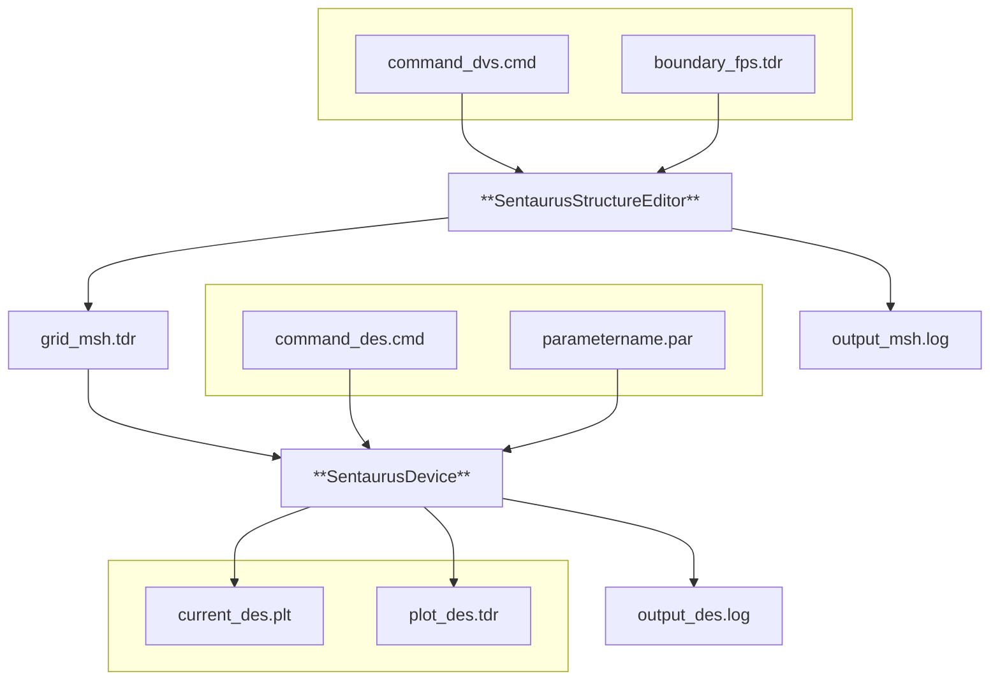

# CHAPTER 1 Introduction to Sentaurus Device

*This chapter describes how Sentaurus Device integrates into the TCAD tool suite and presents some complete simulation examples.*

# Functionality of Sentaurus Device

Sentaurus Device simulates numerically the electrical behavior of a single semiconductor device in isolation or several physical devices combined in a circuit. Terminal currents, voltages, and charges are computed based on a set of physical device equations that describes the carrier distribution and conduction mechanisms. A real semiconductor device, such as a transistor, is represented in the simulator as a ‘virtual’ device whose physical properties are discretized onto a nonuniform ‘grid’ (or ‘mesh’) of nodes.

Therefore, a virtual device is an approximation of a real device. Continuous properties such as doping profiles are represented on a sparse mesh and, therefore, are only defined at a finite number of discrete points in space. The doping at any point between nodes (or any physical quantity calculated by Sentaurus Device) can be obtained by interpolation. Each virtual device structure is described in the Synopsys TCAD tool suite by a TDR file containing the following information:

*   The grid (or geometry) of the device contains a description of the various regions, that is, boundaries, material types, and the locations of any electrical contacts. It also contains the locations of all the discrete nodes and their connectivity.

*   The data fields contain the properties of the device, such as the doping profiles, in the form of data associated with the discrete nodes. Figure 1 on page 4 shows a typical example: the doping profile of a MOSFET structure discretized by a mixed-element grid. By default, a device simulated in 2D is assumed to have a ‘thickness’ in the third dimension of 1 μm.

The features of Sentaurus Device are many and varied. They can be summarized as:

*   An extensive set of models for device physics and effects in semiconductor devices (drift-diffusion, thermodynamic, and hydrodynamic models).

*   General support for different device geometries (1D, 2D, 3D, and 2D cylindrical).

*   Mixed-mode support of electrothermal netlists with mesh-based device models and SPICE circuit models.

Functionality of Sentaurus Device

Two-dimensional doping profile on simulation grid

Figure 1 Two-dimensional doping profile that is discretized on the nodes of simulation grid

Nonvolatile memory simulations are accommodated by robust treatment of floating electrodes in combination with Fowler–Nordheim and direct tunneling, and hot-carrier injection mechanisms.

Hydrodynamic (energy balance) transport is simulated rigorously to provide a more physically accurate alternative to conventional drift-diffusion formulations of carrier conduction in advanced devices.

Floating semiconductor regions in devices such as thyristors and silicon-on-insulator (SOI) transistors (floating body) are handled robustly. This allows hydrodynamic breakdown simulations in such devices to be achieved with good convergence.

The mixed device and circuit capabilities give Sentaurus Device the ability to solve three basic types of simulation: single device, single device with a circuit netlist, and multiple devices with a circuit netlist (see Figure 2).

Three types of simulation: Single Device, Single Device With Circuit, and Multiple Devices With Circuit

Figure 2 Three types of simulation

1: Introduction to Sentaurus Device
Functionality of Sentaurus Device

Multiple-device simulations can combine devices of different mesh dimensionality, and different physical models can be applied in individual devices, providing greater flexibility. In all cases, the circuit netlists can contain an electrical and a thermal section.

# Creating and Meshing Device Structures

Device structures can be created in various ways, including 1D, 2D, or 3D process simulation (Sentaurus Process), 2D or 3D process emulation (Sentaurus Structure Editor), and 2D or 3D structure editors (Sentaurus Structure Editor).

Regardless of the means used to generate a virtual device structure, it is recommended that the structure be remeshed using Sentaurus Structure Editor (2D and 3D meshing with an interactive graphical user interface (GUI)) or Sentaurus Mesh (1D, 2D, and 3D meshing without a GUI) to optimize the grid for efficiency and robustness.

For maximum efficiency of a simulation, a mesh must be created with a minimum number of vertices to achieve the required level of accuracy. For any given device structure, the optimal mesh varies depending on the type of simulation.

It is recommended that to create the most suitable mesh, the mesh must be densest in those regions of the device where the following are expected:

*   High current density (MOSFET channels, bipolar base regions)

*   High electric fields (MOSFET channels, MOSFET drains, depletion regions in general)

*   High charge generation (single event upset (SEU) alpha particle, optical beam)

For example, accurate drain current modeling in a MOSFET requires very fine, vertical, mesh spacing in the channel at the oxide interface (of the order 1 Å) when using advanced mobility models. For reliable simulation of breakdown at a drain junction, the mesh must be more concentrated inside the junction depletion region for good resolution of avalanche multiplication.

Generally, a total node count of 2000 to 4000 is reasonable for most 2D simulations. Large power devices and 3D structures require a considerably larger number of elements.

# Tool Flow

In a typical device tool flow, the creation of a device structure by process simulation (Sentaurus Process) is followed by remeshing using Sentaurus Structure Editor or Sentaurus Mesh. In this scheme, control of mesh refinement is handled automatically through the file `_dvs.cmd`.

Starting Sentaurus Device

Sentaurus Device is used to simulate the electrical characteristics of the device. Finally, Sentaurus Visual is used to visualize the output from the simulation in 2D and 3D, and Inspect is used to plot the electrical characteristics.



Figure 3 Typical tool flow with device simulation using Sentaurus Device

# Starting Sentaurus Device

You can start Sentaurus Device from either the command line or Sentaurus Workbench.

## From the Command Line

Sentaurus Device is driven by a command file and run by the command:

`sdevice <command_filename>`

Various options exist at start-up and are listed by using:

`sdevice -h`

By default, `sdevice` runs the latest version in the current release of Sentaurus Device. To run a particular version in the current release, use the `-ver` command-line option. The following example starts version 1.4 of the latest release of Sentaurus Device:

`sdevice -ver 1.4 nmos_des.cmd`

To run the latest version in a particular release, use the `-rel` command-line option. The following example starts the latest version available in release S-2021.06:

`sdevice -rel S-2021.06 nmos_des.cmd`

1: Introduction to Sentaurus Device

Starting Sentaurus Device

To run a particular version in a particular release, combine `-ver` and `-rel`. The following example starts Sentaurus Device, release R-2020.09, version 1.2:

```
sdevice -rel R-2020.09 -ver 1.2 nmos_des.cmd
```

When the release or the version requested is not installed, the available releases or versions are listed, and the program terminates.

Appendix D on page 1473 lists the command options of Sentaurus Device, which include:

`sdevice -versions`

*   Checks which versions are in the installation path.

`sdevice -P` and `sdevice -L`

*   Extracts model parameter files (see Generating a Copy of Parameter File on page 32).

`sdevice --parameter-names`

*   Prints names of parameters that can be ramped (see Ramping Physical Parameter Values on page 79).

When Sentaurus Device starts, the command file is checked for correct syntax, and the commands are executed in sequence. Character strings starting with `*` or `#` are ignored by Sentaurus Device, so that these characters can be used to insert comments in the simulation command file.

# From Sentaurus Workbench

Sentaurus Device is launched automatically through the Scheduler when working inside Sentaurus Workbench.

Sentaurus Workbench interprets `#` as a special marker for conditional statements. For example:

```
#if...
#elif...
#endif...
```

1: Introduction to Sentaurus Device

TCAD Sentaurus Tutorial: Simulation Projects

# TCAD Sentaurus Tutorial: Simulation Projects

The TCAD Sentaurus Tutorial provides various projects demonstrating the capabilities of Sentaurus Device.

To access the TCAD Sentaurus Tutorial:

1. Open Sentaurus Workbench by entering the following on the command line: `swb`

2. From the menu bar of Sentaurus Workbench, choose **Help** > **Training** or click the T toolbar button toolbar button.

Alternatively, to access the TCAD Sentaurus Tutorial:

1. Go to the following directory:

   `$STROOT/tcad/current/Sentaurus_Training`

   The `STROOT` environment variable indicates where the Synopsys TCAD distribution has been installed.

2. Open the `index.html` file in your browser.

