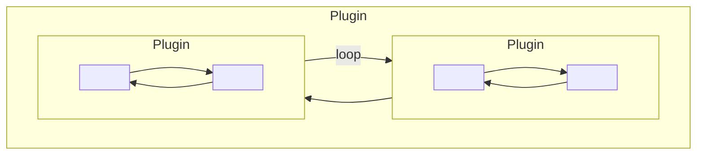
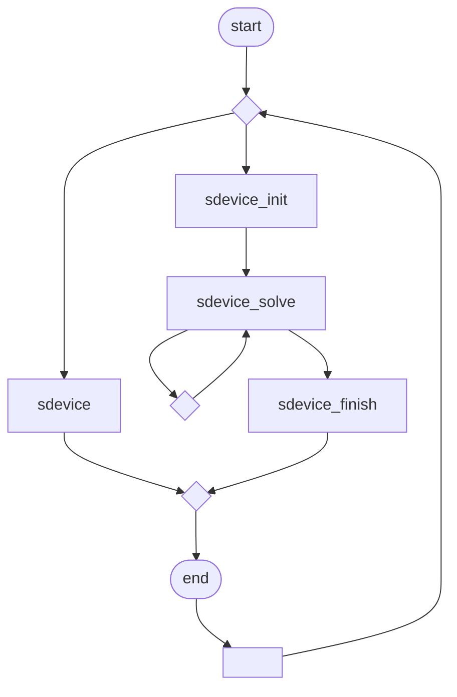

# CHAPTER 5 Simulation Results

*This chapter describes the output of Sentaurus Device, which contains the simulation results.*

This chapter describes only the most important output that Sentaurus Device provides. Many more specific output files exist. They are described in context in other parts of the user guide.

## Current File

Sentaurus Device provides several forms of output. Most importantly, the current file contains the terminal characteristics obtained during the numeric experiment. Plot files allow you to visualize device internal quantities, and thereby provide information not available in real experiments. Other output, such as the log file, allows you to investigate the simulation procedure itself and provides an important tool to understand and resolve problems with the simulation itself.

## When to Write to the Current File

By default, currents are output after each iteration in a `Plugin`, `Quasistationary`, or `Transient` command. This behavior can be modified by a `CurrentPlot` statement in the body of these commands. The `CurrentPlot` statement in the `Solve` section provides full control over the plotting of device currents and circuit currents. If a `CurrentPlot` statement is present, it determines exactly which points are written to the current file. Sentaurus Device can still perform computations for intermediate points, but they are not written to the file.

> **NOTE** Do not confuse the `CurrentPlot` statement in the `Solve` section with the `CurrentPlot` section described in Tracking Additional Data in the Current File on page 116.

The syntax of the `CurrentPlot` statement is:

```
CurrentPlot (<parameters-opt>) {<system-opt>}
```

Both `<parameters-opt>` and `<system-opt>` are optional and can be omitted.

Current File

`<parameters-opt>` is a space-separated list, which can consist of the following entries:

`Time = (<entry> ; <entry> ; <entry> ;)`

The list of time entries enumerates the times for which a current plot is requested. The entries are separated by semicolons. A time entry can have these forms:

*   floating point number

    The time value for which a current plot is requested.

*   `Range = (a b)`

    This option specifies a free plot range between a and b. All the time points in this range are plotted.

*   `Range = (a b) Intervals = n`

    This option specifies n intervals in the range between a and b. In other words, these plot points are generated:

$$ t = a, t = a + \frac{b - a}{n}, \dots, t = b - \frac{b - a}{n}, t = b $$ (28)

`Iterations = (<integer>; <integer>; <integer>;)`

The list of integers specifies the iterations for which a plot is required. This option is available for the `Plugin` command.

`IterationStep=<integer>`

This option requests a current plot every n iterations. It is available for the `Plugin` command.

`When (<when condition>)`

A `When` option can be used to request a current plot whenever a condition has been met. This option works in the same way as in a `Plot` or `Save` command (see Table 339 on page 1631).

`<system-opt>` is a space-separated list of devices. If `<system-opt>` is not present, then Sentaurus Device plots all device currents and the circuit (in mixed-mode simulations). If `<system-opt>` is present, then only the currents of the given devices are plotted. The keyword `Circuit` can be used to request a circuit plot.

5: Simulation Results

Current File

# Example: CurrentPlot Statements

A `CurrentPlot` statement by itself creates a current plot for each iteration:

```
Quasistationary (InitialStep=0.2 MinStep=0.2 MaxStep=0.2
Goal { Name="drain" Voltage=0.5 })
 { Coupled { Poisson Electron Hole }
 CurrentPlot }
```

If no current plots are required, then a current plot for the ‘impossible’ time $t = -1$ can be specified:

```
Quasistationary (InitialStep=0.2 MinStep=0.2 MaxStep=0.2
Goal { Name ="drain" Voltage=0.5 })
 { Coupled { Poisson Electron Hole }
 CurrentPlot ( Time = (-1)) }
```

In this example, the currents of the device `nmos` are plotted for $t = 0$, $t = 10^{-8}$, and $t = 10^{-7}$:

```
Transient ( MaxStep=1e-8 InitialTime=0 FinalTime=1e-6 )
 { Coupled { Poisson Circuit }
 CurrentPlot ( Time = (0 ; 1e-8; 1e-7)) { nmos } }
```

This `CurrentPlot` statement produces 11 equidistant plot points in the interval 0, $10^{-5}$:

```
Transient ( MaxStep = 1e-8 InitialTime=0 FinalTime=1e-5 )
 { Coupled { Poisson Circuit }
 CurrentPlot ( Time = (range = (0 1e-5) intervals = 10)) }
```

In this example, a current plot for iteration 1, 2, 3, and for every tenth iteration is specified:

```
Plugin { Poisson Electron Hole
 CurrentPlot ( Iterations = (1; 2; 3) IterationStep = 10 ) }
```

A `CurrentPlot` statement can also appear at the top level in the `Solve` section. In this case, the currents are plotted when the flow of control reaches the statement.

A `CurrentPlot` statement is also recognized within a `Continuation` command. In this case, the time in the `CurrentPlot` statement corresponds to the arc length in the `Continuation` command. However, only free plot ranges are supported.

5: Simulation Results

Current File

# NewCurrentPrefix Statement

By default, Sentaurus Device saves all current plots in one file (as defined by the variable `Current` in the `File` section). This behavior can be modified by the `NewCurrentPrefix` keyword in the `Solve` section:

`NewCurrentPrefix = prefix`

This keyword appends the specified prefix to the default, current file name, and all subsequent `Plot` statements are directed to the new file. You can specify `NewCurrentPrefix` multiple times in the `Solve` section. For example:

```
Solve {
  Circuit
  Poisson
  NewCurrentPrefix = "pre1"
  Coupled {Poisson Electron Hole Contact Circuit}
  NewCurrentPrefix = "pre2"
  Transient (
    MaxStep= 2.5e-6 InitialStep=1.0e-6
    InitialTime=0.0 FinalTime=0.0001
    Plot {range=(10e-6,40e-6) Intervals=10}
  )
  {Coupled {Poisson Electron Hole Contact Circuit}}
}
```

In this example, the current files specified in the `File` and `System` sections contain the results of the `Circuit` and `Poisson` solves. The results of the `Coupled` solution are saved in a new current file with the same name but prefixed with `pre1`. The last current file contains the results of the `Transient` solve with the prefix `pre2`.

> **NOTE** The file names for current plots defined in the `System` section and the plot files of AC analyses are also modified by `NewCurrentPrefix`.

# Tracking Additional Data in the Current File

The `CurrentPlot` section on the top level of the command file is used to include selected parameter values and mesh data into the current plot file (.plt).

Sentaurus Device provides the following options:

*   You can list the required quantities directly in the `CurrentPlot` section (see CurrentPlot Section on page 117).

*   You can use a Tcl formula (see Tcl Formulas on page 121).

**5: Simulation Results**
Current File

*   You can use a current plot PMI (see Current Plot File on page 1404).

*   You can use the current plot Tcl interface, which represents an alternative to the current plot PMI (see Current Plot File on page 1458).

# CurrentPlot Section

Sentaurus Device can add the scalar data listed in Appendix F on page 1479 to the current plot file.

Data can be plotted according to coordinates. A coordinate is given as one to three (depending on device dimensions) numbers in parentheses. When plotting according to coordinates, the plotted values are interpolated as required.

Furthermore, it is possible to output averages, integrals, maximum, and minimum of quantities over specified domains. To do this, specify the keyword `Average`, `Integrate`, `Maximum`, or `Minimum`, respectively, followed by the specification of the domain in parentheses. A domain specification consists of any number of the following:

*   Region specification: `Region=<regionname>`

*   Material specification: `Material=<materialname>`

*   Region interface specification: `RegionInterface=<regioninterfacename>`

*   Material interface specification: `MaterialInterface=<materialinterfacename>`

*   Any of the keywords `Semiconductor`, `Insulator`, and `Everywhere`, which match all semiconductor regions, all insulator regions, or the entire device, respectively

*   Window specification: `Window[(x1 y1 z1) (x2 y2 z2)]`

*   Well specification: `DopingWell(x1 y1 z1)` (for the definition of the doping well boundary, see Initial Guess for Electrostatic Potential and Quasi-Fermi Potentials in Doping Wells on page 184)

The average, integral, maximum, and minimum are applied to all of the specified parts of the device. Multiple specifications of the same part of the device are insignificant. In addition, `Name=<plotname>` is used to specify a name under which the average, integral, maximum, and minimum are written to the `.plt` file. (By default, the name is automatically obtained from a concatenation of the names in the domain specification, which yields impractically long names for complicated specifications.)

For maximum and minimum, Sentaurus Device can write coordinates where the maximum and minimum occur to the `.plt` file.

Current File

In the case of average and integral, Sentaurus Device can write the coordinates ($\langle x \rangle$, $\langle y \rangle$, $\langle z \rangle$) of the centroid of a data field $f$ defined:

$$ \langle x \rangle = \frac{\int xf(x, y, z) dV}{\int f(x, y, z) dV} \tag{29} $$

where the integration covers the specified domain. The values of $\langle y \rangle$ and $\langle z \rangle$ are defined similarly. Output of coordinates is activated by adding the keyword `Coordinates` in the parentheses where the domain is specified.

The average, integral, maximum, and minimum can be confined to a window by using the window specification. A 1D, 2D, or 3D window is defined by the coordinates (in micrometers) of two opposite corners of the window. In addition, you can confine the domain in a well using the well specification. In this case, the well is defined by the coordinates of a point inside the well. When a list of domains is specified in addition to the window or well, the intersection of the window with the specified domains is taken into account for the average, integral, maximum, or minimum.

The length unit for integration and the number of digits used for names in the current plot file can be specified in the `Math` section (see CurrentPlot Options on page 120 for details).

Parameters from the parameter file of Sentaurus Device can also be added to the current plot file. The general specification looks like:

```
[ Material = <material> | MaterialInterface = <interface> |
  Region = <region> | RegionInterface = <interface> ]
Model = <model> Parameter = <parameter>
```

Specifying the location (material, material interface, region, or region interface) is optional. However, the model name and parameter name must always be present.

> **NOTE** The order of specification is fixed. An optional location specification (material, material interface, region, or region interface) must be followed by a model name and a parameter name. Otherwise, Sentaurus Device will report a syntax error.

Ramping Physical Parameter Values on page 79 describes how model names and parameter names can be determined.

Sentaurus Device also provides a current plot PMI (see Current Plot File on page 1404).

> **NOTE** Do not confuse the `CurrentPlot` section with the `CurrentPlot` statement in the `Solve` section introduced in When to Write to the Current File on page 113.

5: Simulation Results
Current File

## Example: Mixed Mode

In mixed-mode simulations, the `CurrentPlot` section can appear in the body of a physical device within the `System` section (it is also possible to have a global `CurrentPlot` section). For example:

```
System {
  Set (gnd = 0)
  CAP Cm (Top=node2 Bot=gnd) { CurrentPlot { Potential ((0.7, 0.8, 0.9)) } }
  ...
}
```

## Example: Advanced Options

This example is a 2D device that uses the more advanced `CurrentPlot` features:

```
CurrentPlot {
  hDensity((0 1)) * hole density at position (0um, 1um)
  ElectricField/Vector((0 1)) * Electric Field Vector
  Potential (
    (0.1 -0.2) * coordinates need not be integers
    Average(Region="Channel") * average over a region
    Average(Everywhere)      * average over entire device
    Maximum(Material="Oxide") * Maximum in a material
    Maximum(Semiconductor)   * in all semiconductors
    * minimum in a material and a region, output under the name "x":
    Minimum(Name="x" Region="Channel" DopingWell(-0.1 0.3))
  )
  eDensity(
    * average and coordinates of centroid
    Average(Semiconductor Coordinates)
    * maximum and coordinates of maximum in well
    Maximum(DopingWell(-0.1 0.3) Coordinates)
    * integral over the semiconductor regions
    Integrate(Semiconductor)
  )
  SpaceCharge(
    * maximum over 2D window
    Maximum(Window[(-0.2 0) (0.2 0.2)])
    * integral over well
    Integrate( DopingWell(-0.1 0.3) )
  )
}
```

**NOTE** If you specify multiple domains in addition to the window or well, the intersection of the window with the specified domains is taken into account for the average, integral, maximum, or minimum.

Current File

## Example: Plotting Parameter Values

The following example adds five curves to the current plot file:

```
CurrentPlot {
    Model = DeviceTemperature Parameter = "Temperature"
    Material = Silicon Model = Epsilon Parameter = epsilon
    MaterialInterface = "AlGaAs/InGaAs"
        Model = "SurfaceRecombination" Parameter = "S0_e"
    Region = "bulk" Model = LatticeHeatCapacity Parameter = cv
    RegionInterface = "Region.0/Region.1"
        Model = "SurfaceRecombination" Parameter = "S0_h"
}
```

This example also shows the fixed order of specification. An optional location (material, material interface, region, or region interface) is followed by a model name and a parameter name. Therefore this example adds the following five parameter values to the current plot file:

1. Global device temperature

2. Dielectric constant ε in silicon

3. Surface recombination parameter s<sub>0</sub> for electrons on AlGaAs–InGaAs material interfaces

4. Lattice heat parameter cv for region ‘bulk’

5. Surface recombination parameter s<sub>0</sub> for holes on the Region.0–Region.1 region interface

## CurrentPlot Options

The length unit used during a current plot integration (see Tracking Additional Data in the Current File on page 116) can be selected as follows:

```
Math {
    CurrentPlot (IntegrationUnit = um)
}
```

The available choices are cm (centimeters) and um (micrometers). The default is IntegrationUnit=um. This option is useful when quantities such as densities (unit of cm<sup>-3</sup>) are integrated. In a 2D simulation, the unit of the integral is either μm<sup>2</sup>cm<sup>-3</sup> (IntegrationUnit=um) or cm<sup>-1</sup> (IntegrationUnit=cm).

The number of digits in the names of quantities in the current plot file can be specified as follows:

```
Math {
    CurrentPlot (Digits = 6)
}
```

**5: Simulation Results**
Current File

The default is `Digits=6`. This option is useful when the names of two quantities become equal due to rounding. In the following example, you want to monitor the valence band energy in two points:

```
CurrentPlot {
  ValenceBandEnergy ((5.0, 199.011111) (5.0, 199.011112))
}
```

However, with the default setting of `Digits=6`, both quantities are assigned the same name due to rounding:

```
Pos(5,199.011) ValenceBandEnergy
```

By increasing the number of digits, the names in the current plot file become distinct.

Specifying `Digits` affects the names of the following quantities in the current plot file:

* Coordinates

* Well specification

* Window specification

# Tcl Formulas

Sentaurus Device can evaluate Tcl formulas and add the results to the current plot file. The Tcl interpreter has access to the data listed in Appendix F on page 1479, and you can provide Tcl commands to compute derived quantities. For example, it is possible to compute the electron conductivity $\sigma_n$ given by:

$$ \sigma_n = qn\mu_n \text{ (30)} $$

The following operations can be performed with a Tcl formula:

* Evaluation at a given vertex

* Evaluation at a location specified by its coordinates

* Compute the minimum/maximum/average/integral over a domain

* Plot output to a PMI user field

In the case of a minimum/maximum/average/integral operation or plot operation, the domain of the evaluation can be restricted as follows:

* Region

* Material

* Region interface

* Material interface

Current File

*   Contact

*   Semiconductor, insulator, or metal regions

*   Entire device

*   Doping well

*   Window

In the case of a minimum/maximum/average/integral operation, the location of the minimum or maximum, or the centroid of the average or integral operation (see Eq. 29) also will be added to the current plot file.

The following example shows how to compute the average electron conductivity $\sigma_n$ in the channel region:

```
CurrentPlot {
  Tcl (
    Dataset   = "Ave_channel eConductivity"
    Function  = "Conductivity"
    Formula   = "set q 1.602e-19
                 set n [tcl_cp_ReadScalar eDensity]
                 set mu [tcl_cp_ReadScalar eMobility]
                 set value [expr $q * $n * $mu]"
    Operation = "Average Region = channel"
  )
}
```

The `Tcl` statement supports the following options:

```
CurrentPlot {
  Tcl (
    Dataset   = "..."
    Function  = "..."
    Unit      = "..."
    Init      = "..."
    Formula   = "..."
    Finish    = "..."
    Operation = "..."
  )
}
```

## Dataset Option

This option specifies the dataset name that appears in the header section of the current plot file. If it is not specified, Sentaurus Device generates the name `Tcl_Dataset_<index>`, where `<index>` is a unique integer. For example:

```
Dataset = "channel eConductivity"
```

5: Simulation Results
Current File

## Function Option

This is the function name that appears in the header section of the current plot file. If it is not specified, Sentaurus Device generates the name `Tcl_Function_<index>`, where `<index>` is a unique integer. For example:

```
Function = "Conductivity"
```

## Unit Option

This is the unit of the current plot quantity. The `.plt` file format does not support units. For example:

```
Unit = "cm/s"
```

## Init Option

The Tcl code in this option is executed first for each plot time point. It can be used to initialize quantities that will be referenced in `Formula`. For example:

```
Init = "set counter 0"
```

## Formula Option

The Tcl code in this option is executed on individual mesh vertices. It must evaluate a formula and assign the result to the Tcl variable `value`.

The following Tcl functions and variables are available:

*   `tcl_cp_dim`: Dimension of the mesh; possible values are 1, 2, or 3

*   `tcl_cp_vertex`: Mesh index of the current vertex

*   `tcl_cp_ContactOuterVoltage`: Returns the value of the contact voltage for the local contact vertex (the evaluation domain must be contact)

*   `tcl_cp_ContactInnerVoltage`: Returns the value of the contact inner voltage for the local contact vertex (the evaluation domain must be contact)

*   `proc tcl_cp_ReadScalar {dataname}`: Returns the value of a scalar data field for the local vertex (see Appendix F on page 1479 for valid data names)

*   `proc tcl_cp_ReadVector {dataname index}`: Returns a component of a vector data field for the local vertex

    The parameter `index` must satisfy `0 <= $index < $tcl_cp_dim`. See Appendix F on page 1479 for valid data names.

Current File

*   `proc tcl_cp_WriteScalar {dataname value}`: This Tcl function defines the value of a scalar field for the local vertex. This is a side effect of the Tcl current plot statement, and it is typically used to compute the values of a PMI user field.

    Alternatively, you can use the `Plot` operation (see Operation Option).

For example:

```
Formula = "incr counter
           set value [tcl_cp_ReadScalar ElectrostaticPotential]"
```

## Finish Option

The Tcl code in this option is executed last for each plot time point. It can be used for postprocessing purposes. It can access the Tcl list `result`, which contains the final current plot value, followed by the coordinates. When the operation is `Minimum`, `Maximum`, `Average`, or `Integrate` (see Operation Option), the coordinates are those of the corresponding extremum or the centroid (see Eq. 29). For example:

```
Finish = "puts \"Used $counter calls\""
```

For additional examples, see Examples on page 126.

## Operation Option

This option determines how the current plot formula is evaluated. The following operations are recognized:

*   `Node=<int>`: Evaluate formula at specified node.

*   `Coordinate= (...)`: Evaluate formula at specified coordinates.

*   `Minimum`: Compute minimum over specified domain.

*   `Maximum`: Compute maximum over specified domain.

*   `Average`: Compute average over specified domain.

*   `Integrate`: Compute integral over specified domain.

*   `Plot=<name>`: Output formula to PMI user field.

Only one of the above operations must be specified.

To obtain the value of the current plot formula at specified coordinates, Sentaurus Device evaluates the formula at nearby vertices and interpolates these values. The required interpolation scheme can be selected as follows:

*   `Interpolation=<method>`: Specify interpolation scheme.

    The available interpolation schemes are `Arsinh`, `Linear` (default), `Logarithmic`.

5: Simulation Results

Current File

A scaling factor for arsinh interpolation also can be specified:

*   `ArsinhFactor=<value>`: Specify arsinh scaling factor. The default is 1.

The length unit when computing an integral can be selected as follows:

*   `IntegrationUnit=<unit>`: Specify integration unit.

    The possible options are `cm` (centimeter) and `um` (micrometer). The default is `IntegrationUnit=um`. This option is useful when quantities such as densities (unit of cm<sup>-3</sup>) are integrated. In a 2D simulation, the unit of the integral is either μm<sup>2</sup>cm<sup>-3</sup> (`IntegrationUnit=um`) or cm<sup>-1</sup> (`IntegrationUnit=cm`).

In the case of `Minimum`, `Maximum`, `Average`, or `Integrate` operations or a plot operation, the required domain also can be specified as follows:

*   `Region=<regionname>`: Region domain.

*   `Material=<materialname>`: Material domain.

*   `RegionInterface=<region1/region2>`: Region interface domain.

*   `MaterialInterface=<material1/material2>`: Material interface domain.

*   `Contact=<contactname>`: Contact domain (for minimum, maximum, average, or integral operation only).

*   `Semiconductor`: Use all semiconductor regions as domain.

*   `Insulator`: Use all insulator regions as domain.

*   `Conductor`: Use all metal regions as domain.

*   `Everywhere`: Use entire device as domain (default).

*   `DopingWell= (...)`: Doping well domain.

*   `Window= [(...) (...)]`: Window domain.

If multiple domains are specified, Sentaurus Device will only evaluate the current plot formula where the domains intersect. For example, it is possible to specify:

```
Operation = "Average Region=drain DopingWell=(1 2)"
```

In this case, the formula is only evaluated for those vertices in the drain region that also lie within the specified doping well.

Region interface, material interface, and contact specifications cannot be combined with other domains.

For example:

```
Operation = "Average Window=[(1 2) (3 4)]"
```

Current File

For the contact specification, when the contact is connected to multiple regions, you have the option to select a subset of the contact vertices involved in the operation (the intersection between the contact and a selected region). The selected region is specified by the `RegionName` keyword.

For example, to integrate a formula over the intersection of contact `anode` and region `r1`, specify:

```
Operation = "Integrate Contact=\"anode\" RegionName=\"r1\""
```

## Examples

Evaluate the electrostatic potential $\phi$ at (7.2 $\mu$m, 2.1 $\mu$m):

```
CurrentPlot {
  Tcl (
    Formula   = "set value [tcl_cp_ReadScalar ElectrostaticPotential]"
    Operation = "Coordinate = (7.2 2.1)"
    Dataset   = "7.2_2.1 ElectrostaticPotential"
    Function  = "ElectrostaticPotential"
  )
}
```

Save the electron conductivity $\sigma_n = qn\mu_n$ in semiconductor (see Eq. 30, p. 121) as a PMI user field:

```
CurrentPlot {
  Tcl (
    Formula   = "set q 1.602e-19
                 set n [tcl_cp_ReadScalar eDensity]
                 set mu [tcl_cp_ReadScalar eMobility]
                 set value [expr $q * $n * $mu]"
    Unit      = "Ohm^-1*cm^-1"
    Operation = "Plot = PMIUserField5 Semiconductor"
  )
}
```

Plot the integral of the space charge $\rho$ in the window [(0 $\mu$m, 6 $\mu$m) (2.5 $\mu$m, 7 $\mu$m)]:

```
CurrentPlot {
  Tcl (
    Formula   = "set value [tcl_cp_ReadScalar SpaceCharge]
    Operation = "Integrate Window = [(0 6) (2.5 7)] IntegrationUnit = cm"
    Dataset   = "Integral_Window SpaceCharge"
    Function  = "SpaceCharge"
  )
}
```

**5: Simulation Results**
Current File

Compute the integral of the electron Joule heat $J_n \cdot E$ in semiconductor regions:

```
CurrentPlot {
  Tcl (
    Formula   = "set value 0
                 for {set d 0} {$d < $tcl_cp_dim} {incr d} {
                   set j [tcl_cp_ReadVector eCurrentDensity $d]
                   set f [tcl_cp_ReadVector ElectricField $d]
                   set value [expr $value + $j * $f]
                 }"
    Operation = "Integrate Semiconductor IntegrationUnit = cm"
    Dataset   = "Integral_Semiconductor eJouleHeat"
    Function  = "JouleHeat"
  )
}
```

Compute the distributed conductance of the contact anode:

```
CurrentPlot {
  Tcl (
    Formula = "set value 0
               set Vext [tcl_cp_ContactOuterVoltage \"anode\"]
               set QF [tcl_cp_ReadScalar \"QuasiFermiPotential\"]
               for {set d 0} {$d < $tcl_cp_dim} {incr d} {
                  set j [tcl_cp_ReadVector eCurrentDensity $d]
                  set N [tcl_cp_ReadVector ContactSurfaceNormal $d]
                  set value [expr $value + $j * $N]
               }
               set value [expr $value / ($Vext - $QF + 0.0001)]"
    Operation = "Integrate Contact=\"top1\" RegionName=\"r2\"
                IntegrationUnit = cm"
    Dataset   = "Conductance"
    Function  = "Conductance"
  )
}
```

Compute an integral value and use the `Finish` statement. To compute the integral of the optical generation inside silicon and to write the result to the log file, use the `Finish` option as follows:

```
CurrentPlot {
  Tcl (
    Formula   = "set value [tcl_cp_ReadScalar OpticalGeneration]"
    Operation = "Integrate Material=Silicon"
    Dataset   = "IntegrSilicon G"
    Function  = "OpticalGeneration"
    Finish    = "
        set v [lindex $result 0]
        set x [lindex $result 1]
        set y [lindex $result 2]
```

Device Plots

```
        puts [format "GSi = %.4g; centroid_coord=(%.4g %.4g)" $v $x $y]
    )
}
```

In this case, the log file will contain the following information:

`GSi = 1.669e+21; centroid_coord=(1.718 0.5995)`

# Device Plots

Device plots show spatial-dependent datasets in the device and provide a view of the inside of the device.

## What to Plot

The `Plot` section specifies the data that is saved at the end of or, optionally, during the simulation to the `Plot` file specified in the `File` section or by the `Plot` command in the `Solve` section. Consecutive plots can be collected in a single file, or written to separate enumerated files, or written to a single file by overwriting the previous plot. To collect consecutive plots in a single file, specify `Plot(collected)=<filename>` in the `File` section.

The keywords `Overwrite` and `noOverwrite`, specified as options in the `Plot` command in the `Solve` section (see When to Plot on page 129), control whether plots are written to separate files or to a single file.

> **NOTE** You can control further compression, beyond a basic standard compression of `Plot` files, by specifying `CompressTDR` in the `Math` section. However, further compression might not always lead to a significantly reduced file size and, depending on the content of the file, it might lead to a slightly increased file size.

> Specifying `CompressTDR` in the `Math` section applies to all types of plot commands that generate files containing spatial-dependent datasets.

Vector data can be plotted by appending `/Vector` to the corresponding keyword. For example:

`Plot { ElectricField/Vector }`

Element-based scalar data can be plotted by appending `/Element` to the corresponding keyword. For example:

`Plot { eMobility/Element }`

5: Simulation Results

Device Plots

Some quantities (such as the carrier densities) are put into the `Plot` file even when they are not listed in the `Plot` section. The keyword `PlotExplicit` in the global `Math` section suppresses this behavior.

By default, the plot file also contains additional information required by `Load` to restart a simulation (see Save and Load Statements on page 163). To suppress writing this additional information, specify `-PlotLoadable` in the global `Math` section.

You can specify the keyword `DatasetsFromGrid` to copy quantities from the TDR grid file directly to the plot file. You can copy all datasets by specifying `DatasetsFromGrid` by itself:

```
Plot { DatasetsFromGrid }
```

Alternatively, you can copy selected quantities by listing their names:

```
Plot {
  DatasetsFromGrid (dataset1 dataset2 dataset3)
}
```

A dataset is only copied from the TDR grid file if it is not computed by Sentaurus Device. Otherwise, the dataset computed by Sentaurus Device takes precedence.

> **NOTE** The keyword `DatasetsFromGrid` only copies entire datasets from the TDR grid file to the plot file. You cannot copy partial datasets, for example, the components of tensor and vector datasets.

See Table 328 on page 1621 for all possible plot options.

# When to Plot

The simplest way to create a device plot is to define `Plot` in the `File` section. By default, the output to the `Plot` file will occur at the end of the simulation only.

The commands for `Quasistationary` and `Transient` analysis support an option `Plot` that allows you to write plots while these commands are executing. The plot file name is derived from the one specified with `Plot` in the `File` section. See Saving and Plotting During a Quasistationary on page 82 and Transient Command on page 90 for the syntax.

The most flexible way to create device plots is through the `Plot` statement in the `Solve` section. It provides full control of when to plot and limited control of the file names. The `Plot` statement can be used at any level of the `Solve` section. The command takes the form:

```
Plot (<parameters-opt>) <system-opt>
```

Device Plots

If `<system-opt>` is not specified, then all physical devices and circuits are plotted. Use `<system-opt>` to specify an optional list of devices delimited by braces (see Table 331 on page 1623).

If `<parameters-opt>` is not specified, then defaults are used. The keywords `Loadable` and `Explicit` provide plot-specific overrides for `PlotLoadable` and `PlotExplicit` in the global `Math` section (see What to Plot on page 128). For a summary of all options, see Table 339 on page 1631.

**Example**

```
Solve {
  Plugin {
    Poisson
    Plot ( FilePrefix = "output/poisson")
    Coupled { Poisson Electron Hole }
    Plot (FilePrefix = "output/electric" noOverwrite)
  }
  Transient {
    Coupled { Poisson Electron Hole Temperature }
    Plot ( FilePrefix = "output/trans"
             Time = ( range = (0 1) ;
             range = (0 1) intervals = 4 ; 0.7 ;
             range = (1.e-3 1.e-1) intervals = 2 decade )
             NoOverwrite )
  }
  ...
}
```

The first `Plot` statement in `Plugin` writes (after the computation of the Poisson equation) to a file named `output/poisson_des.tdr`. The second `Plot` statement in `Plugin` writes to a file called `output/electric_0000_des.tdr` and increases the internal number for each call.

The `Plot` statement in the transient specifies three different types of time entries (separated by semicolons). The first entry indicates all the times within this range when a plot file must be written. The second time entry forces the transient simulation to compute solutions for the given times. In this example, the given times are 0.25, 0.5, 0.75, and 1.0. The third entry is for the single time of 0.7. The fourth entry triggers the plotting at time points given by subdividing the range on the logarithmic scale, resulting for this example in plots at 1.e-3, 1.e-2, and 1.e-1.

# Snapshots

Sentaurus Device offers the possibility to save snapshots interactively during a simulation. This can be undertaken by sending a POSIX signal to the Sentaurus Device process.

5: Simulation Results
Device Plots

Depending on whether `Plot` or `Save` or both is specified in the `File` section, the signal invokes a request to write a plot (.tdr) file or a save (.sav) file after the actual time step is finished.

The following signals are supported to save snapshots:

*   USR1: The occurrence of the USR1 signal initiates Sentaurus Device to write a plot file or a save file after the simulation has finished its actual time step. The simulation will continue afterwards.

*   INT: By default, sending the INT signal causes a process to exit. This behaviour changes if `Interrupt=BreakRequest` or `Interrupt=PlotRequest` is specified in the `Math` section (see Table 206 on page 1518). In both cases, the occurrence of the INT signal initiates Sentaurus Device to write a plot file or a save file. `Interrupt=BreakRequest` causes Sentaurus Device to terminate the actual solve statement after the snapshot is saved. If `Interrupt=PlotRequest` is specified, the simulation continues.

A signal can be sent to a process by invoking the `kill` command (see the corresponding man page of your operating system). The process ID can be extracted from the `.log` file.

# Interface Plots

Data fields defined on interfaces can be plotted by using the modifier `/RegionInterface`. For Example:

```
Plot {
  eTrappedCharge/RegionInterface
}
```

The following fields are available for interface plots:

```
TotalTrapConcentration
eTrappedCharge
hTrappedCharge
eHIDensity
hHIDensity
eHIDensityPerDensity
hHIDensityPerDensity
eHIDensityPerTemperature
hHIDensityPerTemperature
eHIDensityPer_eTemperature
hHIDensityPer_hTemperature
```

Interface plots are generated only if interface regions appear in the grid file.

Extraction File

## Log File

The name of the log file is specified by `Output` in the `File` section. The log file contains a copy of the messages that Sentaurus Device prints while a simulation runs. The log file contains various information, including:

* Technical information such as the version of Sentaurus Device that is running, the machine where it is running, and the process ID

* Confirmation as to which structure is simulated, which physical models have been selected, and which parameters are used

* Detailed information about how the simulation proceeds, including timing and convergence information

* Warning messages

The log file is of minor interest as long as your simulations are set up well and no convergence problems occur. It is a valuable diagnostic tool during simulation setup or when convergence problems occur.

A log file annotated with XML tags can be generated by specifying the `--xml` command-line option. This file contains the same information as the regular log file, but features additional XML tags to organize its content. The XML log file uses the same file name as the regular log file, but with the extension .xml instead of .log.

The XML log file is best displayed with the TCAD Log File Browser. For more information, see Utilities User Guide, Chapter 2 on page 7.

# Extraction File

Sentaurus Device supports a special-purpose file format (extension .xtr) for the extraction of MOSFET compact model parameters.

## Extraction File Format

The extraction file consists of the following parts:

* A header identifying the file format.

* A section containing the process information of the MOSFET such as channel length or channel width.

* A collection of curves containing the values of a dependent variable as a function of an independent variable, for example, drain current versus gate voltage in an I<sub>d</sub>–V<sub>g</sub> ramp. In

5: Simulation Results

Extraction File

addition, each curve contains the corresponding bias conditions, for example, $V_b$, $V_d$, and $V_s$ in an $I_d$–$V_g$ ramp.

A sample extraction file is:

```
# Synopsys Extraction File Format Version 1.1
# Copyright (C) 2008 Synopsys, Inc.
# All rights reserved.

$ Process
AD 31.50f
AS 31.50f
D NMOS
L 90.00n
NF 1.000
NRD 0.000
NRS 0.000
PD 880.0n
PS 880.0n
SA 500.0n
SB 500.0n
SC 0.000
SCA 0.000
SCB 0.000
SCC 0.000
SD 0.000
W 90.00n

$ Data
Curve: Id_Vg
Bias : Vb = 0 , Vd = 0.5 , Vs = 0
 1.60000000000000E+00    7.95091490486384E-05
 1.63750000000000E+00    8.27433425335473E-05
 1.67500000000000E+00    8.59289596870642E-05
 1.71250000000000E+00    8.90665609661286E-05
 1.75000000000000E+00    9.21567959785304E-05

Curve: Is_Vg
Bias : Vb = 0 , Vd = 0.5 , Vs = 0
 1.60000000000000E+00   -7.95091490484525E-05
 1.63750000000000E+00   -8.27433425333610E-05
 1.67500000000000E+00   -8.59289596868774E-05
 1.71250000000000E+00   -8.90665609659414E-05
 1.75000000000000E+00   -9.21567959783428E-05
```

5: Simulation Results
Extraction File

# Analysis Modes

Sentaurus Device supports different analysis modes.

Table 20 Analysis modes

| Analysis | Curve1 | Description |
| --- | --- | --- |
| DC | Ii_Vj | The i-th terminal current versus j-th terminal voltage. i,j=b (bulk), d (drain), g (gate), or s (source) Bias conditions: all terminal voltages other than j-th terminal voltage. |
| AC | Ai_j_Vk | Admittance $A_{ij}$ versus k-th terminal voltage. i,j,k=b (bulk), d (drain), g (gate), or s (source) Bias conditions: all terminal voltages other than k-th terminal voltage and frequency. |
| Ai_j_F | Admittance $A_{ij}$ versus frequency. i,j=b (bulk), d (drain), g (gate), or s (source) Bias conditions: $V_b$, $V_d$, $V_g$, $V_s$. |  |
| Ci_j_Vk | Capacitance $C_{ij}$ versus k-th terminal voltage. where i,j,k=b (bulk), d (drain), g (gate), or s (source) Bias conditions: all terminal voltages other than k-th terminal voltage and frequency. |  |
| Ci_j_F | Capacitance $C_{ij}$ versus frequency. i,j=b (bulk), d (drain), g (gate), or s (source) Bias conditions: $V_b$, $V_d$, $V_g$, $V_s$. |  |
| Noise | noise_Vi_Vj | Autocorrelation noise voltage spectral density (NVSD) for electrode i versus j-th terminal voltage. i,j=b (bulk), d (drain), g (gate), or s (source) Bias conditions: all terminal voltages other than j-th terminal voltage and frequency. |
| noise_Vi_F | Autocorrelation noise voltage spectral density (NVSD) for electrode i versus frequency. i=b (bulk), d (drain), g (gate), or s (source) Bias conditions: $V_b$, $V_d$, $V_g$, $V_s$. |  |
| noise_Ii_Vj | Autocorrelation noise current spectral density (NISD) for electrode i versus j-th terminal voltage. i,j=b (bulk), d (drain), g (gate), or s (source) Bias conditions: all terminal voltages other than j-th terminal voltage and frequency. |  |
| noise_Ii_F | Autocorrelation noise current spectral density (NISD) for electrode i versus frequency. i=b (bulk), d (drain), g (gate), or s (source) Bias conditions: $V_b$, $V_d$, $V_g$, $V_s$. |  |

1. Underscores are optional and are used to improve legibility.

 5: Simulation Results

Extraction File

# File Section

You specify the name of the extraction file in the `File` section of the Sentaurus Device command file. For example:

```
File {
  Extraction = "mosfet_des.xtr"
  ...
}
```

The default file name is `extraction_des.xtr`.

# Electrode Section

Sentaurus Device automatically recognizes the four electrodes of a MOSFET if they are called "bulk", "drain", "gate", and "source", or "b", "d", "g", and "s" (case insensitive). For other contact names, you can specify the mapping in the `Electrode` section:

```
Electrode {
  { Name = "contact_bulk"   Voltage = 0.0 Extraction {bulk}   }
  { Name = "contact_drain"  Voltage = 0.0 Extraction {drain}  }
  { Name = "contact_gate"   Voltage = 0.0 Extraction {gate}   }
  { Name = "contact_source" Voltage = 0.0 Extraction {source} }
}
```

All four MOSFET electrodes (bulk, drain, gate, and source) must be present. Additional electrodes are allowed, but they will be ignored for extraction purposes.

# Extraction Section

The process parameters can be part of the Sentaurus Device grid or doping file. You can also specify the same information in an `Extraction` section. For example:

```
Extraction {
  AD 31.50f
  AS 31.50f
  D NMOS
  L 90.00n
  NF 1.000
  NRD 0.000
  NRS 0.000
  PD 880.0n
  PS 880.0n
```

Extraction File

```
  SA 500.0n
  SB 500.0n
  SC 0.000
  SCA 0.000
  SCB 0.000
  SCC 0.000
  SD 0.000
  W 90.00n
}
```

Each line in the `Extraction` section consists of a name–value pair. All entries are copied to the extraction file as is.

**NOTE** The process parameters in the `Extraction` section of the Sentaurus Device command file take precedence over the information in the grid or doping file.

# Solve Section

The `Quasistationary` statement in the `Solve` section supports an `Extraction` option to request voltage-dependent extraction curves. Multiple curves can be generated during a single ramp.

No extraction curves are produced if the `Extraction` option is missing. For example:

```
Solve {
  # ramp contributes to extraction
  Quasistationary (
    Goal { Name="contact_gate" Voltage=1.5 }
    Extraction { IdVg IsVg ... }
  )
  { Coupled { Poisson Electron }
    CurrentPlot (Time = (Range=(0 1) Intervals=10))
  }

  # ramp does not contribute to extraction
  Quasistationary (
    Goal { Name="contact_base" Voltage=0.5 }
  )
  { Coupled { Poisson Electron } }

  # ramp contributes to extraction
  Quasistationary (
    Goal { Name="contact_drain" Voltage=1.5 }
    Extraction { IdVd IbVd ... }
  )
```

5: Simulation Results
Extraction File

```
    { Coupled { Poisson Electron } }
}
```

AC and noise simulations must be performed in mixed mode. Only one physical device is supported in the circuit. Voltage-dependent curves are specified as an option to the `Quasistationary` statement; whereas, frequency-dependent curves appear within the `ACCoupled` statement:

```
Solve {
  Quasistationary (
    ...
    Extraction { Ads_Vg Agg_Vg Cgd_Vg
                 noise_Id_Vg noise_Ig_Vg }
  )
  { ACCoupled (
      ...
      Extraction { Add_F Cgd_F Csd_F
                   noise_Vd_F noise_Vg_F noise_Is_F }
    )
    { Poisson Electron }
  }
}
```

The recognized curves in the `Extraction` option are shown in Table 20 on page 134.

## Extraction File

CHAPTER 6

# Numeric and Software-Related Issues

*This chapter discusses technical issues of simulation that do not have real-world equivalents.*

To successfully perform an experiment, apart from understanding the device under investigation, the experimenter must understand, control, and skillfully use the measurement equipment. The same holds for numeric *experiments*. This chapter describes the *equipment* available in Sentaurus Device for numeric experiments: linear and nonlinear solvers, control of accuracy, convergence monitors, and other software-related facilities. Additional background information on numerics is available in Chapter 38 on page 1133.

## Structure of Command File

The Sentaurus Device command file is divided into sections that are defined by a keyword and braces (see Figure 13). A device is defined by the `File`, `Electrode`, `Thermode`, and `Physics` sections. The solve methods are defined by the `Math` and `Solve` sections. Two sections are used in mixed-mode circuit and device simulation, see Chapter 3 on page 41. This section concentrates on the input to define single-device simulations.

```
File {...}          Plot {...}          Solve {...}
Electrode {...}     CurrentPlot {...}
Thermode {...}      Math {...}
Physics {...}
```

Figure 13 Different sections of a Sentaurus Device command file

## Inserting Files

An insert directive is available in the command file of Sentaurus Device to incorporate other files:

```
Insert = "filename"
```

**6: Numeric and Software-Related Issues**

Solve Section: How the Simulation Proceeds

This directive can appear at the top level in the command file or inside any of the following sections:

*   CurrentPlot

*   Device

*   Electrode

*   File

*   Math

*   MonteCarlo

*   NoisePlot

*   NonlocalPlot

*   Physics

*   Plot

*   RayTraceBC

*   Solve

*   System

*   Thermode

The following search strategy is used to locate a file:

*   The current directory is checked first (highest priority).

*   If the environment variable SDEVICEDB exists, then the directory associated with the variable is checked (medium priority).

*   The $STROOT/tcad/$STRELEASE/lib/sdevice/MaterialDB directory is checked (lowest priority).

> **NOTE** The insert directive is also available for parameter files (see Physical Model Parameters on page 22).

---

# Solve Section: How the Simulation Proceeds

The `Solve` section is the only section in which the order of commands are important. It consists of a series of simulation commands to be performed that are activated sequentially, according to the order of commands in the command file.

Many `Solve` commands are high-level commands that have lower level commands as parameters. Figure 14 on page 141 shows an example of these different command levels:

*   The `Coupled` statement (the base command) is used to solve a set of equations.

*   The `Plugin` statement is used to iterate between a number of coupled equations.

6: Numeric and Software-Related Issues

Nonlinear Iterations

*   The `Quasistationary` statement is used to ramp a solution from one boundary condition to another.

*   The `Transient` statement is used to run a transient simulation.

Furthermore, small-signal AC analysis can be performed with the `ACCoupled` statement. An advanced ramping by continuation method can be performed with the `Continuation` statement. (The `ACCoupled` and `Continuation` statements are presented in Small-Signal AC Analysis on page 101 and Continuation Command on page 87, respectively.)

```mermaid
graph LR
    subgraph Ramping_Commands [Ramping Commands]
        QS[Quasistationary]
        C[Continuation]
        T[Transient]
    end

    subgraph Iterative_Level [Iterative Level]
        P[Plugin]
    end

    subgraph Base_Commands [Base Commands]
        AC[ACCoupled]
        CP[Coupled]
    end

    subgraph Base_Options [Base Options]
        BO1[SuperPardisoILSBlocked]
        BO2[PoissonElectronHoleTemperatureeTemperaturehTemperatureeQuantumPotentialhQuantumPotential]
    end

    Ramping_Commands --> Iterative_Level
    Iterative_Level --> Base_Commands
    Base_Commands --> Base_Options
```



Figure 14 Different levels of Solve statements

# Nonlinear Iterations

This section discusses nonlinear iterations.

## Coupled Statement

This statement activates a Newton-like solver over a set of equations. Available equations include the Poisson equation, continuity equations, and the different thermal and energy equations. The syntax of the `Coupled` statement is:

```
Coupled ( <optional parameters> ){ <equation> }
```

or:

```
<equation>
```

Nonlinear Iterations

This last form uses only the keyword `equation`, which is equivalent to a `coupled` with default parameters and the single equation.

For example, if the following command is used, the electrostatic potential and electron density are computed from the resolution of the Poisson equation and electron continuity equation (using the default parameters):

```
Coupled {Poisson Electron}
```

If the following command is used, only the electrostatic potential is computed using the Poisson equation:

```
Poisson
```

The `Coupled` statement is based on a Newton solver. This is an iterative algorithm in which a linear system is solved at each simulation step. Parameters of the command determine:

*   The maximum number of iterations allowed

*   The required precision of the solution

*   The linear solver that must be used

*   Whether the solution is allowed to worsen over a number of iterations

These parameters and others are summarized in Table 334 on page 1626.

The following example limits the previous `Coupled {Poisson Electron}` example to ten iterations and uses the ILS linear solver:

```
Coupled ( Iterations=10 Method=ILS ) {Poisson Electron}
```

> **NOTE** Use a large number of iterations when the coupled iteration is not inside a ramping process. This allows the Newton algorithm to proceed as far as possible. Inside a ramping statement (for example, `Transient` or `Quasistationary`), the maximum number of iterations should be limited to approximately ten because, if the Newton process does not converge rapidly, it is preferable to try again with a smaller step size than to pursue an iterative process that is not likely to converge.

The best linear method to use in a coupled iteration depends on the type and size of the problem solved. Table 218 on page 1542 lists the solvers and the size of the problems for which they are designed.

6: Numeric and Software-Related Issues
Nonlinear Iterations

# Convergence and Error Control

The `Coupled` statement is sensitive to the following `Math` parameters that determine when a coupled solution diverges or converges:

*   `Iterations`

*   `RhsAndUpdateConvergence`

*   `RhsFactor`, `RhsMin`, `RhsMinFactor`, `RhsMax`, `RhsMaxQ`

*   `CheckRhsAfterUpdate`

*   `RelErrControl`

*   `Digits`

*   `ErrRef`

*   `Error`

*   *   `UpdateIncrease`, `UpdateMax`

The parameter `Iterations` in the global `Math` section sets the default for `Iterations` of the `Coupled` statement. `Iterations` limits the number of Newton iterations. If the equation being solved is converging quadratically, the number of iterations might increase beyond this limit. For `Iterations=0`, only one iteration is performed.

Convergence of a solution in Sentaurus Device is determined by calculating and examining the following quantities at each Newton iteration:

*   *RHS norm* is the norm of the right-hand-side (that is, the residual of the equations).

*   *Update error* is a measure of the updates to the equation variables.

These quantities are printed in the log file for each Newton iteration during a solution. By default, a solution is considered converged if the RHS norm < `RhsMin` or if the update error < 1. If `RhsAndUpdateConvergence` is specified, then both of these criteria must be satisfied. However, a solution is accepted as converged if the RHS norm < `RhsMinFactor` $\times$ `RhsMin`, even if the update error criterion is not satisfied.

During a single Newton step, the solution is considered diverged if the RHS norm increases by more than a factor of `RhsFactor`. The solution is also considered diverged if the RHS norm exceeds `RhsMax` (for transient simulations) or `RhsMaxQ` (for nontransient simulations).

Specify `CheckRhsAfterUpdate` to force Sentaurus Device to perform an additional check on the RHS norm after the update error criteria is satisfied. If Sentaurus Device assesses that the RHS norm can be made smaller, additional iterations will be performed. This can sometimes improve the quality of a solution and might result in better overall convergence.

Nonlinear Iterations

> **NOTE** `CheckRhsAfterUpdate` usually adds no more than one or two extra iterations. However, when convergence is slow or when using extended-precision accuracy, this option can result in several additional iterations if the RHS norm continues to be reduced. In such cases, a larger value for `Iterations` might be needed. In all cases, however, Sentaurus Device will accept a converged solution when the maximum number of iterations is reached, even if the RHS norm is still improving.

There are two formulations of the update error calculations used in Sentaurus Device, depending on whether `RelErrControl` (the default) or `-RelErrControl` is specified. For both formulations, Sentaurus Device tries to determine the value of an equation variable $x$, such that the computed update $\Delta x$ is small enough to satisfy an error criterion:

$$
\begin{aligned}
\frac{|\Delta x|}{|x| + x_{\text{ref}}} < \varepsilon_{\text{R}} \quad , \quad \text{RelErrControl} \\
\frac{|\Delta x / x^*|}{\varepsilon_{\text{R}} |x / x^*| + \varepsilon_{\text{A}}} < 1 \text{ , -RelErrControl}
\end{aligned}
\eqno(31)
$$

where:

*   $\varepsilon_{\text{R}} = 10^{-\text{Digits}}$ is the relative error.

*   $x_{\text{ref}} = \text{ErrRef(<equation>)}$ is the reference error parameter.

*   $\varepsilon_{\text{A}} = \text{Error(<equation>)}$ is the absolute error parameter.

*   $x^*$ is a scaling constant for the equation variable.

For large values of $x$ ($|x| \rightarrow \infty$), the conditions in Eq. 31 become relative error criteria:

$$
\frac{|\Delta x|}{|x|} < \varepsilon_{\text{R}} \eqno(32)
$$

Conversely, for small values of $x$ ($|x| \rightarrow 0$), they become absolute error criteria:

$$
|\Delta x| < x_{\text{ref}} \cdot \varepsilon_{\text{R}} \quad \text{or} \quad |\Delta x / x^*| < \varepsilon_{\text{A}} \eqno(33)
$$

Therefore, Eq. 31 ensures a smooth transition between absolute and relative error control.

6: Numeric and Software-Related Issues
Nonlinear Iterations

To account for all coupled equations $i$ at all vertices $j$, Sentaurus Device extends the conditions in Eq. 31 and defines the update error as:

$$ \text{update error} = \begin{cases} \sqrt{\sum_{i=1}^{N_i} \sum_{j=1}^{N_{vi}} \left( \frac{|\Delta x_{i,j}|}{\epsilon_R (|x_{i,j}| + x_{\text{ref},i})} \right)^2 \bigg/ \sum_{i=1}^{N_i} N_{vi}} , & \text{RelErrControl} \\ \sqrt{\sum_{i=1}^{N_i} \sum_{j=1}^{N_{vi}} \left( \frac{|\Delta x_{i,j} / x_i^*|}{\epsilon_R |x_{i,j} / x_i^*| + \epsilon_{A,i}} \right)^2 \bigg/ \sum_{i=1}^{N_i} N_{vi}} , & \text{-RelErrControl} \end{cases} \quad (34) $$

where:

*   $N_i$ is the number of coupled equations.

*   $N_{vi}$ is the number of vertices being solved for equation $i$.

The value of $\epsilon_R$ is defined by specifying the keyword `Digits`.

The values of $x_{\text{ref}}$ and $\epsilon_A$ can be defined commonly or independently for each equation with the keywords `ErrRef` and `Error`, respectively. Default values are listed in Table 336 on page 1628.

The parameters `UpdateMax` and `UpdateIncrease` detect divergence of the Newton algorithm. If the update error is larger than `UpdateMax`, or its increase from Newton step to Newton step exceeds `UpdateIncrease`, then the Newton is regarded as diverged.

## Damped Newton Iterations

Line search damping and Bank–Rose damping are two different damping methods. These approaches try to achieve convergence of the coupled iteration far from the final solution by changing the solution by smaller amounts than a normal Newton iteration would. Damping is useful to find an initial solution, but during Quasistationary or Transient ramps, using smaller time steps is usually preferable.

Line search damping is switched off by default. It is activated when the value of `LineSearchDamping` is set to a value smaller than one. This value determines the minimum factor by which the normal Newton update $\Delta x$ can be damped. The damping method determines the actual damping factor automatically in each Newton step. If the actual factor falls below the minimum specified by `LineSearchDamping`, line search damping is considered to fail and is disabled for the following Newton iterations.

Bank–Rose damping is a method that automatically adjusts the size of the update based on how the RHS changes [1]. It can be used sometimes to improve convergence when large bias steps are taken.

Nonlinear Iterations

Bank–Rose damping becomes activated when the number of iterations exceeds the value specified with `NotDamped` in the `Math` section (default is 1000).

`LineSearchDamping` and `NotDamped` are set in the global `Math` section and by parameters of the `Coupled` statement. The former specification sets the defaults for the latter.

## Derivatives

For most problems, Newton iterations converge best with full derivatives. Furthermore, for small-signal analysis, and noise and fluctuation analysis, using full derivatives is mandatory. Therefore, by default, Sentaurus Device takes full derivatives into account. For rare occasions where omission of derivatives improves convergence or performance significantly, use the keywords `-AvalDerivatives` and `-Derivatives` in the global `Math` section to switch off mobility and avalanche derivatives.

The derivatives are usually computed analytically, but a numeric computation can be used by specifying `Numerically`. This does not work with the method `Blocked` and, generally, is discouraged.

## Incomplete Newton Algorithm

Certain simple simulations, such as I<sub>d</sub>–V<sub>g</sub> ramps, can be accelerated by using a modified Newton algorithm (see Fully Coupled Solution on page 1159 for a description of the standard Newton algorithm). The incomplete Newton algorithm, also known as the Newton–Richardson method, tries to reuse the Jacobian matrix to avoid the expense of evaluating derivatives and computing matrix factorizations.

It can be switched on either in the global `Math` section:

```
Math {
  IncompleteNewton
  ...
}
```

or it can be used as an option in a `Coupled` statement:

```
Coupled (IncompleteNewton) {poisson electron hole}
```

The Jacobian matrix is reused if the following two conditions are satisfied:

$$ \| \text{Rhs}_k \| < \text{RhsFactor} \cdot \| \text{Rhs}_{k-1} \| $$ (35)

$$ \| \text{Update}_k \| < \text{UpdateFactor} \cdot \| \text{Update}_{k-1} \| $$ (36)

**6: Numeric and Software-Related Issues**

Nonlinear Iterations

where $k$ denotes the iteration index, `Rhs` denotes the right-hand side of the nonlinear equations, and `Update` denotes the Newton step. The values of $||Rhs_k||$ and $||Update_k||$ are displayed in the log file of Sentaurus Device during Newton iterations in the columns `|Rhs|` and `|step|`.

You can specify the parameters `RhsFactor` and `UpdateFactor` as arguments to the keyword `IncompleteNewton`. For example:

```
IncompleteNewton (UpdateFactor=0.1 RhsFactor=10)
```

The default values are `UpdateFactor=0.1` and `RhsFactor=10`.

## Additional Equations Available in Mixed Mode

The `Contact`, `Circuit`, `TContact`, and `TCircuit` equations are introduced for mixed-mode problems:

*   The keyword `Circuit` activates the solution of the electrical circuit models and nodes.

*   The keyword `Contact` activates the solution of the electrical interface condition at the contacts.

*   Similarly, `TContact` and `TCircuit` activate the solution of the thermal interface condition and the thermal circuit, respectively.

By default, the keywords `Contact` and `Circuit` are not required because the `Poisson` equation also covers the contact and circuit domains. If only the `Poisson` equation is solved, no additional equations are added. Only if additional equations to `Poisson` appear in a `Coupled` statement, the circuit and contact equations are also added. Therefore, the following two statements are equivalent:

```
Coupled { Poisson Electron Hole }

Coupled { Poisson Electron Hole Circuit Contact }
```

**NOTE** Sentaurus Device does not add circuit and contact equations if `Poisson` is restricted to instances. For example:

```
Coupled {device1.Poisson device1.Electron
  device1.Hole
  device2.Poisson device2.Electron
  device2.Hole}
```

If the keyword `NoAutomaticCircuitContact` appears in the `Math` section, Sentaurus Device does not add the circuit and contact equations automatically (see Figure 15 on page 148).

Nonlinear Iterations

Diagram showing default range of equation keywords (Poisson, Electron, Hole) covering the device.

Diagram showing NoAutomaticCircuitContact range where Circuit and Contact keywords are associated with the circuit node, while Poisson, Electron, and Hole are restricted to the device.

Figure 15 Range of equation keywords Circuit, Contact, Poisson, Electron, and Hole

## Selecting Individual Devices in Mixed Mode

The default usage of an equation keyword such as `Poisson` activates the given equations for all devices. With complex multiple-device systems, such an action is not always desirable especially when a fully consistent solution has not yet been found. Sentaurus Device allows each equation to be restricted to a specific device by adding the name of the device instance to the equation keyword separated with a period. The syntax is:

`<identifier>.<equation>`

Device-specific solutions are used to obtain the initial solution for the whole system. For example, with two or more devices, it is often better to solve each device individually before coupling them all. Such a scheme can be written as:

```
System {
  ... device1 ...
  ... device2 ...
}

Solve {
  # Solve Circuit equation
  Circuit

  # Solve poisson and full coupled for each device
  Coupled { device1.Poisson device1.Contact }
  Coupled { device1.Poisson device1.Contact
            device1.Electron device1.Hole }
  Coupled { device2.Poisson device2.Contact }
  Coupled { device2.Poisson device2.Contact
            device2.Electron device2.Hole }

  # Solve full coupled over all devices
  Coupled { Circuit Poisson Contact Electron Hole }
}
```

**6: Numeric and Software-Related Issues**
Nonlinear Iterations

# Relaxed Newton Method

The relaxed Newton method allows Sentaurus Device to consider whether a solution that has neither converged nor diverged by the final Newton iteration should be accepted as a converged solution based on relaxed convergence criteria. This method applies to `Quasistationary`, `Transient`, and `Continuation` ramps.

Relaxed convergence criteria are established from relaxed Newton parameters that are specified by users in the `AcceptNewtonParameter` (ANP) statement of the global `Math` section. These parameters are used to calculate an *ANP RhsMin* and an *ANP error* that will be used to test for relaxed convergence:

```
Math { ...
    AcceptNewtonParameter (
        [RhsAndUpdateConvergence]    * Use -RhsAndUpdateConvergence to relax
                                     * convergence
        [RhsMin=<float>]             * The ANP RhsMin that is used for relaxed
                                     * convergence
        [UpdateScale=<float>]        * This multiplies update error to give
                                     * a relaxed ANP error
        [RelErrControl]              * Specifies the error control method for
                                     * calculating the ANP error
        [Digits=<integer>]           * The number of relative error digits in the
                                     * ANP error calculation
        [ErrRef (                    * Reference error parameters to use in the ANP
                                     * error calculation
            [Poisson=<float>] [Electron=<float>] [Hole=<float>]
            [Temperature=<float>] [eTemperature=<float>] [hTemperature=<float>]
            [eQuantumPotential=<float>] [hQuantumPotential=<float>]
        )]
        [Error (                     * Absolute error parameters to use in the ANP
                                     * error calculation
            [Poisson=<float>] [Electron=<float>] [Hole=<float>]
            [Temperature=<float>] [eTemperature=<float>] [hTemperature=<float>]
            [eQuantumPotential=<float>] [hQuantumPotential=<float>]
        )]
        [InvokeAtDivergence]         * Allows relaxed convergence for diverging
                                     * solutions
    )
}
```

To activate the relaxed Newton method, specify `AcceptNewtonParameter` in the `Quasistationary`, `Transient`, or `Continuation` statements of the `Solve` section, along with a `ReferenceStep` (except for `Continuation`).

149

Nonlinear Iterations

For example:

```
Solve { ...
  Quasistationary ( ...
    AcceptNewtonParameter ( ReferenceStep = 1.e-3 )
  ) { Coupled { ... } }
}
```

or:

```
Solve { ...
  Transient ( ...
    AcceptNewtonParameter ( ReferenceStep = 1.e-9 )
  ) { Coupled { ... } }
}
```

or:

```
Solve { ...
  Continuation ( ...
    AcceptNewtonParameter
  ) { Coupled { ... } }
}
```

During the simulation, if the Quasistationary or Transient step size is reduced below the value specified with `ReferenceStep`, Sentaurus Device will begin to calculate an ANP error in addition to the standard update error for each Newton iteration during a solution. This will be used to determine whether relaxed convergence has been achieved if the solution fails to converge using the standard error criteria. For Continuation, the check for relaxed convergence is activated for all step sizes.

Relaxed convergence is considered achieved if the calculated ANP error < 1 or the RHS norm < ANP `RhsMin`, for any iteration. If relaxed convergence is achieved, Sentaurus Device will store the solution obtained from the iteration with the smallest standard update error occurring after relaxed convergence is triggered. In most cases, this is a reasonable choice for the "best" solution.

Note the following:

* The relaxed Newton parameters are passed only to the next-level `Coupled` statements, that is, `Coupled` statements in `Plugin` statements do not use the relaxed Newton parameters.

* Only specified parameter values are passed to the `Coupled` statement, that is, no default values are used.

**6: Numeric and Software-Related Issues**

Linear Solvers

# Plugin Command

The `Plugin` command controls an iterative loop over two or more `Coupled` statements. It is used when a fully coupled method would use too many resources of a given machine, or when the problem is not yet solved and a full coupling of the equations would diverge.

The `Plugin` syntax is defined as:

```
Plugin ( <options> ) ( <list-of-coupled-commands> )
```

`Plugin` commands can have any complexity but, usually, only a few combinations are effective. One standard form is the Gummel iteration in which each basic semiconductor equation is solved consecutively.

With the `Plugin` command, this is written as:

```
Plugin { Poisson Electron Hole }
```

Table 341 on page 1633 summarizes the options of `Plugin`.

`Plugin` commands can be used with other `Plugin` commands. For example:

```
Plugin{ Plugin{ ... } Plugin { ... } }
```

Figure 16 illustrates the corresponding loop structure. A hierarchy of `Plugin` commands allows more complex iterative solve patterns to be created.



Figure 16 Example of hierarchy of Plugin commands

# Linear Solvers

The `Math` parameters to the solution algorithms are device independent and must appear only in the base `Math` section. These can be grouped by solver type. The control parameters for the linear solvers are `Method` and `SubMethod`. The keyword `Method` selects the linear solver to be used, and the keyword `SubMethod` selects the inner method for block-decomposition methods (see Table 218 on page 1542 for available linear solvers).

Nonlocal Meshes

The keywords `ACMethod` and `ACSubMethod` determine the linear solver used for AC analysis.

> **NOTE** `ACMethod=Blocked` is the only valid choice for `ACMethod`. However, any of the available linear solvers can be selected for `ACSubMethod`.

Table 218 on page 1542 lists available options for the linear solver PARDISO. The options are specified in parentheses after the solver specification:

```
Method = ParDiSo (NonsymmetricPermutation IterativeRefinement)
```

The default options `NonsymmetricPermutation`, `-IterativeRefinement`, and `-RecomputeNonsymmetricPermutation` provide the best compromise between speed and accuracy. To improve speed, select `-NonsymmetricPermutation`.

To improve accuracy, at the expense of speed, activate `IterativeRefinement`, or `RecomputeNonsymmetricPermutation`, or both.

All ILS options can be specified within an `ILSrc` statement in the global `Math` section:

```
Math {
  ILSrc = "
    set (...) {
      iterative (...);
      preconditioning (...);
      ordering (...);
      options (...);
    };
    ...
  "
  ...
}
```

See Table 218 on page 1542 for additional ILS options.

The linear solvers PARDISO and ILS support the option `MultipleRHS` to solve linear systems with multiple right-hand sides. This option is only appropriate for AC analysis. ILS might produce a small parallel speedup or slightly more accurate results if this option is selected.

Use the `Math` option `PrintLinearSolver` to obtain additional information regarding the linear solver being used.

# Nonlocal Meshes

Nonlocal meshes are one-dimensional, special-purpose meshes that Sentaurus Device needs to implement one-dimensional, nonlocal physical models. A nonlocal mesh consists of nonlocal

**6: Numeric and Software-Related Issues**

Nonlocal Meshes

lines. Each nonlocal line is subdivided by nonlocal mesh points, to allow for the discretization of the equations that constitute the physical models. Sentaurus Device performs this subdivision automatically to obtain optimal interpolation between the nonlocal mesh and the normal mesh.

The 1D Schrödinger equation (see 1D Schrödinger Equation on page 305), the nonlocal tunneling model (see Nonlocal Tunneling at Interfaces, Contacts, and Junctions on page 774), and the trap tunneling model (see Nonlocal Tunneling for Traps on page 517) use nonlocal meshes. The documentation of the first two models introduces the use of nonlocal meshes in the context of the particular model and is restricted to typical cases. This section describes the construction of nonlocal meshes in detail.

# Specifying Nonlocal Meshes

You specify nonlocal meshes using the keyword `Nonlocal`, in the global `Math` section, followed by a string that gives the name of the nonlocal mesh and a list of options that control the construction of the nonlocal mesh. You can specify any number of nonlocal meshes; individual specifications are independent.

In the following example, Sentaurus Device constructs a nonlocal mesh named `GateNonLocalMesh` that consists of nonlocal lines for semiconductor vertices up to a distance of 5 nm from the `Gate` electrode:

```
Math {
  Nonlocal "GateNonLocalMesh" (
    Electrode="Gate"
    Length=5e-7
  )
}
```

In the following example, Sentaurus Device constructs a nonlocal mesh named `for_tunneling` that consists of lines that connect the different sides of the region `gateoxide`:

```
Math {
  Nonlocal "for_tunneling" (
    Barrier(Region="gateoxide")
  )
}
```

For a summary of available options, see Table 221 on page 1543. For a comprehensive description of the construction of a nonlocal mesh, see Constructing Nonlocal Meshes on page 155.

**6: Numeric and Software-Related Issues**

Nonlocal Meshes

# Visualizing Nonlocal Meshes

Sentaurus Device can visualize the nonlocal meshes it constructs. This feature is used to verify that the nonlocal mesh constructed is the one actually intended. For visualizing data defined on nonlocal meshes, see Visualizing Data Defined on Nonlocal Meshes on page 154.

To visualize nonlocal meshes, use the keyword `NonLocal` in the `Plot` section (see Device Plots on page 128). The keyword causes Sentaurus Device to write two vector fields to the plot file that represent the nonlocal meshes constructed in the device.

For each vertex (of the normal mesh) for which a nonlocal line exists, the first vector field `NonLocalDirection` contains a vector that points from the vertex to the end of the nonlocal line in the direction of the reference surface for which the nonlocal line was constructed. The vector in the second field `NonLocalBackDirection` points from the vertex to the other end of the nonlocal line. The unit of both vectors is $\mu$m.

For vertices for which no nonlocal line exists, both vectors are zero. For vertices for which more than one nonlocal line exists, Sentaurus Device plots the vectors for one of these lines.

# Visualizing Data Defined on Nonlocal Meshes

To visualize data defined on nonlocal meshes:

*   In the `File` section, specify a file name using the `NonLocalPlot` keyword.

*   On the top level of the command file, specify a `NonLocalPlot` section. There, `NonLocalPlot` is followed by a list of coordinates in parentheses and a list of datasets in braces.

Sentaurus Device writes nonlocal plots at the same time it writes normal plots. Nonlocal plot files have the extension `.plt` or `.tdr`.

Sentaurus Device picks nonlocal lines close to the coordinates specified in the `NonLocalPlot` section for output. The datasets given in the `NonLocalPlot` section are the datasets that can be used in the `Plot` section (see Device Plots on page 128). `NonLocalPlot` does not support the option `/Vector`. In addition, the Schrödinger equation provides special-purpose datasets available only for `NonLocalPlot` (see Visualizing the Solutions on page 310).

In addition to the datasets explicitly specified, Sentaurus Device automatically includes the `Distance` dataset in the output. It provides the coordinate along the nonlocal line. The values in the `Distance` dataset are measured in $\mu$m. The interface or contact for which a nonlocal mesh line was constructed is located at zero, and its mesh vertex is located at positive coordinates.

**6: Numeric and Software-Related Issues**

Nonlocal Meshes

The following example plots electron and hole densities for the nonlocal lines close to the coordinates (0, 0, 0) and (0, 1, 0) in the device:

```
NonLocalPlot(
  (0 0) (0 1)
){
  eDensity hDensity
}
```

# Constructing Nonlocal Meshes

Nonlocal meshes are specified in the global `Math` section:

```
Math {
  NonLocal <string> (
    Barrier(...)
    RegionInterface=<string>
    MaterialInterface=<string>
    Electrode=<string>
    ...
  )
}
```

The string following `NonLocal` is the name of the nonlocal mesh. The name relates the nonlocal mesh to the physical models defined on it.

Sentaurus Device supports two ways to specify nonlocal meshes:

*   Specify the regions and materials that form the tunneling barrier (keyword `Barrier`).

*   Specify a reference surface (keywords `RegionInterface`, `MaterialInterface`, and `Electrode`).

The `Barrier` specification is simpler but less general, and it is only suitable for nonlocal meshes used for direct tunneling through barriers that are assumed to be insulating.

## Specification Using Barrier

As an option to `Barrier`, specify all regions that belong to the tunneling barrier, using any number of `Region=<string>` or `Material=<string>` specifications. Sentaurus Device connects each side of the barrier to any other with nonlocal lines. Here, *side* means a conductively connected part of the surface of the barrier.

By default, semiconductor regions, metal regions, and electrodes are considered to be conductive. To enforce that a particular region (such as a wide-bandgap semiconductor region)

Nonlocal Meshes

is treated as not conductive, use the option `-Endpoint`, which accepts as an option a list of regions and materials, using the same syntax as for `Barrier`.

The following example causes regions `buffer1` and `buffer2`, and all GaN regions to be considered nonconductive when constructing the nonlocal mesh `NLM`:

```
Nonlocal "NLM" (
  ...
  -Endpoint(Material="GaN" Region="buffer1" Region="buffer2")
)
```

Use `Length=<float>` (in centimeters) to restrict the length on nonlocal lines (to suppress very long tunneling paths).

## Specification Using a Reference Surface

`RegionInterface`, `MaterialInterface`, and `Electrode` specify a region interface name, material interface name, or electrode name. All interfaces and electrodes together form the reference surface that determines where in the device the nonlocal mesh is constructed.

The nonlocal lines link vertices of the normal mesh to the reference surface on the geometrically shortest path. The parameter `Length` of `NonLocal` determines the maximum distance of the vertex to the reference surface (in centimeters). Sentaurus Device provides no default value for `Length`; all nonlocal meshes must specify `Length` explicitly.

`Length` and `Permeation` are limited to the value of the parameter `NonLocalLengthLimit`, which is specified in centimeters in the global `Math` section and defaults to 10<sup>-4</sup>. This parameter is used to capture cases where users accidentally specify lengths in micrometers rather than centimeters.

The property that nonlocal lines connect a vertex to the reference surface on the geometrically shortest path is fundamental. If any of the other rules described in this section inhibits the construction of a nonlocal line for this path, but a longer connection obeys all these restrictions, Sentaurus Device still does not use this connection to construct an alternative nonlocal line.

The parameter `Permeation` specifies a length by which Sentaurus Device extends the nonlocal lines, across the reference surface, towards the opposite of the side for which the line is constructed. `Permeation` defaults to zero. Sentaurus Device never extends the lines outside the device or into regions flagged with `-Permeable` (see below). The extension is not affected by the `Transparent` and `Endpoint` options (see below).

The `Direction` parameter specifies a direction that the nonlocal lines approximately should have. Nonlocal lines with directions that deviate from the specified direction by an angle greater than `MaxAngle` are suppressed. If `Direction` is the zero vector or `MaxAngle` exceeds 90

**6: Numeric and Software-Related Issues**
Nonlocal Meshes

(this is the default), nonlocal lines can have any direction. The length and sign of the direction vector are otherwise insignificant.

Discretization specifies the maximum spacing of the nonlocal mesh vertices. When necessary, Sentaurus Device further refines the mesh created on a nonlocal line according to the built-in rules to yield a spacing no bigger than `Discretization` demands.

The flags Transparent, Permeable, Endpoint, and Refined, as well as their negation, specify flags for regions or materials that control nonlocal mesh construction. Each of the flags can be specified in two different ways:

*   As an option to the main specification in the global `Math` section

*   As an option to `NonLocal` in a region-specific or material-specific `Math` section

In the former case, the flag is followed by a list of region or material specifications that determine where the flag applies. In the latter case, the region or material of applicability is the location of the `Math` specification. Specifications of the latter style provide defaults that can be overwritten by specifications of the former style.

The part of a nonlocal line between the mesh vertex for which the line is constructed and the reference surface must not pass through regions flagged with `-Transparent`. By default, all regions are `Transparent`. For the exterior of the device, the flag `Outside` has the same meaning; this flag is an option to the main `NonLocal` specification.

The `-Permeable` flag limits extension on nonlocal lines across the reference surface. By default, all regions are `Permeable`.

For regions flagged with `-Endpoint`, Sentaurus Device does not construct nonlocal lines that end in this region. The default is `-Endpoint` for insulator regions, and `Endpoint` for other regions.

Inside regions flagged as `-Refined`, the generation of nonlocal mesh points at element boundaries is suppressed. By default, all regions are `Refined`.

---

# Special Handling of the 1D Schrödinger Equation

For performance reasons, Sentaurus Device solves the 1D Schrödinger equation (see 1D Schrödinger Equation on page 305) only on a reduced subset of nonlocal lines that still cover all vertices of the normal mesh for which nonlocal lines are constructed according to the rules outlined above.

To avoid artificial geometric quantization, Sentaurus Device extends nonlocal lines used for the 1D Schrödinger equation that are shorter than `Length` to reach full length. Sentaurus Device

Nonlocal Meshes

never extends the lines outside the device or into regions flagged by the `-Permeable` option. The extension is not affected by the `Transparent` and `Endpoint` options.

For nonlocal line segments in regions not marked by `-Refined` and `-Endpoint`, Sentaurus Device computes the intersections with the boxes of the normal mesh. Sentaurus Device needs this information to interpolate results from the 1D Schrödinger equation back to the normal mesh. Therefore, in regions where `-Refined` or `-Endpoint` is specified, 1D Schrödinger density corrections are not available, even when the regions are covered by nonlocal lines.

## Special Handling of the Nonlocal Tunneling Model

Sentaurus Device computes the intersections of the nonlocal lines with the boxes (see Discretization on page 1133). To this end, some lines might become longer than `Length`. The nonlocal tunneling model uses the intersection points to limit the spatial range of the integrations Sentaurus Device must perform to compute the contribution to tunneling that comes from the particular vertex (see Nonlocal Tunneling at Interfaces, Contacts, and Junctions on page 774). For mesh points that border regions flagged with `-Endpoint`, the integration range is extended into that region, to pick up the Fowler–Nordheim current that enters it.

For nonlocal meshes used only for nonlocal tunneling, when `Permeation` is zero, Sentaurus Device assumes that the nonlocal lines cross the reference plane by an infinitesimal length. Therefore, if `-Endpoint` is specified for one of the regions that border the reference plane, Sentaurus Device suppresses nonlocal lines that point into that region.

If `Permeation` is positive, for nonlocal lines at nonmetal interfaces, Sentaurus Device switches to a nonlocal mesh construction mode similar to the one used for the Schrödinger equation: Sentaurus Device constructs only as many lines as needed to cover all vertices that must be covered, and extends all those lines to their maximum length. Furthermore, for nonlocal meshes not used for tunneling to traps, the integration range for tunneling covers the entire line.

Tunneling to and from segments of the line marked by `-Endpoint` or `-Refined` will be assigned to the vertices for boxes crossed immediately outside those segments, to pick up Fowler–Nordheim currents in a similar manner as for the line construction mode with `Permeation=0`.

## Unnamed Meshes

For backward compatibility, you can specify nonlocal meshes in interface-specific or electrode-specific `Math` sections. For this kind of specification, the location of the mesh is the

**6: Numeric and Software-Related Issues**

Monitoring Convergence Behavior

location of the `Math` section and, therefore, no interface or electrode specification must appear as an option to `NonLocal`.

Furthermore, the name of the nonlocal mesh must be omitted. Physical models are associated with the nonlocal mesh by activating them in a `Physics` section specific to the same interface or electrode for which the nonlocal mesh was constructed.

For unnamed nonlocal meshes, vertices in regions with the trap tunneling model (see Nonlocal Tunneling for Traps on page 517) are connected irrespective of the material of the region or the `Endpoint` specification.

## Performance Suggestions

To limit the negative performance impact of the nonlocal tunneling model, it is important to limit the number of nonlocal lines. To this end, most importantly, select `Length` and `Permeation` to be only as long as necessary. The option `-Endpoint` can be used to suppress the construction of lines to regions for which you know, in advance, that will not receive much tunneling current. The option `-Transparent` allows you to neglect tunneling through materials with comparatively high tunneling barrier, for example, oxides near a Schottky contact or heterointerface for which nonlocal tunneling has been activated.

Another use of the option `-Transparent` is at heterointerfaces, where there is no tunneling to the side of the material with the lower band edge (as there is no barrier to tunnel through). To restrict the construction of nonlocal lines to lines that go through the larger band-edge material, declare the lower band-edge material as not transparent by using `-Transparent`.

The option `-Refined` does not reduce the number of nonlocal lines, but it can reduce the size of the Jacobian matrix. The option `-Refined` is most useful for insulator regions, where the band-edge profile is approximately linear.

# Monitoring Convergence Behavior

When Sentaurus Device has convergence problems, it can be helpful to know in which parts of the device and for which equations the errors are particularly large. With this information, it is easier to adjust the mesh or the models used, to improve convergence.

Sentaurus Device can print the locations in the device where the largest errors occur (see CNormPrint on page 160). This provides limited information and has negligible performance impact. Sentaurus Device can also plot solution error information for the entire device after each Newton step (see NewtonPlot on page 160). This information is comprehensive, but can generate many files and can take significant time to write.

Monitoring Convergence Behavior

Both approaches provide access to the internal data of Sentaurus Device. Therefore, in both cases, the output is implementation dependent. Its proper interpretation can change between different Sentaurus Device releases.

## CNormPrint

To obtain basic error information, specify the `CNormPrint` keyword in the global `Math` section. Then, after each Newton step and for each equation solved, Sentaurus Device prints the following to standard output:

*   Largest error according to Eq. 33, p. 144 that occurs anywhere in the device for the equation

*   Vertex where the largest error occurs

*   Coordinates of the vertex

*   Current value of the solution variable for that vertex

## NewtonPlot

Sentaurus Device can write the spatial values of solution variables, the errors, the right-hand sides, and the solution updates to a `NewtonPlot` file after each Newton step. `NewtonPlot` files then can be read into Sentaurus Visual for examination. To use this feature:

*   Use the `NewtonPlot` keyword in the `File` section to specify a file name for the plot. This name can contain up to two C-style integer format specifiers (for example, `%d`). If present, for the file name generation, the first one is replaced by the iteration number in the current Newton step and the second, by the number of Newton steps in the simulation so far. Sentaurus Device does not enforce any particular file name extension, but prepends the device instance name to the file name in mixed mode.

*   Sentaurus Device writes Newton information to a `NewtonPlot` file during execution of a `Quasistationary` or `Transient` command when the step size decreases below a certain value. By default, the criterion is step size $< 2 \times \text{MinStep}$, where `MinStep` is the lower limit for the step size that is set in a `Quasistationary` or `Transient` command. This condition usually occurs immediately before a simulation is about to fail.

*   Alternatively, use the `NewtonPlotStep` parameter to specify the step-size criterion. `NewtonPlotStep` can be specified as an option to the `NewtonPlot` keyword in the `Math` section of the command file, in which case, it applies to all `Quasistationary` and `Transient` commands. It also can be specified as an option to a particular `Quasistationary` or `Transient` command, in which case, it only applies to that particular command.

6: Numeric and Software-Related Issues
Monitoring Convergence Behavior

* By default, when the step-size criterion is met, Sentaurus Device writes the current values of the solution variables only to the `NewtonPlot` file. Additional data can be included in the output by specifying options to `NewtonPlot` in the `Math` section. See Table 206 on page 1518 for a list of available options.

* In addition, `MinError` can be specified as an option to `NewtonPlot`. If present, Sentaurus Device writes the `NewtonPlot` file only if the error of the actual iteration is smaller than all previous errors within the current Newton step. In this case, the first `%d` format specifier in the `NewtonPlot` file name will be replaced with `min` instead of the iteration number.

# Automatic Activation of CNormPrint and NewtonPlot

By default, `CNormPrint` and `NewtonPlot` are activated automatically when certain criteria are met:

* For `CNormPrint`: step size < `AutoCNPMinStepFactor` × `MinStep`

* For `NewtonPlot`: step size < `AutoNPMinStepFactor` × `MinStep`

where the *step size* is calculated during the execution of a `Quasistationary` or `Transient` statement, and `AutoCNPMinStepFactor` and `AutoNPMinStepFactor` are parameters that can be specified in the `Math` section of the command file:

```
Math {
  AutoCNPMinStepFactor = <float>  #default = 2.0
  AutoNPMinStepFactor = <float>   #default = 2.0
}
```

You can deactivate the automatic activation of `CNormPrint` and `NewtonPlot` by specifying values of zero for the above parameters.

When `NewtonPlot` files are created as a result of automatic activation, the `Error`, `Residual`, `Update`, and `MinError` options for `NewtonPlot` will be used by default. However, any user-specified options for `NewtonPlot` in the `Math` section of the command file will override the default behavior.

In addition, `NewtonPlot` will be activated automatically for solutions that are not part of a `Quasistationary` or `Transient` when the maximum-allowed iterations for the solution have been reached. The same output options described in the previous paragraph will be used in this case as well (except for `MinError`), and the iteration number will replace the `%d` format specifier in the file name.

**6: Numeric and Software-Related Issues**
Monitoring Convergence Behavior

# Simulation Statistics for Plotting and Output

## Simulation Statistics in Current Plot Files

To include various simulation statistics in current plot files for visualization, specify the `SimStats` option in the Math section of the command file:

```
Math {SimStats}
```

When this option is specified, Sentaurus Device will write a `SimStats` group of datasets to the current plot file (`*.plt` file) after each successful solution. The following datasets are included in the `SimStats` group:

| Restarts | Number of consecutive restarts before the solution converged |
| --- | --- |
| CumulativeRestarts | Total number of restarts so far |
| Stepsize | Step size used for quasistationary or transient solution |
| Rhs | Final RHS norm for the solution |
| error | Final error for the solution |
| Iterations | Number of iterations required for solution |
| CumulativeIterations | Total number of iterations so far |
| AssemblyTime | CPU time spent building RHS and Jacobian for the solution |
| SolveTime | CPU time used by solver for the solution |
| TotalTime | Total CPU time for the solution (includes overhead time) |
| CumulativeAssemblyTime | Total assembly time so far |
| CumulativeSolveTime | Total solve time so far |
| CumulativeTotalTime | Total CPU time so far |
| AssemblyTime_wall | Wallclock time spent building RHS and Jacobian for the solution |
| SolveTime_wall | Wallclock time used by solver for the solution |
| TotalTime_wall | Total wallclock time for the solution (includes overhead time) |
| CumulativeAssemblyTime_wall | Total wallclock assembly time so far |
| CumulativeSolveTime_wall | Total wallclock solve time so far |
| CumulativeTotalTime_wall | Total wallclock time so far |
| PeakMemory | Peak memory (watermark) so far |
| AverageMemory | Average memory for the time step |

**6: Numeric and Software-Related Issues**
Save and Load Statements

# Simulation Statistics in Design-of-Experiments Variables

Cumulative simulation statistics can be written to the end of a Sentaurus Device output file (`*.log` file) as design-of-experiments (DOE) variables by specifying the `WriteDOE` option to `SimStats` in the Math section:

```
Math {
  SimStats ( WriteDOE [DOE_prefix = <string>] )
}
```

When `WriteDOE` is specified, the following DOE variables will be written:

```
DOE: Restarts             <value>
DOE: Iterations           <value>
DOE: AssemblyTime         <value>
DOE: SolveTime            <value>
DOE: TotalTime            <value>
DOE: AssemblyTime_wall    <value>
DOE: SolveTime_wall       <value>
DOE: TotalTime_wall       <value>
```

The option `DOE_prefix` allows a string to be prepended to the DOE variable names. For example, specifying `DOE_prefix= "test_"` writes the DOE variable `test_Restarts` instead of `Restarts`.

# Save and Load Statements

The `Save` and `Load` statements allow you to store the current simulation state of a device in a file and later (often, from another simulation run) to reload it, and to resume from where you stopped. By default, `Plot` files can be reloaded as well (see Device Plots on page 128).

The `Save` statement generates files of type `.sav`, which only contain the information required to restart a simulation such as:

* Contact biases and currents

* Values of solution variables

* Occupation probability of traps

* Ferroelectric history (electric field and polarization) if the ferroelectric model is switched on

Loading traps is supported only if the specifications of traps for the saving and loading simulation are identical, that is, the set of traps and their order in the command file must be identical, as well as their types. A mismatch of trap specifications is silently ignored and could

Save and Load Statements

lead to partially correctly, incorrectly, or not loaded trap occupations. In this case, you must verify if the traps are initialized as intended.

When the file is loaded, all this information is restored.

> **NOTE** Contact voltages stored in the loaded file overwrite the bias conditions that are specified in the command file.

When you specify a `Save` file in the `File` section, the simulation state is saved automatically to that file at the end of the simulation. When you specify a `Load` file in the `File` section, the state stored in that file is loaded at the beginning of the simulation. The geometry of a loaded file must match the geometry specified in the `Grid` file.

> **NOTE** Interfaces regions are required in the grid file to save and load data on interfaces (see Interface Plots on page 131).

More control is possible with `Save` and `Load` commands in the `Solve` section. The commands are defined as:

```
Save(<parameters-opt>) <system-opt>
Load(<parameters-opt>) <system-opt>
```

The options are as for `Plot` (see When to Plot on page 129). `Save` statements can be used at any level of the `Solve` section, and the `Load` statement can be used only as a base level of the `Solve` section. For example, in the case of a transient simulation, `Load` can be used only before or after the transient, not during it.

Multiple `Load` and `Save` commands are allowed in a `Solve` section. For example:

```
Solve {
  ...
  # Ramp the gate and save structures
  # First gate voltage
  Quasistationary (InitialStep=0.1 MaxStep=0.1 MinStep=0.01
                   Goal {Name="gate" Voltage=1})
                   {Coupled {Poisson Electron Hole}}
                   Save(FilePrefix="vg1")
  # Second gate voltage
  Quasistationary (InitialStep=0.1 Maxstep=0.1 MinStep=0.01
                   Goal {Name="gate" Voltage=3})
                   {Coupled {Poisson Electron Hole}}
                   Save(FilePrefix="vg2")
  # Load the saved structures and ramp the drain
  # First curve
  Load(FilePrefix="vg1")
  NewCurrentPrefix="Curve1"
  Quasistationary (InitialStep=0.1 MaxStep=0.5 MinStep=0.01
```

**6: Numeric and Software-Related Issues**

Tcl Command File

```
               Goal {Name="drain" Voltage=2.0})
               {Coupled {Poisson Electron Hole}}
 # Second curve
 Load(FilePrefix="vg2")
 NewCurrentPrefix="Curve2"
 Quasistationary (InitialStep=0.1 MaxStep=0.5 MinStep=0.01
               Goal {Name="drain" Voltage=2.0})
               {Coupled {Poisson Electron Hole}}
}
```

# Tcl Command File

The Sentaurus Device command-line option `--tcl` invokes the Tcl interpreter to execute the command file. Tcl provides valuable extensions to the standard command file of Sentaurus Device, including:

*   Variables

*   Expressions

*   Control structures

In addition, all of the Inspect Tcl batch commands are available (refer to the *Inspect User Guide*). These commands are useful for parameter extraction (see Extracting Parameters on page 169).

# Performing Device Simulations

An entire device simulation can be performed using the Tcl command `sdevice`. The following example shows a quasistationary ramp to computed contact values:

```
 set vd 0.2
 set vg [expr {10*$vd}]

 sdevice "
  Electrode{
   { Name = \"source\" Voltage = 0.0 }
   { Name = \"gate\" Voltage = 0.0 }
   { Name = \"drain\" Voltage = $vd }
   { Name = \"bulk\" Voltage = 0.0 }
  }

  File{
   Grid    = \"mosfet.tdr\"
   Plot    = \"mosfet_des.tdr\"
   Current = \"mosfet_des.plt\"
```

Tcl Command File

```
    Output  = \"mosfet_des.log\"
  }

  Physics {
    Mobility (DopingDependence)
    Recombination (SRH (DopingDependence))
  }

  Solve{
    Poisson
    QuasiStationary (Goal {Name=\"gate\" Voltage=$vg})
    { Coupled {Poisson Electron Hole} }
  }
"
```

Sometimes, it is more useful to perform a device simulation in stages. In this case, the `sdevice_init` command is used for initialization, and multiple `sdevice_solve` commands are used to drive the simulation.

In the following example, an I<sub>d</sub>–V<sub>g</sub> sweep is performed, and the threshold voltage is extracted from the current plot file:

```
  # initialize Sentaurus Device simulation
  sdevice_init {
    Electrode{
      { Name = "source" Voltage = 0.0 }
      { Name = "gate"   Voltage = 0.0 }
      { Name = "drain"  Voltage = 0.2 }
      { Name = "bulk"   Voltage = 0.0 }
    }

    File{
      Grid    = "mosfet.tdr"
      Plot    = "extract_VT_des.tdr"
      Current = "extract_VT_des.plt"
      Output  = "extract_VT_des.log"
    }

    Physics{
      EffectiveIntrinsicDensity (Slotboom)
      Mobility (DopingDependence)
      Recombination (SRH (DopingDependence))
    }
  }

  # compute idvgs curve
  sdevice_solve {
    Solve{
      NewCurrentPrefix = "initial_"
```

**6: Numeric and Software-Related Issues**

Tcl Command File

```tcl
    Poisson
    Coupled {Poisson Electron Hole}

    Save (FilePrefix = "extract_VT_inital_save")

    NewCurrentPrefix = ""
    QuasiStationary (
      InitialStep=0.05 Increment=1.3
      MaxStep=0.05 MinStep=1e-4
      Goal {Name="gate" Voltage=2}
    )
    { Coupled {Poisson Electron Hole} }
  }
}

# extract threshold voltage
set VT [extract_VT extract_VT_des.plt gate drain]

# ramp gate voltage to threshold voltage
sdevice_solve "
  Solve{
    NewCurrentPrefix = \"ignore_\"

    Load (FilePrefix = \"extract_VT_inital_save\")

    QuasiStationary (
      InitialStep=0.25 Increment=1.3
      MaxStep=0.25 MinStep=1e-4
      Goal {Name=\"gate\" Voltage=$VT}
    )
    { Coupled {Poisson Electron Hole} }
  }
"

# save final plot file
sdevice_finish
```

The final command `sdevice_finish` signals the end of a sequence of `sdevice_solve` statements, and Sentaurus Device saves the final plot files.

Tcl Command File



Figure 17 Flowchart showing sequence in which various Tcl commands are invoked

---

## sdevice Command

This Tcl command expects one argument, which describes an entire device simulation, that is, it includes a `File` section, `Physics` section, and `Solve` section.

The `sdevice` command returns 1 if the device simulation converges. Otherwise, the value 0 is returned.

---

## sdevice_init Command

This Tcl command expects one argument, which initializes a device simulation, that is, it can contain all of the sections of a standard command file of Sentaurus Device (except a `Solve` section).

No return value is computed by `sdevice_init`. If an error is encountered, Sentaurus Device will terminate.

6: Numeric and Software-Related Issues

Tcl Command File

# sdevice_solve Command

This Tcl command expects one argument and can be used only after an `sdevice_init` command. The argument must contain a single `Solve` section. All the commands in the `Solve` section are executed.

The `sdevice_solve` command returns 1 if the device simulation converges. Otherwise, the value 0 is returned.

# sdevice_finish Command

This Tcl command expects no arguments and can be called after a series of `sdevice_solve` commands. It indicates that the device simulation performed by the `sdevice_solve` commands is finished, and the final plot file is generated. All open current plot files are closed.

# sdevice_parameters Command

This Tcl command expects two arguments: a file name and the contents of a Sentaurus Device parameter file. It is an auxiliary function, which writes the parameter file to the given file name.

The following example generates the file `models.par` containing a permittivity parameter:

```
sdevice_parameters models.par {
  Epsilon {
    epsilon = 11.7
  }
}
```

# Extracting Parameters

The Tcl interpreter in Sentaurus Device provides access to all of the Inspect commands. In this way, you can easily analyze `.plt` files generated by Sentaurus Device and extract parameters. The following example shows a gate ramp followed by the extraction of the threshold voltage:

```
sdevice {
  Electrode {
    { Name = "source" Voltage = 0.0 }
    { Name = "gate"   Voltage = 0.0 }
    { Name = "drain"  Voltage = 0.2 }
    { Name = "bulk"   Voltage = 0.0 }
  }
```

Tcl Command File

```tcl
   File {
    Grid = "mosfet.tdr"
    Current = "IdVg_des.plt"
   }
   Physics { ... }
   Solve {
    QuasiStationary (
     InitialStep=0.05 MaxStep=0.05
     Goal {Name="gate" Voltage=2}
    ) { Coupled {Poisson Electron Hole} }
   }
  }
  load_library EXTRACT
  proj_load IdVg_des.plt iv
  cv_create idvgs "iv gate OuterVoltage" "iv drain TotalCurrent"
  set Vtgm [ExtractVtgm Vtgm idvgs]
  set Vti [ExtractVti Vti idvgs 1e-8]
  set gm [ExtractGm gm idvgs]
  set SS [ExtractSS SS idvgs 1e-2]
```

## Available Inspect Tcl Commands

Inspect Tcl commands can be used in Sentaurus Device.

Table 21 Inspect Tcl commands available for use in Sentaurus Device

| Command functions | Tcl commands |
| --- | --- |
| Reading and writing files | graph_load, graph_write, load_library, param_load, param_write, proj_getDataSet, proj_getList, proj_getNodeList, proj_load, proj_unload, proj_write |
| Curve commands | cv_abs, cv_compute, cv_create, cv_createFromScript, cv_createWithFormula, cv_delete, cv_delPts, cv_getVals, cv_getValsX, cv_getValsY, cv_getXaxis, cv_getYaxis, cv_getZero, cv_inv, cv_log10Scale, cv_logScale, cv_printVals, cv_rename, cv_renameCurve, cv_reset, cv_scaleCurve, cv_set_interpol, cv_split, cv_split_disc, cv_write, macro_define |
| Parameter extraction | f_Gamma, f_gm, f_IDSS, f_KP, f_Ron, f_Rout, f_TetaG, f_VT, f_VT1, f_VT2, ft_scalar |
| Curve comparison library (load_library curvecomp) | cvcmp_CompareTwoCurves, cvcmp_DeltaTwoCurves |
| Extraction library (load_library EXTRACT) | cv_linTransCurve, cv_scaleCurve, ExtractBVi, ExtractBVv, ExtractEarlyV, ExtractGm, ExtractGmb, ExtractIoff, ExtractMax, ExtractRon, ExtractSS, ExtractValue, ExtractVtgm, ExtractVtgmb, ExtractVti |

6: Numeric and Software-Related Issues

Tcl Command File

Table 21 Inspect Tcl commands available for use in Sentaurus Device (Continued)

| Command functions | Tcl commands |
| --- | --- |
| RF extraction library (load_library RFX) | rfx_abs_c, rfx_abs2_c, rfx_add_c, rfx_con_c, rfx_div_c, rfx_Export2csv, rfx_ExtractVal, rfx_GetFK1, rfx_GetFmax, rfx_GetFt, rfx_GetK_MSG_MAG, rfx_GetMUG, rfx_GetNearestIndex, rfx_GetRFCList, rfx_im_c, rfx_load, rfx_mag_phase, rfx_mul_c, rfx_PolarBackdrop, rfx_re_c, rfx_ReIm2Abs, rfx_ReIm2Phase, rfx_S2K, rfx_sign, rfx_SmithBackdrop, rfx_sub_c, rfx_Y2H, rfx_Y2K, rfx_Y2S, rfx_Y2U, rfx_Y2Z, rfx_Z2U |
| IC-CAP model parameter extraction library (load_library ise2iccap) | iccap_Write |

# Redirecting Output

The Tcl commands `sdevice`, `sdevice_init`, `sdevice_solve`, and `sdevice_finish` allow you to redirect standard output and standard errors.

Table 22 Syntax for output redirection

| Syntax | Description |
| --- | --- |
| filename | Writes standard output to filename. |
| 2> filename | Writes standard error to filename. |
| & filename | Writes both standard output and standard error to filename. |
| > filename | Appends standard output to filename. |
| 2>> filename | Appends standard error to filename. |
| >& filename | Appends both standard output and standard error to filename. |

# Known Restrictions

The following restrictions apply:

* If there is a `Set(TrapFilling=...)` statement inside an `sdevice_solve` command, then it applies only to subsequent statements within the surrounding `Solve` section (see Explicit Trap Occupation on page 496). This effect does not persist between multiple calls of the `sdevice_solve` command.

* If a transient simulation is performed using several `sdevice_solve` commands, then the correct initial time must be specified because Sentaurus Device does not remember the last transient time from the previous `sdevice_solve` command.

6: Numeric and Software-Related Issues

Parallelization

# Parallelization

Sentaurus Device uses thread parallelism to accelerate simulations on shared memory computers.

Table 23 Summary of Sentaurus Device components that have been parallelized

| Area | Description |
| --- | --- |
| Matrix assembly | * Computation of mobility, avalanche, current density, energy flux * Assembly of Poisson, continuity, lattice, and temperature equations * Modified local-density approximation (MLDA) * Computation of box method coefficients |
| Linear solver | * Direct solver PARDISO * Iterative solver ILS |

You can specify the number of threads in the global `Math` section of the Sentaurus Device command file:

```
Math {
    NumberOfThreads = <number_of_threads>
}
```

You can specify a constant for the number of threads. For example:

```
NumberOfThreads = 2
NumberOfThreads = maximum
```

Here, `maximum` is equivalent to the number of processors available on the execution platform.

If required, you can specify the number of threads separately for both the assembly and the linear solvers:

```
Math {
    NumberOfAssemblyThreads = number_of_assembly_threads
    NumberOfSolverThreads = number_of_solver_threads
}
```

Table 24 summarizes the priority of the various methods for specifying the number of threads.

Table 24 Specification of number of threads

| Priority | Matrix assembly | Linear solver |
| --- | --- | --- |
| Highest | NumberOfAssemblyThreads | NumberOfSolverThreads |
| Lowest | NumberOfThreads | NumberOfThreads |

6: Numeric and Software-Related Issues
Parallelization

The stack size per assembly thread can be specified in the global Math section of the Sentaurus Device command file:

```
Math {
  StackSize = stacksize in bytes
}
```

Alternatively, the following UNIX environment variables are recognized:

`SDEVICE_STACKSIZE`, `SNPS_STACKSIZE`

**NOTE** By default, Sentaurus Device uses only one thread and the stack size is 1 MB. For most simulations, the default stack size is adequate.

In-line with other Sentaurus tools, you can also specify the number of threads and the maximum number of threads on the command line:

`sdevice --threads <int> --max_threads <int> pp1234_des.cmd`

The number of assembly threads and the number of solver threads are then set if the command-line option `--threads` is detected. The priority order for reading the number of threads is as follows:

1. Command-line specification using `--threads`

2. Threads specification in the Math section for the solver or the assembly process

In all cases, the number of threads is limited by the value of the `--max_threads` command-line option if it is detected.

Sentaurus Device requires one parallel license for every four threads. For example, a parallel simulation with 2–4 threads requires one parallel license, 5–8 threads require two licenses, 9–12 threads require three licenses, and so on.

In the Math section, you can specify the behavior if there are not enough parallel licenses available:

```
Math {
  ParallelLicense (option)
}
```

Table 25 Available options if insufficient parallel licenses are available

| Option | Description |
| --- | --- |
| Abort | Terminate the simulation. |
| Serial | (Default) Continue the simulation in serial mode. |
| Wait | Wait until enough parallel licenses become available. |

Extended Precision

> **NOTE** These options apply only to the initial checkout of parallel licenses. Under certain circumstances, Sentaurus Device might later check in and check out parallel licenses as well. This might occur when another required license is temporarily unavailable. In this case, Sentaurus Device checks in all licenses that have been checked out so far (including parallel licenses), waits until all the required licenses become available, and checks them out again.

Observe the following recommendations to obtain the best results from a parallel Sentaurus Device run:

* Speedups are only obtained for sufficiently large problems. In general, the device grid should have at least 5000 vertices. Three-dimensional problems are good candidates for parallelization.

* It is sensible to run a parallel Sentaurus Device job on an empty computer. As soon as multiple jobs compete for processors, performance decreases significantly.

* Use the keyword `Wallclock` in the `Math` section of the Sentaurus Device command file to display wallclock times rather than CPU times.

* Parallel execution produces different rounding errors. Therefore, the number of Newton iterations might change.

# Extended Precision

Sentaurus Device allows you to perform simulations using extended precision floating-point arithmetic. This option is switched on in the global `Math` section by the keyword `ExtendedPrecision`. Table 26 lists the available options, the size of a floating-point number, and the precision.

Table 26 Extended precision floating-point arithmetic

| Option | Description | Size | Precision |
| --- | --- | --- | --- |
| -ExtendedPrecision | double (default) | 64 bits | 2.22×10–16 |
| ExtendedPrecision | long double | 80 bits (Linux) | 1.08×10–19 |
| ExtendedPrecision(128) | double-double | 128 bits | 4.93×10–32 |
| ExtendedPrecision(256) | quad-double | 256 bits | 1.22×10–63 |
| ExtendedPrecision(Digits=<digits>) | arbitrary | 320 + 4.5<digits> bits | 10–<digits> |

On Linux operating systems, 80-bit extended precision arithmetic is supported in hardware with no noticeable degradation in performance. However, the gain in accuracy compared to normal precision (19 decimal digits versus 16 decimal digits) is limited.

**6: Numeric and Software-Related Issues**
Extended Precision

The data types double-double and quad-double are implemented in software on all platforms. They provide significant improvements in accuracy (32 and 63 decimal digits, respectively). However, the runtimes increase by a factor of 10 and 100, respectively.

Arbitrary precision supports floating-point arithmetic with an arbitrary number of digits. It can be used for small research problems where even quad-double might not provide sufficient accuracy, for example, ultrawide-bandgap semiconductors.

The storage requirements of arbitrary precision increase linearly with the number of digits. The runtimes, however, increase quadratically with the number of digits.

Extended precision can be a powerful tool to simulate wide-bandgap semiconductors, where it is necessary to resolve accurately small currents and very low carrier concentrations. It might or might not be beneficial for general convergence problems.

When using extended precision, the following points should be observed for the best results:

* In general, the direct linear solver SUPER provides the best accuracy. Additional choices include the direct linear solver PARDISO and the iterative linear solver ILS. Other linear solvers do not support extended precision.

* In the Math section:

    - Increase the value of `Digits`. Possible values are `Digits=15` for `ExtendedPrecision(128)` and `Digits=25` for `ExtendedPrecision(256)`. The value of `Digits` can be increased even further with arbitrary precision.

    - Decrease the value of `RhsMin`. Possible values are `RhsMin=1e-15` for `ExtendedPrecision(128)` and `RhsMin=1e-25` for `ExtendedPrecision(256)`. The value of `RhsMin` can be decreased even further with arbitrary precision.

    - Slightly increase `Iterations`, for example, from 15 to 20.

    - In the case of arbitrary precision, you might need to increase the maximum-allowed error (`UpdateMax` parameter) as well as to increase `Digits`. For example, `UpdateMax=1e220` is recommended for `Digits=200`.

Some features of Sentaurus Device do not take advantage of extended precision, including:

* Input and output to files

* Compact circuit models (refer to the *Compact Models User Guide*)

* CMI and the standard C++ interface in the PMI (see Part III of this user guide)

* Monte Carlo (refer to the *Sentaurus™ Device Monte Carlo User Guide*)

* Optical simulations

* Integration of beam distribution for optical generation (see the keyword `RecBoxIntegr` in Transfer Matrix Method on page 680)

**6: Numeric and Software-Related Issues**

System Command

# System Command

The `System` command allows UNIX commands to be executed during a Sentaurus Device simulation:

```
System ("UNIX command")
```

The `System` command can appear as an independent command in the `Solve` section, as well as within a `Transient`, `Plugin`, or `Quasistationary` statement. The string argument of the `System` command is passed to a UNIX shell for evaluation.

By default, the return status of the UNIX command is ignored. If the following variant is used, Sentaurus Device examines the return status:

```
+System ("UNIX command")
```

The `System` command is considered to have converged if the return status is zero. Otherwise, it has not converged.

# References

[1] R. E. Bank and D. J. Rose, “Global Approximate Newton Methods,” *Numerische Mathematik*, vol. 37, no. 2, pp. 279–295, 1981.

# Part II Physics in Sentaurus Device

This part of the ** contains the following chapters:

Chapter 7 Poisson Equation and Quasi-Fermi Potentials

Chapter 8 Carrier Transport Equations in Semiconductors

Chapter 9 Lattice and Carrier Temperature Equations

Chapter 10 Boundary Conditions

Chapter 11 Transport Equations in Metals, Organic Materials, and Disordered Media

Chapter 12 Semiconductor Band Structure

Chapter 13 Incomplete Ionization

Chapter 14 Quantization

Chapter 15 Mobility

Chapter 16 Generation–Recombination

Chapter 17 Traps and Fixed Charges

Chapter 18 Phase and State Transitions

Chapter 19 Degradation

Chapter 20 Organic Devices

Chapter 21 Optical Generation

Chapter 22 Radiation

Chapter 23 Noise, Fluctuations, and Sensitivity

Chapter 24 Tunneling

Chapter 25 Hot-Carrier Injection

Chapter 26 Heterostructure Device Simulation

Chapter 27 Energy-Dependent Parameters

Chapter 28 Anisotropic Properties

Chapter 29 Ferroelectric Materials
Chapter 30 Ferromagnetism and Spin Transport
Chapter 31 Mechanical Stress
Chapter 32 Galvanic Transport
Chapter 33 Thermal Properties
Chapter 34 Light-Emitting Diodes
Chapter 35 Quantum Wells
Chapter 36 Kinetic Monte Carlo MIM Transport
Chapter 37 Kinetic Monte Carlo ReRAM

