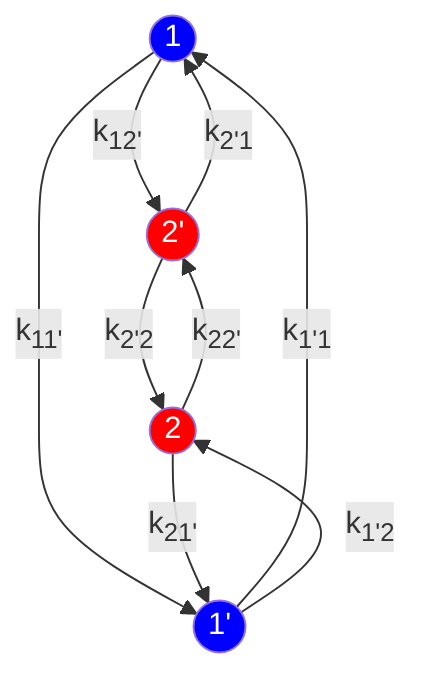

# CHAPTER 19 Degradation

*This chapter discusses the degradation models used in Sentaurus Device.*

# Overview of Degradation Models

A necessary part of predicting CMOS reliability is the simulation of the time dependence of interface trap generation. To cover as wide a range as possible, this simulation should accurately reflect the physics of the interface trap formation process. Although the mechanisms of interface trap generation are not completely understood, it is generally accepted that they involve silicon-hydrogen (Si-H) bond breakage and subsequent hydrogen transport, and various physical models have been proposed in the literature.

Sentaurus Device provides the following degradation models that account for time-dependent trap generation:

*   The trap degradation model is a simple model that captures the reaction-diffusion theory with hydrogen atom transport in the gate oxide (see Trap Degradation Model on page 544).

*   The fluence model explicitly expresses the increase in trap concentration as a function of the number of carriers that have been captured and emitted by a trap (see Fluence Model on page 554).

*   The multistate configuration (MSC)–hydrogen transport degradation model accounts for 3D transport of hydrogen atoms, ions, and molecules in all regions. Complex reaction dynamics related to Si-H bond breakage at the silicon–oxide interface are described with the MSC framework (see MSC–Hydrogen Transport Degradation Model on page 555).

*   The two-stage negative bias temperature instability (NBTI) degradation model, proposed by Grasser et al. <sup>[1]</sup> and Goes et al. <sup>[2]</sup>, is related to the creation of E′ centers and P<sub>b</sub> centers (oxide and interface dangling bonds) (see Two-Stage NBTI Degradation Model on page 564).

*   The extended nonradiative multiphonon model <sup>[3]</sup> is a four-state model that includes metastable states and accounts for the behavior of oxide defects related to NBTI (see Extended Nonradiative Multiphonon Model on page 569).

*   The hot-carrier stress degradation model is a general degradation model suitable for MOS-based devices. It includes mechanisms for hot-carrier stress degradation and field-enhanced thermal degradation (see Hot-Carrier Stress Degradation Model on page 575).

*   The activated barrier double well thermionic model can be used to describe the contribution to the overall threshold voltage shift during and after NBTI or positive bias temperature

Trap Degradation Model

instability (PBTI) due to hole or electron trapping and detrapping from process-dependent preexisting traps in the gate insulator (see Activated Barrier Double Well Thermionic Model on page 582).

* The transient trap occupancy model can be used to compute the charge occupancy of generated interface traps contributing to the overall threshold voltage shift for bias temperature instability calculations (see Transient Trap Occupancy Model on page 585).

---

# Trap Degradation Model

Disorder-induced variations among the Si-H activation energies at the passivated Si–SiO<sub>2</sub> interface have been shown [4] to be a plausible source of the sublinear time dependence of this trap generation process. Diffusion of hydrogen from the passivated interface was used to explain some time dependencies [5]. In addition, this could be due to a Si-H density–dependent activation energy [6], which might be due to the effects of Si-H breaking on the electrical and chemical potential of hydrogens at the interface. Furthermore, the field dependence of the activation energy due to the Poole–Frenkel effect can be considered, so that all these factors lead to enhanced trap formation kinetics.

---

# Trap Formation Kinetics

The main assumption about trap formation is that initially dangling silicon bonds at the Si–SiO<sub>2</sub> interface were passivated by hydrogen (H) or deuterium (D) [7], and degradation is a depassivation process where hot carrier interactions with Si-H/D bonds or other mechanisms are responsible for this. The equations of the model are solved self-consistently with all transport equations.

## Power Law and Kinetic Equation

The experimental data for the kinetics of interface trap formation [8] shows that the time dependence of trap generation can be described by a simple power law: $N_{it} - N_{it}^0 = N_{hb}^0 / (1 + (vt)^{-\alpha})$, where $N_{it}$ is the concentration of interface traps, and $N_{hb}^0$ and $N_{it}^0$ are the initial concentrations of Si-H bonds (or the concentration of hydrogen on Si bonds) and interface traps, respectively.

Assuming $N = N_{hb}^0 + N_{it}^0$ total Si bonds at the interface, the remaining number of Si-H bonds at the interface after stress is $N_{hb} = N - N_{it}$ and follows the power law:

$$ N_{hb} = \frac{N_{hb}^0}{1 + (vt)^\alpha} $$ (574)

Trap Degradation Model

Based on experimental observations, the power $\alpha$ is stress dependent and varies between 0 and 1.

From first-order kinetics [4], it is expected that the Si-H concentration during stress obeys:

$$ \frac{dN_{hb}}{dt} = -\nu N_{hb} \eqno(575) $$

where $\nu$ is a reaction constant that can be described by $\nu \propto \nu_A \exp(-\varepsilon_A/kT)$ in the Arrhenius approximation, $\varepsilon_A$ is the Si-H activation energy, and $T$ is the Si-H temperature. The exponential kinetics given by this equation ($N_{hb} = N_{hb}^0 \exp(-\nu t)$) do not fully describe the experimental data because a constant activation energy will behave like the power law in Eq. 574, but with power $\alpha \approx 1$.

## Si-H Density–Dependent Activation Energy

This section describes an activation energy parameterization to capture the sublinear power law for the time dependence of interface trap generation. There is evidence that the hydrogen atoms, when removed from the silicon, remain negatively charged [9]. If this correct, the hydrogen can be expected to remain in the vicinity of the interface and will affect the breaking of additional silicon-hydrogen bonds by changing the electrical potential.

The concentration of released hydrogen is equal to $N - N_{hb}$, so the activation energy dependence (assuming the activation energy changes logarithmically with the breaking of Si-H) can be expressed as:

$$ \varepsilon_A = \varepsilon_A^0 + (1 + \beta)kT \ln \left( \frac{N - N_{hb}}{N - N_{hb}^0} \right) \eqno(576) $$

where the last term represents the Si-H density–dependent change with a prefactor $1 + \beta$. Note that $(N - N_{hb}) / (N - N_{hb}^0)$ is the fraction of traps generated to the total initial traps, and this gives the form of the chemical potential of Si-H bonds with the prefactor $1 + \beta$.

The numeric solution of the kinetic equation with the varying activation energy above clearly shows that such a Si-H density–dependent activation energy gives a power law, and the power $\alpha$ is a function of the prefactor $1 + \beta$. From the available experimental data of interface trap generation, it was noted that for negative gate biases $\alpha > 0.5$, but for positive ones $\alpha < 0.5$. It is interesting that the solution of the above kinetic equation gives $\alpha \approx 0.5$ in the equilibrium case where a unity prefactor is used. In nonequilibrium, a polarity-dependent modification of the prefactor (field stretched and pressed Si-H bonds) is possible.

Trap Degradation Model

## Diffusion of Hydrogen in Oxide

Another model that can interpret negative bias temperature instability (NBTI) phenomena and different experimental slopes in degradation kinetics is the R-D model [10].

This model considers hydrogen in oxide, which diffuses from the silicon–oxide interface, but the part of the hydrogen that remains at the interface controls the degradation kinetics.

The diffusion of hydrogen in oxide can be expressed as follows:

$$
\begin{aligned}
D \frac{dN_{\text{H}}}{dx} &= \frac{dN_{\text{hb}}}{dt} && x = 0 \\
\frac{dN_{\text{H}}}{dt} &= D \frac{d^2 N_{\text{H}}}{dx^2} && 0 < x < x_{\text{P}} \\
D \frac{dN_{\text{H}}}{dx} &= -k_{\text{P}}(N_{\text{H}} - N_{\text{H}}^0) && x = x_{\text{P}}
\end{aligned} \eqno(577)
$$

where $N_{\text{H}}$ is a concentration of hydrogen in oxide, $D = D_0 \exp(-\varepsilon_{\text{H}}/kT)$ is its diffusion coefficient, $x = 0$ is a coordinate of the silicon–oxide interface, $x = x_{\text{P}}$ is the coordinate of the oxide–polysilicon gate interface (which is equal to the oxide thickness), $k_{\text{P}}$ is the surface recombination velocity at the oxide–polysilicon gate interface, and $N_{\text{H}}^0$ is an equilibrium (initial) concentration of hydrogen in the oxide.

> **NOTE** The model solves the one-dimensional diffusion equation (Eq. 577) with $x_{\text{P}}$ as the effective oxide thickness in a critical part of the interface where the degradation occurs. To solve Eq. 577 numerically, a uniform mesh is used with a number of nodes $N_{\text{ox}}$. Typically, a 15-node mesh is considered to be sufficiently practical. $N_{\text{ox}}$ should be defined together with other model parameters (see Using the Trap Degradation Model on page 549).

---

# Model Equations and Syntax

To use the trap degradation model, specify the `Degradation` keyword as part of a `Traps` specification in the command file. This invokes the general kinetic equation (left column of Eq. 578) with an added passivation term.

19: Degradation
Trap Degradation Model

To use the power law form of the model (right column of Eq. 578), specify `Degradation(PowerLaw)`:

$$ \begin{aligned} & \underline{\text{Kinetic}} & & \underline{\text{Power Law}} \\ & \frac{dN_{\text{hb}}}{dt} = -\nu N_{\text{hb}} + \gamma(N - N_{\text{hb}}) & & N_{\text{hb}} = \frac{N_{\text{hb}}^0}{1 + (\nu t)^\alpha} \\ & \gamma = \gamma_0 [N_{\text{H}} / N_{\text{H}}^0 + \Omega(N_{\text{hb}}^0 - N_{\text{hb}})] & & \alpha = 0.5 + \beta \\ & \gamma_0 = \frac{N_{\text{hb}}^0}{N - N_{\text{hb}}^0} \nu_0 \end{aligned} \tag{578} $$

In Eq. 578, $\gamma_0$ is the passivation constant, which is computed automatically by default to provide the equilibrium, but it can also be specified directly in the command file. $\Omega$ is the passivation volume (by default, it is equal to zero) and represents a simple model for the retrapping of depassivated hydrogen by dangling silicon bonds. Depassivated hydrogen increases the average hydrogen concentration $N_{\text{H}}$ near traps, which is computed from the R-D model (see Diffusion of Hydrogen in Oxide on page 546). If the R-D model is not activated, then $N_{\text{H}} / N_{\text{H}}^0 = 1$.

The parameterized system of equations for the reaction constant $\nu$, based on the trap formation model (see Trap Formation Kinetics on page 544 and [[6]]([6])), can be expressed as:

$$ \begin{aligned} \nu &= \nu_0 \exp \left( \frac{\varepsilon_{\text{A}}^0}{kT_0} - \frac{\varepsilon_{\text{A}}^0 + \Delta\varepsilon_{\text{A}}}{\varepsilon_{\text{T}}} \right) k_{\text{HC}} k_{\text{Tun}} k_{\text{SHE}} \\ \varepsilon_{\text{T}} &= kT + \delta_{//} |F_{//}|^{\rho_{//}} \\ \Delta\varepsilon_{\text{A}} &= -\delta_{\perp} |F_{\perp}|^{\rho_{\perp}} + (1 + \beta) \varepsilon_{\text{T}} \ln \frac{N - N_{\text{hb}}}{N - N_{\text{hb}}^0} \\ \beta &= \beta_0 + \beta_{\perp} F_{\perp} + \beta_{//} F_{//} \end{aligned} \tag{579} $$

where:

* $\nu_0$ (given in the command file) is the reaction (depassivation) constant at the passivation equilibrium (for the passivation temperature $T_0$ and for no changes in the activation energy $\Delta\varepsilon_{\text{A}} = 0$).

* $F_{\perp}$, $F_{//}$ are the perpendicular and parallel components of the electric field $F$ to the interface where traps are located. The perpendicular electric field $F_{\perp}$ has a positive sign if the space charge at the interface is positive.

* $\varepsilon_{\text{T}}$ is the energy of hydrogen on Si-H bonds and is equal to $kT$ plus some possible gain from hot carriers represented as the additional term that is dependent on the parallel component of the electric field $\delta_{//} |F_{//}|^{\rho_{//}}$.

* $\Delta\varepsilon_{\text{A}}$ is a change of the activation energy because of stretched Si-H bonds [[11]]([11]) by the electric field (first term) and due to a change of the chemical potential (second term) [[6]]([6]).

Trap Degradation Model

Effectively, the influence of the chemical potential also can be different in the presence of the electric field, and the coefficient $\beta$ represents this.

*   The coefficients $\delta_{\perp}$, $\rho_{\perp}$, $\delta_{//}$, $\rho_{//}$ and $\beta_{0}$, $\beta_{\perp}$, $\beta_{//}$ are field enhancement parameters for the model.

## Reaction Enhancement Factors

In Eq. 579, $k_{\text{HC}}$ and $k_{\text{Tun}}$ are reaction enhancement factors due to hot-carrier and tunneling current, respectively. They are given by:

$$ k_{\text{HC}} = 1 + \delta_{\text{HC}} \left| \frac{I_{\text{HC}}}{I_{0}} \right|^{\rho_{\text{HC}}} \tag{580} $$

$$ k_{\text{Tun}} = 1 + \delta_{\text{Tun}} \left( \delta_{\text{FN}} \left| \frac{I_{\text{FN}}}{I_{0}} \right|^{\rho_{\text{FN}}} + \delta_{\text{DTe}} \left| \frac{I_{\text{DTe}}}{I_{0}} \right|^{\rho_{\text{DTe}}} + \delta_{\text{DTh}} \left| \frac{I_{\text{DTh}}}{I_{0}} \right|^{\rho_{\text{DTh}}} + \delta_{\text{BTe}} \left| \frac{I_{\text{BTe}}}{I_{0}} \right|^{\rho_{\text{BTe}}} + \delta_{\text{BTh}} \left| \frac{I_{\text{BTh}}}{I_{0}} \right|^{\rho_{\text{BTh}}} \right)^{\rho_{\text{Tun}}} \tag{581} $$

where $I_{\text{HC}}$ is the local hot-carrier current density (see Hot-Carrier Injection on page 793), and $I_{\text{FN}}$, $I_{\text{DTe}}$, $I_{\text{DTh}}$, $I_{\text{BTe}}$, and $I_{\text{BTh}}$ are the tunneling current densities from Fowler–Nordheim tunneling, electron and hole direct tunneling, and electron and hole nonlocal barrier tunneling, respectively (see Tunneling on page 767). In these equations, $I_{0} = 1 \text{ A/cm}^{2}$.

When the electron energy distribution is available by specifying the `eSHEDistribution` keyword in the `Physics` section (see Using Spherical Harmonics Expansion Method on page 806), you can include the following additional spherical harmonics expansion (SHE) distribution enhancement factor:

$$ k_{\text{SHE}} = 1 + \delta_{\text{SHE}} \left( \frac{q g_{v}}{2} \int_{\varepsilon_{\text{th}}}^{\infty} \left( \min \left[ \exp \left( \frac{\varepsilon - \varepsilon_{\text{a}} + \delta_{\perp} |F_{\perp} / F_{0}|^{\rho_{\perp}}}{kT} \right), 1 \right] g(\varepsilon) f(\varepsilon) v(\varepsilon) \right) d\varepsilon \right)^{\rho_{\text{SHE}}} \tag{582} $$

where:

*   $\delta_{\text{SHE}}$ is a prefactor.

*   $\varepsilon_{\text{th}}$ is a threshold energy.

*   $\varepsilon_{\text{a}}$ is an activation energy.

*   $\delta_{\perp}$ is a normal field–induced activation energy–lowering factor.

*   $\rho_{\perp}$ is a normal field–induced activation energy–lowering exponent.

*   $F_{0} = 1 \text{V/cm}$.

*   $g_{v}$ is the valley degeneracy.

*   $g$ is the density-of-states.

*   $f$ is the electron energy distribution.

**19: Degradation**
Trap Degradation Model

* $v$ is the magnitude of the electron velocity.

* $\rho_{\text{SHE}}$ is an exponent for the SHE current.

The SHE distribution enhancement factor can be specified by the `eSHEDistribution` keyword in the `Traps` statement. Similarly, the `hSHEDistribution` keyword specifies the enhancement factor of the hole energy distribution.

The following example specifies the SHE distribution enhancement factor with $\delta_{\text{SHE}} = 100 \text{ cm}^2/\text{A}$, $\epsilon_{\text{th}} = 2 \text{ eV}$, $\epsilon_{\text{a}} = 2.1 \text{ eV}$, $\delta_{\perp} = 10^{-7} \text{ eV}$, $\rho_{\perp} = 1$, and $\rho_{\text{SHE}} = 1$:

```
Physics (MaterialInterface="Silicon/Oxide") {
  Traps (...
    Degradation
    # (delta_SHE  E_th  E_a  delta_p  rho_p  rho_SHE)
    eSHEDistribution=(1.0e2  2  2.1  1.0e-7  1  1)
    ...
  )
}
```

## Using the Trap Degradation Model

The `Degradation` model can be activated for any trap level or distribution (see Chapter 17 on page 489). The keywords related to the `Degradation` model are described in Table 325 on page 1612, along with all other trap-related options, and their syntax is shown here:

| Physics ( [ RegionInterface \| MaterialInterface = "<name1>/<name2>" ] \| |  |  |  |  |  |
| --- | --- | --- | --- | --- | --- |
| [ Material \| Region = "<name>" ] ) { |  |  |  |  |  |
| Traps ( |  |  |  |  |  |
| <trap_specifications> |  |  |  |  |  |
| Degradation [ (PowerLaw) ] |  |  |  |  |  |
| Conc=<$N_{ | ext{it}}^0$> |  |  |  |  |
| BondConc=<$N$> [BondConcSFactor=["<dataset_name>" \| "<pmi_model_name>"]] |  |  |  |  |  |
| ActEnergy=<$ε_{ | ext{A}}^0$> |  |  |  |  |
| DePasCoef=<$v_0$> |  |  |  |  |  |
| [CritConc=<$N_{ | ext{crit}}$>] |  |  |  |  |
| [FieldEnhan=(<$\delta_{//}$> <$\rho_{//}$> <$\delta_{\perp}$> <$\rho_{\perp}$>)] |  |  |  |  |  |
| [PowerEnhan=(<$\beta_0$> <$\beta_{//}$> <$\beta_{\perp}$>)] |  |  |  |  |  |
| [CurrentEnhan=(<$\delta_{ | ext{Tun}}$> <$\rho_{ | ext{Tun}}$> <$\delta_{ | ext{HC}}$> <$\rho_{ | ext{HC}}$>)] |  |
| [FowlerNordheimEnhan=(<$\delta_{ | ext{FN}}$> <$\rho_{ | ext{FN}}$>)] |  |  |  |
| [DirectTunnelingEnhan=(<$\delta_{ | ext{DTe}}$> <$\rho_{ | ext{DTe}}$> <$\delta_{ | ext{DTh}}$> <$\rho_{ | ext{DTh}}$>)] |  |
| [BarrierTunnelingEnhan=(<$\delta_{ | ext{BTe}}$> <$\rho_{ | ext{BTe}}$> <$\delta_{ | ext{BTh}}$> <$\rho_{ | ext{BTh}}$>)] |  |
| [eSHEDistribution=(<$\delta_{ | ext{SHE}}$> <$\epsilon_{ | ext{th}}$> <$\epsilon_{ | ext{a}}$> <$\delta_{\perp}$> <$\rho_{\perp}$> <$\rho_{ | ext{SHE}}$>)] |  |
| [hSHEDistribution=(<$\delta_{ | ext{SHE}}$> <$\epsilon_{ | ext{th}}$> <$\epsilon_{ | ext{a}}$> <$\delta_{\perp}$> <$\rho_{\perp}$> <$\rho_{ | ext{SHE}}$>)] |  |
| [DiffusionEnhan=(<$x_{ | ext{p}}$> <$D_0$> <$\epsilon_{ | ext{H}}$> <$k_{ | ext{p}}$> <$N_{ | ext{H}}^0$> <$N_{ | ext{ox}}$>)] |
| [PasCoef=<$γ_0$>] |  |  |  |  |  |
| [PasTemp=<$T_0$>] |  |  |  |  |  |
| [PasVolume=<$Ω$>] |  |  |  |  |  |

Trap Degradation Model

```
    )
    ...
}
```

The total silicon-bond concentration, which represents the maximum concentration of traps that can be generated as the result of degradation, is specified with `BondConc`. It is possible to have a spatially dependent bond concentration by using the parameter `BondConcSFactor` to specify a dataset or a PMI space factor model (see Space Factor on page 1446) that describes the spatial dependency. If `BondConcSFactor` is specified without `BondConc`, then the values obtained from the dataset or PMI are used directly. If both `BondConcSFactor` and `BondConc` are specified, then the `BondConcSFactor` values are normalized by the largest `BondConcSFactor` value and are then multiplied by `BondConc`.

# Device Lifetime and Simulation

The following example illustrates the use of the `Degradation` model:

```
Physics(MaterialInterface="Silicon/Oxide"){
  Traps(Conc=1e8 EnergyMid=0 Acceptor #FixedCharge
    Degradation #(PowerLaw)
      ActEnergy=2 BondConc=1e12
    DePasCoeff=8e-10
    FieldEnhan=(0 1 1.95e-3 0.33)
    CurrentEnhan=(0 1 6e+5 1)
    PowerEnhan=(0 0 -1e-7)
  )
  GateCurrent(GateName="gate" Lucky(CarrierTemperatureDrive) Fowler)
}
```

For this input, the initially specified trap concentration is 10<sup>8</sup> cm<sup>–2</sup> and, in the process of degradation, it can be increased up to 10<sup>12</sup> cm<sup>–2</sup>. The activation energy of hydrogen on Si-H bonds is 2 eV and the depassivation constant at the equilibrium is equal to 8 × 10<sup>–10</sup> s<sup>–1</sup>. The degradation simulation can be separated into two parts:

* Simulation of extremely stressed devices with existing experimental data and fitting to the data by modification of the field and current-dependent parameters.

* Simulation of normal-operating devices to predict device reliability (lifetime).

For the first part of the degradation simulation, the typical `Solve` section can be:

```
Solve {
  NewCurrentPrefix="tmp"
  coupled (iterations=100) { Poisson }
  coupled { poisson electron hole }
  Quasistationary( InitialStep=0.1 MaxStep=0.2 MinStep=0.0001
       increment=1.5 Goal{name="gate" voltage=-10} )
```

19: Degradation
Trap Degradation Model

```
        { coupled { poisson electron hole } }
    NewCurrentPrefix=""
    coupled { poisson electron hole }
    transient( InitialTime=0 Finaltime = 100000
            increment=2 InitialStep=0.1 MaxStep=100000 ){
           coupled{ poisson electron hole }
    }
}
```

The first `Quasistationary` ramps the device to stress conditions (in this particular case, to high negative gate voltage), the second `transient` simulates the degradation kinetics (up to 10<sup>5</sup> s, which is a typical time for stress experimental data).

**NOTE** The hot carrier currents are postprocessed values and, therefore, `InitialStep` should not be large.

To monitor the trap formation kinetics in transient, you can use `Plot` and `CurrentPlot` statements to output `TotalTrapConcentration` and `OneOverDegradationTime`. For example:

```
CurrentPlot{
    eDensity(359) Potential(359)
    OneOverDegradationTime(359)
    TotalTrapConcentration(359)
}
```

where a vertex number is specified to have a plot of the fields at some location on the interface. As a result, the behavior of these values versus time can be seen in the plot file of Sentaurus Device.

The prediction of the device lifetime can be performed in two different ways:

* Direct simulation of a normal-operating device in transient for a long time (for example, 30 years).

* Extrapolation of the degradation of a stressed device by computation of the ratio between depassivation constants for stressed and unstressed conditions.

The important value here is the critical trap concentration $N_{crit}$, which defines an edge between a properly working and improperly working device. Using $N_{crit}$, the device lifetime $\tau_D$ is defined as follows (according to different prediction ways):

1. In `transient`, direct computation of time $t = \tau_D$ gives the trap concentration equal to $N_{crit}$.

2. In `Quasistationary`, if the previously finished `transient` statement computes the device lifetime $\tau_D^{stress}$ and the depassivation constant $\nu^{stress}$ at stress conditions, then $\tau_D = (\nu^{stress} / \nu) \tau_D^{stress}$.

Trap Degradation Model

So, the plotted value of `OneOverDegradationTime` is equal to $1/\tau_{\text{D}}$ for one trap level and the sum $\sum 1/\tau_{\text{D}}^i$ if several trap levels are defined for the degradation. It is computed for each vertex where the degradation model is applied and can be considered as the lifetime of local device area.

For the second approach to device lifetime computation, the following `Solve` statement can be used:

```
Solve {
    NewCurrentPrefix="tmp"
    coupled (iterations=100) { Poisson }
    coupled { poisson electron hole }

    Quasistationary( InitialStep=0.1 MaxStep=0.2 Minstep=0.0001
            increment=1.5 Goal{name="gate" voltage=-10} )
            { coupled { poisson electron hole } }

    NewCurrentPrefix=""
    coupled { poisson electron hole }
    transient( InitialTime=0 Finaltime = 100000
            increment=2 InitialStep=0.1 MaxStep=100000 ){
            coupled{ poisson electron hole }
    }

    set(Trapfilling=-Degradation)

    coupled { poisson electron hole }
    Quasistationary( InitialStep=0.1 MaxStep=0.2 Minstep=0.0001 increment=1.5
            Goal{name="gate" voltage=1.5} )
            { coupled { poisson electron hole } }
    Quasistationary( InitialStep=0.1 MaxStep=0.2 Minstep=0.0001 increment=1.5
            Goal{name="drain" voltage=3} )
            { coupled { poisson electron hole } }
}
```

The statement `set(Trapfilling=-Degradation)` returns the trap concentrations to their unstressed values (it is not necessary to include, but it might be interesting to check the influence). The first `Quasistationary` statement after the `set` command returns the normal-operating voltage on the gate and, in the second, you can plot the dependence of $1/\tau_{\text{D}}$ on applied drain voltage. The last dependence could be useful to predict an upper limit of operating voltages where the device will work for a specified time.

19: Degradation
Trap Degradation Model

# Degradation in Insulators

Although the Degradation model was designed for trap generation that occurs at semiconductor–insulator interfaces, the model can be used to generate traps at insulator–insulator interfaces or in bulk-insulator regions.

For insulator degradation, Sentaurus Device sets $F_{\perp} = F$ and $F_{\parallel} = 0$, and the enhancement factors $k_{\text{HC}}$, $k_{\text{Tun}}$, and $k_{\text{SHE}}$ are taken from values computed at the semiconductor–insulator interface.

> **NOTE** To allow traps that are created in insulator regions to be filled with carriers, it is necessary to construct a nonlocal mesh to connect the semiconductor–insulator interface to the regions where traps are generated and to invoke nonlocal tunneling models (see Nonlocal Tunneling for Traps on page 517).

To use this feature:

1. Create a nonlocal mesh that connects the semiconductor interface with the regions where traps are generated. For example:

```
Math {
  NonLocal "NLM_silicon_oxide" (
    MaterialInterface = "Silicon/Oxide"
    Length = 4.1e-7                 # Use a length that will reach the traps
  )
}
```

2. Specify nonlocal tunneling and `Traps(Degradation ...)` in the `Physics` section associated with the insulator–insulator interface or the bulk-insulator region where degradation will be used. Degradation parameters must be specified and adjusted as necessary. For example:

```
Physics (RegionInterface="oxide1/oxide2") {
  Traps (
    eBarrierTunneling(Nonlocal="NLM_silicon_oxide")
    hBarrierTunneling(Nonlocal="NLM_silicon_oxide")
    TrapVolume=1e-6
    HuangRhys=70
    PhononEnergy=0.02
  #
    Degradation
    Conc=1e4 EnergyMid=0 Donor
    ActEnergy=2
    BondConc=1e14
    DePasCoeff=1e-11
    PasTemp=300
```

Fluence Model

```
    FieldEnhan=(0 1 3.9e-3 0.33)
    CurrentEnhan=(0 1 1 1)
    PowerEnhan=(0 0 -1e-7)
    DiffusionEnhan=(2e-7 1e-13 0.05 1.0 5e10 15)
    PasVolume=5e-10
  )
}
```

3. In the parameter file, specify a nonzero tunneling mass for all regions or materials where tunneling can occur. For example:

```
Material = "Silicon" {
  BarrierTunneling "NLM_silicon_oxide" { mt = 1, 1 }
}

Material = "Oxide" {
  BarrierTunneling "NLM_silicon_oxide" { mt = 1, 1 }
}
```

# Fluence Model

In the fluence model, degradation is described as an increase in trap concentration as a function of the number of carriers captured and emitted by a particular trap. In this model, the trap concentration at time $t$, $N_{\text{hb}}(t)$, is given by the initial trap concentration $N_{\text{hb}}^0$ as:

$$ N_{\text{hb}}(t) = N_{\text{hb}}^0 [(f_{\text{cb}} N_{\text{cb}}(t) + f_{\text{vb}} N_{\text{vb}}(t))^{\beta_{\text{F}}} + 1] \eqno(583) $$

Here, $f_{\text{cb}}$, $f_{\text{vb}}$, and $\beta_{\text{F}}$ are dimensionless fit parameters. The fluences $N_{\text{cb}}(t)$ and $N_{\text{vb}}(t)$ are the total number of carriers that a single trap has emitted or captured from the conduction band and the valence band, respectively, from the beginning of the simulation up to time $t$.

Note that the fluence model makes no assumption about the physical nature of the degradation process. It is merely a heuristic calibration formula. In addition, since the fluences are the sum of capture and emission processes, they grow all the time, even in equilibrium. Only far from equilibrium, you can consider the fluence as the total current that has passed through a trap.

To activate the fluence model, specify `FluenceDependence` in a `Trap` entry for a trap that should degrade. With this keyword, you specify the parameters $\beta_{\text{F}}$, $f_{\text{cb}}$, and $f_{\text{vb}}$.

The following example specifies a midgap trap with an initial concentration of $1 \text{cm}^{-3}$, $\beta_{\text{F}} = 0.5$, $f_{\text{cb}} = 1 \times 10^{-10}$, and $f_{\text{vb}} = 2 \times 10^{-10}$:

```
Traps((Conc=1 eNeutral EnergyMid=0 FluenceDependence=(0.5 1e-10 2e-10)))
```

19: Degradation
MSC–Hydrogen Transport Degradation Model

# MSC–Hydrogen Transport Degradation Model

Bias and temperature stresses generate interface fixed charges and trapped charges near the oxide interface. These immobile charges affect the threshold voltage (see Chapter 7 on page 179) and the carrier mobility (see Mobility Degradation Components due to Coulomb Scattering on page 372). To explain these degradation phenomena, various physical models have been proposed [1][12][13][14]. Although the details of these models are different, they commonly involve charge-trapping, silicon-hydrogen bond depassivation, and hydrogen transport.

To model charge-trapping, interactions between localized trapping centers and mobile carriers must be considered. Contrary to the standard traps in Chapter 17 on page 489, the trapping centers used in the degradation model usually involve hydrogens. Therefore, interactions between the localized trapping centers and mobile hydrogens should be considered. In addition, the trapping centers might have more than two internal states depending on the structural relaxation and the presence of charges and hydrogens [1].

The multistate configurations (MSCs) introduced in Chapter 18 on page 527 can be used to represent these complex trapping centers because the MSCs can handle an arbitrary number of states and their transitions involving the capture and emission of charges and hydrogens.

Finally, hydrogen transport must be considered if the degradation model involves mobile hydrogens. Hydrogen atoms, hydrogen molecules, and hydrogen ions can contribute to the hydrogen transport, and there can be chemical reactions between them [12][13][14].

Sentaurus Device provides the following capabilities to model oxide degradation:

* Transport equations for hydrogen atoms, hydrogen molecules, and hydrogen ions.

* An arbitrary number of interface and bulk reactions among mobile elements (hydrogen atoms, hydrogen molecules, hydrogen ions, electrons, and holes).

* An arbitrary number of interface and bulk reactions among mobile elements and localized states by using the multistate configurations (see Chapter 18 on page 527).

## Hydrogen Transport

Transport equations for hydrogen atoms ($X_1$), hydrogen molecules ($X_2$), and hydrogen ions ($X_3$) can be written as:

$$ \frac{\partial}{\partial t}[X_i] + \nabla \cdot \left[ D_i \exp(-\frac{E_{di}}{kT}) \left( \frac{qK_i^Q}{kT} \vec{F}[X_i] - \nabla[X_i] - \alpha_{td}[X_i]\nabla \ln T \right) \right] + R_{\text{net}} + r_i([X_i] - [X_i]_0) = 0 $$ (584)

MSC–Hydrogen Transport Degradation Model

where:

*   $D_i$ is the diffusion coefficient.

*   $E_{di}$ is the diffusion activation energy.

*   $\alpha_{td}$ is the prefactor of the thermal diffusion term.

*   $K_i^Q$ is the number of charges for element $X_i$.

*   $R_{net}$ is the net recombination rate due to chemical reactions.

*   $r_i$ is the explicit recombination rate.

*   $[X_i]_0$ is the initial density.

By default, the initial densities of hydrogen atoms, molecules, and ions are all zero. You can load the initial density of each hydrogen element from the `PMIUserField` by using the `Set` command in the `Solve` section. For example:

```
Solve {
    ...
    Set ( HydrogenAtom = "PMIUserField0" )
    Set ( HydrogenMolecule = "PMIUserField1" )
    Set ( HydrogenIon = "PMIUserField3" )
    ...
}
```

Sentaurus Device uses default values for $D_i \exp(-E_{di}/(kT))$ and $\alpha_{td}$. You can customize the computation of $D_i \exp(-E_{di}/(kT))$ and $\alpha_{td}$ by using PMI models (for details, see Diffusivity on page 1362). The corresponding command file can be written as:

```
Physics ( Material = "Oxide" ) {
    HydrogenDiffusion(
        HydrogenAtom (
            Diffusivity = pmi_HydrogenDiffusivity
            Alpha = pmi_HydrogenAlpha
        )
        HydrogenMolecule (
            Diffusivity = pmi_HydrogenDiffusivity
            Alpha = pmi_HydrogenAlpha
        )
        HydrogenIon (
            Diffusivity = pmi_HydrogenDiffusivity
            Alpha = pmi_HydrogenAlpha
        )
        ...
    )
}
```

19: Degradation

MSC–Hydrogen Transport Degradation Model

## Boundary Conditions

At electrodes, $[X_i] = [X_i]_0$ is assumed as the default boundary condition. You can specify more flexible conditions at each contact. The corresponding command file can be written as:

```
HydrogenBoundary {
  { Name = "cSiTop"
    HydrogenAtom = 1e7           # [cm-3]
    HydrogenMolecule = reflective
  }
  { Name = "cSiBot"
    HydrogenAtom = reflective
  }
  ...
}
```

# Reactions Between Mobile Elements

In the model, you can specify an arbitrary number of bulk and interface chemical reactions between hydrogen atoms ($X_1$), hydrogen molecules ($X_2$), hydrogen ions ($X_3$), electrons ($X_4$), and holes ($X_5$). Each reaction is defined by the following reaction equation:

$$ \sum_{i=1}^{5} \alpha_i X_i \leftrightarrow \sum_{i=1}^{5} \beta_i X_i \tag{585} $$

where the nonnegative integers $\alpha_i$ and $\beta_i$ are the particle numbers of element $X_i$ to be removed and created by the forward reaction.

These coefficients must satisfy the charge and hydrogen conservation laws:

$$ \sum_{i=1}^{5} (\alpha_i - \beta_i) K_i^Q = 0 \tag{586} $$

$$ \sum_{i=1}^{5} (\alpha_i - \beta_i) K_i^H = 0 \tag{587} $$

where $K_i^Q$ and $K_i^H$ are the number of charges and the number of hydrogen atoms for element $X_i$ (for $K_i^Q$ and $K_i^H$ of each mobile element, see Table 98 on page 528).

MSC–Hydrogen Transport Degradation Model

The forward and reverse reaction rates $R_f$ and $R_r$ are modeled as:

$$ R_f = k_f \exp \left( \delta_f F - \frac{E_f}{kT} \right) \prod_{i=1}^{5} \left( \frac{[X_i]}{1/\text{cm}^3} \right)^{\alpha_i} \tag{588} $$

$$ R_r = k_r \exp \left( \delta_r F - \frac{E_r}{kT} \right) \prod_{i=1}^{5} \left( \frac{[X_i]}{1/\text{cm}^3} \right)^{\beta_i} \tag{589} $$

where:

* $F$ is the magnitude of the electric field [V/cm].

* $k_f$ and $k_r$ are the forward and reverse reaction coefficients, respectively ([$\text{cm}^{-3} \text{s}^{-1}$] for bulk reactions and [$\text{cm}^{-2} \text{s}^{-1}$] for interface reactions).

* $\delta_f$ and $\delta_r$ are the forward and reverse reaction field coefficients, respectively [$\text{cm V}^{-1}$].

* $E_f$ and $E_r$ are the forward and reverse reaction activation energies, respectively [eV].

**NOTE** For a reaction specified at a semiconductor–insulator interface, the insulator electric field is used instead of the semiconductor electric field.

A reaction can be specified in the `Physics` section as an argument `HydrogenReaction` to the `HydrogenDiffusion` keyword. For example, consider the dimerization of two hydrogen atoms into a hydrogen molecule $2\text{H} \leftrightarrow \text{H}_2$ in the oxide region with $k_f = 10^{-3} \text{ cm}^{-3} \text{ s}^{-1}$ and $k_r = 10^2 \text{ cm}^{-3} \text{ s}^{-1}$.

The corresponding command file can be written as:

```
Physics ( Material = "Oxide" ) {
  HydrogenDiffusion(
    HydrogenReaction( # 2H <-> H_2
      LHSCoef ( # alpha_i
        HydrogenAtom = 2
        HydrogenMolecule = 0
        HydrogenIon = 0
        Electron = 0
        Hole = 0
      )
      RHSCoef ( # beta_i
        HydrogenAtom = 0
        HydrogenMolecule = 1
        HydrogenIon = 0
        Electron = 0
        Hole = 0
      )
      ForwardReactionCoef = 1.0e-3 # k_f
```

19: Degradation
MSC–Hydrogen Transport Degradation Model

```
        ReverseReactionCoef = 1.0e2 # k_r
        ForwardReactionEnergy = 0 # E_f
        ReverseReactionEnergy = 0 # E_r
        ForwardReactionFieldCoef = 0 # delta_f
        ReverseReactionFieldCoef = 0 # delta_r
       )
       ...
      )
     }
```

The default values of all the coefficients are zero. Table 305 on page 1599 lists the options available for the reaction specification.

For heterointerfaces, the keyword `Region` or `Material` allows you to specify the region or material where the reaction process enters as a generation–recombination rate. In addition, the keyword `FieldFromRegion` or `FieldFromMaterial` allows you to specify the region or material where the electric field is obtained.

For example:

```
     Physics ( Material = "Silicon/OxideAsSemiconductor" ) {
      HydrogenDiffusion(
       HydrogenReaction(...
        Material = "Silicon"
        FieldFromMaterial = "OxideAsSemiconductor"
       )
      )
     }
```

# Reactions With Multistate Configurations

A multistate configuration (MSC) can be used to model reactions between the mobile hydrogen elements and localized hydrogen states such as silicon-hydrogen bonds at the silicon–oxide interface.

For example, consider a hydrogen depassivation model based on the hole capture process:

$$ \text{Si-H} + p \leftrightarrow \text{Si}^{+} + \text{H} \text{ (590)} $$

where Si-H, $p$, Si$^{+}$, and H represent the silicon-hydrogen bond, hole, silicon dangling bond, and hydrogen atom, respectively. This reaction can be specified by a two-state MSC defined at the silicon–oxide interface:

```
    Physics ( MaterialInterface = "Silicon/Oxide" ) {
     MSConfigs (
      MSConfig ( Name = "SiHBond" Conc=5.0e12
```

MSC–Hydrogen Transport Degradation Model

```
        State ( Name = "s1" Hydrogen=1 Charge=0 ) # Si-H bond
        State ( Name = "s2" Hydrogen=0 Charge=1 ) # Si^+ dangling bond
        Transition ( Name = "t21" # Si-H + p <-> H + Si^+
         To="s2" From="s1" CEModel("CEModel_Depassivation" 1)
         Reservoirs("VB"(Particles=+1) "HydrogenAtom"(Particles=-1) )
         FieldFromInsulator
        )
    )
    ...
)
}
```

The capture and emission rates are obtained from:

$$ c_{21} = c_{\text{PMI}}(n, p, T, T_n, T_p, F) \prod_{i=1}^{3} \left( \frac{[X_i]}{1/\text{cm}^3} \right)^{\alpha_i} $$ (591)

$$ e_{21} = e_{\text{PMI}}(n, p, T, T_n, T_p, F) \prod_{i=1}^{3} \left( \frac{[X_i]}{1/\text{cm}^3} \right)^{\beta_i} $$ (592)

where $c_{\text{PMI}}$ and $e_{\text{PMI}}$ are the capture and emission rates specified by the trap capture and emission PMI model, respectively.

For more information about multistate configurations, see Chapter 18 on page 527.

**NOTE** Contrary to the conventional trap capture and emission PMI model, the insulator electric field can be used in the PMI model at the semiconductor–insulator interface instead of the semiconductor electric field when the keyword `FieldFromInsulator` is set in the transition.

## The CEModel_Depassivation Model

The built-in capture and emission model `CEModel_Depassivation` models the hydrogen depassivation process. In the model, the hydrogen depassivation (electron capture) rate induced by hot-electron distribution is written as:

$$ c_{\text{PMI}} = 2g_v \sigma \int_{\varepsilon_{\min}}^{\varepsilon_{\max}} v(\varepsilon) g(\varepsilon) f(\varepsilon) \exp \left[ \gamma \left( \frac{F}{1 \text{ V/cm}} \right)^\rho - \frac{\Theta(W_{\text{f}} - q\alpha F - \chi \varepsilon)(W_{\text{f}} - q\alpha F - \chi \varepsilon)}{kT} \right] $$ (593)

**19: Degradation**
MSC–Hydrogen Transport Degradation Model

where:

*   $\varepsilon_{\min}$ and $\varepsilon_{\max}$ are the minimum and maximum kinetic energies of the integration.

*   $\sigma$ is the capture cross-section.

*   $g_v$ is the valley degeneracy.

*   $v(\varepsilon)$ is the magnitude of the group velocity.

*   $g(\varepsilon)$ is the density-of-states.

*   $f(\varepsilon)$ is the distribution function.

*   $\gamma$ is the field enhancement prefactor.

*   $\rho$ is the field enhancement exponent.

*   $W_f$ is the activation energy for the depassivation process.

*   $\alpha$ is the field-induced barrier-lowering factor.

*   $\chi$ is the kinetic energy–induced barrier-lowering factor.

Similarly, the hydrogen depassivation rate induced by cold electrons can be written as:

$$c_{\text{PMI}} = \sigma v_{\text{th}} n \exp \left[ \gamma \left( \frac{F}{1 \text{ V/cm}} \right)^{\rho} - \frac{\Theta(W_f - q\alpha F)(W_f - q\alpha F)}{kT} \right]$$ (594)

where $v_{\text{th}}$ is the thermal velocity.

As the hydrogen passivation (electron emission) rate is not related to hot carriers, it is modeled simply as:

$$e = e_{\text{PMI}} \times \left( \frac{[\text{H}]}{1/\text{cm}^3} \right)$$ (595)

$$e_{\text{PMI}} = e_0 \exp \left( -\frac{W_r}{kT} \right)$$ (596)

where $e_0$ is the passivation rate prefactor, and $W_r$ is the activation energy for the passivation process.

The capture-emission model `CEModel_Depassivation` implements Eq. 593 and Eq. 594 for electrons and holes. The additional index in the `CEModel_Depassivation` model selects the equation and the carrier type as follows:

```
MSConfig( ...
    Transition( ... CEModel("CEModel_Depassivation" 0)) # Eq. 594 for electrons
    Transition( ... CEModel("CEModel_Depassivation" 1)) # Eq. 594 for holes
    Transition( ... CEModel("CEModel_Depassivation" 2)) # Eq. 593 for electrons
    Transition( ... CEModel("CEModel_Depassivation" 3)) # Eq. 593 for holes
)
```

MSC–Hydrogen Transport Degradation Model

To use the `CEModel_Depassivation` model with the index 2 or 3 (hot electron–induced or hot hole–induced degradation), you must specify `eSHEDistribution` or `hSHEDistribution` in the `Physics` section to compute the electron or hole distribution function (see Using Spherical Harmonics Expansion Method on page 806).

The model coefficients and their defaults are given in Table 106. The model coefficients can be changed in the `CEModel_Depassivation` section of the parameter file.

Table 106 Default coefficients for CEModel_Depassivation

| Symbol | Parameter name (Electrons) | Default value (Electrons) | Parameter name (Holes) | Default value (Holes) | Unit |
| --- | --- | --- | --- | --- | --- |
| σ | Xsec_e | 1.0 × 10−24 | Xsec_h | 1.0 × 10−24 | cm2 |
| vth | Vth_e | 2.0 × 107 | Vth_h | 2.0 × 107 | cm/s |
| γ | gamma_e | 2.7 × 10−7 | gamma_h | 2.7 × 10−7 | 1 |
| ρ | rho_e | 1.0 | rho_h | 1.0 | 1 |
| α | alpha_e | 9.0 × 10−9 | alpha_h | 9.0 × 10−9 | cm |
| χ | chi_e | 1.0 | chi_h | 1.0 | 1 |
| Wf | Wf_e | 0.5 | Wf_h | 0.5 | eV |
| e0 | e0_e | 3.0 × 10−9 | e0_h | 3.0 × 10−9 | 1/s |
| Wr | Wr_e | 0 | Wr_h | 0 | eV |
| dε | dE_e | 0.01 | dE_h | 0.01 | eV |
| εmin | Emin_e | 0 | Emin_h | 0 | eV |
| εmax | Emax_e | 5 | Emax_h | 5 | eV |

# Using MSC–Hydrogen Transport Degradation Model

You can select the regions and interfaces where the hydrogen transport equations are to be solved by specifying the keyword `HydrogenDiffusion` in the corresponding `Physics` section of the command file. For example:

```
Physics ( Material = "Oxide" ) {
  HydrogenDiffusion
}
```

The keyword `HydrogenDiffusion` can be specified with the `HydrogenReaction` arguments (see Reactions Between Mobile Elements on page 557).

19: Degradation

MSC–Hydrogen Transport Degradation Model

Specifying `HydrogenDiffusion` in the interface-specific `Physics` section gives a surface recombination term determined by $r_i$ and $[X_i]_0$ at the corresponding interface.

To activate the transport of hydrogen atoms, hydrogen molecules, and hydrogen ions, the keywords `HydrogenAtom`, `HydrogenMolecule`, and `HydrogenIon` must be specified inside the `Coupled` statement of the `Solve` section.

For example, transient drift-diffusion simulation with transport of hydrogen atoms and hydrogen molecules can be specified by:

```
Solve {
  Transient(...) {
    Coupled { Poisson Electron Hole HydrogenAtom HydrogenMolecule }
  }
}
```

The parameters $D_i$, $E_{di}$, $[X_i]_0$, and $r_i$ can be specified in the region-specific and interface-specific `HydrogenDiffusion` parameter set in the parameter file. For example:

```
Material = "Oxide" {
  HydrogenDiffusion {
    HydrogenAtom {
      d0 = 1.0e-13  # [cm^2*s^-1]
      Ed = 0        # [eV]
      atd = 1       # [1]
      n0 = 0        # [cm^-3]
      krec = 0      # [cm^-3*s^-1]
    }
    HydrogenMolecule {
      d0 = 1.0e-14  # [cm^2*s^-1]
      Ed = 0        # [eV]
      atd = 1       # [1]
      n0 = 0        # [cm^-3]
      krec = 0      # [cm^-3*s^-1]
    }
    HydrogenIon {
      ...
    }
  }
}

MaterialInterface = "Oxide/PolySi" {
  HydrogenDiffusion {
    HydrogenAtom {
      n0 = 1        # [cm^-3]
      krec = 1      # [cm^-2*s^-1]
```

Two-Stage NBTI Degradation Model

```
      }
   }
}
```

Here `d0`, `Ed`, `atd`, `n0`, and `krec` correspond to $D_i$, $E_{di}$, $\alpha_{td}$, $[X_i]_0$, and $r_i$. The default values of $D_i$, $E_{di}$, $[X_i]_0$, and $r_i$ are zero; while $\alpha_{td} = 1$ by default.

The keywords for plotting the densities of hydrogen atoms, hydrogen molecules, and hydrogen ions are:

```
Plot { ...
   HydrogenAtom HydrogenMolecule HydrogenIon
}
```

## Changing Charge and Hydrogen Composition of Species

You can change the charge and hydrogen composition of the individual species `HydrogenAtom`, `HydrogenMolecule`, and `HydrogenIon` in the parameter file as follows:

```
HydrogenDiffusion {
   HydrogenAtom {
      Charge = 3
      Hydrogen = 5
   }
}
```

**NOTE** You cannot specify different compositions for different materials or regions.

The specified species compositions are taken into account in the hydrogen transport equation (see Eq. 584, p. 555), the corresponding reactions (see Reactions Between Mobile Elements on page 557), the reactions with MSC states (see Reactions With Multistate Configurations on page 559), and the Poisson equation.

# Two-Stage NBTI Degradation Model

Negative bias temperature instability (NBTI) refers to the generation of positive oxide charges and interface traps in MOS structures under negative gate bias at elevated temperature, which affects the threshold voltage and on-currents of PMOSFETs [12].

19: Degradation

Two-Stage NBTI Degradation Model

Sentaurus Device provides a two-stage NBTI degradation model [[1]]([1])[[2]]([2]), which assumes that the NBTI degradation proceeds using a two-stage process:

*   The first stage includes the creation of $E'$ centers (dangling bonds in amorphous oxides) from their neutral oxygen vacancy precursors, the charging and discharging of $E'$ centers, and the total annealing of $E'$ centers to neutral oxygen vacancy precursors.

*   The second stage considers the creation of poorly recoverable $P_b$ centers (dangling bonds at silicon–oxide interfaces).

In the two-stage NBTI degradation model, the involved energy levels and activation energies are distributed widely and are treated as random variables. A random sampling technique is used to obtain the average change of the interface charge.

> **NOTE** As the two-stage NBTI model is based on the semiclassical carrier density at the semiconductor–insulator interface, it is not recommended to use the model with quantum-correction models.

# Formulation

The two-stage NBTI degradation model considers a special trap having four internal states:

*   $s_1$ : Oxygen vacancy as a precursor state

*   $s_2$ : Positive $E'$ center

*   $s_3$ : Neutral $E'$ center

*   $s_4$ : Fixed positive charge with a $P_b$ center

Each NBTI trap is characterized by seven independent random variables:

*   $E_1$ : Trap level of the precursor [eV] (by default, $-1.14 \le E_1 < -0.31$)

*   $E_2$ : Trap level of the $E'$ center [eV] (by default, $0.01 \le E_2 < 0.3$)

*   $E_4$ : Trap level of the $P_b$ center [eV] (by default, $0.01 \le E_4 < 0.5$)

*   $E_A$ : Barrier energy of a transition from $s_3$ to $s_1$ [eV] (by default, $0.01 \le E_A < 1.15$)

*   $E_B$ : Barrier energy of a transition from $s_1$ to $s_2$ [eV] (by default, $0.01 \le E_B < 1.15$)

*   $E_D$ : Barrier energy of a transition between $s_2$ to $s_4$ [eV] (by default, $\langle E_D \rangle = 1.46, (\langle E_D^2 \rangle - \langle E_D \rangle^2)^{1/2} = 0.44$)

*   $r$ : Uniform number between 0 and 1; when $r < C$, a transition from $s_2$ to $s_4$ is allowed (by default, $C = 0.12$)

$E_1$, $E_2$, $E_4$, $E_A$, and $E_B$ follow the uniform distribution between their minimum and maximum values. $E_D$ follows the Fermi-derivative distribution characterized by its average and standard deviation. The trap levels $E_1$, $E_2$, and $E_4$ are defined relative to the valence band energy.

Two-Stage NBTI Degradation Model

The state occupation probability $s_i$ satisfies the normalization condition:

$$\sum_{i = 1}^{4} s_i = 1 \tag{597}$$

and the following rate equations:

$$\dot{s}_1 = -s_1 k_{12} + s_3 k_{31} \tag{598}$$

$$\dot{s}_2 = s_1 k_{12} - s_2(k_{23} + k_{24}) + s_3 k_{32} + s_4 k_{42} \tag{599}$$

$$\dot{s}_3 = s_2 k_{23} - s_3(k_{32} + k_{31}) \tag{600}$$

$$\dot{s}_4 = s_2 k_{24} - s_4 k_{42} \tag{601}$$

with the transition rates:

$$k_{12} = e_C^{n, 1} + c_V^{p, 1} \tag{602}$$

$$k_{23} = c_C^{n, 2} + e_V^{p, 2} \tag{603}$$

$$k_{32} = e_C^{n, 2} + c_V^{p, 2} \tag{604}$$

$$k_{31} = \nu_1 \exp(-E_A / kT) \tag{605}$$

$$k_{24} = \nu_2 \exp[-(E_D - \gamma F) / kT] \Theta(C - r) \tag{606}$$

$$k_{42} = \nu_2 \exp[-(E_D + \Delta E_D + \gamma F) / kT] \Theta(C - r) \tag{607}$$

where:

*   $\nu_1$ and $\nu_2$ are the attempt frequencies (by default, $\nu_1 = 1.0 \times 10^{13} \text{ s}^{-1}$ and $\nu_2 = 5.11 \times 10^{15} \text{ s}^{-1}$).

*   $\gamma$ is the prefactor for the field-dependent barrier energy (by default, $\gamma = 7.4 \times 10^{-8} \text{ cm} \cdot \text{eV/V}$).

*   $\Delta E_D$ is the additional barrier energy for $k_{42}$ (by default, $\Delta E_D = 0 \text{ eV}$).

In addition, it is assumed that the hole occupation probability $f_{it}^p$ of the $P_b$ center in the state 4 is determined by:

$$\dot{f}_{it}^p = (e_C^{n, 4} + c_V^{p, 4})(1 - f_{it}^p) - (c_C^{n, 4} + e_V^{p, 4}) f_{it}^p \tag{608}$$

19: Degradation
Two-Stage NBTI Degradation Model

The electron emission rate and the hole capture rate for the state 1 are given by:

$$ e_C^{n, 1} = \sigma_n v_{th}^n N_C \exp[-H(E_C - E_1)/kT + \Theta(F_{c, n})(|F|/F_{c, n})^{\rho_n} - E_B/kT] $$ (609)

$$ c_V^{p, 1} = \sigma_p v_{th}^p p \exp[-H(E_V - E_1)/kT + \Theta(F_{c, p})(|F|/F_{c, p})^{\rho_p} - E_B/kT] $$ (610)

where:

*   $\sigma_n$ and $\sigma_p$ are the electron and hole capture cross-sections (by default, $\sigma_n = 1.08 \times 10^{-15} \text{ cm}^2$ and $\sigma_p = 1.24 \times 10^{-14} \text{ cm}^2$).

*   $v_{th}^n$ and $v_{th}^p$ are the electron and hole thermal velocity (by default, $v_{th}^n = 1.5 \times 10^7 \text{ cm/s}$ and $v_{th}^p = 1.2 \times 10^7 \text{ cm/s}$).

*   $F$ is the insulator electric field.

*   $F_{c, n}$ and $F_{c, p}$ are the critical electric field (by default, $F_{c, n} = -1 \text{ V/cm}$ and $F_{c, p} = 2.83 \times 10^6 \text{ V/cm}$).

*   $\rho_n$ and $\rho_p$ are the exponents of the field-dependent term (by default, $\rho_n = 2$ and $\rho_p = 2$).

*   $H(x) = x\Theta(x)$.

When the energy-dependent hole distribution is available (`hSHEDistribution` is activated in the semiconductor region), you can use the following expression for $c_V^{p, 1}$ instead of Eq. 610:

$$ c_V^{p, 1} = 2g_v \sigma_p \int_0^\infty v(\varepsilon) g(\varepsilon) f(\varepsilon) \exp[-H(E_V - E_1 - \varepsilon)/kT + \Theta(F_{c, p})(|F|/F_{c, p})^{\rho_p} - E_B/kT] d\varepsilon $$ (611)

The electron capture rate, the electron emission rate, the hole capture rate, and the hole emission rate for state 2 and state 4 are given by:

$$ c_C^{n, i} = \sigma_n v_{th}^n n \exp[-H(E_i - E_C)/kT] $$ (612)

$$ e_C^{n, i} = \sigma_n v_{th}^n N_C \exp[-H(E_C - E_i)/kT] $$ (613)

$$ c_V^{p, i} = \sigma_p v_{th}^p p \exp[-H(E_V - E_i)/kT] $$ (614)

$$ e_V^{p, i} = \sigma_p v_{th}^p N_V \exp[-H(E_i - E_V)/kT] $$ (615)

where $i = 2$ or 4.

**19: Degradation**

Two-Stage NBTI Degradation Model

# Using Two-Stage NBTI Model

You can activate the two-stage NBTI model by specifying the `NBTI` command in the interface-specific `Physics` section of the command file.

For example:

```
Physics ( MaterialInterface = "Silicon/Oxide" ) {
    NBTI (
        Conc = 5.0e12                      # N_0 [/cm^2]
        NumberOfSamples = 1000             # N_sample [1]
        hSHEDistribution | -hSHEDistribution # (off by default)
    )
}
```

where `Conc` represents the density of the precursor $N_0$, and `NumberOfSamples` represents the number of random samples $N_{\text{sample}}$. Sentaurus Device generates $N_{\text{sample}}$ random configurations for each interface vertex. Then, the interface charge density is obtained from the ensemble average as follows:

$$ Q = Q_{\text{ox}} + Q_{\text{it}} = qN_0 \langle s_2 + s_4 \rangle + qN_0 \langle s_4 f_{\text{it}}^p \rangle \text{ (616)} $$

where $\langle x \rangle = \frac{1}{N_{\text{sample}}} \sum_{j=1}^{N_{\text{sample}}} x^j$.

During transient simulation, state occupation probabilities will change following the kinetic equations, which will change the interface charge density. It is assumed that $s_1 = 1$ at the beginning. In addition, you can restart NBTI degradation simulations by loading the saved data.

When the `hSHEDistribution` keyword is specified in the `NBTI` command (off by default), $c_V^{p,1}$ is computed from Eq. 611 instead of Eq. 610.

> **NOTE** You need to specify `hSHEDistribution` in the `Physics` section to compute the hole distribution function (see Using Spherical Harmonics Expansion Method on page 806).

You can plot the density of charge and the density of each state as follows:

```
Plot {
    InterfaceNBTICharge # [1/cm^2]
    InterfaceNBTIState1 # [1/cm^2]
    InterfaceNBTIState2 # [1/cm^2]
    InterfaceNBTIState3 # [1/cm^2]
    InterfaceNBTIState4 # [1/cm^2]
}
```

**19: Degradation**
Extended Nonradiative Multiphonon Model

The model parameters are defined in the interface-specific `NBTI` parameter set.

# Extended Nonradiative Multiphonon Model

The extended nonradiative multiphonon (eNMP) model [[3]]([3]) can be used to investigate degradation related to NBTI. The model accounts for the behavior of oxide defects (traps) that can have four internal states, two of which are metastable.

As with the two-stage NBTI degradation model, the eNMP model uses a random sampling technique to obtain the average behavior of multiple sample defects ($N_{\text{sample}}$) at each interface vertex. The sample defects are considered to have random insulator positions, and distributed energy levels and activation energies.

Each sample defect is assumed to be located at a distance $x_{\text{t}}$ from the interface, where $x_{\text{t}}$ is distributed randomly between a minimum and maximum location:

$$x_{\text{t,min}} < x_{\text{t}} < x_{\text{t,max}}$$ (617)

**NOTE** The implementation treats the average charge associated with the sample defects as an interface charge.

# eNMP Model Description

The eNMP model considers a special trap having four internal states:

*   $s_{1}$ : Neutral stable state

*   $s_{2}$ : Positive stable state

*   $s_{1'}$ : Neutral metastable state

*   $s_{2'}$ : Positive metastable state

The model describes the transitions between these states according to the diagram in Figure 22 on page 570, in which the $k_{ij}$ terms represent the transition rates between the states.

Extended Nonradiative Multiphonon Model



Figure 22 State diagram for the eNMP model

The state occupation probabilities $s_i$ satisfy the normalization condition:

$$ s_1 + s_{1'} + s_2 + s_{2'} = 1 $$ (618)

The rate equations for the transitions are given by:

$$ \dot{s}_1 = -s_1(k_{11'} + k_{12'}) + s_{1'}k_{1'1} + s_{2'}k_{2'1} $$ (619)

$$ \dot{s}_2 = -s_2(k_{21'} + k_{22'}) + s_{1'}k_{1'2} + s_{2'}k_{2'2} $$ (620)

$$ \dot{s}_{1'} = -s_{1'}(k_{1'1} + k_{1'2}) + s_1k_{11'} + s_2k_{21'} $$ (621)

$$ \dot{s}_{2'} = -s_{2'}(k_{2'1} + k_{2'2}) + s_1k_{12'} + s_2k_{22'} $$ (622)

The eight transition rates are given by the following expressions:

$$ k_{12'} = (1 + R_1)^{3/2} \sigma_p v_{th}^p p \exp(-\varepsilon_{12'} / kT) $$ (623)

$$ k_{2'1} = (1 + R_1)^{3/2} \sigma_p v_{th}^p N_V \exp(-\varepsilon_{12'} / kT) \exp(-(E_t - E_V - \varepsilon_{T2'}) / kT) $$ (624)

$$ k_{1'2} = (1 + R_{1'})^{3/2} \sigma_p v_{th}^p p \exp(-\varepsilon_{1'2} / kT) $$ (625)

$$ k_{21'} = (1 + R_{1'})^{3/2} \sigma_p v_{th}^p N_V \exp(-\varepsilon_{1'2} / kT) \exp(-(E_t' - E_V) / kT) $$ (626)

$$ k_{11'} = \nu_0 \exp(-(\varepsilon_{1'1} + E_t' - E_t) / kT) $$ (627)

$$ k_{1'1} = \nu_0 \exp(-\varepsilon_{1'1} / kT) $$ (628)

Extended Nonradiative Multiphonon Model

$$ k_{22'} = \nu_0 \exp(-(\varepsilon_{2'2} + \varepsilon_{T2'})/kT) \tag{629} $$

$$ k_{2'2} = \nu_0 \exp(-\varepsilon_{2'2}/kT) \tag{630} $$

with:

$$ \varepsilon_{12'} = \frac{(S_1 \hbar \omega_1)}{(1 + R_1)^2} + \frac{R_1}{1 + R_1}(E_V - E_t + \varepsilon_{T2'}) \tag{631} $$

$$ \varepsilon_{1'2} = \frac{(S_{1'} \hbar \omega_{1'})}{(1 + R_{1'})^2} + \frac{R_{1'}}{1 + R_{1'}}(E_V - E_t') \tag{632} $$

For an insulator defect located a distance $x_t$ from the interface:

$$ \sigma_p = \sigma_{p0} \exp(-x_t/x_0) \tag{633} $$

$$ E_t - E_V = E_{t0} - E_{V0} + qx_t |F| = \Delta E_t + qx_t |F| \tag{634} $$

$$ E_t' - E_V = E_{t0}' - E_{V0} + qx_t |F| = \Delta E_t' + qx_t |F| \tag{635} $$

In these expressions:

*   $\sigma_{p0}$ is the hole-capture cross section, and $\exp(-x_t/x_0)$ accounts for the trap depth of tunneling.

*   $\Delta E_t$ and $\Delta E_t'$ are the energy levels of the defect in the neutral stable state and the neutral metastable state, respectively, relative to the valence band energy in the absence of an electric field.

*   $F$ is the insulator electric field.

*   $v_{th}^p$ is the hole thermal velocity.

*   $\varepsilon_{ij}$ represent the transition energies between states.

*   $\varepsilon_{T2'}$ is the energy of the positive metastable state relative to the positive stable state.

*   $\omega_i$ are vibrational frequencies.

*   $R_1 = \omega_1/\omega_{2'}$ and $R_{1'} = \omega_{1'}/\omega_2$.

*   $S_i \hbar \omega_i$ are relaxation energies, where $S_i$ are known as Huang–Rhys factors.

*   $\nu_0$ is the attempt frequency.

Extended Nonradiative Multiphonon Model

## Using the eNMP Model

You can activate the eNMP model in an interface-specific `Physics` section of the command file with the keyword `eNMP`. The command syntax and options are:

```
Physics (MaterialInterface="<mat1>/<mat2>" | RegionInterface="<reg1>/reg2>") {
  eNMP (
     NumberOfSamples = <Nsample>                   # Typically, 1000
     Conc = <N₀>                                   # 1/cm², for example, 5e12
     [ SFactor="<dataset_name-or-pmi_model_name>" ]
     [ <eNMPTransitionRates_pmi_model_name> [StateCharge=<1 | -1>] ]
  )
}
```

where `Conc` represents the density of the precursor $N_0$. By default, the precursor concentration is constant over the interface. However, if `SFactor` is specified, the precursor concentration is obtained from a dataset (or a PMI user field that is read from the file specified with `PMIUserFields` in the `File` section of the command file), or from a space factor PMI written by users (see Space Factor on page 1446). If `SFactor` is specified without specifying `Conc`, the `SFactor` interface values are used directly. If `SFactor` is specified in addition to `Conc`, the `SFactor` values are normalized by the largest `SFactor` value and multiplied by `Conc`.

The `NumberOfSamples` keyword represents the number of random samples, $N_{\text{sample}}$. Sentaurus Device generates $N_{\text{sample}}$ random defects for each interface vertex. Then, the interface charge density is obtained from the ensemble average of the charge states:

$$Q = qN_0 \langle s_2 + s_{2'} \rangle$$ (636)

where $\langle x \rangle = \frac{1}{N_{\text{sample}}} \sum_{j=1}^{N_{\text{sample}}} x^j$.

During transient simulations, the state occupation changes according to the rate equations (Eq. 619 to Eq. 622), which will change the interface charge density. It is assumed that $s_1 = 1$ at the beginning, with all other states unoccupied.

## eNMP Quantities Available for Plotting

Plots of the interface charge density and the density of each state can be specified in the `Plot` section of the command file:

```
Plot {
  InterfaceeNMPCharge
  InterfaceeNMPState1
  InterfaceeNMPState2
  InterfaceeNMPState1p
```

**19: Degradation**
Extended Nonradiative Multiphonon Model

```
    InterfaceeNMPState2p
}
```

You can also obtain the plots of the capture and emission times:

```
Plot {
  eNMPCaptureTime
  eNMPEmissionTime
}
```

For this purpose, Sentaurus Device uses the first passage times given in [3]:

$$ \frac{1}{\tau_{\text{cap}}} = \frac{1}{\tau_{\text{cap}}^{1'}} + \frac{1}{\tau_{\text{cap}}^{2'}} \tag{637} $$

$$ \frac{1}{\tau_{\text{em}}} = \frac{1}{\tau_{\text{em}}^{1'}} + \frac{1}{\tau_{\text{em}}^{2'}} \tag{638} $$

where:

$$ \frac{1}{\tau_{\text{cap}}^{1'}} = \frac{k_{11'}k_{1'2}}{k_{11'} + k_{1'2} + k_{1'1}} \tag{639} $$

$$ \frac{1}{\tau_{\text{cap}}^{2'}} = \frac{k_{12'}k_{2'2}}{k_{12'} + k_{2'2} + k_{2'1}} \tag{640} $$

$$ \frac{1}{\tau_{\text{em}}^{1'}} = \frac{k_{21'}k_{1'1}}{k_{21'} + k_{1'1} + k_{1'2}} \tag{641} $$

$$ \frac{1}{\tau_{\text{em}}^{2'}} = \frac{k_{22'}k_{2'1}}{k_{22'} + k_{2'1} + k_{2'2}} \tag{642} $$

## eNMP Model Parameters

The parameters used in the eNMP model are defined in the interface-specific `eNMP` parameter set. Table 107 to Table 110 list the default parameter values for silicon–oxide interfaces.

Extended Nonradiative Multiphonon Model

Table 107 eNMP parameters that follow a Gaussian distribution: Default coefficients for silicon–oxide interfaces

| Symbol | Parameter name | Mean | Standard deviation | Unit |
| --- | --- | --- | --- | --- |
| ΔEt | Et | -0.5 | 0.1 | eV |
| ΔEt' | Etp | 0.5 | 0.1 | eV |
| R1 | R | 0.6 | 0.1 | 1 |
| R1' | Rp | 0.6 | 0.1 | 1 |
| S1ℏω1 | ES | 1.0 | 0.1 | eV |
| S1'ℏω1' | ESp | 1.0 | 0.1 | eV |
| εT2' | ET2p | 0.5 | 0.1 | eV |
| ε1'1 | E1p1 | 1.0 | 0.1 | eV |
| ε2'2 | E2p2 | 0.5 | 0.1 | eV |

Table 108 eNMP parameters that follow a uniform distribution: Default coefficients for silicon–oxide interfaces

| Symbol | Parameter name | Minimum Value | Maximum Value | Unit |
| --- | --- | --- | --- | --- |
| xt | xt | 0.0 | 8.0 | Å |

Table 109 eNMP parameters that have separate values for electrons and holes: Default coefficients for silicon–oxide interfaces

| Symbol | Parameter name | Electrons | Holes | Unit |
| --- | --- | --- | --- | --- |
| σ0 | Xsec | 1.0×10-15 | 1.0×10-15 | cm² |
| vth | Vth | 1.5×107 | 1.2×107 | cm/s |
| x0 | x0 | 0.5 | 0.5 | Å |

Table 110 eNMP parameters that have a single value: Default coefficients for silicon–oxide interfaces

| Symbol | Parameter name | Value | Unit |
| --- | --- | --- | --- |
| ν0 | nu0 | 1.0×1013 | s-1 |

## eNMP Transition Rates PMI Model

An eNMP transition rates PMI model (see eNMP Transition Rates on page 1366) created by users can be utilized to calculate the transition rates for the eNMP model. This PMI allows for

**19: Degradation**
Hot-Carrier Stress Degradation Model

the possibility of either a positive or negative state charge, and provides additional dependencies that are not included in the built-in eNMP model.

# Hot-Carrier Stress Degradation Model

The hot-carrier stress (HCS) degradation model is based on work in [[15]]([15]), and can be used as a general degradation model for MOS-based devices.

The HCS degradation model includes different mechanisms that contribute to bond breakage and the formation of interface traps [[11]]([11])[[16]]([16])[[17]]([17]):

*   Single-particle (SP) processes, where a single particle is responsible for bond breakage

*   Multiple-particle (MP) processes, where the combined actions of several particles contribute to bond breakage

*   Field-enhanced thermal (TH) processes, where thermal interactions with the lattice contribute to bond breakage

Sentaurus Device includes both an electron version of the model (eHCSDegradation) and a hole version of the model (hHCSDegradation).

The model and its usage are described in the following sections.

# Model Description

The model equations are presented here. Details can be found in [[15]]([15]). The equations presented apply to both the eHCSDegradation and hHCSDegradation models.

## Single-Particle and Multiple-Particle Interface-Trap Densities

For the SP case, the interface trap density as a function of time and activation energy is given by

$$ N_{it,SP}(\mathbf{r}, t, E_{SP}) = P_{SP}N_0[1 - e^{-k_{SP}(\mathbf{r}, E_{SP})t}] $$ (643)

where:

*   $P_{SP}$ is the probability for defect generation by SP processes.

*   $N_0$ is the maximum number of interface bonds.

*   $E_{SP}$ is the activation energy for SP processes.

*   $k_{SP}(\mathbf{r}, E_{SP})$ is the reaction rate for SP processes.

Hot-Carrier Stress Degradation Model

For the MP case, the interface trap density is given by:

$$ N_{it,MP}(\mathbf{r}, t, E_{MP}) = P_{MP} N_0 \left[ \frac{P_{emi}}{P_{pass}} \left( \frac{P_u}{P_d} \right)^{N_l} (1 - e^{-P_{emi}t}) \right]^{1/2} $$ (644)

where:

*   $P_{MP}$ is the probability for defect generation by MP processes.

*   $N_l$ is the number of energy levels in the oscillator that models the bond.

The emission and passivation probabilities $P_{emi}$ and $P_{pass}$ are modeled as Arrhenius laws:

$$ P_{emi} = \nu_{emi} e^{-E_{emi}/(k_B T)} $$ (645)

$$ P_{pass} = \nu_{pass} e^{-E_{pass}/(k_B T)} $$ (646)

where:

*   $\nu_{emi}$ and $\nu_{pass}$ are the emission and passivation frequencies, respectively.

*   $E_{emi}$ and $E_{pass}$ are the emission and passivation energies, respectively.

The oscillator excitation and de-excitation probability rates are given by:

$$ P_u = k_{ph} e^{-E_{ph}/(k_B T)} + k_{MP}(\mathbf{r}, E_{MP}) $$ (647)

$$ P_d = k_{ph} + k_{MP}(\mathbf{r}, E_{MP}) $$ (648)

where:

*   $E_{ph}$ and $k_{ph}$ are the phonon energy and the reaction rate, respectively.

*   $E_{MP}$ is the activation energy for MP processes.

*   $k_{MP}(\mathbf{r}, E_{MP})$ is the reaction rate for MP processes.

The reaction rates for SP and MP processes are given by scattering-rate integrals:

$$ k_{SP}(\mathbf{r}, E_{SP}) = \int_{E_{SP}}^{\infty} f(\mathbf{r}, E) g(E) v(E) \sigma_{SP}(E) dE $$ (649)

$$ k_{MP}(\mathbf{r}, E_{MP}) = \int_{E_{MP}}^{\infty} f(\mathbf{r}, E) g(E) v(E) \sigma_{MP}(E) dE $$ (650)

19: Degradation
Hot-Carrier Stress Degradation Model

where:

*   $f(\boldsymbol{r}, E)$ is the carrier distribution function.

*   $g(E)$ is the total density-of-states.

*   $v(E)$ is the magnitude of the carrier velocity.

*   $\sigma_{\text{SP}}(E)$ and $\sigma_{\text{MP}}(E)$ are the SP and MP reaction cross-sections.

The reaction cross-sections are given by:

$$ \sigma_{\text{SP}}(E) = \sigma_{\text{SP0}} \left( \frac{E - E_{\text{SP}}}{k_{\text{B}}T} \right)^{p_{\text{SP}}} \text{ (651)} $$

$$ \sigma_{\text{MP}}(E) = \sigma_{\text{MP0}} \left( \frac{E - E_{\text{MP}}}{k_{\text{B}}T} \right)^{p_{\text{MP}}} \text{ (652)} $$

where:

*   $p_{\text{SP}}$ and $p_{\text{MP}}$ are exponents characterizing the SP and MP processes.

*   $\sigma_{\text{SP0}}$ and $\sigma_{\text{MP0}}$ are fitting parameters.

## Field-Enhanced Thermal Degradation

The interface-trap density due to field-enhanced thermal degradation is given by:

$$ N_{\text{it,TH}}(\boldsymbol{r}, t, E_{\text{TH}}) = P_{\text{TH}} N_0 [1 - e^{-k_{\text{TH}}(E_{\text{TH}})t}] \text{ (653)} $$

where:

*   $P_{\text{TH}}$ is the probability for defect generation by thermal processes.

*   The reaction rate for bond breakage $k_{\text{TH}}$ is given by:

$$ k_{\text{TH}}(\boldsymbol{r}, E_{\text{TH}}) = \nu_{\text{TH}} e^{-E_{\text{TH}} / (k_{\text{B}}T)} \text{ (654)} $$

$$ E_{\text{TH}} = E_{\text{TH0}} - pE_{\text{ox}} \text{ (655)} $$

where:

*   $\nu_{\text{TH}}$ is the lattice collision frequency.

*   $E_{\text{TH0}}$ is the activation energy for thermal processes in the absence of oxide field $E_{\text{ox}}$.

*   $p$ is the effective dipole moment.

Hot-Carrier Stress Degradation Model

## Carrier Distribution Function

There are two options for obtaining the carrier distribution function $f(\mathbf{r}, E)$ used in the calculation of the scattering-rate integrals (Eq. 649 and Eq. 650):

* From the spherical harmonics expansion (SHE) method

* From an approximate analytic formulation

### Spherical Harmonics Expansion Option

The SHE method computes the microscopic carrier-energy distribution function by solving the lowest-order SHE of the Boltzmann transport equation. When the carrier distribution function is available through the SHE method, it can optionally be used directly in the evaluation of Eq. 649 and Eq. 650. In this case, the band structure quantities $g(E)$ and $v(E)$ used in these equations are the same as those used in the SHE calculations.

> 

> **NOTE** If the carrier distribution function is available through the SHE method, the SHE temperature will be used instead of the carrier temperature in the model equations, if the hydrodynamic model is not used.

### Approximate Analytic Option

A method for obtaining an approximate carrier distribution function [15] is available. In this case, $f(\mathbf{r}, E)$ is modeled using an analytic non-Maxwellian formulation:

$$f_0(\mathbf{r}, E) = \frac{1}{A(\mathbf{r})} \exp \left[ -\alpha(\mathbf{r}) \frac{\gamma(E)}{k_{\text{B}} T_c(\mathbf{r})} \right] \tag{656}$$

$$\gamma(E) = \frac{E(1 + \delta E)}{1 + \beta E} \tag{657}$$

where:

* $T_c(\mathbf{r})$ is the carrier temperature ($T_n$ for `eHCSDegradation` and $T_p$ for `hHCSDegradation`).

* $\delta$ and $\beta$ are fitting parameters.

* $A(\mathbf{r})$ and $\alpha(\mathbf{r})$ are position-dependent parametric factors that are determined by requiring that:

$$c(\mathbf{r}) = \int_0^{E_{\text{max}}} f_0(\mathbf{r}, E) g(E) dE \tag{658}$$

$$T_c(\mathbf{r}) = \frac{2}{3k_{\text{B}}} \frac{\int_0^{E_{\text{max}}} E(f_0(\mathbf{r}, E) g(E) dE)}{c(\mathbf{r})} \tag{659}$$

19: Degradation
Hot-Carrier Stress Degradation Model

where $c(\boldsymbol{r})$ is the electron concentration for `eHCSDegradation` and the hole concentration for `hHCSDegradation`. $E_{\text{max}} = 10 \text{ eV}$ is used as the upper integration limit.

## Bond Dispersion

The reaction rates given by Eq. 649, Eq. 650, and Eq. 654 are for a discrete activation energy. As an option, these rates can be modified to account for bond dispersion by assuming a distribution function for the activation energies:

$$ g_{\text{A},j}(E) = \frac{1}{\sigma_g} \frac{\exp\left(\frac{E_j - E}{\sigma_g}\right)}{\left[1 + \exp\left(\frac{E_j - E}{\sigma_g}\right)\right]^2} \tag{660} $$

where $\sigma_g$ is a dispersion width and $j = \text{SP, MP, or TH}$.

The interface trap generation for each process $j$ is then calculated from:

$$ N_{\text{it},j}(\boldsymbol{r}, t) = \frac{1}{N_{g_{\text{A},j}}} \int\limits_{E_j - m\sigma_g}^{E_j + m\sigma_g} g_{\text{A},j}(E) N_{\text{it},j}(\boldsymbol{r}, t, E) dE \tag{661} $$

where:

$$ N_{g_{\text{A},j}} = \int\limits_{E_j - m\sigma_g}^{E_j + m\sigma_g} g_{\text{A},j}(E) dE \tag{662} $$

Note that Eq. 661 requires the scattering rates for each energy used in the calculation of the integral:

$$ k_{\text{SP/MP}}(\boldsymbol{r}, E) = \int\limits_E^\infty f(\boldsymbol{r}, E') g(E') v(E') \sigma_{\text{SP}}(E') dE' \text{ , } E_{\text{SP/MP}} - m\sigma_g < E < E_{\text{SP/MP}} + m\sigma_g \tag{663} $$

$$ k_{\text{TH}}(\boldsymbol{r}, E) = \nu_{\text{TH}} e^{-E/(k_{\text{B}}T)} \text{ , } E_{\text{TH}} - m\sigma_g < E < E_{\text{TH}} + m\sigma_g \tag{664} $$

The total interface-trap generation rate is taken as the sum of the separate processes:

$$ N_{\text{it}}(\boldsymbol{r}, t) = N_{\text{it,SP}}(\boldsymbol{r}, t) + N_{\text{it,MP}}(\boldsymbol{r}, t) + N_{\text{it,TH}}(\boldsymbol{r}, t) \tag{665} $$

**19: Degradation**

Hot-Carrier Stress Degradation Model

# Using the HCS Degradation Model

You can include the HCS degradation model in a transient simulation by specifying the `eHCSDegradation` option, or the `hHCSDegradation` option, or both options as part of a `Traps` specification for the interface of interest.

The syntax and options for these models are:

```
Physics (MaterialInterface = "Silicon/Oxide") {
  Traps (
    (eHCSDegradation( [SHE] [BondDispersion] [BDEnergyIntervals=<int>] )

    # Specify appropriate parameters for the generated traps.
    Acceptor Level EnergyMid=0 fromMidBandGap
    )

    (hHCSDegradation( [SHE] [BondDispersion] [BDEnergyIntervals=<int>] )

    # Specify appropriate parameters for the generated traps.
    Donor Level EnergyMid=0 fromMidBandGap
    )
  )
}
```

Notes regarding this specification:

*   If the `SHE` option is selected, the distribution function and the band-structure quantities are obtained from the SHE method specified in the `Physics` section. For example:

```
    Physics (Material = "Silicon") {
       eSHEDistribution(FullBand)
    }
```

*   If `SHE` is not selected, an approximate distribution function is used as described in Approximate Analytic Option on page 578. In this case, the band-structure quantities used in the calculations will be taken from the SHE full-band structure files.

*   `BondDispersion` is used by default. Use `-BondDispersion` to switch off this option. The number of energy intervals to use in the bond dispersion integral (Eq. 661) can be specified with `BDEnergyIntervals` (default: 20).

*   If using `FixedCharge` traps, negative charge will be created with the `eHCSDegradation` model, and positive charge will be created with the `hHCSDegradation` model.

Parameters used in the model can be accessed through the `HCSDegradation` parameter set in the parameter file. Since this model describes interface trap generation, these parameters will only be recognized if they are part of a `MaterialInterface` or `RegionInterface` specification.

19: Degradation

Hot-Carrier Stress Degradation Model

Table 111 lists the default parameter values for silicon–oxide interfaces.

Table 111 HCS degradation model: Default coefficients for silicon–oxide interfaces

| Symbol | Parameter name | Electrons | Holes | Unit |
| --- | --- | --- | --- | --- |
| $P_{\text{SP}}$ | Prsp | 1.0 | 1.0 | 1 |
| $P_{\text{MP}}$ | Prmp | 1.0 | 1.0 | 1 |
| $P_{\text{TH}}$ | Prth | 1.0 | 1.0 | 1 |
| $N_0$ | N0 | 1.0$\times$1012 | 1.0$\times$1012 | cm−2 |
| $k_{\text{ph}}$ | kph | 1.0$\times$108 | 1.0$\times$108 | s−1 |
| $E_{\text{ph}}$ | Eph | 0.25 | 0.25 | eV |
| $E_{\text{emi}}$ | Eemi | 0.26 | 0.26 | eV |
| $E_{\text{pass}}$ | Epass | 0.2 | 0.2 | eV |
| $E_{\text{TH0}}$ | Eth0 | 1.9 | 1.9 | eV |
| $N_l$ | Nlev | 10 | 10 | 1 |
| $\nu_{\text{emi}}$ | nu_emi | 1.0$\times$1012 | 1.0$\times$1012 | s−1 |
| $\nu_{\text{pass}}$ | nu_pass | 1.0$\times$1012 | 1.0$\times$1012 | s−1 |
| $\nu_{\text{th}}$ | nu_th | 1.0$\times$1013 | 1.0$\times$1013 | s−1 |
| $p$ | p | 15.5 | 15.5 | eÅ |
| $E_{\text{SP}}$ | Esp | 3.1 | 3.1 | eV |
| $E_{\text{MP}}$ | Emp | 0.25 | 0.25 | eV |
| $p_{\text{SP}}$ | psp | 11 | 11 | 1 |
| $p_{\text{MP}}$ | pmp | 0.1 | 0.1 | 1 |
| $\sigma_{\text{SP0}}$ | Xsecsp | 3.0$\times$10−29 | 3.0$\times$10−29 | cm2 |
| $\sigma_{\text{MP0}}$ | Xsecmp | 1.0$\times$10−24 | 1.0$\times$10−24 | cm2 |
| $\sigma_g$ | sigmag | 0.100 | 0.100 | eV |
| $m$ | m | 3 | 3 | 1 |
| $\delta$ | delta | 1.0 | 1.0 | eV−1 |
| $\beta$ | beta | 0.15 | 0.15 | eV−1 |

19: Degradation

Activated Barrier Double Well Thermionic Model

# Activated Barrier Double Well Thermionic Model

One contribution to the overall threshold voltage shift during and after negative bias temperature instability (NBTI) or positive bias temperature instability (PBTI) is due to hole or electron trapping and detrapping from process-dependent preexisting traps in the gate insulator. This effect can be described with the activated barrier double well thermionic (ABDWT) model [18].

## Model Description

The ABDWT model considers two energy levels $E_1$ and $E_2$ that are separated by a barrier $E_B$. The barrier $E_B$ is thermally activated and lowers by $\Delta = \gamma E_{ins}$ with applied bias, while the energy level $E_2$ lowers by $m\Delta = m\gamma E_{ins}$ with the fit factors $\gamma$ and $m$, and the insulator electric field $E_{ins}$.

The ABDWT model considers a special trap having two internal states:

* $s_1$: Uncharged state at $E_1$

* $s_2$: Charged state at $E_2$

The ABDWT model treats the two energy levels as being connected thermally overcoming an activation energy. In real devices, traps are also located in the bulk of the gate insulator where carriers can be captured and emitted additionally through tunneling processes. The ABDWT model is an effective model, meaning that both connecting processes are considered in an effective manner by fit factors and distributions for $E_B$ and $E_2$.

The barrier energy $E_B$ is distributed according to a Gaussian distribution where a temperature dependence is introduced for the mean energy barrier $\langle E_B \rangle(T)$ and its variance $\sigma_{E_B}(T)$ according to:

$$
\begin{aligned}
\langle E_B \rangle(T) &= \langle E_{B0} \rangle \cdot e^{-\frac{E_A}{kT}} \\
\sigma_{E_B}(T) &= \sigma_{E_{B0}} \cdot e^{-\frac{E_A}{kT}}
\end{aligned}
\tag{666}
$$

with the mean energy barrier $\langle E_{B0} \rangle$, the variance $\sigma_{E_{B0}}$, and the activation energy $E_A$.

The energy level $E_2$ is distributed according to a Gaussian distribution with the mean energy level $\langle E_2 \rangle$ and its variance $\sigma_{E_2}$.

**19: Degradation**

Activated Barrier Double Well Thermionic Model

The rate equations are given by:

$$ \dot{s}_1 = -s_1 k_{12} + s_2 k_{21} \tag{667} $$

$$ \dot{s}_2 = s_1 k_{12} - s_2 k_{21} \tag{668} $$

where the state occupation probability satisfies the normalization condition $s_1 + s_2 = 1$. The rate constants for the forward and backward transitions are given by:

$$ k_{12} = \nu \cdot e^{-\frac{E_B - E_1 - \gamma E_{\text{ins}}}{kT}} \tag{669} $$

$$ k_{21} = \nu \cdot e^{-\frac{E_B - (E_2 - m\gamma E_{\text{ins}}) - \gamma E_{\text{ins}}}{kT}} \tag{670} $$

with the attempt rate $\nu$ and the reference energy level of the uncharged state $E_1$.

# Using the ABDWT Model

You activate the ABDWT model by specifying the `ABDWT` command in the interface-specific `Physics` section of the command file. For example:

```
Physics ( MaterialInterface = "Silicon/Oxide" ) {
  ABDWT (
    Conc = 5.0e18            # N_0 in insulator [1/cm^3]
    NumberOfSamples = 100
  )
}
```

where `Conc` sets the insulator trap concentration and `NumberOfSamples` sets the number of random samples. Sentaurus Device generates random configurations for each interface vertex. Then, the interface states are obtained per interface vertex $v$ from the ensemble average according to:

$$ \langle s_2 \rangle = \frac{1}{N_{\text{sample}}} \sum_{j=0}^{N_{\text{sample}}} s_{2,j}^v \tag{671} $$

During a transient simulation, state occupations change following the kinetic equations, which change the interface ABDWT states $s_1$ and $s_2$. It is assumed that the uncharged state $s_1$ is fully occupied at the beginning of the time evolution.

Activated Barrier Double Well Thermionic Model

You can plot the resulting position-dependent interface-specific quantities as follows:

```
Plot {
  InterfaceABDWTState1  # uncharged state 1
  InterfaceABDWTState2  # charged state 2
}
```

For a more realistic handling of electrostatics, ABDWT charges are distributed into the insulator bulk. For this purpose, Sentaurus Device searches for all ABDWT-activated interfaces that are connected to the same insulator and computes the interface-averaged ABDWT state density $\langle s_2 \rangle$, which is used for the allocation of the ABDWT charge density inside the insulator volume according to:

$$q_{\text{ABDWT}} = N_0 \langle s_2 \rangle \text{ (672)}$$

You can plot the resulting ABDWT charge density as follows:

```
Plot {
  ABDWTCharge  # cm^-3
}
```

**NOTE** ABDWT charges are considered only in the Poisson equation.

The model parameters are defined in the interface-specific ABDWT parameter set (see Table 112). For example:

```
ABDWT {
  nu        = 1.4e14
  gamma     = 5.0e-9
  m         = 2.0
  EBMean    = 1.3
  EA        = 0.02
  EBSpread  = 0.2
  E2Mean    = 0.2
  E2Spread  = 0.07
}
```

Table 112 ABDWT model parameters

| Symbol | Parameter name | Default value | Unit |
| --- | --- | --- | --- |
| ν | nu | 1.0e13 | 1/s |
| γ | gamma | 4.0e-9 | e·cm |
| m | m | 2.0 | 1 |
| ⟨EB0⟩ | EBMean | 1.3 | eV |
| EA | EA | 0.02 | eV |

19: Degradation
Transient Trap Occupancy Model

Table 112 ABDWT model parameters (Continued)

| Symbol | Parameter name | Default value | Unit |
| --- | --- | --- | --- |
| σEB0 | EBSpread | 0.2 | eV |
| ⟨E2⟩ | E2Mean | 0.2 | eV |
| σE2 | E2Spread | 0.07 | eV |

# Transient Trap Occupancy Model

Trap occupancy of interface traps is computed using the transient trap occupancy model. It is expected that only those traps that are above the Fermi level, as in the case of negative bias temperature instability (NBTI), contribute to the threshold voltage (V<sub>t</sub>) degradation [19]. The interface traps below the Fermi level capture electrons in the case of NBTI and, therefore, are neutralized. While the traps physically exist, they do not contribute to V<sub>t</sub> degradation.

## Model Description

The transient trap occupancy model uses the ABDWT model formulation to compute the charge occupancy. The double-well energy model, as described in Activated Barrier Double Well Thermionic Model on page 582, considers a barrier between two energy wells, which carriers must cross thermionically to occupy the trapping site, that is, the charge state [19]. The solution of the rate equations for forward and backward fluxes gives the net occupancy of the charge state. The barrier and charge-state energies are assumed to follow the distribution of energies. Sentaurus Device generates random configurations of barriers and charge-state energies for each interface vertex.

Following the ABDWT model, the trap occupancy can be computed as an ensemble average over the distribution of energies as:

$$ \text{Trap Occupancy} = \left( \frac{1}{N_{\text{samples}}} \sum_{j = 0}^{N_{\text{samples}}} s_{2,j}^{v} \right) $$ (673)

Here, $N_{\text{samples}}$ is the number of Gaussian samples, and $s_{2,j}^{v}$ is the occupancy of the trap state at a given interface vertex, $v$, and for a given barrier and charge-state energy.

**19: Degradation**

Transient Trap Occupancy Model

---

# Using the Transient Trap Occupancy Model

You can activate the model by specifying the `TTOM` statement in the interface-specific `Physics` section of the command file as:

```
Physics ( MaterialInterface = "Silicon/Oxide" ) {
  TTOM (
    NumberOfSamples = 100
  )
}
```

Here, `NumberOfSamples` is the number of random Gaussian samples for the energy distribution.

You can plot the fraction of traps above the Fermi level by using the following keyword in the `Plot` section:

```
Plot {
  TTOMFraction            # Fraction of occupied traps
}
```

The model parameters are defined in the interface-specific `TTOM` parameter set in the parameter file as:

```
TTOM {
  nu = 1.4e14
  gamma = 5.0e-9
  m = 2.0
  EBMean = 1.3
  EA = 0.02
  EBSpread = 0.2
  E2Mean = 0.2
  E2Spread = 0.07
}
```

where:

*   nu, gamma, and m are the model parameters.

*   EBMean and EBSpread are the average and the standard deviation of the barrier energy, respectively.

*   E2Mean and E2Spread are the average and the standard derivation of the charge-state energy, respectively.

*   EA is the energy of the uncharged state of the double-well model.

19: Degradation
References

Table 113 Parameters of transient trap occupancy model

| Parameter name | Default value | Unit |
| --- | --- | --- |
| Nu | 1.0×1013 | 1/s |
| Gamma | 4.5×10–9 | e · cm |
| m | 3.2 | 1 |
| EA | 0 | eV |
| EBMean | 1.1 | eV |
| EBSpread | 0.24 | eV |
| E2Mean | 0.18 | eV |
| E2Spread | 0.07 | eV |

# References

[1] T. Grasser *et al.*, “A Two-Stage Model for Negative Bias Temperature Instability,” in *IEEE International Reliability Physics Symposium (IRPS)*, Montréal, Québec, Canada, pp. 33–44, April 2009.

[2] W. Goes *et al.*, “A Model for Switching Traps in Amorphous Oxides,” in *International Conference on Simulation of Semiconductor Processes and Devices (SISPAD)*, San Diego, CA, USA, pp. 159–162, September 2009.

[3] W. Gös, *Hole Trapping and the Negative Bias Temperature Instability*, PhD thesis, Technischen Universität Wien, Vienna, Austria, December 2011.

[4] A. Plonka, *Time-Dependent Reactivity of Species in Condensed Media*, Lecture Notes in Chemistry, vol. 40, Berlin: Springer, 1986.

[5] C. Hu *et al.*, “Hot-Electron-Induced MOSFET Degradation—Model, Monitor, and Improvement,” *IEEE Journal of Solid-State Circuits*, vol. SC-20, no. 1, pp. 295–305, 1985.

[6] O. Penzin *et al.*, “MOSFET Degradation Kinetics and Its Simulation,” *IEEE Transactions on Electron Devices*, vol. 50, no. 6, pp. 1445–1450, 2003.

[7] K. Hess *et al.*, “Theory of channel hot-carrier degradation in MOSFETs,” *Physica B*, vol. 272, no. 1–4, pp. 527–531, 1999.

[8] Z. Chen *et al.*, “On the Mechanism for Interface Trap Generation in MOS Transistors Due to Channel Hot Carrier Stressing,” *IEEE Electron Device Letters*, vol. 21, no. 1, pp. 24–26, 2000.

## References

[9] B. Tuttle and C. G. Van de Walle, “Structure, energetics, and vibrational properties of Si-H bond dissociation in silicon,” *Physical Review B*, vol. 59, no. 20, pp. 12884–12889, 1999.

[10] M. A. Alam and S. Mahapatra, “A comprehensive model of PMOS NBTI degradation,” *Microelectronics Reliability*, vol. 45, no. 1, pp. 71–81, 2005.

[11] J. W. McPherson, R. B. Khamankar, and A. Shanware, “Complementary model for intrinsic time-dependent dielectric breakdown in SiO<sub>2</sub> dielectrics,” *Journal of Applied Physics*, vol. 88, no. 9, pp. 5351–5359, 2000.

[12] J. H. Stathis and S. Zafar, “The negative bias temperature instability in MOS devices: A review,” *Microelectronics Reliability*, vol. 46, no. 2-4, pp. 270–286, 2006.

[13] A. E. Islam *et al.*, “Recent Issues in Negative-Bias Temperature Instability: Initial Degradation, Field Dependence of Interface Trap Generation, Hole Trapping Effects, and Relaxation,” *IEEE Transactions on Electron Devices*, vol. 54, no. 9, pp. 2143–2154, 2007.

[14] T. Grasser, W. Gös, and B. Kaczer, “Dispersive Transport and Negative Bias Temperature Instability: Boundary Conditions, Initial Conditions, and Transport Models,” *IEEE Transactions on Device and Materials Reliability*, vol. 8, no. 1, pp. 79–97, 2008.

[15] S. Reggiani *et al.*, “TCAD Simulation of Hot-Carrier and Thermal Degradation in STI-LDMOS Transistors,” *IEEE Transactions on Electron Devices*, vol. 60, no. 2, pp. 691–698, 2013.

[16] A. Bravaix *et al.*, “Hot-Carrier Acceleration Factors for Low Power Management in DC-AC stressed 40nm NMOS node at High Temperature,” in *Proceedings of the 47th Annual International Reliability Physics Symposium (IRPS)*, Montréal, Québec, Canada, pp. 531–548, April 2009.

[17] I. Starkov *et al.*, “Hot-carrier degradation caused interface state profile—Simulation versus experiment,” *Journal of Vacuum Science & Technology B*, vol. 29, no. 1, p. 01AB09, 2011.

[18] N. Choudhury *et al.*, “A Model for Hole Trapping-Detrapping Kinetics During NBTI in p-Channel FETs,” to be presented at the *4th IEEE Electron Devices Technology and Manufacturing (EDTM) Conference*, Penang, Malaysia, March 2020.

[19] S. Mahapatra (ed.), *Fundamentals of Bias Temperature Instability in MOS Transistors: Characterization Methods, Process and Materials Impact, DC and AC Modeling*, Springer Series in Advanced Microelectronics, New Delhi: Springer, 2016.

