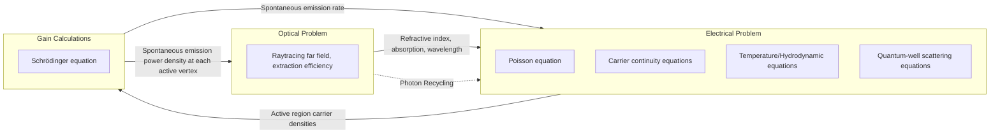
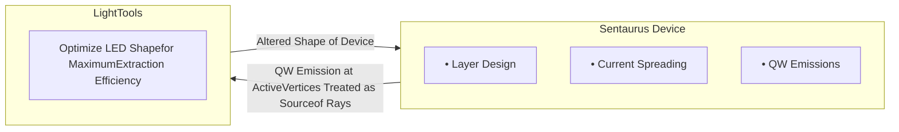
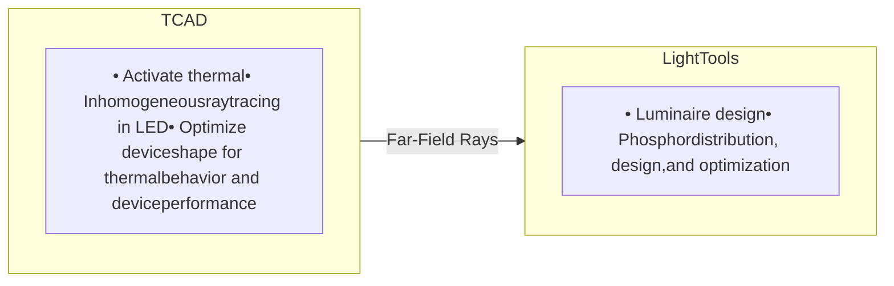

# CHAPTER 34 Light-Emitting Diodes

*This chapter describes the physics and the models used in light-emitting diode simulations.*

**NOTE** LED simulations present unique challenges that require problem-specific model and numerics setups. Contact TCAD Support for advice if you are interested in simulating LEDs (see Contacting Your Local TCAD Support Team Directly on page xlv).

## Modeling Light-Emitting Diodes

From an electronic perspective, light-emitting diodes (LEDs) are similar to lasers operating below the lasing threshold. Consequently, the electronic model contains similar electrothermal parts and quantum-well physics as in the case of a laser simulation.

The key difference between an LED and a laser is a resonant cavity design for lasers that enhances the coherent stimulated emission at a single frequency (for each mode). An LED emits a continuous spectrum of wavelengths based on spontaneous emission of photons in the active region. However, an alternative design for LEDs with a resonant cavity – the resonant cavity LED (RCLED) – uses the resonance characteristics to cause an amplified spontaneous emission in a narrower spectrum to allow for superbright emissions.

The simulation of LEDs presents many challenges. The large dimension of typical LED structures, in the range of a few hundred micrometers, prohibits the use of standard time-domain electromagnetic methods such as finite difference and finite element. These methods require at least 10 points per wavelength and typical emissions are of the order of 1 μm. A quick estimate gives a necessary mesh size in the order of 10 million mesh points for a 2D geometry. Alternatively, the use of the raytracing method approximates the optical intensity inside the device as well as the amount of light that can be extracted from the device. In many cases, a 2D simulation is not sufficient and a 3D simulation is required to give an accurate account of the physical effects associated with the geometric design of the LED.

Innovative designs such as inverted pyramid structures, chamfering of various corners, surface roughening, and drilling holes are performed in an attempt to extract the maximum amount of light from the device. The device editor Sentaurus Structure Editor is well equipped to create complex 3D devices and provides great versatility in exploring different realistic LED designs.

34: Light-Emitting Diodes
Coupling Electronics and Optics in LED Simulations

Photon recycling is important because most of the light rays are trapped within the device by total internal reflection. There are two types of photon recycling: for nonactive regions and for the active region. The nonactive-region photon recycling involves absorption of photons in the nonactive regions to produce optically generated electron–hole pairs, and these subsequently join the drift-diffusion processes of the general carrier population. The active-region photon recycling is more complicated, and interested users are referred to [1][2] for its basic theory.

# Coupling Electronics and Optics in LED Simulations

An LED simulation solves the Poisson equation, carrier continuity equations, temperature equation, and Schrödinger equation self-consistently. Figure 61 illustrates the coupling of the various equation systems in an LED simulation.



Figure 61 Flowchart of the coupling between electronics and optics for an LED simulation

# Single-Grid Versus Dual-Grid LED Simulation

Both single-grid and dual-grid LED simulations are possible. However, for single-grid simulations, raytracing takes a longer time because raytracing builds a binary tree for each starting ray. Each branch of the tree corresponds to a ray at a mesh cell boundary. If the materials in two adjoining cells are different, then the ray splits into refracted and reflected rays, creating two new branches. If the materials are the same in adjoining cells, then the propagated ray creates a new branch. A fine mesh increases the depth of the branching significantly. Each new branch of the binary tree is created dynamically and, if dynamic memory allocation of the machine is not sufficiently fast, then the tree creation of the raytracing becomes a bottleneck in the simulation.

34: Light-Emitting Diodes
Electrical Transport in Light-Emitting Diodes

To overcome this problem, grids for the electrical problem and the raytracing problem are separated. The optical grid for raytracing is meshed coarsely. The binary tree created will be smaller and raytracing is more efficient. Such a coarse mesh allows you to compute the extraction efficiency and output radiation pattern. However, the optical intensity within the device cannot be resolved well with a coarse mesh.

# Electrical Transport in Light-Emitting Diodes

Besides the drift-diffusion transport of typical semiconductor devices, the LED requires additional physical models to compute various optical effects. These physical models are described in the following sections.

## Spontaneous Emission Rate and Power

In the active region, the spontaneous emission of photons depletes the carrier population. At each active vertex, the spontaneous emission (or recombination of carriers) rate (units of #s<sup>-1</sup> m<sup>-3</sup>) is an integral of the spontaneous emission:

$$ R_{\text{active}}^{\text{sp}}(x, y, z) = \int_{0}^{\infty} r^{\text{sp}}(E) \rho^{\text{opt}}(E) dE $$ (1120)

where the optical mode density is:

$$ \rho^{\text{opt}}(E) = \frac{n_g^2 E^2}{\pi^2 \hbar^3 c^2} $$ (1121)

and $r^{\text{sp}}(E)$ is defined in Eq. 1142, p. 1028. The total spontaneous emission power density at each active vertex (units of Js<sup>-1</sup> m<sup>-3</sup>) is:

$$ \Delta P^{\text{sp}}(x, y, z) = \int_{0}^{\infty} r^{\text{sp}}(E) \rho^{\text{opt}}(E) \cdot (\hbar \omega) dE $$ (1122)

This equation is similar to Eq. 1120, except that an additional energy term, $E = \hbar \omega$, is included in the integrand to account for the energy spectrum of the spontaneous emission.

In LED simulations, the spontaneous emission spectrum, $r^{\text{sp}}(E)$, broadens significantly with increasing injected carriers. The integrals in Eq. 1120 and Eq. 1122 are based on a Riemann sum and, as with numeric integration, truncates at an internally set energy value.

Electrical Transport in Light-Emitting Diodes

You can change the truncation value and the Riemann integration interval with the following syntax in the command file:

```
Physics { ...
  LED (...
    Optics (...)
    SponScaling = 1.0
    SponIntegration(<energyspan>, <numpoints>)
  )
}
```

where `<energyspan>` is a floating-point number (in eV) and is measured from the edge of the energy bandgap, and `<numpoints>` is an integer denoting the number of discretized intervals to use within this energy span.

The total spontaneous emission power is the volume integral of the power density over all the active vertices:

$$ P_{\text{total}}^{\text{sp}} = \int_{(\text{active - region})} \Delta P^{\text{sp}}(x, y, z) dV $$ (1123)

This is the total spontaneous emission power that is computed and output in an LED simulation.

Since you are dealing with a spectrum for the spontaneous emission, it is evident from Eq. 1120 and Eq. 1122 that the integral sum of the photon rate and the integral sum of the photon power are not simply related by a constant photon energy, that is:

$$ \Delta P^{\text{sp}}(x, y, z) \neq (\hbar \omega_0) R_{\text{active}}^{\text{sp}}(x, y, z) $$ (1124)

## Spontaneous Emission Power Spectrum

You can plot the LED spontaneous emission power spectrum by activating the `GainPlot` section. The syntax consists of defining the number of discretized points for the spectrum and the span of the spectrum to plot. For example:

```
File { ...
  ModeGain = "ngainplot_des"
}

GainPlot {
  Range = (<float>, <float>)    # specific range in eV
  Range = Auto                  # automatically determines range
  Intervals = <int>             # number of discretized points
}
```

**34: Light-Emitting Diodes**
Electrical Transport in Light-Emitting Diodes

```
Solve {...
  PlotGain( Range=(0,1) Intervals=5 )
}
```

In the gain file, the quantity `SponEmissionPowerPereV` (W/eV) is plotted. Integrating this quantity over the energy (eV) span recovers the total LED power.

# Current File and Plot Variables for LED Simulations

When an LED simulation is run, specific LED result variables are output to the plot file. Table 174 and Table 175 on page 992 list the current file output and the plot variables valid for LED simulations.

Table 174 Current file for LED simulations

| Dataset group | Dataset | Unit | Description |
| --- | --- | --- | --- |
| LedWavelength |  | nm | Average wavelength of LED simulation |
| n_Contact p_Contact | Charge | C |  |
| eCurrent | A |  |  |
| hCurrent | A |  |  |
| InnerVoltage | V |  |  |
| OuterVoltage | V |  |  |
| TotalCurrent | A |  |  |
| Photon_Exited |  | s–1 | Rate of photon escaping from device |
| Photon_ExtEfficiency |  | 1 | Photon extraction efficiency |
| Photon_NetPhotonRecycle |  | s–1 | Net photon-recycling photon rate |
| Photon_NonActiveAbsorb |  | s–1 | Rate of photon absorption in nonactive regions |
| Photon_Spontaneous |  | s–1 | Spontaneous emission photon rate |
| Photon_Trapped |  | s–1 | Rate of trapped photons in device |
| Power_Absorption |  | W | Absorption power |
| Power_ASE |  | W | Amplified spontaneous emission power |
| Power_Exited |  | W | Power escaping from device |
| Power_ExtEfficiency |  | 1 | Power extraction efficiency |
| Power_NetPhotonRecycle |  | W | Net photon-recycling power |

Electrical Transport in Light-Emitting Diodes

Table 174 Current file for LED simulations (Continued)

| Dataset group | Dataset | Unit | Description |
| --- | --- | --- | --- |
| Power_NonActiveAbsorb |  | W | Power absorbed in nonactive regions |
| Power_ReEmit |  | W | Reemission power |
| Power_SpecConvertGain |  | W | Net power gain of spectral conversion |
| Power_Spontaneous |  | W | Spontaneous emission power |
| Power_Total |  | W | Total internal optical power of LED |
| Power_Trapped |  | W | Power trapped inside device |
| Time |  | 1 s | For quasistationary For transient |

Table 175 Plot variables for LED simulations

| Plot variable | Dataset name | Unit | Description |
| --- | --- | --- | --- |
| DielectricConstant |  | 1 | Dielectric profile |
| LED_TraceSource |  |  | Influence of each active vertex on the total extracted light |
| MatGain | OpticalMaterialGain | m–1 | Local material gain |
| RayTraceIntensity |  | Wcm–3 | Optical intensity from raytracing |
| RayTrees |  |  | Raytree structure; not available for the compact memory option |
| SpontaneousRecombination |  | cm–3s–1 | Sum of spontaneous emission |

LedWavelength is computed automatically in the simulation. It is taken as the wavelength where the peak of the spontaneous spectrum occurs. Different options for computing the wavelength are available (see LED Wavelength on page 993). For clarity, photon rate and power output results are separated into different groups:

*   The photon rate group has units of s<sup>–1</sup>.

*   The power group has units of W.

Photon and power quantities must be computed separately if a spectrum is involved. Suppose that the spontaneous emission coefficient is $r_{sp}'$ (units of eV<sup>–1</sup>cm<sup>–3</sup>s<sup>–1</sup>). The photon rate is $\int r_{sp}' dE$ (Eq. 1120, p. 989 with $r^{sp'} = r^{sp}(E) \times \rho^{opt}(E)$), while the power is $\int r_{sp}' \cdot EdE$ (Eq. 1122, p. 989).

The extraction coefficient is the ratio of the exited and internal quantities, so the photon rate (Photon_ExtEfficiency) and power (Power_ExtEfficiency) extraction efficiencies differ.

34: Light-Emitting Diodes

Electrical Transport in Light-Emitting Diodes

The only case when `Photon_ExtEfficiency`=`Power_ExtEfficiency` is for a single wavelength simulation that does not involve a spectrum.

The total outcoupled (exited) power is then (`Power_ExtEfficiency` $\times$ (`Power_Total` - `Power_NonActiveAbsorb`)), where the total internal optical power is:

```
Power_Total = Power_Spontaneous + Power_NetPhotonRecycle
              + Power_SpecConvertGain
```

The photon rate extraction efficiency has been computed using:

```
Photon_ExtEfficiency = Photon_Exited / (Photon_Spontaneous
                       + Photon_NetPhotonRecycle - Photon_NonActiveAbsorb)
```

For power conservation in a nonactive photon-recycling case, you have:

```
Power_Total = Power_Spontaneous
            = Power_Exited + Power_Trapped + Power_NonActiveAbsorb
```

`Power_Trapped` refers to the power of the photons that are trapped (by total internal reflection or possibly nonconverging raytracing) indefinitely in the raytracing simulation. In a realistic scenario, the trapped photons decay in the device by some mechanism.

**NOTE** Users are responsible for introducing losses within the device (perhaps by introducing nonzero extinction coefficients in appropriate regions) to ensure proper treatment of the trapped photons.

The quantities `Power_NetPhotonRecycle`, `Power_SpecConvertGain`, and `Photon_NetPhotonRecycle` pertain only to the active-region photon-recycling model. These quantities are zero if the active-region photon-recycling model is not activated.

# LED Wavelength

There are different ways of computing or inputting the LED wavelength:

*   AutoPeak: A robust algorithm based on the multisection method is used to search for the peak of the spontaneous emission rate spectrum ($r^{sp'}$ versus E-curve). Then, the energy of the peak $r^{sp'}$ is translated into the LED wavelength.

*   AutoPeakPower: The same algorithm as for AutoPeak is used on the spontaneous emission power spectrum ($r^{sp'}E$ versus E-curve).

Electrical Transport in Light-Emitting Diodes

*   Effective: An effective wavelength is computed such that:

    LED power = LED photon rate × photon_energy

    where photon_energy is a direct inverse function of the effective wavelength.

*   User inputs a fixed LED wavelength.

The keywords for activating the various LED wavelength options are:

```
Physics {...
  LED (...
    Optics (...
      RayTrace (...
        Wavelength = <float> | AutoPeak | Effective | AutoPeakPower
      )
    )
  )
}
```

**NOTE** If no `Wavelength` keyword is specified, the old peak wavelength search algorithm is used.

# Optical Absorption Heat

Photon absorption heat in semiconductor materials can be simplified into two processes:

*   *Interband absorption*: When a photon is absorbed across the forbidden band gap in a semiconductor, it is absorbed to create an electron–hole pair. The excess energy (photon energy minus the band gap) of the new electron–hole pair is assumed to thermalize, resulting in eventual lattice heating.

*   *Intraband absorption*: A photon can be absorbed to increase the energy of a carrier. The excess energy relaxes eventually, contributing to lattice heating.

In both processes, it is assumed that the eventual lattice heating (in a quasistationary simulation) occurs in the locality of photon absorption.

In LEDs, the extraction efficiency ranges between 40% and 60% commonly. This means a significant portion of the spontaneous light power is trapped within the device. The trapped light is ultimately absorbed and becomes the source of photon absorption heat.

Other keywords in the `Physics` section have been added. As far as possible, the syntax has been kept similar to that of the `QuantumYield` model (see Quantum Yield Models on page 603):

```
Plot {...
  OpticalAbsorptionHeat        # units of [W/cm^3]
}
```

34: Light-Emitting Diodes
Electrical Transport in Light-Emitting Diodes

```
Physics { ...
  LED(...)
  OpticalAbsorptionHeat (
    StepFunction (
      Wavelength = float     # um
      Energy = float         # eV
      Bandgap                # auto-checking of band gap
      EffectiveBandgap       # auto-checking of band gap
    )
    ScalingFactor = float    # default is 1.0
  )
}
```

Some comments about the different `StepFunction` choices:

* When the keyword `Wavelength` or `Energy` is used, the wavelength or energy of the photons is checked against this value. If the photon wavelength or energy is smaller or larger than this cutoff value, then convert the optical generation totally into optical absorption heat, and set optical generation at the vertex to 0.

* `Bandgap` and `EffectiveBandgap` refer to the cutoff energy of the step function at $E_g - E_{bgn}$ and $(E_g - E_{bgn} + 2 \cdot (3/2)kT)$, respectively. If the photon energy is greater than the cutoff energy (interband absorption), then deduct the band gap to obtain the excess energy but do not deduct the optical generation. If the photon energy is less than the cutoff energy (intraband absorption), then set the excess energy to the photon energy. In both cases, the excess energy will be converted to a heat source term for the lattice temperature equation.

* A `ScalingFactor` is introduced to allow for flexible fine-tuning.

* The `OpticalAbsorptionHeat` statement can be specified globally in the `Physics` section or the materialwise or regionwise `Physics` section.

# Quantum Well Physics

The physics in the quantum well (QW) is described in detail in Chapter 35 on page 1027. Due to the size of the LED structure, it is recommended that you start with representing quantum wells as bulk active regions, and then contact TCAD Support for assistance in the more advanced settings (see Contacting Your Local TCAD Support Team Directly on page xlv).

The scattering transport into QWs is approximated with thermionic emission for the best convergence behavior. The corrections of the carrier densities due to quantizations of the QW can be taken into account in the localized QW model (see Localized Quantum-Well Model on page 1044).

34: Light-Emitting Diodes

Electrical Transport in Light-Emitting Diodes

# Accelerating Gain Calculations and LED Simulations

The computation bottleneck in LED simulations with gain tables is the calculation of the spontaneous emission rate at every Newton step. The spontaneous emission rate (unit is s<sup>–1</sup>) is an energy integral of the spontaneous emission coefficient (unit is s<sup>–1</sup>eV<sup>–1</sup>cm<sup>–3</sup>), and the integration is performed as a Riemann sum. To accelerate this calculation, a Gaussian quadrature integration can be used instead.

All gain calculations (with or without the gain tables) can be accelerated by specifying the following syntax in the `Math` section of the command file:

```
 Math {...
  BroadeningIntegration  ( GaussianQuadrature ( Order = 10 ) )
  SponEmissionIntegration ( GaussianQuadrature ( Order = 5 ) )
 }
```

The Gaussian quadrature numeric integration then is used in all parts of the gain calculations including broadening effects.

The order can be from 1 to 20. This order refers to the order of the Legendre polynomial that is used to fit the spontaneous emission spectrum in the energy range of the integration. The Gaussian quadrature integration is exact for any spectrum that can be expressed as a polynomial.

**NOTE** You might experience convergence issues in some situations. In such cases, switch off the Gaussian quadrature integration for `SponEmissionIntegration` and `BroadeningIntegration` in the `Math` section.

# Discussion of LED Physics

Many physical effects manifest in an LED structure. Current spreading is important to ensure that the current is channeled to supply the spontaneous emission sources at strategic locations that will provide the optimal extraction efficiency.

Changes to the geometric shape of the LED are made to extract more light from the structure. In most cases, the major part of the light produced is trapped within the structure through total internal reflection. As a result, the nonactive-region and active-region photon-recycling effect becomes relevant. This important physics has been incorporated into different physical models within Sentaurus Device. The nonactive photon-recycling (absorption of photons in nonactive regions) is switched on automatically by default. In most cases, the nonactive photon-recycling model is sufficient to capture the major physical effects because the volume of the active region is insignificant compared to the nonactive regions. Nonetheless, the active-region photon-

**34: Light-Emitting Diodes**
LED Optics: Raytracing

recycling model can become important if there is a very high stimulated gain, which is usually not the case for GaN LEDs.

Sentaurus Device can easily simulate important aspects of LED design, including current spreading flow, geometric design, and extraction efficiency.

# LED Optics: Raytracing

Raytracing is used to compute the intensity of light inside an LED, as well as the rays that escape from the LED cavity to give the signature radiation pattern for the LED output. The basic theory of raytracing is presented in Raytracing on page 648.

Arbitrary boundary conditions can be defined. A detailed description of how to set up the boundary conditions for raytracing is discussed in Boundary Condition for Raytracing on page 660. This is particularly useful in 3D simulations where you can define reflecting planes to use symmetry for reducing the size of the simulation model. In addition, you can use reflecting planes to take into account external components such as reflectors, an example of which is shown in Figure 62.

External Reflector diagram showing raytracing paths and a reflecting boundary condition

Figure 62 Using the reflecting boundary condition to define a reflector for LED raytracing

The raytracer needs to include the use of the `ComplexRefractiveIndex` model and to define the polarization vector. The syntax for this is:

```
Physics {...
  ComplexRefractiveIndex (...
    WavelengthDep ( real imag )
    CarrierDep( real imag )
    GainDep( real )                 # or real(log)
    TemperatureDep( real )
    CRImodel ( Name = "crimodelname" )
  )
  LED (...
    Optics (
      RayTrace(
        PolarizationVector = Random # or (x y z) vector
        RetraceCRIchange = float    # fractional change to retrace rays
```

LED Optics: Raytracing

```
          ...
          )
         )
  )
 }
```

When you set `PolarizationVector=Random`, random vectors that are perpendicular to the starting ray directions are generated and assigned to be the polarization vector of each starting ray. The direction of each starting ray is described in Isotropic Starting Rays From Spontaneous Emission Sources and Anisotropic Starting Rays From Spontaneous Emission Sources on page 999.

The keyword `RetraceCRIchange` specifies the fractional change of the complex refractive index (either the real or imaginary part) from its previous state that will force a total recomputation of raytracing.

## Compact Memory Raytracing

A compact memory model is available for LED raytracing. In this model, raytrees are no longer saved, and necessary quantities are computed as required and extracted to compact storages of optical generation and optical intensity. As a result, the memory use and footprint are significantly reduced, thereby allowing the raytracing simulation of large LED structures. The syntax for activation is:

```
Physics {...
 LED (...
        RayTrace(...
         CompactMemoryOption
        )
 )
}
```

**NOTE** The full active photon-recycling model does not work with the compact memory model.

---

# Isotropic Starting Rays From Spontaneous Emission Sources

The source of radiation from an LED is mainly from spontaneous emissions in the active region, which is further discussed in Spontaneous Emission Rate and Power on page 989. The spontaneous emission in the active region of an LED is assumed to be an isotropic source of radiation and can be conveniently represented by uniform rays emitting from each active vertex, as shown in Figure 63 on page 999.

**34: Light-Emitting Diodes**
LED Optics: Raytracing

2D isotropic ray diagram

3D isotropic ray diagram using geodesic dome approximation

Figure 63 Uniform rays radiating isotropically from an active vertex source in (*left*) 2D space and (*right*) 3D space: only one-eighth of spherical space is shown for the 3D case

Isotropy requires that the surface area associated with each ray must be the same. The isotropy of the rays in 2D space is apparent. In 3D space, achieving isotropy is not as simple as dividing the angles uniformly. The elemental surface area of a sphere is $r^2 \sin \theta (d\theta)(d\phi)$, so uniformly angular-distributed rays are weighted by $\sin \theta$ and, therefore, do not signify isotropy.

To approximate this problem in 3D, a geodesic dome approximation is used (the geodesic dome is not strictly isotropic). Rays are directed at the vertices of the geodesic dome. The algorithm starts by constructing an octahedron and, then, recursively splits each triangular face of the octahedron into four smaller triangles.

Figure 63 (*right*) shows the first stage of this splitting process, where rays are directed at the vertices of each triangle. The minimum number of rays is six, that is, one is directed along each positive and negative direction of the axes. If the first stage of recursive splitting is applied, a few more rays are constructed as shown in Figure 63, and the number of starting rays becomes 18. The second stage of recursive splitting gives 68 rays and so on. Therefore, you are constrained to selecting a fixed set of starting rays in the 3D case. Alternatively, you can input your own set of isotropic starting rays (see Reading Starting Rays From File on page 1001).

# Anisotropic Starting Rays From Spontaneous Emission Sources

In some LED designs, the geometry governs the polarization of the optical field in the device. The spontaneous gain is dependent on the direction of this polarization. Consequently, this leads to an anisotropic spontaneous-emission pattern at the source.

The following parametric equations are proposed to describe the anisotropic emission pattern:

$$ E_x = d1 \cdot \sin(\phi) + d4 \cdot \cos(\phi) $$ (1125)

34: Light-Emitting Diodes

LED Optics: Raytracing

$$ E_y = d2 \cdot \sin(\phi) + d5 \cdot \cos(\phi) \tag{1126} $$

$$ E_z = d3 \cdot \sin(\theta) + d6 \cdot \cos(\theta) \tag{1127} $$

where the intensity is given by $I = E_x^2 + E_y^2 + E_z^2$.

The bases of sine and cosine are chosen based on the fact that the optical matrix element has such a functional form when polarization is considered (see Importing Gain and Spontaneous Emission Data With PMI on page 1048). By changing the values of d1 to d6, different emission shapes can be orientated in different directions, and this feature allows you to modify the anisotropy of the spontaneous emission.

The syntax required to activate the anisotropic spontaneous emission feature is:

```
Physics {...
 LED (...
  Optics(...
   RayTrace(...
         EmissionType(
            #Isotropic                    # default
            Anisotropic(
             Sine(d1 d2 d3)
             Cosine(d4 d5 d6)
            )
         )
   )
  )
 )
}
```

# Randomizing Starting Rays

Spontaneous emission is a random process. To take into account the random nature of this process and still ensure that the emission of the starting rays from each active vertex source is isotropic, a randomized shift of the entire isotropic ray emission is introduced.

This is best illustrated in Figure 64 on page 1001 where only four starting rays are used for clarity. For each active vertex, a random angle is generated to determine the random shift of the distribution of the isotropic starting rays. The same concept is also used for the 3D case, and this gives a simple randomization strategy for using raytracing to model the spontaneous emissions.

LED Optics: Raytracing

Diagram showing the shifting of isotropic starting rays by an angle α

Figure 64 Shifting the distribution of entire isotropic starting rays by an angle α

## Pseudorandom Starting Rays

Randomization of the starting rays is activated by the keyword `RaysRandomOffset` in the following syntax:

```
Physics {...
      LED (...
       RayTrace (...
        RaysRandomOffset
#       RaysRandomOffset (RandomSeed = 123)   # seeding the generator
       )
      )
}
```

You also can fix the seed of the random number generator, and this will compute a pseudorandom set of starting rays, so that repeated runs of the same simulation will reproduce exactly the same raytracing results.

> **NOTE** Without the keyword `RaysRandomOffset`, the default is a fixed angular shift that is determined by the active vertex number.

## Reading Starting Rays From File

The geodesic ray distribution is not truly isotropic. As a result, some percentages of error are incurred when isotropy is really needed. To circumvent this issue, a new feature to allow you to read in a set of source isotropic starting rays has been implemented. The syntax is:

```
Physics {...
LED (...
Optics (...
RayTrace (...
        RaysPerVertex = 1000
        SourceRaysFromFile("sourcerays.txt")
```

LED Optics: Raytracing

```
    )
   )
  )
 }
```

It is important to note that `RaysPerVertex` specifies the number of direction vectors to read from the file. The file specified with `SourceRaysFromFile` contains 3D direction vectors for each starting ray; an example of which is `sourcerays.txt`:

```
 -0.239117  0.788883  0.566115
  0.776959  0.548552 -0.308911
 -0.607096 -0.042603  0.793485
 -0.158313 -0.276546 -0.947871
  0.347036 -0.805488  0.480370
 ...
```

There are several methods for generating 3D isotropic rays, such as the constrained centroid Voronoï tessellation. On the other hand, you can also use this option to import experimentally measured ray distribution profiles.

## Moving Starting Rays on Boundaries

Starting rays from active vertices on boundaries create the problem that half of those rays are propagated directly out of the device. To alleviate this problem, a new feature is implemented to allow you to shift the starting position of such rays inwards of the device. Typical values used are from 1 to 5 nm. The syntax is:

```
 Physics {...
  LED (...
   Optics (...
    RayTrace (...
          MoveBoundaryStartRays(float)    # [nm]
    )
   )
  )
 }
```

## Clustering Active Vertices

In 3D LED simulations, the number of active vertices can grow significantly when the electrical mesh is refined. This directly implies that the number of starting rays for raytracing increases significantly because that is a direct function of the number of active vertices.

34: Light-Emitting Diodes
LED Optics: Raytracing

Consequently, the resultant raytree is an exponential function of the number of starting rays, and this results in a very large raytracing problem, which can derail the simulation time and, in part, the memory usage (since the compact memory model declares storage arrays of the size of the number of active vertices).

The solution is to group the active vertices into clusters, with each cluster serving as a distributed source of starting rays for raytracing.

Three possible strategies of clustering the active vertices have been implemented.

# Plane Area Cluster

Users select the total number of clusters to be generated. Then, this number is translated into equal area zones (also taking into account the aspect ratio) of the automatically detected QW plane. The active vertices are subsequently grouped into each of these zones such that each zone forms a cluster. The algorithm for plane area clustering is described as follows.

Assume you input the required cluster size, $N_c$. The aim is to fit as many *squarish* elements (of size $d \times d$) into the QW plane area (size $XY$) as possible, as shown in Figure 65.

Fitting as many squarish elements of size d x d into QW plane

Figure 65 Fitting as many squarish elements of size $d \times d$ into QW plane

The constraints of the problem are:

$$N_c = \frac{XY}{d^2}$$ (1128)

$$X = N_x d, N_x \text{ is an integer}$$ (1129)

$$Y = N_y d, N_y \text{ is an integer}$$ (1130)

Solving gives:

$$N_x = (\text{INTEGER}) \sqrt{(X/Y)N_c}$$ (1131)

$$N_y = (\text{INTEGER})(Y/X)N_x$$ (1132)

LED Optics: Raytracing

Finally, the adjusted cluster size becomes:

$$ N_c' = N_x \times N_y $$ (1133)

If no active vertices fall within a plane area segment, that segment is not added to the list of clusters. Therefore, you might see a smaller number of clusters than $N_c'$.

## Nodal Clustering

A recursive algorithm is used to calculate how to group the active vertices for each cluster, such that each cluster receives, more or less, the same number of active vertices. The algorithm alternates the x- and y-coordinate partitioning of the list of active vertices, in an attempt to group a cluster of nearest neighboring active vertices. Unfortunately, this might not result in an even spatial distribution of clusters, which is a disadvantage of this method.

## Optical Grid Element Clustering

The number of clusters cannot be set by users as it is defined by the number of optical grid elements. Active regions must be defined in both the electrical and optical grids. An effective bulk region in the optical grid is used to describe the active QW layers and can be meshed according to user requirements. Then, the electrical active vertices are grouped inside each of the optical grid active elements such that each optical-grid active element forms a cluster. In this way, you can control the distribution of the clusters for greater modeling flexibility.

> **NOTE** In all these clustering methodologies, the center of each cluster is determined by the average of the active vertices that it encloses.

## Using the Clustering Feature

The following keywords in the LED framework activate the clustering feature:

```
Physics {...
  LED ( ...
    Raytrace (...
      ClusterActive(
        ClusterQuantity = Nodes | PlaneArea | OpticalGridElement
        NumberOfClusters = <int>           # for Nodes | PlaneArea
      )
    )
  )
}
```

34: Light-Emitting Diodes
LED Optics: Raytracing

# Debugging Raytracing

Rays are assumed, by default, to irradiate isotropically from each active vertex. In the case of quantum wells, an artifact of this assumption might cause unrealistic spikes in the radiation pattern. Consider those source rays that are directed within the plane of the quantum wells. These rays will mostly transmit out of the device at the ending vertical edges of the quantum wells. Realistically, the rays would have a much higher probability of being absorbed and reemitted into another direction than traversing the entire plane of the quantum well.

To circumvent this problem, use the anisotropic emission as described in Anisotropic Starting Rays From Spontaneous Emission Sources on page 999. Alternatively, one can try to exclude the source rays emitting within a certain angular range from the horizontal plane, that is, the plane of the quantum well. The power from these excluded rays will be distributed equally to the rest of the rays that are not within this angular range. This results in an approximate anisotropic emission shape at each active vertex. The syntax for this exclusion is:

```
Physics { ...
  LED ( ...
    Optics ( ...
      RayTrace ( ...
        ExcludeHorizontalSource(<float>)  # in degrees
      )
    )
  )
}
```

To add more flexibility to LED raytracing, debugging features include:

* Setting a fixed observation center for the LED radiation calculations

* Fixing a constant wavelength for raytracing

* Allowing you to print and track the LED radiation rays (in a certain angular zone) back to its source active vertex

These features are described in this syntax:

```
Physics { ...
  LED ( ...
    Optics ( ...
      RayTrace ( ...
        ObservationCenter = (<float> <float>)
                                          # in micrometers, 3 entries for 3D
        Wavelength = 888                  # [nm] set fixed wavelength
        DebugLEDRadiation(<filename> <StartAngle> <EndAngle>
          <MinIntensity>)
      )
    )
  )
}
```

**34: Light-Emitting Diodes**

LED Optics: Raytracing

```
    )
}
```

---

# Print Options in Raytracing

The original `Print` feature of raytracing causes all ray paths to be printed. With multiple reflections or refractions and many starting rays, the resultant image can become a black smudge. To reduce the number of ray paths that are printed, the `Skip` option of the `Print` feature is available. In addition, you can trace the ray paths originating from only a single active vertex. These features are described in this syntax:

```
Physics {
    LED (
        Optics (
            RayTrace (
                Print(Skip(<int>))           # skip printing every <int> ray paths
                Print(ActiveVertex(<int>))   # print only rays from active vertex
                                             # <int>
                PrintSourceVertices(<string>)
                ProgressMarkers = <int>      # 1-100% intervals (integer)
            )
        )
    )
}
```

The option `PrintSourceVertices(<string>)` outputs the list of active vertices, their global index numbering, and coordinates into the file specified by `<string>`. If the number of source rays is large or the optical mesh is fine, then raytracing takes some time to be completed. In this case, use `ProgressMarkers=<int>` to set the incremental completion meter.

The `Print` feature only outputs rays as lines with no other information. To obtain a raytree that contains intensity and other information, you can plot the raytree by using `RayTrees` in the `Plot` section of the command file:

```
Plot {...
    RayTrees
}
```

The resultant raytree is plotted in TDR format and can be visualized by Sentaurus Visual, where each branch of the raytree can be accessed individually.

1006

**34: Light-Emitting Diodes**
LED Optics: Raytracing

# Interfacing LED Starting Rays to LightTools

To facilitate the rapid design of LED structures with its luminaire, the starting rays from active region vertices can be output directly to a ray file formatted for use in the Synopsys LightTools® tool. Figure 66 shows a possible design flow.



Figure 66 LED design flow to optimize extraction efficiency by LightTools and coupled to Sentaurus Device LED device simulation

The set of rays is derived from the LED spontaneous emission power spectrum at each vertex of the device. This means that there is wavelength variability such that each starting ray carries a starting position, a direction, an intensity value, and a wavelength.

This feature is an extension of the `Disable` keyword, so that the internal Sentaurus Device raytracing engine will not be activated. The syntax is:

```
File {...
    Plot = "n99_des.tdr"
}

Physics {...
    LED (
        RayTrace(
            Disable(
                OutputLightToolsRays (
                    WavelengthDiscretization=<int>            # spectrum discretization
                    RaysPerCluster=<int>                # rays emitting from each active cluster
                    IsotropyType = InBuilt | Random | UserRays    # default: InBuilt
                    SaveType = Ascii | Binary                    # choose ASCII or binary format
                )
            )
            ClusterActive()
            RaysPerVertex=<int>                             # used with SourceRaysFromFile()
            SourceRaysFromFile(<string>)
        )
    )
}
```

LED Optics: Raytracing

```
Solve {...
  Plot( Range=(0,1) Intervals=5 )
}
```

This feature can be used in conjunction with the `ClusterActive` section, so that the active vertices can be grouped into clusters to reduce the final number of rays. If the `ClusterActive` section is not present, every active vertex will be used as emission centers for the starting rays. It is also possible to import an isotropic distribution of point source rays from a file to be used for random-rotated distribution at different vertices. The span of the spectrum at each active cluster is computed automatically and divided into the numbers as specified by `WavelengthDiscretization`. The total number of starting rays is:

```
WavelengthDiscretization * RaysPerCluster * NumberOfActiveClusters
```

Two types of ray file format for LightTools can be chosen: ASCII or binary. The base name for the ray files is derived from the plot file name and is appended with either `_lighttools.txt` for the ASCII format or `_lighttools.ray` for the binary format.

For example, according to this syntax, the following are the corresponding file names for the LightTools ray files:

```
n99_000000_des_lighttools.txt
n99_000001_des_lighttools.txt
...
n99_000000_des_lighttools.ray
n99_000001_des_lighttools.ray
...
```

These files can be read directly by LightTools as volume sources of rays (see the LightTools documentation for more information).

## Example: n99_000000_des_lighttools.txt File

This example is an ASCII-formatted LightTools ray file (version 2.0 format):

```
# Synopsys Sentaurus Device to LightTools
# Ray Data Export File
LT_RDF_VERSION: 2.0
DATANAME: SentaurusDeviceRayData
LT_DATATYPE: radiant_power
LT_RADIANT_FLUX: 1.946806e-04
LT_FAR_FIELD_DATA: NO
LT_COLOR_INFO: wavelength
LT_LENGTH_UNITS: micrometers
LT_DATA_ORIGIN:           0               0                   0
LT_STARTOFDATA
0.000000e+00 4.290000e-01 0.000000e+00 -0.163343 -0.986569 0.000000
```

34: Light-Emitting Diodes
LED Radiation Pattern

```
5.451892e-05 470.395656
0.000000e+00 4.290000e-01 0.000000e+00 -0.163343 -0.986569 0.000000
1.817405e-04 459.664919
....
LT_ENDOFDATA
```

The first three columns denote the starting position (in $\mu$m) of the ray, the next three columns show the direction vector, which is followed by the fractional power (as a fraction of `LT_RADIANT_FLUX`), and ends with the wavelength (in nm).

# LED Radiation Pattern

Raytracing does not contain phase information, so it is not possible to compute the far-field pattern for LED structures. Instead, the outgoing rays from the LED raytracing are used to produce the radiation pattern.

In 2D space, this is equivalent to moving a detector in a circle around the LED as shown in Figure 67.

Diagram showing a detector path in a circle of radius R around an LED source at the center, with angle phi=0 indicated.

Figure 67 Measuring the radiation pattern in a circular path around LED at observation radius, R

In 3D space, the detector is moved around on a sphere. The circle and sphere have centers that correspond to the center of the device. Sentaurus Device automatically determines the center of the device to be the midpoint of the device on each axis. Nonetheless, there is an option that allows you to set the center of observation (see Debugging Raytracing on page 1005 and Table 271 on page 1579).

To examine the optical intensity inside an LED, use `RayTraceIntensity` in the `Plot` section.

LED Radiation Pattern

The syntax required to activate and plot the LED radiation pattern is located in the `File`, `Physics-LED-Optics-RayTrace`, and `Solve-quasistationary` sections of the command file:

```
File {...
  # ----- Activate LED radiation pattern and save -----
  LEDRadiation = "rad"
}
...
Physics {...
  LED (...
    Optics (...
      RayTrace(...
        LEDRadiationPara(1000.0,180)       # (radius_micrometers, Npoints)
        ObservationCenter = (2.0 3.5 5.5) # set center
      )
    )
  )
}
...
Solve {...
  # ----- Specify quasistationary -----
  quasistationary (...

    PlotLEDRadiation { range=(0,1) intervals=3 }

    Goal {name="p_Contact" voltage=1.8})
    {...}
}
```

The LED radiation plot syntax works in the same way as `GainPlot` (see Spontaneous Emission Power Spectrum on page 990) in the `Quasistationary` statement.

An explanation of this example is:

*   The base file name, "rad", of the LED radiation pattern files is specified by `LEDRadiation` in the `File` section. The keyword `LEDRadiation` also activates the LED radiation plot.

*   Parameters for the LED radiation plot are specified by `LEDRadiationPara` in the `Physics-Optics-RayTrace` section. You must specify the observation radius (in μm) and the discretization of the observation circle (2D) or sphere (3D).

*   You can set the center of observation by including the keyword `ObservationCenter`. If this is not set, then the center is computed automatically as the middle point of the span of the device on each axis.

*   The LED radiation pattern can only be computed and plotted within the `Quasistationary` statement. The keyword `PlotLEDRadiation` controls the number of LED radiation plots to produce.

34: Light-Emitting Diodes
LED Radiation Pattern

*   The argument `range=(0,1)` in the `PlotLEDRadiation` keyword is mapped to the initial and final bias conditions. In this example, the initial and final (goal) `p_Contact` voltages are 0 V and 1.8 V, respectively. Setting `intervals=3` gives a total of four (=3+1) LED radiation plots at 0 V, 0.6 V, 1.2 V, and 1.8 V. In general, specifying `intervals=n` produces $n + 1$ plots.

*   If the LED structure is symmetric, then LED radiation is computed only on a semicircle.

The following sections briefly describe the files that are produced in the LED radiation plot for the 2D and 3D cases.

# Two-Dimensional LED Radiation Pattern and Output Files

Activating the LED radiation plot for a 2D LED simulation produces two different files (using the base name "rad"):

`rad_000000_LEDRad.plt` The normalized radiation pattern versus observation angle, which can be viewed in Inspect.

`rad_000000_LEDRad_Polar.tdr` The normalized radiation pattern projected onto a grid file and can be viewed in Sentaurus Visual. The polar plot of the LED radiation pattern is then shown.

Figure 68 shows a sample output of the radiation plot of a 2D nonsymmetric LED structure. The lower-left image corresponds to the file `rad_000000_LEDRad.plt` plotted by Inspect, and the right image is the product of the file `rad_000000_LEDRad_Polar.tdr` plotted by Sentaurus Visual.

LED internal optical intensity

| Observation Angle [degree] | LED Normalized Radiation |
| --- | --- |
| 0 | 0.2 |
| 100 | 0.5 |
| 200 | 0.1 |
| 300 | 0.4 |

Polar radiation plot

Figure 68 (*Upper left*) LED internal optical intensity, (*lower left*) normalized radiation intensity versus observation angle, and (*right*) polar radiation plot computed by Sentaurus Device in 2D LED simulation

34: Light-Emitting Diodes
LED Radiation Pattern

---

# Three-Dimensional LED Radiation Pattern and Output Files

There are two output files for the radiation pattern in the case of a 3D LED simulation:

**rad_000000_des.tdr**: Data file containing the normalized radiation pattern. Use Sentaurus Visual for this file, and the spherical plot of the 3D LED radiation pattern is then shown. Figure 69 shows a sample of the radiation pattern of a 3D LED simulation.

**rad_000000_des_3Dslices.plt**: The 3D radiation pattern is extracted into polar plots on three planes that can be visualized using Inspect:
* XY plane: $\theta = \pi/2$; plot far field for $\phi = 0$ to $2\pi$
* XZ plane: $\phi = 0, \pi$; plot far field for $\theta = 0$ to $2\pi$
* YZ plane: $\phi = \pi/2, 3\pi/2$; plot far field for $\theta = 0$ to $2\pi$

LED internal optical intensity and normalized radiation intensity projected on a sphere

Figure 69 (Left) LED internal optical intensity and (right) normalized radiation intensity projected on a sphere of 3D LED simulation

## Staggered 3D Grid LED Radiation Pattern

In discretizing a 3D far-field collection sphere with regular longitudinal and latitude lines, the size of each surficial element critically depends on its location on the sphere. At polar regions, elements are very small compared to those along the equator. As the discretization increases, the disparity between the polar and equator surficial elements increases at the same rate.

The sampling rate for rays is constrained by the smallest collecting element, which, in this case, is the much smaller surficial element at the poles. In most cases, polar regions are undersampled and equator regions are oversampled due to the disparity in surficial element areas between the two regions. Undersampling at the poles also could lead to anomalous spikes in the far field since the far-field intensity is computed by the total ray power impinging that

**34: Light-Emitting Diodes**
LED Radiation Pattern

element and is divided by the elemental area. To adequately sample polar regions, a significant number of rays must be used, resulting in a very large raytracing problem that might not be necessary.

To circumvent these problems, the spherical collection space must be composed of more uniformly distributed elemental areas. The baseline requirement is that each elemental area on the surface of the collection sphere must be approximately the same size. The following simple approach is used:

1. Divide the sphere into concentric rings in the latitude planes. Each ring has a thickness of:

$$ d_{\theta} = \int R d\theta = R \Delta\theta \tag{1134} $$

2. For each concentric ring, further subdivide the ring into elements with a width that is approximately $d_{\theta}$.

Mathematically, assume that the sphere is divided into $N_{\theta}$ rings, so that the thickness of each ring is:

$$ d_{\theta} = R \left( \frac{\pi}{N_{\theta}} \right) \tag{1135} $$

In each concentric ring ($i$) bound between $\theta_{1}$ and $\theta_{2}$, choose the order of $\theta$ such that:

$$ \sin(\theta_{2}) > \sin(\theta_{1}) \tag{1136} $$

The circumference at $\theta_{2}$ is $C_{\theta 2} = R \sin(\theta_{2}) \times 2\pi$. The constraint needed here is such that:

$$ \frac{C_{\theta 2}}{N_{\phi}(i)} = d_{\theta} \tag{1137} $$

where $N_{\phi}(i)$ is the number of divisions for the concentric ring ($i$) and is an integer. Solving gives:

$$ N_{\phi}(i) = (\text{INTEGER}) [2 \sin(\theta_{2}) \times N_{\theta}] \tag{1138} $$

At the poles of the sphere ($\theta = 0$ and $\theta = \pi$), the concentric rings collapse into a cap. The following constraint is imposed for these polar cap regions (essentially trying to match triangular area elements with squarish area elements):

$$ 0.5 \times \left( \frac{C_{\theta 2}}{N_{\phi}(i)} \right) \times d_{\theta} = d_{\theta}^{2} \tag{1139} $$

Simplifying gives the number of divisions for the polar cap rings:

$$ N_{\phi}(i) = (\text{INTEGER}) [\sin(\theta_{2}) \times N_{\theta}] \tag{1140} $$

1013

34: Light-Emitting Diodes

LED Radiation Pattern

The total number of elemental areas is $\sum N_{\phi}(i)$.

Table 176 lists the total number of elements obtained from this simple approach.

Table 176 Total number of elements and area information as a function of $N_{\theta}$

| Nθ | Total number of surface elements | Smallest area (unit radius) | Largest area (unit radius) | Area skew = ratio of largest/smallest area |
| --- | --- | --- | --- | --- |
| 5 | 36 | 0.314159 | 0.399994 | 1.273 |
| 10 | 146 | 0.074372 | 0.097081 | 1.305 |
| 20 | 554 | 0.017705 | 0.024573 | 1.388 |
| 50 | 3296 | 0.002857 | 0.003945 | 1.381 |
| 100 | 12976 | 0.000715 | 0.000987 | 1.380 |
| 150 | 29013 | 0.000318 | 0.000439 | 1.381 |
| 200 | 51426 | 0.000179 | 0.000247 | 1.380 |

As $N_{\theta}$ increases, it is clear from Table 176 that the area skew (ratio of largest to smallest elemental area) stabilizes to a value of approximately 1.38.

To activate the new staggered 3D far-field grid, use the syntax:

```
Physics {
  LED (
    RayTrace( Staggered3DFarfieldGrid )
  )
}
```

If you do not specify `Staggered3DFarfieldGrid`, then the collection sphere reverts to the old $(\theta, \phi)$ scheme to maintain backward compatibility.

---

# Spectrum-Dependent LED Radiation Pattern

Unlike a laser beam with single-frequency emissions, rays emitting from an LED carry a spectrum of frequencies (or energies). Sentaurus Device monitors the spectrum of each ray as it undergoes the process of raytracing in and out of the device. The resultant spectrum of the LED radiation pattern can then be plotted.

To activate this feature, include the keyword `LEDSpectrum` in the command file:

```
Physics {...
  LED (...
    Optics (...
```

 34: Light-Emitting Diodes
LED Radiation Pattern

```
      RayTrace(...
        LEDSpectrum(<startenergy> <endenergy> <numpoints>)
      )
    )
  )
}
```

This feature must be used in conjunction with the `LEDRadiation` feature so that the file names of the LED radiation plots and the observation angles can be specified. Other notable aspects of the syntax are:

*   `<startenergy>` and `<endenergy>` give the energy range of the spectrum to be monitored. These parameters are floating-point entries with units of eV.

*   `<numpoints>` is an integer determining the number of discretized points in the specified energy range.

# Tracing Source of Output Rays

Optimizing extraction efficiency is critical in LED designs. Other than modifying the shape of the device, you can use the fact that the rays originating from certain zones in the active region have a higher escape or extraction rate. By designing the shape of the contact to channel higher currents into these zones, the extraction efficiency can be increased effectively.

To facilitate the identification of such zones, a feature is available that correlates the output rays to their source active vertices. The intensity of each output ray is added to an `LED_TraceSource` variable at each active vertex. At the end of the simulation, a profile of `LED_TraceSource` is obtained, which provides an indication of the best localized regions to which more current can be channeled.

The activation of this feature requires keywords to be inserted into two different sections of the command file:

```
Plot { ...
  LED_TraceSource
}

Physics { ...
  LED ( ...
    Optics(
      RayTrace ( ...
        TraceSource()
      )
    )
  )
}
```

34: Light-Emitting Diodes
Interfacing Far-Field Rays to LightTools

**NOTE** A far-field observation radius must be set for the TraceSource feature.

# Interfacing Far-Field Rays to LightTools

LightTools is a robust raytracer that accepts a list of source rays as input, and it can optimize the packaging design for LEDs, that is, the luminaire. Figure 70 shows such a design flow.



Figure 70 Secondary LED design flow to optimize luminaire design by LightTools and coupled to Sentaurus Device LED device simulation

An interface is available in Sentaurus Device to output farfield rays from an LED device simulation that can be input into LightTools as source rays. This feature requires the LED radiation plot to be activated simultaneously, so that rays can be output at various quasistationary and transient states. The syntax for activating this feature is:

```
Physics {
  LED (
    Optics (
      Raytracer (
        ExternalMaterialCRIFile = "string"
        OutputLightToolsFarfieldRays (
          Filename = "farfield"
          WavelengthDiscretization = <int>
          SaveType = Ascii | Binary
        )
      )
    )
  )
}
```

The energy span of the spectrum is computed automatically, and you only need to input the wavelength discretization. The spectrum information is embedded inside the ray information as wavelength and relative intensity values. The relative intensity is a fraction of the total far-field power.

 34: Light-Emitting Diodes
Interfacing Far-Field Rays to LightTools

> **NOTE** In Sentaurus Device, raytracing and wavelength dependency of the refractive index can only be specified by using the complex refractive index model.

When the LED is embedded in another medium, the keyword `ExternalMaterialCRIFile` can be included to take wavelength-dependent complex refractive index changes into account (see External Material in Raytracer on page 670).

You have the option to output the ray information to either an ASCII file or a binary file. The ray information consists of the position vector (x,y,z), the direction cosine (x,y,z), the relative intensity, and the wavelength. Both file types contain identifying headers that are required by LightTools. The resultant name of the file is the user name with the suffix `_lighttools.txt` for the ASCII format or the suffix `_lighttools.ray` for the binary format. For an example of an ASCII-formatted file, see Example: farfield_lighttools.txt File.

# Example: farfield_lighttools.txt File

```
# Synopsys Sentaurus Device Farfield to LightTools
# Ray Data Export File
LT_RDF_VERSION: 2.0
DATANAME: SentaurusDeviceFarfieldRayData
LT_DATATYPE: radiant_power
LT_RADIANT_FLUX: 2.066459e-05
LT_FAR_FIELD_DATA: NO
LT_COLOR_INFO: wavelength
LT_LENGTH_UNITS: micrometers
LT_DATA_ORIGIN:           0             0         0
LT_STARTOFDATA
5.351638e+01 2.716777e+02 8.281585e+01 -0.198138 0.651751 0.732094
1.648189e-08 390.559610
3.000000e+02 7.388091e+01 4.290000e-01 0.637854 0.770158 0.000000
4.411254e-04 390.559610
1.001089e+02 3.000000e+02 4.290000e-01 -0.637854 0.770158 0.000000
2.585151e-05 390.559610
0.000000e+00 1.943600e+02 4.290000e-01 -0.637854 -0.770158 0.000000
2.783280e-06 390.559610
1.735878e+02 0.000000e+00 4.290000e-01 0.637854 -0.770158 0.000000
1.631101e-07 390.559610
```

34: Light-Emitting Diodes
Nonactive Region Absorption (Photon Recycling)

# Nonactive Region Absorption (Photon Recycling)

The default setting for LED simulations includes the contribution of absorbed photons in nonactive regions to the continuity equation as a generation rate. This is the basic concept of the nonactive-region photon recycling. In most cases, LEDs are designed with larger bandgap material in nonactive regions to eradicate intraband absorption.

As a result, it might not be necessary to include very small values of nonactive absorption in some situations. To allow for such flexibility, nonactive absorption can be switched off as an option. The syntax is:

```
Physics { ...
  LED ( ...
    Optics ( ...
      RayTrace ( ...
        NonActiveAbsorptionOff
        OptGenScaling = <float>
        BackgroundOptGen(<float>)   # [#/cm^3]
      )
    )
  )
}
```

If you specify `NonActiveAbsorptionOff`, then the plot variable `OpticalGeneration` still show values, but these values are not included in the continuity equation. A scaling factor, `OptGenScaling`, can be defined to scale the final value of optical generation. You also can set a background optical generation with the keyword `BackgroundOptGen`.

# Device Physics and Tuning Parameters

Unlike a laser diode, an LED does not have a threshold current. Therefore, the carriers in the active region are not limited to any threshold value, which means that the spontaneous gain spectrum continues to grow as the bias current increases. The limiting factor for growth is when the QW active region is completely filled and leakage current increases significantly, or dark recombination processes start to dominate with increasing bias and temperature.

The following are main concerns for LED designs:

*   Designing the basic layers to optimize the internal quantum efficiency. Polarization charge sheets are needed for AlGaN–GaN–InGaN interfaces, and junction tunneling models might be needed for thin electron-blocking layers. For mature QW technology such as InGaAsP systems, there can be predictive value in advanced k·p gain calculations for optical gain. However, for difficult-to-grow materials such as InGaN/AlGaN QWs, the uncertainties of

## Device Physics and Tuning Parameters

growth, mole fraction grading, interface clarity, and so on, make predictive modeling of optical gain almost impossible.

*   **Extraction efficiency.** This is mainly a problem of the geometric shape of the LED structure and the complex refractive index profile of the structure. Temperature, wavelength, and carrier distribution can alter the complex refractive index profile, so the extraction efficiency changes with increasing current injection. Many LED structures have tapered sidewalls to help couple more light out of the device. The slope of the taper can be set as a parameter using Sentaurus Workbench, and the automatic parameter variation feature can be used to optimize the extraction efficiency of the LED geometry.

*   **Current spreading.** You want to spread the current uniformly across the entire active region so that total spontaneous emissions can be increased. In Sentaurus Device, there is an option to switch off raytracing in an LED simulation. Switching off raytracing only forgoes the extraction efficiency and radiation pattern computation; the total spontaneous emission power is still calculated. This can assist you in the faster optimization of an LED device for uniform current spreading.

*   **Thermal management, hot spots, how much heat is produced, and how to cool the device.** Temperature distribution also affects the mobility and complex refractive index profile and, therefore, impacts the current spreading profile and optical extraction efficiency.

# Example of 3D GaN LED Simulation

An LED simulation is best run with a dual-grid approach. The electrical grid must be dense in vicinities where carrier transport details are important. On the other hand, a coarse grid is needed for raytracing. The following is a skeletal sample of command file syntax for a dual-grid 3D GaN LED simulation. Only highlights of the syntax that are important to LED simulations are included.

The typical command file syntax is:

```
#########################
## Global declarations ##
#########################
File {...}

Math {
  Digits = 5
  NoAutomaticCircuitContact
  DirectCurrent
  Method = blocked
  # ILS should be chosen for big 3D simulations
  # For 2D, use Pardiso
  Submethod=ILS(set= 5)
  ILSrc= "
       set (5) {
```

Device Physics and Tuning Parameters

```
       iterative(gmres(100), tolrel=1e-11, tolunprec=1e-4, tolabs=0,
            maxit=200);
       preconditioning(ilut(1e-9,-1), right);
       ordering(symmetric=nd, nonsymmetric=mpsilst);
       options(compact=yes, linscale=0, fit=5, refinebasis=1,
            refineresidual=30, verbose=5);
   }; "
 Derivatives
 Notdamped=20
 Iterations=15
 RelErrControl
 ErrRef(electron)=1e7
 ErrRef(hole)=1e7
 ElementEdgeCurrent
 ExtendedPrecision
 DualGridInterpolation ( Method=Simple )
 NumberOfThreads = maximum
 Extrapolate
}

####################################
## Define the optical solver part ##
####################################
OpticalDevice optDevice {
 File {
  Grid = "optic_msh.tdr"
  Parameters = "optparafile.par"
 }
 RaytraceBC {...}
 Physics {
  ComplexRefractiveIndex (
   WavelengthDep (real imag)
   TemperatureDep(real)
  )
 }
 Physics(Region="EffectiveQW") { Active }
}

#######################################
## Define the electronic solver part ##
#######################################
Device elDevice {
 Electrode {...}

 Thermode {...
  { Name="T_contact" Temperature=300.0 SurfaceResistance=0.05 }
 }
}
```

34: Light-Emitting Diodes
Device Physics and Tuning Parameters

```
File {
  Grid = "elec_msh.tdr"
  Parameters = "elecparafile.par"
  Current = "elsolver"
  Plot =    "elsolver"
  LEDRadiation = "farfield"
  Gain = "gainfilename"
}

# ----- Choose special LED related plot variables to output -----
Plot {...
  RayTraceIntensity
  OpticalGeneration
  LED_TraceSource
  OpticalAbsorptionHeat
# RayTrees               # not for compact memory option
}

# ----- Specify gain plot parameters -----
GainPlot { ... }

Physics {
  Mobility ()
  EffectiveIntrinsicDensity (NoBandGapNarrowing)
  AreaFactor = 1
  IncompleteIonization
  Thermionic
  Fermi
  RecGenHeat

  OpticalAbsorptionHeat(
        Scaling = 1.0
        StepFunction( EffectiveBandgap )
  )

  # Complex refractive index model needed for raytracer
  ComplexRefractiveIndex (
        WavelengthDep (real imag)
        TemperatureDep (real)
  )

  LED (
        SponScaling = 1   * scale matrix element with this factor
        Optics (
        RayTrace(
  #        Disable        # this is for purely electrical investigation
           CompactMemoryOption          # use compact memory model
           Coordinates = Cartesian
```

1021

Device Physics and Tuning Parameters

```
        Staggered3DFarfieldGrid

        # ----- Set ray starting and terminating conditions -----
        PolarizationVector = Random
        RaysPerVertex = 20
        RaysRandomOffset (RandomSeed = 123)
        Depthlimit = 100
        MinIntensity = 1e-5

        # ---------- Set output options ---------
        TraceSource()
            LEDRadiationPara(10000,60)    # (<radius-microns>, Npoints)

        # Choose LED wavelength option
        # Fixed wavelength by entering a <float>, units in [nm]
        Wavelength=AutoPeak  # or Effective or AutoPeakPower or <float>
      )
    )
    # ----- Quantum well options -----
      QWTransport
      QWExtension = autodetect
      Strain
    Broadening = 0.04
    Lorentzian
  )

# Switch on tunneling for electron blocking layer if necessary
# eBarrierTunneling "rline1" ()

}

# ----- Define recombination models for non-active regions -----
Physics (material = "AlGaN") { Recombination (SRH(TempDep) Radiative) }
Physics (material = "GaN") { Recombination (SRH(TempDep) Radiative) }

# ----- Set QWs as active regions ----
Physics (region="QW1") { Recombination(-Radiative SRH(TempDep)) Active }
...
Physics (region="QW6") { Recombination(-Radiative SRH(TempDep)) Active }

# ---- Include polarization sheet charges between interfaces ----
Physics (RegionInterface="Window/Cap") {
  Traps(FixedCharge Conc=-2.666746e+12)
}
Physics (RegionInterface="Barrier6/Buffer") {
  Traps(FixedCharge Conc=-1e+12)
}
Physics (RegionInterface="Barrier0/Window") {
```

34: Light-Emitting Diodes

Device Physics and Tuning Parameters

```
    Traps(FixedCharge Conc=3.8e+12)
 }
 Physics(RegionInterface="Barrier0/QW1") {Traps((FixedCharge Conc=1e12))}
 Physics(RegionInterface="QW1/Barrier1") {Traps((FixedCharge Conc=-1e12))}
 ...

 Math {
  # ---- Define tunneling nonlocal line for electron blocking layer ----
  NonLocal "rline1" (
        Barrier(Region = "Window")
  )
  }
 }

###############################################################
## Define mixed-mode system section for dual-grid simulation ##
###############################################################
System {
 elDevice d1 ( anode=vdd cathode=gnd ) { Physics { OptSolver="opt" } }
 Vsource_pset drive(vdd gnd) { dc = 2.72 }
 Set ( gnd = 0.0 )
 optDevice opt ()
}

#############################
## Define solving sequence ##
#############################
Solve {
 Coupled (Iterations = 40) { Poisson }
 Coupled (Iterations = 40) { Poisson Electron Hole }
 Coupled { Poisson Electron Hole Contact Circuit }
 Coupled { Poisson Electron Hole Contact Circuit Temperature }
 Quasistationary (
  InitialStep = 0.05
  MaxStep = 0.05
  Minstep = 5e-3
  Plot { range=(0,1) intervals=5 }
  PlotGain { range=(0,1) intervals=5 }
  PlotLEDRadiation { range=(0,1) intervals=5 }
  Goal { Parameter=drive.dc Value=3.8 }
 ) {
  # Full self-consistent electrical+thermal+optics simulation
  Plugin(breakonfailure) {
        Coupled(Iterations = 20) {Electron Hole Poisson Contact Circuit
                             Temperature}
        Optics
  }
 }
}
```

Device Physics and Tuning Parameters

Some comments about the command file syntax:

*   Multithreading for the raytracer can be activated by specifying `NumberOfThreads` in the global `Math` section. A value of `maximum` has been chosen in this case so that Sentaurus Device will use the maximum number of threads available on the machine.

*   The solver must be ILS for 3D simulations, due to the large matrix that needs to be solved. The parameters for ILS must be tuned for optimal convergence.

*   `ExtendedPrecision` is recommended for use in GaN device simulations.

*   Various special raytrace boundary conditions can be chosen and are set in the `RayTraceBC` section. For details about these special boundary contacts, see Boundary Condition for Raytracing on page 660.

*   Polarization charges at AlGaN–GaN–InGaN interfaces are added using fixed trap charges.

*   The wavelength used in raytracing is computed automatically to be the wavelength at the peak of the spontaneous emission spectrum. If a fixed wavelength is required, then you have the option of setting it by using the `Wavelength` keyword.

*   QW regions must be labeled as `Active` in both the optical and electrical device declarations so that proper internal mapping can be performed. You also must include the keyword `Recombination(-Radiative)` in the QW active regions because the spontaneous emission computation in these regions uses the special LED model and, therefore, the default radiative recombination model should be switched off.

*   The `ComplexRefractiveIndex` model must be used in conjunction with the raytracer. In addition, a `PolarizationVector` must be defined with the raytracer.

*   When `CompactMemoryOption` is chosen, raytrees are not saved internally, so plotting the `RayTrees` or using `Print(Skip(<int>))` is deactivated.

*   Activating the nonlocal tunneling model requires the keyword `eBarrierTunneling` in the `Physics` section and the `NonLocal` line definition in the `Math` section (see Nonlocal Tunneling at Interfaces, Contacts, and Junctions on page 774).

*   The `Plugin` feature is used to create the full self-consistent simulation framework between the electrical, thermal, and optics. To disengage full self-consistency, remark off the `Plugin` and `Optics` statements, in which case, the `Optics` will be solved only once at each bias step.

*   The dual-grid electrical and optical feature has been used. If you select a single-grid simulation, then you only need to copy the `Physics-LED` section of this example and insert it into the `Physics` section of a typical single-grid command file.

**NOTE** You can deactivate raytracing in LED simulations by specifying `Disable` in the `RayTrace` statement if you do not require the computation of the extraction efficiency and radiation pattern.

Table 271 on page 1579 lists all the arguments for the LED `RayTrace` option.

34: Light-Emitting Diodes
References

# References

[1] W.-C. Ng and M. Pfeiffer, “Generalized Photon Recycling Theory for 2D and 3D LED Simulation in Sentaurus Device,” in *6th International Conference on Numerical Simulation of Optoelectronic Devices (NUSOD-06)*, Singapore, pp. 127–128, September 2006.

[2] W.-C. Ng and G. Létay, “A Generalized 2D and 3D White LED Device Simulator Integrating Photon Recycling and Luminescent Spectral Conversion Effects,” in *Proceedings of SPIE, Light-Emitting Diodes: Research, Manufacturing, and Applications XI*, vol. 6486, February 2007.

## References

 