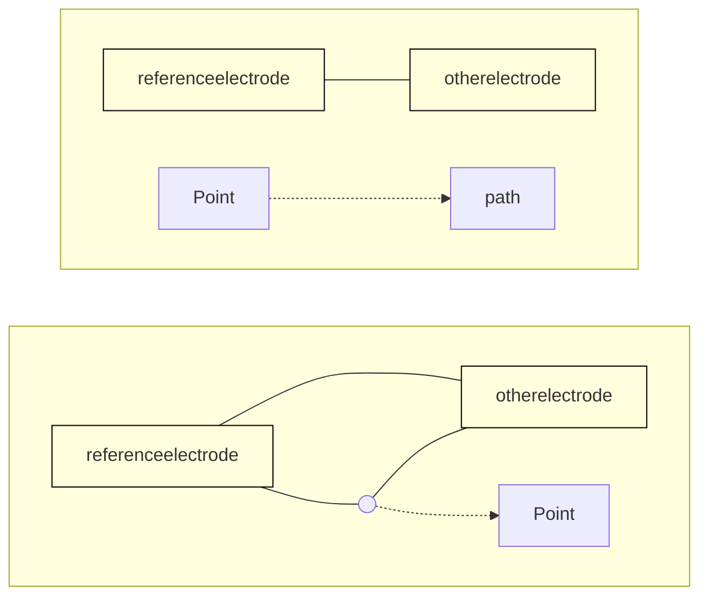
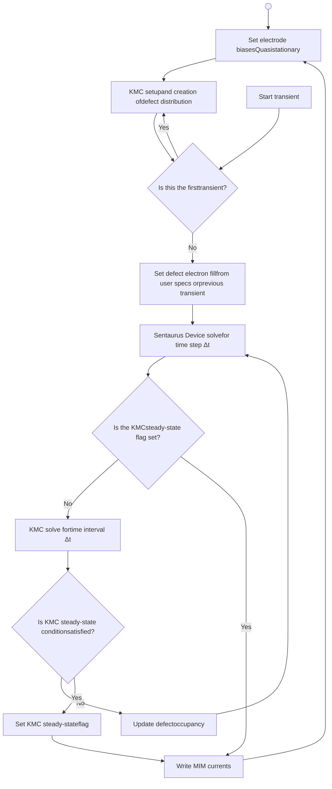

# CHAPTER 36 Kinetic Monte Carlo MIM Transport

---

*This chapter describes how to study transport in metal–insulator–metal structures at the microscopic level by using an interface to a kinetic Monte Carlo simulator that accounts for transport mechanisms in thin insulating films.*

---

## KMC Simulation Space and Math Settings

In the Sentaurus Device command file, the `Math` section settings that relate specifically to the kinetic Monte Carlo metal–insulator–metal (KMC-MIM) capability are:

```
Math {
  KMC (
    MinLocation = (<xmin>, <ymin>, <zmin>) # [um]
    MaxLocation = (<xmax>, <ymax>, <zmax>) # [um]
    CellLength = <float>                   # [um] (for TDDB only)
    [HalfCellOffset]                       # [1], default true (for TDDB only)
    [ReferenceElectrode = "<string>"]      # [1]
    [Trap2ElecMinDist = <float>]           # [um]
    [Trap2TrapMinDist = <float>]           # [um]
    [RandomSeed = <int>]                   # [1]
    [SkipKMCCurrentCheck = <float>]        # [1]
    [SkipKMCNumber = <int>]                # [1]
    [SkipKMC]                              # [1]

    [ResetElectronFill]                    # [1]
    [UseAllCrossings]                      # [1]
    [MoreFrequentRateResets]               # [1]

    [MIMEventCountCheckPoint = <int>]      # [1]
    [MIMBackAndForthThreshold = <int>]     # [1]
    [IntegrationPoints = <int>]            # [1]

    [ApproximateBessel]                    # [1]
  )
}
```

The next sections explain the keywords used in the `KMC` statement.

36: Kinetic Monte Carlo MIM Transport
KMC Simulation Space and Math Settings

# KMC Simulation Space

You define the portion of the Sentaurus Device structure to be used for the KMC simulations with the keywords `MinLocation` and `MaxLocation`, which define the extremities of a KMC box within the Sentaurus Device structure (see Figure 72). If part of the specification lies outside of the Sentaurus Device structure, then it is ignored.

Diagram showing a rectangular KMC simulation box defined by MinLocation and MaxLocation within a larger meshed structure. The axes are labeled Y [µm] and X [µm].

<a id="figure-72"></a>Figure 72 Defining the KMC simulation space in a Sentaurus Device structure

In addition, with regard to the KMC simulation space:

* It supports both 2D and 3D structures.

* It should include at least one insulator region and at least two electrodes.

* If you use metal regions for contacting insulator regions, then an electrode must contact each metal region. You must also include both the `Poisson` and `Contact` equations when obtaining solutions (see Performing the Simulation on page 1085).

The following example defines a 10 nm × 10 nm × 10 nm KMC simulation space:

```
Math {
  KMC (
    MinLocation = (0.000, 0.000, 0.000)
    MaxLocation = (0.010, 0.010, 0.010)
```

 ## KMC Simulation Space and Math Settings

```
    ReferenceElectrode = "cathode"
  )
}
```

For simulations that include the `TDDB` option, defects are confined to KMC cells that span the KMC simulation space (see Time-Dependent Dielectric Breakdown Simulations on page 1080). You specify the KMC cell size with the `CellLength` keyword (default: 0.0005 μm). When you specify the `TDDB` option, you can specify `HalfCellOffset` to shift the KMC simulation space by a half-cell length relative to the device structure.

The `ReferenceElectrode` keyword specifies the electrode to use as a reference for distances and for some analysis options. If not specified, then the reference electrode defaults to the first electrode that Sentaurus Device finds in the KMC simulation space. After the initial KMC setup, Sentaurus Device automatically changes the reference electrode to be the electrode with the lowest applied bias.

# Setting the Minimum Defect Distances

In most cases, defects (traps) are placed randomly in the KMC simulation space. This random placement can cause problems if the defect-to-electrode distance or the defect-to-defect distance is too small:

* The distance might be nonphysical.

* It might result in very high *back-and-forth* defect-to-electrode or defect-to-defect KMC event rates that dominate the KMC simulation time, making it difficult for the simulation to progress to steady state.

To prevent or to help suppress these issues, you can use the keywords `Trap2ElecMinDist` and `Trap2TrapMinDist` to set the minimum-allowed defect-to-electrode distance and defect-to-defect distance, respectively.

The following example sets a minimum distance for these quantities to 1 nm:

```
Trap2ElecMinDist = 0.001
Trap2TrapMinDist = 0.001
```

The default value is 0.0003 μm for both keywords.

# Specifying the Random Seed

KMC simulations are stochastic, and each execution of a command file typically produces results that differ to some degree. Specifying a fixed `RandomSeed` greater than zero allows the

## KMC Simulation Space and Math Settings

same results to be obtained from one simulation to the next, assuming the command file and keywords have not changed, and that the simulation is performed on the same platform.

## Omitting KMC Simulations Near Steady State

KMC leakage current simulations are performed during transient ramps in Sentaurus Device. After a Sentaurus Device time step, the KMC simulator is called to account for MIM transport for an interval equal to the Sentaurus Device time step. Control then returns to Sentaurus Device to solve for the next time step, and this cycle repeats until the Sentaurus Device transient `FinalTime` is reached.

With this process, it might be difficult to predict a good `FinalTime` for the Sentaurus Device transient. In many cases, KMC steady-state currents are reached at transient simulation times much smaller than `FinalTime`. If Sentaurus Device continues to call the KMC simulator after this, then the number of KMC events might become excessive, making it difficult to complete the transient.

The `SkipKMCCurrentCheck` keyword allows you to omit further calls to the KMC simulator for the remainder of the Sentaurus Device transient ramp if the MIM total current at two electrodes (or more) changes by less than the specified fraction when compared to the total MIM current from the previous time step, that is, when the simulation is close to steady state.

The following example will cause Sentaurus Device to stop calling the KMC simulator during the transient if the MIM total current change at two electrodes is less than 25% compared to the previous time step:

```
SkipKMCCurrentCheck = 0.25
```

Sometimes, MIM currents might be noisy even when the specified condition is satisfied. Specifying `SkipKMCNumber > 1` can help in this case by forcing Sentaurus Device to satisfy this condition for `SkipKMCNumber` consecutive Sentaurus Device time-steps before omitting KMC.

When the approximate steady-state condition is reached, Sentaurus Device writes the total MIM current and the current due to each separate tunneling process, for all electrodes, to a special MIM current file. See Special MIM Current File (Currents and Capacitance) on page 1091.

## Omitting the KMC Simulation Completely

For some analysis options, you might need to omit the KMC simulation completely. You can do this by specifying the `SkipKMC` option.

36: Kinetic Monte Carlo MIM Transport
KMC Simulation Space and Math Settings

# Resetting the Fraction of Defects Filled With Electrons

You can specify the fraction of defects filled with electrons. This fraction is used to fill defects at the start of the first KMC-MIM `Transient` simulation in the command file (see Specifying Defects on page 1060). During the transient, the electron configuration might change. By default, the electron configuration at the end of one `Transient` simulation is used as the initial state for the next `Transient` simulation.

You can modify this behavior by specifying the `ResetElectronFill` option. In this case, the electron-fill configuration established at the start of the first `Transient` in the command file is used at the start of all subsequent `Transient` commands.

# Sampling Potential at All Crossings

When calculating the transmission coefficient used in the tunneling rate equations, Sentaurus Device assumes a linear potential between the barrier endpoints. In the case of multilayer structures, a linear potential is assumed between the endpoints of each insulator layer with adjustments of the barrier heights at interfaces to account for electron affinity differences.

In most cases, these assumptions produce sufficiently accurate results. In cases where the potential does not vary linearly across the tunneling barrier (for example, in cylindrical structures), you can obtain improved accuracy by dividing the tunneling path into smaller intervals.

When you specify the `UseAllCrossings` option, Sentaurus Device samples the potential for the transmission coefficient calculation at all crossings of the tunneling path with the Sentaurus Device mesh.

# Resetting the Rate More Frequently

The KMC simulator calculates the KMC-MIM tunneling rates as needed. After a rate for an event is calculated, it is saved and not recalculated unless Sentaurus Device instructs the KMC simulator to do so.

Sentaurus Device requests a reset of all tunneling rates whenever it encounters a new `Transient` command in the command file, which usually is associated with an electrode bias change and which necessitates updated tunneling rates.

To modify this behavior, select `IncludeMIMChargeInPoisson` in the `KMC_MIM_Transport` statement of the `Physics` section (see Including the MIM Charge in the Poisson Equation on

36: Kinetic Monte Carlo MIM Transport
KMC Simulation Space and Math Settings

page 1074. In this case, specifying the option `MoreFrequentRateResets` causes all MIM tunneling rates to be reset after each time step. This can increase the simulation time significantly.

In most cases, resetting the MIM tunneling rates this frequently does not change results significantly.

## Adjusting the Calculated Tunneling Rates

The KMC simulator includes algorithms that attempt to adjust high event rates associated with back-and-forth events that might dominate the KMC simulation time and prevent progress toward a steady-state condition. You can use the following keywords to adjust these algorithms:

*   `MIMBackAndForthThreshold` sets the number of back-and-forth events that must occur before a rate is adjusted. The default is 2000.

*   `MIMEventCountCheckPoint` affects how often the KMC simulator checks for the need to adjust tunneling rates. Checks occur after every `MIMEventCountCheckPoint` event, up to five times. The default is 10000.

## Setting the Integration Points

The calculation of some of the tunneling rates used by KMC-MIM simulations requires numeric integration. Sentaurus Device uses a Gauss–Legendre method for these integrations. You use the keyword `IntegrationPoints` to set the number of integration points to use with this method. Larger values result in more accurate but slower simulations. A very conservative value of 256 is used by default. In most cases, 64 to 128 points will provide sufficient accuracy.

## Specifying the Approximate Bessel Function

A modified Bessel function of the order $p$, $I_p(z)$, is required for the calculation of the following tunneling models:

*   `InelasticElectrodeToTrapTunneling` and `InelasticTrapToElectrodeTunneling` (see Inelastic Electrode-to-Trap and Trap-to-Electrode Tunneling on page 1068)

*   `TrapToTrapTunneling(MultiPhonon)` (see Multiphonon Trap-to-Trap Tunneling Model on page 1072)

By default, this is obtained from a Math library function. It has been found that, for large numbers of defects, the Math library evaluation can be very slow.

36: Kinetic Monte Carlo MIM Transport
Specifying Electrodes

To avoid this slow down, an approximate calculation of $I_p(z)$ can be used instead by specifying `ApproximateBessel`:

$$I_p(z) \approx \frac{1}{\sqrt{2\pi}} \frac{\exp(\chi)}{\chi^{1/2}} \left( \frac{z}{p + \chi} \right)^p \tag{1199}$$

which is valid for $\chi \gg 1$, where $\chi = \sqrt{p^2 + z^2}$.

# Specifying Electrodes

Electrodes for KMC-MIM simulations are specified in the usual way using `Electrode` sections in the Sentaurus Device command file.

To define material properties for each electrode that will be used in the KMC-MIM simulation, specify a metal `Material` name in the `Electrode` section to associate with the electrode. The following example associates the properties of the metal material TiN with both the cathode and the anode:

```
Electrode {
  {name="cathode" voltage=0.0 Material="TiN"}
  {name="anode"   voltage=0.0 Material="TiN"}
}
```

The properties of the metal material can then be specified in the parameter file. For example:

```
Material = "TiN" {
  Bandgap {
    Workfunction = 4.4    # [eV] Workfunction
    FermiEnergy = 11.7    # [eV] Fermi energy
  }
  KMC_MIM_Transport {
    metun = 1.0           # [m0] Effective tunneling mass
    medos = 1.0           # [m0] Density-of-states mass
  }
}
```

If the electrode is a semiconductor, then the `KMC_MIM_Transport` section is not needed. The parameters in the `Bandgap` section for the semiconductor are sufficient.

36: Kinetic Monte Carlo MIM Transport

Specifying Insulators

# Specifying Insulators

You specify the insulator properties for KMC-MIM simulations in the parameter file. For example:

```
# Associate properties of ZrO2 with "Oxide"
Material = "Oxide" {
  Epsilon {
    epsilon = 40.0      # [1] Permittivity
  }
  Bandgap {
    Chi0 = 2.50         # [eV] Electron affinity,
                        # conduction band offset (CBO) = 4.4-2.5 = 1.9
    Eg0 = 5.4           # [eV] Band gap
  }
  KMC_MIM_Transport {
    metun                = 0.50      # [m0] Effective tunneling mass
    medos                = 0.50      # [m0] Density-of-states mass
    mcb                  = 1.16      # [m0] Conduction band mass
    mvb                  = 2.50      # [m0] Valence band mass
    HuangRhys            = 23        # [1] Huang-Rhys parameter
    PhononEnergy         = 0.040     # [eV] Phonon energy
    PhononFrequency      = 1e13      # [s^-1] Phonon frequency
    OpticalPermittivity = 5.6        # [1] Optical permittivity
    alpha                = 1.0       # [1] InelasticPhonon parameter
    tau0                 = 1.e-10    # [s] InelasticPhonon fitting parameter
    nu_max               = 1e14      # [s^-1] Maximum frequency for TDDB generation
    EA                   = 1.87      # [eV] Activation energy for TDDB generation
    p0                   = 2.1       # [eA] Molecular dipole moment for TDDB generation
    SitesPerVolume       = 4.4e22    # [cm^-3] Oxygen atoms per volume
    SigmaDef             = 10.0      # [S/cm] Conductivity of cells with defects
    SigmaIns             = 1e-11     # [S/cm] Conductivity of empty cells
    KappaDef             = 0.23      # [W/cm/K] Thermal conductivity of filled cells
    KappaIns             = 00.11     # [W/cm/K] Thermal conductivity of empty cells
  }
}
```

# Specifying Defects

Defects are included in KMC-MIM simulations through specifications in the `Traps` statement of the Sentaurus Device command file. You need to provide a `Traps` statement for each insulator material or region where defects will be placed.

36: Kinetic Monte Carlo MIM Transport
Specifying Defects

Defects that are used in KMC-MIM simulations are identified with special trap types that must be included in the `Traps` specification. Different KMC-MIM trap types are allowed that can have different properties: `KmcMim1` and `KmcMim2`. Both trap types can be used in a simulation, but they must be specified in separate `Traps` statements.

The syntax and parameters allowed for `KmcMim1` and `KmcMim2` are shown here:

```
Physics ([Material | Region] = "<insulator_name>") {
  Traps (
    ( [KmcMim1 | KmcMim2]
      EtFill       = <float>                                     # [eV]
      EtEmpty      = <float>                                     # [eV]
      TrapSigma    = <float>                                     # [eV]
      EmptyCharge  = <int>                                       # [1]
      Conc         = <float>                                     # [cm^-3]
      Location     = ( (<x1>,<y1>,<z1>) (<x2>,<y2>,<z2>) ... )   # [um]
      Xsection     = <float>                                     # [cm^2]
      XsectionT2T  = <float>                                     # [cm^2]
      FillFrac     = <float>                                     # [1]
      GrainBoundary(
        Density=<float>          # [cm^-2] for 3D device, [cm^-1] for 2D device
        EtEmpty=<float>                                          # [eV]
        EtFill=<float>                                           # [eV]
        FillFrac=<float>                                         # [1]
        TrapSigma=<float>                                        # [eV]
      )
    )
  )
}
```

where:

*   You specify either `KmcMim1` or `KmcMim2` to define the KMC-MIM trap type.

*   `EtFill` sets the filled trap level measured from the conduction band.

*   `EtEmpty` sets the empty trap level measured from the conduction band.

*   If you specify `TrapSigma`, then trap energy levels are randomized using a Gaussian distribution with this standard deviation.

*   `EmptyCharge` sets the charge state of an empty defect (default: 1). This keyword is used only when `IncludeMIMChargeInPoisson` is specified (see Including the MIM Charge in the Poisson Equation on page 1074).

*   `Conc` sets the defect density. The value specified with `Conc` is multiplied by the insulator volume in the KMC simulation space to obtain the number of defects to include in the insulator. For 2D simulations, `AreaFactor` is used for the width of the device in the unsimulated dimension (default: 1 μm). The calculated number of defects is then randomized over the insulator volume inside the KMC simulation space.

1061

Creating the Grain Field

*   Location sets the locations of specifically placed defects. It allows the locations of defects to be specified instead of, or in addition to, defects that are included using `Conc`.

*   If you specify `Xsection`, then this value is used to calculate the defect localization radius used in the inelastic electrode $\leftrightarrow$ trap rate calculations, using $r_D = \sqrt{<Xsection>/\pi}$.

*   If you specify `XsectionT2T`, then this value is used to calculate the defect localization radius used in the multiphonon trap-to-trap rate calculations, using $r_D = \sqrt{<XsectionT2T>/\pi}$.

*   `FillFrac` sets the initial fraction of defects that are filled with electrons.

*   `GrainBoundary` indicates that traps will be generated on the grain boundary. A prerequisite is that the grain field must be generated with `GrainFieldGenerator` specified in the `Math` section:

    *   `GrainBoundary(Density=<float>)` specifies the defect density on the grain boundary. The calculated number of defects is then randomized over the insulator volume inside the KMC simulation space.

    *   `GrainBoundary(EtEmpty=<float>)` specifies the empty grain-boundary trap level measured from the conduction band.

    *   `GrainBoundary(EtFill=<float>)` specifies the filled grain-boundary trap level measured from the conduction band.

    *   `GrainBoundary(FillFrac=<float>)` specifies the initial fraction of defects that are filled with electrons.

    *   `GrainBoundary(TrapSigma=<float>)`, if specified, randomizes the grain-boundary trap energy levels by using a Gaussian distribution with this standard deviation.

**Example**

```
Physics (Material = "Oxide") {
    Traps (
        (KmcMim1 Conc=3e18 FillFrac=0.5 EtFill=1.238 EtEmpty=1.283
        GrainBoundary(Density=1e12 FillFrac=0.1 EtFill=1.3 EtEmpty=1.2))
        (KmcMim2 Conc=3e18 FillFrac=0.5 EtFill=1.72 EtEmpty=1.7 TrapSigma=0.02)
    )
}
```

# Creating the Grain Field

The traps specified in `GrainBoundary` can be created based on the grain field. To create a grain field, specify a `GrainFieldGenerator` statement in the `Math` section of a particular region:

```
Math(Region=<string>) {
    GrainFieldGenerator (
        [Padding=<float>]               # units of AverageGrainSize
```

36: Kinetic Monte Carlo MIM Transport

# Creating the Grain Field

```
            [AverageGrainSize=<float>]                                     # um
            | [AverageGrainSizeVector= (<ax>, <ay>, <az>)]                 # um
            | [NumberOfGrains=<int>] [MinimumGrainSize=<float>]            # um
            [GrainLocation= ((<x1>,<y1>,<z1>), (<x2>,<y2>,<z2>), ...)]     # um
            [GrainLocationSize= ((<sx1>,<sy1>,<sz1>), <sx2>,<sy2>,<sz2>), ...)] # um
            [PoissonDistribution]
            [RandomSeed=<int>]
            [SingleVertexBoundary]
            [TwoDimensionalGrains]
            [UniformSpatialDistribution]
        )
    }
```

where:

*   Padding, if specified, extends the extremities of the region by a distance of Padding $\times$ $a_{gi}$ on all sides before randomizing the grain centers. This allows grain centers to be located outside of the region.

*   AverageGrainSize is the approximate average grain size in $\mu$m in V<sub>reg</sub>, or V<sub>box</sub> if padding is used.

*   AverageGrainSizeVector allows the grain average size to differ in different directions.

*   NumberOfGrains is the number of grain centers located within V<sub>reg</sub>.

*   MinimumGrainSize is used to prevent very small grains, which might arise when grain centers are very close to each other. The value specified with this parameter represents the smallest-allowed distance between grain centers.

*   GrainLocation sets specific locations where grains are placed in the region. Each grain will be an ellipsoid (or ellipse in two dimensions) with elliptic radii given by GrainLocationSize. The grains specified here will overwrite any of the randomly created grains generated using the previous parameters.

*   GrainLocationSize sets the elliptic radii of the grains whose locations are specified with GrainLocation. There must be a one-to-one correspondence between values specified with GrainLocation and GrainLocationSize.

*   Specifying `PoissonDistribution` indicates that the calculated number of grain centers will be used as the expected value for the random number generator of a Poisson distribution. This allows you to account for grain number variability when performing statistical studies.

*   RandomSeed is the seed used for the random number generator. Using the same (nonzero) seed in subsequent simulations allows the grain generation to be repeated. The default is zero (new randomization for each simulation).

*   Specifying `SingleVertexBoundary` indicates that only one vertex of edges that cross a Voronoï boundary will be marked with a negative index. This allows grains to be resolved with a coarser mesh. This is the default. To mark both vertices on an edge, specify `-SingleVertexBoundary`.

1063

Tunneling Processes

*   Specifying `TwoDimensionalGrains` indicates that grains will be created in two dimensions and extruded in the thinnest region dimension.

*   Specifying `UniformSpatialDistribution` indicates that grain centers will be distributed randomly as previously discussed, by default. However, you might want to have uniformly sized and distributed grains. Specifying this option will attempt to provide this. If you specify this option, then an integral number of grains is distributed uniformly over each dimension of the box volume. In this case, padding is not included:

$$ N_x = \max(1, \text{int}((x_{\max} - x_{\min})/a_{gx} + 0.5)) $$
$$ N_y = \max(1, \text{int}((y_{\max} - y_{\min})/a_{gy} + 0.5)) $$
$$ N_z = \max(1, \text{int}((z_{\max} - z_{\min})/a_{gz} + 0.5)) $$

The total number of grains in the box volume will be given by $N_{\text{grain}} = N_x N_y N_z$.

# Tunneling Processes

This section discusses tunneling processes and options.

## Specifying Tunneling Processes and Related Options

You specify the tunneling processes and related options to include in KMC-MIM simulations in the `Physics` section of the command file, in the `KMC_MIM_Transport` statement. The available options are listed here and are described in the next sections:

```
Physics {
  Temperature=298
  KMC_MIM_Transport (
    [DirectTunneling]
    [PooleFrenkelEmission]

    [ElasticElectrodeToTrapTunneling]
    [ElasticTrapToElectrodeTunneling]
    [ElasticUsePZeroSZero]

    [InelasticElectrodeToTrapTunneling]
    [InelasticTrapToElectrodeTunneling]
    [InelasticIgnorePMinus]
    [InelasticIncludePZero]
    [InelasticPZeroOnly]

    [DeltaTrapPotential]
    [TrapToTrapTunneling [(InelasticPhonon) | (MultiPhonon)]]
```

36: Kinetic Monte Carlo MIM Transport

Tunneling Processes

```
        [ImageChargeBarrierLowering]
        [EnergyDependentMass]
        [IncludeMIMChargeInPoisson]
        [AvgOccupancyInMIMCharge]

        [PrintDefectOccupancy]
        [PrintMIMEventStatistics]
        [PrintMIMRates]

        [RateEquationCurrent]
        [PrintRECRates]

        [ConductivePathCurrent]
        [PrintCPCPaths]
        [PrintCPCRates]

        SensitivityAnalysis (
            Point       = (<xp>, <yp>, <zp>)                # [um]
            [XtRange    = (<XtStart>, <XtEnd>, <XtStep>)]   # [um]
            [EtRange    = (<EtStart>, <EtEnd>, <EtStep>)]   # [eV]
            [PlotType   = <int>]                            # [1]
            [PrintAll]
        )
        [ConductanceEquation]                               # Default true (for TDDB only)
        [HeatEquation]                                      # Default true (for TDDB only)
        [TDDB]
    )
}
```

# Direct Tunneling

You specify the `DirectTunneling` option to select direct tunneling, which accounts for the direct electrode-to-electrode tunneling of electrons.

The KMC direct tunneling rate $dR_{\text{DT}}$ associated with a portion of the source electrode with area $dA$ is calculated from:

$$dR_{\text{DT}} = \frac{dA m_1^* k_{\text{B}} T}{2 \pi^2 \hbar^3} \int_0^{E_b} T(E) \ln \left( \frac{e^{(E_{f1} - E_{c1} - E) / k_{\text{B}} T} + 1}{e^{(E_{f2} - E_{c1} - E) / k_{\text{B}} T} + 1} \right) dE$$ (1200)

1065

36: Kinetic Monte Carlo MIM Transport

Tunneling Processes

where, $m_1^*$ is the electrode effective tunneling mass (`metun`), and $T(E)$ is the transmission coefficient calculated using a WKB approximation:

$$T(E) = \exp \left( -2 \int_{x_1}^{x_2} dx \sqrt{\frac{2m_{\text{ins}}^*}{\hbar^2} (V(x) - E)} \right) \tag{1201}$$

For a semiconductor electrode:

$$dR_{\text{DT}} = \frac{dA k_B T}{2\pi^2 \hbar^3} (m_c^* \Theta(E_e - E_c) + m_v^* \Theta(E_v - E_e)) \int_0^{E_b} T(E) \ln \left( \frac{e^{(E_{f1} - E_{c1} - E)/k_B T} + 1}{e^{(E_{f2} - E_{c1} - E)/k_B T} + 1} \right) dE \tag{1202}$$

If the potential energy $V(x)$ is linear along the tunneling path, then the integral can be calculated analytically giving:

$$T(E) = \exp \left( -\frac{4\sqrt{2m_{\text{ins}}^*}}{3\hbar(V_{\text{ins}}/t_{\text{ins}})} [(E_b - E)^{3/2} - (E_b - E - eV_{\text{ins}})^{3/2}] \right) \tag{1203}$$

where $m_{\text{ins}}^*$ is the insulator effective tunneling mass (`metun`).

Diagram showing direct tunneling in a MIM structure with energy levels E_f1, E_f2, E_c1, barrier height E_b, and insulator thickness t_ins.

Figure 73 Direct tunneling in a MIM structure

# Poole–Frenkel Emission

You select Poole–Frenkel emission with the `PooleFrenkelEmission` option, which accounts for the field-enhanced thermal emission of electrons from defects to the insulator conduction band.

36: Kinetic Monte Carlo MIM Transport

Tunneling Processes

The KMC Poole–Frenkel emission rate $R_{\text{PF}}$ is given by [1]:

$$ R_{\text{PF}} = \nu \cdot \exp(-\frac{E_D}{k_B T}) \left\{ \left( \frac{k_B T}{\beta \sqrt{F}} \right)^2 \left[ 1 + \left( \frac{\beta \sqrt{F}}{k_B T} - 1 \right) \exp(\frac{\beta \sqrt{F}}{k_B T}) \right] + \frac{1}{2} \right\} \tag{1204} $$

where:

*   $\beta = \sqrt{\frac{e^3}{\pi \varepsilon_0 \varepsilon_{\text{opt}}}}$.

*   $F$ is the insulator electric field.

*   $\nu$ is the lattice vibration frequency (insulator `PhononFrequency`).

*   $E_D$ is the trap depth (defect `EtFill`).

*   $\varepsilon_{\text{opt}}$ is the insulator `OpticalPermittivity`.

# Elastic Electrode-to-Trap and Trap-to-Electrode Tunneling

You select elastic electrode-to-trap tunneling with the `ElasticElectrodeToTrapTunneling` option and elastic trap-to-electrode tunneling with the `ElasticTrapToElectrodeTunneling` option.

The KMC tunneling rates $R_{\text{ED}}$ and $R_{\text{DE}}$ are given by [1]:

$$ R_{\text{ED}} = \left( \frac{m_e}{m_i} \right)^{5/2} \left( \frac{8 E_e^{3/2}}{3 \hbar \sqrt{E_D}} \right) f(E_e) T(E_e) \tag{1205} $$

$$ R_{\text{DE}} = \left( \frac{m_e}{m_i} \right)^{5/2} \left( \frac{8 E_e^{3/2}}{3 \hbar \sqrt{E_D}} \right) (1 - f(E_e)) T(E_e) \tag{1206} $$

where:

*   $m_e$ is the electrode density-of-states (DOS) mass (`medos`).

*   $m_i$ is the insulator effective tunneling mass (`metun`).

*   $E_D$ is the trap depth of the empty or filled defect (`EtEmpty` or `EtFill`).

*   $E_e$ is the electron energy.

*   $T(E_e)$ is the transmission coefficient for the barrier between the electrode and the defect.

*   $f(E_e)$ is the Fermi–Dirac distribution function given by $f(E_e) = \frac{1}{1 + e^{(E_e - E_f) / (k_B T)}}$.

Tunneling Processes

For a semiconductor electrode:

$$ R_{\text{ED}} = \left( \frac{m_e}{m_i} \right)^{5/2} \left( \frac{8(E_e - E_c)^{3/2}}{3\hbar\sqrt{E_{\text{D}}}} \right) f(E_e) T(E_e) \theta(E_e - E_c) $$
$$ + \left( \frac{m_v}{m_i} \right)^{5/2} \left( \frac{8(E_v - E_e)^{3/2}}{3\hbar\sqrt{E_{\text{D}}}} \right) f(E_e) T(E_e) \theta(E_v - E_e) $$
(1207)

$$ R_{\text{DE}} = \left( \frac{m_e}{m_i} \right)^{5/2} \left( \frac{8(E_e - E_c)^{3/2}}{3\hbar\sqrt{E_{\text{D}}}} \right) (1 - f(E_e)) T(E_e) \theta(E_e - E_c) $$
$$ + \left( \frac{m_h}{m_i} \right)^{5/2} \left( \frac{8(E_v - E_e)^{3/2}}{3\hbar\sqrt{E_{\text{D}}}} \right) (1 - f(E_e)) T(E_e) \theta(E_v - E_e) $$
(1208)

## Option for Elastic Tunneling

As an alternative to Eq. 1205 and Eq. 1206, you can use elastic tunneling rates based on the inelastic expressions in Inelastic Electrode-to-Trap and Trap-to-Electrode Tunneling.

If you specify the `ElasticUsePZeroSZero` option, then the elastic electrode-to-trap and elastic trap-to-electrode tunneling rates are calculated from the $p = 0$ term in Eq. 1209 and Eq. 1210 with the Huang–Rhys parameter set to zero ($S = 0$). The latter condition is equivalent to setting $L_p(z) = 1$ in Eq. 1209 and Eq. 1210.

# Inelastic Electrode-to-Trap and Trap-to-Electrode Tunneling

You can select inelastic electrode-to-trap tunneling with the option `InelasticElectrodeToTrapTunneling` and inelastic trap-to-electrode tunneling with the `InelasticTrapToElectrodeTunneling` option.

The KMC tunneling rates $R_{\text{ED}}^{\text{MP}}$ and $R_{\text{DE}}^{\text{MP}}$ are given by [1]:

$$ R_{\text{ED}}^{\text{MP}} = \sum_{p < 0}^{\infty} c_0 N_E(E_p) f(E_p) T(E_p) L_p(z) \cdot e^{\frac{p\hbar\omega}{k_{\text{B}}T}} + \sum_{p > 0}^{\infty} c_0 N_E(E_p) f(E_p) T(E_p) L_p(z) $$
(1209)

$$ R_{\text{DE}}^{\text{MP}} = \sum_{p < 0}^{\infty} c_0 N_E(E_p) (1 - f(E_p)) T(E_p) L_p(z) + \sum_{p > 0}^{\infty} c_0 N_E(E_p) (1 - f(E_p)) T(E_p) L_p(z) \cdot e^{\frac{-p\hbar\omega}{k_{\text{B}}T}} $$
(1210)

36: Kinetic Monte Carlo MIM Transport
Tunneling Processes

where:

*   The electron tunneling energy $E_p$ is given by $E_p = E_e + p\hbar\omega$, where $p$ is the integer phonon number, and $\hbar\omega$ is the phonon energy in the insulator (`PhononEnergy`).

*   The DOS in the electrode $N_E(E_p)$ is given by:

$$N_E(E_p) = \frac{1}{2\pi^2} \left( \frac{2m_e}{\hbar^2} \right)^{3/2} \sqrt{E_p - E_c} \cdot \theta(E_p - E_c) \tag{1211}$$

where $m_e$ is the electrode DOS mass (`medos`), and $E_c$ is the conduction band edge of the electrode.

*   The DOS in the semiconductor electrode $N_E(E_p)$ is given by:

$$N_E(E_p) = \frac{1}{2\pi^2} \left( \frac{2m_c}{\hbar^2} \right)^{3/2} \sqrt{E_p - E_c} \cdot \theta(E_p - E_c) + \frac{1}{2\pi^2} \left( \frac{2m_v}{\hbar^2} \right)^{3/2} \sqrt{E_v - E_p} \cdot \theta(E_v - E_p) \tag{1212}$$

where $m_c$, $m_v$ is the electrode DOS mass (`medos`), and $E_c$ the conduction band edge of the electrode.

*   The capture coefficient $c_0$ is given by:

$$c_0 = \frac{(4\pi)^2 r_D^3}{\hbar E_g} (\hbar E_0)^3 \tag{1213}$$

$$(\hbar E_0)^3 = \frac{e^2 \hbar^2 F^2}{2m_i} \tag{1214}$$

where:

*   $E_g$ is the insulator band gap (`Eg0`).

*   $m_i$ is the insulator effective tunneling mass (`metun`).

*   $F$ is the insulator electric field.

*   The localization radius $r_D$ is given by $r_D = \frac{\hbar}{\sqrt{2m_i E_D}}$.

If you specify `DeltaTrapPotential`, then a field-independent $c_0$ is used instead:

$$c_0 = \frac{(4\pi)^2 r_D^3}{\hbar} (E_D)^2 \tag{1215}$$

*   The Fermi–Dirac distribution $f(E_p)$ is $f(E_p) = \frac{1}{1 + e^{(E_p - E_f)/(k_B T)}}$.

1069

Tunneling Processes

*   The multiphonon transition probability $L_p(z)$ is given by:

$$ L_p(z) = \exp \left[ -S(2f_{\text{BE}} + 1) + \frac{p\hbar\omega}{2k_{\text{B}}T} \right] \cdot I_p(z) \tag{1216} $$

where:

*   $S$ is the Huang–Rhys parameter in the insulator (`HuangRhys`).

*   $f_{\text{BE}}$ is the Bose–Einstein distribution:

$$ f_{\text{BE}} = \frac{1}{\exp \left( \frac{\hbar\omega}{k_{\text{B}}T} \right) - 1} \tag{1217} $$

*   $I_p(z)$ is a modified Bessel function of order $p$ with:

$$ z = 2S \sqrt{f_{\text{BE}}(f_{\text{BE}} + 1)} \tag{1218} $$

## Options for Inelastic Tunneling

You can use variants of these expressions, mainly related to which phonon energies are included in the tunneling rate calculations. The following options allow the phonon energy summations in Eq. 1209 and Eq. 1210 to be modified:

*   `InelasticIgnorePMinus`: Ignores the $p < 0$ terms in Eq. 1209 and Eq. 1210

*   `InelasticIncludePZero`: Includes the $p = 0$ term in Eq. 1209 and Eq. 1210

*   `InelasticPZeroOnly`: Uses only the $p = 0$ term in Eq. 1209 and Eq. 1210

# Trap-to-Trap Tunneling

This section discusses the trap-to-trap tunneling models.

## Trap-to-Trap Tunneling Model

You select trap-to-trap tunneling (both elastic and inelastic) with the `TrapToTrapTunneling` option, which accounts for electron tunneling between defects. The trap-to-trap rate $R_{ij}$ from defect $i$ to defect $j$ is given by [1]:

$$ R_{ij} = v \cdot T_{ij} \cdot \begin{cases} \exp(-\frac{\Delta E_{ji}}{k_{\text{B}}T}), & \text{if } \Delta E_{ji} > 0 \\ 1, & \text{otherwise} \end{cases} \tag{1219} $$

36: Kinetic Monte Carlo MIM Transport
Tunneling Processes

where:

*   $v$ is the lattice vibration frequency (insulator `PhononFrequency`).

*   $T_{ij}$ is the transmission coefficient for the energy barrier between defect $i$ and defect $j$.

*   $\Delta E_{ji}$ is the energy difference between the final defect state and the initial defect state.

This model is an extension of the Miller–Abrahams hopping model [1] and is obtained by replacing $\exp(-2r_{ij}/r_D)$ in the Miller–Abrahams expression with a calculation of the transmission coefficient $T_{ij}$.

## Inelastic Phonon Trap-to-Trap Tunneling Model

You can select the inelastic phonon trap-to-trap tunneling model as an alternative to the `TrapToTrapTunneling` model by specifying `TrapToTrapTunneling(InelasticPhonon)`.

When selected, the trap-to-trap electron capture rate from defect 1 to defect 2 is calculated using:

$$ R_{12} = \frac{1}{\tau_0} \cdot T_{12}(E) \cdot \left[ \frac{\alpha(S-p)^2}{S} + 1 - \alpha \right] \cdot L_p(z) \cdot \begin{cases} \exp(-\frac{\Delta E_{21}}{k_B T}), & \text{if } \Delta E_{21} > 0 \\ 1, & \text{otherwise} \end{cases} $$ (1220)

where:

*   $\tau_0$ is a fitting parameter (insulator `tau0`; default = $10^{-4}$ s).

*   $T_{12}(E)$ is the transmission coefficient for the energy barrier between defect 1 and defect 2.

*   $\alpha$ is a user-specified parameter (insulator `alpha`; default = 1).

*   $S$ is the Huang–Rhys parameter (insulator `HuangRhys`).

*   $p$ is the phonon number given by:

$$ p = \left| \frac{E_1 - E_2}{\hbar \omega} \right| $$ (1221)

where $\hbar \omega$ is the phonon energy in the insulator (`PhononEnergy`).

*   $\Delta E_{21}$ is the energy difference between the trap levels of defect 2 and defect 1.

*   $L_p(z)$ is the multiphonon transition probability (see Eq. 1216 to Eq. 1218).

The phonon number, $p$, is usually taken to be an integer. In the implementation of this model, however, $p$ can take a floating-point value given by Eq. 1221, and the modified Bessel function, $I_p(z)$ in Eq. 1216, is approximated with the expression given in Specifying the Approximate Bessel Function on page 1058.

36: Kinetic Monte Carlo MIM Transport
Tunneling Processes

# Multiphonon Trap-to-Trap Tunneling Model

You can select a multiphonon description of trap-to-trap tunneling [[2]]([2])[[3]]([3]) by specifying `TrapToTrapTunneling(MultiPhonon)`. For a transition from defect 1 to defect 2, this model provides expressions for capture and emission.

For capture by defect 2 from defect 1, the transition rate is given by:

$$ R_{ca, 12} = \sum_{p = 0}^{\infty} c_0 N_1(E_{2, p}) f_1(E_{2, p}) T_{12}(E_{2, p}) L_p(z) $$ (1222)

$$ N_1(E_{2, p}) = \frac{1}{2\pi^2} \left( \frac{2m_1}{\hbar^2} \right)^{3/2} \sqrt{E_{2, p} - E_1} \cdot \Theta(E_{2, p} - E_1) $$ (1223)

$$ f_1(E_{2, p}) = \frac{1}{1 + e^{(E_{2, p} - E_1) / (k_B T)}} $$ (1224)

$$ E_{2, p} = E_2 + p\hbar\omega $$ (1225)

For emission from defect 1 to defect 2, the transition rate is given by:

$$ R_{em, 12} = \sum_{p = 0}^{\infty} c_0 N_2(E_{1, p}) (1 - f_2(E_{1, p})) T_{12}(E_{1, p}) L_p(z) e^{\frac{-p\hbar\omega}{k_B T}} $$ (1226)

$$ N_2(E_{1, p}) = \frac{1}{2\pi^2} \left( \frac{2m_2}{\hbar^2} \right)^{3/2} \sqrt{E_{1, p} - E_2} \cdot \Theta(E_{1, p} - E_2) $$ (1227)

$$ f_2(E_{1, p}) = \frac{1}{1 + e^{(E_{1, p} - E_2) / (k_B T)}} $$ (1228)

$$ E_{1, p} = E_1 + p\hbar\omega $$ (1229)

In Eq. 1222 and Eq. 1226, $c_0$ is taken from Eq. 1213 ($c_0$ is taken from Eq. 1215 if with the `DeltaTrapPotential` option), $L_p(z)$ is taken from Eq. 1216, and $T_{12}(E)$ is the transmission coefficient calculated at energy $E$. In Eq. 1223 and Eq. 1227, $m_1$ and $m_2$ are DOS masses (`medos`).

For the KMC trap-to-trap rate, the minimum of $R_{ca, 12}$ and $R_{em, 12}$ is used:

$$ R_{12} = \min(R_{ca, 12}, R_{em, 12}) $$ (1230)

36: Kinetic Monte Carlo MIM Transport
Tunneling Processes

Diagram showing capture and emission processes between two defects in a MIM structure. The left panel shows capture from an electrode to a defect, and the right panel shows emission from a defect to an electrode. Energy levels E1, E2, and E2,p are indicated.

Figure 74 (Left) Capture and (right) emission between two defects

# Image Charge Barrier Lowering

To account for image charge barrier lowering, specify the `ImageChargeBarrierLowering` option. When selected, this effect is included in all the preceding tunneling rate calculations except for Poole–Frenkel emission and trap-to-trap tunneling. Image charge barrier lowering reduces the transmission coefficient barrier along the tunneling path by:

$$ \Delta V_{\text{ICBL}} = -\frac{e^{2}}{16\pi\epsilon_{0}\epsilon_{\text{opt}}x} $$ (1231)

where:

* $x$ is the distance from the electrode.

* $\epsilon_{\text{opt}}$ is the insulator optical permittivity (`OpticalPermittivity`).

> **NOTE** Including Eq. 1231 in the calculation of the transmission coefficient introduces a nonlinearity requiring a numeric integration. Often, you can account for image charge barrier lowering by simply reducing the conduction band offset (the workfunction of the electrode minus the electron affinity of the insulator) by a small amount (such as 0.15 eV), thereby avoiding the extra numeric integration.

# Energy-Dependent Mass

You can account for the energy-dependent tunneling mass by specifying `EnergyDependentMass`. When selected, this effect is included in all the preceding tunneling rate calculations except for Poole–Frenkel emission. The energy-dependent mass calculation

Tunneling Processes

adjusts the effective tunneling mass in the top half of insulator band gap using the following expression:

$$ m_{ins}^*(E') = \begin{cases} \frac{m_c \left( 1 - \frac{E'}{E_g} \right)}{\left( 1 - \left( 1 - \frac{m_c}{m_v} \right) \frac{E'}{E_g} \right)}, & E' < \frac{E_g}{2} \\ \frac{m_c m_v}{m_c + m_v}, & E' \geq \frac{E_g}{2} \end{cases} $$ (1232)

where:

*   $E'$ is the energy difference between the insulator conduction band and the electron tunneling energy.

*   $E_g$ is the insulator band gap ($E_{g0}$).

*   $m_c$ is the insulator conduction band mass ($m_{cb}$).

*   $m_v$ is the insulator valence band mass ($m_{vb}$).

> **NOTE** Including Eq. 1232 in the calculation of the transmission coefficient introduces a nonlinearity requiring a numeric integration. Often, you can account for the effect of energy-dependent mass by simply adjusting the insulator effective tunneling mass, thereby avoiding the extra numeric integration.

---

# Including the MIM Charge in the Poisson Equation

By default, the charge associated with defects and electrons in the insulator are excluded when solving the Poisson equation. Therefore, the effect this charge has on the insulator potential is ignored when calculating tunneling rates.

To include the defect and electron charge in the solution of the Poisson equation, select the `IncludeMIMChargeInPoisson` option. When selected, the following adjustments to the solution process are invoked:

*   At the start of each Sentaurus Device time step, the spatial distribution of charge due to defects and electrons is updated, by assigning the charge associated with each defect and each electron in the insulator to the nearest Sentaurus Device vertex. The charge concentration at each vertex is computed by dividing the net vertex charge by the vertex volume.

*   The updated charge distribution is included in the solution of the Poisson equation to obtain a new potential distribution.

**36: Kinetic Monte Carlo MIM Transport**
Tunneling Processes

*   If this is the first time step of a Transient ramp, then Sentaurus Device instructs the KMC simulator to reset all tunneling rates. The KMC simulator discards all previously saved tunneling rates and requests updated rates from Sentaurus Device based on the updated potential. By default, the rates established with this potential are used for all subsequent time steps during the transient, even though the calculated potential in the insulator might change due to movement of electrons.

*   If you select the `MoreFrequentRateResets` option, then the tunneling rates are updated after every Sentaurus Device time step.

Note the following:

*   The charge associated with a defect is established by specifying `EmptyCharge` in the `Traps` statement associated with the defect (see Specifying Defects on page 1060).

*   Resetting the saved KMC tunneling rates at every Sentaurus Device time step (by selecting `MoreFrequentRateResets`) can significantly increase the simulation time and, in most cases, is not needed.

*   Including the defect and electron charge in the solution of the Poisson equation usually only causes a small perturbation of the insulator potential, especially at low defect concentrations and high biases. In most cases, sufficient accuracy is obtained by excluding the `IncludeMIMChargeInPoisson` option.

## Average Electron Occupancy in the MIM Charge

By default, when using `IncludeMIMChargeInPoisson`, the electron component of the total MIM charge at each defect is taken to be the actual occupancy at the end of the KMC time interval, which is zero (0) or one (1). In most cases, it will be zero because the average occupancy associated with a defect tends to be small.

As an alternative, the average occupancy associated with a defect can be used for the electron charge by specifying the option `AvgOccupancyInMIMCharge`. The average occupancies of the defects are calculated from a solution of the rate equations for the system of defects (see Rate Equation Current Calculation on page 1076) and the selected tunneling models.

# Printing Options

You can use the following options to print additional output:

*   `PrintDefectOccupancy` prints a defect summary, including occupancy and energy, to the log file and to standard output (see Occupancy and Energy on page 1089).

*   `PrintMIMEventStatistics` prints MIM event statistics to standard output (see Event Statistics on page 1089).

36: Kinetic Monte Carlo MIM Transport

Tunneling Processes

*   PrintMIMRates prints the calculated tunneling rates to the log file and to standard output (see Tunneling Rates on page 1090).

# Rate Equation Current Calculation

In addition to determining MIM leakage current using the KMC simulator, the option `RateEquationCurrent` invokes a solution of the rate equations for the system of defects and selected tunneling models. This capability, which is used by default, provides average occupancy for all defects and the total MIM leakage current.

The equation for the occupancy of the $i^{th}$ defect in a system of $N_d$ defects and $N_e$ electrodes is given by:

$$ \sum_{j \neq i}^{N_d} [f_j(1 - f_i)R_{ji} - f_i(1 - f_j)R_{ij}] + (1 - f_i) \sum_{k=1}^{N_e} R_{ki} - f_i \sum_{k=1}^{N_e} R_{ik} = 0 \qquad (1233) $$

where:

*   $R_{ij}$ and $R_{ji}$ are the total tunneling rates between defect $i$ and defect $j$.

*   $R_{ik}$ and $R_{ki}$ are the total tunneling rates between defect $i$ and electrode $k$.

This leads to an $N_d \times N_d$ system of equations, which is solved to obtain the defect occupancies.

From the occupancies, the leakage current at the $k^{th}$ electrode is then computed from:

$$ I_k = q \sum_{i=1}^{N_d} [f_i R_{ik} - (1 - f_i)R_{ki}] \qquad (1234) $$

A summary of each solution of the rate equations is written to the `*.log` file. For example:

```
Rate Equation Solution
  Iter      |Rhs|         max_error    TrapIndex  Occupancy      Update
     0   1.6386e-02
     1   6.2237e-12   9.1199e+07           2      3.6728e-13   -4.2615e-12
     2   9.4081e-19   6.5440e-01           7      8.0304e-07   -5.2551e-14
  ... converged solution
  Electrode           Voltage(V)    Current(A)
  cathode             0.0000e+00    3.4146e-20
  anode              -2.2000e+00   -3.4146e-20
```

The total current calculated by the rate equation current (REC) method is written to the `*_mimcur_des.plt` file and can be selected for plotting in Sentaurus Visual using `MIMRateEquationCurrent`.

36: Kinetic Monte Carlo MIM Transport
Tunneling Processes

You can specify the option `PrintRECRates` to print the tunneling rates that are calculated during a REC solution.

The setup for the REC method is the same as that for a KMC-MIM leakage current calculation. The REC method uses the same defects, models, parameters, and biasing as used in a KMC calculation. To perform REC solutions without running a KMC simulation, specify `SkipKMC` in the `KMC` statement of the `Math` section.

## Conductive Path Current Analysis

Conductive path current (CPC) analysis provides an efficient method for approximating the leakage current in MIM structures. CPC analysis attempts to find favorable conduction paths through the defects in the MIM structure, with the assumption that each defect can belong to only one path. The current through each path is calculated, and the total leakage current is obtained by summing the current from each path.

You specify CPC analysis with the `ConductivePathCurrent` option.

You can specify the option `PrintCPCPaths` to obtain detailed information about the paths used in the CPC calculation as well as the option `PrintCPCRates` to obtain information about the rate calculations used during the CPC calculation.

The total current calculated by CPC analysis is written to the `*_mimcur_des.plt` file and can be selected for plotting in Sentaurus Visual using `MIMConductivePathCurrent`.

The setup for CPC analysis is the same as that for a KMC-MIM leakage current calculation. CPC analysis uses the same defects, models, parameters, and biasing as used in a KMC calculation. To perform a CPC analysis without running a KMC simulation, specify `SkipKMC` in the `KMC` statement of the `Math` section.

## Sensitivity Analysis

Sensitivity analysis can determine efficiently how the position and the energy level of a single defect will affect the leakage current in a MIM structure.

A single defect is placed at different locations, $X_t$, along a path through the structure and a leakage current calculation is performed at a series of defect energy levels, $E_t$, at each location. The result is a matrix of leakage current values, one for each ($X_t$, $E_t$) pair. The maximum leakage current and the corresponding ($X_t$, $E_t$) are printed to the log file.

Tunneling Processes

The leakage current for all ($X_t$, $E_t$) pairs is written to a file with the `_<volt>_mimsa_des.tdr` suffix, which Sentaurus Visual can read for plotting leakage current over the ($X_t$, $\bar{E}_t$) space, where `<volt>` is the voltage at which the analysis occurs.

Alternatively, the leakage current can be plotted as absolute energy versus $X_t$, which shows the band edges. The base name for the file can be specified in the `File` section of the command file using the `MIMSensitivity` keyword. In this file, $X_t$ values are stored in nm and $E_t$ values are stored in eV.

You specify sensitivity analysis in the `KMC_MIM_Transport` statement of the `Physics` section as follows:

```
Physics {
  KMC_MIM_Transport (
    ...
    SensitivityAnalysis (
      Point     = (<xp>, <yp>, <zp>)             # [um]
      [XtRange  = (<XtStart>, <XtEnd>, <XtStep>)] # [um]
      [EtRange  = (<EtStart>, <EtEnd>, <EtStep>)] # [eV]
      [PlotType = <int>]                          # [1]
      [PrintAll]
    )
    ...
  )
}
```

where:

*   `Point` specifies the path for the defect locations, $X_t$. Sentaurus Device finds the closest point on the reference electrode to `Point` and the closest point on another electrode. The path is drawn between these two closest electrode points. In most cases, `Point` will be on the path (as shown in the left figure). In some situations, this might not be the case (as shown in the right figure). The default is `Point= (0, 0, 0)`.


Diagram showing Point and path relative to electrodes

*   `XtRange` specifies the start, end, and step size for defect locations, $X_t$, along the path. The reference electrode is at $X_t = 0$. Defect locations, $X_t$, cannot be closer than 0.0001 µm to the electrodes, and the minimum-allowed step size is 0.0001 µm. If you do not specify `XtRange`, then $X_t$ will span the entire path, from electrode to electrode, with a step size of 0.0001 µm.

1078

36: Kinetic Monte Carlo MIM Transport

Tunneling Processes

*   `EtRange` specifies the start, end, and step size for defect energy levels, $E_t$, relative to the conduction band. The defect energy levels cannot be closer than 0.05 eV to the band edges, and the minimum-allowed step size is 0.05 eV. If you do not specify `EtRange`, then $E_t$ will span the entire band gap with a step size of 0.05 eV.

*   `PlotType` specifies how Sentaurus Visual plots the results. Options are:

    *   `PlotType=1`: (Default) Plot absolute energy versus $X_t$ (flat band).

    *   `PlotType=2`: Plot absolute energy versus $X_t$ (bias included).

    *   `PlotType=3`: Plot $E_t$ versus $X_t$.

*   If you specify `PrintAll`, then the leakage current values for all ($X_t$, $E_t$) pairs are printed to the log file.

The setup for sensitivity analysis is the same as that for a KMC-MIM leakage current calculation. That is, a `Traps` statement is required that specifies either `KmcMim1` or `KmcMim2`, and a series of `Quasistationary` or `Transient` ramps should be specified to set electrode biases and to initiate the analysis. To perform sensitivity analysis without running KMC, specify `SkipKMC` in the `KMC` statement of the `Math` section.

Here is an example log file and graphical output for a two-layer MIM structure (see Figure 75 on page 1080):

```
Sensitivity Analysis
  Path Start Location: ( 0.0000e+00, 5.0000e-03, 5.0000e-03) um, cathode
  Path End Location   : ( 1.0000e-02, 5.0000e-03, 5.0000e-03) um, anode
  Path Max Distance   : 1.0000e-02 um
  Defect Distances    : Start: 1.0000e-04 um, End: 9.9000e-03 um, Step:
  1.0000e-04 um
  Defect Energies     : Start: 5.0000e-02 eV, End: 5.3500e+00 eV, Step:
  5.0000e-02 eV

  Maximum current     = 1.2670e-17 Amps
  Defect energy level = 1.2000e+00 eV
  Distance along path = 2.0000e-03 um
  Defect Location     = ( 2.0000e-03, 5.0000e-03, 5.0000e-03) um
```

Tunneling Processes

Anode Voltage = 2.5 V

Example of graphical output (PlotType=1) from sensitivity analysis showing Energy [eV] vs Distance from cathode [nm] with NormalizedCurrent heatmap

Figure 75 Example of graphical output (PlotType=1) from sensitivity analysis

# Time-Dependent Dielectric Breakdown Simulations

If you select the `TDDB` option, then Sentaurus Device accounts for time-dependent dielectric breakdown (TDDB). The KMC simulator is used to generate defects according to the following expression [4]:

$$ G(x, y, z) = v \cdot \exp \left( - \frac{E_A - p_0 \frac{2 + \kappa}{3} \cdot F(x, y, z)}{k_B T(x, y, z)} \right) $$ (1235)

where:

*   $v$ is the maximum frequency of the generation process (`nu_max`); default: 10<sup>14</sup> s<sup>–1</sup>.

*   $E_A$ is the activation energy (`EA`); default: 2.4 eV (SiO<sub>2</sub>) [4], 3.0 eV (HfO<sub>2</sub>) [4].

*   $p_0$ is the molecular dipole moment (`p0`); default: 4.1 eÅ (SiO<sub>2</sub>) [4], 5.2 eÅ (HfO<sub>2</sub>) [4].

*   $\kappa$ is the dielectric constant.

*   $F$ is the local electric field.

*   $T$ is the local lattice temperature.

36: Kinetic Monte Carlo MIM Transport

Tunneling Processes

Parameter values for ZrO<sub>2</sub> from [[5]]([5])[[6]]([6]) are $E_A = 1.87\text{ eV}$ and $p_0 = 2.1\text{ eÅ}$. Parameter values for SiO<sub>2</sub> from [[7]]([7]) considering a double electron capture process are $E_A = 0.7\text{ eV}$ and $p_0 = 1.0\text{ eÅ}$.

When you specify TDDB, Sentaurus Device automatically uses the following settings:

*   SkipKMC (`KMC` statement in the `Math` section), which instructs Sentaurus Device not to use the KMC simulator for the calculation of leakage current

*   RateEquationCurrent (`KMC_MIM_Transport` statement in the `Physics` section), which instructs Sentaurus Device to calculate the current through the MIM structure using the REC method

The other parameters in Tunneling Processes define the tunneling mechanisms and options used for leakage current calculations. The MIM leakage current is calculated after each Sentaurus Device/KMC time interval and is stored in the standard `*.plt` file as `MIMTotalCurrent`.

In a nonuniform insulator, there can be a spatial distribution on the activation energy and molecule dipole moment. To simulate the nonuniformity, assuming that the spatial variation of the activation energy and molecule dipole moment follow a normal distribution, their standard deviations $\sigma_{E_A}$ (`SigmaEA`) and $\sigma_{p_0}$ (`SigmaP0`) can be defined. By default, both values are zero, meaning there is no spatial variation on the activation energy and molecule dipole moment.

The conductive effect of individual defects should be independent of the size of the simulation mesh. To ensure that the conductive effect has an influence across multiple meshes, the conductive radius (`ConductiveRadius`) can be defined in units of μm. Meshes within this radius will have a high conductance. By default, a conductive radius is 0 means the defect does not influence neighboring meshes.

When you specify TDDB, the `ConductanceEquation` and `HeatEquation` options are switched on by default. The steady-state conductance equation is given by:

$$ \vec{\nabla} \cdot \vec{j} = \vec{\nabla} \cdot (\sigma \vec{\nabla} \psi) = 0 \hfill (1236) $$

The steady-state heat equation with Joule heating is given by:

$$ \vec{\nabla} \cdot (\kappa \vec{\nabla} T + \psi \sigma \vec{\nabla} \psi) = 0 \hfill (1237) $$

In these equations, $\psi$ is the potential, $T$ is the temperature, and $\sigma$ and $\kappa$ are the spatially dependent electrical and thermal conductivities that account for the presence of defects in KMC cells.

The solution of these equations over the KMC cells provides better values for the potential (and electric field) and temperature to use in the generation expression, Eq. 1235. If you select

36: Kinetic Monte Carlo MIM Transport

Tunneling Processes

`-HeatEquation`, then the heat equation is not solved. If you select `-ConductanceEquation`, then neither equation is solved.

## Adjustment for Vacancy Sites per Volume

Eq. 1235 is an expression for the vacancy generation rate at a single site. In KMC simulations, since only one vacancy is allowed to occupy a KMC cell, a rate adjustment must be made to account for the cell size used in the simulation.

To this end, Eq. 1235 is multiplied by a factor that represents the number of vacancies that could potentially occupy the volume of a KMC cell:

$$ \text{factor} = \text{SitesPerVolume} \times \text{CellLength}^3 \left( \frac{10^{-4} \text{ cm}}{\mu\text{m}} \right)^3 \text{ (in three dimensions)} \eqno(1238) $$

or:

$$ \text{factor} = \text{SitesPerVolume} \times \text{CellLength}^2 \times \text{AreaFactor} \left( \frac{10^{-4} \text{ cm}}{\mu\text{m}} \right)^3 \text{ (in two dimensions)} \eqno(1239) $$

where `SitesPerVolume` is an insulator property that is specified in the parameter file. The default is 4.40e22 (SiO<sub>2</sub>), 5.54e22 (HfO<sub>2</sub>), and 5.55e22 (ZrO<sub>2</sub>) in units of #/cm<sup>3</sup>.

## TDDB Break Criteria

Specifying the `UseKMCTimeStep` option instructs Sentaurus Device to use the time step determined by the KMC simulator. The keyword `MaxTrapNumberIncrease` allows you to specify the maximum increment of the number of particles of each KMC time step. In addition, you can use `MaxCurrent` and `MaxCurrentRatio` as stopping criteria for the TDDB calculation. These keywords and option are specified in the `KMC` statement of the `Math` section. For example:

```
Math {
  Extrapolate
  transient=BE

  KMC (
    ...
    UseKMCTimeStep
    MaxTrapNumberIncrease = 25
    MaxTrapNumber = 1000
    MaxCurrent = 1e-6
    MaxCurrentRatio = 1e8
  )
}
```

36: Kinetic Monte Carlo MIM Transport
Tunneling Processes

where:

*   `UseKMCTimeStep` is false if not provided. The KMC simulator determines the time step for the transient calculation using the value of `MaxTrapNumberIncrease` when the trap increases sufficiently fast.

*   `MaxTrapNumberIncrease` is 0 by default. Each time step allows a maximum number of particles to increase if `UseKMCTimeStep` is specified.

*   `MaxTrapNumber` is 0 by default. Use the value specified as the maximum trap number as a criterion to stop the TDDB calculation.

*   `MaxCurrent` is 0 by default. Use the value specified as the maximum current as a criterion to stop the TDDB calculation.

*   `MaxCurrentRatio` is 0 by default. Use the value specified as the maximum current ratio as a criterion to stop the TDDB calculation. The current ratio is defined as I(t)/min(I(t') for t' < t).

The current stopping criteria work without `UseKMCTimeStep` and `MaxTrapNumberIncrease`, but the criteria will work better when both of these are provided because more data points are sampled during the breakdown process.

Three graphs showing different sampling methods for TDDB: sampling by given time step (left), sampling by trap number (middle), and sampling by given time step + trap number (right). The graphs plot Number of Traps vs. Time, highlighting accuracy for fast and slow breakdown processes.

Figure 76 Different ways of sampling: (*left*) sampling by given time step, (*middle*) sampling by trap number increment, and (*right*) sampling by given time step and trap number

## TDDB Models

Different TDDB generation models are suggested by Wu [8]:

$$ G = G_0 \exp \left[ a \left( \frac{|E|}{E_0} \right)^b \right] \left( \frac{|E|}{E_0} \right)^c $$ (1240)

where:

*   $$ G_0 = \nu \exp \left( - \frac{E_a - p_0 (2 + \kappa) |E| / 3}{k_B T} \right) . $$

Tunneling Processes

* $G_0$ is the model implemented as the default TDDB generation model.

* $a$, $b$, $c$, and $E_0$ are parameters for the new TDDB models.

* $p$ and $E_0$ are defined in the `*.par` file. For example:

```
Material = "ZrO2" {
   KMC_MIM_Transport {
      TrapGenParam1 = 1.1, 0.5, 0.0,0.0 # parameters a, b, and c in Eq. 1240
                                        # for kmcmim1
      # default Parameter_1 = 0.0, 0.5, 0.0
      FieldRef1 = 1.0e6                 # parameter E0 for kmcmim1 (V/cm)
      TrapGenParam2 = 2.1, 0.5, 0.0, 0.0 # parameters a, b and c in Eq. 1240
                                        # for kmcmim2
      # default Parameter_2 = 0.0, 0.5, 0.0
      FieldRef2 = 1.0e6                 # parameter E0 for kmcmim2 (V/cm)
   }
}
```

where:

* For the default model, these parameters do not need to be specified.

* For the inverse E model, use TrapGenParam1= $a$, -1.0, 0.0, 0.0 with $a < 0$.

* For the square root of the E model, use TrapGenParam1= $a$, 0.5, 0.0, 0.0 with $a > 0$.

* For the power law model, use TrapGenParam1= 0.0, 0.0, $c$, 0.0 with $c > 0$.

* The fourth parameter in TrapGenParam is related to the fluence dependency (see Fluence Dependency).

## Fluence Dependency

The fluence of an electrode $F(t)$ and the fluence density at location $x$ ($f(x, t)$) are defined by:

$$
\begin{aligned}
F(t) &= \int_0^t I(\tau) d\tau \\
f(x, t) &= \int_0^t j(x, \tau) d\tau
\end{aligned}
\qquad (1241)
$$

where $I(t)$ is the current flowing through the electrode, and $j(x, t)$ is the current density at location $x$.

Experiments show that the trap density versus fluence follows the square root law $N_T(t) \propto F(t)^m$, with $m$ close to 0.5 [[9]]([9]). Therefore, the total generation rate follows:

$$
G = \frac{dN_T(t)}{dt} \propto \frac{dF(t)^m}{dt} = F(t)^{m-1} I(t) \qquad (1242)
$$

36: Kinetic Monte Carlo MIM Transport
Performing the Simulation

For the generation rate at a given location, you add the fluence-dependent term to the existing electric field–dependent model $G_E(x)$:

$$G_f(x, t) = G_E(x) \frac{f(x, t)^{m-1} j(x, t)}{f_0^m}$$ (1243)

Here, $f_0$ is the user-defined reference fluence.

In the command file, no new option is introduced for the fluence model. You must include `MoreFrequentRateResets` in the `KMC` statement of the `Math` section to update the generation rate at every time step, because fluence is time dependent.

In the parameter file, no new option is introduced for the fluence model. You must include `MoreFrequentRateResets` in the `KMC` statement of the `Math` section to update the generation rate at every time step, because fluence is time dependent. In the parameter file:

```
Material = "ZrO2" {
  KMC_MIM_Transport {
    FluenceRef1 = 1e5          # [um^-2]; reference fluence for defect 1
    FluenceRef2 = 1e5          # [um^-2]; reference fluence for defect 2
    TrapGenParam1 = 0,0,0,0.5  # Fourth parameter is the m
    TrapGenParam2 = 0,0,0,0.5  # Fourth parameter is the m
  }
}
```

The fourth parameter in `TrapGenParam` is the parameter exponent $m$ for the fluence power law dependency.

# Performing the Simulation

KMC-MIM simulations and KMC-TDDB simulations are performed during `Transient` ramps specified in the `Solve` section of the command file. During a transient ramp, Sentaurus Device first obtains a solution for a time step, $\Delta t$, during which the state of KMC is frozen. After this, the KMC simulator is called for an equal time interval, $\Delta t$, where:

* For MIM leakage current simulations, the KMC simulator accounts for the transport events contributing to leakage current, after which MIM electrode currents are updated.

* For TDDB simulations, the KMC simulator accounts for defect generation during the interval, after which the steady-state current through the MIM structure is calculated using the REC method.

Then, control returns to Sentaurus Device and a solution is obtained for the next time step. This sequence continues until the Sentaurus Device transient ramp has finished or, in the case of a MIM leakage current simulation, until steady state is reached.

Performing the Simulation

In most cases, the KMC simulation space will consist only of insulators and electrodes, so it is usually only necessary to include the Poisson equation in the Sentaurus Device solutions. If metal regions are included in the structure, then also include the Contact equation in the solution.

You can use Quasistationary solutions to set electrodes to the required bias. You can include multiple Quasistationary or Transient sequences in the Solve section to perform the simulations at different biases.

For example, for a KMC-MIM leakage current simulation:

```
Solve {
  Coupled {Poisson Contact}
  NewCurrentFile="tran_25C_"

  # Ramp anode to 2 V
  Quasistationary (
    InitialStep=0.5 MinStep=1e-3 MaxStep=0.5
    Goal {Name="anode" Voltage=2.0}
  ) { Coupled {Poisson Contact} }
  Transient (
    InitialTime=0 FinalTime=1000 Increment=2 InitialStep=1e-10 MaxStep=1e30
  ) { Coupled {Poisson Contact} }

  # Ramp anode to 2.5 V
  Quasistationary (
    InitialStep=051 MinStep=1e-3 MaxStep=0.5
    Goal {Name="anode" Voltage=2.5}
  ) { Coupled {Poisson Contact} }
  Transient (
    InitialTime=0 FinalTime=1000 Increment=2 InitialStep=1e-10 MaxStep=1e30
  ) { Coupled {Poisson Contact} }
}
```

For a KMC-TDDB simulation, these Quasistationary or Transient sequences are similar, except a smaller Increment is usually chosen to try to better capture the current increases caused by defect generation.

36: Kinetic Monte Carlo MIM Transport

Printed Output



Figure 77 Typical Sentaurus Device/KMC flow for MIM leakage current simulations

# Printed Output

This section discusses the various printed output from KMC-MIM or KMC-TDDB simulations.

## Setup Information

By default, at the start of a transient ramp that includes KMC-MIM or KMC-TDDB, the setup information is printed to the log file and to standard output. For example:

```
KMC setup information:
 MinLocation[0] = 0.000e+00, MaxLocation[0] = 9.000e-03
 MinLocation[1] = 0.000e+00, MaxLocation[1] = 4.000e-02
 MinLocation[2] = 0.000e+00, MaxLocation[2] = 4.000e-02
Regions in KMC simulation space for MIM:
 Oxide: Insulator
ReferenceElectrode: cathode
 Maximum shortest distance to anode = 9.0000e-03 (um)
 Minimum shortest distance to anode = 9.0000e-03 (um)
RandomSeed: 130988961
Tunneling mechanisms and settings:
 DirectTunneling
 PooleFrenkelEmission
 TrapToTrapTunneling
 InelasticElectrodeToTrapTunneling
 InelasticTrapToElectrodeTunneling
 InelasticIncludePZero
 InelasticIgnorePMinus
 ImageChargeBarrierLowering
```

Printed Output

EnergyDependentMass

ResetElectronFill

```
Type 1 defects: total = 43
index dist2ref(um)   x(um)   y(um)   z(um)   Efill(eV) Eempt(eV) EmptyChrg region
  1     1.2211e-03 ( 1.2211e-03, 1.0409e-03, 3.0509e-02)  1.1500     1.1500     1.00     Oxide
  2     1.2381e-03 ( 1.2381e-03, 1.7439e-02, 1.5901e-02)  1.1500     1.1500     1.00     Oxide
  3     1.2498e-03 ( 1.2498e-03, 2.0123e-02, 2.1410e-02)  1.1500     1.1500     1.00     Oxide
  4     1.3742e-03 ( 1.3742e-03, 3.6005e-02, 3.6985e-02)  1.1500     1.1500     1.00     Oxide
  5     1.4255e-03 ( 1.4255e-03, 1.8202e-02, 2.5212e-03)  1.1500     1.1500     1.00     Oxide
  6     1.5850e-03 ( 1.5850e-03, 2.5704e-02, 2.1066e-02)  1.1500     1.1500     1.00     Oxide
  7     1.7802e-03 ( 1.7802e-03, 3.1963e-02, 5.5743e-03)  1.1500     1.1500     1.00     Oxide
  8     1.8567e-03 ( 1.8567e-03, 9.1129e-03, 3.0628e-02)  1.1500     1.1500     1.00     Oxide
  9     2.0098e-03 ( 2.0098e-03, 2.0942e-02, 2.6813e-02)  1.1500     1.1500     1.00     Oxide
 10     2.1568e-03 ( 2.1568e-03, 1.0286e-02, 1.8557e-02)  1.1500     1.1500     1.00     Oxide
 11     2.1743e-03 ( 2.1743e-03, 1.4167e-02, 5.3378e-03)  1.1500     1.1500     1.00     Oxide
 12     2.3214e-03 ( 2.3214e-03, 2.7644e-03, 4.3473e-03)  1.1500     1.1500     1.00     Oxide
 13     2.3973e-03 ( 2.3973e-03, 3.8677e-02, 2.6157e-02)  1.1500     1.1500     1.00     Oxide
 14     2.4480e-03 ( 2.4480e-03, 2.8581e-02, 2.2959e-02)  1.1500     1.1500     1.00     Oxide
 15     2.5130e-03 ( 2.5130e-03, 3.5078e-02, 2.7776e-02)  1.1500     1.1500     1.00     Oxide
 16     2.6195e-03 ( 2.6195e-03, 2.3512e-02, 2.6541e-02)  1.1500     1.1500     1.00     Oxide
 17     2.7903e-03 ( 2.7903e-03, 4.5697e-03, 2.5779e-03)  1.1500     1.1500     1.00     Oxide
 18     2.8706e-03 ( 2.8706e-03, 3.4315e-02, 2.2018e-02)  1.1500     1.1500     1.00     Oxide
 19     2.9317e-03 ( 2.9317e-03, 6.6882e-03, 2.4940e-02)  1.1500     1.1500     1.00     Oxide
 20     3.0575e-03 ( 3.0575e-03, 3.7761e-02, 2.6641e-02)  1.1500     1.1500     1.00     Oxide
 21     3.2296e-03 ( 3.2296e-03, 3.7586e-02, 3.2086e-02)  1.1500     1.1500     1.00     Oxide
...
...

MIM defect and electron summary:
 Defects : total = 43
 Defect1 : total = 43
 Defect2 : total = 0
 Electrons: total = 0
Region : Oxide
 Defects : 43
 Defect1 : 43
```

At the end of each Sentaurus Device time step, a MIM current update is given. For example:

MIM electron count and current at electrodes:

| Electrode | TotalCount | tStepCount | Component | Current(Amps) |
| --- | --- | --- | --- | --- |
| cathode | -202 | -103 | Total Curr | -3.0018e-19 |
| cathode | 0 | 0 | Direct Tun | 0.0000e+00 |
| cathode | 0 | 0 | PF emiss | 0.0000e+00 |
| cathode | -13169 | -2891 | Inel El2Tr | -8.4254e-18 |
| cathode | 12967 | 2788 | Inel Tr2El | 8.1253e-18 |
|  |  |  |  |  |
| anode | 202 | 103 | Total Curr | 3.0018e-19 |
| anode | 0 | 0 | Direct Tun | 0.0000e+00 |
| anode | 202 | 103 | PF emiss | 3.0018e-19 |
| anode | 0 | 0 | Inel El2Tr | 0.0000e+00 |
| anode | 0 | 0 | Inel Tr2El | 0.0000e+00 |

36: Kinetic Monte Carlo MIM Transport
Printed Output

# Occupancy and Energy

Specify `PrintDefectOccupancy` in the `KMC_MIM_Transport` statement of the Physics section to print defect location, energy, and occupancy to the log file and to standard output after each Sentaurus Device time step. For example:

```
Type 1 defects: total = 20
 index  dist2ref(um)   x(um)   y(um)    z(um)   E(eV)   KMCOcc  RECOccup    Charge(e) region
  1     5.6754e-04 ( 5.6754e-04, 7.0437e-03, 3.5963e-03) 1.1000     0       2.2779e-10  0.0000e+00 oxide
  2     1.1722e-03 ( 1.1722e-03, 8.6942e-03, 1.1224e-02) 1.1000     0       2.9579e-06  0.0000e+00 oxide
  3     1.9155e-03 ( 1.9155e-03, 1.3907e-02, 6.0403e-03) 1.1000     0       4.4543e-03  0.0000e+00 oxide
  4     2.1378e-03 ( 2.1378e-03, 1.0529e-03, 4.6743e-03) 1.1000     0       6.4094e-03  0.0000e+00 oxide
  5     2.4049e-03 ( 2.4049e-03, 5.1541e-03, 2.9232e-03) 1.1000     0       5.9990e-03  0.0000e+00 oxide
  6     2.6702e-03 ( 2.6702e-03, 8.6097e-04, 3.5008e-03) 1.1000     0       4.7246e-03  0.0000e+00 oxide
  7     3.2154e-03 ( 3.2154e-03, 8.3628e-03, 1.3953e-02) 1.1000     0       1.6267e-03  0.0000e+00 oxide
  8     3.3788e-03 ( 3.3788e-03, 1.8238e-04, 9.7925e-03) 1.1000     0       1.0865e-03  0.0000e+00 oxide
  9     3.4087e-03 ( 3.4087e-03, 5.6450e-03, 4.6252e-03) 1.1000     0       1.0162e-03  0.0000e+00 oxide
 10     3.4438e-03 ( 3.4438e-03, 1.2257e-02, 6.4376e-03) 1.1000     0       9.2199e-04  0.0000e+00 oxide
 11     3.8271e-03 ( 3.8271e-03, 1.4823e-02, 8.8857e-03) 1.1000     0       2.2940e-04  0.0000e+00 oxide
 12     3.8570e-03 ( 3.8570e-03, 1.5582e-02, 1.3997e-02) 1.1000     0       1.9144e-04  0.0000e+00 oxide
 13     4.2468e-03 ( 4.2468e-03, 1.3063e-02, 3.7237e-03) 1.1000     0       4.8615e-06  0.0000e+00 oxide
 14     4.2479e-03 ( 4.2479e-03, 6.2982e-03, 1.5123e-02) 1.1000     0       4.8923e-06  0.0000e+00 oxide
 15     5.3886e-03 ( 5.3886e-03, 1.5756e-02, 1.9473e-03) 1.1000     0       2.3180e-09  0.0000e+00 oxide
...
...
```

# Event Statistics

Specify `PrintMIMEventStatistics` in the `KMC_MIM_Transport` statement of the Physics section to print MIM event statistics to standard output after each Sentaurus Device time step. For example:

```
----- Direct Tunneling Event Statistics (Total events= 0) -----

----- Poole-Frenkel Emission Event Statistics (Total events= 10) -----
            3 Trap1 15:( 0.00251299, 0.0350785, 0.0277761) (um) to anode
            3 Trap1 20:( 0.0030575, 0.0377605, 0.0266408) (um) to anode
            1 Trap1 16:( 0.00261949, 0.0235122, 0.0265409) (um) to anode
            1 Trap1 10:( 0.00215679, 0.010286, 0.0185566) (um) to anode
            1 Trap1 17:( 0.0027903, 0.00456968, 0.00257792) (um) to anode
            1 Trap1 14:( 0.00244797, 0.0285811, 0.0229586) (um) to anode

----- Inelastic Electrode-to-Trap Tunneling Event Statistics (Total events= 2823) -----
            609 cathode to Trap1 1:( 0.00122109, 0.00104095, 0.030509) (um)
            577 cathode to Trap1 2:( 0.00123813, 0.0174387, 0.0159013) (um)
            527 cathode to Trap1 3:( 0.00124977, 0.0201226, 0.0214097) (um)
            371 cathode to Trap1 4:( 0.00137417, 0.0360052, 0.0369845) (um)
            344 cathode to Trap1 5:( 0.00142546, 0.0182019, 0.00252116) (um)
            171 cathode to Trap1 6:( 0.00158498, 0.0257042, 0.0210655) (um)
             76 cathode to Trap1 7:( 0.00178023, 0.0319631, 0.00557431) (um)
             65 cathode to Trap1 8:( 0.00185673, 0.00911292, 0.0306282) (um)
```

Printed Output

```
          33 cathode to Trap1 9:( 0.0020098, 0.0209418, 0.0268126) (um)
          17 cathode to Trap1 10:( 0.00215679, 0.010286, 0.0185566) (um)
          17 cathode to Trap1 11:( 0.00217431, 0.0141669, 0.00533778) (um)
           5 cathode to Trap1 12:( 0.00232142, 0.00276436, 0.00434726) (um)
           4 cathode to Trap1 15:( 0.00251299, 0.0350785, 0.0277761) (um)
           3 cathode to Trap1 13:( 0.00239733, 0.0386775, 0.0261574) (um)
           3 cathode to Trap1 14:( 0.00244797, 0.0285811, 0.0229586) (um)
           1 cathode to Trap1 16:( 0.00261949, 0.0235122, 0.0265409) (um)

----- Inelastic Trap-to-Electrode Tunneling Event Statistics (Total events= 2813) -----
         609 Trap1 1:( 0.00122109, 0.00104095, 0.030509) (um) to cathode
         577 Trap1 2:( 0.00123813, 0.0174387, 0.0159013) (um) to cathode
         527 Trap1 3:( 0.00124977, 0.0201226, 0.0214097) (um) to cathode
         371 Trap1 4:( 0.00137417, 0.0360052, 0.0369845) (um) to cathode
         344 Trap1 5:( 0.00142546, 0.0182019, 0.00252116) (um) to cathode
         171 Trap1 6:( 0.00158498, 0.0257042, 0.0210655) (um) to cathode
          76 Trap1 7:( 0.00178023, 0.0319631, 0.00557431) (um) to cathode
          65 Trap1 8:( 0.00185673, 0.00911292, 0.0306282) (um) to cathode
          33 Trap1 9:( 0.0020098, 0.0209418, 0.0268126) (um) to cathode
          17 Trap1 11:( 0.00217431, 0.0141669, 0.00533778) (um) to cathode
          16 Trap1 10:( 0.00215679, 0.010286, 0.0185566) (um) to cathode
           4 Trap1 12:( 0.00232142, 0.00276436, 0.00434726) (um) to cathode
           2 Trap1 14:( 0.00244797, 0.0285811, 0.0229586) (um) to cathode
           1 Trap1 15:( 0.00251299, 0.0350785, 0.0277761) (um) to cathode

----- Trap-to-Trap Tunneling Event Statistics (Total events= 7784) -----
        3893 Trap1 13:( 0.002397, 0.038677, 0.026157) (um) to Trap1 20:( 0.003057, 0.037760, 0.026640) (um)
        3890 Trap1 20:( 0.003057, 0.037760, 0.026640) (um) to Trap1 13:( 0.002397, 0.038677, 0.026157) (um)
           1 Trap1 12:( 0.002321, 0.002764, 0.004347) (um) to Trap1 17:( 0.002790, 0.004569, 0.002577) (um)
...
...
```

# Tunneling Rates

Specify `PrintMIMRates` in the `KMC_MIM_Transport` statement of the `Physics` section to print calculated tunneling rates to the log file and to standard output. For example:

```
Tunneling rates calculated during current KMC time interval:
 Tunneling Process      From          To              Distance(um) Rate(#/s)
 Direct tunneling       (cathode -to- anode         ) 9.0000e-03   6.5571e-09
 Inelastic elec-to-trap (cathode -to- TrapIndex 29)   5.8662e-03   5.8716e-20
 Inelastic elec-to-trap (anode   -to- TrapIndex 29)   3.1338e-03   3.0745e-21
 Inelastic elec-to-trap (cathode -to- TrapIndex 37)   7.1969e-03   1.6854e-28
 Inelastic elec-to-trap (anode   -to- TrapIndex 37)   1.8031e-03   1.0023e-11
```

36: Kinetic Monte Carlo MIM Transport

Quantities Available for Plotting

```
Inelastic elec-to-trap (cathode -to- TrapIndex 16) 2.6195e-03 2.4392e-01
Inelastic elec-to-trap (anode   -to- TrapIndex 16) 6.3805e-03 8.5563e-38
Inelastic elec-to-trap (cathode -to- TrapIndex 39) 7.2884e-03 4.2489e-29
Inelastic elec-to-trap (anode   -to- TrapIndex 39) 1.7116e-03 4.9441e-11
Inelastic elec-to-trap (cathode -to- TrapIndex 43) 7.9966e-03 9.0767e-34
Inelastic elec-to-trap (anode   -to- TrapIndex 43) 1.0034e-03 1.6124e-05
Inelastic elec-to-trap (cathode -to- TrapIndex 42) 7.6953e-03 9.0120e-32
Inelastic elec-to-trap (anode   -to- TrapIndex 42) 1.3047e-03 6.8110e-08
Inelastic elec-to-trap (cathode -to- TrapIndex 35) 6.8916e-03 1.6095e-26
Inelastic elec-to-trap (anode   -to- TrapIndex 35) 2.1084e-03 5.2010e-14
...
...
```

# Quantities Available for Plotting

This section presents the quantities that can be plotted.

## Quantities Written to the Current Plot (*.plt) File

After each Sentaurus Device time step, the following quantities are written to the `*.plt` file for each electrode in the KMC simulation space. These can be visualized in Sentaurus Visual:

```
MIMConductionCurrent
MIMDirectTunnelingCurrent
MIMElasElec2TrapCurrent
MIMElasTrap2ElecCurrent
MIMInelElec2TrapCurrent
MIMInelTrap2ElecCurrent
MIMLeakageCurrent
MIMPooleFrenkelCurrent
MIMTotalCurrent
```

## Special MIM Current File (Currents and Capacitance)

Sentaurus Device creates a special file containing the approximate steady-state MIM currents. KMC leakage currents calculated by Sentaurus Device are written to this file only when the `SkipKMCCurrentCheck` condition is satisfied. If the simulation command file includes transient ramps for several bias points, then the data in this file includes the approximate steady-state MIM currents for each bias. This makes it convenient to create plots of the approximate steady-state current versus bias.

36: Kinetic Monte Carlo MIM Transport

Quantities Available for Plotting

In addition, Sentaurus Device calculates the AverageCharge, $Q_{avg}$, on each electrode during the transient ramp up to the time where the `SkipKMCCurrentCheck` condition is satisfied, which is also written to the MIM current file. For each pair of consecutive biases, a quantity called `MIMCapacitance` is also included, which is calculated from:

$$ C(V_2) = \frac{Q_{avg}(V_2) - Q_{avg}(V_1)}{V_2 - V_1} $$ (1244)

By default, the name of the MIM current file is the base name of the command file with the suffix `_mimcur_des.plt`. Alternatively, you can specify the base name of the file using the `MIMCurrent` keyword in the `File` section of the command file.

The following example creates a file named `MyResults_mimcur_des.plt`:

```
File {
  ...
  MIMCurrent = "MyResults"
  ...
}
```

# Quantities Written to TDR Files

The following section discuss the quantities written to TDR files.

## Concentration Plots

You can specify the following quantities in the `Plot` section of the command file:

*   `MIMDefect1Conc`: Concentration of `KmcMim1` defects in the Sentaurus Device mesh

*   `MIMDefect2Conc`: Concentration of `KmcMim2` defects in the Sentaurus Device mesh

*   `MIMDefectConc`: Total defect concentration in the Sentaurus Device mesh

*   `MIMElectronConc`: Electron concentration in the Sentaurus Device mesh

*   `MIMChargeConc`: Net charge concentration (defects and electrons) in the Sentaurus Device mesh

*   `MIMCellPotential`: KMC cell potential from the conductance equation (TDDB only)

*   `MIMTemperaturePotential`: KMC cell temperature from the heat equation (TDDB only)

These quantities provide an approximate representation of where defects and electrons are located. They are obtained by first assigning each defect or electron to the closest vertex in the Sentaurus Device mesh. The concentration is then calculated by dividing the number of defects or electrons at the vertex by the volume associated with the vertex.

36: Kinetic Monte Carlo MIM Transport
Quantities Available for Plotting

# Particle Plots

You can specify particle plots of KmcMim1 defects, KmcMim2 defects, and electron locations in the `Plot` section of the command file with the `MIMParticle` plot name.

Particle plots show the actual position of the MIM defects within the Sentaurus Device structure when visualized with Sentaurus Visual.

When viewing the TDR file in Sentaurus Visual, you can do the following:

* Select the particles to be displayed on the **Lines/Particles** tab of the Selection panel.

* Modify the size and color of the particles by choosing **Data** > **Region Properties**.

* Select the quantities Par(Current), Par(Energy), and Par(Occupancy) to display the particles with colors that represent their current, energy level, and electron occupancy, respectively.

# Band Diagram With Traps

When a KMC-MIM simulation is performed, Sentaurus Device automatically creates a TDR file containing information that allows plotting of a band diagram that will show the defect distance from a reference electrode and defect energy within the insulator band gap.

You specify the reference electrode with the `ReferenceElectrode` keyword in the `KMC` statement of the `Math` section.

By default, the name of the MIM band diagram file is the base name of the command file with the suffix `_mimband_des.tdr`. Alternatively, you can specify the base name of the file using the `MIMBand` keyword in the `File` section of the command file.

The following example creates a file named `MyResults_mimband_des.tdr`:

```
File {
  ...
  MIMBand = "MyResults"
  ...
}
```

To plot the band diagram:

1. Open the TDR file with Sentaurus Visual.

2. In the Selection panel, select the data name `<basename>_mimband_des_BandDiagram`.

Example: MIM Leakage Current

3. Set the following:

   a) Select **X** and click **To X-Axis**.

   b) Select **Ec** and click **To Left Y-Axis**.

   c) Select **Ev** and click **To Left Y-Axis**.

4. Select the data name `<basename>_mimband_des_TrapLevel`.

5. Set the following:

   a) Select **TrapPos** and click **To X-Axis**.

   b) Select **TrapE** and click **To Left Y-Axis**.

6. Select the **TrapE** curve and change its curve properties in the Plot Properties panel, on the **Main** tab, by selecting **Curve Markers** and clearing **Curve Lines** if already selected.

---

# Example: MIM Leakage Current

This example demonstrates a KMC-MIM simulation of the leakage current in a TiN/ZrO<sub>2</sub>/TiN MIM structure. The ZrO<sub>2</sub> film is 9 nm thick.

---

## Sentaurus Device Command File

```
# mim_9nm.cmd
File {
  Grid        = "mim9x40x40s.tdr"
  Plot        = "mim_9nm"
  Current     = "mim_9nm"
  Output      = "mim_9nm"
  Param       = "mim.par"
  MIMCurrent  = "mim_9nm"
  MIMBand     = "mim_9nm"
}

Plot {
  VertexIndex
  ConductionBandEnergy
  ValenceBandEnergy
  InsulatorElectricField
  Potential
  SpaceCharge
  MIMDefectConc
  MIMElectronConc
  MIMChargeConc
```

Example: MIM Leakage Current

```
    MIMParticleDefect1
    MIMParticleDefect2
    MIMParticleElectron
}

Electrode {
 {name="cathode" voltage=0.0 Material="TiN"}
 {name="anode"   voltage=0.0 Material="TiN"}
}

Physics {
 Temperature=298
 KMC_MIM_Transport (
  ImageChargeBarrierLowering
  EnergyDependentMass
  #IncludeMIMChargeInPoisson
  DirectTunneling
  PooleFrenkelEmission
  TrapToTrapTunneling
  #ElasticElectrodeToTrapTunneling
  #ElasticTrapToElectrodeTunneling
  #ElasticUsePZeroSZero
  InelasticElectrodeToTrapTunneling
  InelasticTrapToElectrodeTunneling
  InelasticIncludePZero
  InelasticIgnorePMinus

  PrintMimRates
  PrintMIMEventStatistics
  #PrintDefectOccupancy
 )
}

Physics (Material = "Oxide") {
 Traps (
  (KmcMim1 Conc=3e18 FillFrac=0.0 EtFill=1.15 EtEmpty=1.15 EmptyCharge=1)
 )
}

Math {
 Extrapolate
 NumberOfThreads=1
 Transient=BE
 KMC (
  MinLocation = (0.00 , 0.00, 0.00)
  MaxLocation = (0.009, 0.04, 0.04)
  Trap2ElecMinDist = 0.0010
  Trap2TrapMinDist = 0.0010
  RandomSeed=130988961
```

Example: MIM Leakage Current

```
    SkipKMCCurrentCheck = 0.10
    SkipKMCNumber = 1
    #SkipKMC

    ResetElectronFill
    #UseAllCrossings
    #MoreFrequentRateResets
    IntegrationPoints = 128
  )
}

Solve {
  Coupled {Poisson}
  NewCurrentFile="tran_25C_"

  Quasistationary (
    InitialStep=0.1 MinStep=1e-3 MaxStep=0.5
    Goal {Name="anode" Voltage=0.75}
  ) { Coupled {Poisson} }
  Transient (
    InitialTime=0 FinalTime=1e5 Increment=2 InitialStep=1e-10 MaxStep=1e30
  ) { Coupled {Poisson Contact} }

  Quasistationary (
    InitialStep=0.1 MinStep=1e-3 MaxStep=0.5
    Goal {Name="anode" Voltage=1.0}
  ) { Coupled {Poisson} }
  Transient (
    InitialTime=0 FinalTime=1e5 Increment=2 InitialStep=1e-10 MaxStep=1e30
  ) { Coupled {Poisson Contact} }
}
...
```

# Sentaurus Device Parameter File

```
# mim.par
Material = "TiN" {
  Bandgap {
    WorkFunction = 4.7    # [eV]
    FermiEnergy  = 11.7   # [eV]
  }
  KMC_MIM_Transport {
    metun = 1.00          # [m0]
    medos = 1.00          # [m0]
  }
}

Material = "Oxide" {
```

Example: MIM Leakage Current

```
KMC_MIM_Transport {
  metun     = 0.85            # [m0]
  medos     = 1.00            # [m0]
  mcb       = 1.16            # [m0]
  mvb       = 2.5             # [m0]
  HuangRhys = 1.0             # [1]
  PhononEnergy = 0.040        # [eV]
  OpticalPermittivity = 5.6   # [1]
  PhononFrequency = 1e13      # [s^-1]
  alpha = 1                   # [1]
  tau0  = 1.e-4               # [s]
}
Epsilon {
  # Use permittivity of ZrO2
  epsilon = 40.0              # [1]
}
Bandgap {
  # Specify values for ZrO2
  Chi0 = 2.96                 # [eV] CBO = 4.7-2.96 = 1.74
  Eg0  = 5.4                  # [eV]
}
}
```

# Results

Figure 78 on page 1098 shows the plot that was produced using the results written to the file `mim_9nm_mimcur_des.plt`.

Example: TiN/ZrO₂/TiN KMC-TDDB Simulation

| Anode Voltage [V] | Anode MIM Total Current [A] |
| --- | --- |
| 0.2 | 10^-27 |
| 0.4 | 10^-26.5 |
| 0.6 | 10^-26 |
| 0.8 | 10^-25.5 |
| 1.0 | 10^-24.5 |
| 1.2 | 10^-22.5 |
| 1.4 | 10^-21 |
| 1.6 | 10^-19.5 |
| 1.8 | 10^-18 |
| 2.0 | 10^-16.5 |
| 2.2 | 10^-15.5 |
| 2.4 | 10^-14.5 |
| 2.6 | 10^-14 |

Figure 78 Approximate steady-state leakage current in a KMC-MIM simulation

# Example: TiN/ZrO₂/TiN KMC-TDDB Simulation

> **NOTE** This example was created before the introduction of the `HeatEquation` and `ConductanceEquation` options. Using these options will affect the results significantly.

This example demonstrates a KMC-TDDB simulation for a TiN/ZrO2/TiN MIM structure. The ZrO₂ film is 8 nm thick.

This example examines whether the initial TDDB simulation capabilities, despite lacking some key features, can generate results that are qualitatively similar to those shown in Figure 4 of [6].

This example uses the following defect and TDDB generation parameters. The generation-related parameters have been modified compared to those given in [6] so as to have similar breakdown times:

*   $T = 398\text{ K}$

*   $t_{\text{ins}} = 8\text{ nm}$

*   $\text{CBO} = 1.90\text{ eV: } (W_{\text{FTiN}} = 4.4\text{ eV}) - (\chi_{\text{ZrO}_2} = 2.5\text{ eV})$

*   $E_{\text{T}} = 1.1\text{ eV}$

**36: Kinetic Monte Carlo MIM Transport**

# Example: TiN/ZrO₂/TiN KMC-TDDB Simulation

*   $N_T = 10^{19} \text{cm}^{-3}$
*   $E_A = 3.0 \text{ eV}$
*   $p_0 = 2.05 \text{ eÅ}$
*   $\kappa_{\text{ZrO}_2} = 40$
*   $\text{nu\_max} = 1.5 \times 10^{13} \text{ s}^{-1}$
*   $\text{SitesPerVolume} = 5.55 \times 10^{22} \text{ cm}^{-3}$

# Sentaurus Device Command File

```
# tddb_zro2.cmd
File {
 Grid        = "zro2_8x16x16.tdr"
 Plot        = "tddb_zro2"
 Current     = "tddb_zro2"
 Output      = "tddb_zro2"
 MIMCurrent  = "tddb_zro2"
 MIMBand     = "tddb_zro2"
 Param       = "tddb.par"
}

Plot {
 VertexIndex
 ConductionBandEnergy
 ValenceBandEnergy
 InsulatorElectricField
 LatticeTemperature
 Potential
 MIMDefect1Conc
 MIMDefect2Conc
 MIMDefectConc
 MIMElectronConc
 MIMChargeConc
 MIMParticle
}

Electrode {
 {name="cathode" voltage=0.0 Material="TiN"}
 {name="anode"   voltage=0.0 Material="TiN"}
}

Physics {
 Temperature=398
 KMC_MIM_Transport (
  TDDB
  #IncludeMIMChargeInPoisson
```

Example: TiN/ZrO<sub>2</sub>/TiN KMC-TDDB Simulation

```
      ConductivePathCurrent
      PrintCPCPaths

      DirectTunneling
      PooleFrenkelEmission
      TrapToTrapTunneling(MultiPhonon)

      InelasticElectrodeToTrapTunneling
      InelasticTrapToElectrodeTunneling
      InelasticIncludePZero
      InelasticIgnorePMinus
    )
}

Physics (Material = "ZrO2") {
  Traps (
    (KmcMim1 Conc=1e19 FillFrac=0.0 EtFill=1.1 EtEmpty=1.1 TrapSigma=0
      EmptyCharge=0 Xsection=1e-14 XsectionT2T=1e-14)
  )
}

Math {
  Extrapolate
  Transient=BE
  KMC (
    MinLocation = (0.000, 0.000, 0.000)
    MaxLocation = (0.100, 0.100, 0.100)
    CellLength  = 0.0005
    Trap2ElecMinDist = 0.0003
    Trap2TrapMinDist = 0.0003
    RandomSeed=1

    ResetElectronFill
    UseAllCrossings
    #MoreFrequentRateResets

    IntegrationPoints = 128
    SkipKMCCurrentCheck = 0.10
  )
}

Solve {
  Coupled {Poisson}

  Quasistationary (
    InitialStep=0.1 MinStep=1e-3 MaxStep=0.5
    Goal {Name="anode" Voltage=4.2}
  ) { Coupled {Poisson} }

  NewCurrentFile="tddb_zro2_4.2_"
```

**36: Kinetic Monte Carlo MIM Transport**

Example: TiN/ZrO₂/TiN KMC-TDDB Simulation

```
  Transient (
    InitialTime=0 FinalTime=2000 Increment=1.2 InitialStep=1e-12
    MaxStep=1e30
  ) { Coupled {Poisson Contact}
    Plot ( FilePrefix="tddb_zro2_4.2" Time=(range = (1 1000))
           NoOverwrite )
  }

  NewCurrentFile="tmp_"
  Quasistationary (
    InitialStep=0.1 MinStep=1e-3 MaxStep=0.5
    Goal {Name="anode" Voltage=4.4}
  ) { Coupled {Poisson} }

  NewCurrentFile="tddb_zro2_4.4_"
  Transient (
    InitialTime=0 FinalTime=200 Increment=1.2 InitialStep=1e-12 MaxStep=1e30
  ) { Coupled {Poisson Contact} }

  NewCurrentFile="tmp_"
  Quasistationary (
    InitialStep=0.1 MinStep=1e-3 MaxStep=0.5
    Goal {Name="anode" Voltage=4.6}
  ) { Coupled {Poisson} }

  NewCurrentFile="tddb_zro2_4.6_"
  Transient (
    InitialTime=0 FinalTime=20 Increment=1.2 InitialStep=1e-12 MaxStep=1e30
  ) { Coupled {Poisson Contact} }
}
```

# Sentaurus Device Parameter File

```
# tddb.par
Material = "TiN" {
  Bandgap {
    WorkFunction = 4.4  # [eV]
    FermiEnergy  = 6.0  # [eV]
  }
  KMC_MIM_Transport {
    metun = 1.00        # [m0]
    medos = 1.00        # [m0]
  }
}

Material = "ZrO2" {
  KMC_MIM_Transport {
```

Example: TiN/ZrO₂/TiN KMC-TDDB Simulation

```
      metun        = 0.5           # [m0]
      medos        = 0.5           # [m0]
      mcb          = 1.16          # [m0]
      mvb          = 2.5           # [m0]
      HuangRhys = 23               # [1]
      PhononEnergy = 0.040         # [eV]
      OpticalPermittivity = 5.6    # [1]
      PhononFrequency = 1e13       # [s^-1]
      alpha = 1                    # [1]
      tau0 = 1.e-10                # [s]
      nu_max = 1.5e13              # [s^-1]
      EA = 3.0                     # [eV]
      p0 = 2.05                    # [eA]
      SitesPerVolume = 5.55e22     # [cm^-3]
    }
    Epsilon {
      epsilon = 40.0               # [1]
    }
    Bandgap {
      Chi0 = 2.5                   # [eV] CBO = 4.4 - 2.5 = 1.9
      Eg0 = 5.4                    # [eV]
      Alpha = 0.0                  # [eV K^-1], no temperature dependence
    }
}
```

## Results

Figure 79 on page 1103 shows the MIM current as a function of time for anode biases of 4.2 V, 4.4 V, and 4.6 V. Initially, each curve shows the leakage current obtained from the initial configuration of defects. The leakage current increases as defects are created as a function of time.

Although you cannot observe a hard breakdown with the present simulation capabilities, you can assume that, after a certain current level is reached, the device will rapidly go into a hard breakdown state. If you choose a time when the current increases by a factor of 10 from the initial leakage current as that level in this simulation, then you will find that the time to breakdown is approximately 630 s, 80 s, and 8 s for V(node) = 4.2 V, 4.4 V, and 4.6 V, respectively. This is qualitatively similar to the breakdown times shown in [6].

**36: Kinetic Monte Carlo MIM Transport**
Example: TiN/ZrO₂/TiN KMC-TDDB Simulation

| time (seconds) | anode MIMTotalCurrent (4.2 V) | anode MIMTotalCurrent (4.4 V) | anode MIMTotalCurrent (4.6 V) |
| --- | --- | --- | --- |
| 10^-4 | 2.5e-13 | 5.5e-13 | 1.1e-12 |
| 10^-3 | 2.5e-13 | 5.5e-13 | 1.1e-12 |
| 10^-2 | 2.5e-13 | 5.5e-13 | 1.1e-12 |
| 10^-1 | 2.5e-13 | 5.5e-13 | 1.1e-12 |
| 10^0 | 2.5e-13 | 5.5e-13 | 2.5e-12 |
| 10^1 | 2.5e-13 | 1.0e-12 | 1.0e-11 |
| 10^2 | 1.0e-12 | 1.0e-11 |  |
| 10^3 | 5.0e-12 |  |  |
| 2e^3 | 7.0e-12 |  |  |

Figure 79 MIM current versus time for V(anode) = 4.2 V, 4.4 V, and 4.6 V

Figure 80 on page 1104 shows the defects in the MIM structure for V(node) = 4.2 V at four different times during the generation process.

36: Kinetic Monte Carlo MIM Transport

References

Four 3D scatter plots showing defect evolution in a MIM structure over time (t = 9.4 s, 58 s, 359 s, 2000 s) with color-coded current levels.

Figure 80 Defects in the MIM structure with V(anode) = 4.2 V at times (*upper left*) 9.4 s, (*upper right*) 58 s, (*lower left*) 359 s, and (*lower right*) 2000 s

---

# References

[1] G. C. Jegert, *Modeling of Leakage Currents in High-$\kappa$ Dielectrics*, PhD thesis, Technische Universität München, Institut für Nanoelektronik, Munich, Germany, September 2011.

[2] M. Herrmann and A. Schenk, “Field and High-temperature Dependence of the Long Term Charge Loss in Erasable Programmable Read Only Memories: Measurements and Modeling,” *Journal of Applied Physics*, vol. 77, no. 9, pp. 4522–4540, 1995.

[3] L. Larcher, “Statistical Simulation of Leakage Currents in MOS and Flash Memory Devices With a New Multiphonon Trap-Assisted Tunneling Model,” *IEEE Transactions on Electron Devices*, vol. 50, no. 5, pp. 1246–1253, 2003.

[4] A. Padovani and L. Larcher, “Time-Dependent Dielectric Breakdown Statistics in SiO<sub>2</sub> and HfO<sub>2</sub> Dielectrics: Insights from a Multi-Scale Modeling Approach,” in *International Reliability Physics Symposium (IRPS)*, Burlingame, CA, USA, pp. 3A.2-1–3A.2-7, March 2018.

**36: Kinetic Monte Carlo MIM Transport**

References

[5] H.-M. Kwon *et al.*, “A Correlation Between Oxygen Vacancies and Reliability Characteristics in a Single Zirconium Oxide Metal–Insulator–Metal Capacitor,” *IEEE Transactions on Electron Devices*, vol. 61, no. 8, pp. 2619–2627, 2014.

[6] W. Y. Choi *et al.*, “A Technology-Computer-Aided-Design-Based Reliability Prediction Model for DRAM Storage Capacitors,” *Micromachines*, vol. 10, no. 4, p. 256, 2019.

[7] A. Padovani *et al.*, “A microscopic mechanism of dielectric breakdown in SiO<sub>2</sub> films: An insight from multi-scale modeling,” *Journal of Applied Physics*, vol. 121, no. 15, p. 155101, 2017.

[8] E. Y. Wu, “Facts and Myths of Dielectric Breakdown Processes—Part I: Statistics, Experimental, and Physical Acceleration Models,” *IEEE Transactions on Electron Devices*, vol. 66, no. 11, pp. 4523–4534, 2019.

[9] R. Degraeve *et al.*, “New Insights in the Relation Between Electron Trap Generation and the Statistical Properties of Oxide Breakdown,” *IEEE Transactions on Electron Devices*, vol. 45, no. 4, pp. 904–911, 1998.

## References

CHAPTER 37 Kinetic Monte Carlo ReRAM

*This chapter describes how to study resistive random access memory (ReRAM) structures at the microscopic level by providing an interface to the kinetic Monte Carlo (KMC) engine.*

# Starting the Simulation and Specifying Particles

ReRAM simulations are launched by specifying `KmcReram` in the `Traps` statement of the `Physics` section. For example:

```
Physics{
  Traps(( KmcReram ))
}
```

Defects are included in the KMC-ReRAM simulation through specifications in the `KMCDefects` section of the Sentaurus Device command file. The defects can be defined as conductive particles (with keyword `Filament`) or nonconductive particles (with keyword `Particle`). Sentaurus Device supports three different types of particle and filament.

The particle or filament can have basic properties such as names and relations with other particles or filaments. The relation among particles can be one of the following:

*   The default *non-interactive relation* suggests that different types of defect can be located at the same location.

*   The *exclusive relation* (defined by the keyword `Exclude`) suggests different types of trap cannot be located at the same location.

*   The *shared capacity relation* (defined by the keyword `ShareCapacity`) suggests that different types of trap can be located at the same location but the total number cannot be greater than the capacity.

The following example defines an oxygen, a vacancy with charge, and a vacancy without charge. The vacancies without charge are conductive particles and cannot share the same location with other types of particle:

```
Physics{
  KMCDefects(
    Particle1(                   # Define particle 1
      Name="Oxygen"              # Three particle types can be defined
      Exclude(Filament1)
    )
```

Starting the Simulation and Specifying Particles

```
        Particle2(            # Define particle 2
          Name="Vacancy2+"    # Three particle types can be defined
          Exclude(Filament1)
        )

        Filament1(            # Define filament 1
          Name="Vacancy0"     # Three filament particle types can be defined
          Exclude(Particle1 Particle2)
        )
      )
    }
```

where:

*   The `KMCDefects/Particle{i}` or `KMCReRAM/Filament{i}` statement defines the particle type. The particles defined by the keywords `Filament1`, `Filament2`, and `Filament3` are conductive particles and are considered in the conductance equation.

*   In the `KMCDefects/Particle{i}` statements:

    - `Name` specifies the name of the particle. Default: empty string.

    - `Exclude` specifies a list of particles to be excluded. The list can include `Particle2` or `Filament2`, or `Particle3` or `Filament3`, or both. The defects exclude each other and, therefore, they cannot be located in the same KMC cell.

    - `ShareCapacity` specifies a list of particles with a shared capacity relation. The list can include `Particle2`, or `Particle3`, or both.

# Capacity of Defects

In three dimensions, the capacity of particles is defined by `ParticlesPerVolume{i}` or `FilamentsPerVolume{i}` as follows:

$$ \text{capacity} = \text{ParticlesPerVolume} \times \text{CellLength}^3 \left( \frac{10^{-4} \text{ cm}}{\mu\text{m}} \right)^3 \eqno(1245) $$

where `SitesPerVolume` is an insulator property that is specified in the parameter file (default = 4.40e22 (SiO<sub>2</sub>), 5.54e22 (HfO<sub>2</sub>), and 5.55e22 (ZrO<sub>2</sub>) in units of cm<sup>–3</sup> ).

37: Kinetic Monte Carlo ReRAM
KMC Events

# KMC Events

Based on the defects defined, you can define KMC events (processes) during ReRAM operations. Table 181 lists the supported physical events.

Table 181 Supported physical events

| Physical event | Description | Relevant equation |
| --- | --- | --- |
| Diffusion | Keywords: `Diffusion` A particle moves to a neighboring cell. | $A(r_1) \rightarrow A(r_2)$ |
| Bulk generation or recombination | Keywords: `Generation`, `Recombination` One or two particle types are generated at a location or neighboring locations. | $0 \Leftrightarrow A(r) + B(r)$ |
| Interface generation or recombination | Keywords: `Generation`, `Recombination` One or two particle types are generated or recombined at the interface. For generation or recombination of two particles, the particles are located on different sides of the interface. For generation or recombination of one particle, the particle is located on one side of the interface. | $0 \Leftrightarrow A(r_1) + B(r_2)$ |
| Filament growth or recession | Keywords: `FilamentGrowth`, `FilamentRecession` Transition between particle and filament. | $F(r) \Leftrightarrow A(r)$ |

For the event rate, a generic expression is used:

$$ r = v \exp \left[ -\frac{E_A - pF}{k_B T} \right] $$ (1246)

where:

*   $v$ is the maximum rate of diffusion (keyword `Frequency`; default is 0.0).

*   $E_A$ is the activation energy (keyword `Ea`; default is 0.0).

*   $p$ is the molecular dipole (keyword `Dipole`; default is 0.0).

*   $F$ is the electric field.

The $v$, $E_A$, and $p$ are parameters to be determined.

**NOTE** By default, the KMC event rate is 0.

37: Kinetic Monte Carlo ReRAM
KMC Events

# Location of KMC Events

The location of KMC events is specified when the `Physics` section is created. For example, `Physics(MaterialInterface="Ti/HfO2"){}` can be used to create interface generation and recombination, and `Physics(Material="HfO2"){}` can be used to create all events in the region of HfO<sub>2</sub>.

# Particle or Particle Pairs Involved in KMC Events

The particle or particle pairs must be specified as an option in the `Physics` section. For particles in diffusion, filament growth, or filament recession events, the particles or filaments defined in the particle specification section are sufficient.

For particles involved in generation or recombination events, the `FrenkelPair` option must be defined. Particles or filaments forming the Frenkel pair and regions where the defects are located should also be specified as follows:

* `FrenkelPair1` is the Frenkel pair involved in generation or recombination. The Frenkel pair can be defined on interfaces (two regions) or in the same region. Sentaurus Device supports a maximum of three different Frenkel pairs.

* `FrenkelPair1` or `Particle1` is the particle in the Frenkel pair.

* In the `FrenkelPair1` or `Particle1` statement, `Region` is the region of the particle in the Frenkel pair. This applies to interface Frenkel pairs.

* In the `FrenkelPair1` statement, `SameSite` specifies that two particles are at the same location (used for bulk generation or recombination only).

The following example defines a Frenkel pair at the Ti–HfO<sub>2</sub> interface:

```
FrenkelPair1(
  Particle1(Region="Titanium")
  Particle2(Region="HfO2")
)
```

# Parameters of KMC Events

For every KMC event, you specify the keywords `Frequency`, `Ea`, and `Dipole` in the command file. For example:

```
Physics (Material = "Titanium") {
  KMCDefects (                     # Diffusion event of Particle1
    Diffusion(Particle1(Frequency=1e10 Ea=0.4 Dipole=1e-8))
```

## KMC Events

```
  )
}
```

## Diffusion Events

Diffusion events can be defined for any particle within a material or a region. The following example is the specification of a diffusion event for Particle1:

```
Diffusion(Particle1(Frequency=1e10 Ea=0.4 Dipole=1e-8))
```

Here, `Diffusion` defines a diffusion event for `Particle{i}`, which can be `Particle1`, `Particle2`, and `Particle3`.

## Generation and Recombination Events

Generation and recombination events can be defined for a particle pair within a region or an interface. The Frenkel pair is a pair of two particles.

For bulk generation or recombination, the Frenkel pair should be defined at the same region; for interface generation or recombination, the Frenkel pair should be defined in different regions.

For example:

```
FrenkelPair1(Particle1(Region="Titanium") Particle2(Region="HfO2"))
Generation(FrenkelPair1(Frequency=1e10 Ea=0.7 Dipole=1e-7))
Recombination(FrenkelPair1(Frequency=1e10 Ea=0.3 Dipole=1e-7))
```

where:

*   `FrenkelPair1(...)` defines the Frenkel pair involved in the generation or recombination event. The Frenkel pair can be defined on interfaces (two regions) or in the same region.

*   `FrenkelPair1(Particle1 ...)` defines the particle in the Frenkel pair.

*   In the `FrenkelPair1(Particle1 ...)` statement, `Region` specifies the region of the particle in the Frenkel pair. This applies to interface Frenkel pairs.

*   `Generation` indicates a generation event is activated.

*   `Recombination` indicates a recombination event is activated.

*   `Generation(FrenkelPair1 ...)` defines a generation event for FrenkelPair1.

*   `Recombination(FrenkelPair1 ...)` defines a recombination event for FrenkelPair1.

KMC Simulation Space and Math Settings

## Filament Growth and Recession Events

Filament growth and recession events can be defined for any filament, and the particle type transformed to a filament must be specified.

For example:

```
FilamentGrowth(Filament1(Frequency=1e9 Ea=0.6 Dipole=1e-7 Particle2))
FilamentRecession(Filament1(Frequency=1e9 Ea=0.55 Dipole=1e-7 Particle2))
```

where:

* FilamentGrowth indicates that a growth event is activated.

* FilamentRecession indicates that a recession event is activated.

* FilamentGrowth(Filament1 ...) defines the growth of Filament1.

* FilamentRecession(Filament1 ...) defines the recession of Filament1.

### Seeds for Filament Growth

Filament growth can commence from preexisting filament particles or electrodes. You can use the `FilamentSeeds` statement to specify the starting point of filament growth.

For example:

```
Physics (Electrode = "anode") {
  KMCDefects(
    FilamentSeeds(Filament1)            # Define anode as seed for Filament1
  )
}
```

where `FilamentSeeds(Filament1)` defines the seed for Filament1. Filament growth commences at that point.

# KMC Simulation Space and Math Settings

A typical ReRAM calculation requires a `KMC` statement in the `Math` section. Options for the KMC space, random seed, time step control, and current compliance must be included. For example:

```
Math {
  KMC (
    MinLocation = (0.00, 0.00, 0.00)     # Minimum location of KMC box
    MaxLocation = (0.02, 0.02, 0.02)     # Maximum location of KMC box
    CellLength = 0.0005                  # KMC grid size
```

37: Kinetic Monte Carlo ReRAM

KMC Simulation Space and Math Settings

```
    RandomSeed = 1                # Random seed
    TargetParticle(Filament1)     # Time step is determined by tracking
                                  # Filament1
    UseKMCTimeStep                # KMC determines the time step
    MaxTrapNumberChange = 1       # In each KMC time step,
                                  # 'TargetParticle' number changes by
                                  # 1 at most
    MaxTrapNumber = 100           # Stop transient calculation whenever
                                  # 'TargetParticle' reaches the
                                  # maximum trap number
    CurrentCompliance(            # Use current compliance
      Contact = "anode"           # One contact must be specified
      minval = -1e-7
      maxval = 1e-7
    )
  )
}
```

# KMC Simulation Space

The portion of the Sentaurus Device structure that is used for the KMC-ReRAM simulations must be defined with the following keywords in the Math section:

*   MinLocation specifies the minimum location for the KMC calculation.

*   MaxLocation specifies the maximum location for the KMC calculation.

*   CellLength sets the grid size of the KMC region defined by MinLocation and MaxLocation.

These keywords define the extremities of a KMC box within the Sentaurus Device structure. If part of the specification lies outside of the Sentaurus Device structure, then it is ignored.

Other details of the KMC simulation space are:

*   It must include at least one insulator region.

*   It must include at least two electrodes.

*   If metal regions are used for contacting the insulator regions, then an electrode must contact each metal region. In addition, both the Poisson and contact equations must be included when obtaining solutions.

*   It supports 2D and 3D structures.

KMC Simulation Space and Math Settings

The following example specifies a 10 nm × 10 nm × 10 nm KMC simulation space:

```
Math {
  KMC (
    MinLocation = (0.000, 0.000, 0.000)
    MaxLocation = (0.010, 0.010, 0.010)
  )
}
```

## Random Seed

KMC simulations are stochastic and each execution of a command file typically produces results that differ to some degree. Specifying a fixed `RandomSeed` greater than zero allows the same results to be retrieved from one simulation to the next, assuming the command file and parameters have not changed and that the simulation is performed on the same platform.

## KMC Time Step Control

KMC event rates depend on the electric field and temperature. Therefore, whenever particles change, fields and temperatures must be recalculated.

To handle abrupt changes during the forming, setup, and reset process, the option `UseKMCTimeStep` can be used to instruct the KMC simulator to update fields with the correct time step. With this option, Sentaurus Device determines the time step based on stochastic KMC time steps rather than the time step specified in the `Transient` section.

Some types of particle have little impact on electric fields because they are in metal regions, and other particles have a greater impact on electric fields. The `TargetParticle` statement can be used to select the particles that the KMC simulator is monitoring; the KMC time step is determined based on changes to `TargetParticle`. The option `MaxTrapNumberChange` specifies the maximum `TargetParticle` number of changes within a single KMC time step.

In summary:

* `UseKMCTimeStep` instructs the KMC simulator to determine the time step in transient calculations.

* `TargetParticle/Filament{i}` defines the particles used to determine the time step.

* `MaxTrapNumberChange` specifies the maximum trap number changes for a transient time step. Default: not applied.

* `MaxTrapNumber` specifies the maximum number of traps used to terminate the KMC calculation. Default: not applied.

37: Kinetic Monte Carlo ReRAM
Specifying the Material

# Current Compliance

ReRAM is usually operated with a current compliance. The current compliance limits the maximum current during the forming and setup process. With a current compliance, the size of the filament can be controlled. You can use the option `CurrentCompliance` to limit the maximum current of a selected electrode as follows:

*   `CurrentCompliance` specifies to use current compliance.

*   `CurrentCompliance(Contact=<string>)` specifies the name of the contact applying current compliance. Default: empty string.

*   `CurrentCompliance(MinVal=<float>)` specifies the minimum value accepted. The value must be negative. Default: not applied.

*   `CurrentCompliance(MaxVal=<float>)` specifies the maximum value accepted. The value must be positive. Default: not applied.

When the current compliance is reached, the biases applied to the ReRAM change so that the current is maintained at the `MaxVal` or `MinVal` specified.

> **NOTE** The KMC process continues even if the current reaches `MaxVal` or `MinVal`. The size of the filament and the defect distribution will continue to change.

For example:

```
Math {
  KMC (
    CurrentCompliance(      # Use current compliance.
        Contact = "anode"   # Only one contact needs to be specified.
        MinVal = -1e-7
        MaxVal = 1e-7
    )
  )
}
```

# Specifying the Material

Insulator properties for a KMC-ReRAM simulation are specified in the parameter file. The parameters related to the capacity, heat equation, and conductance equation are defined here. For example:

```
Material = "HfO2" {
  FilamentParameter {
    SigmaDef1 = 0.001      # [S/cm]
```

Specifying the Field and Temperature

```
        Sigma = 1e-8               # [S/cm]
        KappaDef1 = 0.1            # [W/cm/K]
        Kappa = 0.1                # [W/cm/K]
        ParticlesPerVolume1 = 4e22 # [cm^-3]
        FilamentsPerVolume1 = 4e22 # [cm^-3]
    }
}
```

where:

*   SigmaDef{i} sets the conductivity of the particle of Filament{i}. Default: 10 S/cm

*   Sigma sets the conductivity of the material. Default: 1e-11 S/cm

*   KappaDef{i} sets the thermal conductivity of the particle of Filament{i}. Default: 0.23 W/cm/K

*   Kappa sets the spatially dependent thermal conductivity of the material. Default: 0.11 W/cm/K

*   ParticlesPerVolume{i} sets the volume of Particle{i}. Default: 4.4e22 cm<sup>-3</sup>

*   FilamentsPerVolume{i} sets the volume of Filament{i}. Default: 4.4e22 cm<sup>-3</sup>

**NOTE** SigmaDef and KappaDef apply only to filament particles.

# Specifying the Field and Temperature

When you select the TDDB option, the `ConductanceEquation` and `HeatEquation` options are switched on by default. The steady-state conductance equation is given by:

$$ \vec{\nabla} \cdot \vec{J} = \vec{\nabla} \cdot (\sigma \vec{\nabla} \psi) = 0 $$ (1247)

The steady-state heat equation with Joule heating is given by:

$$ \vec{\nabla} \cdot (\kappa \vec{\nabla} T + \psi \sigma \vec{\nabla} \psi) = 0 $$ (1248)

In these equations, $\psi$ is the potential, $T$ is the temperature, and $\sigma$ and $\kappa$ are the spatially dependent electrical and thermal conductivity that account for the presence of defects in KMC cells.

You can use the `UpdateKMCTemperature` option to selectively update the temperature in the KMC rate calculation. In other words, without this option, the KMC rate calculation still uses the initial temperature although the heat equation produces different temperatures.

37: Kinetic Monte Carlo ReRAM
Transient Calculation for ReRAM

The solution of these equations over the KMC cells will provide better values for the potential (and electric field) and temperature to use in the generation expression. If you specify `-HeatEquation`, then the heat equation is not solved. If you specify `-ConductanceEquation`, then neither equation is solved.

For example:

```
Physics{
  KMCDefects(
    ConductanceEquation
    HeatEquation
    UpdateKMCTemperature
  )
}
```

where:

*   `ConductanceEquation` specifies to solve the conductance equation for the potential.

*   `HeatEquation` specifies to solve the heat equation to determine the temperature.

*   `UpdateKMCTemperature` specifies to use the temperature obtained from the heat equation in the KMC simulation. Otherwise, use the initial temperature.

# Transient Calculation for ReRAM

To sweep the bias of an electrode, in the `Transient` statement, use options in the `Goal` statement. For example:

```
Transient (
  InitialTime=0 FinalTime=0.1 Increment=1.2
  InitialStep=0.001 MaxStep=1e30
  Goal{Name="anode" Voltage=3.0}
) { Coupled { Poisson Contact } }
```

# Current in ReRAM Operations

This section discusses different types of current relevant to ReRAM operations.

## Conduction Current

The conduction current is calculated when the conductance equation (Eq. 1247, p. 1116) is solved.

37: Kinetic Monte Carlo ReRAM
Current in ReRAM Operations

# Trap-Assisted Tunneling Calculation

To activate the trap-assisted tunneling calculation, specify:

`KMCDefects(TrapAssistedTunneling)`

## Particles for Trap-Assisted Tunneling Calculation

The ReRAM solver is used to obtain the trap-assisted tunneling current and the conduction current.

To link the particle and filament defined for the ReRAM process, use the option `kmcmim1` or `kmcmim2` with other MIM-related options for traps. For example:

```
Particle2(Name="Vacancy" kmcmim1 EtFill=1.1 EtEmpty=1.1 Xsection=1e-14
    XsectionT2T=1e-14)

Filament1(Name="ImmobileVacancy" kmcmim2 EtFill=1.10 EtEmpty=1.1
    Xsection=1e-14 XsectionT2T=1e-14)
```

Here, the keyword for trap-assisted tunneling calculations is repeated (see Chapter 36 on page 1053), and where:

* `kmcmim1` and `kmcmim2` specify the defect types for the trap-assisted tunneling calculation as defined in the MIM calculation.

* `EtFill` sets the filled trap level measured from the conduction band.

* `EtEmpty` sets the empty trap level measured from the conduction band.

* `TrapSigma`, if specified, means the trap energy levels are randomized using a Gaussian distribution with this standard deviation.

* `Xsection`, if specified, means this value is used to calculate the defect <u>localization</u> radius used in the inelastic electrode $\leftrightarrow$ trap rate calculations using $r_D = \sqrt{\text{Xsection}/\pi}$.

* `XsectionT2T`, if specified, means this value is used to calculate the defect localization radius used in the multiphonon trap-to-trap rate calculations using $r_D = \sqrt{\text{XsectionT2T}/\pi}$.

## Physics for Trap-Assisted Tunneling Calculation

The physics included in the trap-assisted tunneling calculation should be specified in the `KMC_MIM_Transport` statement in the Physics section (see Chapter 36 on page 1053) as follows:

* `DirectTunneling`: Include direct tunneling in the trap-assisted tunneling calculation.

* `PooleFrenkelEmission`: Include Poole–Frenkel emission in the trap-assisted tunneling calculation.

37: Kinetic Monte Carlo ReRAM
Current in ReRAM Operations

*   **DeltaTrapPotential**: Assume trap potential as a delta potential. This option affects the prefactor of trap-to-trap, electrode-to-trap, and trap-to-electrode tunneling.

*   **TrapToTrapTunneling [(InelasticPhonon) | (MultiPhonon)]**: Include trap-to-trap tunneling. You can use the elastic (default), inelastic, or multiphonon model.

*   **ElasticElectrodeToTrapTunneling**: Include the elastic electrode-to-trap tunneling model.

*   **ElasticTrapToElectrodeTunneling**: Include the elastic trap-to-electrode tunneling model.

*   **InelasticElectrodeToTrapTunneling**: Include the inelastic (multiphonon) electrode-to-trap tunneling model.

*   **InelasticTrapToElectrodeTunneling**: Include the inelastic (multiphonon) trap-to-electrode tunneling model.

*   **InelasticIncludePZero**: Ignore the p < 0 terms in the inelastic model.

*   **InelasticIgnorePMinus**: Include the p=0 term in the inelastic model.

*   **InelasticPZeroOnly**: Use only the p=0 term in the inelastic model.

*   **ImageChargeBarrierLowering**: Consider image-charge barrier-lowering effects.

*   **EnergyDependenceMass**: Use the energy-dependent mass in all tunneling models.

## Stopping Criteria of Trap-Assisted Tunneling Calculation

Trap-assisted tunneling calculations can be time-consuming when many defects exist. You can use the keyword `MaxTATTrapNumber` to terminate the trap-assisted tunneling calculation when the number of target particles reaches the value specified.

A more effective criterion to terminate the trap-assisted tunneling calculation is the conductance of the device, which can be specified with the keyword `MaxConductance`. The calculation is omitted when the total conductance reaches the value specified.

By default, the trap-assisted tunneling calculation is omitted when current compliance is reached. `MaxTATTrapNumber` can also be used to stop the trap-assisted tunneling calculation. For example:

```
Math {
  KMC (
    CurrentCompliance (
      Contact = "anode"
      MaxVal = 1E-6
      MaxTATTrapNumber = 200
      MaxConductance = 1E-8
    )
  )
}
```

Current in ReRAM Operations

## Parameters for Trap-Assisted Tunneling Calculation

Parameters for MIM-TDDB calculations must be included. For example:

```
Material = "TiN" {
  Bandgap {
    Workfunction = 4.4    # [eV] Workfunction
    FermiEnergy = 11.7    # [eV] Fermi energy
  }
  KMC_MIM_Transport {
    metun = 1.0           # [m0] Effective tunneling mass
    medos = 1.0           # [m0] DOS mass
  }
}

# Associate properties of ZrO2 with "Oxide"
Material = "Oxide" {
  Epsilon {
    epsilon = 40.0        # [1] Permittivity
  }
  Bandgap {
    Chi0 = 2.50           # [eV] Electron affinity; CBO = 4.4-2.5 = 1.9
    Eg0 = 5.4             # [eV] Band gap
  }
  KMC_MIM_Transport {
    metun              = 0.50     # [m0] Effective tunneling mass
    medos              = 0.50     # [m0] DOS mass
    mcb                = 1.16     # [m0] Conduction band mass
    mvb                = 2.50     # [m0] Valence band mass
    HuangRhys          = 23       # [1] Huang-Rhys parameter
    PhononEnergy       = 0.040    # [eV] Phonon energy
    PhononFrequency    = 1e13     # [s^-1] Phonon frequency
    OpticalPermittivity = 5.6     # [1] Optical permittivity
    alpha              = 1.0      # [1] InelasticPhonon parameter
    tau0               = 1.e-10   # [s] InelasticPhonon fitting parameter
    SigmaDef           = 10.0     # [S/cm] Conductivity of cells with defects
    SigmaIns           = 1e-11    # [S/cm] Conductivity of empty cells
    KappaDef           = 0.23     # [W/cm/K] Thermal conductivity of filled cells
    KappaIns           = 00.11    # [W/cm/K] Thermal conductivity of empty cells
  }
}
```

37: Kinetic Monte Carlo ReRAM
Simulation Output

# Simulation Output

This sections discusses the simulation output.

## Current and Particles

Plots of the current versus bias, or the number of filaments versus bias, are saved in the `.plt` file. Figure 81 shows some example plots. For the input files, see ReRAM Example on page 1123.

| Current [A] vs Bias [V] |  |  |  |  |  |  |
| --- | --- | --- | --- | --- | --- | --- |
| Bias [V] | Forming | Reset 1 | Set 1 | Reset 2 | Set 2 | Reset 3 |
| -2 | 0 | 0 | 0 | 0 | 0 | 0 |
| -1 | 0 | -4.5e-7 | 0 | -2.5e-7 | 0 | -1.5e-7 |
| 0 | 0 | 0 | 0 | 0 | 0 | 0 |
| 1 | 0 | 5e-7 | 5e-7 | 5e-7 | 5e-7 | 5e-7 |
| 2 | 0 | 5e-7 | 5e-7 | 5e-7 | 5e-7 | 5e-7 |

| Number of Filaments vs Bias [V] |  |  |  |  |  |  |
| --- | --- | --- | --- | --- | --- | --- |
| Bias [V] | Forming | Reset 1 | Set 1 | Reset 2 | Set 2 | Reset 3 |
| -2 | 10 | 320 | 10 | 260 | 10 | 180 |
| -1 | 10 | 320 | 10 | 260 | 10 | 180 |
| 0 | 10 | 320 | 10 | 260 | 10 | 180 |
| 1 | 10 | 320 | 10 | 260 | 10 | 180 |
| 2 | 10 | 320 | 10 | 260 | 10 | 180 |

Figure 81 Plot of (*left*) I–V and (*right*) number of filament particles versus bias during forming, setup, and reset process of a ReRAM operation

## Event and Particle Statistics

Specify `PrintMIMEventStatistics` in the `KMC_MIM_Transport` statement of the `Physics` section to print MIM event statistics to standard output after each Sentaurus Device time step. For example:

```
KMC Events Summary:
FrenkelPair1 Bulk Generation count 644
FrenkelPair1 Bulk Recombination count 122
FrenkelPair1 Interface recombination count 29
FrenkelPair2 Interface recombination count 6
Oxygen diffusion count 17147
Vacancy diffusion count 8562
ImmobileVacancy Growth count 27
```

Simulation Output

```
ImmobileVacancy Recession count 21
ImmobileVacancy Growth count 623
ImmobileVacancy Recession count 250

KMC Particles Summary:
 Number of Oxygen = 567.
 Number of Vacancy = 114.
 Number of ImmobileVacancy = 373.
```

# Defect and Field Visualization

You can set up the generation of particle plots of defects in the `Plot` section of the command file by using the `ReRAMParticle` option. The particle plots show the actual position of the defects within the Sentaurus Device structure when visualized with Sentaurus Visual.

When viewing the TDR file in Sentaurus Visual:

* The particles to be displayed can be chosen on the **Lines/Particles** tab of the Selection panel.

* The size and color of particles can be modified by choosing **Data > Region Properties**.

For example:

```
Plot {
  ...
  ReRAMParticle
  ReRAMPotential
  ReRAMTemperature
  ReRAMField
  ReRAMCurrent
}
```

where:

* `ReRAMParticle` specifies to output a 3D discrete particle view of the ReRAM.

* `ReRAMPotential` specifies to output the potential in the 3D structure; it appears in the TDR file.

* `ReRAMTemperature` specifies to output the temperature in the 3D structure; it appears in the TDR file.

* `ReRAMField` specifies to output the electric field in the 3D structure; it appears in the TDR file.

* `ReRAMCurrent` specifies to output the conductance current in the 3D structure; it appears in the TDR file.

37: Kinetic Monte Carlo ReRAM
ReRAM Example

Figure 82 shows examples of visualization of output. For the input files, see ReRAM Example.

Particle distribution in ReRAM

Potential distribution in ReRAM with legend

Figure 82 (Left) Particle distribution in ReRAM and (right) potential distribution in ReRAM

# ReRAM Example

For this example, the structure of the ReRAM is shown in Figure 82 (left). The ReRAM contains four layers: the top layer is HfO<sub>2</sub>, the bottom layer is titanium, and the two thin layers in the middle are HfO<sub>x</sub> and TiO<sub>x</sub>. The two thin layers approximate an imperfect HfO<sub>2</sub>–Ti interface. In this example, trap generation and recombination occur in the HfO<sub>x</sub> layer.

## Sentaurus Device Command File

```
# mim_3d.cmd
File {
  Grid    = "reram_structure_msh.tdr"
  Plot    = "reram_3d_thin"
  Current = "reram_3d_thin"
  Output  = "reram_3d_thin"
  Param   = "reram_3d.par"
}

Plot {
  VertexIndex
  ReRAMParticle
  ReRAMPotential
  ReRAMTemperature
```

ReRAM Example

```
    ReRAMField
    ReRAMCurrent
}

Electrode {
  {name="cathode" voltage=0.0 Material="TiN"}
  {name="anode"   voltage=0.0 Material="TiN"}
}
Thermode {
  {name="cathode" temperature=298}
  {name="anode"   temperature=298}
}

Physics {
  Temperature=298
  Traps(( KmcReram ))
  KMCDefects(
    ConductanceEquation
    HeatEquation
    Particle1(Name="Oxygen")
    Particle2(Name="Vacancy")
    Filament1(Name="ImmobileVacancy")
  )
}

Physics (Material = "HfO2") {
  KMCDefects(
    Diffusion(Particle2(Frequency=1e10 Ea=0.4 Dipole=2e-7))
    FilamentGrowth(Filament1(Frequency=1e9 Ea=0.4 Dipole=2e-7 Particle2))
    FilamentRecession(Filament1(Frequency=1e9 Ea=0.5 Dipole=2e-7 Particle2))
  )
}

Physics (Material="HfOx") {
  KMCDefects(
    FrenkelPair1(Particle1(Region="Oxide") Particle2(Region="Oxide")
      SameSite)
    Generation(FrenkelPair1(Frequency=1e8 Ea=0.8 Dipole=2e-7))
    Recombination(FrenkelPair1(Frequency=1e9 Ea=0.3 Dipole=0e-7))
    Diffusion(Particle1(Frequency=1e10 Ea=0.4 Dipole=-2e-7))
    Diffusion(Particle2(Frequency=1e10 Ea=0.4 Dipole=2e-7))
    FilamentGrowth(Filament1(Frequency=1e9 Ea=0.4 Dipole=2e-7 Particle2))
    FilamentRecession(Filament1(Frequency=1e9 Ea=0.5 Dipole=2e-7 Particle2))
  )
}

Physics (MaterialInterface="TiOx/HfOx") {
  KMCDefects(
```

37: Kinetic Monte Carlo ReRAM

ReRAM Example

```
      FrenkelPair1(Particle1(Region="Metal") Particle2(Region="Oxide"))
      Recombination(FrenkelPair1(Frequency=1e9 Ea=0.4 Dipole=4e-7))
      FrenkelPair2(Particle1(Region="Metal") Filament1(Region="Oxide"))
      Recombination(FrenkelPair2(Frequency=1e9 Ea=0.4 Dipole=4e-7))
    )
  }

  Physics (Material="TiOx") {
    KMCDefects(
      Diffusion(Particle1(Frequency=1e10 Ea=0.4 Dipole=-2e-7))
    )
  }

  Physics (Material = "Titanium") {
    KMCDefects(
      # Particle1(Conc=1e21)
      Diffusion(Particle1(Frequency=1e8 Ea=0.4 Dipole=-2e-7))
    )
  }

  Physics (Electrode = "cathode") {
    KMCDefects(
      FilamentSeeds(Filament1)
    )
  }

  Physics (Electrode = "anode") {
    KMCDefects(
      FilamentSeeds(Filament1)
    )
  }

  Math {
    Extrapolate
    NumberOfThreads=1
    Iterations=200
    transient=BE
    KMC (
      CurrentCompliance (
        Contact = "anode" maxval = 1E-8
      )
      MinLocation = (0.00, 0.00, 0.00)
      MaxLocation = (0.02, 0.02, 0.02)
      CellLength = 0.0005
      UseKMCTimeStep
      MaxTrapNumberChange = 1
      MaxTrapNumber = 1000
      TargetParticle(Filament1)
```

ReRAM Example

```
    )
}

Solve {

    Coupled (iterations=100) {Poisson Contact}

    NewCurrentFile="tmp"
    Quasistationary (
        InitialStep=0.1 MinStep=1e-3 MaxStep=0.5
        Goal {Name="anode" Voltage=0.0}
    ) { Coupled { Poisson Contact} }

    NewCurrentFile="V-1"
    Transient (
        InitialTime=0 FinalTime=0.015 Increment=1.2 InitialStep=0.001
        MaxStep=1e30

        Goal{Name="anode" Voltage=3.0}
    )
    { Coupled { Poisson Contact }
        Plot(FilePrefix="reram_thin_1" Time=(range = (1e-10 0.01)) NoOverwrite)
    }

    NewCurrentFile="tmp"
    Quasistationary (
        InitialStep=0.01 MinStep=1e-3 MaxStep=0.5
        Goal {Name="anode" Voltage=3.0}
    ) { Coupled { Poisson Contact} }
    NewCurrentFile="V-2"
    Transient (
        InitialTime=0.0 FinalTime=0.03 Increment=1.2 InitialStep=0.001
        MaxStep=1e30
        Goal{Name="anode" Voltage=-3.0}
    )
    { Coupled { Poisson Contact }
        Plot(FilePrefix="reram_thin_2" Time=(range = (1e-7 0.1)) NoOverwrite)
    }

    NewCurrentFile="tmp"
    Quasistationary (
        InitialStep=0.01 MinStep=1e-3 MaxStep=0.5
        Goal {Name="anode" Voltage=-3.0}
    ) { Coupled { Poisson Contact} }
    NewCurrentFile="V-3"
    Transient (
        InitialTime=0.0 FinalTime=0.03 Increment=1.2 InitialStep=0.001
        MaxStep=1e30
```

37: Kinetic Monte Carlo ReRAM

ReRAM Example

```
      Goal{ Name="anode" Voltage=3.0 }
    )
    { Coupled { Poisson Contact }
      Plot(FilePrefix="reram_thin_3" Time=(range = (1e-7 0.1)) NoOverwrite)
    }
  }
```

# Sentaurus Device Parameter File

```
Material = "TiN" {
  Bandgap {
    WorkFunction = 4.4  # [eV]
    FermiEnergy  = 6.0  # [eV]
  }
  FilamentParameter {
    SigmaDef1 = 1e4
    Sigma = 1e4
    KappaDef1 = 0.2
    Kappa = 0.2
  }
}

Material = "Titanium" {
  Bandgap {
    WorkFunction = 4.4  # [eV]
    FermiEnergy  = 6.0  # [eV]
  }
  FilamentParameter {
    SigmaDef1 = 1e3
    Sigma = 1e3
    KappaDef1 = 0.1
    Kappa = 0.2
    ParticlesPerVolume1 = 5e22
  }
}

Material = "HfOx" {
  FilamentParameter {
    SigmaDef1 = 1
    Sigma = 1e-11
    KappaDef1 = 0.1
    Kappa = 0.1
    ParticlesPerVolume1 = 1.5e22
    ParticlesPerVolume2 = 1.5e22
    FilamentsPerVolume1 = 1.5e22
  }
}
```

ReRAM Example

```
    KMC_MIM_Transport {
        metun               = 0.2           # [m0]
        medos               = 0.2           # [m0]
        mcb                 = 1.16          # [m0]
        mvb                 = 2.5           # [m0]
        HuangRhys           = 17.0          # [1]
        PhononEnergy        = 0.070         # [eV]
        OpticalPermittivity = 5.6           # [1]
        PhononFrequency     = 1e13          # [s^-1]
        tau0                = 1e-10         # [s]
        nu_max              = 1e14          # [s^-1]
        EA                  = 3.00          # [eV]
        p0                  = 5.2           # [eA]
    }

    Epsilon {
        epsilon = 21.0              # [1]
    }

    Bandgap {
        Chi0   = 2.4                # [eV]
        Eg0    = 5.8                # [eV]
        alpha  = 0.0000e+00         # [eV K^-1]
        beta   = 0.0000e+00         # [K]
        alpha2 = 0.0000e+00         # [eV K^-1]
        beta2  = 0.0000e+00         # [K]
        EgMin  = -1.0000e+01        # [eV]
        dEgMin = 0.0000e+00         # [eV]
        Tpar   = 0.0000e+00         # [K]
    }
}

Material = "TiOx" {
    FilamentParameter {
        SigmaDef1 = 0.01
        Sigma = 0.01
        KappaDef1 = 0.1
        Kappa = 0.1
        ParticlesPerVolume1 = 5e22
    }
    Bandgap {
        WorkFunction = 4.7  # [eV]
        FermiEnergy  = 11.7 # [eV]
    }
}
```

37: Kinetic Monte Carlo ReRAM
ReRAM Example

```
Material = "HfO2" {
  FilamentParameter {
    SigmaDef1 = 0.01
    Sigma = 1e-11
    KappaDef1 = 0.1
    Kappa = 0.1
    ParticlesPerVolume2 = 1.5e22
    FilamentsPerVolume1 = 1.5e22
  }

  KMC_MIM_Transport {
    metun        = 0.2           # [m0]
    medos        = 0.2           # [m0]
    mcb          = 1.16          # [m0]
    mvb          = 2.5           # [m0]
    HuangRhys = 17.0             # [1]
    PhononEnergy = 0.070         # [eV]
    OpticalPermittivity = 5.6    # [1]
    PhononFrequency = 1e13       # [s^-1]
    tau0 = 1e-10                 # [s]
    nu_max = 1e14                # [s^-1]
    EA = 3.00                    # [eV]
    p0 = 5.2                     # [eA]
  }

  Epsilon {
    epsilon = 21.0               # [1]
  }

  Bandgap {
    Chi0      = 2.4              # [eV]
    Eg0       = 5.8              # [eV]
    alpha     = 0.0000e+00       # [eV K^-1]
    beta      = 0.0000e+00       # [K]
    alpha2    = 0.0000e+00       # [eV K^-1]
    beta2     = 0.0000e+00       # [K]
    EgMin     = -1.0000e+01      # [eV]
    dEgMin    = 0.0000e+00       # [eV]
    Tpar      = 0.0000e+00       # [K]
  }
}
```

ReRAM Example

# Part III Numeric Methods and External Interfaces

This part of the ** contains the following chapters:

Chapter 38 Numeric Methods

Chapter 39 Physical Model Interface

Chapter 40 Tcl Interfaces

